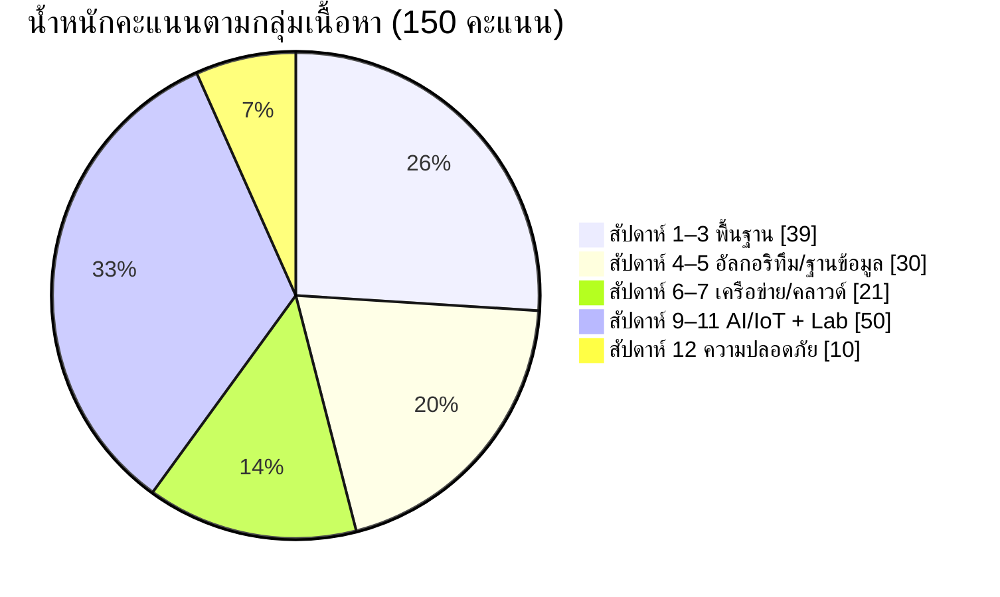

## สรุปลักษณะข้อสอบ (อ่านจบใน 2 นาที)

> [!ABSTRACT]
> **ภาพรวม:** 3 ตอน 28 ข้อ 150 คะแนน ครอบคลุม **สัปดาห์ 1–12** (ไม่มีสัปดาห์ 8 และไม่มีสัปดาห์ 13–17) ทั้ง 3 ชุดมีโครงสร้างเดียวกันทุกข้อ เปลี่ยนเฉพาะตัวเลข สถานการณ์ โค้ด และตัวเลือก
>
> **นำเข้าห้องสอบได้:** โน้ตลายมือตนเอง 5 แผ่น และเครื่องคำนวณ
>
> **กติกาสำคัญ:** ปรนัยตอบผิดหัก 0.2 คะแนน ตอนปฏิบัติการไม่ได้รันโค้ด ต้องอ่านโค้ดแล้วบอกผลเอง

**ลักษณะคำถามแต่ละตอน**

| ตอน | คะแนน | รูปแบบคำถามที่เจอ | ตัวอย่างสิ่งที่ถูกถาม |
|---|---|---|---|
| 1 อัตนัย (ข้อ 1–19) | 70 | ให้ความหมายพร้อมตัวอย่าง · เปรียบเทียบ A กับ B · เรียงลำดับ/ระบุให้ครบจำนวน · คำนวณ · เขียน SQL · เขียนรหัสเทียม | CE ต่างจาก IT อย่างไร · เรียงลำดับชั้นหน่วยความจำ · แปลงเลขฐาน · ตารางค่าความจริง · คำนวณ PUE และค่าไฟ · Big-O ของการค้นหา · SELECT/GROUP BY/HAVING · OSI กับ TCP/IP · CIA Triad |
| 2 ปรนัย (ข้อ 20 จำนวน 50 ข้อ) | 50 | เลือก A–D ข้อละ 1 คะแนน ผิดหัก 0.2 | นิยามศัพท์ · จับคู่ตัวอย่างกับประเภท (เช่น บริการไหนเป็น PaaS) · โพรโทคอลประจำชั้น · ประเภทภัยคุกคาม |
| 3 ปฏิบัติการ (ข้อ 21–28) | 30 | อ่านโค้ดแล้วบอกผลลัพธ์ · อธิบายทีละบรรทัด · เติมโค้ดในช่องว่าง | SQLite + Python · ESP32 ควบคุม LED (เวลารวมของ sleep) · Wi-Fi + Web API · I2C/DHT22 · Google Sheets + Dashboard · Linear Regression (MSE) · YOLOv11 · MobileNetV2 |

**น้ำหนักคะแนนแยกตามกลุ่มเนื้อหา** (รวมทั้ง 3 ตอน)

| กลุ่มเนื้อหา | สัปดาห์ | อัตนัย | ปรนัย | ปฏิบัติการ | รวม |
|---|---|---|---|---|---|
| พื้นฐานคอมพิวเตอร์ เลขฐาน เกต CPU | 1–3 | 26 | 13 | – | **39** |
| อัลกอริทึม ฐานข้อมูล SQL Git | 4–5 | 16 | 9 | 5 | **30** |
| เครือข่าย คลาวด์ ศูนย์ข้อมูล Docker | 6–7 | 11 | 10 | – | **21** |
| AI/ML, GenAI, IoT และ Lab ฮาร์ดแวร์/AI | 9–11 | 12 | 13 | 25 | **50** |
| ความมั่นคงปลอดภัยไซเบอร์ | 12 | 5 | 5 | – | **10** |
| **รวม** | | **70** | **50** | **30** | **150** |



> [!TIP]
> **ลำดับความสำคัญในการอ่าน**
> 1. **ข้อที่มีคำตอบตายตัว** เก็บคะแนนได้แน่: ข้อ 5 เลขฐาน (5) · ข้อ 6 เกต (5) · ข้อ 11 SQL (4) · ข้อ 14 PUE (4) · ข้อ 21 SQLite (5)
> 2. **ตอนปฏิบัติการ 30 คะแนน** ฝึกไล่โค้ด Lab 05 และ 09–14 ด้วยมือ จดค่าตัวแปรทีละบรรทัด
> 3. **คู่เปรียบเทียบที่ออกซ้ำ** CE/CS/SE/IT/IS · RAM/SSD · TCP/UDP · Switch/Router · IaaS/PaaS/SaaS · VM/Container · Hash/Encryption · RAG/Fine-tuning
> 4. **ปรนัย** ทำแบบทดสอบท้ายบทสัปดาห์ 1–12 (สัปดาห์ละ 20 ข้อ) ให้ครบ

ตารางด้านล่างให้รายละเอียดเต็มของรูปแบบข้อสอบ การจับคู่ข้อกับสัปดาห์ และแนวคำตอบทีละข้อ

## รูปแบบข้อสอบ

ข้อสอบรายวิชา EN-001-019 แก่นวิศวกรรมคอมพิวเตอร์ ครอบคลุมเนื้อหา **สัปดาห์ที่ 1–12** (ยกเว้นสัปดาห์ที่ 8 ซึ่งเป็นสัปดาห์สอบกลางภาค) ข้อสอบทั้ง 3 ชุดมีโครงสร้างเหมือนกันทุกข้อ ต่างกันที่ตัวโจทย์ ตัวเลข และตัวเลือก ดังนั้นถ้าเข้าใจ "ประเด็น" ของแต่ละข้อจากหน้านี้ จะตอบได้ไม่ว่าจะเจอชุดใด

| ตอน | จำนวน | คะแนน | ลักษณะ |
|---|---|---|---|
| ตอนที่ 1 อัตนัย (Subjective Test) | 19 ข้อ (ข้อ 1–19) ข้อย่อย 1–2 คะแนน | **70** | อธิบาย ให้ความหมาย เปรียบเทียบ ยกตัวอย่าง แปลงเลขฐาน คำนวณ PUE เขียน SQL และรหัสเทียม (Pseudocode) |
| ตอนที่ 2 ปรนัย (Objective Test) | 50 ข้อ (อยู่ใน "ข้อ 20") | **50** | เลือก A–D แล้วทำเครื่องหมาย X ในตารางคำตอบ ถูกได้ 1 คะแนน **ผิดหัก 0.2 คะแนน** |
| ตอนที่ 3 ปฏิบัติการ (Laboratory Test) | 8 ข้อ (ข้อ 21–28) 30 ข้อย่อย | **30** | อ่านและเขียนโค้ด: SQLite + Python บน Colab, ESP32 MicroPython บน Wokwi, Wi-Fi + Web API, I2C บน KidBright, Google Sheets/Apps Script + Dashboard, Linear Regression, YOLOv11, MobileNetV2 |
| **รวม** | **28 ข้อ** | **150** (คะแนนดิบ) | |

| หัวข้อ | รายละเอียด |
|---|---|
| เอกสารที่นำเข้าได้ | **เอกสารที่เขียนด้วยลายมือของตนเองเท่านั้น 5 แผ่น** (พิมพ์ ถ่ายเอกสาร หรือเขียนแทนกันไม่ได้) |
| เครื่องคำนวณ | นำเข้าได้ ใช้กับ PUE, kWh, ค่าไฟ, ร้อยละ, MSE/RMSE, ค่าเฉลี่ย |
| การเขียนคำตอบ | เขียนลงในแบบทดสอบ ข้อสอบนำออกจากห้องไม่ได้ |

> [!NOTE]
> **การแบ่งเวลาที่แนะนำ** (สมมติเวลาสอบ 3 ชั่วโมง ถ้าเวลาจริงต่างไป ให้ปรับตามสัดส่วนเดิม) ใช้หลักประมาณ **1 นาทีต่อ 1 คะแนน** แล้วเหลือเวลาทวน
>
> | ช่วง | เวลา | สิ่งที่ทำ |
> |---|---|---|
> | 0–5 นาที | 5 | กวาดตาดูทั้งฉบับ วงข้อคำนวณ/โค้ดที่ทำได้ทันที |
> | ตอนที่ 2 ปรนัย | 35–40 | ทำก่อนเพราะเร็ว ข้อที่ไม่แน่ใจให้วงไว้ อย่าเพิ่งกา |
> | ตอนที่ 1 อัตนัย | 70–75 | ทำข้อคำนวณ (5, 6, 9.2, 14.2–14.3) และ SQL (11) ก่อน ตามด้วยข้ออธิบาย |
> | ตอนที่ 3 ปฏิบัติการ | 40–45 | ไล่โค้ดทีละบรรทัด เขียนค่าตัวแปรกำกับไว้ข้างโค้ด |
> | 15 นาทีสุดท้าย | 15 | กลับมาตัดสินข้อปรนัยที่วงไว้ (ดูกลยุทธ์ด้านล่าง) และเติมข้อย่อยที่เว้นว่าง |

**ตารางจับคู่ข้อสอบกับสัปดาห์เรียน** (เหมือนกันทั้ง 3 ชุด)

| ข้อ | เนื้อหา | สัปดาห์ | อ่านเพิ่ม |
|---|---|---|---|
| 1 | สาขาวิชาด้านคอมพิวเตอร์ CE, CS, SE, IT, IS และ ACM/IEEE | 1 | [1.2](/module/01/02) · [1.3](/module/01/03) · [1.4](/module/01/04) |
| 2 | องค์ประกอบคอมพิวเตอร์และลำดับชั้นหน่วยความจำ | 2 | [2.1](/module/02/01) · [Lab 02](/lab/02) |
| 3 | ซอฟต์แวร์ ระบบปฏิบัติการ เฟิร์มแวร์ | 2 | [2.2](/module/02/02) |
| 4 | Edge, Green, Heterogeneous Computing | 2 | [2.3](/module/02/03) · [2.4](/module/02/04) · [2.5](/module/02/05) |
| 5 | แปลงเลขฐาน | 3 | [3.1](/module/03/01) · [Lab 03](/lab/03) · [ตัวอย่างคำนวณ หมวด 1](/calc-examples) |
| 6 | เกตตรรกะ ตารางค่าความจริง วงจรบวก | 3 | [3.1](/module/03/01) · [Boolean Algebra](/concept/boolean-algebra-logic-gates) |
| 7 | หน่วยประมวลผล von Neumann/Harvard, RISC-V, NPU/TPU, Chiplet | 3 | [3.2](/module/03/02) · [3.3](/module/03/03) · [3.4](/module/03/04) · [3.5](/module/03/05) |
| 8 | การคิดเชิงคำนวณ ผังงาน รหัสเทียม OOP/FP | 4 | [4.1](/module/04/01) · [4.3](/module/04/03) · [Lab 04](/lab/04) |
| 9 | Big-O และการใช้ AI ช่วยเขียนโค้ด | 4 | [4.2](/module/04/02) · [4.4](/module/04/04) · [Big-O](/concept/big-o-notation) |
| 10 | ฐานข้อมูล DBMS, คีย์, ACID, NoSQL, Vector DB, Big Data | 5 | [5.1](/module/05/01) · [5.2](/module/05/02) · [5.3](/module/05/03) · [5.4](/module/05/04) |
| 11 | เขียนคำสั่ง SQL | 5 | [5.1](/module/05/01) · [Lab 05](/lab/05) |
| 12 | เครือข่าย OSI/TCP-IP, TCP/UDP, DNS, DHCP, IP | 6 | [6.1](/module/06/01) · [6.2](/module/06/02) · [6.4](/module/06/04) · [Lab 06](/lab/06) |
| 13 | คลาวด์ IaaS/PaaS/SaaS, VM/Container, Kubernetes | 7 | [7.2](/module/07/02) · [7.3](/module/07/03) |
| 14 | ศูนย์ข้อมูล PUE, Liquid Cooling, Virtualization, Hyperscale | 7 | [7.1](/module/07/01) · [7.4](/module/07/04) · [7.5](/module/07/05) · [PUE](/concept/pue) |
| 15 | AI/ML พื้นฐาน, Neural Network, Data Lifecycle, MLOps | 9 | [9.1](/module/09/01) · [9.2](/module/09/02) · [9.4](/module/09/04) · [9.5](/module/09/05) |
| 16 | Generative AI, LLM, RAG, Agentic AI, Physical AI | 10 | [10.1](/module/10/01) · [10.2](/module/10/02) · [10.3](/module/10/03) · [10.4](/module/10/04) · [10.5](/module/10/05) |
| 17 | ระบบฝังตัว, MCU, IoT Architecture, MQTT, TinyML | 11 | [11.1](/module/11/01) · [11.2](/module/11/02) · [11.3](/module/11/03) · [11.4](/module/11/04) |
| 18 | ความมั่นคงปลอดภัย CIA, Zero Trust, Crypto, ภัยคุกคาม, Deepfake | 12 | [12.1](/module/12/01) · [12.2](/module/12/02) · [12.3](/module/12/03) · [12.4](/module/12/04) · [12.5](/module/12/05) |
| 19 | เครื่องมือ Git และ Docker | 4, 7 | [4.5](/module/04/05) · [7.2](/module/07/02) · [Lab 07](/lab/07) |
| ปรนัย 1–8 | สาขาวิชา หน่วยความจำ ซอฟต์แวร์ Edge/Green/Heterogeneous | 1–2 | [สัปดาห์ 1](/module/01) · [สัปดาห์ 2](/module/02) |
| ปรนัย 9–13 | เลขฐาน เกต สถาปัตยกรรม CPU | 3 | [สัปดาห์ 3](/module/03) |
| ปรนัย 14–22 | อัลกอริทึม Big-O OOP/FP, SQL ACID NoSQL Vector DB | 4–5 | [สัปดาห์ 4](/module/04) · [สัปดาห์ 5](/module/05) |
| ปรนัย 23–32 | เครือข่าย คลาวด์ ศูนย์ข้อมูล Docker/Kubernetes | 6–7 | [สัปดาห์ 6](/module/06) · [สัปดาห์ 7](/module/07) |
| ปรนัย 33–36 | ML, Supervised/Unsupervised/Reinforcement, Overfitting, MLOps (ชุดที่ 3 ข้อ 37 เรื่อง MLOps ก็เป็นของสัปดาห์ 9) | 9 | [สัปดาห์ 9](/module/09) |
| ปรนัย 37–41 | Transformer, LLM, RAG, Agentic AI, หุ่นยนต์/Physical AI | 10 | [สัปดาห์ 10](/module/10) |
| ปรนัย 42–45 | MCU, Sensor/Actuator, MQTT, TinyML | 11 | [สัปดาห์ 11](/module/11) |
| ปรนัย 46–50 | CIA, ภัยคุกคาม, MFA, Zero Trust, Prompt Injection | 12 | [สัปดาห์ 12](/module/12) |
| 21 | SQLite + Python บน Google Colab | 5 | [Lab 05](/lab/05) |
| 22 | ESP32 MicroPython บน Wokwi: LED | 10–11 | [Lab 10](/lab/10) · [ตัวอย่างคำนวณ หมวด 5](/calc-examples) |
| 23 | Wi-Fi + Web API (urequests, JSON) | 10–11 | [Lab 10](/lab/10) · [Lab 12](/lab/12) |
| 24 | I2C บน KidBright (VEML6075, DHT22) | 11 | [Lab 11](/lab/11) · [I2C Bus](/concept/i2c-bus) |
| 25 | Google Sheets/Apps Script + Dashboard บน Vercel | 12 | [Lab 12](/lab/12) |
| 26 | Linear Regression และ Gradient Descent | 9 | [Lab 09](/lab/09) · [ตัวอย่างคำนวณ หมวด 8](/calc-examples) |
| 27 | YOLOv11 Object Detection | ปฏิบัติการ | [Lab 13](/lab/13) |
| 28 | MobileNetV2 Transfer Learning | ปฏิบัติการ | [Lab 14](/lab/14) |

## กลยุทธ์ทำข้อสอบปรนัย (หักคะแนนข้อผิด)

ตอนที่ 2 ตอบถูกได้ **+1** ตอบผิด **−0.2** เว้นว่างได้ **0** การตัดสินใจว่าจะกาหรือเว้นจึงเป็นเรื่องของ **ค่าคาดหวัง (Expected Value)** ถ้าความน่าจะเป็นที่จะตอบถูกคือ $p$

$$E = p \times 1 - (1-p) \times 0.2 = 1.2p - 0.2$$

| สถานการณ์ | $p$ | ค่าคาดหวังต่อข้อ | ควรทำอย่างไร |
|---|---|---|---|
| ไม่รู้เลย สุ่มจาก 4 ตัวเลือก | 1/4 | $0.25 - 0.75 \times 0.2 = +0.10$ | กาได้ (ได้เปรียบเล็กน้อย) หรือเว้นก็ได้ |
| ตัดตัวเลือกที่ผิดแน่ ๆ ได้ 1 ตัว | 1/3 | $\tfrac{1}{3} - \tfrac{2}{3} \times 0.2 = +0.20$ | **ควรกา** |
| ตัดได้ 2 ตัว เหลือ 2 ตัว | 1/2 | $0.5 - 0.5 \times 0.2 = +0.40$ | **กาเสมอ** |
| มั่นใจ | ใกล้ 1 | ใกล้ +1 | กา |

จุดคุ้มทุนคือ $1.2p - 0.2 = 0 \Rightarrow p = 1/6 \approx 0.17$ แปลว่าการเดาแบบสุ่มจริง ๆ (p = 0.25) ยัง **ได้เปรียบเล็กน้อย** แต่ถ้าโจทย์มีตัวลวงที่เราเชื่อผิด ๆ อยู่ (เช่น เชื่อว่า "Harvard เก็บคำสั่งและข้อมูลที่เดียวกัน") ความน่าจะเป็นจริงอาจต่ำกว่า 1/6 จนเสียคะแนน

> [!TIP]
> **กฎปฏิบัติ:** กาเมื่อ **ตัดตัวเลือกได้อย่างน้อย 1 ตัว** ถ้าไม่รู้เลยจริง ๆ การเว้นว่างเป็นทางเลือกที่ยอมรับได้ (เสียโอกาสเพียง 0.1 คะแนนต่อข้อโดยเฉลี่ย) แต่ถ้าจะเดา ค่าคาดหวังยังเป็นบวกเล็กน้อย ตัวเลือกที่มีคำเด็ดขาด เช่น "เสมอ" "ทุกครั้ง" "ห้าม" "เท่านั้น" มักเป็นตัวลวง

**วิธีทำเครื่องหมายในตารางคำตอบ**

- ทำเครื่องหมาย **X** ในช่อง A/B/C/D ที่ตรงกับเลขข้อ **ช่องเดียวต่อข้อ** ตารางแบ่งเป็นสองฝั่ง (ข้อ 1–25 และ 26–50) ระวังกาข้ามแถว
- ระหว่างทำ ให้วงคำตอบในตัวข้อสอบก่อน แล้วค่อยลอกลงตารางทีละ 10 ข้อ ตรวจเลขข้อทุกครั้ง
- ถ้าต้องการเปลี่ยนคำตอบ ให้ขีดฆ่าให้ชัดเจนแล้วกา X ใหม่ คำตอบที่มี X สองช่องในข้อเดียวอาจถูกนับเป็นข้อผิด (โดน −0.2)
- ข้อที่ตั้งใจเว้น ให้ปล่อยว่างทั้งแถว อย่าขีดเครื่องหมายอื่นลงในช่อง

## คำแนะนำจากอาจารย์: ควรเตรียมตัวอย่างไร

### สิ่งที่ควรให้ความสำคัญก่อน

1. **คะแนนที่ "เก็บได้แน่" ก่อน** ข้อคำนวณและโค้ดมีคำตอบตายตัว ได้แก่ ข้อ 5 (เลขฐาน 5 คะแนน), 6 (เกต 5 คะแนน), 9.2, 11 (SQL 4 คะแนน), 14.2–14.3 (PUE), 21 (SQL 5 คะแนน), 22, 24.3–24.4, 25.1–25.2, 26 รวมกันกว่า 40 คะแนน ฝึกจน 1 ข้อย่อยใช้ไม่เกิน 2–3 นาที
2. **นิยามคู่เปรียบเทียบ** ตอนที่ 1 ถามรูปแบบ "A ต่างจาก B อย่างไร" ซ้ำมากที่สุด: CE/CS/SE/IT/IS, RAM/SSD, System/Application Software, Edge/Cloud, von Neumann/Harvard, OOP/FP, PK/FK, SQL/NoSQL, TCP/UDP, LAN/WAN, IPv4/IPv6, Switch/Router, IaaS/PaaS/SaaS, VM/Container, Image/Container, Supervised/Unsupervised, Chatbot/Agentic AI, RAG/Fine-tuning, Sensor/Actuator, MQTT/HTTP, Perimeter/Zero Trust, Symmetric/Asymmetric, Hashing/Encryption
3. **ไล่โค้ดปฏิบัติการด้วยมือ** ตอนที่ 3 ไม่ได้ให้รันโค้ด ต้องอ่านแล้วบอกผล เช่น เวลารวมของ `sleep()` ค่าที่ได้จากการรวมไบต์ ค่า MSE ที่โปรแกรมพิมพ์ ต้องทำบนกระดาษให้คล่อง
4. **ทำโน้ตลายมือ 5 แผ่นให้หาเจอเร็ว** ดูหัวข้อ "วิธีทำโน้ตลายมือ 5 แผ่น" ด้านล่าง

### แนวการให้คะแนน (สิ่งที่ผู้ตรวจมองหา)

| ประเภทคำถาม | คำตอบที่ได้คะแนนเต็ม |
|---|---|
| อธิบาย / ให้ความหมาย | **นิยามที่ถูกต้อง + ตัวอย่างที่เป็นรูปธรรม** ใช้ศัพท์เทคนิคถูกต้อง โจทย์สั่ง "ยกตัวอย่าง 2 งาน" ต้องมีครบ 2 ถ้ามีแต่นิยามหรือมีแต่ตัวอย่าง มักได้ครึ่งเดียว |
| เปรียบเทียบ (A ต่างจาก B) | บอก **เกณฑ์** ที่ใช้เทียบ แล้วตอบ **ทั้งสองฝั่ง** เช่น "TCP รับประกันการส่ง/ช้ากว่า ส่วน UDP ไม่รับประกัน/เร็วกว่า" ถ้าตอบฝั่งเดียวได้ไม่เกินครึ่ง |
| ระบุ / เรียงลำดับ | ตอบให้ **ครบจำนวน** ที่โจทย์สั่ง (4 ชั้น, 7 ชั้น, ACID 4 ตัว, 3 องค์ประกอบ) และเรียงลำดับถูกทิศ (เร็ว→ช้า, ล่าง→บน) |
| คำนวณ | **สูตร → แทนค่า → ผลลัพธ์ + หน่วย** (kW, kWh, บาท, %, วินาที) ผลลัพธ์ถูกแต่ไม่แสดงวิธีอาจได้ไม่เต็ม |
| แปลงเลขฐาน | แสดงวิธี: หารสองเก็บเศษ (ฐานสิบ→สอง), กระจายค่าประจำหลัก (ฐานสอง/สิบหก→สิบ), แบ่งกลุ่ม 4 บิต (ฐานสอง→สิบหก) และเขียนฐานกำกับ เช่น $1101_2$, `0xF0` |
| เขียน SQL | ถูกทั้ง **คอลัมน์ ตาราง เงื่อนไข และคำสั่งเสริม** (`ORDER BY ... DESC`, `GROUP BY`, `HAVING`) ข้อความต้องอยู่ในเครื่องหมาย `'...'` |
| อ่านโค้ด | อธิบาย **ทีละบรรทัด** ว่าทำอะไร แล้วให้ **ผลลัพธ์สุดท้าย** (ค่าที่พิมพ์ / สถานะ LED / เวลารวม) เขียนตารางค่าตัวแปรแต่ละรอบช่วยให้ไม่พลาด |
| เขียนโค้ดเติมช่อง | ไวยากรณ์ถูก (`data["current"]["relative_humidity_2m"]`, `str(t)`, `"&humi="`) ชื่อตัวแปรตรงกับโค้ดที่โจทย์ให้ |

### ข้อผิดพลาดที่พบบ่อย (แยกตามสัปดาห์)

| สัปดาห์ | ข้อผิดพลาด | ที่ถูกต้อง |
|---|---|---|
| 1 | ตอบว่า IT กับ IS เหมือนกัน | IT = ติดตั้ง ดูแล ให้บริการโครงสร้างพื้นฐาน · IS = ใช้เทคโนโลยีสนับสนุน **กระบวนการธุรกิจและการตัดสินใจ** ขององค์กร |
| 2 | เรียงหน่วยความจำ "แคช → เรจิสเตอร์" | **Register → Cache → RAM → SSD** (เร็ว→ช้า) ความจุเรียงกลับทิศ |
| 2 | จัด Device Driver/BIOS เป็นซอฟต์แวร์ประยุกต์ | Driver และ OS เป็น **System Software** · BIOS/UEFI เป็น **Firmware** |
| 3 | แปลงฐานสิบเป็นฐานสองแล้วอ่านเศษจากบนลงล่าง | อ่านเศษ **จากล่างขึ้นบน** (เศษสุดท้ายคือบิตซ้ายสุด) ตรวจย้อนด้วยการบวกค่าประจำหลัก |
| 3 | สับสน NAND/NOR/XOR | NAND = 0 **เฉพาะ** เมื่อทุกอินพุตเป็น 1 · NOR = 1 **เฉพาะ** เมื่อทุกอินพุตเป็น 0 · XOR = 1 เมื่ออินพุต **ต่างกัน** |
| 3 | Half Adder: Sum ใช้ OR | **Sum = XOR, Carry = AND** · Full Adder บวก 3 บิต (A, B, Cin) |
| 3 | ตอบว่า von Neumann แยกหน่วยความจำ | von Neumann **เก็บรวม** คำสั่ง+ข้อมูล (เกิดคอขวด) · Harvard **แยก** |
| 4 | Binary Search 1,024 ตัวตอบ 512 ครั้ง | $\lfloor \log_2 1024 \rfloor + 1 = 11$ (ประมาณ 10 ก็ได้คะแนน) · Linear = 1,024 |
| 4 | ลืมกรณีเริ่มต้นในรหัสเทียมหาค่ามากสุด | เริ่ม `max ← list[0]` ไม่ใช่ `max ← 0` (ถ้าทุกค่าติดลบจะผิด) |
| 5 | `WHERE` หลัง `GROUP BY` เพื่อกรองกลุ่ม | กรองแถวก่อนจัดกลุ่มใช้ `WHERE` · กรองผลรวมของกลุ่มใช้ **`HAVING`** |
| 5 | ใช้ `DROP` ลบข้อมูลบางแถว | `DELETE FROM ... WHERE ...` ลบแถว · `DROP TABLE` ลบทั้งตาราง |
| 5 | ลืม `conn.commit()` หลัง INSERT/UPDATE/DELETE | ไม่ commit = การเปลี่ยนแปลงไม่ถูกบันทึกถาวร |
| 6 | TCP/IP มี 7 ชั้น | **TCP/IP 4 ชั้น** (Network Access, Internet, Transport, Application) · **OSI 7 ชั้น** |
| 6 | Switch เลือกเส้นทางตาม IP | Switch ส่งต่อตาม **MAC** ใน LAN เดียวกัน · Router เลือกเส้นทางตาม **IP** ระหว่างเครือข่าย |
| 7 | Vercel/App Engine เป็น SaaS | อัปโหลดโค้ดแล้วระบบดูแลเซิร์ฟเวอร์ให้ = **PaaS** · EC2 = IaaS · Gmail/M365/Canva = SaaS |
| 7 | PUE = IT ÷ Total | **PUE = Total ÷ IT** (≥ 1.0 เสมอ) ถ้าได้ค่าน้อยกว่า 1 แปลว่ากลับเศษส่วน |
| 7 | ร้อยละที่ลดลงหารด้วยค่าใหม่ | หารด้วย **ค่าเดิม** เช่น $450/1500 = 30\%$ |
| 9 | สลับ Feature กับ Label | Feature = อินพุต (พื้นที่ ทำเล) · Label = คำตอบที่ทำนาย (ราคา) |
| 9 | เรียกค่าที่โค้ดคำนวณว่า "MSE" ตามชื่อตัวแปร | ดูสูตรจริง: `abs(e)` = **MAE**, `e ** 2` = **MSE**, ถอดรากได้ **RMSE** |
| 10 | RAG = ฝึกโมเดลใหม่ | RAG **ค้นคืนเอกสาร** มาใส่พรอมต์ ไม่แก้น้ำหนักโมเดล · Fine-tuning จึงจะฝึกใหม่ |
| 11 | DHT22 เป็นอุปกรณ์ I2C | DHT22 ใช้สายข้อมูลเส้นเดียวของตัวเอง · VEML6075 เป็น I2C (address 0x10) |
| 11 | เวลา LED คิด "2 × t" ทุกครั้ง | **บวกทุก `sleep()` ที่ถูกเรียกจริง** บางฟังก์ชันมี sleep ครั้งเดียว และดูว่า sleep อยู่ในหรือนอกลูป |
| 11 | รวมไบต์กลับด้าน | `data[0] \| (data[1] << 8)` = `data[1] × 256 + data[0]` (ไบต์แรกเป็นไบต์ต่ำ little-endian) |
| 12 | Ransomware กระทบ Confidentiality | เข้ารหัสแฟ้มจนใช้ไม่ได้ = **Availability** โดยตรง (ถ้าขโมยข้อมูลด้วยจึงกระทบ C เพิ่ม) |
| 12 | Hashing = Encryption | Hash **ทางเดียว** ย้อนกลับไม่ได้ · Encryption ถอดกลับได้ด้วยกุญแจ |

## แผนอ่านหนังสือ 2 สัปดาห์

สมมติว่ามีเวลาวันละ 2–3 ชั่วโมง ทุกวันทำ 3 อย่าง: **อ่านเนื้อหา → ทำแบบทดสอบท้ายสัปดาห์ → เขียนโน้ตลายมือของหัวข้อนั้น** แล้วปิดท้ายด้วยการตอบข้อสอบข้อที่เกี่ยวข้องในหน้านี้ (ทั้ง 3 ชุด) โดยไม่เปิดแนวคำตอบ

| วัน | เนื้อหา | อ่าน / ทบทวน | ฝึก | โน้ตลายมือ |
|---|---|---|---|---|
| 1 | สาขาวิชา, ฮาร์ดแวร์ ซอฟต์แวร์ OS, Edge/Green/Heterogeneous | [สัปดาห์ 1](/module/01) · [สัปดาห์ 2](/module/02) | [แบบทดสอบ 01](/exam/01) · [02](/exam/02) · ข้อ 1–4 · ปรนัย 1–8 | แผ่น 1 |
| 2 | เลขฐานและเกตตรรกะ | [3.1](/module/03/01) · [Lab 03](/lab/03) | ข้อ 5–6 · ปรนัย 9–11 · [ตัวอย่างคำนวณ หมวด 1–2](/calc-examples) | แผ่น 1 |
| 3 | หน่วยประมวลผล von Neumann/Harvard, RISC-V, NPU, Chiplet | [3.2](/module/03/02)–[3.5](/module/03/05) | [แบบทดสอบ 03](/exam/03) · ข้อ 7 · ปรนัย 12–13 | แผ่น 1 |
| 4 | การคิดเชิงคำนวณ, Big-O, OOP/FP, AI Coding, Git | [สัปดาห์ 4](/module/04) · [Lab 04](/lab/04) | [แบบทดสอบ 04](/exam/04) · ข้อ 8–9, 19.1 · ปรนัย 14–17 · [หมวด 3](/calc-examples) | แผ่น 2 |
| 5 | ฐานข้อมูล ACID, NoSQL, Vector DB, Big Data, SQL | [สัปดาห์ 5](/module/05) · [Lab 05](/lab/05) | [แบบทดสอบ 05](/exam/05) · ข้อ 10–11, **21** · ปรนัย 18–22 | แผ่น 2 |
| 6 | เครือข่าย OSI/TCP-IP, TCP/UDP, DNS/DHCP, IPv4/IPv6 | [สัปดาห์ 6](/module/06) · [Lab 06](/lab/06) | [แบบทดสอบ 06](/exam/06) · ข้อ 12 · ปรนัย 23–27 | แผ่น 3 |
| 7 | คลาวด์, Docker/Kubernetes, ศูนย์ข้อมูล PUE | [สัปดาห์ 7](/module/07) · [Lab 07](/lab/07) | [แบบทดสอบ 07](/exam/07) · ข้อ 13–14, 19.2 · ปรนัย 28–32 · [หมวด 4](/calc-examples) | แผ่น 3 |
| 8 | AI/ML, Neural Network, Data Lifecycle, MLOps, Linear Regression | [สัปดาห์ 9](/module/09) · [Lab 09](/lab/09) | [แบบทดสอบ 09](/exam/09) · ข้อ 15, **26** · ปรนัย 33–36 · [หมวด 8](/calc-examples) | แผ่น 4, 5 |
| 9 | Generative AI, LLM, RAG, Agentic AI, Physical AI | [สัปดาห์ 10](/module/10) | [แบบทดสอบ 10](/exam/10) · ข้อ 16 · ปรนัย 37–41 | แผ่น 4 |
| 10 | ระบบฝังตัว, IoT, MQTT, TinyML + ESP32 LED และ Wi-Fi | [สัปดาห์ 11](/module/11) · [Lab 10](/lab/10) | [แบบทดสอบ 11](/exam/11) · ข้อ 17, **22–23** · ปรนัย 42–45 · [หมวด 5–6](/calc-examples) | แผ่น 4, 5 |
| 11 | I2C/DHT22 และ Google Sheets + Dashboard | [Lab 11](/lab/11) · [Lab 12](/lab/12) | ข้อ **24–25** · [หมวด 7](/calc-examples) | แผ่น 5 |
| 12 | ความมั่นคงปลอดภัยไซเบอร์ | [สัปดาห์ 12](/module/12) | [แบบทดสอบ 12](/exam/12) · ข้อ 18 · ปรนัย 46–50 | แผ่น 4 |
| 13 | YOLOv11 และ MobileNetV2 | [Lab 13](/lab/13) · [Lab 14](/lab/14) | ข้อ **27–28** · [หมวด 9–10](/calc-examples) | แผ่น 5 |
| 14 | สอบจำลอง | ทำชุดใดชุดหนึ่งครบ 28 ข้อ จับเวลา ใช้โน้ต 5 แผ่นของตัวเองเท่านั้น | ตรวจกับแนวคำตอบ แล้วกลับไปแก้ตาราง "ข้อผิดพลาดที่พบบ่อย" | แก้ทุกแผ่น |

## วิธีทำโน้ตลายมือ 5 แผ่น

โน้ตต้อง **เขียนด้วยลายมือของตนเองเท่านั้น** การเขียนเองช่วยสรุปและจำไปในตัว ให้เขียนหน้า–หลังถ้าข้อกำหนดอนุญาต แบ่งกรอบเป็นหัวข้อที่ตรงกับเลขข้อสอบ เพื่อหาเจอภายใน 10 วินาที ไม่ต้องลอกเนื้อหายาว ๆ ให้เขียน **ตาราง เปรียบเทียบ สูตร และรูปแบบโค้ด** เป็นหลัก

| แผ่น | เนื้อหา | สิ่งที่ต้องมี |
|---|---|---|
| 1 | สัปดาห์ 1–3 (ข้อ 1–7, ปรนัย 1–13) | ตาราง CE/CS/SE/IT/IS 1 บรรทัดต่อสาขา · CE2016/CS2023 · ลำดับหน่วยความจำ (เร็ว↔จุ) · System/Application/Firmware + ตัวอย่าง · หน้าที่ OS (Process, Memory, File, Device) · Edge vs Cloud · Green 3 แนวทาง · **ตารางค่าประจำหลัก** $2^0$–$2^{10}$ และ 0–F ↔ 0000–1111 · ตารางความจริง AND/OR/NOT/NAND/NOR/XOR · Half/Full Adder · NAND เป็นเกตสากล · Fetch–Decode–Execute · CU/ALU/Register/Bus · von Neumann vs Harvard + คอขวด · CPU/GPU/NPU/TPU · RISC-V · Chiplet |
| 2 | สัปดาห์ 4–5 (ข้อ 8–11, ปรนัย 14–22, ข้อ 21) | 4 เสาของ Computational Thinking · Sequence/Selection/Iteration · สัญลักษณ์ผังงาน · แม่แบบรหัสเทียม (max, count, sum/avg) · ตาราง Big-O: O(1) < O(log n) < O(n) < O(n log n) < O(n²) + ตัวอย่างโค้ด · OOP (Encapsulation, Inheritance, Polymorphism) vs FP (Pure Function, Immutable) · PK/FK · ACID · 1:N/M:N · Normalization · SQL vs NoSQL (4 แบบ) · Vector DB (Cosine Similarity) · 3V · **ไวยากรณ์ SQL** `SELECT … FROM … WHERE … GROUP BY … HAVING … ORDER BY … LIMIT` · `INSERT INTO … VALUES` · `UPDATE … SET … WHERE` · `DELETE FROM … WHERE` · `LIKE 'ศรี%'` · `BETWEEN` · `JOIN … ON` · `?` + `conn.commit()` · `to_sql(if_exists=…)` |
| 3 | สัปดาห์ 6–7 (ข้อ 12–14, 19, ปรนัย 23–32) | OSI 7 ชั้น (ล่าง→บน) และ TCP/IP 4 ชั้น · โพรโทคอลประจำชั้น (HTTP/HTTPS, DNS, DHCP, SMTP, FTP, SSH, MQTT; TCP/UDP; IP) · TCP vs UDP + ตัวอย่างงาน · IPv4 32 บิต vs IPv6 128 บิต · Private IP (10.x, 172.16–31.x, 192.168.x) · Switch/Router/Firewall/AP · ลำดับการเปิดเว็บ (DNS → TCP/TLS → HTTP Request → Response) · ping/nslookup · IaaS/PaaS/SaaS + ตัวอย่าง · Public/Private/Sovereign · VM vs Container · Image vs Container · Dockerfile, build, run · Kubernetes · Hypervisor · **PUE = Total/IT**, DCiE, kWh, ค่าไฟ · Liquid Cooling · Hyperscale · Git commit/push/branch/merge |
| 4 | สัปดาห์ 9–12 (ข้อ 15–18, ปรนัย 33–50) | AI ⊃ ML ⊃ DL · Supervised/Unsupervised/Reinforcement + ตัวอย่าง · Regression vs Classification vs Clustering · Feature/Label · Overfitting/Underfitting + วิธีแก้ · Train/Test/Validation · นิวรอน (x, w, b, Σ, activation) · Data Lifecycle · MLOps, Data Drift, Monitoring · T/P/E · LLM, Token, Transformer/Attention, Temperature · Hallucination · Embedding · ขั้นตอน RAG · RAG vs Fine-tuning · Agentic AI vs Chatbot + MCP + การควบคุม · Physical AI · Sense–Plan–Act · Embedded vs PC · MCU vs MPU · Real-time · Sensor vs Actuator · IoT 4 ชั้น · MQTT (Pub/Sub/Broker/Topic, QoS 0/1/2, `+` และ `#`) · MQTT vs HTTP · CoAP/Zigbee · TinyML · **CIA + ตัวอย่างละเมิด/ป้องกัน** · Zero Trust vs Perimeter · MFA · Least Privilege · Symmetric/Asymmetric · Hash vs Encryption · Phishing/SQL Injection/DDoS/Ransomware/Prompt Injection · Deepfake + C2PA |
| 5 | รูปแบบโค้ดปฏิบัติการ (ข้อ 22–28) | **MicroPython:** `Pin(n, Pin.OUT)`, `Pin(n, Pin.IN, Pin.PULL_UP)` (กด = 0), `led.value(not led.value())`, **บวกทุก `sleep`**, `leds[::2]`, `reversed()` · **Wi-Fi:** `network.WLAN(network.STA_IF)` / `AP_IF`, `ifconfig()` → (IP, mask, gateway, DNS), ลูป `for` จำกัดเวลารอ, `urequests.get`, `status_code` 200/404/500, `data["a"]["b"]`, `response.close()` · **I2C:** SDA/SCL, `freq=100000/400000`, `scan()`, `readfrom_mem(addr, reg, n)`, `data[0] \| (data[1] << 8)` · **Apps Script:** `doGet(e)`, `e.parameter.x`, `appendRow([new Date(), …])`, `getSheetByName`, `ContentService…JSON`, `rows[rows.length-1]`, `fetch().then(r => r.json())`, `setInterval(fn, 30000)` · **Regression:** $y = mx + c$, MAE/MSE/RMSE, gradient ของ m และ c, `m -= lr*grad_m` · **YOLO:** `conf` (สูงขึ้น → กล่องน้อยลง), `iou` ใน NMS (ต่ำลง → กดกล่องซ้อนมากขึ้น), `classes=[0, 2]`, IoU = ซ้อนทับ/รวม · **Keras:** `include_top=False`, `trainable=False`, GAP, Dropout, Dense softmax `num_classes`, EarlyStopping (patience, restore_best_weights), `/255.0`, `np.argmax`, Augmentation, `validation_split`, Fine-tuning ด้วย lr ต่ำ |

> [!WARNING]
> ห้ามลอกเฉลยในหน้านี้ลงโน้ตทั้งหมด เพราะ 5 แผ่นไม่พอ และข้อสอบจริงอาจเปลี่ยนตัวเลข ให้จด **วิธีคิด** (สูตร แม่แบบโค้ด ตารางเปรียบเทียบ) แทนคำตอบสำเร็จรูป

## สูตรและการคำนวณที่ต้องทำได้

โจทย์คำนวณของชุดที่ 2 และ 3 มีวิธีทำละเอียดพร้อมภาพประกอบใน **[ตัวอย่างการคำนวณ](/calc-examples)** (10 หมวด) ตารางนี้สรุปสูตรและตัวอย่างสั้น ๆ ให้จดลงโน้ต

| เรื่อง | สูตร / วิธี | ตัวอย่างสั้น |
|---|---|---|
| ฐานสิบ → ฐานสอง | หารด้วย 2 ซ้ำ เก็บเศษ อ่าน **ล่าง→บน** (หรือแยกเป็นผลบวกกำลังของ 2) | $45 = 32+8+4+1 = 101101_2$ |
| ฐานสอง → ฐานสิบ | $\sum b_i \times 2^i$ | $110110_2 = 32+16+4+2 = 54$ |
| ฐานสิบหก → ฐานสิบ | $\sum h_i \times 16^i$ (A=10 … F=15) | `0x2F` $= 2 \times 16 + 15 = 47$ |
| ฐานสอง → ฐานสิบหก | แบ่งกลุ่มละ 4 บิตจากขวา | $1111\,0000_2$ = F 0 = `0xF0` |
| ตารางความจริง | 2 อินพุตมี $2^2 = 4$ แถว (00, 01, 10, 11) · 3 อินพุตมี 8 แถว | XOR: 0, 1, 1, 0 · NAND: 1, 1, 1, 0 · NOR: 1, 0, 0, 0 |
| นิพจน์บูลีน | ทำในวงเล็บก่อน · NOT → AND → OR | $(1 \cdot 0) + \overline{1} = 0 + 0 = 0$ |
| NAND เป็นเกตสากล | NOT A = A NAND A · AND = NOT(NAND) · OR = (NOT A) NAND (NOT B) | สร้างทุกวงจรได้ด้วย NAND อย่างเดียว |
| Half / Full Adder | HA: Sum = A ⊕ B, Carry = A·B · FA: Sum = A ⊕ B ⊕ Cin | 1 + 1 → Sum 0, Carry 1 |
| นับจำนวนครั้ง Big-O | O(n) = n · O(n²) = $n^2$ · O(n log n) = $n \log_2 n$ · Binary Search กรณีแย่สุด $\lfloor \log_2 n \rfloor + 1$ | n = 1,000: $n^2$ = 1,000,000 (มากกว่า 1,000 เท่า) · n = 1,024: Binary 11 (≈10) ครั้ง |
| PUE | $\text{PUE} = \dfrac{\text{Total Facility Power}}{\text{IT Equipment Power}}$ · Total = PUE × IT · Non-IT = Total − IT | 1,500/1,000 = 1.5 · 1.6 × 500 = 800 kW, Non-IT 300 kW |
| ลดลงร้อยละ | $\dfrac{\text{เดิม} - \text{ใหม่}}{\text{เดิม}} \times 100$ | (1,500 − 1,050)/1,500 = 30% |
| DCiE | $\text{DCiE} = \dfrac{1}{\text{PUE}} \times 100\%$ = IT/Total | PUE 1.25 → DCiE 80% |
| พลังงานและค่าไฟ | kWh = kW × ชั่วโมง · ค่าไฟ = kWh × ราคาต่อหน่วย | 800 kW × 24 = 19,200 kWh × 4 บาท = 76,800 บาท/วัน |
| เวลา LED | **รวมทุก `sleep()`** ต่อรอบ × จำนวนรอบ · `sleep` นอกลูป `for` นับครั้งเดียว | `on; sleep(0.5); off; sleep(0.5)` = 1 s/ครั้ง × 9 = 9 s |
| จำนวนแถวที่บันทึก | แถว ≈ ช่วงเวลารวม (วินาที) ÷ คาบการส่ง | `sleep(60)`: 3,600/60 = 60 แถว/ชม., 86,400/60 = 1,440 แถว/วัน |
| เวลารอสูงสุด | จำนวนรอบ × sleep ต่อรอบ | `range(20)` × 0.5 = 10 s |
| รวมไบต์ little-endian | `value = data[0] \| (data[1] << 8)` = $\text{data[1]} \times 256 + \text{data[0]}$ | [0x34, 0x12] → `0x1234` = 4,660 |
| เงื่อนไขความร้อน | แทนค่าในสูตรก่อน แล้วไล่ `if → elif → else` จากบนลงล่าง หยุดที่เงื่อนไขแรกที่จริง | heat = 31 + 0.1×60 = 37 → ≥ 35 → กะพริบ |
| เส้นตรง | $\hat{y} = mx + c$ · $e = y - \hat{y}$ | m = 2, c = 1, x = 10 → 21 |
| MAE / MSE / RMSE | $\text{MAE} = \frac{1}{N}\sum \lvert e_i \rvert$ · $\text{MSE} = \frac{1}{N}\sum e_i^2$ · $\text{RMSE} = \sqrt{\text{MSE}}$ | e = 0, 0, −1, 0 → MSE 0.25, RMSE 0.5 |
| Gradient ของ MSE | $\dfrac{\partial}{\partial m} = \frac{2}{N}\sum e_i x_i$ · $\dfrac{\partial}{\partial c} = \frac{2}{N}\sum e_i$ (เมื่อ $e = \hat{y} - y$) · $m \leftarrow m - \text{lr} \cdot \text{grad}_m$ | grad_m = −0.5, lr 0.05 → m = 2 + 0.025 = 2.025 |
| IoU | $\text{IoU} = \dfrac{\text{พื้นที่ซ้อนทับ}}{\text{พื้นที่รวม (Union)}}$ · Union = A + B − ซ้อนทับ | 40/100 = 0.4 |
| Validation Split | val = N × split · train = N − val | 1,000 × 0.2 = 200 → train 800 |

## สรุปสิ่งที่ข้อสอบถาม แยกตามข้อ (ครอบคลุมชุดที่ 1–3)

แต่ละข้อมี **ตารางเทียบโจทย์ 3 ชุด** (สรุปความสั้น ๆ) → **ประเด็นที่ต้องตอบได้** (ความรู้ชุดเดียวที่ใช้ตอบได้ทุกชุด) → **แนวคำตอบ** ของทุกข้อย่อย (กดเปิด) → ลิงก์อ่านเพิ่ม แนวคำตอบชุดที่ 2–3 อ้างอิงเฉลยของผู้ออกข้อสอบ ส่วนชุดที่ 1 เป็นแนวคำตอบที่เรียบเรียงจากเนื้อหารายวิชา คำตอบอื่นที่ถูกต้องและสมเหตุสมผลได้คะแนนเช่นกัน

> [!TIP]
> ลองตอบเองบนกระดาษก่อนเปิดแนวคำตอบ โดยเฉพาะชุดที่ยังไม่เคยทำ ถ้าตอบชุดหนึ่งได้แล้ว ให้ลองตอบอีกสองชุดของข้อเดียวกันต่อทันที จะเห็นว่าใช้ความรู้ชุดเดียวกัน

---

**ตอนที่ 1 อัตนัย (ข้อ 1–19, 70 คะแนน)**

### ข้อ 1. สาขาวิชาด้านคอมพิวเตอร์ (3 คะแนน)

| ข้อย่อย | ชุดที่ 1 | ชุดที่ 2 | ชุดที่ 3 |
|---|---|---|---|
| 1.1 (1) | ความหมายของ CE + ตัวอย่างงาน 2 งาน | ความหมายของ SE + ตัวอย่างงาน 2 งาน | บทบาทวิศวกรคอมพิวเตอร์ยุค AI-driven Architecture + ทักษะ 2 ทักษะ |
| 1.2 (1) | CE ต่างจาก CS | CE ต่างจาก IT | CS ต่างจาก SE |
| 1.3 (1) | IS ต่างจาก IT | ยกตัวอย่างระบบ 1 ระบบ แยกส่วนงาน CE กับ IS | CE2016 คืออะไร มีประโยชน์อย่างไร |

**ประเด็นที่ต้องตอบได้**

- **CE** = บูรณาการวิศวกรรมไฟฟ้ากับวิทยาการคอมพิวเตอร์ ออกแบบระบบที่รวม **ฮาร์ดแวร์ + ซอฟต์แวร์** (วงจร ชิป ระบบฝังตัว เฟิร์มแวร์ ซอฟต์แวร์ระบบ IoT)
- **CS** = ทฤษฎีการคำนวณ อัลกอริทึม ภาษาโปรแกรม AI (เน้น "การคำนวณ" ไม่ผูกกับฮาร์ดแวร์)
- **SE** = กระบวนการพัฒนาซอฟต์แวร์ขนาดใหญ่อย่างเป็นระบบ (ความต้องการ → ออกแบบ → พัฒนา → ทดสอบ → บำรุงรักษา) ให้มีคุณภาพ ตรงเวลา
- **IT** = ติดตั้ง ดูแล ให้บริการโครงสร้างพื้นฐานและระบบแก่ผู้ใช้ (เครือข่าย เซิร์ฟเวอร์ Help Desk)
- **IS** = ใช้เทคโนโลยีสนับสนุน **กระบวนการธุรกิจและการตัดสินใจ** ขององค์กร (ERP, ระบบรายงาน)
- **ACM/IEEE CE2016** = ข้อเสนอแนะหลักสูตร CE (Body of Knowledge) · **CS2023** ยก AI และ Security เป็นพื้นฐานของทุกสาขา
- วิศวกรยุค AI ต้องเข้าใจ **ข้ามชั้นของระบบ** สถาปัตยกรรม ข้อจำกัด ความปลอดภัย และตรวจสอบผลลัพธ์จาก AI ได้

<details><summary>แนวคำตอบชุดที่ 1–3</summary>

**ชุดที่ 1**

- **1.1** CE คือสาขาที่บูรณาการวิศวกรรมไฟฟ้ากับวิทยาการคอมพิวเตอร์ เพื่อออกแบบและพัฒนาระบบคอมพิวเตอร์ทั้งฮาร์ดแวร์และซอฟต์แวร์ ตัวอย่างงาน: ออกแบบระบบฝังตัว/อุปกรณ์ IoT, เขียนเฟิร์มแวร์และไดรเวอร์, ออกแบบวงจรดิจิทัล/ชิป
- **1.2** CE เน้นการออกแบบระบบที่รวมฮาร์ดแวร์กับซอฟต์แวร์ระดับระบบ ใกล้ชิดอุปกรณ์จริง ส่วน CS เน้นทฤษฎีการคำนวณ อัลกอริทึม และซอฟต์แวร์ ไม่ผูกกับฮาร์ดแวร์
- **1.3** IS เน้นนำเทคโนโลยีมาสนับสนุนกระบวนการธุรกิจและการตัดสินใจขององค์กร (เช่น ERP) ส่วน IT เน้นติดตั้ง ดูแล และให้บริการโครงสร้างพื้นฐานเทคโนโลยีแก่ผู้ใช้ (เช่น ดูแลเครือข่าย เซิร์ฟเวอร์)

**ชุดที่ 2**

- **1.1** SE คือการประยุกต์หลักวิศวกรรมกับการพัฒนาซอฟต์แวร์อย่างเป็นระบบ (ความต้องการ ออกแบบ พัฒนา ทดสอบ บำรุงรักษา) ตัวอย่างงาน: นักพัฒนาซอฟต์แวร์, วิศวกรทดสอบ/QA, DevOps
- **1.2** CE ออกแบบระบบที่รวมฮาร์ดแวร์และซอฟต์แวร์ (วงจร ระบบฝังตัว ซอฟต์แวร์ระบบ) ส่วน IT ติดตั้ง ดูแล และให้บริการโครงสร้างพื้นฐานและระบบที่มีอยู่แก่ผู้ใช้
- **1.3** ระบบสั่งอาหารออนไลน์: CE = อุปกรณ์ เซิร์ฟเวอร์ ระบบฝังตัวของเครื่อง POS · IS = กระบวนการรับคำสั่งซื้อ จัดการลูกค้า รายงานยอดขายเพื่อการตัดสินใจ (ตัวอย่างอื่นที่สมเหตุสมผลก็ได้)

**ชุดที่ 3**

- **1.1** วิศวกรต้องออกแบบและบูรณาการระบบที่มี AI เป็นองค์ประกอบ เข้าใจสถาปัตยกรรม ข้อจำกัด ความปลอดภัย และรับผิดชอบผลลัพธ์ ทักษะ: การออกแบบระบบ, ข้อมูล/ML พื้นฐาน, ความมั่นคงปลอดภัย, การตรวจสอบผลลัพธ์จาก AI
- **1.2** CS เน้นทฤษฎีการคำนวณ อัลกอริทึม และหลักการพื้นฐาน ส่วน SE เน้นกระบวนการพัฒนาซอฟต์แวร์ขนาดใหญ่ให้มีคุณภาพ ตรงเวลา และบำรุงรักษาได้
- **1.3** CE2016 คือข้อเสนอแนะหลักสูตรวิศวกรรมคอมพิวเตอร์ของ ACM/IEEE ที่กำหนดกลุ่มองค์ความรู้ (Body of Knowledge) ช่วยให้หลักสูตรมีมาตรฐานสากลและออกแบบรายวิชาได้ครอบคลุม

</details>

อ่านเพิ่ม: [สัปดาห์ที่ 1 หัวข้อ 2](/module/01/02) · [สัปดาห์ที่ 1 หัวข้อ 3](/module/01/03) · [สัปดาห์ที่ 1 หัวข้อ 4](/module/01/04)

### ข้อ 2. องค์ประกอบของคอมพิวเตอร์และหน่วยความจำ (4 คะแนน)

| ข้อย่อย | ชุดที่ 1 | ชุดที่ 2 | ชุดที่ 3 |
|---|---|---|---|
| 2.1 (2) | ฮาร์ดแวร์ 3 องค์ประกอบ + หน้าที่ | หน่วยรับ/ประมวลผล/แสดงผล + ตัวอย่างอุปกรณ์ | หน้าที่ CPU, RAM, Storage เมื่อเปิดโปรแกรม |
| 2.2 (1) | เรียง RAM, Register, SSD, Cache จากเร็วไปช้า | RAM vs SSD/HDD เรื่องข้อมูลคงอยู่เมื่อปิดเครื่อง | Volatile vs Non-volatile + ตัวอย่าง |
| 2.3 (1) | ทำไมหน่วยความจำเร็วจึงจุน้อยและแพง | แคชช่วย CPU ได้อย่างไร | ทำไม RAM น้อยแล้วช้าเมื่อเปิดหลายโปรแกรม |

**ประเด็นที่ต้องตอบได้**

- องค์ประกอบหลัก: หน่วยรับข้อมูล → **CPU** (CU + ALU + Register) → หน่วยแสดงผล โดยมี **RAM** (หน่วยความจำหลัก ชั่วคราว) และ **Storage** (SSD/HDD ถาวร) และ **Bus/เมนบอร์ด** เชื่อมกัน
- **Memory Hierarchy**: Register → Cache → RAM → SSD/HDD (เร็ว/แพง/จุน้อย → ช้า/ถูก/จุมาก)
- **Volatile** (RAM, Cache, Register) ข้อมูลหายเมื่อไฟดับ · **Non-volatile** (SSD, HDD, Flash, ROM) ข้อมูลคงอยู่
- **Cache** เก็บข้อมูลที่ใช้บ่อยใกล้ CPU (อาศัย Locality) ลดเวลารอ RAM
- RAM ไม่พอ → OS ต้องทำ **Paging/Swap** ไปยัง Storage ซึ่งช้ากว่าหลายพันเท่า

<details><summary>แนวคำตอบชุดที่ 1–3</summary>

**ชุดที่ 1**

- **2.1** (ตอบ 3 ใน 4) CPU: ประมวลผลและควบคุมการทำงานตามคำสั่ง · RAM: เก็บโปรแกรมและข้อมูลชั่วคราวขณะทำงาน · Storage (SSD/HDD): เก็บข้อมูลถาวร · อุปกรณ์รับ/แสดงผล (แป้นพิมพ์ จอภาพ): ติดต่อผู้ใช้
- **2.2** Register → Cache → RAM → SSD
- **2.3** หน่วยความจำเร็ว (เช่น SRAM ในแคช เรจิสเตอร์) ใช้ทรานซิสเตอร์ต่อบิตมาก กินพื้นที่บนชิปและต้องอยู่ใกล้ CPU จึงผลิตความจุมากได้ยากและราคาต่อบิตสูง ระบบจึงจัดเป็นลำดับชั้นเพื่อสมดุลความเร็ว ความจุ และราคา

**ชุดที่ 2**

- **2.1** หน่วยรับข้อมูล: แป้นพิมพ์/เมาส์/สแกนเนอร์ · หน่วยประมวลผล: CPU · หน่วยแสดงผล: จอภาพ/เครื่องพิมพ์/ลำโพง
- **2.2** RAM เป็นหน่วยความจำลบเลือนได้ ข้อมูลหายเมื่อปิดเครื่อง ส่วน SSD/HDD เก็บข้อมูลถาวรแม้ปิดเครื่อง (RAM เร็วกว่า)
- **2.3** แคชเก็บข้อมูล/คำสั่งที่ใช้บ่อยไว้ใกล้ CPU ทำให้ไม่ต้องรอดึงจาก RAM ซึ่งช้ากว่า ลดเวลาการเข้าถึงหน่วยความจำ

**ชุดที่ 3**

- **2.1** Storage เก็บแฟ้มโปรแกรมถาวร → OS โหลดโปรแกรมเข้า RAM → CPU ดึงคำสั่งจาก RAM มาประมวลผล ผลลัพธ์ชั่วคราวอยู่ใน RAM และบันทึกกลับ Storage เมื่อสั่งบันทึก
- **2.2** Volatile: ข้อมูลหายเมื่อไฟดับ เช่น RAM, แคช · Non-volatile: ข้อมูลคงอยู่ เช่น SSD, HDD, Flash, ROM
- **2.3** เมื่อ RAM ไม่พอ OS ต้องย้ายข้อมูลไปมาระหว่าง RAM กับหน่วยเก็บข้อมูล (Paging/Swap) ซึ่งช้ากว่ามาก ระบบจึงช้าลง

</details>

อ่านเพิ่ม: [สัปดาห์ที่ 2 หัวข้อ 1](/module/02/01) · [Lab 02](/lab/02) · [von Neumann Architecture](/concept/von-neumann-architecture)

### ข้อ 3. ซอฟต์แวร์และระบบปฏิบัติการ (4 คะแนน)

| ข้อย่อย | ชุดที่ 1 | ชุดที่ 2 | ชุดที่ 3 |
|---|---|---|---|
| 3.1 (2) | System vs Application Software + ตัวอย่าง | จำแนก Windows 11, Excel, Printer Driver, LINE | ลำดับชั้น Hardware → Firmware → OS → Application + ตัวอย่าง |
| 3.2 (1) | หน้าที่ OS 2 ประการ | หน้าที่ Memory Management | System Call คืออะไร + ตัวอย่าง |
| 3.3 (1) | ความหมายของ Firmware | BIOS/UEFI ต่างจาก OS | หน้าที่ Process Management |

**ประเด็นที่ต้องตอบได้**

- **System Software** = จัดการฮาร์ดแวร์และเป็นฐานให้โปรแกรมอื่น (OS, Device Driver, Utility) · **Application Software** = ทำงานเฉพาะให้ผู้ใช้ (Excel, LINE, เบราว์เซอร์, เกม)
- **Firmware** = ซอฟต์แวร์ระดับต่ำที่ฝังใน ROM/Flash ของอุปกรณ์ ควบคุมการทำงานพื้นฐาน เช่น BIOS/UEFI (ทำ POST แล้วบูต OS)
- หน้าที่ OS: **Process** (สร้าง จัดลำดับ สลับ ยุติ), **Memory** (จัดสรร/คืน ป้องกันการก้าวล้ำ Virtual Memory), **File System**, **Device/I/O** (ผ่าน Driver), Security, User Interface
- **System Call** = ช่องทางที่โปรแกรมขอบริการจาก OS เช่น `open/read/write` แฟ้ม, สร้างกระบวนการ, ส่งข้อมูลเครือข่าย
- **Device Driver** = ตัวกลางให้ OS สื่อสารกับฮาร์ดแวร์

<details><summary>แนวคำตอบชุดที่ 1–3</summary>

**ชุดที่ 1**

- **3.1** System Software ควบคุมและจัดการฮาร์ดแวร์ เป็นฐานให้โปรแกรมอื่นทำงาน เช่น Windows, Linux, Device Driver · Application Software ทำงานเฉพาะตามความต้องการของผู้ใช้ เช่น Microsoft Word, เว็บเบราว์เซอร์
- **3.2** (ตอบ 2 ข้อ) จัดการกระบวนการ (Process), จัดการหน่วยความจำ, จัดการแฟ้มข้อมูล, จัดการอุปกรณ์รับ/แสดงผล, รักษาความปลอดภัยและเป็นส่วนต่อประสานกับผู้ใช้
- **3.3** Firmware คือซอฟต์แวร์ระดับต่ำที่ฝังอยู่ในหน่วยความจำแบบไม่ลบเลือน (ROM/Flash) ของอุปกรณ์ เพื่อควบคุมการทำงานพื้นฐาน เช่น BIOS/UEFI, เฟิร์มแวร์ของเราเตอร์

**ชุดที่ 2**

- **3.1** ซอฟต์แวร์ระบบ: Windows 11, Printer Driver · ซอฟต์แวร์ประยุกต์: Microsoft Excel, LINE (ตัวละ 0.5 คะแนน)
- **3.2** จัดสรรและคืนพื้นที่หน่วยความจำให้แต่ละโปรแกรม ป้องกันไม่ให้โปรแกรมเข้าถึงพื้นที่ของกันและกัน และจัดการหน่วยความจำเสมือน (Virtual Memory)
- **3.3** BIOS/UEFI เป็นเฟิร์มแวร์บนเมนบอร์ดที่ทดสอบฮาร์ดแวร์ (POST) และเริ่มบูตระบบ ส่วน OS ถูกโหลดภายหลังเพื่อจัดการทรัพยากรและให้บริการโปรแกรมประยุกต์

**ชุดที่ 3**

- **3.1** Hardware: CPU/RAM/SSD · Firmware: BIOS/UEFI เริ่มต้นและทดสอบฮาร์ดแวร์ · OS: Windows/Linux จัดการทรัพยากร · Application: เบราว์เซอร์ Word เกม ใช้งานผ่านบริการของ OS
- **3.2** System Call คือช่องทางที่โปรแกรมประยุกต์ร้องขอบริการจาก OS เช่น open/read/write แฟ้ม สร้างกระบวนการ ส่งข้อมูลทางเครือข่าย
- **3.3** สร้าง จัดลำดับ (Scheduling) สลับ และยุติกระบวนการ แบ่งเวลา CPU ให้หลายโปรแกรมทำงานพร้อมกัน และจัดการการสื่อสารระหว่างกระบวนการ

</details>

อ่านเพิ่ม: [สัปดาห์ที่ 2 หัวข้อ 2](/module/02/02)

### ข้อ 4. Edge, Green และ Heterogeneous Computing (2 คะแนน)

| ข้อย่อย | ชุดที่ 1 | ชุดที่ 2 | ชุดที่ 3 |
|---|---|---|---|
| 4.1 (1) | Edge ต่างจาก Cloud | ยกตัวอย่างระบบที่เหมาะกับ Edge + เหตุผล | Heterogeneous Computing คืออะไร + ตัวอย่าง |
| 4.2 (1) | ความหมาย Green Computing + แนวทาง 1 ข้อ | แนวทาง Green Computing 2 แนวทาง | ทำไม Edge ลดภาระเครือข่ายและเพิ่มความเป็นส่วนตัว |

**ประเด็นที่ต้องตอบได้**

- **Edge** = ประมวลผล **ใกล้แหล่งข้อมูล** → Latency ต่ำ ประหยัดแบนด์วิดท์ ทำงานออฟไลน์ได้ ข้อมูลดิบไม่ต้องออกจากอุปกรณ์ · **Cloud** = ศูนย์ข้อมูลระยะไกล ทรัพยากรมาก ขยายได้ แต่หน่วงกว่าและต้องมีเครือข่าย
- ตัวอย่าง Edge: รถยนต์ไร้คนขับ, กล้องวงจรปิดอัจฉริยะ, ตรวจจับในโรงงาน, สมาร์ตฟาร์ม
- **Green Computing** = ออกแบบ ใช้ และกำจัดอุปกรณ์ให้ใช้พลังงาน/ทรัพยากรน้อยและลดผลกระทบสิ่งแวดล้อม เช่น ปิด/พักเครื่อง, Virtualization รวมเซิร์ฟเวอร์, อุปกรณ์ประหยัดไฟ, ระบายความร้อนให้มีประสิทธิภาพ, รีไซเคิล E-waste
- **Heterogeneous** = ใช้หน่วยประมวลผลต่างชนิด (CPU + GPU + NPU) ในระบบ/แพ็กเกจเดียว แบ่งงานให้หน่วยที่เหมาะ เช่น ชิปสมาร์ตโฟน, Apple M-series

<details><summary>แนวคำตอบชุดที่ 1–3</summary>

**ชุดที่ 1**

- **4.1** Edge ประมวลผลที่อุปกรณ์หรือใกล้แหล่งข้อมูล จึงตอบสนองเร็ว ลดการส่งข้อมูล และทำงานได้แม้เครือข่ายขัดข้อง แต่ทรัพยากรจำกัด ส่วน Cloud ประมวลผลในศูนย์ข้อมูลระยะไกล มีทรัพยากรมากและขยายได้ แต่มีความหน่วงและต้องเชื่อมต่อเครือข่าย
- **4.2** Green Computing คือการออกแบบ ใช้งาน และกำจัดระบบคอมพิวเตอร์ให้ใช้พลังงานและทรัพยากรอย่างมีประสิทธิภาพ ลดผลกระทบต่อสิ่งแวดล้อม เช่น ตั้งให้เครื่องพักการทำงานเมื่อไม่ใช้

**ชุดที่ 2**

- **4.1** เช่น ยานยนต์ไร้คนขับ/กล้องตรวจจับในโรงงาน/สมาร์ตฟาร์ม เพราะต้องตอบสนองเร็ว (Latency ต่ำ) ลดข้อมูลที่ส่งขึ้นคลาวด์ และทำงานได้แม้เครือข่ายขัดข้อง
- **4.2** (ตอบ 2 ข้อ) ปิด/พักเครื่องเมื่อไม่ใช้, ใช้ Virtualization รวมเครื่องแม่ข่าย, เลือกอุปกรณ์ประหยัดพลังงาน, ปรับระบบระบายความร้อน, รีไซเคิลขยะอิเล็กทรอนิกส์

**ชุดที่ 3**

- **4.1** การใช้หน่วยประมวลผลต่างชนิดร่วมกันตามความเหมาะสมของงาน เช่น ชิปสมาร์ตโฟน/Apple M-series ที่รวม CPU, GPU และ NPU
- **4.2** ประมวลผลใกล้แหล่งข้อมูลจึงส่งเฉพาะผลลัพธ์หรือข้อมูลสรุปขึ้นคลาวด์ ลดแบนด์วิดท์ และข้อมูลดิบ (เช่น ภาพใบหน้า) ไม่ต้องออกจากอุปกรณ์

</details>

อ่านเพิ่ม: [สัปดาห์ที่ 2 หัวข้อ 3](/module/02/03) · [สัปดาห์ที่ 2 หัวข้อ 4](/module/02/04) · [สัปดาห์ที่ 2 หัวข้อ 5](/module/02/05) · [Edge Computing](/concept/edge-computing)

### ข้อ 5. การแปลงเลขฐาน (5 คะแนน)

| ข้อย่อย | ชุดที่ 1 | ชุดที่ 2 | ชุดที่ 3 |
|---|---|---|---|
| 5.1 (1) | 13 → ฐานสอง | 25 → ฐานสอง | 19 → ฐานสอง |
| 5.2 (1) | 45 → ฐานสอง | 100 → ฐานสอง | 77 → ฐานสอง |
| 5.3 (1) | $110110_2$ → ฐานสิบ | $101101_2$ → ฐานสิบ | $111001_2$ → ฐานสิบ |
| 5.4 (1) | `0x2F` → ฐานสิบ | `0x3C` → ฐานสิบ | `0x7B` → ฐานสิบ |
| 5.5 (1) | $11110000_2$ → ฐานสิบหก | $10101111_2$ → ฐานสิบหก | $11011010_2$ → ฐานสิบหก |

**ประเด็นที่ต้องตอบได้**

- ค่าประจำหลักฐานสอง: 128, 64, 32, 16, 8, 4, 2, 1 · ฐานสิบหก: $16^1 = 16$, $16^0 = 1$ · A = 10, B = 11, C = 12, D = 13, E = 14, F = 15
- ฐานสิบ → ฐานสอง: หารสองเก็บเศษ อ่าน **ล่างขึ้นบน** หรือแยกเป็นผลบวกกำลังของสอง
- ฐานสอง → ฐานสิบหก: แบ่งกลุ่ม **4 บิตจากขวา** แล้วแปลงทีละกลุ่ม
- **แสดงวิธีทำทุกข้อ** (ข้อละ 1 คะแนน) และตรวจย้อนกลับก่อนส่ง

<details><summary>แนวคำตอบชุดที่ 1–3</summary>

| ข้อย่อย | ชุดที่ 1 | ชุดที่ 2 | ชุดที่ 3 |
|---|---|---|---|
| 5.1 | $13 = 8+4+1 = 1101_2$ | $25 = 16+8+1 = 11001_2$ | $19 = 16+2+1 = 10011_2$ |
| 5.2 | $45 = 32+8+4+1 = 101101_2$ | $100 = 64+32+4 = 1100100_2$ | $77 = 64+8+4+1 = 1001101_2$ |
| 5.3 | $32+16+4+2 = 54$ | $32+8+4+1 = 45$ | $32+16+8+1 = 57$ |
| 5.4 | $2 \times 16 + 15 = 47$ | $3 \times 16 + 12 = 60$ | $7 \times 16 + 11 = 123$ |
| 5.5 | 1111 0000 → `0xF0` | 1010 1111 → `0xAF` | 1101 1010 → `0xDA` |

ตัวอย่างวิธีหารสอง (ชุดที่ 1 ข้อ 5.1): 13 ÷ 2 = 6 เศษ 1 → 6 ÷ 2 = 3 เศษ 0 → 3 ÷ 2 = 1 เศษ 1 → 1 ÷ 2 = 0 เศษ 1 อ่านล่างขึ้นบน = $1101_2$ · วิธีทำละเอียดของชุดที่ 2–3 ดู [ตัวอย่างการคำนวณ หมวด 1](/calc-examples)

</details>

อ่านเพิ่ม: [สัปดาห์ที่ 3 หัวข้อ 1](/module/03/01) · [Lab 03](/lab/03) · [ตัวอย่างการคำนวณ](/calc-examples)

### ข้อ 6. เกตตรรกะและวงจรตรรกะ (5 คะแนน)

| ข้อย่อย | ชุดที่ 1 | ชุดที่ 2 | ชุดที่ 3 |
|---|---|---|---|
| 6.1 (2) | ตารางความจริง XOR 2 อินพุต | ตารางความจริง NOR 2 อินพุต | ตารางความจริง NAND 2 อินพุต |
| 6.2 (1) | NAND ให้ 0 เมื่อใด | OR ให้ 0 เมื่อใด | XOR ให้ 1 เมื่อใด |
| 6.3 (1) | A=1, B=0, C=1: Y = (A AND B) OR (NOT C) | A=0, B=1, C=1: Y = (A OR B) AND (NOT C) | A=1, B=1, C=0: Y = NOT(A AND B) OR C |
| 6.4 (1) | Half Adder ใช้เกตใดหา Sum และ Carry | Full Adder ต่างจาก Half Adder | ทำไม NAND เป็น Universal Gate |

**ประเด็นที่ต้องตอบได้**

| A | B | AND | OR | NAND | NOR | XOR |
|---|---|---|---|---|---|---|
| 0 | 0 | 0 | 0 | 1 | 1 | 0 |
| 0 | 1 | 0 | 1 | 1 | 0 | 1 |
| 1 | 0 | 0 | 1 | 1 | 0 | 1 |
| 1 | 1 | 1 | 1 | 0 | 0 | 0 |

- NAND = 0 เฉพาะเมื่อทุกอินพุตเป็น 1 · OR = 0 เฉพาะเมื่อทุกอินพุตเป็น 0 · NOR = 1 เฉพาะเมื่อทุกอินพุตเป็น 0 · XOR = 1 เมื่ออินพุตต่างกัน
- **Half Adder**: Sum = XOR, Carry = AND (บวก 2 บิต) · **Full Adder**: บวก 3 บิต (A, B, Cin) ต่อกันเป็นตัวบวกหลายบิตได้
- **NAND/NOR เป็นเกตสากล**: สร้าง NOT, AND, OR ได้ทั้งหมด เช่น NOT A = A NAND A

<details><summary>แนวคำตอบชุดที่ 1–3</summary>

**ชุดที่ 1**

- **6.1** XOR: 00 → 0 · 01 → 1 · 10 → 1 · 11 → 0
- **6.2** NAND ให้ 0 เมื่ออินพุตทุกตัวเป็น 1 เท่านั้น
- **6.3** Y = (1 AND 0) OR (NOT 1) = 0 OR 0 = **0**
- **6.4** Sum ใช้ XOR, Carry ใช้ AND

**ชุดที่ 2**

- **6.1** NOR: 00 → 1 · 01 → 0 · 10 → 0 · 11 → 0
- **6.2** OR ให้ 0 เมื่ออินพุตทุกตัวเป็น 0
- **6.3** Y = (0 OR 1) AND (NOT 1) = 1 AND 0 = **0**
- **6.4** Half Adder บวกบิต 2 ตัว (A, B) ไม่มีตัวทดเข้า ส่วน Full Adder บวกบิต 3 ตัว (A, B, Cin) จึงนำมาต่อกันบวกเลขหลายบิตได้

**ชุดที่ 3**

- **6.1** NAND: 00 → 1 · 01 → 1 · 10 → 1 · 11 → 0
- **6.2** XOR ให้ 1 เมื่ออินพุตทั้งสองมีค่าต่างกัน
- **6.3** Y = NOT(1 AND 1) OR 0 = NOT 1 OR 0 = 0 OR 0 = **0**
- **6.4** เพราะนำ NAND มาต่อกันสร้างเกตพื้นฐานอื่นได้ทั้งหมด (NOT, AND, OR) จึงสร้างวงจรตรรกะใดก็ได้ด้วย NAND อย่างเดียว

ดูวิธีไล่นิพจน์ทีละขั้นของชุดที่ 2–3 ใน [ตัวอย่างการคำนวณ หมวด 2](/calc-examples)

</details>

อ่านเพิ่ม: [สัปดาห์ที่ 3 หัวข้อ 1](/module/03/01) · [Boolean Algebra และ Logic Gates](/concept/boolean-algebra-logic-gates) · [Lab 03](/lab/03)

### ข้อ 7. หน่วยประมวลผล (3 คะแนน)

| ข้อย่อย | ชุดที่ 1 | ชุดที่ 2 | ชุดที่ 3 |
|---|---|---|---|
| 7.1 (1) | Fetch–Decode–Execute Cycle | หน้าที่ Control Unit และ ALU | หน้าที่ Register และ Bus |
| 7.2 (1) | CPU, GPU, NPU เหมาะกับงานใด | von Neumann vs Harvard | von Neumann Bottleneck |
| 7.3 (1) | RISC-V + ข้อดี 1 ข้อ | Chiplet แก้ปัญหาใดในยุค Post-Moore's Law | ทำไม NPU/TPU เร็วกว่า CPU ในงาน DL |

**ประเด็นที่ต้องตอบได้**

- **Fetch** (ดึงคำสั่งจากหน่วยความจำตาม Program Counter) → **Decode** (CU แปลความหมายคำสั่ง) → **Execute** (ALU/หน่วยอื่นทำงาน เก็บผล) แล้ววนซ้ำ
- **CU** ควบคุมและสั่งการ · **ALU** คำนวณคณิตศาสตร์และตรรกะ · **Register** หน่วยความจำเร็วที่สุดใน CPU · **Bus** เส้นทางข้อมูล/เลขที่อยู่/สัญญาณควบคุม
- **von Neumann** เก็บคำสั่ง+ข้อมูลรวมกันและใช้บัสร่วม → **คอขวด** (CPU เร็วกว่าหน่วยความจำ ต้องรอ) แก้ด้วย Cache, Pipeline · **Harvard** แยกหน่วยความจำและบัสของคำสั่งกับข้อมูล (นิยมใน MCU)
- **CPU** งานทั่วไป/ตรรกะซับซ้อน · **GPU** งานขนานจำนวนมาก (กราฟิก ฝึก DL) · **NPU/TPU** คูณเมทริกซ์ของโครงข่ายประสาทแบบขนาน ประหยัดพลังงาน
- **RISC-V** = ISA แบบเปิด ไม่มีค่าลิขสิทธิ์ โมดูลาร์ ปรับแต่งได้ · **Chiplet** = แบ่งชิปเป็นชิ้นเล็กหลายชิ้นรวมในแพ็กเกจเดียว เพิ่ม Yield ลดต้นทุน ผสมเทคโนโลยีการผลิตได้

<details><summary>แนวคำตอบชุดที่ 1–3</summary>

**ชุดที่ 1**

- **7.1** Fetch: ดึงคำสั่งถัดไปจากหน่วยความจำตามที่ Program Counter ชี้ · Decode: หน่วยควบคุมแปลความหมายว่าต้องทำอะไร · Execute: ALU หรือหน่วยที่เกี่ยวข้องทำงานและเก็บผล แล้ววนรอบใหม่
- **7.2** CPU: งานทั่วไปที่มีตรรกะซับซ้อนและทำตามลำดับ · GPU: งานคำนวณขนานจำนวนมาก เช่น กราฟิก ฝึก Deep Learning · NPU: ประมวลผล AI บนอุปกรณ์ เช่น จดจำใบหน้า โดยใช้พลังงานต่ำ
- **7.3** RISC-V คือสถาปัตยกรรมชุดคำสั่ง (ISA) แบบเปิด ไม่มีค่าลิขสิทธิ์ ข้อดี: ไม่ต้องจ่ายค่าสิทธิ์ ปรับแต่ง/เพิ่มชุดคำสั่งเสริมได้ และช่วยสร้างอธิปไตยด้านฮาร์ดแวร์

**ชุดที่ 2**

- **7.1** Control Unit ดึง ถอดรหัส และสั่งการให้ส่วนต่าง ๆ ทำงานตามคำสั่ง · ALU คำนวณทางคณิตศาสตร์และตรรกะ
- **7.2** von Neumann เก็บคำสั่งและข้อมูลในหน่วยความจำเดียวกันและใช้บัสร่วมกัน (เกิดคอขวด) · Harvard แยกหน่วยความจำและบัสของคำสั่งกับข้อมูล อ่านทั้งสองได้พร้อมกัน (นิยมในไมโครคอนโทรลเลอร์)
- **7.3** Chiplet คือการแบ่งชิปเป็นชิ้นเล็กหลายชิ้นแล้วรวมในแพ็กเกจเดียว ช่วยเพิ่มผลผลิต (Yield) ลดต้นทุน และผสมเทคโนโลยีการผลิตต่างกันได้ เมื่อการย่อขนาดทรานซิสเตอร์ทำได้ยากขึ้น

**ชุดที่ 3**

- **7.1** Register เป็นหน่วยความจำเร็วที่สุดใน CPU เก็บข้อมูล/คำสั่งที่กำลังประมวลผล · Bus เป็นเส้นทางรับส่งข้อมูล เลขที่อยู่ และสัญญาณควบคุมระหว่าง CPU หน่วยความจำ และ I/O
- **7.2** CPU ประมวลผลเร็วกว่าที่หน่วยความจำส่งข้อมูลให้ได้ และคำสั่งกับข้อมูลใช้บัสร่วมกัน CPU จึงต้องรอ แก้ด้วยแคช ไปป์ไลน์ หรือ Harvard แบบปรับปรุง
- **7.3** ออกแบบหน่วยคำนวณจำนวนมากสำหรับการคูณเมทริกซ์/เวกเตอร์แบบขนาน ซึ่งเป็นงานหลักของโครงข่ายประสาทเทียม และใช้พลังงานต่อการคำนวณต่ำกว่า

</details>

อ่านเพิ่ม: [สัปดาห์ที่ 3 หัวข้อ 2](/module/03/02) · [สัปดาห์ที่ 3 หัวข้อ 3](/module/03/03) · [สัปดาห์ที่ 3 หัวข้อ 4](/module/03/04) · [สัปดาห์ที่ 3 หัวข้อ 5](/module/03/05) · [RISC-V](/concept/risc-v) · [Chiplet](/concept/chiplet)

### ข้อ 8. อัลกอริทึมและการคิดเชิงคำนวณ (4 คะแนน)

| ข้อย่อย | ชุดที่ 1 | ชุดที่ 2 | ชุดที่ 3 |
|---|---|---|---|
| 8.1 (1) | องค์ประกอบ Computational Thinking 4 ประการ | Abstraction + ตัวอย่าง | ใช้ Decomposition กับ Text Game |
| 8.2 (1) | โครงสร้างควบคุม 3 แบบ | สัญลักษณ์ผังงาน 3 สัญลักษณ์ | OOP vs Functional Programming |
| 8.3 (2) | รหัสเทียมหาค่ามากที่สุดในรายการ | รหัสเทียมนับเลขคู่ในรายการ | รหัสเทียมหาผลรวมและค่าเฉลี่ย |

**ประเด็นที่ต้องตอบได้**

- 4 เสา: **Decomposition** (แยกย่อยปัญหา), **Pattern Recognition** (หารูปแบบซ้ำ), **Abstraction** (ตัดรายละเอียดที่ไม่จำเป็น), **Algorithm Design** (ออกแบบขั้นตอน)
- โครงสร้างควบคุม: **Sequence**, **Selection** (IF), **Iteration** (LOOP)
- ผังงาน: วงรี = เริ่ม/จบ · สี่เหลี่ยมผืนผ้า = ประมวลผล · ข้าวหลามตัด = ตัดสินใจ · สี่เหลี่ยมด้านขนาน = รับ/แสดงผล
- **OOP** จัดเป็นวัตถุที่รวมข้อมูล + เมท็อด (Encapsulation, Inheritance, Polymorphism) · **FP** ใช้ Pure Function ข้อมูลไม่เปลี่ยน (Immutable) ใช้ map/filter/reduce
- แม่แบบรหัสเทียม: กำหนดค่าเริ่มต้น → `FOR each x IN list` → เงื่อนไข/สะสม → `RETURN`

<details><summary>แนวคำตอบชุดที่ 1–3</summary>

**ชุดที่ 1**

- **8.1** Decomposition, Pattern Recognition, Abstraction, Algorithm Design
- **8.2** Sequence (ทำตามลำดับ), Selection (เลือกทำตามเงื่อนไข IF), Iteration (ทำซ้ำ LOOP)
- **8.3** `max ← list[0]` · `FOR each x IN list: IF x > max THEN max ← x` · `END FOR` · `RETURN max` (เริ่มจากสมาชิกตัวแรก ไม่ใช่ 0)

**ชุดที่ 2**

- **8.1** Abstraction คือการตัดรายละเอียดที่ไม่จำเป็นออก เหลือเฉพาะสาระสำคัญ เช่น แผนที่รถไฟฟ้าแสดงเฉพาะสถานีและเส้นทาง ไม่แสดงถนนทุกเส้น
- **8.2** (ตอบ 3 ใน 4) วงรี = เริ่มต้น/สิ้นสุด · สี่เหลี่ยมผืนผ้า = ประมวลผล · ข้าวหลามตัด = ตัดสินใจ · สี่เหลี่ยมด้านขนาน = รับ/แสดงผลข้อมูล
- **8.3** `count ← 0` · `FOR each x IN list: IF x MOD 2 = 0 THEN count ← count + 1` · `END FOR` · `RETURN count`

**ชุดที่ 3**

- **8.1** แยกเกมเป็นส่วนย่อย เช่น แสดงเมนู, รับคำสั่งผู้เล่น, ตรวจกติกา/คำนวณคะแนน, บันทึก/โหลดเกม, แสดงผลแพ้ชนะ
- **8.2** OOP จัดโปรแกรมเป็นวัตถุที่รวมข้อมูลและเมท็อด เน้นสถานะของวัตถุ · Functional ใช้ฟังก์ชันบริสุทธิ์ ข้อมูลไม่เปลี่ยนแปลง (Immutable) และใช้ map/filter/reduce
- **8.3** `total ← 0` · `FOR each s IN scores: total ← total + s` · `END FOR` · `avg ← total / LENGTH(scores)` · `RETURN total, avg` (ควรตรวจกรณีรายการว่าง)

</details>

อ่านเพิ่ม: [สัปดาห์ที่ 4 หัวข้อ 1](/module/04/01) · [สัปดาห์ที่ 4 หัวข้อ 3](/module/04/03) · [Lab 04](/lab/04)

### ข้อ 9. Big-O Notation และการใช้ AI ช่วยเขียนโปรแกรม (3 คะแนน)

| ข้อย่อย | ชุดที่ 1 | ชุดที่ 2 | ชุดที่ 3 |
|---|---|---|---|
| 9.1 (1) | Big-O ของรหัสเทียมข้อ 8.3 (หาค่ามากสุด) | Big-O ของข้อ 8.3 (นับเลขคู่) | Big-O ของข้อ 8.3 (ผลรวม/ค่าเฉลี่ย) |
| 9.2 (1) | n = 1,000: O(n²) เทียบ O(n) | 1,024 ตัว: Linear vs Binary Search กรณีแย่สุด | n = 10,000: O(n log n) เทียบ O(n²) |
| 9.3 (1) | ทำไมยังต้องเข้าใจอัลกอริทึมแม้มี AI | เรียง O(n), O(1), O(n²), O(log n) | ใช้ AI Coding Assistant อย่างรับผิดชอบ 2 ประการ |

**ประเด็นที่ต้องตอบได้**

- ลูปเดียววนทุกสมาชิก 1 ครั้ง = **O(n)** · ลูปซ้อน 2 ชั้น = **O(n²)** · Binary Search = **O(log n)** · เข้าถึงอาร์เรย์ด้วยดัชนี = **O(1)**
- เรียงจากเร็วไปช้า: O(1) → O(log n) → O(n) → O(n log n) → O(n²) → O(2ⁿ)
- นับจำนวนครั้ง: แทน n ในฟังก์ชัน แล้วหารกันเพื่อบอก "มากกว่ากี่เท่า" · Binary Search กรณีแย่สุด $\lfloor \log_2 n \rfloor + 1$
- AI เขียนโค้ดได้แต่ **อาจผิด/ไม่มีประสิทธิภาพ/ไม่ปลอดภัย** ผู้ใช้ต้องตรวจสอบ ทดสอบ เข้าใจและอธิบายได้ ไม่ใส่ข้อมูลลับในพรอมต์ ตรวจลิขสิทธิ์

<details><summary>แนวคำตอบชุดที่ 1–3</summary>

**ชุดที่ 1**

- **9.1** O(n) เพราะต้องตรวจสมาชิกทุกตัวในรายการหนึ่งครั้งเพื่อเทียบกับค่ามากสุด
- **9.2** O(n²) = 1,000² = 1,000,000 ครั้ง · O(n) = 1,000 ครั้ง → O(n²) ทำงานมากกว่า **1,000 เท่า**
- **9.3** AI อาจสร้างโค้ดที่ผิดหรือช้า ผู้เขียนต้องเข้าใจอัลกอริทึมเพื่อตรวจความถูกต้อง เลือกวิธีที่มีประสิทธิภาพเหมาะกับขนาดข้อมูล แก้จุดบกพร่อง และรับผิดชอบผลลัพธ์

**ชุดที่ 2**

- **9.1** O(n) เพราะตรวจสอบสมาชิกทุกตัวในรายการหนึ่งครั้ง
- **9.2** Linear Search ประมาณ 1,024 ครั้ง · Binary Search ประมาณ $\log_2 1024 = 10$ ครั้ง (ยอมรับ 10–11 ครั้ง)
- **9.3** O(1) → O(log n) → O(n) → O(n²)

**ชุดที่ 3**

- **9.1** O(n) เพราะวนบวกคะแนนทุกตัวหนึ่งครั้ง (การหารหาค่าเฉลี่ยทำครั้งเดียว)
- **9.2** O(n log n) ≈ 10,000 × 13.3 ≈ 133,000 ครั้ง · O(n²) = 100,000,000 ครั้ง (มากกว่าประมาณ 750 เท่า) ดู [ตัวอย่างการคำนวณ หมวด 3](/calc-examples)
- **9.3** (ตอบ 2 ข้อ) ตรวจสอบและทดสอบโค้ดเอง, เข้าใจและอธิบายโค้ดได้, ไม่ใส่ข้อมูลลับในพรอมต์, ตรวจลิขสิทธิ์/ใบอนุญาต, เปิดเผยการใช้ AI ตามนโยบายรายวิชา

</details>

อ่านเพิ่ม: [สัปดาห์ที่ 4 หัวข้อ 2](/module/04/02) · [สัปดาห์ที่ 4 หัวข้อ 4](/module/04/04) · [Big-O Notation](/concept/big-o-notation)

### ข้อ 10. ฐานข้อมูล (4 คะแนน)

| ข้อย่อย | ชุดที่ 1 | ชุดที่ 2 | ชุดที่ 3 |
|---|---|---|---|
| 10.1 (1) | DBMS คืออะไร + ตัวอย่าง | Table, Row, Column | ER Diagram |
| 10.2 (1) | Primary Key vs Foreign Key | วัตถุประสงค์ของ Normalization | 1:N vs M:N + ตัวอย่าง |
| 10.3 (1) | คุณสมบัติ ACID | Isolation และ Durability | Consistency + ตัวอย่าง |
| 10.4 (1) | SQL vs NoSQL | Vector DB ค้นหาต่างจาก Relational อย่างไร | Big Data 3V |

**ประเด็นที่ต้องตอบได้**

- **DBMS** = ซอฟต์แวร์สร้าง เก็บ ค้น แก้ไข ควบคุมสิทธิ์และความถูกต้องของข้อมูล เช่น MySQL, PostgreSQL, SQLite, Oracle
- **PK** ระบุแต่ละแถวไม่ซ้ำ ไม่เป็น NULL · **FK** อ้างอิง PK ของอีกตาราง สร้างความสัมพันธ์
- **ACID**: Atomicity (สำเร็จทั้งหมดหรือไม่เกิดเลย), Consistency (ถูกกฎก่อนและหลัง), Isolation (ธุรกรรมพร้อมกันไม่รบกวนกัน), Durability (Commit แล้วไม่หายแม้ระบบล่ม)
- **Normalization** ลดความซ้ำซ้อนและป้องกัน Anomaly · **ER Diagram** แสดง Entity, Attribute, Relationship · **M:N** ต้องมีตารางเชื่อม (เช่น Enrollment)
- **SQL** ตาราง Schema ตายตัว รองรับ ACID/JOIN ขยายแนวตั้ง · **NoSQL** (Document, Key-Value, Column, Graph) Schema ยืดหยุ่น ขยายแนวนอน
- **Vector DB** ค้นหาตาม **ความหมายใกล้เคียง** (Similarity Search เช่น Cosine Similarity) ของ Embedding · **3V** = Volume, Velocity, Variety

<details><summary>แนวคำตอบชุดที่ 1–3</summary>

**ชุดที่ 1**

- **10.1** DBMS คือซอฟต์แวร์ที่ใช้สร้าง จัดเก็บ ค้นหา ปรับปรุง และควบคุมการเข้าถึงฐานข้อมูลให้ถูกต้องและปลอดภัย เช่น MySQL, PostgreSQL, SQLite
- **10.2** Primary Key ระบุแต่ละแถวในตารางได้ไม่ซ้ำและห้ามว่าง ส่วน Foreign Key เป็นคอลัมน์ที่อ้างอิง Primary Key ของอีกตารางเพื่อเชื่อมความสัมพันธ์
- **10.3** Atomicity, Consistency, Isolation, Durability
- **10.4** SQL Database เก็บเป็นตารางที่มี Schema ตายตัว ใช้ภาษา SQL รองรับ ACID และ JOIN ส่วน NoSQL มี Schema ยืดหยุ่น (Document, Key-Value, Graph) ขยายแบบแนวนอนได้ดี เหมาะกับข้อมูลขนาดใหญ่และหลากหลาย

**ชุดที่ 2**

- **10.1** ตาราง = ชุดข้อมูลเรื่องเดียวกัน · แถว = ข้อมูล 1 รายการ (เช่น นักศึกษา 1 คน) · คอลัมน์ = คุณลักษณะของข้อมูล (เช่น ชื่อ เกรด)
- **10.2** ลดความซ้ำซ้อนของข้อมูล และป้องกันความผิดปกติ (Anomaly) เมื่อเพิ่ม ลบ หรือแก้ไขข้อมูล
- **10.3** Isolation: ธุรกรรมที่ทำพร้อมกันไม่รบกวนผลลัพธ์ของกัน · Durability: ข้อมูลที่ Commit แล้วไม่สูญหายแม้ระบบล่ม
- **10.4** Relational ค้นหาด้วยค่าที่ตรงตามเงื่อนไข (WHERE/JOIN) ส่วน Vector DB ค้นหาตามความหมายที่ใกล้เคียง (Similarity Search) จาก Embedding

**ชุดที่ 3**

- **10.1** ER Diagram เป็นแผนภาพแสดงเอนทิตี (เช่น Student, Course) คุณลักษณะ และความสัมพันธ์ระหว่างเอนทิตี ใช้ออกแบบฐานข้อมูลก่อนสร้างตาราง
- **10.2** 1:N เช่น อาจารย์ 1 คนเป็นที่ปรึกษานักศึกษาหลายคน · M:N เช่น นักศึกษาลงหลายวิชาและวิชามีนักศึกษาหลายคน ต้องใช้ตารางเชื่อม (Enrollment)
- **10.3** ธุรกรรมต้องเปลี่ยนฐานข้อมูลจากสถานะที่ถูกต้องไปสู่สถานะที่ถูกต้องตามกฎ เช่น โอนเงินแล้วยอดรวมของสองบัญชีคงเดิม หรือเกรดต้องอยู่ในช่วงที่กำหนด
- **10.4** Volume (ปริมาณมาก), Velocity (ความเร็วในการเกิด/ประมวลผล), Variety (ความหลากหลายของรูปแบบ)

</details>

อ่านเพิ่ม: [สัปดาห์ที่ 5 หัวข้อ 1](/module/05/01) · [สัปดาห์ที่ 5 หัวข้อ 2](/module/05/02) · [สัปดาห์ที่ 5 หัวข้อ 3](/module/05/03) · [สัปดาห์ที่ 5 หัวข้อ 4](/module/05/04) · [Vector Database](/concept/vector-database)

### ข้อ 11. เขียนคำสั่ง SQL (4 คะแนน)

| ข้อย่อย | ชุดที่ 1 `Student(student_id, name, major, gpa)` | ชุดที่ 2 `Asset(asset_id, name, category, price, room)` | ชุดที่ 3 `Student(student_id, name, major)` + `Enrollment(student_id, course_id, grade)` |
|---|---|---|---|
| 11.1 (1) | name, gpa ของสาขา CE | name, price ของหมวด 'Computer' | course_id, grade ของนักศึกษา 6701001 |
| 11.2 (1) | gpa > 3.00 เรียงมากไปน้อย | price > 20,000 เรียงน้อยไปมาก | JOIN แสดง name และ course_id |
| 11.3 (1) | INSERT นักศึกษาใหม่ | UPDATE ห้องของ 'A001' | DELETE การลงทะเบียนวิชาหนึ่งของนักศึกษาหนึ่งคน |
| 11.4 (1) | นับนักศึกษาแต่ละสาขา | ราคารวมแต่ละหมวด | นับผู้ลงทะเบียนแต่ละวิชา เฉพาะ > 30 คน |

**ประเด็นที่ต้องตอบได้**

- ลำดับคำสั่ง: `SELECT คอลัมน์ FROM ตาราง WHERE เงื่อนไข GROUP BY กลุ่ม HAVING เงื่อนไขกลุ่ม ORDER BY คอลัมน์ ASC/DESC LIMIT n`
- เพิ่ม `INSERT INTO t (c1, c2) VALUES (v1, v2);` · แก้ `UPDATE t SET c = v WHERE ...;` · ลบ `DELETE FROM t WHERE ...;` (**ห้ามลืม WHERE**)
- ฟังก์ชันรวม `COUNT(*)`, `SUM()`, `AVG()`, `MAX()`, `MIN()` ใช้คู่กับ `GROUP BY` · กรองผลรวมใช้ `HAVING`
- JOIN: `FROM A a JOIN B b ON a.key = b.key` · ข้อความใส่ `'...'` ตัวเลขไม่ต้องใส่

<details><summary>แนวคำตอบชุดที่ 1–3</summary>

**ชุดที่ 1**

```sql
-- 11.1
SELECT name, gpa FROM Student WHERE major = 'CE';
-- 11.2
SELECT * FROM Student WHERE gpa > 3.00 ORDER BY gpa DESC;
-- 11.3
INSERT INTO Student (student_id, name, major, gpa) VALUES (6701001, 'Somchai', 'CE', 3.25);
-- 11.4
SELECT major, COUNT(*) AS total FROM Student GROUP BY major;
```

**ชุดที่ 2**

```sql
-- 11.1
SELECT name, price FROM Asset WHERE category = 'Computer';
-- 11.2
SELECT * FROM Asset WHERE price > 20000 ORDER BY price ASC;
-- 11.3
UPDATE Asset SET room = 'EN-301' WHERE asset_id = 'A001';
-- 11.4
SELECT category, SUM(price) FROM Asset GROUP BY category;
```

**ชุดที่ 3**

```sql
-- 11.1
SELECT course_id, grade FROM Enrollment WHERE student_id = 6701001;
-- 11.2
SELECT s.name, e.course_id FROM Student s JOIN Enrollment e ON s.student_id = e.student_id;
-- 11.3
DELETE FROM Enrollment WHERE student_id = 6701002 AND course_id = 'EN001019';
-- 11.4
SELECT course_id, COUNT(*) AS total FROM Enrollment GROUP BY course_id HAVING COUNT(*) > 30;
```

</details>

อ่านเพิ่ม: [สัปดาห์ที่ 5 หัวข้อ 1](/module/05/01) · [Lab 05](/lab/05)

### ข้อ 12. เครือข่ายคอมพิวเตอร์และอินเทอร์เน็ต (4 คะแนน)

| ข้อย่อย | ชุดที่ 1 | ชุดที่ 2 | ชุดที่ 3 |
|---|---|---|---|
| 12.1 (1) | LAN vs WAN | IPv4 vs IPv6 | ชื่อชั้น OSI ทั้ง 7 ชั้น |
| 12.2 (1) | TCP vs UDP + งานที่เหมาะอย่างละ 1 | หน้าที่ Switch และ Router | DHCP ทำอะไร อุปกรณ์ได้ค่าใดบ้าง |
| 12.3 (1) | DNS ทำหน้าที่อะไร | ลำดับการทำงานเมื่อพิมพ์ www.ksu.ac.th (3 ขั้น) | โพรโทคอลชั้น Application 3 ตัว + หน้าที่ |
| 12.4 (1) | ชั้นทั้ง 4 ของ TCP/IP | HTTP vs HTTPS | Wi-Fi 7/5G กับระบบ Low Latency + ตัวอย่าง |

**ประเด็นที่ต้องตอบได้**

- **OSI 7 ชั้น** (ล่าง→บน): Physical, Data Link, Network, Transport, Session, Presentation, Application · **TCP/IP 4 ชั้น**: Network Access (Link), Internet, Transport, Application
- **TCP** มีการเชื่อมต่อ รับประกันครบและเรียงลำดับ (เว็บ อีเมล ดาวน์โหลด) · **UDP** ไม่เชื่อมต่อ เร็ว ไม่รับประกัน (Video Call, Live Stream, เกม, DNS)
- **DNS** แปลงชื่อโดเมน → IP · **DHCP** แจก IP, Subnet Mask, Default Gateway, DNS Server อัตโนมัติ
- **IPv4** 32 บิต (≈ 4.3 พันล้าน) ฐานสิบ 4 ชุด · **IPv6** 128 บิต ฐานสิบหก 8 ชุด
- **Switch** ส่งต่อตาม MAC ใน LAN · **Router** เลือกเส้นทางตาม IP ระหว่างเครือข่าย · **LAN** พื้นที่จำกัด เร็ว · **WAN** ครอบคลุมกว้าง เชื่อมหลาย LAN
- เปิดเว็บ: DNS → TCP (+TLS) → HTTP Request → HTTP Response → เบราว์เซอร์แสดงผล · **HTTPS** = HTTP + TLS เข้ารหัส ยืนยันตัวตนด้วย Certificate

<details><summary>แนวคำตอบชุดที่ 1–3</summary>

**ชุดที่ 1**

- **12.1** LAN ครอบคลุมพื้นที่จำกัด เช่น อาคารหรือมหาวิทยาลัย ความเร็วสูง องค์กรเป็นเจ้าของเอง ส่วน WAN ครอบคลุมพื้นที่กว้างระดับเมือง/ประเทศ เชื่อม LAN หลายแห่งเข้าด้วยกัน มักใช้เครือข่ายของผู้ให้บริการ เช่น อินเทอร์เน็ต
- **12.2** TCP สร้างการเชื่อมต่อก่อนส่ง รับประกันว่าข้อมูลครบและเรียงลำดับ แต่ช้ากว่า เหมาะกับเว็บ/อีเมล/ดาวน์โหลดแฟ้ม · UDP ส่งทันทีไม่รับประกัน แต่เร็วและหน่วงต่ำ เหมาะกับประชุมวิดีโอ/เกมออนไลน์
- **12.3** DNS แปลงชื่อโดเมน (เช่น www.ksu.ac.th) เป็น IP Address ที่คอมพิวเตอร์ใช้ติดต่อกัน
- **12.4** Application, Transport, Internet, Network Access (Link)

**ชุดที่ 2**

- **12.1** IPv4 ยาว 32 บิต (ประมาณ 4.3 พันล้านเลขที่อยู่) เขียนเป็นเลขฐานสิบ 4 ชุด · IPv6 ยาว 128 บิต มีเลขที่อยู่มหาศาล เขียนเป็นเลขฐานสิบหก 8 ชุด
- **12.2** Switch ส่งต่อข้อมูลภายใน LAN เดียวกันตามเลขที่อยู่ MAC · Router เชื่อมต่อระหว่างเครือข่ายและเลือกเส้นทางตามเลขที่อยู่ IP
- **12.3** (1) DNS แปลงชื่อเป็น IP (2) สร้างการเชื่อมต่อ TCP/TLS กับเครื่องแม่ข่าย (3) ส่ง HTTP Request (4) เครื่องแม่ข่ายตอบ HTTP Response แล้วเบราว์เซอร์แสดงผล
- **12.4** HTTPS คือ HTTP ที่เข้ารหัสด้วย TLS ป้องกันการดักฟังและแก้ไขข้อมูล และยืนยันตัวตนเว็บไซต์ด้วยใบรับรอง (Certificate)

**ชุดที่ 3**

- **12.1** Physical, Data Link, Network, Transport, Session, Presentation, Application
- **12.2** DHCP กำหนดค่าเครือข่ายให้อุปกรณ์อัตโนมัติ ได้แก่ IP Address, Subnet Mask, Default Gateway และ DNS Server
- **12.3** (ตอบ 3 ข้อ) HTTP/HTTPS (เว็บ), DNS (แปลงชื่อโดเมน), SMTP (ส่งอีเมล), FTP (ถ่ายโอนแฟ้ม), MQTT (IoT), SSH (เข้าใช้งานระยะไกล)
- **12.4** ลดความหน่วงและเพิ่มแบนด์วิดท์ รองรับอุปกรณ์จำนวนมาก เหมาะกับยานยนต์อัตโนมัติ หุ่นยนต์ในโรงงาน XR/เกมคลาวด์ การผ่าตัดทางไกล

</details>

อ่านเพิ่ม: [สัปดาห์ที่ 6 หัวข้อ 1](/module/06/01) · [สัปดาห์ที่ 6 หัวข้อ 2](/module/06/02) · [สัปดาห์ที่ 6 หัวข้อ 4](/module/06/04) · [TCP/IP Model](/concept/tcp-ip-model) · [Lab 06](/lab/06)

### ข้อ 13. การประมวลผลแบบคลาวด์และคอนเทนเนอร์ (2 คะแนน)

| ข้อย่อย | ชุดที่ 1 | ชุดที่ 2 | ชุดที่ 3 |
|---|---|---|---|
| 13.1 (1) | IaaS vs PaaS vs SaaS + ตัวอย่างอย่างละ 1 | จำแนก Amazon EC2, Vercel/App Engine, Microsoft 365 | Public vs Private vs Sovereign Cloud |
| 13.2 (1) | VM vs Container | Image vs Container ใน Docker | Kubernetes ทำหน้าที่อะไร |

**ประเด็นที่ต้องตอบได้**

- **IaaS** เช่าโครงสร้างพื้นฐาน (VM, Storage, Network) ผู้ใช้ดูแล OS เอง เช่น Amazon EC2 · **PaaS** อัปโหลดโค้ด ระบบดูแลเซิร์ฟเวอร์ให้ เช่น Vercel, Google App Engine · **SaaS** ซอฟต์แวร์พร้อมใช้ผ่านเว็บ เช่น Gmail, Microsoft 365, Canva
- **Public** แบ่งทรัพยากรให้ลูกค้าทั่วไป · **Private** ใช้เฉพาะองค์กรเดียว · **Sovereign** ข้อมูลและการดำเนินงานอยู่ใต้กฎหมายของประเทศ
- **VM** จำลองทั้งเครื่องมี Guest OS ผ่าน Hypervisor (หนัก บูตช้า) · **Container** ใช้ Kernel ร่วมกับเครื่องหลัก (เล็ก เริ่มเร็ว)
- **Image** = แม่แบบอ่านอย่างเดียว · **Container** = Instance ที่กำลังทำงานจาก Image · **Kubernetes** = Container Orchestration (Deploy, Scale, Self-healing, Load Balancing, Rolling Update)

<details><summary>แนวคำตอบชุดที่ 1–3</summary>

**ชุดที่ 1**

- **13.1** IaaS ให้เช่าโครงสร้างพื้นฐาน (เครื่องเสมือน พื้นที่จัดเก็บ เครือข่าย) ผู้ใช้ติดตั้ง OS และซอฟต์แวร์เอง เช่น Amazon EC2 · PaaS ให้แพลตฟอร์มพร้อม deploy โค้ดโดยไม่ต้องดูแลเซิร์ฟเวอร์ เช่น Google App Engine, Vercel · SaaS ให้ใช้ซอฟต์แวร์สำเร็จผ่านเว็บ เช่น Gmail, Google Docs
- **13.2** VM จำลองฮาร์ดแวร์ทั้งเครื่องผ่าน Hypervisor แต่ละเครื่องมี OS ของตนเอง จึงใหญ่และบูตช้า ส่วน Container (เช่น Docker) ใช้ Kernel ร่วมกับเครื่องหลัก แยกเฉพาะแอปและ Dependency จึงเล็กและเริ่มทำงานเร็ว

**ชุดที่ 2**

- **13.1** Amazon EC2 = IaaS · Vercel/Google App Engine = PaaS · Microsoft 365 = SaaS
- **13.2** Image เป็นแม่แบบอ่านอย่างเดียวที่รวมโค้ดและสภาพแวดล้อม · Container คือการทำงานจริง (Instance) ที่สร้างจาก Image สร้างได้หลายตัวจาก Image เดียว

**ชุดที่ 3**

- **13.1** Public: ผู้ให้บริการแบ่งทรัพยากรให้ลูกค้าทั่วไป · Private: ใช้เฉพาะองค์กรเดียว ควบคุมได้มาก · Sovereign: ข้อมูลและการดำเนินงานอยู่ใต้กฎหมายและการควบคุมของประเทศ
- **13.2** Kubernetes จัดการคอนเทนเนอร์จำนวนมากข้ามหลายเครื่อง: Deploy, Scale ตามภาระงาน, Self-healing เมื่อคอนเทนเนอร์ล่ม, Load Balancing และ Rolling Update

</details>

อ่านเพิ่ม: [สัปดาห์ที่ 7 หัวข้อ 2](/module/07/02) · [สัปดาห์ที่ 7 หัวข้อ 3](/module/07/03) · [Lab 07](/lab/07)

### ข้อ 14. ศูนย์ข้อมูล (Data Center) (4 คะแนน)

| ข้อย่อย | ชุดที่ 1 | ชุดที่ 2 | ชุดที่ 3 |
|---|---|---|---|
| 14.1 (1) | ความหมาย PUE และวิธีคำนวณ | องค์ประกอบหลักของศูนย์ข้อมูล 4 อย่าง | Virtualization และ Hypervisor |
| 14.2 (1) | Total 1,500 kW, IT 1,000 kW → PUE | Total 2,400 kW, IT 1,600 kW → PUE | PUE 1.6, IT 500 kW → Total และ Non-IT |
| 14.3 (1) | PUE ลดเหลือ 1.05 → Total ใหม่และร้อยละที่ลด | PUE ลดเหลือ 1.2 → Total ใหม่ ลดกี่ kW กี่ % | ทำงาน 24 ชม. → kWh/วัน และค่าไฟที่ 4 บาท/หน่วย |
| 14.4 (1) | ทำไม AI Data Center ต้องใช้ Liquid Cooling | Sovereign Cloud และความสำคัญต่อภาครัฐ | Hyperscale Data Center คืออะไร |

**ประเด็นที่ต้องตอบได้**

- $\text{PUE} = \dfrac{\text{Total Facility Power}}{\text{IT Equipment Power}}$ ค่าในอุดมคติ = **1.0** ยิ่งใกล้ 1 ยิ่งดี · Total = PUE × IT · Non-IT = Total − IT · ลดลงร้อยละ = ส่วนที่ลด ÷ **ค่าเดิม**
- kWh = kW × ชั่วโมง · ค่าไฟ = kWh × ราคาต่อหน่วย
- องค์ประกอบ: Compute (เซิร์ฟเวอร์), Storage, Network, ไฟฟ้าสำรอง (UPS/Generator), Cooling, ความปลอดภัยทางกายภาพ
- **Liquid Cooling** จำเป็นเมื่อแร็ก GPU มีความหนาแน่นพลังงานสูงเกินกว่าอากาศระบายไหว ของเหลวนำความร้อนดีกว่าอากาศมาก
- **Virtualization** = จำลองฮาร์ดแวร์เป็น VM หลายเครื่อง · **Hypervisor** = ซอฟต์แวร์สร้าง/จัดการ VM (ESXi, KVM, Hyper-V) · **Hyperscale** = หลายหมื่นถึงหลายแสนเซิร์ฟเวอร์ ระบบอัตโนมัติสูง

<details><summary>แนวคำตอบชุดที่ 1–3</summary>

**ชุดที่ 1**

- **14.1** PUE คืออัตราส่วนพลังงานรวมของศูนย์ข้อมูลต่อพลังงานที่อุปกรณ์ IT ใช้จริง $\text{PUE} = \text{Total} / \text{IT}$ ค่ายิ่งใกล้ 1.0 ยิ่งมีประสิทธิภาพ (พลังงานส่วนเกินเสียไปกับระบบระบายความร้อนและไฟฟ้า)
- **14.2** PUE = 1,500 / 1,000 = **1.5**
- **14.3** Total ใหม่ = 1.05 × 1,000 = **1,050 kW** · ลดลง 1,500 − 1,050 = 450 kW → 450 / 1,500 × 100 = **30%**
- **14.4** แร็ก GPU สำหรับ AI ใช้พลังงานและปล่อยความร้อนต่อแร็กสูงมาก การระบายด้วยอากาศรับไม่ไหว ของเหลว (Direct-to-chip หรือ Immersion) นำความร้อนได้ดีกว่ามาก ลดพลังงานระบบทำความเย็นและช่วยให้ PUE ต่ำลง

**ชุดที่ 2**

- **14.1** (ตอบ 4 ข้อ) เครื่องแม่ข่าย (Compute), ระบบจัดเก็บข้อมูล (Storage), เครือข่าย (Network), ระบบไฟฟ้าสำรอง (UPS/Generator), ระบบระบายความร้อน (Cooling), ความปลอดภัยทางกายภาพ
- **14.2** PUE = 2,400 / 1,600 = **1.5**
- **14.3** Total ใหม่ = 1.2 × 1,600 = **1,920 kW** · ลดลง **480 kW** · คิดเป็น 480 / 2,400 = **20%**
- **14.4** Sovereign Cloud คือคลาวด์ที่ข้อมูลและการดำเนินงานอยู่ภายใต้กฎหมายและการควบคุมของประเทศนั้น สำคัญต่อภาครัฐเพื่อรักษาอธิปไตยข้อมูล ความมั่นคง และปฏิบัติตามกฎหมาย เช่น PDPA

**ชุดที่ 3**

- **14.1** Virtualization คือการจำลองทรัพยากรฮาร์ดแวร์ให้เป็นเครื่องเสมือนหลายเครื่อง · Hypervisor คือซอฟต์แวร์ที่สร้างและจัดการ VM (เช่น VMware ESXi, KVM, Hyper-V)
- **14.2** Total = 1.6 × 500 = **800 kW** · Non-IT = 800 − 500 = **300 kW**
- **14.3** 800 kW × 24 ชม. = **19,200 kWh/วัน** · ค่าไฟ = 19,200 × 4 = **76,800 บาท/วัน**
- **14.4** ศูนย์ข้อมูลขนาดใหญ่มากของผู้ให้บริการคลาวด์ ขยายได้หลายหมื่นถึงหลายแสนเครื่องแม่ข่าย ใช้การออกแบบมาตรฐานและระบบอัตโนมัติสูง

วิธีทำละเอียดของชุดที่ 2–3 ดู [ตัวอย่างการคำนวณ หมวด 4](/calc-examples)

</details>

อ่านเพิ่ม: [สัปดาห์ที่ 7 หัวข้อ 1](/module/07/01) · [สัปดาห์ที่ 7 หัวข้อ 4](/module/07/04) · [สัปดาห์ที่ 7 หัวข้อ 5](/module/07/05) · [PUE](/concept/pue) · [Liquid Cooling](/concept/liquid-cooling)

### ข้อ 15. ปัญญาประดิษฐ์และการเรียนรู้ของเครื่อง (4 คะแนน)

| ข้อย่อย | ชุดที่ 1 | ชุดที่ 2 | ชุดที่ 3 |
|---|---|---|---|
| 15.1 (1) | ความสัมพันธ์ AI, ML, DL | Feature และ Label ในงานทำนายราคาบ้าน | นิยาม T/P/E ของ Tom Mitchell + ตัวอย่าง |
| 15.2 (1) | Supervised vs Unsupervised | Overfitting + วิธีป้องกัน 1 วิธี | องค์ประกอบของ Artificial Neuron |
| 15.3 (1) | Reinforcement Learning + ตัวอย่าง | ทำไมต้องแบ่ง Training/Test Set | ตัวอย่างงาน Unsupervised 2 ตัวอย่าง |
| 15.4 (1) | MLOps และความสำคัญ | Data Drift และทำไม MLOps ต้องเฝ้าระวัง | ขั้นตอน AI Data Lifecycle อย่างน้อย 4 ขั้น |

**ประเด็นที่ต้องตอบได้**

- **AI ⊃ ML ⊃ DL**: AI กว้างที่สุด (รวมระบบกฎ) · ML เรียนรู้จากข้อมูล · DL ใช้ Neural Network หลายชั้นเรียนคุณลักษณะจากข้อมูลดิบ
- **Supervised** มี Label (Regression, Classification) · **Unsupervised** ไม่มี Label (Clustering, Anomaly Detection, PCA) · **Reinforcement** เรียนจาก Reward ด้วยการลองผิดลองถูก
- **T/P/E**: โปรแกรมเรียนรู้จากประสบการณ์ E เกี่ยวกับงาน T ถ้าการวัดผล P ดีขึ้นตาม E
- **Feature** = อินพุต · **Label** = คำตอบ · **Overfitting** = จำข้อมูลฝึก ทำนายข้อมูลใหม่แย่ (แก้: เพิ่มข้อมูล, Regularization, Dropout, Early Stopping)
- นิวรอน: อินพุต $x$, น้ำหนัก $w$, ไบแอส $b$, ผลรวมถ่วงน้ำหนัก $\sum w_i x_i + b$, Activation Function
- **Data Lifecycle**: เก็บ → ทำความสะอาด/ติดป้าย → แบ่งข้อมูล/สร้างคุณลักษณะ → ฝึก → ประเมิน → นำไปใช้ → เฝ้าระวัง
- **MLOps** = DevOps สำหรับวงจรชีวิตโมเดล (Data, Train, Deploy, Monitor, Retrain) · **Data Drift** = ข้อมูลจริงเปลี่ยนไปจากข้อมูลฝึก

<details><summary>แนวคำตอบชุดที่ 1–3</summary>

**ชุดที่ 1**

- **15.1** AI เป็นขอบเขตกว้างที่สุด (ระบบที่แสดงความฉลาด) ML เป็นสาขาย่อยของ AI ที่เรียนรู้จากข้อมูล และ DL เป็นสาขาย่อยของ ML ที่ใช้โครงข่ายประสาทเทียมหลายชั้น (AI ⊃ ML ⊃ DL)
- **15.2** Supervised ฝึกด้วยข้อมูลที่มีป้ายกำกับ (คำตอบ) เช่น จำแนกอีเมลขยะ ส่วน Unsupervised ฝึกด้วยข้อมูลไม่มีป้ายกำกับเพื่อหาโครงสร้าง/กลุ่ม เช่น จัดกลุ่มลูกค้า
- **15.3** RL คือการให้ Agent เรียนรู้จากการลองผิดลองถูกกับสภาพแวดล้อม ได้รางวัล (Reward) หรือบทลงโทษ เพื่อหานโยบายที่ให้รางวัลสะสมสูงสุด เช่น หุ่นยนต์เรียนเดิน, AlphaGo
- **15.4** MLOps คือการนำหลัก DevOps มาใช้กับวงจรชีวิตโมเดล (ข้อมูล ฝึก ทดสอบ deploy เฝ้าระวัง ฝึกซ้ำ) อย่างอัตโนมัติและทำซ้ำได้ สำคัญเพราะโมเดลเสื่อมเมื่อข้อมูลเปลี่ยน ต้องติดตามและปรับปรุงอย่างต่อเนื่อง

**ชุดที่ 2**

- **15.1** Feature คือข้อมูลนำเข้า เช่น พื้นที่ จำนวนห้อง ทำเล · Label คือคำตอบที่ต้องการทำนาย เช่น ราคาบ้าน
- **15.2** Overfitting คือแบบจำลองจำข้อมูลฝึกมากเกินไปจนทำนายข้อมูลใหม่ได้แย่ ป้องกันโดยเพิ่มข้อมูล ลดความซับซ้อนของแบบจำลอง Regularization/Dropout หรือ Early Stopping
- **15.3** เพื่อประเมินความสามารถของแบบจำลองกับข้อมูลที่ไม่เคยเห็น (Generalization) อย่างเป็นธรรม ถ้าทดสอบด้วยข้อมูลฝึกจะได้ผลดีเกินจริง
- **15.4** Data Drift คือการที่ลักษณะข้อมูลจริงเปลี่ยนไปจากข้อมูลที่ใช้ฝึก ทำให้ความแม่นยำลดลง MLOps จึงต้องเฝ้าระวังและฝึกแบบจำลองใหม่เมื่อจำเป็น

**ชุดที่ 3**

- **15.1** โปรแกรมเรียนรู้จากประสบการณ์ E เกี่ยวกับงาน T เมื่อการวัดผล P ดีขึ้นตาม E เช่น กรองอีเมลขยะ: T = จำแนกอีเมล, P = ความแม่นยำ, E = อีเมลเก่าที่ติดป้ายกำกับแล้ว
- **15.2** อินพุต (x), น้ำหนัก (Weight), ไบแอส (Bias), ผลรวมถ่วงน้ำหนัก และฟังก์ชันกระตุ้น (Activation Function) ที่ให้เอาต์พุต
- **15.3** (ตอบ 2 ข้อ) จัดกลุ่มลูกค้า (Clustering), ตรวจจับความผิดปกติ (Anomaly Detection), ลดมิติข้อมูล (PCA), แนะนำสินค้าจากรูปแบบการซื้อ
- **15.4** เก็บข้อมูล → ทำความสะอาด/ติดป้ายกำกับ → แบ่งข้อมูล/สร้างคุณลักษณะ → ฝึกแบบจำลอง → ประเมินผล → นำไปใช้งาน → เฝ้าระวัง

</details>

อ่านเพิ่ม: [สัปดาห์ที่ 9 หัวข้อ 1](/module/09/01) · [สัปดาห์ที่ 9 หัวข้อ 2](/module/09/02) · [สัปดาห์ที่ 9 หัวข้อ 4](/module/09/04) · [สัปดาห์ที่ 9 หัวข้อ 5](/module/09/05) · [MLOps](/concept/mlops)

### ข้อ 16. Generative AI และวิทยาการหุ่นยนต์ (4 คะแนน)

| ข้อย่อย | ชุดที่ 1 | ชุดที่ 2 | ชุดที่ 3 |
|---|---|---|---|
| 16.1 (1) | LLM และ Token | Embedding และบทบาทใน RAG | Transformer และ Attention ใน LLM |
| 16.2 (1) | Hallucination และ RAG ช่วยลดอย่างไร | ขั้นตอน RAG อย่างน้อย 3 ขั้น | ทำไม RAG เหมาะกว่า Fine-tuning เมื่อข้อมูลเปลี่ยนบ่อย |
| 16.3 (1) | Agentic AI vs Chatbot | วงจร Sense–Plan–Act + ตัวอย่าง | องค์ประกอบของ Agentic AI และการควบคุมความปลอดภัย |
| 16.4 (1) | Physical AI + ตัวอย่าง | ความเสี่ยง GenAI ในองค์กร 2 ประการ | Sensor และ Actuator ของ Humanoid Robot อย่างละ 1 |

**ประเด็นที่ต้องตอบได้**

- **LLM** = โมเดลภาษาขนาดใหญ่บน **Transformer** ฝึกจากข้อความมหาศาล ทำนาย Token ถัดไป · **Token** = หน่วยย่อยของข้อความ · **Attention** ให้น้ำหนักความสัมพันธ์ระหว่าง Token ทุกตัวในบริบท ประมวลผลขนานได้
- **Hallucination** = คำตอบที่ดูน่าเชื่อแต่ผิด · **Embedding** = เวกเตอร์ตัวเลขที่แทนความหมาย
- **RAG**: (1) Chunking + Embedding เก็บใน Vector DB (2) แปลงคำถามเป็น Embedding ค้นคืนเอกสารใกล้เคียง (3) ใส่เอกสารในพรอมต์ (4) LLM ตอบโดยอ้างอิง · ดีกว่า Fine-tuning เมื่อข้อมูลเปลี่ยนบ่อย เพราะแค่อัปเดตเอกสาร ไม่ต้องฝึกใหม่ อ้างอิงแหล่งที่มาได้
- **Chatbot** ตอบทีละคำถาม · **Agentic AI** รับเป้าหมาย วางแผนหลายขั้น เรียกเครื่องมือ/API ลงมือทำและตรวจผลเอง (องค์ประกอบ: LLM, Tools, Memory, Planning) ควบคุมด้วย Least Privilege, Human-in-the-loop, Log, กัน Prompt Injection
- **Physical AI** = AI ที่รับรู้และกระทำในโลกจริงผ่าน Sensor/Actuator · **Sense–Plan–Act** · ความเสี่ยง GenAI: Hallucination, ข้อมูลลับรั่ว, อคติ, ลิขสิทธิ์, Prompt Injection

<details><summary>แนวคำตอบชุดที่ 1–3</summary>

**ชุดที่ 1**

- **16.1** LLM คือแบบจำลองภาษาขนาดใหญ่ (สถาปัตยกรรม Transformer) ที่ฝึกจากข้อความจำนวนมหาศาลให้ทำนายโทเคนถัดไป จึงสร้างและเข้าใจข้อความได้ · Token คือหน่วยย่อยของข้อความ (คำหรือส่วนของคำ) ที่แบบจำลองใช้ประมวลผล
- **16.2** Hallucination คือการที่ AI สร้างคำตอบที่ดูน่าเชื่อถือแต่ไม่ถูกต้องหรือแต่งขึ้น · RAG ค้นคืนเอกสารที่เกี่ยวข้องจากแหล่งข้อมูลที่เชื่อถือได้มาใส่ในพรอมต์ ให้ LLM ตอบโดยอ้างอิงข้อมูลจริง
- **16.3** Chatbot ทั่วไปตอบคำถามทีละครั้งตามที่ถูกถาม ส่วน Agentic AI รับเป้าหมาย วางแผนหลายขั้นตอน เรียกใช้เครื่องมือ/API และลงมือทำจนบรรลุเป้าหมาย เช่น ค้นหา เปรียบเทียบราคา แล้วจองตั๋วเอง
- **16.4** Physical AI คือ AI ที่รับรู้และกระทำในโลกกายภาพผ่านตัวรับรู้และตัวขับเร้า เช่น หุ่นยนต์ฮิวแมนนอยด์, รถยนต์ไร้คนขับ, หุ่นยนต์คลังสินค้าที่หยิบจับสินค้าเอง

**ชุดที่ 2**

- **16.1** Embedding คือการแปลงข้อความเป็นเวกเตอร์ตัวเลขที่แทนความหมาย ใน RAG ใช้ค้นหาเอกสารที่มีความหมายใกล้เคียงกับคำถาม
- **16.2** (1) แบ่งเอกสารเป็นส่วนย่อยและสร้าง Embedding เก็บใน Vector Database (2) แปลงคำถามเป็น Embedding แล้วค้นคืนเอกสารที่ใกล้เคียง (3) นำเอกสารใส่ในพรอมต์ (4) LLM สร้างคำตอบโดยอ้างอิงเอกสาร
- **16.3** Sense = รับข้อมูลจากตัวรับรู้ (กล้อง LiDAR) · Plan = ตัดสินใจ/วางเส้นทาง · Act = สั่งมอเตอร์เคลื่อนที่ เช่น หุ่นยนต์ดูดฝุ่นหลบสิ่งกีดขวาง
- **16.4** (ตอบ 2 ข้อ) อาการหลอน (Hallucination), ข้อมูลลับรั่วไหลผ่านพรอมต์, อคติในคำตอบ, ปัญหาลิขสิทธิ์, Prompt Injection

**ชุดที่ 3**

- **16.1** Transformer เป็นสถาปัตยกรรมหลักของ LLM ใช้ Attention ให้น้ำหนักความสำคัญของโทเคนอื่นในบริบท ทำให้เข้าใจความสัมพันธ์ของคำที่อยู่ห่างกันและประมวลผลแบบขนานได้
- **16.2** RAG ปรับปรุงความรู้ได้ทันทีโดยอัปเดตเอกสารในฐานข้อมูลเวกเตอร์ ไม่ต้องฝึกใหม่ ต้นทุนต่ำกว่า และอ้างอิงแหล่งที่มาได้ ส่วน Fine-tuning ต้องฝึกใหม่ทุกครั้งที่ข้อมูลเปลี่ยน
- **16.3** องค์ประกอบ: LLM (ให้เหตุผล), เครื่องมือ/API, หน่วยความจำ, การวางแผนและวนตรวจสอบผล · การควบคุม: สิทธิ์น้อยที่สุด, มนุษย์อนุมัติการกระทำสำคัญ, บันทึก Log, กันคำสั่งแฝง (Prompt Injection)
- **16.4** Sensor เช่น กล้อง, LiDAR, IMU, ตัวรับรู้แรงกด · Actuator เช่น มอเตอร์ข้อต่อ, เซอร์โว, มือจับ (Gripper)

</details>

อ่านเพิ่ม: [สัปดาห์ที่ 10 หัวข้อ 1](/module/10/01) · [สัปดาห์ที่ 10 หัวข้อ 2](/module/10/02) · [สัปดาห์ที่ 10 หัวข้อ 3](/module/10/03) · [สัปดาห์ที่ 10 หัวข้อ 4](/module/10/04) · [สัปดาห์ที่ 10 หัวข้อ 5](/module/10/05) · [RAG และ LLM](/concept/rag-llm) · [Agentic AI](/concept/agentic-ai)

### ข้อ 17. ระบบฝังตัวและ IoT (4 คะแนน)

| ข้อย่อย | ชุดที่ 1 | ชุดที่ 2 | ชุดที่ 3 |
|---|---|---|---|
| 17.1 (1) | Embedded System ต่างจากคอมพิวเตอร์ทั่วไป 2 ประการ | Sensor vs Actuator + ตัวอย่าง | Real-time System + ตัวอย่าง |
| 17.2 (1) | MCU คืออะไร + ตัวอย่าง 1 รุ่น | หน้าที่ Publisher, Subscriber, Broker, Topic | MQTT vs HTTP สำหรับ IoT |
| 17.3 (1) | ลำดับ IoT Architecture จาก Sensor ถึง Cloud | QoS 0, 1, 2 ของ MQTT | CoAP หรือ Zigbee ต่างจาก MQTT |
| 17.4 (1) | MQTT ทำงานอย่างไร | TinyML คืออะไร เหมาะกับงานใด | ออกแบบ Topic ห้อง EN301 อาคาร 5 + Topic บอกรับทุกห้อง |

**ประเด็นที่ต้องตอบได้**

- **Embedded** ทำงานเฉพาะอย่าง ทรัพยากรจำกัด พลังงานต่ำ มักต้อง Real-time ฝังในอุปกรณ์ · PC อเนกประสงค์ ติดตั้งโปรแกรมหลากหลาย
- **MCU** = CPU + RAM + Flash + I/O บนชิปเดียว (ESP32, ATmega328P/Arduino, STM32, RP2040) · **MPU** ต้องใช้หน่วยความจำภายนอก
- **Real-time** = ต้องตอบสนองภายในเวลาที่กำหนด ช้าถือว่าผิด (ถุงลมนิรภัย, ABS, เครื่องกระตุ้นหัวใจ)
- **Sensor** วัดสภาพแวดล้อม (DHT22, LDR, VEML6075) · **Actuator** ลงมือกระทำ (มอเตอร์, รีเลย์, เซอร์โว, บัซเซอร์)
- IoT 4 ชั้น: **Perception** (Sensor/Device) → **Network** (Wi-Fi, LoRa, MQTT) → **Edge/Fog Processing** → **Application & Cloud** (เก็บ วิเคราะห์ Dashboard)
- **MQTT** Publish/Subscribe ผ่าน Broker ด้วย Topic · QoS 0 อย่างมาก 1 ครั้ง / QoS 1 อย่างน้อย 1 ครั้ง (อาจซ้ำ) / QoS 2 ครั้งเดียวพอดี · Wildcard `+` = 1 ระดับ, `#` = ทุกระดับย่อย
- **MQTT vs HTTP**: MQTT หัวเล็ก เชื่อมต่อค้าง เหมาะข้อมูลต่อเนื่อง · HTTP Request/Response หัวใหญ่ · **CoAP** REST บน UDP · **Zigbee** Mesh พลังงานต่ำบน IEEE 802.15.4
- **TinyML** = รันโมเดล ML ขนาดเล็กบน MCU ประหยัดพลังงาน ตอบสนองทันที ออฟไลน์ได้

<details><summary>แนวคำตอบชุดที่ 1–3</summary>

**ชุดที่ 1**

- **17.1** (ตอบ 2 ข้อ) ระบบฝังตัวทำงานเฉพาะอย่าง ส่วนคอมพิวเตอร์ทั่วไปใช้งานอเนกประสงค์ · ระบบฝังตัวมีทรัพยากรจำกัด (หน่วยความจำ พลังงาน) · มักต้องตอบสนองแบบเวลาจริง · ฝังอยู่ในอุปกรณ์และมักไม่มีจอ/แป้นพิมพ์แบบ PC
- **17.2** MCU คือชิปเดียวที่รวม CPU หน่วยความจำ (RAM/Flash) และ I/O ไว้ด้วยกัน ใช้ควบคุมอุปกรณ์ เช่น ESP32 (บนบอร์ด KidBright), ATmega328P (Arduino Uno), STM32
- **17.3** Sensor → Microcontroller/Device (Perception) → Gateway/เครือข่าย Wi-Fi + MQTT (Network) → ประมวลผลที่ Edge/Fog → Cloud เก็บและวิเคราะห์ → Application/Dashboard
- **17.4** MQTT ทำงานแบบ Publish/Subscribe ผ่านตัวกลาง (Broker): ผู้เผยแพร่ส่งข้อความไปยังหัวข้อ (Topic) แล้ว Broker กระจายต่อให้ผู้บอกรับหัวข้อนั้น ใช้ทรัพยากรน้อย เหมาะกับ IoT

**ชุดที่ 2**

- **17.1** Sensor รับรู้/ตรวจวัดสภาพแวดล้อม เช่น DHT22, LDR · Actuator ลงมือกระทำ เช่น มอเตอร์ รีเลย์ ลำโพง
- **17.2** Publisher ส่งข้อความไปยังหัวข้อ · Subscriber บอกรับหัวข้อที่สนใจ · Broker รับและกระจายข้อความ · Topic เป็นชื่อช่องทางข้อมูล เช่น room1/temp
- **17.3** QoS 0 ส่งอย่างมากหนึ่งครั้ง อาจสูญหาย · QoS 1 ส่งอย่างน้อยหนึ่งครั้ง อาจซ้ำ · QoS 2 ส่งครั้งเดียวพอดี เชื่อถือได้สูงสุดแต่ช้าที่สุด
- **17.4** TinyML คือการรันแบบจำลอง ML ขนาดเล็กบนไมโครคอนโทรลเลอร์ เหมาะกับงานที่ต้องประหยัดพลังงานและตอบสนองทันที เช่น ตรวจจับเสียงคำสั่ง ตรวจจับการสั่นของเครื่องจักร

**ชุดที่ 3**

- **17.1** ระบบที่ต้องตอบสนองภายในเวลาที่กำหนดอย่างแน่นอน ถ้าช้าถือว่าผิดพลาด เช่น ระบบถุงลมนิรภัย ระบบเบรก ABS เครื่องควบคุมการเต้นของหัวใจ
- **17.2** MQTT: Publish/Subscribe ผ่าน Broker ส่วนหัวเล็ก เชื่อมต่อค้างไว้ เหมาะกับข้อมูลต่อเนื่องและเครือข่ายไม่เสถียร · HTTP: Request/Response ส่วนหัวใหญ่ เหมาะกับการเรียก API/เว็บทั่วไป
- **17.3** CoAP: Request/Response แบบ REST บน UDP สำหรับอุปกรณ์ทรัพยากรจำกัด · Zigbee: โพรโทคอลครบชั้นบน IEEE 802.15.4 สร้างเครือข่าย Mesh พลังงานต่ำ (ส่วน MQTT อยู่ชั้นประยุกต์บน TCP)
- **17.4** เช่น `building5/EN301/temperature` และ `building5/EN301/humidity` · บอกรับทุกห้อง: `building5/#` (หรือ `building5/+/temperature`)

</details>

อ่านเพิ่ม: [สัปดาห์ที่ 11 หัวข้อ 1](/module/11/01) · [สัปดาห์ที่ 11 หัวข้อ 2](/module/11/02) · [สัปดาห์ที่ 11 หัวข้อ 3](/module/11/03) · [สัปดาห์ที่ 11 หัวข้อ 4](/module/11/04) · [TinyML และ Edge AI](/concept/tinyml-edge-ai) · [Lab 11](/lab/11)

### ข้อ 18. ความมั่นคงปลอดภัยไซเบอร์ (5 คะแนน)

| ข้อย่อย | ชุดที่ 1 | ชุดที่ 2 | ชุดที่ 3 |
|---|---|---|---|
| 18.1 (2) | CIA ทั้ง 3 ด้าน + ตัวอย่างการละเมิด 1 ด้าน | CIA ทั้ง 3 ด้าน + มาตรการป้องกันด้านละ 1 | วิเคราะห์ (ก) Ransomware (ข) ข้อมูลลูกค้ารั่ว กระทบด้านใด + มาตรการ |
| 18.2 (1) | Zero Trust vs Perimeter Security | Symmetric vs Asymmetric Encryption | หลักการ Zero Trust 2 ประการ |
| 18.3 (1) | ความหมาย MFA | SQL Injection + วิธีป้องกัน | Deepfake และ Digital Provenance |
| 18.4 (1) | ความหมาย Prompt Injection | Principle of Least Privilege | Hashing vs Encryption ของรหัสผ่าน |

**ประเด็นที่ต้องตอบได้**

- **CIA**: Confidentiality (เฉพาะผู้มีสิทธิ์เห็น; ป้องกันด้วยเข้ารหัส ควบคุมสิทธิ์ MFA) · Integrity (ไม่ถูกแก้ไขโดยมิชอบ; Hash, Digital Signature, Log) · Availability (พร้อมใช้; Backup, ระบบสำรอง, ป้องกัน DDoS)
- ตัวอย่างละเมิด: ข้อมูลรั่ว/ดักฟัง = C · แก้เกรด = I · DDoS/Ransomware = A
- **Perimeter** เชื่อถือทุกอย่างในเครือข่าย ป้องกันที่ขอบ · **Zero Trust** Never trust, always verify ตรวจทุกคำขอ Least Privilege, Micro-segmentation, เฝ้าระวังต่อเนื่อง
- **MFA** ≥ 2 ปัจจัย (สิ่งที่รู้ / สิ่งที่มี / สิ่งที่เป็น) · **Least Privilege** สิทธิ์เท่าที่จำเป็น
- **Symmetric** กุญแจเดียว เร็ว (AES) · **Asymmetric** คู่ Public/Private (RSA) · **Hash** ทางเดียว (+Salt) · **Encryption** ถอดกลับได้
- **SQL Injection** แทรก SQL ผ่านอินพุต ป้องกันด้วย Parameterized Query · **Prompt Injection** ซ่อนคำสั่งในอินพุต/เอกสารหลอก AI · **Deepfake** + **C2PA/Digital Provenance**

<details><summary>แนวคำตอบชุดที่ 1–3</summary>

**ชุดที่ 1**

- **18.1** Confidentiality: ข้อมูลเข้าถึงได้เฉพาะผู้มีสิทธิ์ · Integrity: ข้อมูลถูกต้อง ไม่ถูกแก้ไขโดยไม่ได้รับอนุญาต · Availability: ระบบและข้อมูลพร้อมใช้เมื่อต้องการ · ตัวอย่างการละเมิด (เลือก 1): ข้อมูลส่วนบุคคลรั่ว (C), ผู้ไม่หวังดีแก้เกรด (I), เว็บถูก DDoS จนใช้งานไม่ได้ (A)
- **18.2** Perimeter Security เชื่อถือทุกอย่างที่อยู่ภายในเครือข่ายและป้องกันเฉพาะที่ขอบ (Firewall) ถ้าผู้โจมตีผ่านเข้ามาได้จะเคลื่อนที่ได้อิสระ ส่วน Zero Trust ไม่เชื่อถือโดยปริยาย ตรวจสอบตัวตน อุปกรณ์ และสิทธิ์ทุกคำขอ ไม่ว่าอยู่ในหรือนอกเครือข่าย
- **18.3** MFA คือการยืนยันตัวตนด้วยปัจจัยตั้งแต่ 2 ประเภทขึ้นไป ได้แก่ สิ่งที่รู้ (รหัสผ่าน) สิ่งที่มี (OTP/โทรศัพท์) และสิ่งที่เป็น (ลายนิ้วมือ ใบหน้า)
- **18.4** Prompt Injection คือการซ่อนคำสั่งไว้ในข้อมูลนำเข้า (ข้อความ เอกสาร หน้าเว็บ) เพื่อหลอกให้ระบบ AI ละเลยคำสั่งเดิมและทำสิ่งที่ไม่ได้รับอนุญาต เช่น เปิดเผยข้อมูลลับ

**ชุดที่ 2**

- **18.1** Confidentiality: เข้ารหัส/ควบคุมสิทธิ์ · Integrity: Hash/ลายมือชื่อดิจิทัล/บันทึก Log · Availability: สำรองข้อมูล ระบบสำรอง ป้องกัน DDoS
- **18.2** Symmetric ใช้กุญแจเดียวกันเข้าและถอดรหัส เร็ว เช่น AES · Asymmetric ใช้คู่กุญแจ Public/Private เช่น RSA ใช้แลกเปลี่ยนกุญแจและลายมือชื่อดิจิทัล
- **18.3** SQL Injection คือการแทรกคำสั่ง SQL ผ่านข้อมูลนำเข้าเพื่อเข้าถึงหรือแก้ไขฐานข้อมูล ป้องกันด้วย Parameterized Query/Prepared Statement และตรวจสอบข้อมูลนำเข้า
- **18.4** ให้ผู้ใช้หรือระบบมีสิทธิ์เท่าที่จำเป็นต่อการทำงานเท่านั้น เพื่อจำกัดความเสียหายเมื่อบัญชีถูกยึด

**ชุดที่ 3**

- **18.1** (ก) Ransomware กระทบ Availability (และ Confidentiality ถ้าขโมยข้อมูลด้วย) ป้องกันด้วยการสำรองข้อมูลแบบแยกเก็บ อัปเดตแพตช์ ฝึกอบรมผู้ใช้ · (ข) ข้อมูลรั่วกระทบ Confidentiality ป้องกันด้วยการเข้ารหัส ควบคุมสิทธิ์ MFA
- **18.2** (ตอบ 2 ข้อ) ไม่เชื่อถือโดยปริยาย ตรวจสอบตัวตน อุปกรณ์ และบริบททุกคำขอ, ให้สิทธิ์น้อยที่สุด, แบ่งส่วนเครือข่ายย่อย (Micro-segmentation), เฝ้าระวังต่อเนื่อง
- **18.3** Deepfake คือภาพ เสียง หรือวิดีโอปลอมที่สร้างด้วย AI ให้เหมือนจริง Digital Provenance บันทึกแหล่งที่มาและประวัติการแก้ไขพร้อมลายมือชื่อดิจิทัล (เช่น C2PA) ให้ตรวจสอบได้
- **18.4** Hashing เป็นฟังก์ชันทางเดียว ย้อนกลับไม่ได้ ใช้ตรวจรหัสผ่านโดยเทียบค่าแฮช (ควรเติม Salt) · Encryption ถอดรหัสกลับได้ด้วยกุญแจ ใช้ปกป้องข้อมูลที่ต้องนำกลับมาใช้

</details>

อ่านเพิ่ม: [สัปดาห์ที่ 12 หัวข้อ 1](/module/12/01) · [สัปดาห์ที่ 12 หัวข้อ 2](/module/12/02) · [สัปดาห์ที่ 12 หัวข้อ 3](/module/12/03) · [สัปดาห์ที่ 12 หัวข้อ 4](/module/12/04) · [สัปดาห์ที่ 12 หัวข้อ 5](/module/12/05) · [CIA Triad](/concept/cia-triad) · [Zero-Trust Architecture](/concept/zero-trust-architecture)

### ข้อ 19. เครื่องมือที่ใช้ในปฏิบัติการ (2 คะแนน)

| ข้อย่อย | ชุดที่ 1 | ชุดที่ 2 | ชุดที่ 3 |
|---|---|---|---|
| 19.1 (1) | Git ใช้ทำอะไร | `git commit` และ `git push` | Branch และ Merge มีประโยชน์ต่อทีมอย่างไร |
| 19.2 (1) | Docker ใช้ทำอะไรในการ Deploy เว็บแอป | Dockerfile มีหน้าที่อะไร | `docker build` vs `docker run` |

**ประเด็นที่ต้องตอบได้**

- **Git** = Version Control บันทึกประวัติการเปลี่ยนแปลง ย้อนเวอร์ชันได้ ทำงานร่วมกันได้ · `commit` บันทึกเวอร์ชันในเครื่อง · `push` ส่งขึ้น Remote (GitHub) · `branch` แยกพัฒนา · `merge` รวมกลับ (ผ่าน Pull Request)
- **Docker** แพ็กแอป + Dependency เป็น Image/Container ทำงานเหมือนกันทุกเครื่อง · **Dockerfile** = สูตรสร้าง Image (Base Image, ติดตั้ง Dependency, คัดลอกโค้ด, คำสั่งเริ่ม) · `docker build` สร้าง Image · `docker run` สร้างและเริ่ม Container

<details><summary>แนวคำตอบชุดที่ 1–3</summary>

**ชุดที่ 1**

- **19.1** Git ใช้บันทึกและติดตามประวัติการเปลี่ยนแปลงของโค้ด ย้อนกลับไปเวอร์ชันเดิมได้ และให้หลายคนพัฒนาร่วมกันผ่าน Branch/Merge และคลังกลาง เช่น GitHub
- **19.2** Docker แพ็กโปรแกรมพร้อมไลบรารีและสภาพแวดล้อมเป็น Image แล้วรันเป็น Container ทำให้เว็บแอปทำงานเหมือนกันทุกเครื่อง ตั้งแต่เครื่องผู้พัฒนาจนถึงเซิร์ฟเวอร์/คลาวด์ และ Deploy ซ้ำได้ง่าย

**ชุดที่ 2**

- **19.1** `git commit` บันทึกการเปลี่ยนแปลงเป็นเวอร์ชันในเครื่อง · `git push` ส่งการเปลี่ยนแปลงขึ้นคลังกลาง (Remote) เช่น GitHub
- **19.2** Dockerfile กำหนดขั้นตอนสร้าง Image เช่น Base Image ติดตั้ง Dependency คัดลอกโค้ด และคำสั่งเริ่มโปรแกรม ทำให้สร้างสภาพแวดล้อมเดิมซ้ำได้ทุกเครื่อง

**ชุดที่ 3**

- **19.1** Branch ให้สมาชิกพัฒนาฟีเจอร์แยกกันโดยไม่กระทบโค้ดหลัก · Merge รวมงานกลับเข้ากิ่งหลักหลังตรวจทาน (Pull Request) ทำงานคู่ขนานและย้อนกลับได้
- **19.2** `docker build` สร้าง Image จาก Dockerfile · `docker run` สร้างและเริ่มการทำงานของ Container จาก Image

</details>

อ่านเพิ่ม: [สัปดาห์ที่ 4 หัวข้อ 5](/module/04/05) · [สัปดาห์ที่ 7 หัวข้อ 2](/module/07/02) · [Lab 07](/lab/07)

---

### ตอนที่ 2 ปรนัย: หัวข้อที่ออกบ่อย

ข้อปรนัย 50 ข้อ × 3 ชุด = 150 ข้อ จัดกลุ่มตามหัวข้อด้านล่าง คอลัมน์ "ชุด/ข้อ" เขียนเป็น **ชุด/เลขข้อ (ตัวเลือกที่ถูก)** เช่น 1/4 (C) คือชุดที่ 1 ข้อ 4 ตอบ C ตัวเลือกของชุดที่ 2–3 มาจากเฉลยของผู้ออกข้อสอบ ส่วนชุดที่ 1 ผ่านการตรวจคำตอบจากเนื้อหารายวิชา **ให้จำ "ประเด็น" มากกว่าจำตัวอักษร** เพราะตำแหน่งตัวเลือกอาจสลับได้

<details><summary>ตารางคำตอบรวม (ตัวอักษร) ทั้ง 3 ชุด</summary>

| ข้อ | 1–10 | 11–20 | 21–30 | 31–40 | 41–50 |
|---|---|---|---|---|---|
| ชุดที่ 1 | B D D C A A C B D A | D D B C B D C C A D | C A A C A A B A A D | D B C A B B A C B D | D B B C B C B C D A |
| ชุดที่ 2 | C A B D D B C A C B | A B C D D B A B C C | D A B C D C A C B B | D A B C D A B C D B | A C D B C D A C A D |
| ชุดที่ 3 | D B A D C B A C B C | C D B A D C B C B B | A D C D A B C D A C | B D C A C D B A C D | B A C D A B C D C B |

</details>

#### 1. สาขาวิชาด้านคอมพิวเตอร์และมาตรฐานหลักสูตร (สัปดาห์ 1)

| ประเด็น | ชุด/ข้อ | คำตอบที่ถูก (สั้น) |
|---|---|---|
| สาขาที่เชื่อมเทคโนโลยีกับกระบวนการธุรกิจ | 1/1 (B) | ระบบสารสนเทศ (IS) |
| สาขาที่รวมวิศวกรรมไฟฟ้า + CS ตั้งแต่วงจรถึงซอฟต์แวร์ระบบ | 1/2 (D) | วิศวกรรมคอมพิวเตอร์ (CE) |
| CS2023 ยกระดับเนื้อหาใดเป็นพื้นฐานทุกสาขา | 1/3 (D) | AI และ Security |
| สาขาที่ติดตั้ง ดูแล ให้บริการโครงสร้างพื้นฐาน | 2/1 (C) | เทคโนโลยีสารสนเทศ (IT) |
| สาขาที่พัฒนาซอฟต์แวร์ขนาดใหญ่อย่างเป็นระบบ | 2/2 (A) | วิศวกรรมซอฟต์แวร์ (SE) |
| กรอบองค์ความรู้หลักสูตร CE ของ ACM/IEEE | 2/3 (B) | CE2016 |
| ลักษณะงานของวิศวกรคอมพิวเตอร์ | 3/1 (D) | ออกแบบแผงวงจรและเฟิร์มแวร์ของอุปกรณ์ IoT |
| จุดเน้นของ IS | 3/2 (B) | ใช้เทคโนโลยีสนับสนุนการตัดสินใจและกระบวนการขององค์กร |
| ทักษะสำคัญเมื่อใช้ AI ช่วยออกแบบระบบ | 3/3 (A) | เข้าใจสถาปัตยกรรม ข้อจำกัด และความปลอดภัยของระบบ |

#### 2. หน่วยความจำ ซอฟต์แวร์ และระบบปฏิบัติการ (สัปดาห์ 2)

| ประเด็น | ชุด/ข้อ | คำตอบที่ถูก (สั้น) |
|---|---|---|
| ลำดับหน่วยความจำ เร็ว → ช้า | 1/4 (C) | Register → Cache → RAM → SSD |
| ลำดับหน่วยความจำ จุมาก → น้อย | 2/4 (D) | SSD → RAM → Cache → Register |
| หน่วยความจำแบบไม่ลบเลือน | 3/4 (D) | SSD |
| ซอฟต์แวร์ระบบ | 1/5 (A) | Device Driver |
| ซอฟต์แวร์ประยุกต์ | 2/5 (D) | Microsoft PowerPoint |
| Firmware หมายถึง | 2/6 (B) | ซอฟต์แวร์ระดับต่ำที่ฝังในอุปกรณ์ ควบคุมการทำงานพื้นฐาน |
| หน้าที่ Device Driver | 3/5 (C) | ตัวกลางให้ OS สื่อสารกับฮาร์ดแวร์ |
| หน้าที่ OS | 3/6 (B) | จัดสรร CPU หน่วยความจำ และอุปกรณ์ให้โปรแกรม |

#### 3. Edge, Heterogeneous และ Green Computing (สัปดาห์ 2)

| ประเด็น | ชุด/ข้อ | คำตอบที่ถูก (สั้น) |
|---|---|---|
| ทำไมรถไร้คนขับต้องใช้ Edge | 1/6 (A) | ลด Latency ในการตัดสินใจ |
| กล้องตรวจจับบนตัวกล้องแล้วส่งเฉพาะเหตุการณ์ | 2/7 (C) | Edge Computing |
| Heterogeneous Computing คือ | 1/7 (C), 3/7 (A) | รวม CPU + GPU + NPU ในแพ็กเกจ/ระบบเดียว แบ่งงานให้หน่วยที่เหมาะ |
| NPU ในสมาร์ตโฟนเหมาะกับงาน | 2/8 (A) | ประมวลผล AI บนอุปกรณ์ เช่น จดจำใบหน้า |
| แนวทาง Green Computing | 1/8 (B) | พักการทำงานเมื่อไม่ใช้ + อุปกรณ์ประหยัดพลังงาน |
| ข้อใด **ไม่ใช่** Green Computing | 3/8 (C) | เปิดเซิร์ฟเวอร์ที่ไม่ได้ใช้ทิ้งไว้ตลอดเวลา |

#### 4. เลขฐานและเกตตรรกะ (สัปดาห์ 3)

| ประเด็น | ชุด/ข้อ | คำตอบที่ถูก (สั้น) |
|---|---|---|
| $1011_2$ | 1/9 (D) | 8 + 2 + 1 = **11** |
| $1101_2$ | 2/9 (C) | 8 + 4 + 1 = **13** |
| $10110_2$ | 3/9 (B) | 16 + 4 + 2 = **22** |
| `0xFF` | 1/10 (A) | 15 × 16 + 15 = **255** |
| `0x1F` | 2/10 (B) | 16 + 15 = **31** |
| `0x40` | 3/10 (C) | 4 × 16 = **64** |
| ให้ 1 เฉพาะเมื่ออินพุตต่างกัน | 1/11 (D) | XOR |
| ให้ 0 เฉพาะเมื่ออินพุตทั้งสองเป็น 1 | 2/11 (A) | NAND |
| ให้ 1 เฉพาะเมื่ออินพุตทั้งสองเป็น 0 | 3/11 (C) | NOR |
| วงจรบวก 1 บิต 3 ตัว (A, B, Cin) | 3/13 (B) | Full Adder |

#### 5. หน่วยประมวลผลและสถาปัตยกรรม (สัปดาห์ 3)

| ประเด็น | ชุด/ข้อ | คำตอบที่ถูก (สั้น) |
|---|---|---|
| ลักษณะ von Neumann | 1/12 (D) | เก็บคำสั่งและข้อมูลในหน่วยความจำเดียวกัน |
| ลักษณะ Harvard | 2/12 (B) | แยกหน่วยความจำคำสั่งกับข้อมูล |
| สาเหตุ von Neumann Bottleneck | 3/12 (D) | CPU กับหน่วยความจำใช้บัสร่วมกันทั้งคำสั่งและข้อมูล |
| หน่วยสำหรับงานขนานปริมาณมาก/ฝึก DL | 1/13 (B) | GPU |
| ISA แบบเปิด ไม่มีค่าลิขสิทธิ์ | 2/13 (C) | RISC-V |
| ขั้น Decode | 3/14 (A) | แปลความหมายของคำสั่งว่าต้องทำงานใด |

#### 6. อัลกอริทึม Big-O และกระบวนทัศน์การเขียนโปรแกรม (สัปดาห์ 4)

| ประเด็น | ชุด/ข้อ | คำตอบที่ถูก (สั้น) |
|---|---|---|
| Pseudocode คือ | 1/14 (C) | คำอธิบายขั้นตอนใกล้ภาษาโปรแกรมแต่ไม่ยึด Syntax |
| ข้าวหลามตัดในผังงาน | 2/14 (D) | การตัดสินใจ (Decision) |
| Binary Search | 1/15 (B) | O(log n) |
| ลูปซ้อน 2 ชั้น ชั้นละ n รอบ | 2/15 (D) | O(n²) |
| เข้าถึงอาร์เรย์ด้วยดัชนี | 3/15 (D) | O(1) |
| แบ่งปัญหาใหญ่เป็นปัญหาย่อย | 1/16 (D) | Decomposition |
| มองหารูปแบบซ้ำเพื่อใช้วิธีเดิม | 2/16 (B) | Pattern Recognition |
| ตัดรายละเอียดที่ไม่จำเป็น | 3/16 (C) | Abstraction |
| ลักษณะเด่น OOP | 1/17 (C) | จัดเป็นวัตถุที่มีทั้งข้อมูลและเมท็อด |
| ลักษณะเด่น Functional Programming | 2/17 (A) | Pure Function และหลีกเลี่ยงการเปลี่ยนสถานะ |
| สร้างคลาสใหม่โดยรับคุณสมบัติจากคลาสเดิม | 3/17 (B) | Inheritance |

#### 7. SQL, ACID, NoSQL, Vector DB และ Big Data (สัปดาห์ 5)

| ประเด็น | ชุด/ข้อ | คำตอบที่ถูก (สั้น) |
|---|---|---|
| แก้ไขข้อมูลที่มีอยู่ | 1/18 (C) | UPDATE |
| ลบบางแถว | 2/18 (B) | DELETE (ไม่ใช่ DROP) |
| สร้างตารางใหม่ | 3/18 (C) | CREATE |
| Atomicity | 1/19 (A) | สำเร็จทั้งหมดหรือไม่เกิดขึ้นเลย |
| Durability | 2/19 (C) | Commit แล้วไม่สูญหายแม้ระบบขัดข้อง |
| Isolation | 3/19 (B) | ธุรกรรมพร้อมกันไม่รบกวนกัน |
| รวมข้อมูลจากสองตารางด้วยคีย์ร่วม | 1/20 (D) | JOIN |
| จัดกลุ่มเพื่อหาผลรวม/จำนวน | 2/20 (C) | GROUP BY |
| กรองผลหลังจัดกลุ่ม | 3/20 (B) | HAVING |
| Document, Key-Value, Graph อยู่กลุ่มใด | 1/21 (C) | NoSQL |
| หน้าที่ Foreign Key | 2/21 (D) | อ้างอิง PK ของอีกตารางเพื่อสร้างความสัมพันธ์ |
| MongoDB (เอกสาร JSON) | 3/21 (A) | Document Database (NoSQL) |
| Vector DB ใน RAG ใช้ทำอะไร | 1/22 (A) | ค้นคืนเอกสารที่ความหมายใกล้คำถามส่งให้ LLM |
| ค่าวัดความคล้ายของเวกเตอร์ | 2/22 (A) | Cosine Similarity |
| 3V ของ Big Data | 3/22 (D) | Volume, Velocity, Variety |

#### 8. เครือข่ายคอมพิวเตอร์ (สัปดาห์ 6)

| ประเด็น | ชุด/ข้อ | คำตอบที่ถูก (สั้น) |
|---|---|---|
| แปลงชื่อโดเมนเป็น IP | 1/23 (A) | DNS |
| TCP และ UDP อยู่ชั้นใดของ TCP/IP | 2/23 (B) | Transport |
| ส่งอีเมลระหว่างเซิร์ฟเวอร์ | 3/23 (C) | SMTP |
| หน้าที่ DHCP | 1/24 (C) | กำหนด IP ให้อุปกรณ์อัตโนมัติ |
| IPv6 ยาวกี่บิต | 2/24 (C) | 128 บิต |
| OSI มีกี่ชั้น | 3/24 (D) | 7 ชั้น |
| ทำไมประชุมวิดีโอใช้ UDP | 1/25 (A) | เร็ว หน่วงต่ำ ยอมให้ข้อมูลหายบางส่วน |
| งานที่เหมาะกับ TCP | 2/25 (D) | ดาวน์โหลดแฟ้มที่ต้องได้ครบ |
| Private IP | 3/25 (A) | 192.168.1.10 |
| เชื่อมต่างเครือข่าย + Routing | 1/26 (A) | Router |
| ส่งต่อใน LAN ตาม MAC | 2/26 (C) | Switch |
| กรองการรับส่งตามกฎความปลอดภัย | 3/26 (B) | Firewall |
| HTTPS ต่างจาก HTTP | 1/27 (B) | มีการเข้ารหัส (TLS) |
| คำสั่ง ping | 2/27 (A) | ทดสอบการเชื่อมต่อและวัดเวลาตอบสนอง |
| คำสั่ง nslookup | 3/27 (C) | ตรวจการแปลงชื่อโดเมนเป็น IP จาก DNS |

#### 9. คลาวด์ คอนเทนเนอร์ และศูนย์ข้อมูล (สัปดาห์ 7)

| ประเด็น | ชุด/ข้อ | คำตอบที่ถูก (สั้น) |
|---|---|---|
| Gmail, Google Docs | 1/28 (A) | SaaS |
| Vercel, Google App Engine (อัปโหลดโค้ด) | 2/28 (C) | PaaS |
| Canva, Microsoft 365 | 3/28 (D) | SaaS |
| เช่า VM ติดตั้ง OS เอง | 1/29 (A) | IaaS |
| ข้อได้เปรียบของ Container เทียบ VM | 2/29 (B) | เล็ก เริ่มเร็ว ใช้ Kernel ร่วมกับเครื่องหลัก |
| หน้าที่ Hypervisor | 3/29 (A) | สร้างและจัดการ VM หลายเครื่องบนฮาร์ดแวร์เดียว |
| PUE ใดมีประสิทธิภาพสูงสุด (1.5, 3.0, 2.0, 1.1) | 1/30 (D) | 1.1 (ใกล้ 1 ที่สุด) |
| Total 1,200 kW, IT 1,000 kW | 2/30 (B) | PUE = 1.2 |
| PUE ในอุดมคติ | 3/30 (C) | 1.0 |
| Sovereign Cloud | 1/31 (D) | ข้อมูลอยู่ภายใต้กฎหมายของประเทศนั้น |
| Liquid Cooling เหมาะกับ | 2/31 (D) | ศูนย์ข้อมูลที่มีแร็ก GPU ความหนาแน่นพลังงานสูง |
| Hyperscale Data Center | 3/31 (B) | หลายหมื่นถึงหลายแสนเซิร์ฟเวอร์ ระบบอัตโนมัติสูง |
| Kubernetes | 1/32 (B) | Container Orchestration |
| Image vs Container | 2/32 (A) | Image เป็นแม่แบบ Container คือสิ่งที่ทำงานจาก Image |
| แฟ้มกำหนดขั้นตอนสร้าง Image | 3/32 (D) | Dockerfile |

#### 10. AI และ Machine Learning (สัปดาห์ 9)

| ประเด็น | ชุด/ข้อ | คำตอบที่ถูก (สั้น) |
|---|---|---|
| จำแนกอีเมลขยะจากข้อมูลมีป้าย | 1/33 (C) | Supervised Learning |
| ทำนายราคาบ้าน (ค่าต่อเนื่อง) | 2/33 (B) | Regression |
| T/P/E: อีเมลเก่าที่ติดป้ายแล้ว | 3/33 (C) | Experience (E) |
| จัดกลุ่มลูกค้าโดยไม่มีป้าย | 1/34 (A) | Unsupervised Learning |
| จำแนก "แมว" หรือ "สุนัข" | 2/34 (C) | Classification |
| ตรวจธุรกรรมผิดปกติโดยไม่มีป้าย | 3/34 (A) | Anomaly Detection แบบไม่มีผู้สอน |
| หุ่นยนต์ลองผิดลองถูก ได้ Reward | 1/35 (B) | Reinforcement Learning |
| ดีกับข้อมูลฝึก แย่กับข้อมูลใหม่ | 2/35 (D) | Overfitting |
| Deep Learning คือ | 3/35 (C) | ML ที่ใช้ NN หลายชั้นเรียนคุณลักษณะจากข้อมูลดิบ |
| MLOps คือ | 1/36 (B) | นำหลัก DevOps มาใช้กับวงจรชีวิตโมเดล ML |
| หน้าที่ Activation Function | 2/36 (A) | เพิ่ม Non-linearity ให้แบบจำลอง |
| สาเหตุอคติ (Bias) ของโมเดล | 3/36 (D) | ข้อมูลฝึกไม่เป็นตัวแทนของประชากรทุกกลุ่ม |
| ขั้นตรวจว่าโมเดลยังดีหลังใช้งานจริง | 3/37 (B) | Monitoring |

#### 11. Generative AI, Agentic AI และหุ่นยนต์ (สัปดาห์ 10)

| ประเด็น | ชุด/ข้อ | คำตอบที่ถูก (สั้น) |
|---|---|---|
| Transformer เป็นพื้นฐานของ | 1/37 (A) | LLM เช่น ChatGPT, Claude |
| Token ใน LLM | 2/37 (B) | หน่วยย่อยของข้อความที่โมเดลประมวลผล |
| Self-Attention ช่วยให้ | 3/38 (A) | พิจารณาความสัมพันธ์ระหว่าง Token ทุกตัวในบริบท |
| Hallucination | 1/38 (C) | สร้างคำตอบที่ดูน่าเชื่อแต่ไม่ถูกต้อง |
| ตอบจากเอกสารองค์กรโดยไม่ฝึกใหม่ | 2/38 (C) | RAG |
| Embedding | 1/39 (B) | แปลงข้อความเป็นเวกเตอร์ตัวเลขที่แทนความหมาย |
| เพิ่ม Temperature | 2/39 (D) | คำตอบหลากหลาย สร้างสรรค์ขึ้น แต่คาดเดายากขึ้น |
| ขั้นแรกของการเตรียมเอกสาร RAG | 3/39 (C) | Chunking + Embedding |
| วงจรพื้นฐานของหุ่นยนต์ | 1/40 (D) | Sense → Plan → Act |
| ตัวอย่าง Physical AI | 2/40 (B) | หุ่นยนต์คลังสินค้าที่มองเห็นและหยิบจับเอง |
| บทบาท MCP | 3/40 (D) | มาตรฐานเชื่อมโมเดล AI กับเครื่องมือและแหล่งข้อมูลภายนอก |
| ตัวอย่าง Agentic AI | 1/41 (D) | รับเป้าหมาย "จองตั๋ว" แล้วค้นหา เปรียบเทียบ จองเอง |
| แนวปฏิบัติปลอดภัยเมื่อ Agent เรียกเครื่องมือเอง | 2/41 (A) | สิทธิ์เท่าที่จำเป็น + มนุษย์อนุมัติการกระทำสำคัญ |
| ความเสี่ยงของหุ่นยนต์ที่ใช้ AI วางแผน | 3/41 (B) | ความผิดพลาดอาจเป็นอันตรายทางกายภาพต่อคนและทรัพย์สิน |

#### 12. ระบบฝังตัวและ IoT (สัปดาห์ 11)

| ประเด็น | ชุด/ข้อ | คำตอบที่ถูก (สั้น) |
|---|---|---|
| MCU คือ | 1/42 (B) | รวม CPU หน่วยความจำ และ I/O บนชิปเดียว |
| ESP32 ต่างจาก PC | 2/42 (C) | พลังงานต่ำ งานเฉพาะ มี Wi-Fi/Bluetooth ในตัว |
| MCU vs MPU | 3/42 (A) | MCU รวมทุกอย่างบนชิป MPU ต้องใช้หน่วยความจำภายนอก |
| Actuator | 1/43 (B), 3/43 (C) | มอเตอร์/รีเลย์ · เซอร์โวมอเตอร์ |
| Sensor | 2/43 (D) | DHT22 วัดอุณหภูมิและความชื้น |
| รูปแบบการทำงาน MQTT | 1/44 (C) | Publish/Subscribe ผ่าน Broker |
| ต้องการรับข้อมูลอุณหภูมิผ่าน MQTT | 2/44 (B) | Subscribe หัวข้อกับ Broker |
| `#` ใน `building5/#` | 3/44 (D) | รับทุกหัวข้อย่อยภายใต้ building5 |
| ข้อดี TinyML/Edge AI | 1/45 (B) | ตัดสินใจ Real-time บนอุปกรณ์ ทำงานได้โดยไม่ต้องต่อเครือข่าย |
| MQTT QoS 1 | 2/45 (C) | At least once (อาจได้รับซ้ำ) |
| Mesh พลังงานต่ำในบ้านอัจฉริยะ | 3/45 (A) | Zigbee |

#### 13. ความมั่นคงปลอดภัยไซเบอร์ (สัปดาห์ 12)

| ประเด็น | ชุด/ข้อ | คำตอบที่ถูก (สั้น) |
|---|---|---|
| DDoS จนเข้าใช้ไม่ได้ | 1/46 (C) | Availability |
| ดักฟังข้อมูลบัตรเครดิต | 2/46 (D) | Confidentiality |
| Ransomware เข้ารหัสแฟ้มจนเปิดไม่ได้ | 3/46 (B) | Availability |
| ลักลอบแก้เกรด | 1/47 (B) | Integrity |
| Asymmetric Encryption | 2/47 (A) | คู่ Public Key และ Private Key |
| แฮชรหัสผ่านก่อนเก็บ | 3/47 (C) | ไม่ให้ผู้เข้าถึงฐานข้อมูลเห็นรหัสจริง เพราะย้อนกลับไม่ได้ |
| อีเมลปลอมหลอกกรอกรหัสผ่าน | 1/48 (C) | Phishing |
| กรอก `' OR '1'='1` | 2/48 (C) | SQL Injection |
| ป้องกัน SQL Injection | 3/48 (D) | Parameterized Query |
| สิทธิ์เท่าที่จำเป็นเท่านั้น | 1/49 (D) | Least Privilege |
| รหัสผ่าน + OTP | 2/49 (A) | MFA |
| หลักการ Zero Trust | 3/49 (C) | ตรวจสอบตัวตนและสิทธิ์ทุกคำขอ |
| Never trust, always verify | 1/50 (A) | Zero-Trust Architecture |
| Prompt Injection | 2/50 (D) | ซ่อนคำสั่งในอินพุตเพื่อหลอก AI ให้ทำสิ่งที่ไม่ได้รับอนุญาต |
| รับรองแหล่งที่มา/ประวัติแก้ไขของสื่อ | 3/50 (B) | Digital Provenance เช่น C2PA |

---

**ตอนที่ 3 ปฏิบัติการ (ข้อ 21–28, 30 คะแนน)**

> [!TIP]
> ทุกข้อในตอนนี้ให้ **เขียนค่าตัวแปรกำกับข้างโค้ด** ทีละบรรทัด (เช่น `i = 0 → ขา 2 → 1.0 s`) และดูย่อหน้าให้ดีว่า `sleep()` หรือคำสั่งใดอยู่ "ในลูป" หรือ "นอกลูป" เพราะเปลี่ยนคำตอบเรื่องเวลาได้ทันที

### ข้อ 21. SQLite ด้วย Python บน Google Colab (5 คะแนน)

ทั้ง 3 ชุดใช้ตาราง `students(student_id, first_name, last_name, gender, faculty, gpa)` ที่นำเข้าจาก `student.csv` (ค่าในแฟ้มของ Lab 05 เช่น faculty = 'วิศวกรรมศาสตร์', 'วิทยาศาสตร์', 'บริหารธุรกิจ' และ gender = 'ชาย', 'หญิง')

| ข้อย่อย | ชุดที่ 1 | ชุดที่ 2 | ชุดที่ 3 |
|---|---|---|---|
| 21.1 (1) | รายชื่อนักศึกษาคณะบริหารธุรกิจ | ชื่อ-นามสกุลนักศึกษาหญิงคณะวิศวกรรมศาสตร์ | นามสกุลขึ้นต้นด้วย 'ศรี' |
| 21.2 (1) | ค่าเฉลี่ย gpa คณะวิทยาศาสตร์ | นับจำนวนแต่ละคณะ เรียงมากไปน้อย | gpa สูงสุดและต่ำสุดแต่ละคณะ |
| 21.3 (1) | gpa อยู่ในช่วง 3.00–3.50 | 5 อันดับแรกที่ gpa สูงสุด | นับแยกเพศ เฉพาะคณะวิศวกรรมศาสตร์ |
| 21.4 (1) | ลบนักศึกษาชื่อ 'กิตติ' | แก้ gpa ของรหัส 6601005 เป็น 3.40 | เพิ่มนักศึกษาใหม่ 1 คน |
| 21.5 (1) | ถ้าลบ `conn.commit()` ออกจะเกิดอะไร | ข้อดีของ `?` (Parameterized Query) | `if_exists='replace'` vs `'append'` |

**ประเด็นที่ต้องตอบได้**

- รูปแบบ SQL ชุดเดียวกับข้อ 11 เพิ่ม `LIKE 'ศรี%'` (ขึ้นต้น), `BETWEEN 3.00 AND 3.50` (รวมปลาย), `ORDER BY gpa DESC LIMIT 5`, `MAX()/MIN()/AVG()`
- `cursor.execute(sql)` รันคำสั่ง · `fetchall()` ดึงผล · **INSERT/UPDATE/DELETE ต้อง `conn.commit()`** ไม่เช่นนั้นการเปลี่ยนแปลงไม่ถูกบันทึกถาวร (หายเมื่อปิดการเชื่อมต่อ)
- `?` ส่งค่าเป็นข้อมูล ไม่ถูกตีความเป็นคำสั่ง → ป้องกัน **SQL Injection** และจัดการเครื่องหมายคำพูดให้
- `df.to_sql(..., if_exists='replace')` ลบตารางเดิมสร้างใหม่ · `'append'` ต่อท้าย (รันซ้ำได้ข้อมูลซ้ำ)

<details><summary>แนวคำตอบชุดที่ 1–3</summary>

**ชุดที่ 1**

```sql
-- 21.1
SELECT * FROM students WHERE faculty = 'บริหารธุรกิจ';
-- 21.2
SELECT AVG(gpa) FROM students WHERE faculty = 'วิทยาศาสตร์';
-- 21.3
SELECT * FROM students WHERE gpa BETWEEN 3.00 AND 3.50;   -- หรือ gpa >= 3.00 AND gpa <= 3.50
-- 21.4
DELETE FROM students WHERE first_name = 'กิตติ';            -- แล้ว conn.commit()
```

- **21.5** คำสั่ง UPDATE ถูกรันแต่ยังไม่ถูกยืนยัน (Commit) การเปลี่ยนแปลงจึงไม่ถูกบันทึกลงแฟ้มฐานข้อมูลถาวร เมื่อปิดการเชื่อมต่อหรือรันใหม่ ข้อมูลจะกลับเป็นค่าเดิม

**ชุดที่ 2**

```sql
-- 21.1
SELECT first_name, last_name FROM students WHERE gender = 'หญิง' AND faculty = 'วิศวกรรมศาสตร์';
-- 21.2
SELECT faculty, COUNT(*) AS total FROM students GROUP BY faculty ORDER BY total DESC;
-- 21.3
SELECT * FROM students ORDER BY gpa DESC LIMIT 5;
-- 21.4
UPDATE students SET gpa = 3.40 WHERE student_id = 6601005;   -- แล้ว conn.commit()
```

- **21.5** Parameterized Query ป้องกัน SQL Injection เพราะค่าตัวแปรถูกส่งเป็นข้อมูล ไม่ถูกตีความเป็นคำสั่ง และจัดการเครื่องหมายคำพูดให้อัตโนมัติ

**ชุดที่ 3**

```sql
-- 21.1
SELECT * FROM students WHERE last_name LIKE 'ศรี%';
-- 21.2
SELECT faculty, MAX(gpa), MIN(gpa) FROM students GROUP BY faculty;
-- 21.3
SELECT gender, COUNT(*) FROM students WHERE faculty = 'วิศวกรรมศาสตร์' GROUP BY gender;
-- 21.4
INSERT INTO students VALUES (6701099, 'มานี', 'ใจดี', 'หญิง', 'วิศวกรรมศาสตร์', 3.10);   -- แล้ว conn.commit()
```

- **21.5** `'replace'` ลบตารางเดิมแล้วสร้างใหม่จากข้อมูลใน df · `'append'` เพิ่มข้อมูลต่อท้ายตารางเดิม (รันซ้ำจะได้ข้อมูลซ้ำ)

</details>

อ่านเพิ่ม: [Lab 05](/lab/05) · [สัปดาห์ที่ 5 หัวข้อ 1](/module/05/01) · [สัปดาห์ที่ 5 หัวข้อ 5](/module/05/05)

### ข้อ 22. ESP32 MicroPython บน Wokwi: ควบคุม LED (4 คะแนน)

| ข้อย่อย | ชุดที่ 1 | ชุดที่ 2 | ชุดที่ 3 |
|---|---|---|---|
| 22.1 (1) | `Pin(2, Pin.OUT)` หมายถึงอะไร | `Pin(15, Pin.IN, Pin.PULL_UP)` และค่า `btn.value()` เมื่อกด | `led.value(not led.value())` ทำงานอย่างไร |
| 22.2 (1) | `blink()` (on 0.5 s, off 0.5 s) เรียก 9 ครั้ง ใช้เวลาเท่าไร | `blink(6)` (on 0.25, off 0.25 ต่อรอบ) ใช้เวลาเท่าไร | ลูป `count < 5` สลับ LED + sleep 0.4: กี่รอบ กี่วินาที จบสถานะใด |
| 22.3 (1) | 5 ดวง ขา [2, 4, 16, 17, 5] `blink(L)` 1 s/ดวง: ลำดับและเวลา 1 รอบ | 4 ดวง ขา [5, 17, 16, 4] `blink(L, 0.2*(i+1))`: ลำดับและเวลา | `leds[::2]` จากขา [2, 4, 16, 17, 5] + `sleep(1)` ท้ายรอบ |
| 22.4 (1) | ข้อดีของ `blink(L)` รับพารามิเตอร์ | แก้โค้ดให้ติดย้อนลำดับ | ข้อดีของ List Comprehension |

**ประเด็นที่ต้องตอบได้**

- `Pin(n, Pin.OUT)` = ตั้งขา GPIO n เป็น **เอาต์พุตดิจิทัล** (`on()` = HIGH/1, `off()` = LOW/0) · `Pin(n, Pin.IN, Pin.PULL_UP)` = อินพุตมีตัวต้านทานดึงขึ้นภายใน ปกติอ่าน **1** กดปุ่ม (ต่อลงกราวด์) อ่าน **0**
- `led.value(not led.value())` = Toggle (สลับสถานะ) · สลับจำนวน **คี่** ครั้ง จบตรงข้ามกับตอนเริ่ม
- **เวลา = ผลรวมของทุก `sleep()` ที่ถูกเรียก** · ดูว่า sleep อยู่ในฟังก์ชัน/ในลูป/นอกลูป · `on()`/`off()` ใช้เวลาน้อยมากจนไม่นับ
- `for L in leds` ไล่ตามลำดับในรายการ · `leds[::2]` เอา index 0, 2, 4 · ย้อนลำดับใช้ `reversed(leds)` หรือ `leds[::-1]` หรือ `range(len(leds)-1, -1, -1)`
- ข้อดีของฟังก์ชันรับพารามิเตอร์/List Comprehension: ลดโค้ดซ้ำ อ่านง่าย แก้ที่เดียว เพิ่ม/ลด LED ได้โดยแก้รายการ

<details><summary>แนวคำตอบชุดที่ 1–3</summary>

**ชุดที่ 1**

- **22.1** กำหนดขา GPIO 2 ของ ESP32 ให้เป็นขาเอาต์พุตดิจิทัล เพื่อสั่ง LED (ที่ต่อขา 2) ให้ติด (`on`) หรือดับ (`off`)
- **22.2** หนึ่งครั้ง = 0.5 + 0.5 = 1.0 วินาที × 9 ครั้ง = **9 วินาที**
- **22.3** ลำดับขา **2 → 4 → 16 → 17 → 5** (แล้ววนซ้ำ) · 1 รอบ = 5 ดวง × (0.5 + 0.5) = **5 วินาที**
- **22.4** ใช้ฟังก์ชันเดียวกับ LED ได้ทุกดวง ไม่ต้องเขียนโค้ดซ้ำ แก้ไขจังหวะกะพริบที่เดียว และเพิ่ม/ลด LED ได้โดยแก้รายการ `leds` เท่านั้น

**ชุดที่ 2**

- **22.1** กำหนดขา 15 เป็นอินพุต เปิดตัวต้านทานดึงขึ้นภายใน (Pull-up) ปกติอ่านได้ 1 เมื่อกดปุ่ม (ต่อลงกราวด์) อ่านได้ **0**
- **22.2** รอบละ 0.25 + 0.25 = 0.5 วินาที × 6 = **3 วินาที**
- **22.3** ลำดับขา **5 → 17 → 16 → 4** · เวลา 0.2 + 0.4 + 0.6 + 0.8 = **2.0 วินาที** (ฟังก์ชันนี้มี sleep ครั้งเดียวต่อดวง)
- **22.4** เช่น `for L in reversed(leds): blink(L, ...)` หรือ `for i in range(len(leds) - 1, -1, -1): blink(leds[i], 0.2 * (i + 1))`

**ชุดที่ 3**

- **22.1** อ่านสถานะปัจจุบันของ LED แล้วกลับค่า (Toggle) ถ้าติดจะดับ ถ้าดับจะติด
- **22.2** ทำงาน **5 รอบ** (count 0–4) ใช้เวลา 5 × 0.4 = **2.0 วินาที** · สลับ 5 ครั้งจากดับ → จบที่สถานะ **ติด**
- **22.3** `leds[::2]` เลือกขา **2 → 16 → 5** · เวลา 3 × 0.3 + 1 = **1.9 วินาที** (`sleep(1)` อยู่นอกลูป for)
- **22.4** เขียนสั้น อ่านง่าย เพิ่มหรือลดขาได้โดยแก้รายการ `pins` เพียงที่เดียว ลดการเขียนโค้ดซ้ำ

ไทม์ไลน์ของชุดที่ 2–3 ดู [ตัวอย่างการคำนวณ หมวด 5](/calc-examples)

</details>

อ่านเพิ่ม: [Lab 10](/lab/10) · [สัปดาห์ที่ 11 หัวข้อ 1](/module/11/01)

### ข้อ 23. Wi-Fi และ Web API (4 คะแนน)

| ข้อย่อย | ชุดที่ 1 | ชุดที่ 2 | ชุดที่ 3 |
|---|---|---|---|
| 23.1 (1) | `network.STA_IF` คือโหมดใด | `for i in range(20)` ต่างจาก `while not ...` อย่างไร รอนานสุดกี่วินาที | `ip, mask, gw, dns = wlan.ifconfig()` เก็บค่าอะไร |
| 23.2 (1) | `wlan.ifconfig()` คืนค่าอะไร 4 ค่า | `status_code` 404 หรือ 500 หมายถึง | ให้ ESP32 ปล่อย Wi-Fi เองใช้โหมดใด |
| 23.3 (1) | เติม `temp = ...` จาก `{"current_weather": {"temperature": 31.2, ...}}` | เติม `humi = ...` จาก `{"current": {..., "relative_humidity_2m": 68}}` | ค่า `temps` + อุณหภูมิพรุ่งนี้ + ค่าเฉลี่ย |
| 23.4 (1) | ทำไมต้อง `response.close()` | `latitude`/`longitude` ทำหน้าที่อะไร อยู่ส่วนใดของ URL | ถ้า Wi-Fi ขัดข้อง ลูป while มีปัญหาอะไร แก้อย่างไร |

**ประเด็นที่ต้องตอบได้**

- `network.STA_IF` = **Station** (เป็นลูกข่ายเชื่อมเข้า Access Point/เราเตอร์) · `network.AP_IF` = **Access Point** (ปล่อย Wi-Fi เอง)
- `wlan.ifconfig()` คืน tuple 4 ค่า: **(IP Address, Subnet Mask, Default Gateway, DNS Server)**
- `while not wlan.isconnected()` รอไม่จำกัด ถ้าเชื่อมไม่ได้โปรแกรมค้าง · `for i in range(N)` + `sleep(t)` รอได้สูงสุด N × t แล้วออกจากลูป (Timeout)
- `urequests.get(url)` → `status_code` (200 สำเร็จ, 404 ไม่พบทรัพยากร, 500 เซิร์ฟเวอร์ผิดพลาดภายใน) → `response.json()` ได้ dict → เข้าถึงซ้อนด้วย `data["a"]["b"]` · list ใช้ดัชนี `[1]`
- Query String: หลัง `?` คั่นพารามิเตอร์ด้วย `&` เช่น `?latitude=16.43&longitude=103.51`
- `response.close()` คืน Socket และหน่วยความจำ (ESP32 มี RAM และจำนวน Socket จำกัด ไม่ปิดจะหน่วยความจำเต็ม/เชื่อมต่อครั้งต่อไปไม่ได้)

<details><summary>แนวคำตอบชุดที่ 1–3</summary>

**ชุดที่ 1**

- **23.1** โหมด Station (STA) ให้ ESP32 เป็นอุปกรณ์ลูกข่ายที่เชื่อมต่อเข้ากับ Access Point/เราเตอร์ Wi-Fi ที่มีอยู่
- **23.2** IP Address ของ ESP32, Subnet Mask, Default Gateway, DNS Server
- **23.3** `temp = data["current_weather"]["temperature"]` (ได้ 31.2)
- **23.4** เพื่อปิดการเชื่อมต่อและคืน Socket/หน่วยความจำ เพราะ ESP32 มีหน่วยความจำและจำนวนการเชื่อมต่อจำกัด ถ้าไม่ปิดเมื่อเรียกซ้ำหลายครั้งจะหน่วยความจำเต็มหรือเชื่อมต่อใหม่ไม่ได้

**ชุดที่ 2**

- **23.1** `for i in range(20)` รอได้สูงสุด 20 × 0.5 = **10 วินาที** แล้วออกจากลูป ไม่ค้างตลอดไปเหมือน `while` เมื่อเชื่อมต่อไม่ได้
- **23.2** 404 = ไม่พบทรัพยากร (URL ผิด) · 500 = เครื่องแม่ข่ายเกิดข้อผิดพลาดภายใน (200 = สำเร็จ)
- **23.3** `humi = data["current"]["relative_humidity_2m"]` (ได้ 68)
- **23.4** ระบุพิกัดตำแหน่ง (จังหวัดกาฬสินธุ์) ที่ต้องการข้อมูลสภาพอากาศ ส่งผ่าน Query String หลังเครื่องหมาย `?` คั่นด้วย `&`

**ชุดที่ 3**

- **23.1** ip = IP Address ของ ESP32 · mask = Subnet Mask · gw = Default Gateway · dns = DNS Server
- **23.2** ใช้โหมด `network.AP_IF` (Access Point)
- **23.3** `temps = [33.1, 34.6, 32.0]` · พรุ่งนี้: `temps[1]` = **34.6** · ค่าเฉลี่ย: `sum(temps) / len(temps)` ≈ **33.23**
- **23.4** โปรแกรมจะค้างอยู่ในลูปตลอดไป ควรกำหนดเวลารอสูงสุด (Timeout) หรือจำนวนรอบ แล้วแจ้งข้อผิดพลาด/ลองเชื่อมต่อใหม่ หรือรีเซ็ตบอร์ด

ดู [ตัวอย่างการคำนวณ หมวด 6](/calc-examples) สำหรับเวลารอและค่าเฉลี่ย

</details>

อ่านเพิ่ม: [Lab 10](/lab/10) · [Lab 12](/lab/12) · [สัปดาห์ที่ 6 หัวข้อ 5](/module/06/05)

### ข้อ 24. ตัวรับรู้ผ่าน I2C บน KidBright (VEML6075, DHT22) (4 คะแนน)

| ข้อย่อย | ชุดที่ 1 | ชุดที่ 2 | ชุดที่ 3 |
|---|---|---|---|
| 24.1 (1) | สาย 2 เส้นของ I2C ชื่อและหน้าที่ | `freq=400000` หมายถึงอะไร | Controller vs Target และ ESP32 เป็นอะไร |
| 24.2 (1) | `i2c.scan()` ใช้ทำอะไร | ผล `['0x10', '0x3c']` หมายความว่าอย่างไร | `addr = 0x10`, `0x07`, `0x09` ใน `readfrom_mem()` คืออะไร |
| 24.3 (1) | `data = [0x34, 0x12]`, `value = data[0] \| (data[1] << 8)` | `data = [0xA0, 0x01]`, `value = (data[1] << 8) \| data[0]` | UVA `[0xFF, 0x00]`, UVB `[0x00, 0x02]` |
| 24.4 (1) | t = 30.5, h = 20 กับ `if h < 25: on` / `if h >= 25: off` | t = 33.0, h = 85 กับ `if t > 35 or h > 80` | t = 31, h = 60 กับ `heat = t + 0.1*h` แล้ว `if ≥ 38 / elif ≥ 35 / else` |

**ประเด็นที่ต้องตอบได้**

- I2C ใช้ 2 สาย: **SDA** (Serial Data รับส่งข้อมูล) และ **SCL** (Serial Clock สัญญาณนาฬิกา) · **Controller** (ESP32) สร้าง Clock และเริ่มการสื่อสาร · **Target** (เซนเซอร์) ตอบเมื่อถูกเรียกด้วย Address 7 บิต
- `freq=100000` = 100 kHz (Standard) · `freq=400000` = 400 kHz (Fast Mode)
- `i2c.scan()` คืนรายการ Address ของอุปกรณ์ที่ตอบบนบัส (0x10 = VEML6075, 0x3C มักเป็นจอ OLED)
- `readfrom_mem(addr, reg, n)` อ่าน n ไบต์จากเรจิสเตอร์ `reg` ของอุปกรณ์ที่ `addr` (VEML6075: 0x07 = UVA, 0x09 = UVB)
- รวมไบต์ **little-endian**: `data[0] | (data[1] << 8)` = $\text{data[1]} \times 256 + \text{data[0]}$ (ลำดับการเขียนสลับกันได้ ผลเท่ากัน)
- DHT22 **ไม่ใช่ I2C** ใช้สายข้อมูลเส้นเดียว (`sensor.measure()` ก่อนอ่าน) · ไล่ `if/elif/else` จากบนลงล่าง

<details><summary>แนวคำตอบชุดที่ 1–3</summary>

**ชุดที่ 1**

- **24.1** SDA (Serial Data) ใช้รับส่งข้อมูล · SCL (Serial Clock) ใช้ส่งสัญญาณนาฬิกากำหนดจังหวะการสื่อสาร
- **24.2** ค้นหาอุปกรณ์ที่ต่ออยู่บนบัส I2C และคืนรายการเลขที่อยู่ (Address) ของอุปกรณ์ที่ตอบ ใช้ตรวจว่าต่อเซนเซอร์ถูกต้องหรือไม่
- **24.3** `0x34 | (0x12 << 8)` = `0x1234` = 1 × 4096 + 2 × 256 + 3 × 16 + 4 = **4,660**
- **24.4** h = 20 < 25 → `led.on()` · เงื่อนไขที่สอง h ≥ 25 เป็นเท็จ ไม่ดับ → **LED ติด**

**ชุดที่ 2**

- **24.1** ความถี่สัญญาณนาฬิกาของบัส 400,000 Hz = 400 kHz (Fast Mode)
- **24.2** พบอุปกรณ์บนบัส 2 ตัว ที่เลขที่อยู่ 0x10 (VEML6075) และ 0x3C (เช่น จอ OLED)
- **24.3** `value = (0x01 << 8) | 0xA0` = **0x01A0** = **416**
- **24.4** **LED ติด** เพราะ h = 85 > 80 ทำให้เงื่อนไข `t > 35 or h > 80` เป็นจริง (แม้ t = 33 ไม่เกิน 35)

**ชุดที่ 3**

- **24.1** Controller สร้างสัญญาณนาฬิกา (SCL) และเริ่มการสื่อสาร · Target ตอบสนองเมื่อถูกเรียกด้วยเลขที่อยู่ · ESP32 เป็น Controller ส่วน VEML6075 เป็น Target
- **24.2** 0x10 คือเลขที่อยู่ I2C ของ VEML6075 · 0x07 และ 0x09 คือเลขที่อยู่เรจิสเตอร์ภายในเซนเซอร์ที่เก็บค่า UVA และ UVB
- **24.3** uva = 0xFF + 0x00 × 256 = **255** · uvb = 0x00 + 0x02 × 256 = **512**
- **24.4** heat = 31 + 0.1 × 60 = **37** → ไม่ถึง 38 แต่ ≥ 35 จึงเข้า `elif` เรียก `blink(led)` → **LED กะพริบ**

ดู [ตัวอย่างการคำนวณ หมวด 7](/calc-examples)

</details>

อ่านเพิ่ม: [Lab 11](/lab/11) · [I2C Bus](/concept/i2c-bus) · [สัปดาห์ที่ 11 หัวข้อ 1](/module/11/01)

### ข้อ 25. Google Sheets/Apps Script และ Dashboard (4 คะแนน)

| ข้อย่อย | ชุดที่ 1 | ชุดที่ 2 | ชุดที่ 3 |
|---|---|---|---|
| 25.1 (1) | ESP32 ส่งด้วย HTTP Method ใด แนบข้อมูลส่วนใดของ URL | ส่งทุก 60 วินาที ได้กี่แถวต่อชั่วโมง/วัน | `doGet(e)` แบบอ่านข้อมูลทำอะไร ต่างจากแบบบันทึกอย่างไร |
| 25.2 (1) | เขียน `send_url` เมื่อ t = 29.5, h = 61 | เขียน `send_url` เมื่อ t = 27.8, h = 55, room = 'EN301' | `rows[rows.length - 1]` คือข้อมูลใด |
| 25.3 (1) | `sheet.appendRow([new Date(), temp, humi])` ทำอะไร | `print(response.text)` แสดงอะไร และ `getSheetByName("Log")` vs `getActiveSheet()` | เติมโค้ดแสดงอุณหภูมิใน Dashboard |
| 25.4 (1) | Dashboard บน Vercel ดึงข้อมูลจาก Sheets มาทำแผนภูมิอย่างไร | ความเสี่ยงของการส่งผ่าน URL ด้วย GET และแนวทางปรับปรุง | อัปเดตทุก 30 วินาทีด้วยคำสั่งใด |

**ประเด็นที่ต้องตอบได้**

- `urequests.get(url)` = **HTTP GET** ข้อมูลอยู่ใน **Query String** (`?temp=...&humi=...`) Apps Script เรียก `doGet(e)` อ่านค่าด้วย `e.parameter.temp`
- ประกอบ URL: `WEB_APP_URL + "?temp=" + str(t) + "&humi=" + str(h)` (ตัวเลขต้อง `str()` · ใช้ `?` ครั้งแรก ตามด้วย `&`)
- `appendRow([...])` เพิ่มแถวใหม่ต่อท้ายข้อมูลล่าสุด · `new Date()` = เวลาที่บันทึก · `createTextOutput("OK")` คือข้อความที่ ESP32 ได้รับใน `response.text`
- `getSheetByName("Log")` ระบุแท็บชัดเจน · `getActiveSheet()` ใช้แท็บที่ใช้งานอยู่ (อาจเปลี่ยน)
- แบบอ่าน: `getDataRange().getValues()` → แถวสุดท้าย `rows[rows.length - 1]` → `JSON.stringify` + `MimeType.JSON` · Dashboard: `fetch(WEB_APP_URL).then(r => r.json()).then(d => ...)` · อัปเดตอัตโนมัติด้วย `setInterval(fn, 30000)` · วาดกราฟด้วย Chart.js
- จำนวนแถว ≈ เวลารวม ÷ คาบส่ง · ความเสี่ยงของ GET: ใครรู้ URL ส่งข้อมูลปลอมได้ ค่าติดอยู่ใน Log/ประวัติ → ใช้ HTTPS, Token/Key, POST, ตรวจค่าฝั่ง Apps Script

<details><summary>แนวคำตอบชุดที่ 1–3</summary>

**ชุดที่ 1**

- **25.1** ใช้เมท็อด **HTTP GET** และแนบข้อมูลไว้ใน **Query String** ของ URL (หลังเครื่องหมาย `?` เช่น `?temp=29.5&humi=61`) ซึ่ง Apps Script อ่านด้วย `e.parameter`
- **25.2** `send_url = WEB_APP_URL + "?temp=" + str(t) + "&humi=" + str(h)` ได้ `...?temp=29.5&humi=61`
- **25.3** เพิ่มแถวใหม่ต่อท้ายแผ่นงาน ประกอบด้วยวันเวลาที่บันทึก (`new Date()`) ค่าอุณหภูมิ และค่าความชื้น
- **25.4** สร้าง Apps Script แบบอ่านข้อมูล (doGet คืนค่าเป็น JSON) แล้วหน้า HTML บน Vercel ใช้ `fetch(URL)` ดึงข้อมูล แปลงด้วย `res.json()` และนำไปวาดแผนภูมิด้วย Chart.js (ตั้ง `setInterval` ให้ดึงซ้ำเป็นระยะได้)

**ชุดที่ 2**

- **25.1** ประมาณ **60 แถวต่อชั่วโมง** และ **1,440 แถวต่อวัน** (ไม่รวมเวลาส่งข้อมูล)
- **25.2** `send_url = WEB_APP_URL + "?temp=" + str(t) + "&humi=" + str(h) + "&room=EN301"`
- **25.3** แสดงคำว่า **OK** · `getSheetByName("Log")` ระบุแผ่นงานชื่อ Log โดยตรง ส่วน `getActiveSheet()` ใช้แผ่นงานที่ใช้งานอยู่ ซึ่งอาจเปลี่ยนได้
- **25.4** ใครที่รู้ URL ก็ส่งข้อมูลปลอมได้ และข้อมูลอาจถูกบันทึกใน Log ควรใช้ HTTPS เพิ่มคีย์/โทเคนตรวจสอบ ใช้ POST และตรวจสอบความถูกต้องของข้อมูลฝั่ง Apps Script

**ชุดที่ 3**

- **25.1** อ่านข้อมูลทั้งแผ่นงาน เลือกแถวล่าสุด และส่งกลับเป็น JSON (เป็น API ให้อ่านข้อมูล) ต่างจากแบบบันทึกที่รับพารามิเตอร์แล้วใช้ `appendRow` เขียนแถวใหม่
- **25.2** แถวสุดท้ายของแผ่นงาน คือข้อมูลที่บันทึกล่าสุด (เวลา อุณหภูมิ ความชื้น)
- **25.3** `d.temp` เช่น `document.getElementById("temp").innerText = d.temp + " °C"`
- **25.4** `setInterval(() => { fetch(WEB_APP_URL).then(r => r.json()).then(d => { ... }); }, 30000);`

</details>

อ่านเพิ่ม: [Lab 12](/lab/12) · [Lab 07](/lab/07) (Deploy บน Vercel)

### ข้อ 26. Linear Regression และ Gradient Descent (4 คะแนน)

| ข้อย่อย | ชุดที่ 1 `xs=[1..5]`, `ys=[2,1,3,3.5,4]`, m = 0.625, c = 1 | ชุดที่ 2 `xs=[1,2,3,4]`, `ys=[3,5,6,9]`, m = 2, c = 1 | ชุดที่ 3 `xs=[0,1,2,3]`, `ys=[1,3,4,8]`, m = 2, c = 1, lr = 0.05 |
|---|---|---|---|
| 26.1 (1) | ทำนาย y ที่ x = 7 | ทำนาย y ที่ x = 10 | ทำนาย y ที่ x = 5 (ก่อนปรับ) |
| 26.2 (1) | e = y − y_pred ที่ x = 2 | e ที่ x = 3 | e ทุกจุด และ MSE ก่อนปรับ |
| 26.3 (1) | ค่า `mse` ที่โปรแกรมพิมพ์ (โค้ดใช้ `abs(e)`) | ค่า `mse` (โค้ดใช้ `e ** 2`) | grad_m, grad_c และ m, c ใหม่หลัง 1 รอบ |
| 26.4 (1) | ค่าที่คำนวณได้คือ MSE จริงหรือไม่ ถ้าไม่ใช่คืออะไร และ MSE ที่ถูกเป็นเท่าใด | RMSE และเหตุผลที่ยกกำลังสอง | ผลของ lr ที่มากหรือน้อยเกินไป |

**ประเด็นที่ต้องตอบได้**

- $\hat{y} = mx + c$ · ดูนิยาม error ในโค้ดให้ดี: ชุด 1–2 ใช้ $e = y - \hat{y}$ ส่วนชุด 3 ใช้ $e = \hat{y} - y$
- **ชื่อตัวแปรไม่ใช่สูตร**: `sum(abs(e))/N` = **MAE** · `sum(e**2)/N` = **MSE** · $\sqrt{\text{MSE}}$ = **RMSE** (หน่วยเดียวกับ y)
- ยกกำลังสอง: ค่าบวก/ลบไม่หักล้างกัน และลงโทษความคลาดเคลื่อนมากให้หนักขึ้น
- Gradient (เมื่อ $e = \hat{y} - y$): $\text{grad}_m = \frac{2}{N}\sum e_i x_i$, $\text{grad}_c = \frac{2}{N}\sum e_i$ · อัปเดต $m \leftarrow m - \text{lr} \cdot \text{grad}_m$
- lr มากเกินไป → ก้าวข้ามจุดต่ำสุด Loss แกว่ง/ลู่ออก · lr น้อยเกินไป → ลู่เข้าช้ามาก

<details><summary>แนวคำตอบชุดที่ 1–3</summary>

**ชุดที่ 1** (y_pred = 1.625, 2.25, 2.875, 3.5, 4.125)

- **26.1** y = 0.625 × 7 + 1 = **5.375**
- **26.2** y_pred = 0.625 × 2 + 1 = 2.25 → e = 1 − 2.25 = **−1.25**
- **26.3** e = 0.375, −1.25, 0.125, 0, −0.125 → |e| รวม = 0.375 + 1.25 + 0.125 + 0 + 0.125 = 1.875 → `mse` = 1.875 / 5 = **0.375**
- **26.4** **ไม่ใช่ MSE** เพราะโค้ดใช้ `abs(e)` ค่าที่ได้คือ **MAE** (Mean Absolute Error) · MSE ที่ถูกต้องใช้ `sum_error += e ** 2` → (0.140625 + 1.5625 + 0.015625 + 0 + 0.015625) / 5 = 1.734375 / 5 ≈ **0.3469**

**ชุดที่ 2**

- **26.1** y = 2 × 10 + 1 = **21**
- **26.2** y_pred = 2 × 3 + 1 = 7 → e = 6 − 7 = **−1**
- **26.3** ทำนาย 3, 5, 7, 9 → e = 0, 0, −1, 0 → sum_sq = 1 → mse = 1 / 4 = **0.25**
- **26.4** RMSE = √0.25 = **0.5** · ยกกำลังสองเพื่อไม่ให้ค่าบวกและลบหักล้างกัน และลงโทษความคลาดเคลื่อนที่มากให้มากขึ้น

**ชุดที่ 3**

- **26.1** y = 2 × 5 + 1 = **11**
- **26.2** ทำนาย 1, 3, 5, 7 → e = pred − y = 0, 0, 1, −1 · MSE = (0 + 0 + 1 + 1) / 4 = **0.5**
- **26.3** grad_m = 2 × (0·0 + 0·1 + 1·2 + (−1)·3) / 4 = **−0.5** · grad_c = 2 × (0 + 0 + 1 − 1) / 4 = **0** · m = 2 − 0.05 × (−0.5) = **2.025** · c = 1 − 0 = **1**
- **26.4** lr มากเกินไป: ก้าวกระโดดข้ามจุดต่ำสุด ค่า Loss แกว่งหรือลู่ออก · lr น้อยเกินไป: ลู่เข้าช้ามาก ต้องฝึกหลายรอบ

วิธีทำทีละขั้นของชุดที่ 2–3 ดู [ตัวอย่างการคำนวณ หมวด 8](/calc-examples)

</details>

อ่านเพิ่ม: [Lab 09](/lab/09) · [สัปดาห์ที่ 9 หัวข้อ 1](/module/09/01) · [สัปดาห์ที่ 9 หัวข้อ 2](/module/09/02)

### ข้อ 27. Object Detection ด้วย YOLOv11 (2 คะแนน)

| ข้อย่อย | ชุดที่ 1 `conf=0.35, iou=0.25` | ชุดที่ 2 `conf=0.5, iou=0.45, classes=[0, 2]` | ชุดที่ 3 `conf=0.4` + ลูปพิมพ์ชื่อคลาสและความเชื่อมั่น |
|---|---|---|---|
| 27.1 (1) | ลด conf ผลตรวจจับเปลี่ยนอย่างไร | `classes=[0, 2]` มีผลอย่างไร (0 = person, 2 = car) | กล่อง person 0.91, person 0.38, chair 0.55 กล่องใดถูกพิมพ์ |
| 27.2 (1) | ลด iou ใน NMS มีผลอย่างไร | เพิ่ม conf จาก 0.5 เป็น 0.8 มีผลและข้อเสียอย่างไร | IoU คำนวณอย่างไร ซ้อนทับ 40 รวม 100 |

**ประเด็นที่ต้องตอบได้**

- `conf` = ขีดแบ่งความเชื่อมั่น เก็บเฉพาะกล่องที่ ≥ conf · **ลด conf** → กล่องมากขึ้น จับวัตถุได้ครบขึ้นแต่ False Positive เพิ่ม · **เพิ่ม conf** → กล่องน้อยลง แม่นขึ้นแต่พลาดวัตถุจริง (False Negative เพิ่ม)
- **IoU** = พื้นที่ซ้อนทับ ÷ พื้นที่รวม (Union) · ใน **NMS** กล่องที่ทับกล่องคะแนนสูงสุดเกินค่า `iou` จะถูกตัด → **ลด iou** = ตัดกล่องซ้อนเข้มขึ้น เหลือกล่องน้อยลง (วัตถุที่อยู่ชิดกันอาจหายไป) · เพิ่ม iou = เหลือกล่องซ้อนมากขึ้น
- `classes=[...]` กรองให้แสดงเฉพาะคลาสที่ระบุ (ดัชนีของชุดข้อมูล COCO)
- `results[0].boxes` → `box.cls` (ดัชนีคลาส), `box.conf` (ความเชื่อมั่น), `model.names[...]` (ชื่อคลาส)

<details><summary>แนวคำตอบชุดที่ 1–3</summary>

**ชุดที่ 1**

- **27.1** แบบจำลองจะยอมรับกล่องที่มีความเชื่อมั่นต่ำลง จึงตรวจพบวัตถุมากขึ้น (จับวัตถุที่เห็นไม่ชัดได้) แต่มีโอกาสตรวจผิด (False Positive) มากขึ้น
- **27.2** NMS จะตัดกล่องที่ซ้อนทับกันเกินค่า iou ทิ้ง เมื่อลด iou กล่องที่ซ้อนกันเพียงเล็กน้อยก็ถูกตัด จึงเหลือกล่องน้อยลง ลดกล่องซ้ำ แต่วัตถุที่อยู่ชิดกัน (เช่น สุนัขหลายตัวยืนติดกัน) อาจถูกรวมเหลือกล่องเดียว

**ชุดที่ 2**

- **27.1** ตรวจจับและแสดงผลเฉพาะคลาส person และ car วัตถุคลาสอื่นถูกตัดออก
- **27.2** จำนวนกล่องลดลง เหลือเฉพาะที่มั่นใจสูง ลด False Positive แต่อาจพลาดวัตถุจริงที่ความเชื่อมั่นต่ำ (False Negative เพิ่ม)

**ชุดที่ 3**

- **27.1** พิมพ์ **person 0.91** และ **chair 0.55** เท่านั้น เพราะ conf = 0.4 กรองกล่องที่มีความเชื่อมั่นต่ำกว่า 0.4 ออก (person 0.38 ถูกตัด)
- **27.2** IoU = พื้นที่ซ้อนทับ / พื้นที่รวม = 40 / 100 = **0.4**

ดู [ตัวอย่างการคำนวณ หมวด 9](/calc-examples)

</details>

อ่านเพิ่ม: [Lab 13](/lab/13)

### ข้อ 28. Image Classification ด้วย Transfer Learning (MobileNetV2) (3 คะแนน)

| ข้อย่อย | ชุดที่ 1 | ชุดที่ 2 | ชุดที่ 3 |
|---|---|---|---|
| 28.1 (1) | `include_top=False` และ `trainable = False` เพื่ออะไร | `Dropout(0.2)` ทำหน้าที่อะไร | `rotation_range=20`, `horizontal_flip=True` คือเทคนิคใด |
| 28.2 (1) | EarlyStopping `patience=20`, `restore_best_weights=True` | ทำไมชั้นสุดท้ายใช้ softmax และมี `num_classes` นิวรอน | `validation_split=0.2` กับภาพ 1,000 ภาพ |
| 28.3 (1) | ทำไมหาร `img_array` ด้วย 255.0 และ `np.argmax(predictions[0])` ใช้ทำอะไร | Fine-tuning ทำอย่างไร ทำไมใช้ lr ต่ำ | accuracy เพิ่มแต่ val_accuracy ลด คือปัญหาใด แก้อย่างไร |

**ประเด็นที่ต้องตอบได้**

- **Transfer Learning**: ใช้ MobileNetV2 ที่ฝึกด้วย ImageNet เป็นตัวสกัดคุณลักษณะ · `include_top=False` ตัดชั้นจำแนก 1,000 คลาสเดิมออกเพื่อใส่ชั้นใหม่ · `trainable = False` แช่แข็งน้ำหนักเดิม ฝึกเฉพาะชั้นใหม่ (เร็ว ใช้ข้อมูลน้อย)
- `GlobalAveragePooling2D` ย่อ Feature Map เป็นเวกเตอร์ · `Dropout(p)` สุ่มปิดนิวรอน p ระหว่างฝึก ลด Overfitting · `Dense(num_classes, softmax)` ให้ความน่าจะเป็นรวม = 1 หนึ่งนิวรอนต่อหนึ่งคลาส
- **EarlyStopping**: หยุดเมื่อค่าที่ monitor ไม่ดีขึ้นติดต่อกัน `patience` รอบ · `restore_best_weights=True` คืนน้ำหนักรอบที่ดีที่สุด
- เตรียมภาพทดสอบให้ **เหมือนตอนฝึก**: `/255.0` (rescale เป็น 0–1) · `np.argmax` = ดัชนีคลาสที่ความน่าจะเป็นสูงสุด
- **Data Augmentation** (หมุน กลับด้าน) ลด Overfitting · `validation_split=0.2` → train 80% / val 20% · **Fine-tuning**: ปลดล็อกชั้นท้ายแล้วฝึกต่อด้วย lr ต่ำ
- train acc ↑ แต่ val acc ↓ = **Overfitting** → EarlyStopping, Augmentation, Dropout, เพิ่มข้อมูล

<details><summary>แนวคำตอบชุดที่ 1–3</summary>

**ชุดที่ 1**

- **28.1** `include_top=False` ตัดชั้นจำแนก 1,000 คลาสของ ImageNet ออก เพื่อใส่ชั้น Dense ใหม่ตามจำนวนคลาสของเรา · `trainable = False` แช่แข็งน้ำหนักที่เรียนมาแล้ว ใช้ MobileNetV2 เป็นตัวสกัดคุณลักษณะ ฝึกเฉพาะชั้นใหม่ จึงเร็วและใช้ข้อมูลน้อย
- **28.2** ติดตาม `val_accuracy` ทุก epoch ถ้าไม่ดีขึ้นติดต่อกัน 20 epoch จะหยุดฝึก แล้วคืนน้ำหนักของ epoch ที่ val_accuracy ดีที่สุด (ไม่ใช้น้ำหนักรอบสุดท้าย)
- **28.3** หารด้วย 255.0 เพื่อปรับค่าพิกเซลจาก 0–255 เป็น 0–1 ให้เหมือนข้อมูลตอนฝึก (rescale) · `np.argmax(predictions[0])` คืนดัชนีของคลาสที่มีความน่าจะเป็นสูงสุด คือคลาสที่แบบจำลองทำนาย

**ชุดที่ 2**

- **28.1** Dropout สุ่มปิดนิวรอน 20% ระหว่างการฝึก ลดการพึ่งพานิวรอนเฉพาะตัว ช่วยลด Overfitting
- **28.2** softmax แปลงผลลัพธ์เป็นความน่าจะเป็นของแต่ละคลาสที่รวมกันได้ 1 และต้องมีนิวรอน 1 ตัวต่อ 1 คลาส
- **28.3** ฝึกชั้นใหม่ก่อน แล้วปลดล็อก (`trainable = True`) บางชั้นท้ายของ base_model และฝึกต่อด้วย Learning Rate ต่ำ เพื่อไม่ให้ทำลายน้ำหนักที่เรียนรู้จาก ImageNet

**ชุดที่ 3**

- **28.1** Data Augmentation สร้างภาพที่หมุน/กลับด้านจากภาพเดิม ทำให้แบบจำลองทนต่อความหลากหลายของภาพและลด Overfitting
- **28.2** แบ่งข้อมูล 20% ไว้ตรวจสอบ (Validation) · ฝึก **800** ภาพ ตรวจสอบ **200** ภาพ
- **28.3** เกิด **Overfitting** แก้โดยใช้ Early Stopping (restore_best_weights), เพิ่ม Data Augmentation/Dropout, เพิ่มข้อมูล หรือลดความซับซ้อนของแบบจำลอง

</details>

อ่านเพิ่ม: [Lab 14](/lab/14) · [สัปดาห์ที่ 9 หัวข้อ 3](/module/09/03) · [ตัวอย่างการคำนวณ หมวด 10](/calc-examples)

## เช็กลิสต์ก่อนเข้าห้องสอบ

- [ ] โน้ต **5 แผ่น** เขียนด้วยลายมือตนเองทั้งหมด เรียงแผ่นตามเลขข้อ (แผ่น 1 สัปดาห์ 1–3 … แผ่น 5 โค้ดปฏิบัติการ) มีหัวข้อชัดเจน
- [ ] เครื่องคำนวณใช้งานได้ ทดลองกด 1,500 ÷ 1,000, 800 × 24 × 4, √0.25, 1.734375 ÷ 5 แล้ว
- [ ] ปากกาอย่างน้อย 2 ด้าม ดินสอ ยางลบ บัตรนักศึกษา
- [ ] ทวนจุดที่ผิดบ่อย: Register → Cache → RAM → SSD, NAND/NOR/XOR, Sum = XOR/Carry = AND, PUE = Total ÷ IT, ร้อยละหารด้วยค่าเดิม, OSI 7 / TCP/IP 4, Vercel = PaaS, MAE ≠ MSE, `data[1] × 256 + data[0]`, รวมทุก `sleep()`
- [ ] **ตอนที่ 2 ปรนัย:** วงคำตอบในข้อสอบก่อน ลอกลงตารางทีละ 10 ข้อ X ช่องเดียวต่อข้อ กาเมื่อตัดตัวเลือกได้อย่างน้อย 1 ตัว
- [ ] **ตอนที่ 1 อัตนัย:** ข้ออธิบายตอบ **นิยาม + ตัวอย่าง** ข้อเปรียบเทียบตอบ **ทั้งสองฝั่ง** ตอบให้ครบจำนวนที่โจทย์สั่ง
- [ ] **ข้อคำนวณ:** เขียน **สูตร → แทนค่า → ผลลัพธ์ + หน่วย** และแสดงวิธีแปลงเลขฐานทุกข้อ
- [ ] **ตอนที่ 3 ปฏิบัติการ:** เขียนค่าตัวแปรกำกับข้างโค้ดทีละบรรทัด ดูว่าคำสั่งอยู่ในหรือนอกลูป SQL ที่แก้ข้อมูลต้องมี `WHERE` และ `conn.commit()`
- [ ] 15 นาทีสุดท้าย ตรวจว่าไม่มีข้อย่อยที่เว้นว่าง ข้ออัตนัยเขียนนิยามสั้น ๆ ก็ยังได้คะแนนบางส่วน และตรวจเลขข้อในตารางปรนัยอีกครั้ง
