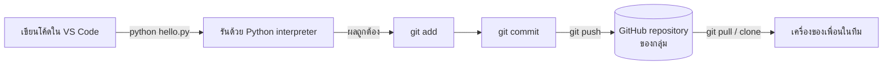
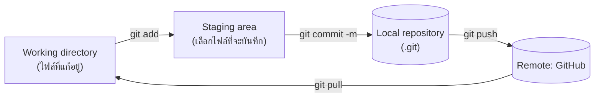
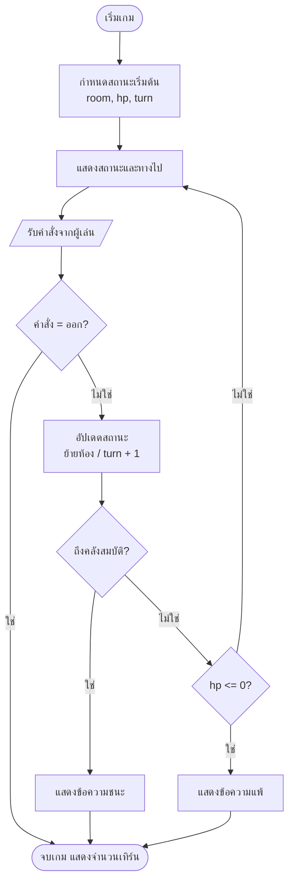

> **โมดูล:** Module 1 - Foundation & Programming (Mini-Project 1)
> **เวลาที่ใช้:** 2 ชั่วโมง (ในห้องปฏิบัติการ) + เวลาศึกษาด้วยตนเอง

## 🎯 จุดประสงค์การทดลอง (Objectives)
- ติดตั้ง Python, VS Code, Git และวางแผนทำ Simple Text/2D Game
- ประยุกต์ใช้ความรู้จากภาคทฤษฎี (สัปดาห์ที่ 1) สู่การปฏิบัติจริง
- เสริมสร้างทักษะการทำงานกลุ่มผ่าน Mini-Project

## 🛠️ เครื่องมือที่ต้องใช้ (Prerequisites & Tools)
- เครื่องคอมพิวเตอร์ (Windows 10/11, macOS หรือ Linux) และอินเทอร์เน็ต
- **Python 3.12 ขึ้นไป** จาก [python.org/downloads](https://www.python.org/downloads/)
- **Visual Studio Code** จาก [code.visualstudio.com](https://code.visualstudio.com/) และ extension **Python** (ผู้พัฒนา: Microsoft)
- **Git** จาก [git-scm.com](https://git-scm.com/downloads) และบัญชี **GitHub** ([github.com](https://github.com/)) สมาชิกทุกคนต้องมีบัญชีของตัวเอง
- ทางเลือกสำรองเมื่อติดตั้งโปรแกรมไม่ได้: บัญชี Google สำหรับ **Google Colab** ([colab.research.google.com](https://colab.research.google.com/))

> [!note] ผลลัพธ์ในใบงานนี้
> ทุก output ได้จากการรันจริงบน Windows 11 (Python 3.14.3, Git 2.42.0) เครื่องของนักศึกษาอาจแสดงเลขเวอร์ชัน, path และ commit hash ต่างไป ซึ่งถือว่าปกติ (path ใน output ถูกย่อเป็น `C:/Users/student/...`)

---

## 🕒 ส่วนที่ 1: ทฤษฎีประยุกต์ประจำสัปดาห์ (1 ชั่วโมง)

**ภาพรวม:** วิศวกรคอมพิวเตอร์ทำงานผ่าน "ชุดเครื่องมือ" (toolchain) ที่เชื่อมกัน ได้แก่ **interpreter** ที่รันโค้ด, **IDE** ที่ใช้เขียนโค้ด และ **version control** ที่เก็บประวัติและใช้ทำงานเป็นทีม แล็บนี้ติดตั้งครบทั้งสามส่วนแล้วส่งโค้ดชิ้นแรกขึ้น GitHub



### ขั้นตอนที่ 1: ติดตั้ง Python และตรวจสอบเวอร์ชัน

1. ดาวน์โหลดตัวติดตั้งจาก python.org แล้วเปิดไฟล์
2. **Windows:** หน้าแรกของตัวติดตั้ง **ติ๊ก "Add python.exe to PATH"** ก่อนกด Install Now (ถ้าลืมติ๊ก คำสั่ง `python` จะใช้ไม่ได้)
3. เปิด Terminal ใหม่ (Windows: PowerShell, macOS: Terminal) แล้วพิมพ์

```bash
python --version
```

```output
Python 3.14.3
```

> [!tip] คำสั่งที่ใช้ตามระบบปฏิบัติการ
> macOS/Linux มักต้องใช้ `python3` และ `pip3` แทน `python` และ `pip` ส่วน Windows ใช้ `py --version` ได้อีกทางหนึ่ง ถ้าพิมพ์ `python` แล้วเปิด Microsoft Store แปลว่ายังไม่ได้เพิ่ม Python ลง PATH ให้ติดตั้งใหม่และติ๊กช่อง PATH

### ขั้นตอนที่ 2: ติดตั้ง VS Code และ Python extension

1. ติดตั้ง VS Code แล้วเปิดโปรแกรม
2. กด `Ctrl+Shift+X` (macOS: `Cmd+Shift+X`) ค้นหา **Python** เลือกของ **Microsoft** แล้วกด Install (จะได้ Pylance สำหรับ autocomplete มาด้วย)
3. สร้างโฟลเดอร์งาน เช่น `D:\cpe-lab\text-game` แล้วเลือก **File > Open Folder...**
4. กด `Ctrl+Shift+P` พิมพ์ **Python: Select Interpreter** แล้วเลือก Python 3 ที่เพิ่งติดตั้ง
5. เปิด Terminal ในตัว VS Code ด้วย `` Ctrl+` `` (ปุ่มตัวหนอนใต้ Esc)

| ส่วนของ IDE | หน้าที่ | ทางลัด |
|---|---|---|
| Explorer | ดูไฟล์ในโฟลเดอร์โปรเจกต์ | `Ctrl+Shift+E` |
| Editor | เขียนโค้ด มี syntax highlight และ autocomplete | - |
| Terminal | รันคำสั่ง `python`, `git` | `` Ctrl+` `` |
| Source Control | ดูไฟล์ที่เปลี่ยน, commit, push แบบคลิก | `Ctrl+Shift+G` |
| Run Python File | รันไฟล์ที่เปิดอยู่ | ปุ่ม ▷ มุมขวาบน |

### ขั้นตอนที่ 3: ติดตั้ง Git และตั้งค่าตัวตนผู้ commit

ติดตั้ง Git (Windows ใช้ค่าเริ่มต้นของตัวติดตั้งได้ทั้งหมด) แล้วเปิด Terminal ใหม่

```bash
git --version
```

```output
git version 2.42.0.windows.2
```

ตั้งชื่อและอีเมลที่จะติดไปกับทุก commit **ใช้อีเมลเดียวกับบัญชี GitHub** เพื่อให้ GitHub นับผลงานให้ถูกคน ทำครั้งเดียวต่อเครื่อง

```bash
git config --global user.name "Somchai S."
git config --global user.email "somchai@example.com"
git config --global init.defaultBranch main
git config --global --list
```

> [!warning] เครื่องในห้องปฏิบัติการใช้ร่วมกัน
> ถ้าใช้เครื่องของมหาวิทยาลัย ให้ตั้งค่าแบบเฉพาะโฟลเดอร์ (ไม่ใส่ `--global`) หลัง `git init` และ **ออกจากระบบ GitHub ใน browser** และ Credential Manager ก่อนเลิกใช้งาน เพื่อไม่ให้คนต่อไป push ในนามของเรา

### ขั้นตอนที่ 4: เขียนและรันสคริปต์แรก

สร้างไฟล์ `hello.py` ในโฟลเดอร์งาน

```python
import platform

name = "Computer Engineering"
print(f"สวัสดี {name}!")
print("Python version:", platform.python_version())
print("ระบบปฏิบัติการ:", platform.system(), platform.release())

# ทดสอบคำนวณ: 2 ยกกำลัง 10 และแปลงเป็นฐานสอง
x = 2 ** 10
print(x, "=", bin(x))
```

รันด้วยคำสั่ง `python hello.py` ใน Terminal หรือกดปุ่ม ▷

```output
สวัสดี Computer Engineering!
Python version: 3.14.3
ระบบปฏิบัติการ: Windows 11
1024 = 0b10000000000
```

- `import platform` เรียกใช้ module มาตรฐานที่อ่านข้อมูลระบบ (จะใช้ต่อใน [Lab 02](/lab/02))
- `f"...{name}..."` คือ **f-string** แทรกค่าตัวแปรลงในข้อความ
- `bin(x)` แปลงเลขฐานสิบเป็นฐานสอง (ฐานสองเป็นหัวข้อหลักของ [Lab 03](/lab/03))

> [!tip] ถ้าภาษาไทยแสดงเป็นตัวอักษรแปลก ๆ
> บันทึกไฟล์เป็น UTF-8 (ดูมุมขวาล่างของ VS Code) ถ้า Terminal ของ Windows รุ่นเก่ายังแสดงผิด ให้รัน `$env:PYTHONIOENCODING="utf-8"` ใน PowerShell ก่อนรันสคริปต์

### ขั้นตอนที่ 5: Git พื้นฐาน: init, add, commit

Git เก็บงานไว้ 3 บริเวณ คือ **working directory** (ไฟล์ที่เรากำลังแก้), **staging area** (ไฟล์ที่เลือกไว้ว่าจะบันทึก) และ **repository** (ประวัติที่ commit แล้ว)



ใน Terminal ของโฟลเดอร์ `text-game` (มี `hello.py` อยู่แล้ว) สร้าง `README.md` ที่มีบรรทัด `# Text Game` แล้วรัน

```bash
git init
git status
```

```output
Initialized empty Git repository in C:/Users/student/text-game/.git/
On branch main

No commits yet

Untracked files:
  (use "git add <file>..." to include in what will be committed)
	README.md
	hello.py

nothing added to commit but untracked files present (use "git add" to track)
```

```bash
git add hello.py README.md
git status --short
git commit -m "Add hello script and README"
git log --oneline
```

```output
A  README.md
A  hello.py
[main (root-commit) 65ba4ff] Add hello script and README
 2 files changed, 13 insertions(+)
 create mode 100644 README.md
 create mode 100644 hello.py
65ba4ff Add hello script and README
```

| คำสั่ง | ทำอะไร | ใช้เมื่อ |
|---|---|---|
| `git init` | สร้างโฟลเดอร์ `.git` เริ่มเก็บประวัติ | ครั้งแรกของโปรเจกต์ |
| `git status` | ดูว่าไฟล์ไหนเปลี่ยน/ยังไม่ถูก track | ก่อนและหลังทุกคำสั่ง |
| `git add <ไฟล์>` | ย้ายการเปลี่ยนแปลงเข้า staging | เลือกสิ่งที่จะ commit |
| `git commit -m "..."` | บันทึก snapshot พร้อมข้อความ | ทำงานเสร็จเป็นชิ้น ๆ |
| `git log --oneline` | ดูประวัติ commit แบบย่อ | ตรวจสอบงาน |
| `git push` / `git pull` | ส่งขึ้น / ดึงลงจาก GitHub | ทำงานร่วมกับทีม |

> [!tip] ข้อความ commit ที่ดี
> เขียนเป็นประโยคสั้นบอก **สิ่งที่เปลี่ยน** เช่น `Add save/load system` หรือ `Fix HP below zero` ไม่ใช่ `update` หรือ `แก้งาน` และควร commit บ่อย ๆ ทีละเรื่อง ส่วนคำเตือน `LF will be replaced by CRLF` บน Windows เป็นเรื่องปกติ ไม่ใช่ error

### ขั้นตอนที่ 6: สร้าง repository บน GitHub และ push

1. เข้า github.com กด **New repository** ตั้งชื่อ เช่น `text-game-team01` เลือก **Public** หรือ **Private** (ถ้า Private ให้เพิ่มเพื่อนและอาจารย์ใน **Settings > Collaborators**)
2. **ไม่ต้อง** ติ๊ก Add a README เพราะเรามี README ในเครื่องแล้ว (ถ้าติ๊ก จะ push ครั้งแรกไม่ผ่าน ต้อง `git pull` ก่อน)
3. คัดลอก URL ของ repository แล้วรันในเครื่อง

```bash
git remote add origin https://github.com/<username>/text-game-team01.git
git push -u origin main
```

4. ครั้งแรกจะมีหน้าต่าง **Git Credential Manager** ให้ล็อกอิน GitHub ผ่าน browser กด Authorize แล้วกลับมาที่ Terminal จะเห็นข้อความ `branch 'main' set up to track 'origin/main'`
5. Refresh หน้า GitHub ต้องเห็น `hello.py` และ `README.md`
6. เพื่อนในทีมดึงโปรเจกต์ไปที่เครื่องตัวเองด้วย `git clone https://github.com/<username>/text-game-team01.git`

> [!warning] GitHub ไม่รับรหัสผ่านบัญชีใน Terminal
> การ push ผ่าน HTTPS ต้องยืนยันตัวตนผ่าน browser (Credential Manager) หรือ Personal Access Token เท่านั้น **ห้ามใส่ token ลงในไฟล์โค้ดหรือ commit ขึ้น GitHub**

### ขั้นตอนที่ 7: ทางเลือก Google Colab (เมื่อติดตั้งโปรแกรมในเครื่องไม่ได้)

Colab คือ Jupyter Notebook บนคลาวด์ของ Google มี Python และ Git ติดตั้งไว้แล้ว เปิด [colab.research.google.com](https://colab.research.google.com/) > **New notebook** แล้วพิมพ์ในเซลล์ (เครื่องหมาย `!` นำหน้า = รันคำสั่ง shell)

```python
!python --version
!git --version
print("สวัสดี Computer Engineering!")
```

| หัวข้อ | VS Code + Python ในเครื่อง | Google Colab |
|---|---|---|
| การติดตั้ง | ต้องติดตั้งเอง | ไม่ต้องติดตั้ง ใช้ browser |
| `input()` และเกมแบบข้อความ | ใช้ได้เต็มที่ | ใช้ได้ แต่แสดงเป็นช่องกรอกในเซลล์ |
| ไฟล์ที่สร้าง | อยู่ในเครื่องถาวร | **หายเมื่อ runtime ถูกรีเซ็ต** |
| ส่งงานขึ้น GitHub | `git push` | **File > Save a copy in GitHub** |
| เหมาะกับ | Mini-Project 1 ทั้งโมดูล | ทดลองโค้ดสั้น ๆ หรือสำรองระหว่างรอติดตั้ง |

### ขั้นตอนที่ 8: ปัญหาที่พบบ่อยและวิธีแก้

| อาการ | สาเหตุ | วิธีแก้ |
|---|---|---|
| `'python' is not recognized ...` | ไม่ได้เพิ่ม Python ลง PATH | ติดตั้งใหม่ ติ๊ก Add to PATH แล้วเปิด Terminal ใหม่ |
| พิมพ์ `python` แล้วเปิด Microsoft Store | Windows ใช้ alias ของ Store แทน | ปิด App execution aliases ของ python ใน Settings หรือใช้ `py` |
| VS Code ขึ้นว่าไม่พบ interpreter | ยังไม่ได้เลือก interpreter | `Ctrl+Shift+P` > Python: Select Interpreter |
| `Author identity unknown` ตอน commit | ยังไม่ได้ตั้ง `user.name`/`user.email` | ทำขั้นตอนที่ 3 |
| `fatal: not a git repository` | รันคำสั่งนอกโฟลเดอร์โปรเจกต์ | `cd` เข้าโฟลเดอร์ หรือ `git init` |
| `! [rejected] main -> main (fetch first)` | บน GitHub มี commit ที่เครื่องเรายังไม่มี | `git pull --rebase origin main` แล้ว push ใหม่ |

### ขั้นตอนที่ 9: บันทึกผลการสังเกต

ตอบคำถามต่อไปนี้ลงใน `progress-log.md`

1. เครื่องของคุณใช้ Python และ Git เวอร์ชันใด และรัน `python` หรือ `python3`
2. ถ้าแก้ `hello.py` แล้วรัน `git status` ทันที ไฟล์จะอยู่สถานะใด และต้องทำอะไรต่อจึงจะขึ้น GitHub
3. `git commit` กับ `git push` ต่างกันอย่างไร ถ้า commit แล้วแต่ยังไม่ push เพื่อนจะเห็นงานไหม
4. Python เป็นภาษาแบบ interpreted ต่างจากภาษาที่ต้อง compile อย่างไร (เชื่อมกับเนื้อหา [สัปดาห์ที่ 1: Introduction to CE & IT](/module/01))

<details><summary>ดูเฉลย</summary>

1. ตอบตามเครื่องจริง เช่น Python 3.14.3 และ git 2.42.0 บน Windows ใช้ `python` ส่วน macOS/Linux ส่วนใหญ่ใช้ `python3`
2. อยู่ในสถานะ **modified** (Changes not staged for commit) ต้อง `git add hello.py` → `git commit -m "..."` → `git push`
3. `commit` บันทึกประวัติใน **repository ในเครื่อง** เท่านั้น `push` จึงจะส่ง commit ขึ้น **remote (GitHub)** ถ้ายังไม่ push เพื่อนจะ **ไม่เห็น** งาน
4. interpreter อ่านและรันโค้ดทีละคำสั่งขณะทำงาน แก้แล้วรันได้ทันที เหมาะกับการเรียนรู้และงานทดลอง ส่วนภาษา compiled (เช่น C) ต้องแปลทั้งโปรแกรมเป็น machine code ก่อน ได้ไฟล์ที่รันเร็วกว่า แต่ต้อง compile ใหม่ทุกครั้งที่แก้
</details>

---

## 🚀 ส่วนที่ 2: งานพัฒนา Mini-Project (1 ชั่วโมง + การบ้าน)

- **เป้าหมายสัปดาห์นี้:** ทีม (3–5 คน) ตกลงแนวคิดเกม กติกา และโครงสร้างโปรแกรม ของ **Mini-Project 1: Simple Text/2D Game** พร้อมสร้าง repository กลางที่ทุกคน push ได้
- **โจทย์:** จัดทำ Game Design Document สั้น ๆ ใน `README.md`, วาด flowchart ของ game loop, เขียนโครงโปรแกรม `main.py` ที่รันได้ และแบ่งงานสำหรับสัปดาห์ที่ 1–4

### ขั้นตอนที่ 1: เลือกแนวคิดเกม

เลือก 1 แนวคิด (หรือเสนอเอง) โดยต้องทำให้เสร็จได้ภายใน 4 สัปดาห์ และต่อยอดฟีเจอร์ของสัปดาห์ถัดไปได้

| แนวคิด | ตัวอย่างการเล่น | จุดที่ต่อยอดได้ (W2–W4) |
|---|---|---|
| ผจญภัยในถ้ำ (Text Adventure) | พิมพ์ทิศเพื่อเดินระหว่างห้อง เก็บไอเทม | Save/Load ตำแหน่งและไอเทม, เงื่อนไขเปิดประตู |
| RPG ต่อสู้แบบผลัดตา | เลือกโจมตี/ป้องกัน/ใช้ยา | ค่าสถานะใน JSON, สูตรดาเมจ, ค้นหาไอเทม |
| เกมตอบคำถาม (Quiz) | สุ่มคำถามจากคลัง นับคะแนน | คลังคำถามในไฟล์, ตารางคะแนนสูงสุด, ค้นหาคำถาม |
| ทายตัวเลข/คำ (Hangman) | ทายภายในจำนวนครั้งที่กำหนด | ระดับความยาก, สถิติการเล่น, binary search ช่วยเฉลย |
| 2D Game ด้วย `pygame` (ท้าทาย) | หลบสิ่งกีดขวาง เก็บเหรียญ | ต้องติดตั้ง `pip install pygame` ใช้แนวคิด game loop เดียวกัน |

### ขั้นตอนที่ 2: เขียนกติกาเกม (Game Rules)

ตัวอย่างของเกม **"หนีออกจากถ้ำ"** (ทีมเขียนของตัวเองในรูปแบบเดียวกัน)

| หัวข้อ | รายละเอียด |
|---|---|
| เป้าหมาย | เดินจากปากถ้ำไปถึงคลังสมบัติ |
| สถานะผู้เล่น | `room`, `hp` (เริ่ม 100), `turn`, `inventory` |
| คำสั่ง | `เหนือ`, `ใต้`, `ตะวันออก`, `ตะวันตก`, `ออก` |
| เงื่อนไขชนะ | ไปถึงห้อง `คลังสมบัติ` |
| เงื่อนไขแพ้ | `hp <= 0` (เพิ่มกับดัก/มอนสเตอร์ใน Lab 03) |
| คำสั่งผิด | แจ้ง "ไปทางนั้นไม่ได้" แต่ยังนับเทิร์น |

### ขั้นตอนที่ 3: วาด Flowchart ของ Game Loop

เกมแทบทุกเกมทำงานเป็นวงรอบ **แสดงผล → รับคำสั่ง → อัปเดตสถานะ → ตรวจเงื่อนไขจบ** ซ้ำไปเรื่อย ๆ



### ขั้นตอนที่ 4: เขียนโครงโปรแกรม `main.py`

โครงนี้แยกหน้าที่เป็นฟังก์ชันตาม flowchart ทำให้สมาชิกแต่ละคนแก้คนละฟังก์ชันได้โดยไม่ชนกัน (ตัวอย่างยังไม่มีเงื่อนไขแพ้ `hp <= 0` ซึ่งเป็นการบ้านข้อ 3)

```python
# main.py: โครง (skeleton) ของเกมผจญภัยแบบข้อความ "หนีออกจากถ้ำ"
ROOMS = {
    "ปากถ้ำ":   {"เหนือ": "ห้องโถง"},
    "ห้องโถง":  {"ใต้": "ปากถ้ำ", "ตะวันออก": "คลังสมบัติ"},
    "คลังสมบัติ": {"ตะวันตก": "ห้องโถง"},
}

def show_status(state):
    exits = ", ".join(ROOMS[state["room"]])
    print(f"[เทิร์น {state['turn']}] คุณอยู่ที่ {state['room']} | HP {state['hp']} | ทางไป: {exits}")

def update(state, command):
    """รับคำสั่งแล้วเปลี่ยนสถานะเกม คืนค่า False เมื่อผู้เล่นต้องการออก"""
    if command == "ออก":
        return False
    if command in ROOMS[state["room"]]:
        state["room"] = ROOMS[state["room"]][command]
    else:
        print("  ไปทางนั้นไม่ได้")
    state["turn"] += 1
    return True

def main():
    state = {"room": "ปากถ้ำ", "hp": 100, "turn": 1}   # สถานะเกมทั้งหมดเก็บใน dict เดียว
    running = True
    while running:                          # game loop
        show_status(state)                  # 1) แสดงผล
        command = input("> ").strip()       # 2) รับคำสั่ง
        running = update(state, command)    # 3) อัปเดตสถานะ
        if state["room"] == "คลังสมบัติ":   # 4) ตรวจเงื่อนไขจบเกม
            print("คุณพบสมบัติ ชนะแล้ว!")
            break
    print("จบเกม ใช้ไป", state["turn"], "เทิร์น")

if __name__ == "__main__":
    main()
```

ทดลองพิมพ์ `ตะวันตก`, `เหนือ`, `ตะวันออก` ตามลำดับ

```output
[เทิร์น 1] คุณอยู่ที่ ปากถ้ำ | HP 100 | ทางไป: เหนือ
> ตะวันตก
  ไปทางนั้นไม่ได้
[เทิร์น 2] คุณอยู่ที่ ปากถ้ำ | HP 100 | ทางไป: เหนือ
> เหนือ
[เทิร์น 3] คุณอยู่ที่ ห้องโถง | HP 100 | ทางไป: ใต้, ตะวันออก
> ตะวันออก
คุณพบสมบัติ ชนะแล้ว!
จบเกม ใช้ไป 4 เทิร์น
```

- แผนที่เกมเก็บเป็น **dict ซ้อน dict**: `ROOMS[ห้องปัจจุบัน][ทิศ]` ได้ชื่อห้องถัดไป การเพิ่มห้องใหม่จึงแก้แค่ข้อมูล ไม่ต้องแก้ตรรกะ
- `if __name__ == "__main__":` ทำให้ไฟล์อื่น `import` ฟังก์ชันจาก `main.py` ไปทดสอบได้โดยเกมไม่เริ่มเล่นเอง
- สถานะทั้งหมดอยู่ใน `state` ตัวเดียว ซึ่งจะบันทึกลงไฟล์ JSON ได้ทันทีใน [Lab 02](/lab/02)

### ขั้นตอนที่ 5: โครงสร้าง repository และ README

```text
text-game-team01/
├── README.md          # Game Design Document + วิธีติดตั้ง/รัน + สมาชิก
├── main.py            # game loop
├── game_logic.py      # กติกา การต่อสู้ เงื่อนไขชนะ/แพ้ (Lab 03)
├── save_system.py     # Save/Load ด้วย JSON (Lab 02)
├── data/              # ไฟล์ข้อมูลเกม เช่น rooms.json, questions.json
├── docs/
│   ├── flowchart.png  # หรือ flowchart.md (mermaid)
│   └── progress-log.md
└── .gitignore         # ไม่ commit ไฟล์ที่ไม่ควรขึ้น GitHub
```

ตัวอย่าง `.gitignore` สำหรับ Python

```text
__pycache__/
*.pyc
.venv/
.vscode/
savegame.json
```

แม่แบบ `README.md` (เติมให้ครบ)

```markdown
# หนีออกจากถ้ำ (Text Adventure)
เกมผจญภัยแบบข้อความ ผู้เล่นพิมพ์ทิศเพื่อเดินหาคลังสมบัติ

## วิธีรัน
python main.py   (ต้องใช้ Python 3.12 ขึ้นไป)

## กติกา
- เป้าหมาย / เงื่อนไขชนะ / เงื่อนไขแพ้ / คำสั่งทั้งหมด

## สมาชิกและหน้าที่
| รหัสนักศึกษา | ชื่อ | หน้าที่ |

## แผนงาน
- [ ] W1 โครงเกมและ game loop
- [ ] W2 Save/Load
- [ ] W3 Game logic
- [ ] W4 ทดสอบและนำเสนอ
```

### ขั้นตอนที่ 6: มอบหมายงานภายในทีม

| บทบาท | หน้าที่หลัก | ผลงานที่ต้องส่ง |
|---|---|---|
| Project Lead / Git Maintainer | สร้าง repo เพิ่ม collaborator ดูแล branch `main` | repo ที่ทุกคน push ได้ |
| Game Designer | กติกา เนื้อเรื่อง แผนที่/คำถาม | ส่วนกติกาใน README, `data/` |
| Core Programmer | game loop และการรับคำสั่ง | `main.py` |
| Logic & Data Programmer | Save/Load และกติกาการต่อสู้ (W2–W3) | `save_system.py`, `game_logic.py` |
| Tester & Documenter | ทดสอบทุกเส้นทาง เขียน progress log | `docs/progress-log.md` |

ทีม 3 คนให้รวมบทบาทได้ แต่ **ทุกคนต้องมี commit ของตัวเองใน repository** ลำดับการทำงานที่ลดปัญหา conflict คือ `git pull` ก่อนเริ่มงาน → แก้เฉพาะไฟล์ของตัวเอง → `git add` → `git commit` → `git pull` อีกครั้ง → `git push` (การใช้ branch และการแก้ conflict ดูใน 05_Version_Control_และ_Concurrency)

### งานที่ทีมต้องทำต่อ (การบ้าน)

1. สมาชิกทุกคน `git clone` repository แล้วแก้ README ส่วนของตัวเอง (ชื่อ/หน้าที่) และ push อย่างน้อย 1 commit
2. ปรับ `ROOMS` หรือข้อมูลเกมให้เป็นแนวคิดของทีม (อย่างน้อย 4 ห้อง/ฉาก หรือ 10 คำถาม)
3. เพิ่มเงื่อนไขแพ้ใน game loop เช่น ห้องที่มีกับดักลด `hp` และหยุดเกมเมื่อ `hp <= 0` ให้ตรงกับ flowchart
4. บันทึก flowchart ของทีมใน `docs/` (วาดด้วย draw.io หรือ mermaid)

---

## 📝 เกณฑ์การส่งงานและการประเมิน (Deliverables & Rubric)
- ส่งรายงานความคืบหน้า (Progress Log) เป็นไฟล์ Markdown ผ่าน GitHub
- ส่งโค้ดต้นฉบับผ่าน Repository ของกลุ่ม
- ให้ฟีดแบ็กความสมบูรณ์โดยพิจารณาจากเกณฑ์ของ CLO1, CLO4

| หัวข้อ | สิ่งที่ตรวจ |
|---|---|
| ส่วนที่ 1 | ภาพหน้าจอ `python --version`, `git --version`, ผลรัน `hello.py` และ `git log --oneline` ที่มีอย่างน้อย 1 commit พร้อมคำตอบบันทึกผล 4 ข้อ |
| Repository | สร้างบน GitHub แล้ว มี `README.md`, `main.py`, `.gitignore` และสมาชิกทุกคนมี commit |
| Game Design | README ระบุเป้าหมาย กติกา คำสั่ง เงื่อนไขชนะ/แพ้ ครบ |
| Flowchart | แสดง game loop ครบ 4 ขั้น (แสดงผล รับคำสั่ง อัปเดต ตรวจเงื่อนไข) และตรงกับโค้ด |
| การแบ่งงาน | ตารางบทบาทและแผน W1–W4 ชัดเจน |
