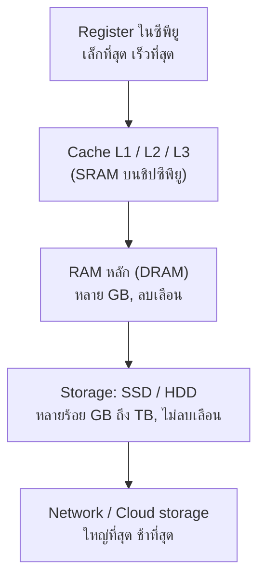

> **โมดูล:** Module 1 - Foundation & Programming (Mini-Project 1)
> **เวลาที่ใช้:** 2 ชั่วโมง (ในห้องปฏิบัติการ) + เวลาศึกษาด้วยตนเอง

## 🎯 จุดประสงค์การทดลอง (Objectives)
- ใช้ Python ดึงข้อมูล OS (System Req) และทำระบบ Save/Load ผ่านการอ่านเขียนไฟล์
- ประยุกต์ใช้ความรู้จากภาคทฤษฎี (สัปดาห์ที่ 2) สู่การปฏิบัติจริง
- เสริมสร้างทักษะการทำงานกลุ่มผ่าน Mini-Project

## 🛠️ เครื่องมือที่ต้องใช้ (Prerequisites & Tools)
- เครื่องคอมพิวเตอร์และอินเทอร์เน็ต พร้อม Python 3, VS Code และ Git ที่ติดตั้งไว้ใน [Lab 01](/lab/01)
- เครื่องมือของระบบปฏิบัติการ: **System Information** (`msinfo32`), **Task Manager** และ **DirectX Diagnostic Tool** (`dxdiag`) บน Windows (macOS/Linux ใช้คำสั่งในตารางขั้นตอนที่ 1)
- Library **`psutil`** ติดตั้งด้วย `pip install psutil` (ส่วน `platform`, `os`, `shutil`, `json` เป็น library มาตรฐาน มีมากับ Python)
- repository ของทีมจาก Lab 01 (มี `main.py` ที่เป็น game loop แล้ว)

> [!note] ผลลัพธ์ในใบงานนี้
> output ได้จากการรันจริงบนโน้ตบุ๊ก Windows 11 (AMD Ryzen 6 คอร์, RAM 28 GiB, Python 3.14.3, psutil 7.2.2) **ตัวเลขสเปกและเวลาในเครื่องของนักศึกษาจะต่างออกไป** ซึ่งเป็นจุดประสงค์ของแล็บ ให้บันทึกค่าจริงของเครื่องตัวเองแล้วเปรียบเทียบกับเพื่อน

---

## 🕒 ส่วนที่ 1: ทฤษฎีประยุกต์ประจำสัปดาห์ (1 ชั่วโมง)

**ภาพรวม:** สำรวจสเปกเครื่องด้วยเครื่องมือของ OS แล้วเขียน Python อ่านค่าเดียวกันผ่าน OS (โปรแกรมไม่ได้แตะฮาร์ดแวร์ตรง ๆ แต่ถาม OS ซึ่งเป็นตัวกลาง) จากนั้นทดลองให้เห็นความเร็วที่ต่างกันของชั้นหน่วยความจำ



### ขั้นตอนที่ 1: สำรวจสเปกด้วยเครื่องมือของระบบปฏิบัติการ

**1.1 System Information:** กด `Win+R` พิมพ์ `msinfo32` แล้ว Enter ดูหน้า **System Summary**

**1.2 Task Manager:** กด `Ctrl+Shift+Esc` เลือกแท็บ **Performance** แล้วคลิกทีละหัวข้อ CPU, Memory, Disk, GPU (ข้อมูล cache L1/L2/L3 และจำนวน slot ของ RAM อยู่มุมขวาล่างของแต่ละหน้า)

**1.3 DirectX Diagnostic Tool:** กด `Win+R` พิมพ์ `dxdiag` ดูแท็บ **System** และ **Display** (ชื่อ GPU และหน่วยความจำการ์ดจอ)

คัดลอกตารางนี้ลง `progress-log.md` แล้วเติมค่าของเครื่องตัวเอง

| ส่วนประกอบ | หาได้จาก | ค่าของเครื่องฉัน |
|---|---|---|
| ระบบปฏิบัติการ และ System Type (x64/ARM64) | msinfo32: OS Name, System Type | |
| รุ่น CPU | msinfo32: Processor / Task Manager: CPU | |
| จำนวน Cores และ Logical processors | Task Manager: CPU | |
| ความเร็ว Base speed | Task Manager: CPU | |
| ขนาด Cache L1 / L2 / L3 | Task Manager: CPU | |
| RAM ทั้งหมด, ความเร็ว, จำนวน slot ที่ใช้ | Task Manager: Memory | |
| ชนิด storage (SSD/HDD) และความจุ | Task Manager: Disk | |
| GPU และหน่วยความจำ GPU | dxdiag: Display / Task Manager: GPU | |

| ระบบ | คำสั่งที่ให้ข้อมูลใกล้เคียงกัน |
|---|---|
| macOS | เมนู Apple > About This Mac > More Info หรือ `system_profiler SPHardwareDataType` |
| Linux | `lscpu` (CPU และ cache), `free -h` (RAM), `lsblk` (storage) |

### ขั้นตอนที่ 2: อ่านข้อมูลระบบด้วย `platform` และ `os`

สร้างไฟล์ `spec_basic.py`

```python
import os
import platform

print("ระบบปฏิบัติการ :", platform.system(), platform.release(), f"({platform.version()})")
print("สถาปัตยกรรม    :", platform.machine())
print("ชื่อ CPU        :", platform.processor())
print("จำนวน logical CPU:", os.cpu_count())
print("Python          :", platform.python_version(), platform.architecture()[0])
```

```output
ระบบปฏิบัติการ : Windows 11 (10.0.26200)
สถาปัตยกรรม    : AMD64
ชื่อ CPU        : AMD64 Family 25 Model 80 Stepping 0, AuthenticAMD
จำนวน logical CPU: 12
Python          : 3.14.3 64bit
```

- `platform.machine()` บอก **ISA** ของ CPU: `AMD64`/`x86_64` คือ x86 แบบ 64 บิต ส่วน `arm64` คือ ARM (เช่น Apple M-series) โปรแกรมที่ compile ไว้ต้องตรงกับ ISA นี้
- `platform.processor()` บน Windows คืนชื่อตระกูล CPU แบบย่อ ไม่ใช่ชื่อการค้า ชื่อเต็ม (เช่น "AMD Ryzen 5 ...") ดูได้จาก Task Manager
- `os.cpu_count()` นับ **logical CPU** (thread ที่ OS เห็น) ไม่ใช่คอร์จริง

### ขั้นตอนที่ 3: สร้างรายงานสเปกด้วย `psutil`

ติดตั้งก่อนด้วย `pip install psutil` (macOS/Linux ใช้ `pip3`) แล้วสร้าง `spec_report.py`

```python
import os
import platform
import shutil
import psutil

GB = 1024 ** 3   # 1 GiB = 1,073,741,824 bytes

def spec_report():
    vm = psutil.virtual_memory()
    disk = shutil.disk_usage(os.path.abspath(os.sep))   # ไดรฟ์ที่รันสคริปต์ (เช่น C:\ หรือ /)
    freq = psutil.cpu_freq()
    return {
        "os": f"{platform.system()} {platform.release()}",
        "machine": platform.machine(),
        "cpu_physical": psutil.cpu_count(logical=False),
        "cpu_logical": psutil.cpu_count(logical=True),
        "cpu_max_mhz": round(freq.max) if freq else None,
        "ram_total_gb": round(vm.total / GB, 1),
        "ram_used_pct": vm.percent,
        "disk_total_gb": round(disk.total / GB, 1),
        "disk_free_gb": round(disk.free / GB, 1),
    }

report = spec_report()
print("=" * 40)
print(" รายงานสเปกเครื่อง (System Spec Report)")
print("=" * 40)
for key, value in report.items():
    print(f"{key:<15}: {value}")

# เทียบกับความต้องการขั้นต่ำของเกม (System Requirements)
MIN_REQ = {"cpu_logical": 2, "ram_total_gb": 4, "disk_free_gb": 1}
print("-" * 40)
for key, need in MIN_REQ.items():
    ok = report[key] >= need
    print(f"{key:<15}: ต้องการ >= {need:<4} -> {'ผ่าน' if ok else 'ไม่ผ่าน'}")
```

```output
========================================
 รายงานสเปกเครื่อง (System Spec Report)
========================================
os             : Windows 11
machine        : AMD64
cpu_physical   : 6
cpu_logical    : 12
cpu_max_mhz    : 3301
ram_total_gb   : 27.9
ram_used_pct   : 81.6
disk_total_gb  : 385.8
disk_free_gb   : 19.6
----------------------------------------
cpu_logical    : ต้องการ >= 2    -> ผ่าน
ram_total_gb   : ต้องการ >= 4    -> ผ่าน
disk_free_gb   : ต้องการ >= 1    -> ผ่าน
```

- `cpu_physical` 6 แต่ `cpu_logical` 12 เพราะ CPU รองรับ **SMT/Hyper-Threading** หนึ่งคอร์รัน 2 thread พร้อมกันได้
- `cpu_max_mhz` บน Windows มักแสดง **base clock** ไม่ใช่ความเร็ว boost สูงสุด
- เราหารด้วย `1024**3` จึงได้หน่วย **GiB** ส่วนผู้ผลิตดิสก์ใช้ GB = 10⁹ bytes ตัวเลขในโปรแกรมจึงน้อยกว่าที่เขียนบนกล่องเสมอ
- `MIN_REQ` คือแนวคิด **System Requirements** ที่เกมจริงประกาศไว้ ทีมจะใช้ส่วนนี้ใน README ของเกม

> [!tip] ถ้ารันใน Google Colab
> ผลที่ได้คือสเปกของ **เครื่องเสมือน Linux ใน data center ของ Google** ไม่ใช่โน้ตบุ๊กของเรา (มักได้ 2 logical CPU และ RAM ประมาณ 12 GiB) ลองรันทั้งสองที่แล้วเปรียบเทียบ จะเห็นภาพของ cloud computing ชัดขึ้น

### ขั้นตอนที่ 4: เฝ้าดูการใช้งาน CPU แบบเรียลไทม์

```python
import psutil

# วัดการใช้งาน CPU 3 ครั้ง ครั้งละ 1 วินาที (ค่าเฉลี่ยทุกแกน)
for i in range(3):
    print(f"ครั้งที่ {i+1}: CPU {psutil.cpu_percent(interval=1):5.1f} %")
```

```output
ครั้งที่ 1: CPU  16.1 %
ครั้งที่ 2: CPU  46.5 %
ครั้งที่ 3: CPU  35.1 %
```

ระหว่างที่สคริปต์รัน ให้เปิด Task Manager แท็บ Performance คู่กันแล้วลองเปิดโปรแกรมหนัก ๆ (เช่น browser หลายแท็บ) ค่าที่ Python อ่านได้ต้องสอดคล้องกับกราฟของ Task Manager เพราะทั้งสองถามข้อมูลจาก OS ชุดเดียวกัน

### ขั้นตอนที่ 5: ทดลองลำดับชั้นหน่วยความจำ: RAM vs Storage

```python
import os
import time

N = 1_000_000
numbers = list(range(N))

# 1) เขียนข้อมูลลงไฟล์บน storage (SSD/HDD)
with open("numbers.txt", "w") as f:
    f.write("\n".join(map(str, numbers)))
print("ขนาดไฟล์:", round(os.path.getsize("numbers.txt") / 1024**2, 2), "MB")

# 2) รวมค่าจาก list ที่อยู่ใน RAM แล้ว
t0 = time.perf_counter()
total_ram = sum(numbers)
t_ram = time.perf_counter() - t0

# 3) อ่านจากไฟล์ แปลงเป็นตัวเลข แล้วรวมค่า
t0 = time.perf_counter()
with open("numbers.txt") as f:
    total_file = sum(int(line) for line in f)
t_file = time.perf_counter() - t0

print(f"รวมจาก RAM : {total_ram}  ใช้เวลา {t_ram*1000:7.2f} ms")
print(f"รวมจากไฟล์ : {total_file}  ใช้เวลา {t_file*1000:7.2f} ms")
print(f"ช้ากว่าประมาณ {t_file / t_ram:.0f} เท่า")
os.remove("numbers.txt")
```

```output
ขนาดไฟล์: 7.52 MB
รวมจาก RAM : 499999500000  ใช้เวลา    4.53 ms
รวมจากไฟล์ : 499999500000  ใช้เวลา  137.84 ms
ช้ากว่าประมาณ 30 เท่า
```

> [!warning] อ่านผลให้ถูก
> ตัวเลข 30 เท่านี้ **ไม่ใช่** ความต่างของ RAM กับ SSD โดยตรง เพราะ (1) ไฟล์ที่เพิ่งเขียนมักยังอยู่ใน **page cache** ของ OS (อยู่ใน RAM) และ (2) เวลาส่วนใหญ่ใช้ไปกับการแปลงข้อความเป็น `int` ทีละบรรทัด ข้อสรุปที่ถูกคือ "ข้อมูลที่อยู่ใน RAM พร้อมใช้แล้วเร็วกว่าการไปเอามาจากไฟล์มาก" ความต่างของฮาร์ดแวร์จริงดูได้จากตารางด้านล่าง

| ชั้นหน่วยความจำ | ความจุโดยประมาณ | เวลาเข้าถึงโดยประมาณ | ลบเลือนเมื่อปิดเครื่อง |
|---|---|---|---|
| Register | ไม่กี่สิบตัว × 64 บิต | < 1 ns | ใช่ |
| Cache L1 / L2 / L3 | KB ถึงหลายสิบ MB | ~1 ns ถึง ~10–20 ns | ใช่ |
| RAM (DRAM) | 8–64 GB | ~50–100 ns | ใช่ |
| SSD (NVMe) | 256 GB–4 TB | ~10–100 µs | ไม่ |
| HDD | 1–20 TB | ~5–10 ms | ไม่ |

ตัวเลขในตารางเป็นค่าประมาณระดับ order of magnitude ที่ใช้กันทั่วไปในตำราสถาปัตยกรรมคอมพิวเตอร์ ค่าจริงขึ้นกับรุ่นของอุปกรณ์ (รายละเอียดใน 01_สถาปัตยกรรมระดับฮาร์ดแวร์เชิงลึก)

### ขั้นตอนที่ 6: บันทึกผลการสังเกต

1. เครื่องของคุณมีกี่คอร์และกี่ logical processor ตรงกับที่ Task Manager แสดงหรือไม่ เพราะอะไรสองค่านี้จึงอาจไม่เท่ากัน
2. ความจุดิสก์ที่ `psutil`/`shutil` รายงานน้อยกว่าที่ระบุบนสเปกเครื่อง อธิบายสาเหตุ
3. ถ้า `ram_used_pct` สูงเกิน 90% ขณะเล่นเกม จะเกิดอะไรขึ้นกับความเร็วของเครื่อง เพราะอะไร
4. ทำไมไฟล์เซฟเกมต้องเก็บใน storage ไม่ใช่เก็บในตัวแปรของโปรแกรม (เชื่อมกับส่วนที่ 2)
5. โปรแกรม Python ของเราอ่านข้อมูล CPU/RAM ได้โดยไม่ต้องแตะฮาร์ดแวร์ตรง ๆ ใครเป็นตัวกลางให้ (ดู 02_ระบบปฏิบัติการสมัยใหม่และคอนเทนเนอร์)

<details><summary>ดูเฉลย</summary>

1. ตอบตามเครื่องจริง ตัวอย่างนี้ 6 คอร์ 12 logical processor ซึ่งตรงกับ Task Manager ที่ไม่เท่ากันเพราะ **SMT/Hyper-Threading** ให้ 1 คอร์รัน 2 thread ส่วน CPU บางรุ่นที่มีคอร์ประหยัดพลังงาน (E-core) ที่ไม่รองรับ SMT จะได้ logical ไม่ถึง 2 เท่า
2. (ก) ผู้ผลิตใช้ GB = 10⁹ bytes แต่โปรแกรมหารด้วย 1024³ (GiB) ทำให้ได้ตัวเลขน้อยลงราว 7% (ข) พื้นที่บางส่วนแบ่งเป็น partition อื่น เช่น recovery/EFI และ (ค) `shutil.disk_usage` ดูเฉพาะไดรฟ์เดียว
3. เครื่องจะช้าลงชัดเจน เพราะ OS ต้องย้ายข้อมูลบางส่วนจาก RAM ไปพักใน storage (**paging/swap**) ซึ่งช้ากว่า RAM ระดับพันเท่าขึ้นไป
4. RAM เป็นหน่วยความจำ **ลบเลือน (volatile)** ตัวแปรหายเมื่อปิดโปรแกรมหรือปิดเครื่อง ส่วน SSD/HDD เป็น **non-volatile** ข้อมูลยังอยู่เมื่อเปิดเกมใหม่
5. **ระบบปฏิบัติการ (OS)** ผ่าน system call และ driver ส่วน `psutil` เรียก API ของ OS แต่ละตัว (Windows API, `/proc` ของ Linux) ให้เราใช้คำสั่งเดียวกันได้ทุกระบบ
</details>

---

## 🚀 ส่วนที่ 2: งานพัฒนา Mini-Project (1 ชั่วโมง + การบ้าน)

- **เป้าหมายสัปดาห์นี้:** เพิ่มระบบ **Save/Load** ให้เกมของทีม ผู้เล่นปิดเกมแล้วกลับมาเล่นต่อจากจุดเดิมได้
- **โจทย์:** เขียน `save_system.py` ที่บันทึก `state` ของเกมเป็นไฟล์ JSON ด้วย `json.dump`/`json.load` จัดการกรณีไม่มีไฟล์และไฟล์เสีย แล้วเพิ่มคำสั่ง `เซฟ` ใน game loop

### ขั้นตอนที่ 1: เลือกรูปแบบไฟล์

| รูปแบบ | ตัวอย่าง | ข้อดี | ข้อเสีย |
|---|---|---|---|
| Text ธรรมดา | `ห้องโถง,85,7` | ง่ายที่สุด | ต้องแยกข้อความเอง เพิ่มฟิลด์ยาก |
| **JSON** | `{"room": "ห้องโถง", "hp": 85}` | อ่านออก แก้ด้วยมือได้ เก็บ list/dict ซ้อนได้ ใช้ได้ทุกภาษา (เว็บใน Module 2 ก็ใช้) | เก็บ object ของ Python ได้เฉพาะชนิดพื้นฐาน |
| `pickle` | ไฟล์ binary | เก็บ object ใดก็ได้ | อ่านไม่ออก ใช้ได้แค่ Python และ **โหลดไฟล์จากคนอื่นไม่ปลอดภัย** |

ชนิดข้อมูลที่ JSON รองรับ: `dict` → object, `list` → array, `str`, `int`/`float`, `True`/`False` → `true`/`false`, `None` → `null` (ส่วน `tuple` จะกลายเป็น list และ `set` บันทึกไม่ได้)

### ขั้นตอนที่ 2: เขียน `save_system.py`

```python
import json

SAVE_FILE = "savegame.json"
DEFAULT_STATE = {"player": "ผู้กล้า", "room": "ปากถ้ำ", "hp": 100, "turn": 1, "inventory": []}

def save_game(state, filename=SAVE_FILE):
    with open(filename, "w", encoding="utf-8") as f:
        # ensure_ascii=False ให้ภาษาไทยอ่านออกในไฟล์, indent=2 จัดย่อหน้าให้อ่านง่าย
        json.dump(state, f, ensure_ascii=False, indent=2)
    print(f"บันทึกเกมลง {filename} แล้ว")

def load_game(filename=SAVE_FILE):
    try:
        with open(filename, "r", encoding="utf-8") as f:
            state = json.load(f)
    except FileNotFoundError:
        print("ไม่พบไฟล์เซฟ เริ่มเกมใหม่")
        return dict(DEFAULT_STATE, inventory=[])          # สำเนาใหม่ ไม่แก้ค่าเริ่มต้น
    except json.JSONDecodeError as e:
        print("ไฟล์เซฟเสียหาย:", e.msg, "-> เริ่มเกมใหม่")
        return dict(DEFAULT_STATE, inventory=[])
    # ตรวจว่ามี key ครบ (กันไฟล์เซฟจากเวอร์ชันเก่า)
    missing = DEFAULT_STATE.keys() - state.keys()
    for key in missing:
        state[key] = DEFAULT_STATE[key]
    print(f"โหลดเกมจาก {filename} สำเร็จ")
    return state

if __name__ == "__main__":
    state = load_game()                      # ครั้งแรกยังไม่มีไฟล์
    state["room"] = "ห้องโถง"
    state["hp"] -= 15
    state["turn"] = 7
    state["inventory"].append("คบเพลิง")
    save_game(state)

    loaded = load_game()                     # โหลดกลับมา
    print(loaded)
    print("ตรงกับที่บันทึกไหม:", loaded == state)

    with open(SAVE_FILE, "w", encoding="utf-8") as f:
        f.write('{"player": "ผู้กล้า", "hp": 85,')   # จำลองไฟล์เสีย (เขียนไม่จบ)
    load_game()
```

รัน `python save_system.py` (ลบ `savegame.json` เดิมก่อนถ้ามี)

```output
ไม่พบไฟล์เซฟ เริ่มเกมใหม่
บันทึกเกมลง savegame.json แล้ว
โหลดเกมจาก savegame.json สำเร็จ
{'player': 'ผู้กล้า', 'room': 'ห้องโถง', 'hp': 85, 'turn': 7, 'inventory': ['คบเพลิง']}
ตรงกับที่บันทึกไหม: True
ไฟล์เซฟเสียหาย: Expecting property name enclosed in double quotes -> เริ่มเกมใหม่
```

เนื้อหาไฟล์ `savegame.json` หลังบันทึก (ก่อนถูกจำลองให้เสีย) เปิดดูใน VS Code ได้

```output
{
  "player": "ผู้กล้า",
  "room": "ห้องโถง",
  "hp": 85,
  "turn": 7,
  "inventory": [
    "คบเพลิง"
  ]
}
```

- `with open(...)` ปิดไฟล์ให้อัตโนมัติแม้เกิด error และต้องระบุ `encoding="utf-8"` เสมอเมื่อมีภาษาไทย (Windows บางเครื่องใช้ค่าเริ่มต้นเป็น cp874)
- `try/except` แยกจัดการ 2 กรณี: **ไม่มีไฟล์** (`FileNotFoundError`) คือการเล่นครั้งแรก ส่วน **ไฟล์เสีย** (`json.JSONDecodeError`) เช่น ไฟดับระหว่างบันทึก ทั้งสองกรณีเกมต้องไม่ crash
- `dict(DEFAULT_STATE, inventory=[])` สร้าง dict ใหม่พร้อม list ใหม่ ถ้า `return DEFAULT_STATE` ตรง ๆ การ `append` ไอเทมจะไปแก้ค่าเริ่มต้นของเกมด้วย
- การเติม key ที่หายไปทำให้ไฟล์เซฟจากเวอร์ชันเก่ายังโหลดได้ เมื่อทีมเพิ่มฟิลด์ใหม่ในสัปดาห์ต่อไป

### ขั้นตอนที่ 3: ต่อเข้ากับ game loop

แก้ `main.py` ให้เริ่มเกมด้วย `load_game()` และเพิ่มคำสั่ง `เซฟ` ตัวอย่างนี้ใช้ `ROOMS` และ `show_status` จาก `main.py` ของ Lab 01

```python
from save_system import save_game, load_game
from main import ROOMS, show_status

def update(state, command):
    if command == "ออก":
        return False
    if command == "เซฟ":
        save_game(state)
        return True                     # เซฟไม่นับเทิร์น
    if command in ROOMS[state["room"]]:
        state["room"] = ROOMS[state["room"]][command]
    else:
        print("  ไปทางนั้นไม่ได้")
    state["turn"] += 1
    return True

def main():
    state = load_game()                 # เริ่มเกมด้วยการโหลด ถ้าไม่มีไฟล์จะได้สถานะเริ่มต้น
    running = True
    while running:
        show_status(state)
        command = input("> ").strip()
        running = update(state, command)
        if state["room"] == "คลังสมบัติ":
            print("คุณพบสมบัติ ชนะแล้ว!")
            break

if __name__ == "__main__":
    main()
```

รอบที่ 1 พิมพ์ `เหนือ`, `เซฟ`, `ออก` แล้วเปิดเกมใหม่เป็นรอบที่ 2 พิมพ์ `ตะวันออก`

```output
ไม่พบไฟล์เซฟ เริ่มเกมใหม่
[เทิร์น 1] คุณอยู่ที่ ปากถ้ำ | HP 100 | ทางไป: เหนือ
> เหนือ
[เทิร์น 2] คุณอยู่ที่ ห้องโถง | HP 100 | ทางไป: ใต้, ตะวันออก
> เซฟ
บันทึกเกมลง savegame.json แล้ว
[เทิร์น 2] คุณอยู่ที่ ห้องโถง | HP 100 | ทางไป: ใต้, ตะวันออก
> ออก
```

```output
โหลดเกมจาก savegame.json สำเร็จ
[เทิร์น 2] คุณอยู่ที่ ห้องโถง | HP 100 | ทางไป: ใต้, ตะวันออก
> ตะวันออก
คุณพบสมบัติ ชนะแล้ว!
```

รอบที่ 2 เริ่มที่ห้องโถงเทิร์น 2 ทันที แสดงว่าสถานะถูกบันทึกลง storage และโหลดกลับมาได้ถูกต้อง

> [!warning] อย่า commit ไฟล์เซฟขึ้น GitHub
> `savegame.json` เป็นข้อมูลของผู้เล่นแต่ละคน ไม่ใช่โค้ด ให้ใส่ไว้ใน `.gitignore` (ตามตัวอย่างใน Lab 01) ไม่เช่นนั้นเซฟของสมาชิกแต่ละคนจะทับกันและเกิด conflict

### งานที่ทีมต้องทำต่อ (การบ้าน)

1. นำ `save_system.py` ไปใช้กับ `state` จริงของเกมทีม (ทุก key ที่ต้องจำ เช่น ไอเทม คะแนน ด่าน) และเพิ่มคำสั่ง `โหลด` ระหว่างเล่น
2. เพิ่ม **auto-save** ทุก 5 เทิร์น และถามผู้เล่นตอนเริ่มเกมว่าจะ "เล่นต่อ" หรือ "เริ่มใหม่"
3. ทดสอบ 3 กรณีแล้วบันทึกผลใน progress log: ไม่มีไฟล์, ไฟล์ปกติ, ไฟล์เสีย (แก้ไฟล์ด้วยมือให้ผิดรูปแบบ)
4. เพิ่มส่วน **System Requirements** ใน README ของเกม จากผล `spec_report.py` (Python เวอร์ชันขั้นต่ำ, RAM, พื้นที่ดิสก์)
5. (ท้าทาย) เก็บตารางคะแนนสูงสุด `highscores.json` เป็น list ของ dict เรียงคะแนนจากมากไปน้อย แสดง 5 อันดับแรกเมื่อจบเกม

---

## 📝 เกณฑ์การส่งงานและการประเมิน (Deliverables & Rubric)
- ส่งรายงานความคืบหน้า (Progress Log) เป็นไฟล์ Markdown ผ่าน GitHub
- ส่งโค้ดต้นฉบับผ่าน Repository ของกลุ่ม
- ให้ฟีดแบ็กความสมบูรณ์โดยพิจารณาจากเกณฑ์ของ CLO1, CLO3

| หัวข้อ | สิ่งที่ตรวจ |
|---|---|
| ส่วนที่ 1 | ตารางสเปกจากเครื่องมือของ OS ครบ 8 แถว, ผลรัน `spec_report.py` ของเครื่องตัวเอง และคำตอบบันทึกผล 5 ข้อ |
| ความเข้าใจฮาร์ดแวร์ | อธิบายความต่าง core/logical processor, GB/GiB และลำดับชั้นหน่วยความจำได้ถูกต้อง |
| Save/Load | บันทึกและโหลด `state` ได้ครบทุก key ภาษาไทยอ่านออก ใช้ `encoding="utf-8"` |
| Error handling | เกมไม่ crash เมื่อไม่มีไฟล์หรือไฟล์เสีย มีหลักฐานการทดสอบทั้ง 3 กรณี |
| Repository | มี `save_system.py`, README มี System Requirements และ `savegame.json` อยู่ใน `.gitignore` |
