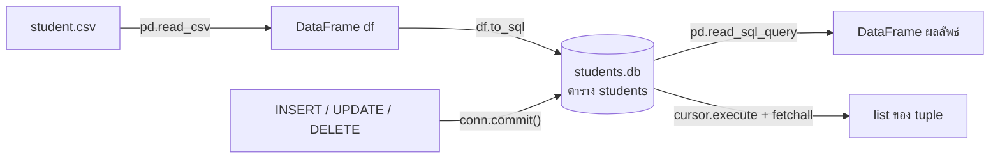
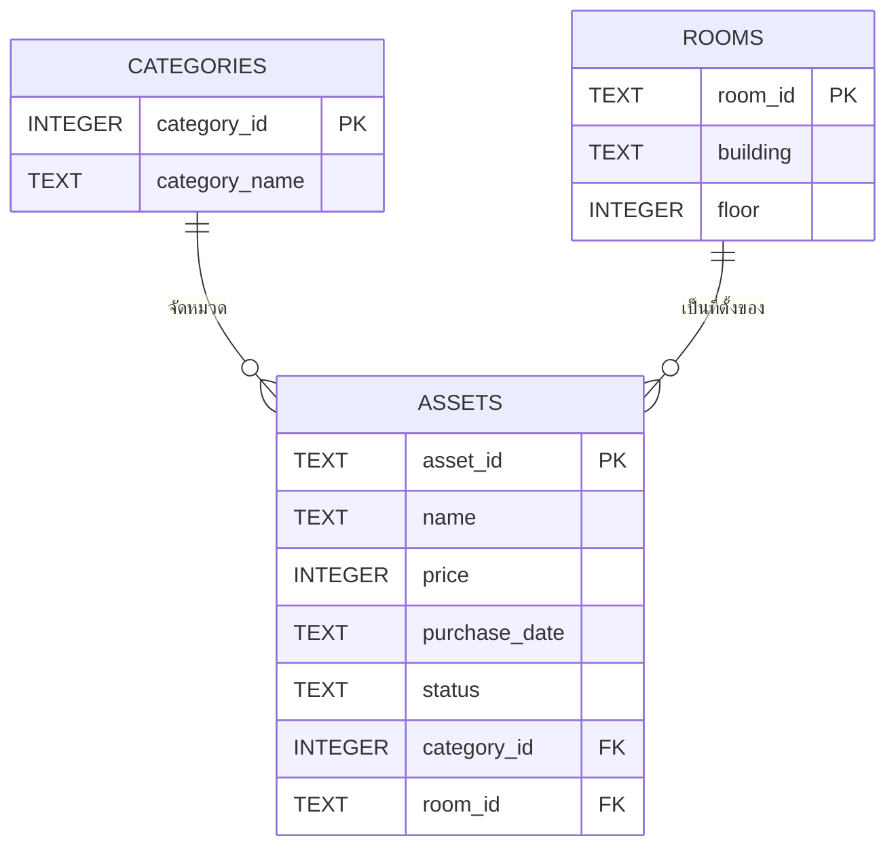

> **โมดูล:** Module 2 - Web Development (Mini-Project 2)
> **เวลาที่ใช้:** 2 ชั่วโมง (ในห้องปฏิบัติการ) + เวลาศึกษาด้วยตนเอง

## 🎯 จุดประสงค์การทดลอง (Objectives)
- ออกแบบ ER Diagram สร้างตาราง SQLite และดึงข้อมูลไปใช้ใน Python
- ประยุกต์ใช้ความรู้จากภาคทฤษฎี (สัปดาห์ที่ 5) สู่การปฏิบัติจริง
- เสริมสร้างทักษะการทำงานกลุ่มผ่าน Mini-Project

## 🛠️ เครื่องมือที่ต้องใช้ (Prerequisites & Tools)
- เครื่องคอมพิวเตอร์และอินเทอร์เน็ต
- บัญชี Google สำหรับใช้ **Google Colab** ([colab.research.google.com](https://colab.research.google.com/)) ซึ่งมี Python, `sqlite3` และ `pandas` ติดตั้งไว้แล้ว ไม่ต้องลงโปรแกรมเพิ่ม
- ทบทวนคำสั่ง SQL ใน 01_กลไกเบื้องหลัง_RDBMS (หัวข้อ "คำสั่ง SQL ที่ต้องรู้") ก่อนเข้าแล็บ

> [!note] ผลลัพธ์ในใบงานนี้
> ทุก output ในใบงานได้จากการรันโค้ดจริง (Python 3.14, pandas 3.0, SQLite 3.50) ตามลำดับเซลล์ ใน Colab ตัวเลขจะเหมือนกัน แต่การจัดคอลัมน์ภาษาไทยของตาราง pandas อาจเยื้องต่างไปเล็กน้อย (Colab แสดงเป็นตาราง HTML) **ต้องรันเซลล์ตามลำดับ** เพราะเซลล์หลังใช้ผลของเซลล์ก่อนหน้า

---

## 🕒 ส่วนที่ 1: ทฤษฎีประยุกต์ประจำสัปดาห์ (1 ชั่วโมง)

**ภาพรวม:** นำข้อมูลนักศึกษาจากไฟล์ CSV เข้าสู่ฐานข้อมูล SQLite แล้วตอบคำถามด้วย SQL



### ขั้นตอนที่ 1: สร้างไฟล์ `student.csv` และอ่านด้วย pandas

ในงานจริงเราจะอัปโหลดไฟล์ CSV ขึ้น Colab แต่ในแล็บนี้สร้างไฟล์จากข้อความในโค้ดเลย เพื่อให้ทุกคนได้ข้อมูลชุดเดียวกัน

```python
import sqlite3
import pandas as pd

csv_text = """student_id,first_name,last_name,gender,faculty,gpa
65010001,สมชาย,ศรีสุข,ชาย,วิศวกรรมศาสตร์,3.25
65010002,สมหญิง,ใจดี,หญิง,วิศวกรรมศาสตร์,3.80
65010003,มานี,ศรีวงศ์,หญิง,วิทยาศาสตร์,3.45
65010004,ปิติ,แสนดี,ชาย,วิทยาศาสตร์,2.75
65010005,ชูใจ,ทองคำ,หญิง,บริหารธุรกิจ,3.10
65010006,วีระ,ศรีสมบูรณ์,ชาย,บริหารธุรกิจ,2.40
65010007,กานดา,มีสุข,หญิง,วิศวกรรมศาสตร์,3.55
65010008,ธนา,พูลผล,ชาย,วิศวกรรมศาสตร์,2.95
65010009,นภา,ศรีอ่อน,หญิง,วิทยาศาสตร์,3.90
65010010,อนันต์,บุญมา,ชาย,บริหารธุรกิจ,3.00
65010011,พรทิพย์,แก้วใส,หญิง,บริหารธุรกิจ,3.65
65010012,ณัฐพล,รักเรียน,ชาย,วิศวกรรมศาสตร์,2.60
65010013,สุดา,วงศ์ใหญ่,หญิง,วิศวกรรมศาสตร์,3.35
65010014,กิตติ,ศรีประเสริฐ,ชาย,วิทยาศาสตร์,3.70
65010015,อรุณี,คำแก้ว,หญิง,วิทยาศาสตร์,2.85
"""
with open("student.csv", "w", encoding="utf-8") as f:   # เขียนไฟล์ CSV ลงดิสก์ของ Colab (/content)
    f.write(csv_text)

# dtype=str ให้ student_id เป็นข้อความ เลข 0 นำหน้า (ถ้ามี) จะไม่หาย
df = pd.read_csv("student.csv", dtype={"student_id": str})
print(df.shape)       # (จำนวนแถว, จำนวนคอลัมน์)
print(df.head())      # 5 แถวแรก
```

```output
(15, 6)
  student_id first_name last_name gender         faculty   gpa
0   65010001      สมชาย    ศรีสุข    ชาย  วิศวกรรมศาสตร์  3.25
1   65010002     สมหญิง      ใจดี   หญิง  วิศวกรรมศาสตร์  3.80
2   65010003       มานี   ศรีวงศ์   หญิง     วิทยาศาสตร์  3.45
3   65010004       ปิติ     แสนดี    ชาย     วิทยาศาสตร์  2.75
4   65010005       ชูใจ     ทองคำ   หญิง    บริหารธุรกิจ  3.10
```

> [!tip] ถ้าจะใช้ไฟล์ของตัวเอง
> คลิกไอคอนโฟลเดอร์ทางซ้ายของ Colab แล้วอัปโหลด `student.csv` หรือใช้ `from google.colab import files; files.upload()` จากนั้นข้ามการเขียนไฟล์ แล้วใช้ `pd.read_csv("student.csv")` ได้เลย ส่วนถ้าไม่อยากสร้างไฟล์ ใช้ `pd.read_csv(io.StringIO(csv_text))` ได้เช่นกัน (ต้อง `import io`)

### ขั้นตอนที่ 2: เชื่อมต่อฐานข้อมูลและนำ DataFrame ลงตารางด้วย `to_sql`

```python
conn = sqlite3.connect("students.db")   # ถ้ายังไม่มีไฟล์ SQLite จะสร้างให้ใหม่
n = df.to_sql("students", conn, if_exists="replace", index=False)
print("เขียนลงตาราง:", n, "แถว")
# ดูโครงสร้างตารางที่ pandas สร้างให้ (ชื่อคอลัมน์ + ชนิดข้อมูล)
print(pd.read_sql_query("SELECT name, type FROM pragma_table_info('students')", conn))
```

```output
เขียนลงตาราง: 15 แถว
         name  type
0  student_id  TEXT
1  first_name  TEXT
2   last_name  TEXT
3      gender  TEXT
4     faculty  TEXT
5         gpa  REAL
```

- `"students"` คือชื่อตารางที่จะสร้างในฐานข้อมูล
- `index=False` ไม่เอาเลข index ของ DataFrame (0, 1, 2, …) ไปเป็นคอลัมน์เพิ่ม
- `if_exists` บอกว่าถ้ามีตารางชื่อนี้อยู่แล้วจะทำอย่างไร

| `if_exists` | ถ้าตารางมีอยู่แล้ว | เหมาะกับ |
|---|---|---|
| `'fail'` (ค่าเริ่มต้น) | แจ้ง `ValueError` และไม่ทำอะไร | ป้องกันการเขียนทับโดยไม่ตั้งใจ |
| `'replace'` | **DROP ตารางเดิมทิ้งแล้วสร้างใหม่** ใส่ข้อมูลชุดนี้ | โหลดข้อมูลใหม่ทั้งชุด รันซ้ำกี่ครั้งก็ได้ผลเท่าเดิม |
| `'append'` | **เพิ่มแถว** ต่อท้ายตารางเดิม | เติมข้อมูลชุดใหม่ ระวัง: รันซ้ำจะได้ **ข้อมูลซ้ำ** |

ทดลองให้เห็นความต่าง

```python
try:
    df.to_sql("students", conn, if_exists="fail", index=False)
except ValueError as e:
    print("fail ->", e)
df.to_sql("students", conn, if_exists="append", index=False)
print("append ->", pd.read_sql_query("SELECT COUNT(*) AS n FROM students", conn))
df.to_sql("students", conn, if_exists="replace", index=False)   # กลับมาเหลือ 15 แถวเหมือนเดิม
print("replace ->", pd.read_sql_query("SELECT COUNT(*) AS n FROM students", conn))
```

```output
fail -> Table 'students' already exists.
append ->     n
0  30
replace ->     n
0  15
```

> [!warning] `replace` ลบ constraint ที่เราสร้างไว้ด้วย
> เพราะ `replace` สั่ง DROP แล้วสร้างตารางใหม่ตามชนิดข้อมูลใน DataFrame PRIMARY KEY, FOREIGN KEY หรือ CHECK ที่เคยสร้างด้วย `CREATE TABLE` จะหายไป ตาราง `students` ในแล็บนี้จึง **ไม่มี PK** (ส่วนที่ 2 จะสร้างตารางด้วย `CREATE TABLE` เอง เพื่อให้มี PK/FK ครบ)

### ขั้นตอนที่ 3: สอบถามด้วย `pd.read_sql_query`

`pd.read_sql_query(sql, conn)` รัน SQL แล้วคืนผลเป็น DataFrame ซึ่งดูง่ายใน Colab เราสร้างฟังก์ชันย่อ `q()` ไว้ใช้ในแบบฝึกหัด

```python
def q(sql, params=()):
    """รัน SELECT แล้วคืนผลเป็น DataFrame (params ใช้กับ placeholder ?)"""
    return pd.read_sql_query(sql, conn, params=params)

print(q("SELECT * FROM students LIMIT 3"))
```

```output
  student_id first_name last_name gender         faculty   gpa
0   65010001      สมชาย    ศรีสุข    ชาย  วิศวกรรมศาสตร์  3.25
1   65010002     สมหญิง      ใจดี   หญิง  วิศวกรรมศาสตร์  3.80
2   65010003       มานี   ศรีวงศ์   หญิง     วิทยาศาสตร์  3.45
```

### ขั้นตอนที่ 4: ใช้ `cursor.execute(sql, params)` กับ placeholder `?` และ `fetchall()`

อีกวิธีคือใช้ cursor ของ `sqlite3` โดยตรง ผลจาก `fetchall()` เป็น **list ของ tuple** (1 tuple = 1 แถว)

```python
cursor = conn.cursor()
faculty = "วิทยาศาสตร์"                       # สมมติว่าค่านี้มาจากผู้ใช้กรอกในฟอร์ม
cursor.execute("SELECT first_name, last_name, gpa FROM students WHERE faculty = ?",
               (faculty,))                    # ค่าที่ส่งต้องเป็น tuple: (faculty,) มี , ต่อท้าย
rows = cursor.fetchall()
print(type(rows), len(rows))
for r in rows:
    print(r)
```

```output
<class 'list'> 5
('มานี', 'ศรีวงศ์', 3.45)
('ปิติ', 'แสนดี', 2.75)
('นภา', 'ศรีอ่อน', 3.9)
('กิตติ', 'ศรีประเสริฐ', 3.7)
('อรุณี', 'คำแก้ว', 2.85)
```

**ทำไมต้องใช้ `?` แทนการต่อสตริง (f-string)?** เมื่อใช้ placeholder ไลบรารีจะส่ง SQL กับค่าแยกกัน ค่าที่ผู้ใช้กรอกจะถูกมองเป็น **ข้อมูล** เสมอ ไม่ถูกแปลเป็น **คำสั่ง SQL** จึงป้องกัน **SQL injection** ได้ (ดูรายละเอียดใน 05_Data_Privacy_and_Security)

```python
evil = "x' OR '1'='1"                       # input ของผู้โจมตี
unsafe = f"SELECT COUNT(*) FROM students WHERE faculty = '{evil}'"   # ❌ ต่อสตริง
print("ต่อสตริง:", cursor.execute(unsafe).fetchone())
print("ใช้ ?   :", cursor.execute("SELECT COUNT(*) FROM students WHERE faculty = ?", (evil,)).fetchone())  # ✅
```

```output
ต่อสตริง: (15,)
ใช้ ?   : (0,)
```

คำสั่งแบบต่อสตริงกลายเป็น `WHERE faculty = 'x' OR '1'='1'` ซึ่งจริงทุกแถว จึงได้ข้อมูลทั้งตาราง 15 แถว ส่วนแบบ `?` ฐานข้อมูลหาคณะที่ชื่อ `x' OR '1'='1` ตรงตัว ซึ่งไม่มี จึงได้ 0

> [!note] `?` ใช้แทนได้เฉพาะ "ค่า"
> placeholder ใช้แทนค่าข้อมูลเท่านั้น (เช่น `'วิทยาศาสตร์'`, `3.5`) ใช้แทนชื่อตารางหรือชื่อคอลัมน์ไม่ได้

### ขั้นตอนที่ 5: แบบฝึกหัด SQL (ทำตามลำดับ)

ให้นักศึกษาเขียน SQL เองก่อน แล้วค่อยเปิดดูเฉลย ข้อ 1–9 เป็นการสอบถาม (SELECT) ส่วนข้อ 10–12 เป็นการแก้ข้อมูล ซึ่งต้อง `conn.commit()`

**ข้อ 1.** แสดงรหัส ชื่อ นามสกุล และ gpa ของนักศึกษาคณะวิศวกรรมศาสตร์ทั้งหมด

<details><summary>ดูเฉลย</summary>

```python
print(q("SELECT student_id, first_name, last_name, gpa FROM students WHERE faculty = 'วิศวกรรมศาสตร์'"))
```

```output
  student_id first_name last_name   gpa
0   65010001      สมชาย    ศรีสุข  3.25
1   65010002     สมหญิง      ใจดี  3.80
2   65010007      กานดา     มีสุข  3.55
3   65010008        ธนา     พูลผล  2.95
4   65010012      ณัฐพล  รักเรียน  2.60
5   65010013       สุดา  วงศ์ใหญ่  3.35
```
</details>

**ข้อ 2.** หา gpa เฉลี่ยของนักศึกษาคณะวิศวกรรมศาสตร์ (ปัดทศนิยม 2 ตำแหน่ง)

<details><summary>ดูเฉลย</summary>

```python
print(q("SELECT ROUND(AVG(gpa), 2) AS avg_gpa FROM students WHERE faculty = ?", ("วิศวกรรมศาสตร์",)))
```

```output
   avg_gpa
0     3.25
```
`WHERE` กรองเหลือ 6 คนก่อน แล้ว `AVG()` จึงเฉลี่ยเฉพาะกลุ่มนั้น: (3.25+3.80+3.55+2.95+2.60+3.35)/6 = 19.50/6 = 3.25
</details>

**ข้อ 3.** แสดงนักศึกษาที่มี gpa ระหว่าง 3.00 ถึง 3.50 เรียงจาก gpa น้อยไปมาก

<details><summary>ดูเฉลย</summary>

```python
print(q("SELECT first_name, last_name, faculty, gpa FROM students "
        "WHERE gpa BETWEEN 3.00 AND 3.50 ORDER BY gpa"))
```

```output
  first_name last_name         faculty   gpa
0     อนันต์     บุญมา    บริหารธุรกิจ  3.00
1       ชูใจ     ทองคำ    บริหารธุรกิจ  3.10
2      สมชาย    ศรีสุข  วิศวกรรมศาสตร์  3.25
3       สุดา  วงศ์ใหญ่  วิศวกรรมศาสตร์  3.35
4       มานี   ศรีวงศ์     วิทยาศาสตร์  3.45
```
`BETWEEN` รวมค่าขอบ อนันต์ (3.00) จึงติดผลด้วย
</details>

**ข้อ 4.** แสดงนักศึกษา **หญิง** ของคณะวิทยาศาสตร์

<details><summary>ดูเฉลย</summary>

```python
print(q("SELECT first_name, last_name, faculty, gpa FROM students "
        "WHERE gender = 'หญิง' AND faculty = 'วิทยาศาสตร์'"))
```

```output
  first_name last_name      faculty   gpa
0       มานี   ศรีวงศ์  วิทยาศาสตร์  3.45
1        นภา   ศรีอ่อน  วิทยาศาสตร์  3.90
2      อรุณี    คำแก้ว  วิทยาศาสตร์  2.85
```
</details>

**ข้อ 5.** นับจำนวนนักศึกษาแต่ละคณะ เรียงจากมากไปน้อย

<details><summary>ดูเฉลย</summary>

```python
print(q("SELECT faculty, COUNT(*) AS n_students FROM students "
        "GROUP BY faculty ORDER BY n_students DESC"))
```

```output
          faculty  n_students
0  วิศวกรรมศาสตร์           6
1     วิทยาศาสตร์           5
2    บริหารธุรกิจ           4
```
</details>

**ข้อ 6.** แสดงนักศึกษา 5 คนที่มี gpa สูงสุด

<details><summary>ดูเฉลย</summary>

```python
print(q("SELECT first_name, last_name, faculty, gpa FROM students ORDER BY gpa DESC LIMIT 5"))
```

```output
  first_name    last_name         faculty   gpa
0        นภา      ศรีอ่อน     วิทยาศาสตร์  3.90
1     สมหญิง         ใจดี  วิศวกรรมศาสตร์  3.80
2      กิตติ  ศรีประเสริฐ     วิทยาศาสตร์  3.70
3    พรทิพย์       แก้วใส    บริหารธุรกิจ  3.65
4      กานดา        มีสุข  วิศวกรรมศาสตร์  3.55
```
ถ้าลืม `DESC` จะได้ 5 คนที่ gpa **ต่ำสุด** แทน เพราะค่าเริ่มต้นของ `ORDER BY` คือ `ASC`
</details>

**ข้อ 7.** แสดงนักศึกษาที่นามสกุลขึ้นต้นด้วย "ศรี"

<details><summary>ดูเฉลย</summary>

```python
print(q("SELECT first_name, last_name FROM students WHERE last_name LIKE 'ศรี%'"))
```

```output
  first_name    last_name
0      สมชาย       ศรีสุข
1       มานี      ศรีวงศ์
2       วีระ   ศรีสมบูรณ์
3        นภา      ศรีอ่อน
4      กิตติ  ศรีประเสริฐ
```
`'ศรี%'` = ขึ้นต้นด้วย ศรี ถ้าเขียน `'%ศรี%'` จะหมายถึง "มีคำว่าศรีอยู่ตรงไหนก็ได้"
</details>

**ข้อ 8.** หา gpa สูงสุดและต่ำสุดของแต่ละคณะ

<details><summary>ดูเฉลย</summary>

```python
print(q("SELECT faculty, MAX(gpa) AS max_gpa, MIN(gpa) AS min_gpa FROM students GROUP BY faculty"))
```

```output
          faculty  max_gpa  min_gpa
0    บริหารธุรกิจ     3.65     2.40
1     วิทยาศาสตร์     3.90     2.75
2  วิศวกรรมศาสตร์     3.80     2.60
```
</details>

**ข้อ 9.** นับจำนวนนักศึกษาชายและหญิงของคณะบริหารธุรกิจ

<details><summary>ดูเฉลย</summary>

```python
print(q("SELECT gender, COUNT(*) AS n FROM students "
        "WHERE faculty = 'บริหารธุรกิจ' GROUP BY gender"))
```

```output
  gender  n
0    ชาย  2
1   หญิง  2
```
`WHERE` กรองคณะก่อน แล้ว `GROUP BY gender` แบ่งกลุ่มตามเพศ
</details>

**ข้อ 10.** เพิ่มนักศึกษาใหม่: 65010016 ปวีณา ศรีทอง หญิง บริหารธุรกิจ gpa 3.20

<details><summary>ดูเฉลย</summary>

```python
cursor.execute(
    "INSERT INTO students (student_id, first_name, last_name, gender, faculty, gpa) "
    "VALUES (?, ?, ?, ?, ?, ?)",
    ("65010016", "ปวีณา", "ศรีทอง", "หญิง", "บริหารธุรกิจ", 3.20))
conn.commit()                                 # ยืนยันให้บันทึกลงไฟล์จริง
print("rowcount:", cursor.rowcount)           # จำนวนแถวที่ได้รับผล
print(q("SELECT * FROM students WHERE student_id = ?", ("65010016",)))
```

```output
rowcount: 1
  student_id first_name last_name gender       faculty  gpa
0   65010016      ปวีณา    ศรีทอง   หญิง  บริหารธุรกิจ  3.2
```
</details>

**ข้อ 11.** แก้ gpa ของนักศึกษารหัส 65010012 (ณัฐพล) เป็น 3.05

<details><summary>ดูเฉลย</summary>

```python
cursor.execute("UPDATE students SET gpa = ? WHERE student_id = ?", (3.05, "65010012"))
conn.commit()
print("rowcount:", cursor.rowcount)
print(q("SELECT student_id, first_name, gpa FROM students WHERE student_id = '65010012'"))
```

```output
rowcount: 1
  student_id first_name   gpa
0   65010012      ณัฐพล  3.05
```
ถ้าลืม `WHERE` นักศึกษา **ทุกคน** จะได้ gpa 3.05
</details>

**ข้อ 12.** ลบนักศึกษาชื่อ ปิติ นามสกุล แสนดี ออกจากตาราง

<details><summary>ดูเฉลย</summary>

```python
cursor.execute("DELETE FROM students WHERE first_name = ? AND last_name = ?", ("ปิติ", "แสนดี"))
conn.commit()
print("rowcount:", cursor.rowcount)
print(q("SELECT COUNT(*) AS n FROM students"))   # 16 คน (หลังข้อ 10) ลบ 1 เหลือ 15
```

```output
rowcount: 1
    n
0  15
```
ใช้ทั้งชื่อ **และ** นามสกุล (`AND`) เพื่อไม่ลบคนที่ชื่อซ้ำผิดคน ในระบบจริงควรลบด้วย PK (`student_id`)
</details>

### ขั้นตอนที่ 6: ทดลองว่าถ้าไม่ `conn.commit()` จะเกิดอะไรขึ้น

`sqlite3` ของ Python เปิด transaction ให้อัตโนมัติเมื่อเจอ `INSERT`/`UPDATE`/`DELETE` การเปลี่ยนแปลงจะเห็นได้เฉพาะใน connection เดิม จนกว่าจะ `commit()`

```python
cursor.execute("DELETE FROM students WHERE faculty = 'วิทยาศาสตร์'")   # ⚠️ ไม่มี commit
print("ก่อนปิด (connection เดิม):", q("SELECT COUNT(*) AS n FROM students")["n"][0])
conn.close()                                  # ปิดโดยไม่ commit
conn = sqlite3.connect("students.db")         # เปิดใหม่
print("หลังเปิดใหม่:", pd.read_sql_query("SELECT COUNT(*) AS n FROM students", conn)["n"][0])
```

```output
ก่อนปิด (connection เดิม): 11
หลังเปิดใหม่: 15
```

การลบ 4 คนของคณะวิทยาศาสตร์ **ถูก rollback ทิ้ง** เมื่อปิด connection เพราะไม่ได้ commit (ข้อมูลยังเป็น 15 คน) นี่คือหลัก **Atomicity/Durability** ของ ACID: การเปลี่ยนแปลงจะถาวรเมื่อ `COMMIT` แล้วเท่านั้น (ดู 01_กลไกเบื้องหลัง_RDBMS)

> [!warning] ข้อผิดพลาดที่พบบ่อยที่สุดในแล็บนี้
> รัน INSERT/UPDATE/DELETE แล้วเห็นผลใน Colab แต่ลืม `conn.commit()` พอ restart runtime หรือเปิดไฟล์ด้วยโปรแกรมอื่น ข้อมูลกลับเป็นเหมือนเดิม วิธีป้องกันคือใช้ `with conn:` ครอบคำสั่งแก้ข้อมูล ซึ่งจะ commit ให้เมื่อสำเร็จ และ rollback ให้เมื่อเกิด error

### ขั้นตอนที่ 7: บันทึกผลการสังเกต

ตอบคำถามต่อไปนี้ใน Progress Log

1. `if_exists='append'` ต่างจาก `'replace'` อย่างไร ถ้ารันเซลล์ append ซ้ำ 3 ครั้งจะมีกี่แถว
2. ผลของ `pd.read_sql_query` กับ `cursor.fetchall()` ต่างกันอย่างไร ควรใช้แบบไหนเมื่อใด
3. อธิบายด้วยคำพูดของตนเองว่าทำไม `?` ป้องกัน SQL injection ได้
4. ถ้าลบ `conn.commit()` ในข้อ 10 ออก แล้ว restart runtime ข้อมูลของ ปวีณา จะยังอยู่หรือไม่

<details><summary>ดูเฉลย</summary>

1. `append` เพิ่มแถวต่อท้าย `replace` ลบตารางแล้วสร้างใหม่ ถ้าตารางเริ่มต้นมี 15 แถวแล้วรัน append ซ้ำ 3 ครั้ง จะมี 15 + 3×15 = 60 แถว (ข้อมูลซ้ำกัน เพราะตารางที่ `to_sql` สร้างไม่มี PK มากันไว้)
2. `read_sql_query` คืน DataFrame ที่มีชื่อคอลัมน์ เหมาะกับการวิเคราะห์และแสดงผล ส่วน `fetchall()` คืน list ของ tuple ใช้หน่วยความจำน้อยกว่า เหมาะกับการนำค่าไปใช้ต่อในโปรแกรม เช่น ส่งให้หน้าเว็บ
3. SQL ถูกส่งไปแปลความหมายก่อน โดยมีช่องว่าง `?` ไว้ ค่าจากผู้ใช้ถูกเติมลงช่องภายหลังในฐานะข้อมูล จึงไม่มีทางกลายเป็นส่วนหนึ่งของคำสั่ง
4. ไม่อยู่ เพราะ transaction ที่ไม่ได้ commit จะถูก rollback เมื่อ connection ปิด
</details>

---

## 🚀 ส่วนที่ 2: งานพัฒนา Mini-Project (1 ชั่วโมง + การบ้าน)

- **เป้าหมายสัปดาห์นี้:** ออกแบบและสร้างฐานข้อมูลของ **Mini-Project 2: Asset Management Web App** (ระบบจัดการครุภัณฑ์ของสาขา) ซึ่งจะใช้เป็น backend ของเว็บในสัปดาห์ถัดไป
- **โจทย์:** ระบบต้องเก็บได้ว่าครุภัณฑ์แต่ละชิ้นคืออะไร ราคาเท่าไร อยู่หมวดใด วางอยู่ห้องใด และสถานะปัจจุบัน (ใช้งาน / ส่งซ่อม / จำหน่ายแล้ว)
- มอบหมายงานภายในทีม: ผู้ออกแบบ ER, ผู้เขียน `CREATE TABLE` และข้อมูลตัวอย่าง, ผู้เขียน query รายงาน, ผู้ทดสอบและเขียน Progress Log

### ขั้นตอนที่ 1: วิเคราะห์ entity และความสัมพันธ์

| Entity | Attribute หลัก | ความสัมพันธ์ |
|---|---|---|
| `categories` | `category_id` (PK), `category_name` | 1 หมวด มีครุภัณฑ์หลายชิ้น (**1:N**) |
| `rooms` | `room_id` (PK), `building`, `floor` | 1 ห้อง มีครุภัณฑ์หลายชิ้น (**1:N**) |
| `assets` | `asset_id` (PK), `name`, `price`, `purchase_date`, `status`, `category_id` (FK), `room_id` (FK) | ฝั่ง N ของทั้งสองความสัมพันธ์ จึงเก็บ FK ทั้งสองตัว |



> [!tip] หลักการวาง FK
> ความสัมพันธ์ 1:N ให้วาง FK ไว้ฝั่ง **N** เสมอ (`assets.category_id`) ถ้าต่อยอดเป็นระบบยืม-คืน (ผู้ใช้หนึ่งคนยืมได้หลายชิ้น และครุภัณฑ์หนึ่งชิ้นถูกยืมได้หลายครั้ง = **M:N**) ให้เพิ่มตารางเชื่อม `borrowings(borrow_id, asset_id FK, user_id FK, borrow_date, return_date)` แบบเดียวกับ `Enrollment`

### ขั้นตอนที่ 2: สร้างตารางด้วย `CREATE TABLE` (มี PK, FK, CHECK) และใส่ข้อมูลตัวอย่าง

```python
aconn = sqlite3.connect("assets.db")
aconn.execute("PRAGMA foreign_keys = ON")     # SQLite ต้องเปิดการตรวจ FK เองทุกครั้งที่เชื่อมต่อ
aconn.executescript("""
DROP TABLE IF EXISTS assets;
DROP TABLE IF EXISTS categories;
DROP TABLE IF EXISTS rooms;
CREATE TABLE categories (
  category_id   INTEGER PRIMARY KEY,
  category_name TEXT NOT NULL UNIQUE
);
CREATE TABLE rooms (
  room_id   TEXT PRIMARY KEY,
  building  TEXT NOT NULL,
  floor     INTEGER
);
CREATE TABLE assets (
  asset_id      TEXT PRIMARY KEY,
  name          TEXT NOT NULL,
  price         INTEGER CHECK (price >= 0),
  purchase_date TEXT,
  status        TEXT DEFAULT 'ใช้งาน' CHECK (status IN ('ใช้งาน','ส่งซ่อม','จำหน่ายแล้ว')),
  category_id   INTEGER NOT NULL REFERENCES categories(category_id),
  room_id       TEXT REFERENCES rooms(room_id)
);
CREATE INDEX idx_assets_category ON assets(category_id);   -- คอลัมน์ที่ JOIN/กรองบ่อย
CREATE INDEX idx_assets_room ON assets(room_id);
""")
aconn.executemany("INSERT INTO categories VALUES (?, ?)",
                  [(1, "คอมพิวเตอร์"), (2, "โสตทัศนูปกรณ์"), (3, "บอร์ดทดลอง")])
aconn.executemany("INSERT INTO rooms VALUES (?, ?, ?)",
                  [("EN-301", "อาคารวิศวกรรม", 3), ("EN-405", "อาคารวิศวกรรม", 4)])
aconn.executemany(
    "INSERT INTO assets (asset_id, name, price, purchase_date, category_id, room_id) "
    "VALUES (?, ?, ?, ?, ?, ?)", [
    ("A001", "Notebook Dell",   25900, "2025-06-01", 1, "EN-301"),
    ("A002", "Projector Epson", 18500, "2024-11-15", 2, "EN-301"),
    ("A003", "Raspberry Pi 5",   3200, "2025-08-20", 3, "EN-405"),
    ("A004", "Desktop HP",      21000, "2023-05-10", 1, "EN-405"),
    ("A005", "Arduino Uno",       850, "2025-08-20", 3, "EN-405"),
])
aconn.commit()

print(pd.read_sql_query("""
SELECT a.asset_id, a.name, c.category_name, r.room_id, r.floor, a.price, a.status
FROM assets a
JOIN categories c ON a.category_id = c.category_id
LEFT JOIN rooms r ON a.room_id = r.room_id
ORDER BY a.asset_id""", aconn))
```

```output
  asset_id             name  category_name room_id  floor  price  status
0     A001    Notebook Dell    คอมพิวเตอร์  EN-301      3  25900  ใช้งาน
1     A002  Projector Epson  โสตทัศนูปกรณ์  EN-301      3  18500  ใช้งาน
2     A003   Raspberry Pi 5     บอร์ดทดลอง  EN-405      4   3200  ใช้งาน
3     A004       Desktop HP    คอมพิวเตอร์  EN-405      4  21000  ใช้งาน
4     A005      Arduino Uno     บอร์ดทดลอง  EN-405      4    850  ใช้งาน
```

- `executemany` รันคำสั่งเดียวกับข้อมูลหลายชุดในครั้งเดียว และยังใช้ `?` ป้องกัน SQL injection
- `status` ไม่ได้ระบุตอน INSERT จึงได้ค่า `DEFAULT 'ใช้งาน'`
- ใช้ `LEFT JOIN rooms` เพราะ `room_id` เป็น NULL ได้ (ครุภัณฑ์ที่ยังไม่ได้กำหนดห้องก็ยังแสดงในรายงาน)

### ขั้นตอนที่ 3: query รายงานและทดสอบ constraint

```python
# รายงาน: จำนวนและมูลค่ารวมของครุภัณฑ์แต่ละห้อง
print(pd.read_sql_query("""
SELECT r.room_id, COUNT(a.asset_id) AS n_assets, SUM(a.price) AS total_value
FROM rooms r LEFT JOIN assets a ON a.room_id = r.room_id
GROUP BY r.room_id ORDER BY total_value DESC""", aconn))

# ทดสอบ FK: ใส่ครุภัณฑ์ที่อ้างถึงหมวด 9 ซึ่งไม่มีอยู่จริง
try:
    aconn.execute("INSERT INTO assets (asset_id, name, price, category_id, room_id) "
                  "VALUES ('A006','เก้าอี้',1500,9,'EN-301')")
except sqlite3.IntegrityError as e:
    print("IntegrityError:", e)
aconn.close()
conn.close()
```

```output
  room_id  n_assets  total_value
0  EN-301         2        44400
1  EN-405         3        25050
IntegrityError: FOREIGN KEY constraint failed
```

### งานที่ทีมต้องทำต่อ (การบ้าน)

1. เพิ่มข้อมูลจริงของสาขาอย่างน้อย 3 หมวด 3 ห้อง และ 15 รายการครุภัณฑ์
2. เขียน query อย่างน้อย 5 ข้อที่หน้าเว็บจะต้องใช้ เช่น ค้นหาครุภัณฑ์ด้วยชื่อ (`LIKE '%…%'` + `?`), รายการครุภัณฑ์ที่ `status = 'ส่งซ่อม'`, มูลค่ารวมต่อหมวด, ครุภัณฑ์ที่ซื้อก่อนปี 2024, ย้ายห้อง (`UPDATE … WHERE asset_id = ?`)
3. (ท้าทาย) เพิ่มตาราง `users` และ `borrowings` สำหรับระบบยืม-คืน แล้ววาด ER ใหม่
4. เก็บไฟล์ `assets.db` และ notebook ไว้ใน repository ของกลุ่ม เพราะไฟล์ใน Colab จะหายเมื่อ runtime ถูกรีเซ็ต (ดาวน์โหลดด้วย `files.download("assets.db")`)

---

## 📝 เกณฑ์การส่งงานและการประเมิน (Deliverables & Rubric)
- ส่งรายงานความคืบหน้า (Progress Log) เป็นไฟล์ Markdown ผ่าน GitHub
- ส่งโค้ดต้นฉบับผ่าน Repository ของกลุ่ม
- ให้ฟีดแบ็กความสมบูรณ์โดยพิจารณาจากเกณฑ์ของ CLO3

| หัวข้อ | สิ่งที่ตรวจ |
|---|---|
| ส่วนที่ 1 | notebook รันได้ครบ 12 ข้อ ผลตรงกับเฉลย และตอบคำถามบันทึกผล 4 ข้อ |
| ER Diagram | entity/attribute ครบ ระบุ PK/FK และ cardinality (1:N) ถูกต้อง |
| Schema | มี PK, FK, `NOT NULL`/`CHECK` ที่เหมาะสม เปิด `PRAGMA foreign_keys = ON` |
| Query | ใช้ placeholder `?` กับค่าจากผู้ใช้ทุกครั้ง และ `commit()` หลังแก้ข้อมูล |
