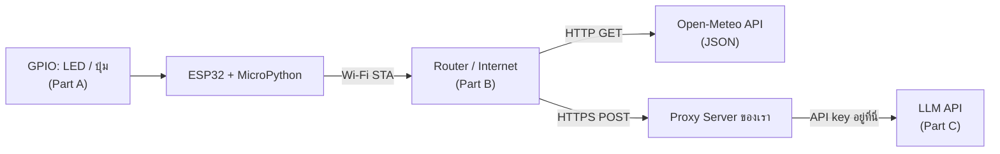

> **โมดูล:** Module 3 - IoT & Smart Systems (Mini-Project 3)
> **เวลาที่ใช้:** 2 ชั่วโมง (ในห้องปฏิบัติการ) + เวลาศึกษาด้วยตนเอง

## 🎯 จุดประสงค์การทดลอง (Objectives)
- ดึง API ของ LLM มาใช้ และต่อวงจร ESP32/Arduino ร่วมกับเซนเซอร์
- ประยุกต์ใช้ความรู้จากภาคทฤษฎี (สัปดาห์ที่ 10) สู่การปฏิบัติจริง
- เสริมสร้างทักษะการทำงานกลุ่มผ่าน Mini-Project

## 🛠️ เครื่องมือที่ต้องใช้ (Prerequisites & Tools)
- เครื่องคอมพิวเตอร์และอินเทอร์เน็ต (เบราว์เซอร์ Chrome/Edge)
- บัญชี [Wokwi](https://wokwi.com) (simulator ESP32 ออนไลน์ ไม่ต้องมีบอร์ดจริง)
- (ถ้ามี) บอร์ด ESP32 / KidBright32 จริง + สาย USB + Thonny IDE
- ความรู้ Python พื้นฐาน: ตัวแปร, `if`, `for`, `while`, function, list

---

## 🕒 ส่วนที่ 1: ทฤษฎีประยุกต์ประจำสัปดาห์ (1 ชั่วโมง)

ภาพรวมของ lab นี้คือการพาข้อมูลเดินทางจาก "ขาของชิป" ไปถึง "AI บนคลาวด์":



---

### Part A: MicroPython บน ESP32 ด้วย Wokwi

#### A1. สร้างโปรเจกต์
1. เข้า https://wokwi.com → **New Project** → เลือก **MicroPython on ESP32** (เทมเพลต ESP32 + MicroPython)
2. จะได้ไฟล์ `main.py` (โค้ด) และ `diagram.json` (วงจร) — กดปุ่ม **+** เพื่อเพิ่มชิ้นส่วน เช่น LED, Resistor, Pushbutton
3. ต่อ LED: ขายาว (anode, A) → resistor 220 Ω → **GPIO2**, ขาสั้น (cathode, C) → **GND**
4. กด ▶ (Start Simulation) โค้ดใน `main.py` จะรันทันที ผลของ `print()` จะแสดงใน Serial Monitor ด้านล่าง

> [!note] MicroPython คืออะไร
> MicroPython คือ Python 3 ฉบับย่อสำหรับไมโครคอนโทรลเลอร์ มีโมดูลเฉพาะฮาร์ดแวร์ เช่น `machine` (ควบคุมขา GPIO, I2C, ADC), `network` (Wi-Fi), `time` เขียน syntax เหมือน Python ปกติ

#### A2. Output: สั่ง LED ด้วย `Pin`

```python
from machine import Pin     # คลาส Pin ใช้ควบคุมขา GPIO
from time import sleep      # sleep(วินาที) หยุดรอ (รับทศนิยมได้ เช่น 0.5)

led = Pin(2, Pin.OUT)       # ขา GPIO2 เป็น output

led.on()                    # ส่งลอจิก 1 (3.3 V) → LED ติด
sleep(1)
led.off()                   # ส่งลอจิก 0 (0 V) → LED ดับ
sleep(1)
led.value(1)                # เทียบเท่า led.on()
led.value(0)                # เทียบเท่า led.off()
print(led.value())          # ไม่ใส่อาร์กิวเมนต์ = "อ่าน" สถานะปัจจุบัน
```

```output
0
```

| คำสั่ง | ความหมาย |
|---|---|
| `Pin(2, Pin.OUT)` | กำหนดขา 2 เป็นขาออก |
| `led.on()` / `led.off()` | ตั้งค่า 1 / 0 |
| `led.value(x)` | ตั้งค่าเป็น `x` (0 หรือ 1) |
| `led.value()` | อ่านค่าปัจจุบัน คืนค่า 0 หรือ 1 |

**Toggle (สลับสถานะ)** — ไม่ต้องรู้ว่าตอนนี้ติดหรือดับ:

```python
while True:
    led.value(not led.value())   # 1 → not 1 = False (0), 0 → not 0 = True (1)
    sleep(0.5)                   # LED กะพริบ ติด 0.5 s ดับ 0.5 s (คาบ 1 s)
```

> [!tip] ทำไม `not led.value()` ใช้ได้
> `not 1` ได้ `False` และ `not 0` ได้ `True` ส่วน `Pin.value()` รับ `True`/`False` ได้ (มองเป็น 1/0) จึงเป็นการสลับค่าในบรรทัดเดียว

#### A3. Input: ปุ่มกดแบบ Pull-up (active-low)

```python
from machine import Pin
from time import sleep

led = Pin(2, Pin.OUT)
btn = Pin(15, Pin.IN, Pin.PULL_UP)   # ขา 15 เป็น input + เปิดตัวต้านทาน pull-up ภายใน

while True:
    if btn.value() == 0:      # 0 = กำลังกด (active-low)
        led.on()
    else:                     # 1 = ไม่ได้กด
        led.off()
    sleep(0.05)               # หน่วงสั้น ๆ ลดการอ่านถี่เกินและลด bounce
```

การต่อวงจร: ปุ่มขาหนึ่ง → GPIO15 อีกขา → **GND** (ไม่ต่อ 3.3 V)

| สถานะปุ่ม | วงจร | `btn.value()` |
|---|---|---|
| ไม่กด | pull-up ดึงขาขึ้นไปที่ 3.3 V | **1** |
| กด | ปุ่มลัดขาลง GND | **0** |

> [!warning] Active-low กลับด้านกับสัญชาตญาณ
> "กด = 0" เพราะปุ่มต่อลง GND ถ้าเขียน `if btn.value() == 1: led.on()` LED จะติดตอน **ไม่กด** ซึ่งเป็นข้อผิดพลาดที่พบบ่อย ถ้าไม่ใส่ `Pin.PULL_UP` ขาจะ "ลอย" (floating) อ่านค่าสุ่ม 0/1

ตัวอย่างสั้นแบบ "LED ตามปุ่ม": `led.value(not btn.value())` → กด (0) ได้ LED = 1

#### A4. การคำนวณเวลา (Timing) ของลูป

หลักการ: **เวลารวม = (เวลาต่อรอบ) × (จำนวนรอบ)** โดยเวลาต่อรอบ = ผลรวมของ `sleep()` ทั้งหมดในรอบ (คำสั่งอื่นใช้เวลาน้อยมากจนตัดทิ้งได้)

```python
def blink():
    led.on();  sleep(0.5)
    led.off(); sleep(0.5)

for i in range(9):      # 9 รอบ
    blink()
```

```python
def blink_fast(n):
    for i in range(n):
        led.on();  sleep(0.25)
        led.off(); sleep(0.25)

blink_fast(6)
```

| โค้ด | เวลาต่อรอบ | จำนวนรอบ | เวลารวม | จำนวนครั้งที่ LED ติด |
|---|---|---|---|---|
| `blink()` × `range(9)` | 0.5 + 0.5 = 1.0 s | 9 | **9 s** | 9 |
| `blink_fast(6)` | 0.25 + 0.25 = 0.5 s | 6 | **3 s** | 6 |
| `for i in range(4): blink(); sleep(1)` | 1.0 + 1 = 2.0 s | 4 | **8 s** | 4 |
| `for i in range(2, 7): blink()` | 1.0 s | 7 − 2 = 5 | **5 s** | 5 |
| `for i in range(0, 10, 2): blink_fast(1)` | 0.5 s | 5 (0,2,4,6,8) | **2.5 s** | 5 |

> [!tip] จำนวนรอบของ `range`
> `range(n)` = n รอบ, `range(a, b)` = b − a รอบ, `range(a, b, s)` = ceil((b − a)/s) รอบ

#### A5. ฟังก์ชันที่มีพารามิเตอร์: `blink(L, t)`

```python
def blink(L, t):
    """กะพริบ LED ตัว L หนึ่งครั้ง ติด t วินาที ดับ t วินาที (ใช้เวลา 2t)"""
    L.on();  sleep(t)
    L.off(); sleep(t)

red   = Pin(2, Pin.OUT)
green = Pin(4, Pin.OUT)

blink(red, 0.5)    # 1.0 s
blink(green, 0.2)  # 0.4 s
blink(red, 1)      # 2.0 s   → รวม 3.4 s
```

ทำไมต้องใส่พารามิเตอร์:
- **Reuse / DRY (Don't Repeat Yourself):** เขียนตรรกะกะพริบครั้งเดียว ใช้ได้กับ LED กี่ดวงก็ได้ และความเร็วเท่าไรก็ได้
- **แก้ที่เดียว:** ถ้าต้องเปลี่ยนวิธีกะพริบ (เช่น เพิ่ม `print`) แก้ในฟังก์ชันเดียวมีผลทุกจุด
- **อ่านง่าย:** `blink(red, 0.5)` สื่อความหมายกว่า 4 บรรทัด on/sleep/off/sleep ซ้ำ ๆ

#### A6. LED หลายดวงด้วย List

```python
pins = [2, 4, 5, 18]
leds = [Pin(p, Pin.OUT) for p in pins]   # list comprehension: สร้าง Pin ทีละขา
# เทียบเท่า:
# leds = []
# for p in pins:
#     leds.append(Pin(p, Pin.OUT))
```

> [!tip] ข้อดีของ List Comprehension `[Pin(p, Pin.OUT) for p in pins]`
> - **สั้นและอ่านง่าย** — สร้าง LED ทุกดวงได้ในบรรทัดเดียว แทนการเขียน `Pin(...)` ซ้ำหลายบรรทัด
> - **แก้ที่เดียว** — ต้องการเพิ่ม/ลด/เปลี่ยนขา แก้เฉพาะรายการ `pins` ส่วนโค้ดที่เหลือไม่ต้องแก้ ลดโอกาสพิมพ์ผิด
> - **ใช้ต่อกับลูปและ slicing ได้ทันที** — เช่น `for L in leds`, `leds[::2]`, `reversed(leds)`
> - **ทำงานเหมือนลูป `for` + `append()`** ทุกประการ แต่ไม่ต้องสร้าง list ว่างก่อน

**(1) วนทุกดวงตามลำดับ** — `for L in leds`

```python
for L in leds:
    blink(L, 0.5)      # แต่ละดวงใช้ 1 s
```
ลำดับ: GPIO2 → 4 → 5 → 18, เวลารวม = 4 × 1 = **4 s**

**(2) ใช้ index ให้เวลาขึ้นกับตำแหน่ง** — `for i in range(len(leds))`

```python
for i in range(len(leds)):        # i = 0, 1, 2, 3
    blink(leds[i], 0.1 * (i + 1)) # t = 0.1, 0.2, 0.3, 0.4
```
เวลาแต่ละดวง = 2t → 0.2 + 0.4 + 0.6 + 0.8 = **2.0 s**

> [!warning] นับ `sleep()` จากโค้ดจริงเสมอ
> ถ้าฟังก์ชันมี `sleep` เพียงครั้งเดียว เวลาต่อดวงจะเป็น **t** ไม่ใช่ 2t เช่น
> ```python
> def blink(L, t):
>     L.on()
>     sleep(t)
>     L.off()          # ไม่มี sleep หลังดับ
>
> for i in range(len(leds)):
>     blink(leds[i], 0.2 * (i + 1))   # t = 0.2, 0.4, 0.6, 0.8
> ```
> เวลารวม = 0.2 + 0.4 + 0.6 + 0.8 = **2.0 s** (ถ้าจำสูตร "2t" ไปใช้จะได้ 4.0 s ซึ่งผิด) — หลักคือ **บวกทุก `sleep()` ที่ถูกเรียกจริง**

**(3) ย้อนลำดับ** — 3 วิธีที่ได้ผลเหมือนกัน (GPIO18 → 5 → 4 → 2):

```python
for L in reversed(leds):              # วิธีที่ 1: iterator ย้อนกลับ (ไม่สร้าง list ใหม่)
    blink(L, 0.5)

for L in leds[::-1]:                  # วิธีที่ 2: slicing step −1 (สร้าง list สำเนาใหม่)
    blink(L, 0.5)

for i in range(len(leds)-1, -1, -1):  # วิธีที่ 3: index 3, 2, 1, 0 (stop = −1 เพราะ stop ไม่รวม)
    blink(leds[i], 0.5)
```

**(4) ข้ามทีละ 2** — `leds[::2]` ได้ index 0, 2 → GPIO2, GPIO5 (และ `leds[1::2]` ได้ GPIO4, GPIO18)

```python
for L in leds[::2]:
    blink(L, 0.5)     # 2 ดวง × 1 s = 2 s
```

**(5) Knight Rider (ไป-กลับ)**

```python
for L in leds + leds[-2:0:-1]:   # 2,4,5,18 + 5,4  → 6 ครั้ง
    blink(L, 0.1)                # 6 × 0.2 = 1.2 s ต่อหนึ่งรอบไป-กลับ
```

**(6) ลูปนับด้วย `while`**

```python
count = 0
while count < 5:      # count = 0,1,2,3,4 → 5 รอบ
    blink(leds[0], 0.5)
    count += 1        # ลืมบรรทัดนี้ = infinite loop
print("done", count)
```

```output
done 5
```
เวลารวม = 5 × 1 s = **5 s**

**(7) สลับสถานะ (Toggle) ด้วยตัวนับ — LED สุดท้ายอยู่สถานะใด?**

```python
led = Pin(2, Pin.OUT)      # เริ่มต้นดับ (value = 0)
count = 0
while count < 5:
    led.value(not led.value())   # สลับ: ดับ→ติด, ติด→ดับ
    sleep(0.4)
    count += 1
```

| รอบ (count ก่อนบวก) | 0 | 1 | 2 | 3 | 4 |
|---|---|---|---|---|---|
| สถานะหลังสลับ | ติด | ดับ | ติด | ดับ | **ติด** |

ทำงาน **5 รอบ** · เวลารวม 5 × 0.4 = **2.0 s** · สลับ 5 ครั้ง (จำนวนคี่) จากสถานะดับ → จบที่สถานะ **ติด**
(ถ้าสลับจำนวนคู่ จะกลับมาที่สถานะเริ่มต้น)

---

### Part B: เชื่อมต่อ Wi-Fi และเรียก Web API

#### B1. โหมดของ Wi-Fi

```python
import network, urequests     # MicroPython รุ่นใหม่ใช้ชื่อ requests ได้ด้วย (urequests ยังใช้ได้)
```

| โหมด | ค่าคงที่ | บทบาท | ใช้เมื่อ |
|---|---|---|---|
| Station (STA) | `network.STA_IF` | ESP32 เป็น "ลูกข่าย" เชื่อมต่อเข้า router/hotspot | ต้องการออกอินเทอร์เน็ต เรียก API, ส่ง MQTT |
| Access Point (AP) | `network.AP_IF` | ESP32 "ปล่อย Wi-Fi ของตัวเอง" ให้มือถือ/คอมเชื่อมเข้ามา | ตั้งค่าอุปกรณ์ครั้งแรก, เว็บควบคุมในวงแคบโดยไม่มี router |

#### B2. เชื่อมต่อแบบมี timeout

```python
import network
from time import sleep

SSID = "Wokwi-GUEST"   # ใน Wokwi ใช้ SSID นี้ รหัสผ่านว่าง
PW   = ""

wlan = network.WLAN(network.STA_IF)  # สร้าง interface โหมด station
wlan.active(True)                    # เปิดวิทยุ Wi-Fi
wlan.connect(SSID, PW)               # เริ่มเชื่อมต่อ (ไม่ได้รอจนเสร็จ)

# แบบเสี่ยง: รอไม่สิ้นสุด ถ้ารหัสผิดหรือไม่มีสัญญาณ โปรแกรมค้างตรงนี้ตลอดไป
# while not wlan.isconnected():
#     sleep(0.5)

# แบบปลอดภัย: รอสูงสุด 20 × 0.5 = 10 วินาที
for i in range(20):
    if wlan.isconnected():
        break                         # เชื่อมได้แล้ว ออกจากลูปทันที
    print("connecting...", i)
    sleep(0.5)

if wlan.isconnected():
    ip, mask, gw, dns = wlan.ifconfig()   # tuple unpacking 4 ค่า
    print("IP:", ip, "Gateway:", gw)
else:
    print("Wi-Fi failed")             # จัดการความล้มเหลว: แจ้งเตือน/ติด LED แดง/ลองใหม่/machine.reset()
```

```output
connecting... 0
connecting... 1
IP: 10.10.0.2 Gateway: 10.10.0.1
```
*(ค่า IP ขึ้นกับเครือข่ายจริง)*

`wlan.ifconfig()` คืน tuple 4 ค่าเรียงตามนี้: **(IP address, subnet mask, gateway, DNS server)** เช่น `('192.168.1.45', '255.255.255.0', '192.168.1.1', '192.168.1.1')` ค่าเหล่านี้ router แจกให้อัตโนมัติด้วยโปรโตคอล **DHCP** (Dynamic Host Configuration Protocol) ตอนเชื่อมต่อ — ดูเรื่อง IP/gateway เพิ่มที่ [TCP-IP Model](/concept/tcp-ip-model)

> [!note] API รุ่นใหม่
> เอกสาร MicroPython รุ่นล่าสุดระบุว่า `ifconfig()` เป็น legacy และแนะนำ `wlan.ipconfig('addr4')` แทน แต่ `ifconfig()` ยังใช้ได้และพบในตัวอย่างส่วนใหญ่

#### B3. โครงสร้าง URL และ Query String

`https://api.open-meteo.com/v1/forecast?latitude=16.43&longitude=103.51&current_weather=true`

| ส่วน | ค่า | ความหมาย |
|---|---|---|
| scheme | `https` | โปรโตคอล (HTTP + TLS เข้ารหัส) |
| host | `api.open-meteo.com` | ชื่อเครื่องเซิร์ฟเวอร์ (DNS แปลงเป็น IP) |
| path | `/v1/forecast` | resource ที่ต้องการบนเซิร์ฟเวอร์ (v1 = API version 1) |
| `?` | — | จุดเริ่ม query string |
| parameters | `latitude=16.43`, `longitude=103.51`, `current_weather=true` | คู่ `key=value` คั่นด้วย `&` |

ตัวอย่าง URL อื่นของ Open-Meteo (พิกัดโดยประมาณของ จ.กาฬสินธุ์):
- ความชื้นปัจจุบัน: `...forecast?latitude=16.43&longitude=103.51&current=relative_humidity_2m`
- อุณหภูมิสูงสุดรายวัน: `...forecast?latitude=16.43&longitude=103.51&daily=temperature_2m_max&timezone=Asia/Bangkok` (เมื่อขอ `daily` ต้องระบุ `timezone` เพื่อกำหนดขอบเขตของวัน)

#### B4. HTTP Status Code

| Code | ชื่อ | ความหมาย |
|---|---|---|
| 200 | OK | สำเร็จ มีข้อมูลตอบกลับ |
| 201 | Created | สร้าง resource ใหม่สำเร็จ (มักตอบ POST) |
| 400 | Bad Request | คำขอผิดรูปแบบ เช่น พารามิเตอร์ผิด/ขาด |
| 401 | Unauthorized | ไม่ได้ยืนยันตัวตน หรือ API key ผิด/ไม่ส่ง |
| 403 | Forbidden | ยืนยันตัวตนแล้วแต่ไม่มีสิทธิ์ |
| 404 | Not Found | ไม่พบ path ที่ขอ |
| 500 | Internal Server Error | เซิร์ฟเวอร์ทำงานผิดพลาด |
| 503 | Service Unavailable | เซิร์ฟเวอร์ไม่พร้อม (ล่ม/โหลดเกิน/ปิดซ่อม) |

กลุ่ม: **2xx** สำเร็จ, **4xx** ฝั่ง client ผิด, **5xx** ฝั่ง server ผิด

#### B5. เรียก API และอ่าน JSON

```python
import urequests

URL = ("https://api.open-meteo.com/v1/forecast"
       "?latitude=16.43&longitude=103.51&current_weather=true")

r = urequests.get(URL)
print("status:", r.status_code)
if r.status_code == 200:
    data = r.json()                           # แปลง JSON text → dict ของ Python
    cw = data["current_weather"]              # dict ซ้อนชั้นที่ 1
    print("temp:", cw["temperature"], "°C")   # หรือ data["current_weather"]["temperature"]
    print("wind:", cw["windspeed"], "km/h")
r.close()                                     # คืน socket และหน่วยความจำ
```

```output
status: 200
temp: 25.1 °C
wind: 8.6 km/h
```

ตัวอย่าง response จริงของ `current_weather=true` (ค่าตัวเลขเปลี่ยนตามเวลา):

```json
{
  "latitude": 16.414762, "longitude": 103.529976,
  "utc_offset_seconds": 0, "timezone": "GMT", "elevation": 149.0,
  "current_weather_units": {"time": "iso8601", "interval": "seconds",
    "temperature": "°C", "windspeed": "km/h", "winddirection": "°",
    "is_day": "", "weathercode": "wmo code"},
  "current_weather": {"time": "2026-10-11T17:15", "interval": 900,
    "temperature": 25.1, "windspeed": 8.6, "winddirection": 91,
    "is_day": 0, "weathercode": 0}
}
```

> [!note] `latitude` ใน response ไม่ตรงกับที่ขอ
> Open-Meteo คืนพิกัดของจุดกริดที่ใกล้ที่สุดของแบบจำลองอากาศ (เช่น 16.414762) จึงต่างจาก 16.43 เล็กน้อย เป็นเรื่องปกติ นอกจากนี้ `current_weather` เป็นพารามิเตอร์รุ่นเก่าที่ยังใช้ได้ เอกสารปัจจุบันแนะนำ `current=...` แทน

`current=relative_humidity_2m` (รูปแบบใหม่ที่เอกสารแนะนำ):

```json
{
  "current_units": {"time": "iso8601", "interval": "seconds", "relative_humidity_2m": "%"},
  "current": {"time": "2026-10-11T17:15", "interval": 900, "relative_humidity_2m": 77}
}
```
อ่านค่า: `data["current"]["relative_humidity_2m"]` → `77`

`daily=temperature_2m_max&timezone=Asia/Bangkok` (ค่าเป็น **array** เรียงตามวัน, index 0 = วันนี้):

```json
{
  "timezone": "Asia/Bangkok", "utc_offset_seconds": 25200,
  "daily_units": {"time": "iso8601", "temperature_2m_max": "°C"},
  "daily": {
    "time": ["2026-10-12","2026-10-13","2026-10-14","2026-10-15","2026-10-16","2026-10-17","2026-10-18"],
    "temperature_2m_max": [31.6, 31.7, 29.9, 29.8, 29.9, 31.5, 30.8]
  }
}
```

```python
t = data["daily"]["temperature_2m_max"]
print("พรุ่งนี้:", data["daily"]["time"][1], t[1])   # index 1 = วันถัดไป
print("สูงสุด 7 วัน:", max(t))
print("เฉลี่ย:", round(sum(t) / len(t), 2))
```

```output
พรุ่งนี้: 2026-10-13 31.7
สูงสุด 7 วัน: 31.7
เฉลี่ย: 30.74
```
*(sum = 215.2, len = 7 → 215.2/7 = 30.742…)*

> [!warning] ทำไมต้อง `response.close()`
> ทุก request ใช้ **socket** หนึ่งตัวและ buffer ใน RAM ไมโครคอนโทรลเลอร์มี RAM น้อย (ESP32 มี SRAM ราว 520 KB สำหรับทุกอย่าง) และเปิด socket พร้อมกันได้จำกัด ถ้าเรียก API ในลูปโดยไม่ `close()` socket จะค้างสะสมจนเกิด `OSError` / `MemoryError` หรือบอร์ดค้าง บน PC ยังมี garbage collector และหน่วยความจำมากกว่า แต่บน MCU ควรปิดเองเสมอ

---

### Part C: เรียก GenAI (LLM) API จาก IoT

LLM API ส่วนใหญ่ใช้รูปแบบเดียวกัน: **HTTPS POST** + body เป็น **JSON** + ส่ง **API key** ใน header (ชื่อ header และรูปแบบ body ของแต่ละผู้ให้บริการต่างกัน ให้ตรวจสอบกับเอกสารทางการของผู้ให้บริการ)

```python
# รันบน PC/Server (Python ปกติ) — ห้ามฝัง key ลงในบอร์ด
import os, requests

API_KEY = os.environ["LLM_API_KEY"]          # อ่านจาก environment variable ไม่เขียนในโค้ด
readings = {"temp_c": [31.6, 32.4, 33.0], "humidity": [60, 65, 72]}

resp = requests.post(
    "https://api.example-llm.com/v1/chat",   # URL ตัวอย่าง — ใช้ endpoint จริงตามเอกสารผู้ให้บริการ
    headers={"Authorization": "Bearer " + API_KEY, "Content-Type": "application/json"},
    json={"model": "<model-name>",
          "messages": [{"role": "user",
                        "content": f"สรุปสภาพห้องจากข้อมูลนี้ใน 1 ประโยค: {readings}"}]},
    timeout=30,
)
print(resp.status_code)   # 200 สำเร็จ, 401 key ผิด, 429 เรียกถี่เกินโควตา
```

> [!warning] เก็บ API key เป็นความลับ
> - **ห้ามเขียน key ลงใน `main.py` บนบอร์ด** ใครได้บอร์ด/เฟิร์มแวร์ไปก็อ่าน flash ได้ และห้าม push key ขึ้น GitHub
> - ใช้สถาปัตยกรรม **proxy**: ESP32 → POST ข้อมูลเซนเซอร์ (JSON) ไปที่ server ของเรา → server แนบ key แล้วเรียก LLM → ส่งเฉพาะข้อความสรุปกลับมา
> - ข้อดีเพิ่ม: ลดภาระ TLS/RAM บน MCU, คุมค่าใช้จ่าย/rate limit, เปลี่ยนผู้ให้บริการได้โดยไม่ต้องแฟลชบอร์ดใหม่

ฝั่ง ESP32 จึงเหลือแค่:

```python
r = urequests.post("http://<proxy-server>/summarize",
                   json={"device": "esp32-01", "temp": 33.0, "hum": 72})
print(r.json()["summary"])
r.close()
```

แนวคิดที่เกี่ยวข้อง: [RAG และ LLM](/concept/rag-llm), [Edge Computing](/concept/edge-computing), [TinyML และ Edge AI](/concept/tinyml-edge-ai)

---

## 🚀 ส่วนที่ 2: งานพัฒนา Mini-Project (1 ชั่วโมง + การบ้าน)

- **เป้าหมายสัปดาห์นี้:** ให้บอร์ดของทีม "ออนไลน์ได้" และดึงข้อมูลจากภายนอกมาแสดงผล
- **โจทย์:**
  1. ESP32 เชื่อม Wi-Fi แบบมี timeout และแสดง IP ทาง Serial
  2. เรียก Open-Meteo ทุก 10 นาที อ่านอุณหภูมิปัจจุบันและค่าสูงสุดพรุ่งนี้
  3. LED หลายดวงแสดงระดับอุณหภูมิ (เช่น < 28 °C ติด 1 ดวง, 28–32 °C ติด 2 ดวง, > 32 °C ติดทุกดวง)
  4. (โบนัส) ส่งค่าไปยัง proxy เพื่อให้ LLM สรุปเป็นข้อความภาษาไทย
- **มอบหมายงานภายในทีม:** คนต่อวงจร Wokwi, คนเขียน Wi-Fi/API, คนเขียน logic LED, คนทำ proxy/เอกสาร

---

## ✏️ แบบฝึกหัด (Exercises)

**ข้อ 1.** โค้ดต่อไปนี้ใช้เวลารวมกี่วินาที และ LED ติดกี่ครั้ง
```python
def blink():
    led.on(); sleep(0.5); led.off(); sleep(0.5)
for i in range(1, 10):
    blink()
```
<details><summary>ดูเฉลย</summary>

`range(1, 10)` = 9 รอบ (1..9) × 1 s = **9 s**, LED ติด **9 ครั้ง**
</details>

**ข้อ 2.** ปุ่มต่อแบบ `Pin(15, Pin.IN, Pin.PULL_UP)` ปุ่มอีกขาต่อ GND ขณะ **กด** `btn.value()` มีค่าเท่าไร และต้องเขียนเงื่อนไขอย่างไรให้ LED ติดตอนกด
<details><summary>ดูเฉลย</summary>

กด = **0** (active-low) เขียน `if btn.value() == 0: led.on()` หรือ `led.value(not btn.value())`
</details>

**ข้อ 3.** `leds = [Pin(p, Pin.OUT) for p in [2, 4, 5, 18, 19]]` แล้วรัน `for i in range(len(leds)): blink(leds[i], 0.1*(i+1))` ใช้เวลารวมเท่าไร
<details><summary>ดูเฉลย</summary>

t = 0.1, 0.2, 0.3, 0.4, 0.5 แต่ละดวงใช้ 2t → 2 × (0.1+0.2+0.3+0.4+0.5) = 2 × 1.5 = **3.0 s**
</details>

**ข้อ 4.** จาก list ในข้อ 3 ลำดับขา GPIO ของ `leds[::-1]`, `leds[::2]` และ `leds[1::2]` คืออะไร
<details><summary>ดูเฉลย</summary>

- `leds[::-1]` → 19, 18, 5, 4, 2
- `leds[::2]` → 2, 5, 19 (index 0, 2, 4)
- `leds[1::2]` → 4, 18 (index 1, 3)
</details>

**ข้อ 5.** `range(len(leds)-1, -1, -1)` กับ list 5 ตัว ได้ index อะไรบ้าง ทำไม stop ต้องเป็น −1 ไม่ใช่ 0
<details><summary>ดูเฉลย</summary>

ได้ 4, 3, 2, 1, 0 เพราะ `range` **ไม่รวม** ค่า stop ถ้าใส่ 0 จะหยุดที่ 1 และไม่ได้ index 0
</details>

**ข้อ 6.** อธิบายความเสี่ยงของ `while not wlan.isconnected(): pass` และเขียนแบบมี timeout สูงสุด 15 วินาที (ตรวจทุก 0.5 s)
<details><summary>ดูเฉลย</summary>

ถ้ารหัสผิด/ไม่มีสัญญาณ โปรแกรมจะวนรอ **ไม่สิ้นสุด** ค้างทั้งระบบ แบบมี timeout: 15/0.5 = 30 รอบ
```python
for i in range(30):
    if wlan.isconnected():
        break
    sleep(0.5)
if not wlan.isconnected():
    print("Wi-Fi failed")
```
</details>

**ข้อ 7.** `wlan.ifconfig()` คืน `('192.168.1.45', '255.255.255.0', '192.168.1.1', '8.8.8.8')` จงระบุว่าแต่ละค่าคืออะไร และเขียนโค้ดดึงเฉพาะ gateway
<details><summary>ดูเฉลย</summary>

IP = 192.168.1.45, subnet mask = 255.255.255.0, gateway = 192.168.1.1, DNS = 8.8.8.8 · โค้ด: `ip, mask, gw, dns = wlan.ifconfig(); print(gw)` หรือ `wlan.ifconfig()[2]`
</details>

**ข้อ 8.** จาก URL `https://api.open-meteo.com/v1/forecast?latitude=16.43&longitude=103.51&daily=temperature_2m_max&timezone=Asia/Bangkok` ระบุ host, path และมีกี่ parameter
<details><summary>ดูเฉลย</summary>

host = `api.open-meteo.com`, path = `/v1/forecast`, parameter **4 ตัว** (latitude, longitude, daily, timezone) คั่นด้วย `&` 3 ตัว
</details>

**ข้อ 9.** ถ้า `t = data["daily"]["temperature_2m_max"]` มีค่า `[32.0, 33.5, 31.0, 30.5]` จงหาค่า `t[1]`, `t[-1]` และค่าเฉลี่ย
<details><summary>ดูเฉลย</summary>

`t[1]` = 33.5, `t[-1]` = 30.5, เฉลี่ย = (32.0+33.5+31.0+30.5)/4 = 127.0/4 = **31.75**
</details>

**ข้อ 10.** API ตอบ status 401 และ 503 หมายถึงอะไร ควรแก้ที่ฝั่งไหน
<details><summary>ดูเฉลย</summary>

401 = ไม่ได้ยืนยันตัวตน/API key ผิด → แก้ฝั่ง **client** (ตรวจ key/header) · 503 = server ไม่พร้อม → ปัญหาฝั่ง **server** ให้รอแล้ว retry ภายหลัง
</details>

**ข้อ 11.** ทำไมไม่ควรเก็บ API key ของ LLM ไว้ใน `main.py` บน ESP32 และควรออกแบบอย่างไร
<details><summary>ดูเฉลย</summary>

ผู้ที่ได้บอร์ดสามารถอ่าน flash/โค้ดแล้วนำ key ไปใช้ (เสียเงิน/ถูกใช้ในทางที่ผิด) และ key อาจหลุดขึ้น Git ควรให้ ESP32 ส่งข้อมูลไป **proxy server** ซึ่งเก็บ key ใน environment variable แล้วเรียก LLM แทน
</details>

---

## 📝 เกณฑ์การส่งงานและการประเมิน (Deliverables & Rubric)
- ส่งรายงานความคืบหน้า (Progress Log) เป็นไฟล์ Markdown ผ่าน GitHub
- ส่งโค้ดต้นฉบับผ่าน Repository ของกลุ่ม
- ให้ฟีดแบ็กความสมบูรณ์โดยพิจารณาจากเกณฑ์ของ CLO1, CLO4

## 📚 อ้างอิง
- MicroPython docs: `machine.Pin` https://docs.micropython.org/en/latest/library/machine.Pin.html
- MicroPython docs: `network.WLAN` https://docs.micropython.org/en/latest/library/network.WLAN.html
- MicroPython ESP32 quick reference https://docs.micropython.org/en/latest/esp32/quickref.html
- Wokwi ESP32 guide https://docs.wokwi.com/guides/esp32
- Open-Meteo Weather Forecast API https://open-meteo.com/en/docs
