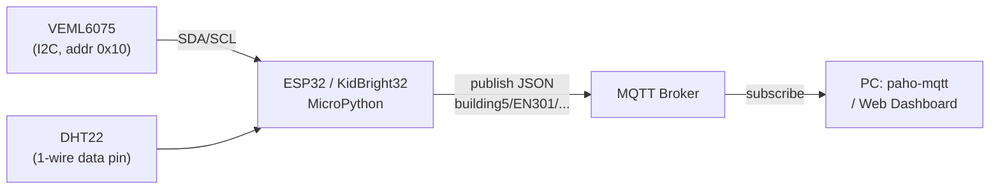

> **โมดูล:** Module 3 - IoT & Smart Systems (Mini-Project 3)
> **เวลาที่ใช้:** 2 ชั่วโมง (ในห้องปฏิบัติการ) + เวลาศึกษาด้วยตนเอง

## 🎯 จุดประสงค์การทดลอง (Objectives)
- เขียนโค้ด ESP32 ส่งข้อมูลไป Web Dashboard และรับกลับ
- ประยุกต์ใช้ความรู้จากภาคทฤษฎี (สัปดาห์ที่ 11) สู่การปฏิบัติจริง
- เสริมสร้างทักษะการทำงานกลุ่มผ่าน Mini-Project

## 🛠️ เครื่องมือที่ต้องใช้ (Prerequisites & Tools)
- เครื่องคอมพิวเตอร์และอินเทอร์เน็ต
- บอร์ด KidBright32 / ESP32 (หรือ Wokwi simulator) ที่ลง MicroPython แล้ว
- เซนเซอร์ DHT22 (อุณหภูมิ/ความชื้น) และเซนเซอร์ I2C เช่น VEML6075 (UVA/UVB)
- MQTT broker สาธารณะสำหรับทดลอง (เช่น `test.mosquitto.org` หรือ `broker.hivemq.com`) หรือ Mosquitto ที่ติดตั้งเอง
- PC ที่มี Python 3 และ `pip install paho-mqtt`
- พื้นฐานจาก [Lab 10 - GenAI API and ESP32 Sensors](/lab/10) (Pin, Wi-Fi, JSON)

---

## 🕒 ส่วนที่ 1: ทฤษฎีประยุกต์ประจำสัปดาห์ (1 ชั่วโมง)

ภาพรวมของ lab: อ่านเซนเซอร์ → ตัดสินใจบนบอร์ด → ส่งข้อมูลขึ้นเครือข่ายด้วย MQTT



### 1.1 การอ่านตัวรับรู้ผ่านบัส I2C และ DHT22 บนบอร์ด KidBright/ESP32

#### (ก) พื้นฐานบัส I2C

**I2C (Inter-Integrated Circuit)** เป็นบัสอนุกรมแบบ synchronous ที่ใช้สายสัญญาณเพียง **2 เส้น** (บวก GND ร่วม) ต่ออุปกรณ์หลายตัวบนสายคู่เดียวกันได้ ดูสรุปที่ [I2C Bus](/concept/i2c-bus)

| สาย | ชื่อเต็ม | หน้าที่ |
|---|---|---|
| **SDA** | Serial Data | รับส่งข้อมูลทีละบิต (สองทิศทาง) |
| **SCL** | Serial Clock | สัญญาณนาฬิกากำหนดจังหวะของแต่ละบิต |

| บทบาท | ในแล็บนี้ | หน้าที่ |
|---|---|---|
| **Controller** (เดิมเรียก master) | ESP32 | สร้างสัญญาณ clock บน SCL, เริ่ม (START) และจบ (STOP) การสื่อสาร, เลือกว่าจะคุยกับอุปกรณ์ตัวไหน |
| **Target** (เดิมเรียก slave) | เซนเซอร์ เช่น VEML6075, จอ OLED | รอฟัง และตอบเฉพาะเมื่อ controller เรียก **address 7 บิต** ของตัวเอง |

- address 7 บิต → มีได้ทางทฤษฎี 128 ค่า (0x00–0x7F) บางค่าถูกสงวนไว้ อุปกรณ์สองตัวบนบัสเดียวกัน **ห้ามมี address ซ้ำกัน**
- ความเร็วมาตรฐาน: **Standard mode 100 kHz**, **Fast mode 400 kHz** (VEML6075 รองรับ 10–400 kHz ตาม datasheet)
- สาย SDA/SCL เป็นแบบ open-drain จึงต้องมีตัวต้านทาน pull-up (บอร์ด/โมดูลเซนเซอร์ส่วนใหญ่ใส่มาแล้ว)

#### (ข) สร้างบัสและสแกนหาอุปกรณ์

```python
from machine import I2C, Pin

# I2C hardware บัสหมายเลข 0, กำหนดขา SCL/SDA และความถี่ 100 kHz
i2c = I2C(0, scl=Pin(5), sda=Pin(4), freq=100000)

devices = i2c.scan()                 # ส่ง address 0x08–0x77 ทีละค่า ตัวที่ตอบ ACK จะถูกเก็บใน list
print(devices)                       # list ของ int (ฐานสิบ)
print([hex(d) for d in devices])     # แปลงเป็นเลขฐานสิบหกให้อ่านง่าย
```

```output
[16, 60]
['0x10', '0x3c']
```

ตีความ: พบอุปกรณ์ **2 ตัว** — `0x10` (16) คือ VEML6075 และ `0x3c` (60) มักเป็นจอ OLED SSD1306 ถ้าได้ `[]` แปลว่าไม่พบอุปกรณ์ ให้ตรวจสาย SDA/SCL สลับกันหรือไม่, ไฟเลี้ยง, GND ร่วม และ pull-up

> [!warning] ขา SDA/SCL ขึ้นกับบอร์ด
> ESP32 กำหนดขา I2C ได้เกือบทุกขา ตัวอย่างนี้ใช้ `scl=Pin(5), sda=Pin(4)` ตามที่ใช้ในชั้นเรียน ส่วนบอร์ด ESP32 DevKit ทั่วไปมักใช้ SCL=GPIO22, SDA=GPIO21 สำหรับ **KidBright32** ขาของพอร์ต I2C/KB-Chain ให้ **ตรวจสอบกับ schematic/pinout ของบอร์ด (NECTEC)** ก่อนใช้งาน เพราะยังไม่ได้ยืนยันจากเอกสารทางการในบันทึกนี้

#### (ค) อ่านค่าจาก register: `readfrom_mem(addr, reg, nbytes)`

เซนเซอร์ I2C เก็บค่าไว้ใน **register ภายใน** แต่ละตัวมีหมายเลข (register address) ของตัวเอง

| พารามิเตอร์ | ความหมาย | ตัวอย่าง |
|---|---|---|
| `addr` | address ของ **อุปกรณ์** บนบัส | `0x10` = VEML6075 |
| `reg` (memaddr) | address ของ **register ภายในอุปกรณ์** | `0x07` = UVA data |
| `nbytes` | จำนวนไบต์ที่จะอ่าน | `2` (ค่า 16 บิต) |

Register map ของ VEML6075 (จาก Vishay datasheet Rev. 1.1): `0x00` UV_CONF, `0x07` UVA_Data, `0x09` UVB_Data, `0x0A` UVCOMP1, `0x0B` UVCOMP2, `0x0C` ID (ค่า LSB = `0x26`) ทุก register กว้าง 16 บิต ส่ง **ไบต์ต่ำ (LSB) ก่อน** แล้วจึงไบต์สูง (MSB)

```python
ADDR = 0x10
i2c.writeto_mem(ADDR, 0x00, bytes([0x00, 0x00]))  # UV_CONF: บิต SD = 0 → power on (โหมดวัดต่อเนื่อง)

data = i2c.readfrom_mem(ADDR, 0x07, 2)   # อ่าน UVA 2 ไบต์ → b'\x34\x12' (ตัวอย่าง)
uva = data[0] | (data[1] << 8)           # รวมเป็นค่า 16 บิตแบบ little-endian

data = i2c.readfrom_mem(ADDR, 0x09, 2)   # อ่าน UVB
uvb = data[0] | (data[1] << 8)
print("UVA raw:", uva, "UVB raw:", uvb)
```

> [!note] ค่า raw ยังไม่ใช่ UV Index
> ค่าที่ได้เป็น "count" ดิบ การแปลงเป็น UV Index ต้องหักค่าชดเชย (UVCOMP1/2) และคูณสัมประสิทธิ์ตาม application note ของ Vishay ให้ตรวจสอบกับ datasheet/application note ก่อนใช้งานจริง

#### (ง) รวมไบต์แบบ little-endian ด้วย `<<` และ `|`

- **Little-endian** = เก็บ/ส่ง **ไบต์ต่ำก่อน** → `data[0]` = LSB, `data[1]` = MSB
- `x << 8` = เลื่อนบิตไปทางซ้าย 8 ตำแหน่ง = คูณ 2⁸ = 256 → ย้ายไบต์ MSB ไปอยู่ตำแหน่งบิต 8–15
- `a | b` = OR ทีละบิต ใช้ "ประกอบ" สองส่วนที่ไม่ทับกัน (บิต 0–7 กับบิต 8–15) จึงให้ผลเท่ากับการบวก

$$\text{value} = \text{data}[0] \;|\; (\text{data}[1] \ll 8) = \text{LSB} + 256 \times \text{MSB}$$

| `data` (LSB, MSB) | `data[1] << 8` | OR กับ `data[0]` | hex | ฐานสิบ |
|---|---|---|---|---|
| `[0x34, 0x12]` | 0x1200 | 0x1200 \| 0x34 | **0x1234** | 18×256 + 52 = **4660** |
| `[0xA0, 0x01]` | 0x0100 | 0x0100 \| 0xA0 | **0x01A0** | 1×256 + 160 = **416** |
| `[0xFF, 0x00]` | 0x0000 | 0x0000 \| 0xFF | **0x00FF** | **255** |
| `[0x00, 0x02]` | 0x0200 | 0x0200 \| 0x00 | **0x0200** | 2×256 = **512** |

```python
for d in ([0x34, 0x12], [0xA0, 0x01], [0xFF, 0x00], [0x00, 0x02]):
    v = d[0] | (d[1] << 8)
    print(d, hex(v), v)
```

```output
[52, 18] 0x1234 4660
[160, 1] 0x1a0 416
[255, 0] 0xff 255
[0, 2] 0x200 512
```

> [!warning] กลับลำดับผิด = ค่าผิด
> ถ้าเขียน `(data[0] << 8) | data[1]` (big-endian) กับ `[0x34, 0x12]` จะได้ 0x3412 = 13330 แทน 4660 ต้องดู datasheet เสมอว่าอุปกรณ์ส่งไบต์ไหนก่อน

#### (จ) DHT22: อุณหภูมิและความชื้น

DHT22 (AM2302) **ไม่ใช่อุปกรณ์ I2C** ใช้สายข้อมูลเส้นเดียว (single-wire protocol เฉพาะของมันเอง) MicroPython มีโมดูล `dht` ในตัว

```python
import dht
from machine import Pin
from time import sleep

sensor = dht.DHT22(Pin(15))   # ขา data ของ DHT22 ต่อ GPIO15 (เปลี่ยนตามวงจรจริง)
led = Pin(2, Pin.OUT)

while True:
    sensor.measure()          # สั่งวัด 1 ครั้ง (ต้องเรียกก่อนอ่านทุกครั้ง)
    t = sensor.temperature()  # °C (float)
    h = sensor.humidity()     # %RH (float)
    print("T =", t, "C  H =", h, "%")
    sleep(2)                  # DHT22 อ่านได้ประมาณ 1 ครั้ง/2 วินาที อ่านถี่กว่านี้อาจ error
```

```output
T = 24.0 C  H = 40.0 %
```

> [!tip] Wokwi
> ใน Wokwi เพิ่มชิ้นส่วน **DHT22** แล้วคลิกที่เซนเซอร์ระหว่างจำลองเพื่อเลื่อนปรับค่า temperature/humidity ได้ ใช้ทดสอบเงื่อนไข if ได้สะดวก

ควรครอบ `measure()` ด้วย `try/except OSError` เพราะถ้าสายหลุดหรืออ่านเร็วเกิน จะเกิด `OSError`

#### (ฉ) ตรรกะการตัดสินใจ (Decision logic)

**แบบ `if` อย่างเดียว** — อากาศแห้ง:
```python
if h < 25:
    led.on()          # ความชื้นต่ำกว่า 25% → เปิดไฟเตือน (เช่น สั่งเครื่องเพิ่มความชื้น)
```

**แบบ `if-else` + `or`** — เงื่อนไขใดเงื่อนไขหนึ่งจริงก็เตือน:
```python
if t > 35 or h > 80:
    led.on();  print("ALERT")
else:
    led.off(); print("NORMAL")
```

**แบบ `and`** — ต้องจริงทั้งคู่:
```python
if t > 30 and h > 70:
    print("ร้อนชื้น เปิดพัดลม")
```

**แบบ `if-elif-else`** — ดัชนีความร้อนอย่างง่าย (สูตรสำหรับฝึกเขียนโปรแกรม ไม่ใช่ Heat Index มาตรฐานทางอุตุนิยมวิทยา):
```python
heat = t + 0.1 * h
if heat >= 38:
    level = "DANGER"
elif heat >= 35:
    level = "WARNING"
else:
    level = "OK"
```

| t (°C) | h (%) | `t > 35 or h > 80` | `t > 30 and h > 70` | heat = t + 0.1h | level |
|---|---|---|---|---|---|
| 33 | 60 | False | False | 39.0 | DANGER |
| 32 | 40 | False | False | 36.0 | WARNING |
| 30 | 50 | False | False | 35.0 | WARNING (≥ 35) |
| 28 | 85 | True (h) | False | 36.5 | WARNING |
| 36 | 20 | True (t) | False | 38.0 | DANGER (≥ 38) |
| 31 | 75 | False | True | 38.5 | DANGER |
| 25 | 50 | False | False | 30.0 | OK |

> [!tip] ลำดับของ `elif` สำคัญ
> ต้องเช็กเกณฑ์สูง (≥ 38) ก่อน ถ้าเช็ก ≥ 35 ก่อน ค่า 39 จะตกเป็น WARNING เพราะ `elif` จะหยุดที่เงื่อนไขแรกที่เป็นจริง

---

### 1.2 ส่งข้อมูลด้วย MQTT

#### (ก) แนวคิด Publish/Subscribe

MQTT เป็นโปรโตคอลน้ำหนักเบาบน TCP (พอร์ตมาตรฐาน **1883**, แบบ TLS **8883**) อุปกรณ์ไม่คุยกันตรง ๆ แต่ผ่าน **broker**:
- **Publisher** (ESP32) ส่งข้อความไปที่ **topic**
- **Subscriber** (PC/Dashboard) บอก broker ว่าสนใจ topic ใด broker จะส่งต่อข้อความให้

#### (ข) การออกแบบ Topic

ใช้ลำดับชั้นคั่นด้วย `/` จากกว้างไปแคบ เช่น `building5/EN301/temperature`

| Topic | ความหมาย |
|---|---|
| `building5/EN301/temperature` | อุณหภูมิห้อง EN301 อาคาร 5 |
| `building5/EN301/humidity` | ความชื้นห้องเดียวกัน |
| `building5/EN301/led/set` | คำสั่งควบคุม LED (ทิศทางกลับ: PC → ESP32) |

Wildcard (ใช้ได้เฉพาะตอน **subscribe**):

| Wildcard | ความหมาย | ตัวอย่าง | ตรงกับ |
|---|---|---|---|
| `+` | แทน **หนึ่งระดับ** พอดี | `building5/+/temperature` | `building5/EN301/temperature`, `building5/EN302/temperature` (ไม่ตรงกับ `building5/EN301/a/temperature`) |
| `#` | แทน **ทุกระดับที่เหลือ** ต้องอยู่ท้ายสุด | `building5/EN301/#` | ทุก topic ใต้ห้อง EN301 |

#### (ค) QoS (Quality of Service)

| QoS | ชื่อ | การรับประกัน | ใช้เมื่อ |
|---|---|---|---|
| 0 | At most once | ส่งครั้งเดียว ไม่ยืนยัน อาจหาย | ค่าเซนเซอร์ที่ส่งถี่ หายบ้างไม่เป็นไร |
| 1 | At least once | ยืนยันด้วย PUBACK ไม่หายแต่ **อาจซ้ำ** | แจ้งเตือน/คำสั่งทั่วไป |
| 2 | Exactly once | handshake 4 ขั้น ไม่หายไม่ซ้ำ ช้าที่สุด | ข้อมูลสำคัญ เช่น การนับ/การเงิน |

> [!note] `umqtt.simple` บน MicroPython รองรับ publish ที่ QoS 0 และ 1 (ไม่รองรับ QoS 2)

#### (ง) ESP32 publish ข้อมูลเซนเซอร์เป็น JSON

```python
import network, json, dht
from time import sleep
from machine import Pin
from umqtt.simple import MQTTClient

# 1) เชื่อม Wi-Fi (แบบมี timeout ตาม Lab 10)
wlan = network.WLAN(network.STA_IF); wlan.active(True)
wlan.connect("Wokwi-GUEST", "")
for i in range(20):
    if wlan.isconnected(): break
    sleep(0.5)

# 2) เชื่อม broker
client = MQTTClient("ksu-en301-esp32-01", "test.mosquitto.org")  # client_id ต้องไม่ซ้ำกับคนอื่น
client.connect()

sensor = dht.DHT22(Pin(15))
TOPIC = b"building5/EN301/sensor"

while True:
    sensor.measure()
    msg = json.dumps({"t": sensor.temperature(), "h": sensor.humidity()})
    client.publish(TOPIC, msg)      # publish(topic, msg) — ค่าเริ่มต้น QoS 0
    print("sent", msg)
    sleep(10)
```

```output
sent {"t": 24.0, "h": 40.0}
```

> [!warning] Broker สาธารณะ
> ทุกคนบนอินเทอร์เน็ต subscribe topic เดียวกันได้ ห้ามส่งข้อมูลส่วนบุคคลหรือรหัสผ่าน ใช้ topic ที่มี prefix เฉพาะกลุ่ม และในงานจริงควรใช้ broker ที่มี username/password + TLS (ดู [CIA Triad](/concept/cia-triad))

#### (จ) Subscriber บน PC ด้วย paho-mqtt

```python
# pip install paho-mqtt   (โค้ดนี้สำหรับ paho-mqtt 2.x)
import json
import paho.mqtt.client as mqtt

def on_connect(client, userdata, flags, reason_code, properties):
    print("connected:", reason_code)
    client.subscribe("building5/EN301/#")      # รับทุก topic ของห้อง EN301

def on_message(client, userdata, msg):
    data = json.loads(msg.payload)             # payload เป็น bytes → dict
    print(msg.topic, data["t"], data["h"])

client = mqtt.Client(mqtt.CallbackAPIVersion.VERSION2)
client.on_connect = on_connect
client.on_message = on_message
client.connect("test.mosquitto.org", 1883, 60)  # host, port, keepalive (วินาที)
client.loop_forever()
```

```output
connected: Success
building5/EN301/sensor 24.0 40.0
```

**รับคำสั่งกลับที่ ESP32** (ทิศทาง PC → บอร์ด):

```python
def on_cmd(topic, msg):
    led.value(1 if msg == b"ON" else 0)

client.set_callback(on_cmd)
client.subscribe(b"building5/EN301/led/set")
while True:
    client.check_msg()      # ตรวจข้อความใหม่แบบไม่บล็อก (ต้องเรียกในลูป)
    sleep(0.1)
```

แนวคิดที่เกี่ยวข้อง: [Edge Computing](/concept/edge-computing), [TCP-IP Model](/concept/tcp-ip-model), [สัปดาห์ที่ 11: Embedded Systems & IoT](/module/11)

---

## 🚀 ส่วนที่ 2: งานพัฒนา Mini-Project (1 ชั่วโมง + การบ้าน)

- **เป้าหมายสัปดาห์นี้:** ให้บอร์ดของทีมวัดค่าจริงและส่งข้อมูลขึ้น MQTT ให้ Dashboard แสดงผลได้
- **โจทย์:**
  1. `i2c.scan()` แสดงอุปกรณ์ทั้งหมดบนบัสเป็นเลขฐานสิบหก บันทึกผลลงรายงาน
  2. อ่าน UVA/UVB จาก VEML6075 และ T/H จาก DHT22 ทุก 10 วินาที
  3. ใช้ `if-elif-else` จัดระดับ OK/WARNING/DANGER และแสดงด้วย LED
  4. publish JSON `{"t":..,"h":..,"uva":..,"uvb":..,"level":..}` ไปที่ `building5/<ห้อง>/sensor` และเขียน subscriber บน PC
  5. (โบนัส) รับคำสั่ง `ON`/`OFF` จาก topic `.../led/set`
- **มอบหมายงานภายในทีม:** คนต่อวงจร/เซนเซอร์, คนเขียนโค้ดอ่าน I2C/DHT22, คนทำ MQTT + subscriber, คนออกแบบ topic/เอกสาร

---

## ✏️ แบบฝึกหัด (Exercises)

**ข้อ 1.** ในบัส I2C ใครเป็นผู้สร้างสัญญาณบน SCL และอุปกรณ์รู้ได้อย่างไรว่าถูกเรียก
<details><summary>ดูเฉลย</summary>

**Controller (ESP32)** สร้าง clock และเริ่มการสื่อสาร ส่วน target (เซนเซอร์) จะตอบเมื่อ controller ส่ง **address 7 บิต** ที่ตรงกับของตัวเอง
</details>

**ข้อ 2.** `print([hex(d) for d in i2c.scan()])` ได้ `['0x10', '0x3c', '0x68']` มีอุปกรณ์กี่ตัว และ 0x3c เป็นเลขฐานสิบเท่าไร
<details><summary>ดูเฉลย</summary>

**3 ตัว** · 0x3c = 3×16 + 12 = **60**
</details>

**ข้อ 3.** ใน `i2c.readfrom_mem(0x10, 0x09, 2)` ตัวเลขแต่ละตัวหมายถึงอะไร
<details><summary>ดูเฉลย</summary>

`0x10` = address ของอุปกรณ์ (VEML6075), `0x09` = register ภายใน (UVB_Data), `2` = อ่าน 2 ไบต์ (ค่า 16 บิต)
</details>

**ข้อ 4.** จงคำนวณ `data[0] | (data[1] << 8)` เมื่อ `data = [0x10, 0x27]` และ `data = [0x0A, 0x00]`
<details><summary>ดูเฉลย</summary>

- `[0x10, 0x27]` → 0x2710 = 39×256 + 16 = 9984 + 16 = **10000**
- `[0x0A, 0x00]` → 0x000A = **10**
</details>

**ข้อ 5.** ถ้าเขียนผิดเป็น `(data[0] << 8) | data[1]` กับ `data = [0xA0, 0x01]` จะได้เท่าไร ต่างจากค่าที่ถูกเท่าไร
<details><summary>ดูเฉลย</summary>

ได้ 0xA001 = 160×256 + 1 = **40961** ค่าที่ถูก (little-endian) คือ 0x01A0 = **416**
</details>

**ข้อ 6.** ให้ t = 34, h = 45 จงหาผลของ `t > 35 or h > 80`, `t > 30 and h > 40` และระดับจาก `heat = t + 0.1*h` (เกณฑ์ 38/35)
<details><summary>ดูเฉลย</summary>

- `t > 35 or h > 80` → False or False = **False**
- `t > 30 and h > 40` → True and True = **True**
- heat = 34 + 4.5 = 38.5 ≥ 38 → **DANGER**
</details>

**ข้อ 7.** ต้องเรียกเมธอดใดของ DHT22 ก่อนอ่าน `temperature()` และ `humidity()` และควรอ่านห่างกันอย่างน้อยเท่าไร
<details><summary>ดูเฉลย</summary>

ต้องเรียก **`sensor.measure()`** ก่อน และควรเว้นประมาณ **2 วินาที** ต่อการอ่านหนึ่งครั้ง
</details>

**ข้อ 8.** subscribe `building5/+/temperature` จะได้รับข้อความจาก topic ใดบ้าง: (a) `building5/EN301/temperature` (b) `building5/EN301/humidity` (c) `building5/EN302/temperature` (d) `building5/EN301/lab/temperature`
<details><summary>ดูเฉลย</summary>

ได้ **(a) และ (c)** · (b) ระดับสุดท้ายไม่ตรง · (d) มี 2 ระดับตรงกลาง แต่ `+` แทนได้แค่ระดับเดียว (ถ้าต้องการทุกระดับใช้ `building5/#`)
</details>

**ข้อ 9.** ระบบรายงานอุณหภูมิทุก 5 วินาที และระบบสั่งเปิด/ปิดประตู ควรเลือก QoS ใด เพราะอะไร
<details><summary>ดูเฉลย</summary>

อุณหภูมิ → **QoS 0** (ส่งถี่ หายหนึ่งค่าไม่กระทบ ประหยัดทรัพยากร) · คำสั่งประตู → **QoS 1** ขึ้นไป (ต้องไม่หาย ถ้าซ้ำได้ให้ออกแบบคำสั่งแบบ idempotent เช่น "OPEN" ซ้ำก็ยังเปิดอยู่) หรือ QoS 2 ถ้า broker/ไลบรารีรองรับและต้องไม่ซ้ำเด็ดขาด
</details>

**ข้อ 10.** เขียนโค้ด MicroPython ส่ง `{"t": 30.5}` ไปที่ `building5/EN301/temperature`
<details><summary>ดูเฉลย</summary>

```python
import json
from umqtt.simple import MQTTClient
c = MQTTClient("ksu-student-01", "test.mosquitto.org")
c.connect()
c.publish(b"building5/EN301/temperature", json.dumps({"t": 30.5}))
c.disconnect()
```
</details>

---

## 📝 เกณฑ์การส่งงานและการประเมิน (Deliverables & Rubric)
- ส่งรายงานความคืบหน้า (Progress Log) เป็นไฟล์ Markdown ผ่าน GitHub
- ส่งโค้ดต้นฉบับผ่าน Repository ของกลุ่ม
- ให้ฟีดแบ็กความสมบูรณ์โดยพิจารณาจากเกณฑ์ของ CLO2, CLO4

## 📚 อ้างอิง
- MicroPython docs: `machine.I2C` https://docs.micropython.org/en/latest/library/machine.I2C.html
- MicroPython ESP32 quick reference (I2C, DHT) https://docs.micropython.org/en/latest/esp32/quickref.html
- Vishay VEML6075 datasheet (Rev. 1.1, 19-May-16) https://www.vishay.com/docs/84304/veml6075.pdf
- micropython-lib `umqtt.simple` https://github.com/micropython/micropython-lib/tree/master/micropython/umqtt.simple
- Eclipse Paho MQTT Python client https://eclipse.dev/paho/files/paho.mqtt.python/html/
- KidBright32 pinout/schematic: ตรวจสอบจากเอกสารของ NECTEC
