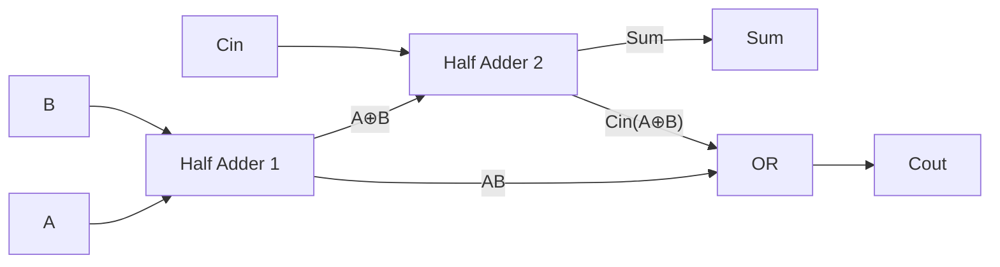

## 📖 เนื้อหาและคำอธิบาย

การออกแบบชิป (Chip Design) หรือวงจรรวม (Integrated Circuits) ในยุคปัจจุบันที่มีความซับซ้อนระดับพันล้านทรานซิสเตอร์ ล้วนมีรากฐานมาจากหลักการพื้นฐานของวงจรตรรกะ (Logic Circuits) การทำความเข้าใจเส้นทางจากสวิตช์อิเล็กทรอนิกส์พื้นฐานไปสู่หน่วยประมวลผลทางคณิตศาสตร์ เป็นหัวใจสำคัญของวิศวกรรมคอมพิวเตอร์

### 1. จากทรานซิสเตอร์สู่ Logic Gates
ทรานซิสเตอร์ (Transistor) โดยเฉพาะชนิด CMOS (Complementary Metal-Oxide-Semiconductor) ทำหน้าที่เป็นสวิตช์ที่ควบคุมด้วยแรงดันไฟฟ้า เมื่อนำทรานซิสเตอร์ชนิด NMOS และ PMOS มาต่อรวมกัน เราสามารถสร้างเกตตรรกะพื้นฐาน เช่น `NAND`, `NOR`, และ `NOT` ได้ ซึ่งเกตเหล่านี้เป็นหน่วยสร้างพื้นฐาน (Building Blocks) ของวงจรดิจิทัลทั้งหมด

### 2. ตารางความจริง (Truth Tables) และพีชคณิตบูลีน (Boolean Algebra)
ในการออกแบบวงจรตรรกะ เราเริ่มต้นจากการกำหนดพฤติกรรมของวงจรผ่าน **ตารางความจริง (Truth Table)** ซึ่งแสดงผลลัพธ์ (Output) สำหรับทุกๆ ความเป็นไปได้ของอินพุต (Input) จากนั้น นำตารางความจริงมาเขียนเป็นสมการทางคณิตศาสตร์โดยใช้พีชคณิตบูลีน การลดรูปสมการเหล่านี้ให้สั้นที่สุดจะช่วยลดจำนวนเกตที่ต้องใช้ ซึ่งส่งผลโดยตรงต่อการลดพื้นที่บนซิลิคอนและลดการใช้พลังงาน

### 3. การลดรูปสมการด้วย K-Maps (Karnaugh Maps)
แม้พีชคณิตบูลีนจะสามารถลดรูปสมการได้ แต่ในทางปฏิบัติ การใช้ **Karnaugh Maps (K-Maps)** เป็นวิธีเชิงกราฟิกที่ช่วยให้วิศวกรสามารถมองเห็นและจับกลุ่มพจน์ (Terms) ที่ซ้ำซ้อนกันได้อย่างรวดเร็วและมีประสิทธิภาพมากขึ้น โดยเฉพาะสำหรับวงจรที่มีอินพุต 3 ถึง 5 ตัว K-Maps ช่วยให้ได้สมการแบบ Sum-of-Products (SOP) หรือ Product-of-Sums (POS) ที่ประหยัดเกตที่สุด

### 4. การสร้างวงจรเชิงคำนวณ (Combinational Logic)
เมื่อนำ Logic Gates มาต่อกัน เราสามารถสร้างวงจรที่ทำหน้าที่ซับซ้อนขึ้นได้ ตัวอย่างที่สำคัญที่สุดคือวงจรบวกเลข:
- **Half Adder:** วงจรบวกเลข 1 บิต 2 ตัว มีเอาต์พุตเป็น Sum และ Carry (ตัวทด)
- **Full Adder:** พัฒนาจาก Half Adder โดยเพิ่มการรับตัวทดจากหลักก่อนหน้า (Carry-in)

### 5. สู่การสร้าง ALU (Arithmetic Logic Unit)
เมื่อนำ Full Adder หลายๆ ตัวมาต่อกันแบบขนาน (Ripple Carry Adder) หรือแบบคาดการณ์ตัวทดล่วงหน้า (Carry-Lookahead Adder) และรวมเข้ากับวงจรตรรกะระดับบิต (เช่น AND, OR, XOR) เราจะได้หน่วยประมวลผลทางคณิตศาสตร์และตรรกะ หรือ **ALU** ซึ่งเป็นแกนกลางของการทำงานใน CPU ทุกตัวในโลก 

การออกแบบในระดับนี้ถือเป็นจุดเปลี่ยนผ่านที่สำคัญจากวงจรไฟฟ้าดิจิทัล ไปสู่สถาปัตยกรรมคอมพิวเตอร์ที่สามารถรับคำสั่ง (Instruction) และประมวลผลข้อมูลได้จริง

### 6. การแปลงเลขฐาน (Number Base Conversion)
คอมพิวเตอร์เก็บทุกอย่างเป็นเลขฐานสอง (binary) แต่มนุษย์ใช้ฐานสิบ (decimal) และวิศวกรนิยมเขียนเป็นฐานสิบหก (hexadecimal) เพราะสั้นกว่า

| ฐาน | หลักที่ใช้ | ตัวอย่าง |
|---|---|---|
| 2 (Binary) | 0, 1 | $1101_2$ |
| 10 (Decimal) | 0–9 | $13_{10}$ |
| 16 (Hexadecimal) | 0–9, A(10), B(11), C(12), D(13), E(14), F(15) | $D_{16}$ หรือ `0xD` |

**ค่าประจำหลักของฐานสอง:** $2^7=128,\ 2^6=64,\ 2^5=32,\ 2^4=16,\ 2^3=8,\ 2^2=4,\ 2^1=2,\ 2^0=1$

**ตัวอย่างที่ 1: ฐานสิบ → ฐานสอง (หารด้วย 2 ซ้ำ ๆ แล้วอ่านเศษจากล่างขึ้นบน)** แปลง $156_{10}$

| การหาร | ผลหาร | เศษ |
|---|---|---|
| 156 ÷ 2 | 78 | 0 |
| 78 ÷ 2 | 39 | 0 |
| 39 ÷ 2 | 19 | 1 |
| 19 ÷ 2 | 9 | 1 |
| 9 ÷ 2 | 4 | 1 |
| 4 ÷ 2 | 2 | 0 |
| 2 ÷ 2 | 1 | 0 |
| 1 ÷ 2 | 0 | 1 |

อ่านเศษจากล่างขึ้นบน: $156_{10} = 10011100_2$

**ตัวอย่างที่ 2: ฐานสอง → ฐานสิบ (คูณค่าประจำหลักแล้วบวก)** แปลง $101101_2$

$$101101_2 = 1(32) + 0(16) + 1(8) + 1(4) + 0(2) + 1(1) = 45_{10}$$

**ตัวอย่างที่ 3: ฐานสิบหก → ฐานสิบ** แปลง $3A7_{16}$ (ค่าประจำหลัก $16^2=256,\ 16^1=16,\ 16^0=1$)

$$3A7_{16} = 3(256) + 10(16) + 7(1) = 768 + 160 + 7 = 935_{10}$$

**ตัวอย่างที่ 4: ฐานสิบ → ฐานสิบหก (หารด้วย 16 ซ้ำ ๆ)** แปลง $250_{10}$: $250 ÷ 16 = 15$ เศษ $10$ (A), $15 ÷ 16 = 0$ เศษ $15$ (F) → อ่านจากล่างขึ้นบน $250_{10} = FA_{16}$ (ตรวจ: $15 \times 16 + 10 = 250$ ✓)

**ตัวอย่างที่ 5: ฐานสอง ↔ ฐานสิบหก (จับกลุ่มทีละ 4 บิต)** เพราะ $2^4 = 16$ ทุก 4 บิตจึงเท่ากับเลขฐานสิบหก 1 หลักพอดี
- $11010110_2$ → แบ่งเป็น `1101 | 0110` → `D | 6` → $D6_{16}$
- $2F_{16}$ → `2 = 0010`, `F = 1111` → $00101111_2 = 101111_2$
- ถ้าจำนวนบิตไม่ครบ 4 ให้เติม 0 ด้านซ้าย เช่น $101011_2$ → `0010 | 1011` → $2B_{16}$

> [!tip] ทริกจำ
> ไล่จากขวาไปซ้ายเสมอเมื่อจับกลุ่ม 4 บิต และจำตาราง 0–F เป็นเลขฐานสอง 4 บิต (0000 ถึง 1111) จะช่วยให้แปลงได้เร็วมาก เช่น สีบนเว็บ `#FF8800` คือ R=255, G=136, B=0

### 7. ตารางความจริงของเกตพื้นฐานทั้ง 7 ชนิด

| A | B | AND $(A\cdot B)$ | OR $(A+B)$ | NAND $\overline{A\cdot B}$ | NOR $\overline{A+B}$ | XOR $(A\oplus B)$ | XNOR $\overline{A\oplus B}$ |
|---|---|---|---|---|---|---|---|
| 0 | 0 | 0 | 0 | 1 | 1 | 0 | 1 |
| 0 | 1 | 0 | 1 | 1 | 0 | 1 | 0 |
| 1 | 0 | 0 | 1 | 1 | 0 | 1 | 0 |
| 1 | 1 | 1 | 1 | 0 | 0 | 0 | 1 |

| A | NOT $\overline{A}$ |
|---|---|
| 0 | 1 |
| 1 | 0 |

**สรุปความหมาย:** AND = เป็น 1 เมื่อ "ทุกตัว" เป็น 1 · OR = เป็น 1 เมื่อ "อย่างน้อยหนึ่งตัว" เป็น 1 · XOR = เป็น 1 เมื่ออินพุต "ต่างกัน" · XNOR = เป็น 1 เมื่ออินพุต "เหมือนกัน" · NAND/NOR = กลับผลของ AND/OR

### 8. การหาค่านิพจน์ตรรกะทีละขั้น
**ตัวอย่าง:** $Y = (A \text{ AND } B) \text{ OR } (\text{NOT } C)$ หรือเขียนแบบบูลีนว่า $Y = AB + \overline{C}$

วิธีทำ: สร้างคอลัมน์ย่อยทีละส่วน (AB และ $\overline{C}$) แล้วค่อยนำมา OR กัน

| A | B | C | $AB$ | $\overline{C}$ | $Y = AB + \overline{C}$ |
|---|---|---|---|---|---|
| 0 | 0 | 0 | 0 | 1 | 1 |
| 0 | 0 | 1 | 0 | 0 | 0 |
| 0 | 1 | 0 | 0 | 1 | 1 |
| 0 | 1 | 1 | 0 | 0 | 0 |
| 1 | 0 | 0 | 0 | 1 | 1 |
| 1 | 0 | 1 | 0 | 0 | 0 |
| 1 | 1 | 0 | 1 | 1 | 1 |
| 1 | 1 | 1 | 1 | 0 | 1 |

เช่น เมื่อ A=1, B=0, C=1: $AB = 1\cdot0 = 0$, $\overline{C} = 0$ → $Y = 0 + 0 = 0$

> [!note] จำนวนแถว
> นิพจน์ที่มี n อินพุตจะมีตารางความจริง $2^n$ แถว (3 อินพุต → 8 แถว)

### 9. Half Adder และ Full Adder (ละเอียด)
**Half Adder** บวกเลข 1 บิตสองตัว (A + B)

$$\text{Sum} = A \oplus B \qquad \text{Carry} = A \cdot B$$

| A | B | Sum | Carry | ความหมาย |
|---|---|---|---|---|
| 0 | 0 | 0 | 0 | 0+0 = 0 |
| 0 | 1 | 1 | 0 | 0+1 = 1 |
| 1 | 0 | 1 | 0 | 1+0 = 1 |
| 1 | 1 | 0 | 1 | 1+1 = 10₂ (ได้ 0 ทด 1) |

**Full Adder** บวก 3 บิต (A + B + ตัวทดจากหลักก่อนหน้า $C_{in}$)

$$\text{Sum} = A \oplus B \oplus C_{in} \qquad C_{out} = AB + C_{in}(A \oplus B)$$

| A | B | $C_{in}$ | Sum | $C_{out}$ |
|---|---|---|---|---|
| 0 | 0 | 0 | 0 | 0 |
| 0 | 0 | 1 | 1 | 0 |
| 0 | 1 | 0 | 1 | 0 |
| 0 | 1 | 1 | 0 | 1 |
| 1 | 0 | 0 | 1 | 0 |
| 1 | 0 | 1 | 0 | 1 |
| 1 | 1 | 0 | 0 | 1 |
| 1 | 1 | 1 | 1 | 1 |

Full Adder สร้างได้จาก **Half Adder 2 ตัว + OR gate 1 ตัว**: Half Adder ตัวแรกบวก A กับ B ได้ $A\oplus B$ และ $AB$ ตัวที่สองบวก $(A\oplus B)$ กับ $C_{in}$ ได้ Sum และ $C_{in}(A\oplus B)$ แล้ว OR ตัวทดทั้งสองเป็น $C_{out}$

### 10. Universal Gate: สร้างทุกเกตจาก NAND อย่างเดียว
NAND (และ NOR) เรียกว่า **Universal Gate** เพราะสามารถสร้างเกตอื่นทุกชนิดได้ ผู้ผลิตชิปจึงใช้เซลล์ NAND ซ้ำ ๆ ได้สะดวก

| เกตที่ต้องการ | วิธีต่อด้วย NAND | เหตุผล |
|---|---|---|
| **NOT A** | ต่อ A เข้าทั้งสองขาของ NAND: $A \text{ NAND } A$ | $\overline{A\cdot A} = \overline{A}$ (เพราะ $A\cdot A = A$) ใช้ 1 เกต |
| **A AND B** | NAND ก่อน แล้วกลับผลด้วย NAND-as-NOT: $(A \text{ NAND } B) \text{ NAND } (A \text{ NAND } B)$ | $\overline{\overline{AB}} = AB$ ใช้ 2 เกต |
| **A OR B** | กลับ A และ B ก่อน แล้ว NAND: $(A \text{ NAND } A) \text{ NAND } (B \text{ NAND } B)$ | ตาม De Morgan: $\overline{\overline{A}\cdot\overline{B}} = A + B$ ใช้ 3 เกต |

**ตรวจสอบ OR จาก NAND:** เมื่อ A=0, B=1 → $\overline{A}=1$, $\overline{B}=0$ → $1 \text{ NAND } 0 = \overline{1\cdot0} = 1$ ✓ ตรงกับ $0 + 1 = 1$

ดูเฉลย: แบบฝึกหัด (1) แปลง 45₁₀ เป็นฐานสิบหก (2) Y = (A OR B) AND (NOT A) เมื่อ A=0, B=1 (3) Full Adder เมื่อ A=1, B=1, Cin=0

1. $45 ÷ 16 = 2$ เศษ $13$ (D) → $2D_{16}$ (ตรวจ: $45_{10} = 101101_2$ → `0010 1101` → 2D ✓)
2. $A+B = 1$, $\overline{A} = 1$ → $Y = 1 \cdot 1 = 1$
3. Sum $= 1\oplus1\oplus0 = 0$, $C_{out} = (1\cdot1) + 0\cdot(1\oplus1) = 1$ → ผล $10_2$ = 2 ✓

**อ้างอิง:**
- *Digital Design*, Mano & Ciletti

---
*เนื้อหานี้เป็นส่วนขยายของวิชาแก่นวิศวกรรมคอมพิวเตอร์ เพื่อให้ผู้เรียนค้นคว้าเพิ่มเติมได้*
