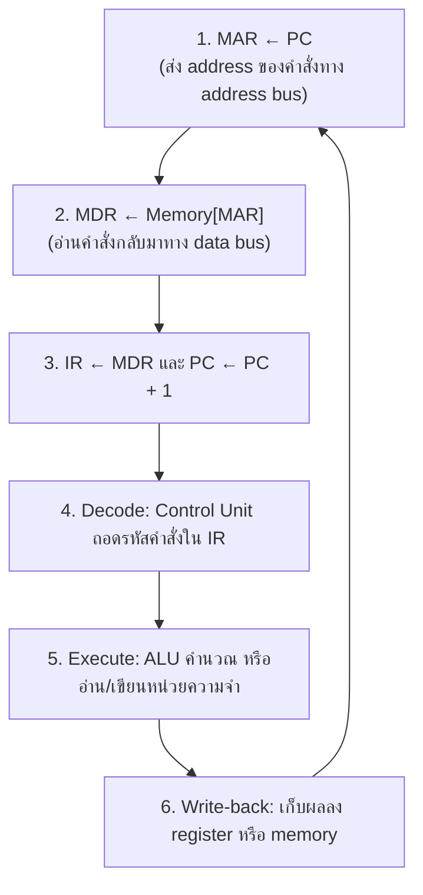

## 📖 เนื้อหาและคำอธิบาย

การออกแบบสถาปัตยกรรมระดับระบบของคอมพิวเตอร์ (Computer Architecture) มีสองแนวทางหลักที่ถูกใช้งานอย่างแพร่หลายมาจนถึงปัจจุบัน ได้แก่ สถาปัตยกรรม von Neumann และสถาปัตยกรรม Harvard ทั้งสองมีจุดเด่นและข้อจำกัดที่ส่งผลโดยตรงต่อประสิทธิภาพการทำงานของซีพียู

### สถาปัตยกรรม von Neumann
ถูกนำเสนอโดย John von Neumann ในปี 1945 สถาปัตยกรรมนี้มีลักษณะเด่นคือ **ใช้หน่วยความจำหลัก (Memory) เดียวกัน** ในการจัดเก็บทั้ง "คำสั่ง" (Instructions) และ "ข้อมูล" (Data) และใช้ระบบบัส (Bus) ร่วมกันในการดึงข้อมูล

**ข้อดี:**
- การออกแบบเรียบง่าย ต้นทุนต่ำ เนื่องจากมีระบบบัสเพียงชุดเดียว
- ยืดหยุ่นในการจัดสรรพื้นที่หน่วยความจำ สามารถปรับเปลี่ยนสัดส่วนระหว่างคำสั่งและข้อมูลได้ง่าย

**ข้อเสีย (von Neumann Bottleneck):**
- เนื่องจากแชร์บัสเดียวกัน CPU จึงไม่สามารถดึงคำสั่งและอ่าน/เขียนข้อมูลได้ในเวลาเดียวกัน (Clock cycle เดียวกัน) ทำให้เกิดคอขวดที่บัสข้อมูล ส่งผลให้ CPU ต้องรอการเข้าถึงหน่วยความจำ เป็นข้อจำกัดความเร็วสูงสุดของระบบ

### สถาปัตยกรรม Harvard
เพื่อแก้ปัญหาคอขวด สถาปัตยกรรม Harvard จึงออกแบบให้ **แยกหน่วยความจำและระบบบัสสำหรับคำสั่งและข้อมูลออกจากกันอย่างเด็ดขาด** (Instruction Memory และ Data Memory) 

**ข้อดี:**
- **ประสิทธิภาพสูง:** CPU สามารถดึงคำสั่งถัดไปพร้อมกับอ่าน/เขียนข้อมูลของคำสั่งปัจจุบันได้ในเวลาเดียวกัน ทำให้การทำ Pipeline มีประสิทธิภาพมากขึ้น
- สามารถออกแบบบัสข้อมูลและบัสคำสั่งให้มีขนาดความกว้าง (Width) ต่างกันได้ เช่น บัสคำสั่ง 14 บิต และบัสข้อมูล 8 บิต (พบได้ในตระกูล PIC Microcontroller)

**ข้อเสีย:**
- การออกแบบฮาร์ดแวร์ซับซ้อนขึ้น ต้องใช้สายสัญญาณหรือพิน (Pins) จำนวนมากขึ้น 
- พื้นที่หน่วยความจำไม่สามารถใช้ทดแทนกันได้ หากหน่วยความจำคำสั่งเต็ม แต่ข้อมูลเหลือ ก็ไม่สามารถดึงมาใช้ได้

### Modified Harvard Architecture ในปัจจุบัน
ในคอมพิวเตอร์สมัยใหม่และไมโครคอนโทรลเลอร์ระดับสูง มักจะใช้สถาปัตยกรรมแบบ **Modified Harvard** คือในระดับแคช (Cache ระดับ L1) แยกเป็น Instruction Cache และ Data Cache (รูปแบบ Harvard) เพื่อให้ CPU ทำงานได้เร็วที่สุด แต่ในระดับหน่วยความจำหลัก (Main Memory / RAM) จะจัดเก็บรวมกัน (รูปแบบ von Neumann) เพื่อประหยัดพื้นที่และความยืดหยุ่นในการใช้งาน

### ส่วนประกอบของ CPU
ไม่ว่าจะเป็น von Neumann หรือ Harvard ภายใน CPU ประกอบด้วยส่วนหลักดังนี้

- **Control Unit (CU, หน่วยควบคุม):** ดึง (fetch) คำสั่งจากหน่วยความจำ ถอดรหัส (decode) ว่าเป็นคำสั่งอะไร แล้วส่ง **สัญญาณควบคุม (control signals)** สั่งให้ ALU, register และหน่วยความจำทำงานตามจังหวะ clock
- **ALU (Arithmetic Logic Unit):** ทำการคำนวณทางคณิตศาสตร์ (บวก ลบ) และตรรกะ (AND, OR, NOT, เปรียบเทียบ)
- **Registers:** หน่วยความจำขนาดเล็กที่เร็วที่สุด อยู่ภายใน CPU

| Register | ชื่อเต็ม | หน้าที่ |
|---|---|---|
| **PC** | Program Counter | เก็บ **ที่อยู่ (address)** ของคำสั่งถัดไปที่จะดึงมาทำ |
| **IR** | Instruction Register | เก็บ **คำสั่ง** ที่กำลังถอดรหัส/ประมวลผลอยู่ |
| **MAR** | Memory Address Register | เก็บ address ที่ CPU ต้องการอ่าน/เขียนในหน่วยความจำ |
| **MDR** (หรือ MBR) | Memory Data Register | เก็บ **ข้อมูล** ที่เพิ่งอ่านมาจาก หรือกำลังจะเขียนลงหน่วยความจำ |
| **ACC** / General-purpose registers | Accumulator / R0, R1, … | เก็บค่าตัวถูกดำเนินการและผลลัพธ์ของ ALU |

- **Buses (บัส):** ชุดสายสัญญาณที่เชื่อม CPU กับหน่วยความจำและ I/O

| บัส | ทิศทาง | ส่งอะไร |
|---|---|---|
| **Address Bus** | ทางเดียว: CPU → หน่วยความจำ/I/O | ตำแหน่ง (address) ที่ต้องการเข้าถึง ความกว้าง n บิตอ้างถึงได้ $2^n$ ตำแหน่ง |
| **Data Bus** | สองทาง | ตัวข้อมูลหรือคำสั่งที่อ่าน/เขียน |
| **Control Bus** | สองทาง (ส่วนใหญ่ส่งจาก CU) | สัญญาณควบคุม เช่น Read, Write, Clock, Interrupt |

### วงรอบ Fetch–Decode–Execute ทีละขั้น
CPU ทำวงรอบนี้ซ้ำไปเรื่อย ๆ หลายพันล้านครั้งต่อวินาที

**ตัวอย่างการไล่ (trace) โปรแกรม 3 คำสั่ง:** คำนวณ $C = A + B$ โดย A อยู่ที่ address 5 (ค่า 3), B อยู่ที่ address 6 (ค่า 4) และเก็บผล C ที่ address 7

| Address | เนื้อหา |
|---|---|
| 0 | `LOAD 5`  (ACC ← Memory[5]) |
| 1 | `ADD 6`   (ACC ← ACC + Memory[6]) |
| 2 | `STORE 7` (Memory[7] ← ACC) |
| 5 | 3 |
| 6 | 4 |
| 7 | 0 (ว่าง) |

| รอบ | Fetch (PC→MAR→MDR→IR) | PC หลัง fetch | Decode | Execute / Write-back | ACC | Memory[7] |
|---|---|---|---|---|---|---|
| 1 | MAR=0, IR=`LOAD 5` | 1 | โหลดค่าจาก address 5 | MAR=5, MDR=3, ACC←3 | 3 | 0 |
| 2 | MAR=1, IR=`ADD 6` | 2 | บวกค่าจาก address 6 | MAR=6, MDR=4, ALU: 3+4, ACC←7 | 7 | 0 |
| 3 | MAR=2, IR=`STORE 7` | 3 | เก็บ ACC ไป address 7 | MAR=7, MDR←7, เขียนลงหน่วยความจำ | 7 | **7** |

> [!note] สังเกต von Neumann bottleneck
> คำสั่งแต่ละคำสั่งในตัวอย่างใช้บัสหน่วยความจำ **2 ครั้ง** คือ ดึงคำสั่ง 1 ครั้ง และอ่าน/เขียนข้อมูลอีก 1 ครั้ง ซึ่งทำพร้อมกันไม่ได้เพราะใช้บัสร่วมกัน ส่วนในสถาปัตยกรรม Harvard การดึงคำสั่งถัดไปสามารถทำพร้อมกับการอ่านข้อมูลของคำสั่งปัจจุบันได้

ดูเฉลย: ถ้าเพิ่มคำสั่ง ADD 7 ที่ address 3 หลัง STORE แล้ว ACC และ PC จะมีค่าเท่าใด?

ACC = 7 (ค่าเดิม) + Memory[7] (= 7) = **14** และ PC จะกลายเป็น **4** (เพิ่มขึ้นตอน fetch)

**อ้างอิง:**
- *Computer Organization and Design*, Patterson & Hennessy

---
*เนื้อหานี้เป็นส่วนขยายของวิชาแก่นวิศวกรรมคอมพิวเตอร์ เพื่อให้ผู้เรียนค้นคว้าเพิ่มเติมได้*
