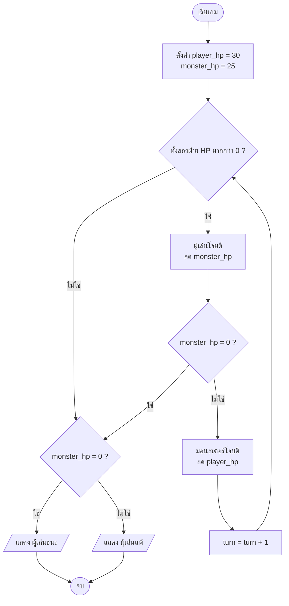

## 🎯 สิ่งที่จะได้เรียนรู้
- อธิบายองค์ประกอบ 4 ส่วนของการคิดเชิงคำนวณ ได้แก่ decomposition, pattern recognition, abstraction และ algorithm design
- บอกคุณสมบัติของอัลกอริทึมที่ดี (ชัดเจน มีอินพุต/เอาต์พุต และจบได้ในจำนวนขั้นที่จำกัด)
- เขียน pseudocode และวาด flowchart ของปัญหาง่าย ๆ ก่อนลงมือเขียนโค้ด
- แปลงตรรกะ "ตาเดินของเกม (game turn)" จาก pseudocode ไปเป็นโปรแกรม Python ได้
- ใช้รูปแบบตัวนับ (counter) และตัวสะสม (accumulator) เขียน pseudocode, trace table และวิเคราะห์ Big-O ของโจทย์นับเลขคู่และหาค่าเฉลี่ย

## 📖 เนื้อหาและคำอธิบาย

### การคิดเชิงคำนวณคืออะไร
Jeannette M. Wing (2006) เสนอว่า computational thinking เป็นทักษะพื้นฐานที่ทุกคนควรมี ไม่ใช่เฉพาะนักคอมพิวเตอร์ หัวใจคือ **การกำหนดปัญหาและวิธีแก้ให้อยู่ในรูปที่คนหรือเครื่องจักรนำไปทำตามได้** ข้อสำคัญคือ "คิดแบบนักวิทยาการคอมพิวเตอร์" ไม่ได้แปลว่า "คิดแบบคอมพิวเตอร์" เราใช้ความคิดสร้างสรรค์ของมนุษย์ออกแบบวิธีแก้ แล้วให้เครื่องช่วยทำงานซ้ำ ๆ แทน

แหล่งการสอนหลายแห่ง เช่น BBC Bitesize สรุปไว้เป็น **4 เสาหลัก (four cornerstones)** ดังนี้

### 1. Decomposition — แบ่งปัญหาใหญ่เป็นปัญหาย่อย
เหมือนการทำอาหารมื้อใหญ่ เราไม่ได้คิดว่า "ทำอาหาร" ทีเดียว แต่แยกเป็น หุงข้าว ทำต้มยำ ผัดผัก และจัดโต๊ะ ปัญหาย่อยแต่ละข้อเล็กพอจะแก้ได้ และแบ่งให้หลายคนช่วยกันทำได้

ตัวอย่างในเกม: "สร้างเกมต่อสู้" แยกเป็น (1) เก็บสถานะผู้เล่น/ศัตรู (2) รับคำสั่ง (3) คำนวณความเสียหาย (4) ตรวจเงื่อนไขชนะ/แพ้ (5) แสดงผล

### 2. Pattern Recognition — มองหารูปแบบที่ซ้ำกัน
เมื่อแยกปัญหาแล้ว มักพบว่าหลายส่วนมีลักษณะเหมือนกัน เช่น ทั้งผู้เล่นและมอนสเตอร์ "โจมตี" และ "รับความเสียหาย" ด้วยกติกาเดียวกัน ถ้าเห็นรูปแบบนี้ก็เขียนขั้นตอนครั้งเดียวแล้วใช้ซ้ำได้ ไม่ต้องเขียนใหม่ทุกตัวละคร

### 3. Abstraction — ตัดรายละเอียดที่ไม่จำเป็นออก
แผนที่รถไฟฟ้าไม่ได้วาดถนนทุกเส้น แต่แสดงเฉพาะสถานีและเส้นทาง เพราะผู้โดยสารต้องการแค่นั้น ในเกม ตัวละครอาจถูกแทนด้วยค่าเพียงไม่กี่ค่า คือ `name`, `hp`, `power` โดยไม่ต้องสนใจสีผมหรือส่วนสูง ถ้าสิ่งนั้นไม่มีผลต่อกติกาเกม

### 4. Algorithm Design — ออกแบบขั้นตอนที่ชัดเจน
อัลกอริทึมคือลำดับขั้นตอนที่ชัดเจนสำหรับแก้ปัญหา ตำรา *Introduction to Algorithms* (CLRS) อธิบายว่าอัลกอริทึมคือกระบวนการคำนวณที่รับค่าอินพุตแล้วให้ผลเป็นเอาต์พุต อัลกอริทึมที่ดีควรมีคุณสมบัติต่อไปนี้

| คุณสมบัติ | ความหมาย | ตัวอย่างที่ผิด |
|---|---|---|
| **ชัดเจน (Definiteness)** | ทุกขั้นตีความได้แบบเดียว | "ใส่เกลือนิดหน่อย" |
| **มีอินพุต (Input)** | ระบุว่ารับข้อมูลอะไร | ไม่บอกว่าต้องรู้ HP เริ่มต้น |
| **มีเอาต์พุต (Output)** | ให้ผลลัพธ์ที่ตรวจสอบได้ | วนจบแต่ไม่บอกผู้ชนะ |
| **จบได้ (Finiteness)** | หยุดภายในจำนวนขั้นที่จำกัด | ลูปที่เงื่อนไขไม่มีวันเป็นเท็จ |
| **ทำได้จริง (Effectiveness)** | แต่ละขั้นทำได้จริงด้วยทรัพยากรที่มี | "ทายใจผู้เล่น" |

### การแทนอัลกอริทึม: Pseudocode และ Flowchart

| ประเด็น | Pseudocode (รหัสเทียม) | Flowchart (ผังงาน) |
|---|---|---|
| รูปแบบ | ข้อความกึ่งภาษาโปรแกรม | รูปสัญลักษณ์ต่อด้วยลูกศร |
| จุดเด่น | ใกล้โค้ดจริง แปลงเป็นภาษาใดก็ได้ง่าย | เห็นภาพการไหลและการแตกแขนงชัด |
| จุดด้อย | ตรรกะซับซ้อนอาจอ่านยาก | ใหญ่และแก้ไขยากเมื่อโปรแกรมยาว |
| เหมาะกับ | ออกแบบรายละเอียดก่อนเขียนโค้ด | อธิบายภาพรวมให้ทีม/ผู้ไม่ใช่โปรแกรมเมอร์ |

สัญลักษณ์ flowchart ที่ใช้บ่อย: **วงรี** = เริ่ม/จบ, **สี่เหลี่ยมผืนผ้า** = การประมวลผล, **สี่เหลี่ยมด้านขนาน** = รับ/แสดงข้อมูล, **สี่เหลี่ยมข้าวหลามตัด** = การตัดสินใจ (ใช่/ไม่ใช่)

### โครงสร้างควบคุม 3 แบบ
อัลกอริทึมทั่วไปสร้างจากโครงสร้างพื้นฐานเพียง 3 แบบ คือ **ลำดับ (sequence)**, **เงื่อนไข (selection: if/else)** และ **วนซ้ำ (iteration: for/while)** ซึ่งเป็นแนวคิดหลักของ structured programming (มีรากจากทฤษฎีบทของ Böhm และ Jacopini ปี 1966 ที่แสดงว่าโครงสร้างเหล่านี้เพียงพอสำหรับแทนโปรแกรมใด ๆ)

> [!tip] เคล็ดลับ
> ก่อนเปิด IDE ให้เขียน pseudocode ลงกระดาษ 5–10 บรรทัดก่อนเสมอ ถ้ายังอธิบายเป็นภาษาคนไม่ได้ การเขียนเป็นโค้ด (หรือสั่ง AI ให้เขียน) ก็จะยิ่งยาก

## 🧩 ตัวอย่างประกอบ / Worked Example

**โจทย์:** เกมต่อสู้แบบผลัดตา ผู้เล่น (HP 30) สู้กับมอนสเตอร์ (HP 25) ผู้เล่นโจมตีก่อน แล้วมอนสเตอร์โจมตีกลับ (ครั้งละ 9) วนไปจนฝ่ายใดฝ่ายหนึ่ง HP เป็น 0

**ขั้นที่ 1 — Decomposition:** เก็บ HP ทั้งสองฝ่าย → ตาผู้เล่น → ตรวจว่ามอนสเตอร์แพ้ไหม → ตามอนสเตอร์ → ตรวจว่าผู้เล่นแพ้ไหม → วนซ้ำ → ประกาศผล

**ขั้นที่ 2 — Pattern Recognition:** "ลด HP แต่ไม่ให้ต่ำกว่า 0" เกิดขึ้นทั้งสองฝ่าย ใช้สูตรเดียวกัน `hp = max(0, hp - damage)`

**ขั้นที่ 3 — Abstraction:** ตัวละครแต่ละตัวต้องการแค่ HP และพลังโจมตี

**ขั้นที่ 4 — Pseudocode:**
```text
SET player_hp = 30, monster_hp = 25, turn = 1
WHILE player_hp > 0 AND monster_hp > 0
    damage = พลังโจมตีของผู้เล่นในตานี้
    monster_hp = MAX(0, monster_hp - damage)
    IF monster_hp = 0 THEN BREAK
    player_hp = MAX(0, player_hp - 9)
    turn = turn + 1
END WHILE
IF monster_hp = 0 THEN แสดง "ผู้เล่นชนะ" ELSE แสดง "ผู้เล่นแพ้"
```

**ขั้นที่ 5 — แปลงเป็น Python:**
```python
# เกมต่อสู้แบบผลัดตา (Turn-based Battle) แบบง่าย
player_hp = 30
monster_hp = 25
player_attacks = [8, 6, 10, 7]   # ความเสียหายที่ผู้เล่นทำได้ในแต่ละตา (กำหนดตายตัวเพื่อให้ทดสอบซ้ำได้)
monster_attack = 9               # มอนสเตอร์โจมตีเท่าเดิมทุกตา

turn = 1
while player_hp > 0 and monster_hp > 0:
    damage = player_attacks[(turn - 1) % len(player_attacks)]
    monster_hp = max(0, monster_hp - damage)          # ตาผู้เล่น
    print(f"ตา {turn}: ผู้เล่นโจมตี {damage} -> มอนสเตอร์เหลือ {monster_hp}")
    if monster_hp == 0:                               # ตรวจเงื่อนไขจบเกมทันที
        break
    player_hp = max(0, player_hp - monster_attack)    # ตามอนสเตอร์
    print(f"      มอนสเตอร์โจมตี {monster_attack} -> ผู้เล่นเหลือ {player_hp}")
    turn += 1

print("ผู้เล่นชนะ!" if monster_hp == 0 else "ผู้เล่นแพ้...")
```

```output
ตา 1: ผู้เล่นโจมตี 8 -> มอนสเตอร์เหลือ 17
      มอนสเตอร์โจมตี 9 -> ผู้เล่นเหลือ 21
ตา 2: ผู้เล่นโจมตี 6 -> มอนสเตอร์เหลือ 11
      มอนสเตอร์โจมตี 9 -> ผู้เล่นเหลือ 12
ตา 3: ผู้เล่นโจมตี 10 -> มอนสเตอร์เหลือ 1
      มอนสเตอร์โจมตี 9 -> ผู้เล่นเหลือ 3
ตา 4: ผู้เล่นโจมตี 7 -> มอนสเตอร์เหลือ 0
ผู้เล่นชนะ!
```

**ขั้นที่ 6 — ตรวจคุณสมบัติอัลกอริทึม:** ลูปจบแน่นอน (Finiteness) เพราะทุกตา HP ของอย่างน้อยหนึ่งฝ่ายลดลงเสมอ (ความเสียหายทุกค่ามากกว่า 0) และมีเอาต์พุตชัดเจนว่าใครชนะ

> [!warning] ลองคิดต่อ
> ถ้าความเสียหายเป็น 0 ได้ (เช่น ทั้งสองฝ่ายหลบหลีกสำเร็จตลอด) ลูปนี้อาจไม่จบ ต้องเพิ่มเงื่อนไขจำกัดจำนวนตา เช่น `turn <= 50`

### ตัวอย่างเพิ่มเติม: รูปแบบตัวนับ (Counter) และตัวสะสม (Accumulator)

โจทย์ที่ใช้ลูปส่วนใหญ่ใช้ 2 รูปแบบนี้ซ้ำไปมา (เป็นตัวอย่างของ pattern recognition)

| รูปแบบ | ค่าเริ่มต้น | ในลูปทำอะไร | ใช้กับโจทย์ |
|---|---|---|---|
| **Counter (ตัวนับ)** | `count = 0` | `count = count + 1` เมื่อเงื่อนไขเป็นจริง | นับจำนวนเลขคู่, นับคนที่สอบผ่าน |
| **Accumulator (ตัวสะสม)** | `total = 0` | `total = total + x` ทุกรอบ | หาผลรวม, ค่าเฉลี่ย |

#### ตัวอย่าง A: นับจำนวนเลขคู่ในรายการ

**แนวคิด:** เลขคู่คือเลขที่หารด้วย 2 แล้ว **เหลือเศษ 0** ใน pseudocode ใช้ตัวดำเนินการ `MOD` (หาเศษ) ส่วน Python ใช้ `%`

**Pseudocode:**
```text
INPUT numbers
SET count = 0
FOR EACH x IN numbers
    IF x MOD 2 = 0 THEN
        count = count + 1
    END IF
END FOR
OUTPUT count
```

**Python:**
```python
def count_even(numbers):
    count = 0                      # ตัวนับ (counter) เริ่มที่ 0
    for x in numbers:
        if x % 2 == 0:             # เศษจากการหารด้วย 2 เป็น 0 = เลขคู่
            count = count + 1
    return count

data = [4, 7, 10, 3, 8, 5]
print("ข้อมูล:", data)
print("จำนวนเลขคู่:", count_even(data))
print("ลิสต์ว่าง:", count_even([]))
```

```output
ข้อมูล: [4, 7, 10, 3, 8, 5]
จำนวนเลขคู่: 3
ลิสต์ว่าง: 0
```

**Trace table (ไล่ค่าตัวแปรทีละรอบ):**

| รอบ | `x` | `x MOD 2` | `x MOD 2 = 0` ? | `count` หลังจบรอบ |
|---|---|---|---|---|
| เริ่มต้น | – | – | – | 0 |
| 1 | 4 | 0 | จริง | 1 |
| 2 | 7 | 1 | เท็จ | 1 |
| 3 | 10 | 0 | จริง | 2 |
| 4 | 3 | 1 | เท็จ | 2 |
| 5 | 8 | 0 | จริง | 3 |
| 6 | 5 | 1 | เท็จ | 3 |

**ความซับซ้อน:** ลูปวิ่ง 1 รอบต่อข้อมูล 1 ตัว และในแต่ละรอบทำงานจำนวนคงที่ (หาเศษ 1 ครั้ง เทียบ 1 ครั้ง) จึงเป็น **O(n)** ถ้ารายการว่าง ลูปไม่ทำงานเลยและได้ 0 ซึ่งถูกต้อง

> [!tip] เปลี่ยนโจทย์นิดเดียว
> นับเลขคี่ใช้ `x MOD 2 = 1` (ในโค้ดนิยมเขียน `x % 2 != 0` เพราะในบางภาษา เช่น C/Java เลขคี่ติดลบให้เศษเป็น -1 ไม่ใช่ 1) ส่วนนับคนที่สอบผ่านใช้ `IF score >= 50` โครงของอัลกอริทึมยังเหมือนเดิม

#### ตัวอย่าง B: หาผลรวมและค่าเฉลี่ยของคะแนน

**แนวคิด:** ใช้ตัวสะสม `total` บวกคะแนนทีละตัว แล้วหารด้วยจำนวนคะแนน แต่ต้อง **ตรวจกรณีรายการว่างก่อน (guard)** เพราะ `total / 0` จะทำให้โปรแกรมพัง (`ZeroDivisionError`)

**Pseudocode:**
```text
INPUT scores
IF LENGTH(scores) = 0 THEN
    OUTPUT "ไม่มีข้อมูล"
    STOP
END IF
SET total = 0
FOR EACH s IN scores
    total = total + s
END FOR
average = total / LENGTH(scores)
OUTPUT total, average
```

**Python:**
```python
def sum_and_average(scores):
    if len(scores) == 0:           # guard: ป้องกันการหารด้วยศูนย์
        return 0, None
    total = 0                      # ตัวสะสม (accumulator) เริ่มที่ 0
    for s in scores:
        total = total + s
    average = total / len(scores)
    return total, average

scores = [72, 85, 64, 90, 79]
total, avg = sum_and_average(scores)
print("คะแนน:", scores)
print("ผลรวม:", total)
print("ค่าเฉลี่ย:", avg)
print("ลิสต์ว่าง:", sum_and_average([]))
```

```output
คะแนน: [72, 85, 64, 90, 79]
ผลรวม: 390
ค่าเฉลี่ย: 78.0
ลิสต์ว่าง: (0, None)
```

**Trace table:**

| รอบ | `s` | `total` ก่อนบวก | `total` หลังบวก |
|---|---|---|---|
| เริ่มต้น | – | – | 0 |
| 1 | 72 | 0 | 72 |
| 2 | 85 | 72 | 157 |
| 3 | 64 | 157 | 221 |
| 4 | 90 | 221 | 311 |
| 5 | 79 | 311 | 390 |
| หลังลูป | – | – | `average = 390 / 5 = 78.0` |

**ความซับซ้อน:** ลูปเดียววิ่ง $n$ รอบ บวกด้วยการหาร 1 ครั้งหลังลูป (O(1)) รวมเป็น O(n) + O(1) = **O(n)** (ดู 02_การวิเคราะห์ความซับซ้อน_Big_O) ใน Python จริงเขียนสั้น ๆ ได้ว่า `sum(scores) / len(scores)` ซึ่งก็ยังเป็น O(n) เพราะ `sum()` ต้องไล่ทุกตัวเช่นกัน

> [!warning] ข้อผิดพลาดที่พบบ่อย
> (1) ลืมกำหนด `total = 0` หรือ `count = 0` ก่อนลูป (2) ตั้งค่าเริ่มต้นไว้ **ในลูป** ทำให้ค่าถูกรีเซ็ตทุกรอบ (3) หารค่าเฉลี่ย **ในลูป** แทนที่จะหารครั้งเดียวหลังลูป (4) ไม่ตรวจรายการว่าง

## 🗺️ แผนภาพสรุป



## ⚠️ ความเข้าใจผิดที่พบบ่อย
1. **"Computational thinking คือการเขียนโปรแกรม"** — ไม่ใช่ เป็นวิธีคิดแก้ปัญหาที่ใช้ได้แม้ไม่มีคอมพิวเตอร์ (เช่นวางแผนจัดตารางสอบ) การเขียนโปรแกรมเป็นเพียงวิธีหนึ่งในการนำผลการคิดไปใช้
2. **"อัลกอริทึมต้องเป็นโค้ด"** — อัลกอริทึมเป็นอิสระจากภาษา จะเขียนเป็นภาษาไทย pseudocode หรือ flowchart ก็ได้ โค้ดคือการ implement อัลกอริทึมในภาษาหนึ่ง
3. **"Abstraction คือทำให้คลุมเครือ"** — ตรงกันข้าม abstraction คือการเลือกเก็บสิ่งที่สำคัญอย่างชัดเจน และซ่อนรายละเอียดที่ไม่เกี่ยวข้อง
4. **"มี AI แล้วไม่ต้องออกแบบเอง"** — AI เขียนโค้ดตามสิ่งที่เราสั่ง ถ้าเราแยกปัญหาและกำหนดเงื่อนไขไม่ชัด (เช่นลืมกรณีลูปไม่จบ) AI ก็อาจเขียนโค้ดที่ผิดได้เช่นกัน

## 🔗 เชื่อมโยงกับรายวิชา
- แผนสัปดาห์: [สัปดาห์ที่ 4: Algorithms & Programming Paradigms](/module/04) และภาพรวม 00_Overview - อัลกอริทึมและการเขียนโปรแกรม
- ต่อยอดเรื่องประสิทธิภาพของอัลกอริทึมใน 02_การวิเคราะห์ความซับซ้อน_Big_O และแนวคิด [Big-O Notation](/concept/big-o-notation)
- นำ pseudocode/flowchart ไปใช้ใน **Mini-Project 1: Simple Text/2D Game in Python** ผ่าน [Lab 04 - Algorithm Flowchart and Module 1 Presentation](/lab/04) และดูภาพรวมโครงงานที่ [กิจกรรมปฏิบัติการและโครงงาน](/docs/labs-projects)
- เชื่อมย้อนกับตรรกะการตัดสินใจระดับฮาร์ดแวร์ใน [สัปดาห์ที่ 3: Digital Logic & Modern Processors](/module/03)

## ❓ คำถามทบทวน
1. จงอธิบาย 4 เสาหลักของการคิดเชิงคำนวณ พร้อมยกตัวอย่างจากการจัดงานกีฬาสีของคณะ
<details><summary>ดูแนวคำตอบ</summary>

Decomposition: แยกงานเป็นฝ่ายสถานที่ ฝ่ายแข่งขัน ฝ่ายอาหาร; Pattern recognition: การรับสมัครทุกกีฬาใช้แบบฟอร์มและขั้นตอนเดียวกัน; Abstraction: ตารางแข่งขันสนใจแค่ทีม เวลา สนาม ไม่ต้องสนใจสีเสื้อ; Algorithm: ลำดับขั้นจัดการแข่งขันแต่ละนัดตั้งแต่เรียกทีมจนบันทึกผล
</details>

2. อัลกอริทึม "ตักน้ำใส่ถังไปเรื่อย ๆ จนกว่าจะพอใจ" ขาดคุณสมบัติใด
<details><summary>ดูแนวคำตอบ</summary>

ขาดความชัดเจน (Definiteness) เพราะ "พอใจ" ตีความได้หลายแบบ และอาจขาดความจบได้ (Finiteness) ควรแก้เป็น "ตักจนระดับน้ำถึงขีด 10 ลิตร หรือครบ 20 ครั้ง"
</details>

3. ในตัวอย่างเกม ทำไมต้องตรวจ `monster_hp == 0` ก่อนให้มอนสเตอร์โจมตี
<details><summary>ดูแนวคำตอบ</summary>

เพื่อไม่ให้มอนสเตอร์ที่แพ้แล้วยังโจมตีได้อีก ซึ่งผิดกติกาและอาจทำให้ผู้เล่นแพ้ทั้งที่ควรชนะ เป็นตัวอย่างของการคิดกรณีขอบ (edge case) ตอนออกแบบอัลกอริทึม
</details>

4. เมื่อใดควรใช้ flowchart และเมื่อใดควรใช้ pseudocode
<details><summary>ดูแนวคำตอบ</summary>

Flowchart เหมาะกับการอธิบายภาพรวมและจุดแตกแขนงให้ทีมหรือผู้ไม่ใช่โปรแกรมเมอร์เห็นภาพ ส่วน pseudocode เหมาะกับการออกแบบรายละเอียดก่อนเขียนโค้ด เพราะใกล้กับโค้ดจริงและแก้ไขง่ายกว่า
</details>

5. เขียน pseudocode หาคะแนนสูงสุดในรายการคะแนนผู้เล่น
<details><summary>ดูแนวคำตอบ</summary>

```text
SET best = scores[0]
FOR EACH s IN scores
    IF s > best THEN best = s
END FOR
OUTPUT best
```
อัลกอริทึมนี้ดูข้อมูลทุกตัวครั้งเดียว จึงมีความซับซ้อน O(n)
</details>

## 📚 แหล่งอ้างอิง
- [Wing, J. M. (2006). Computational Thinking. *Communications of the ACM*, 49(3), 33–35. (PDF, Carnegie Mellon University)](https://www.cs.cmu.edu/~15110-s13/Wing06-ct.pdf)
- [Center for Computational Thinking, Carnegie Mellon University](https://www.cs.cmu.edu/~CompThink/)
- [BBC Bitesize — Introduction to computational thinking (KS3 Computer Science)](https://www.bbc.co.uk/bitesize/guides/zp92mp3/revision/1)
- [MIT OpenCourseWare — 6.006 Introduction to Algorithms (Spring 2020)](https://ocw.mit.edu/courses/6-006-introduction-to-algorithms-spring-2020/)
- Cormen, T. H., Leiserson, C. E., Rivest, R. L., & Stein, C. (2022). *Introduction to Algorithms* (4th ed.). MIT Press. ISBN 9780262046305
