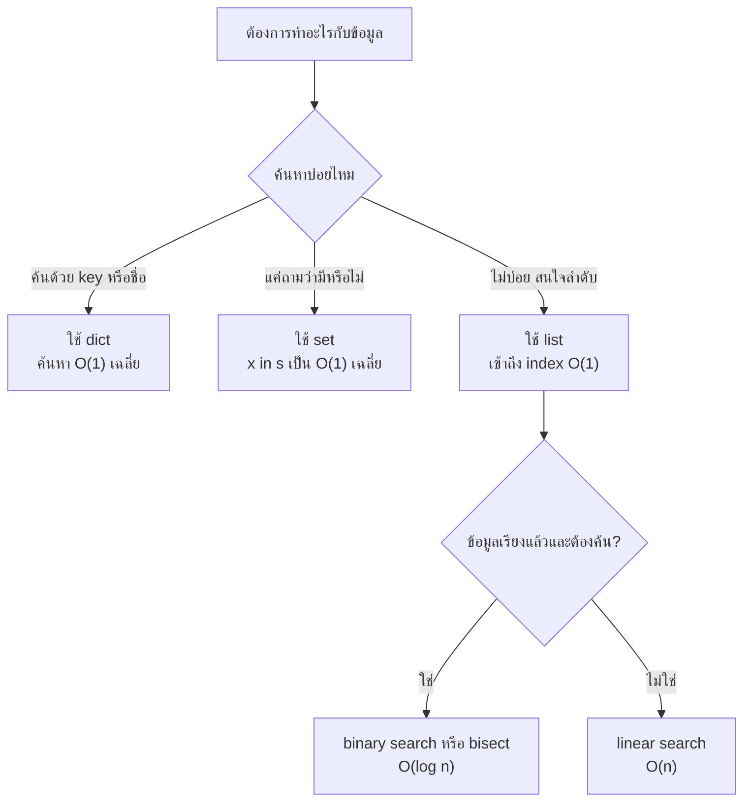

## 🎯 สิ่งที่จะได้เรียนรู้
- อธิบายความหมายของ Big-O ว่าเป็นการวัด "อัตราการเติบโต" ของงาน เมื่อขนาดข้อมูล $n$ ใหญ่ขึ้น
- จำแนกความซับซ้อนพื้นฐาน O(1), O(log n), O(n), O(n log n), O(n²), O(2ⁿ) พร้อมตัวอย่าง
- เปรียบเทียบจำนวนขั้นของ linear search กับ binary search ได้ด้วยตัวเลขจริง
- เลือกโครงสร้างข้อมูล list / dict / set ใน Python ให้เหมาะกับงาน โดยอาศัยความซับซ้อนของแต่ละ operation

## 📖 เนื้อหาและคำอธิบาย

### ทำไมต้องวัดด้วย Big-O แทนการจับเวลา
ถ้าจับเวลาโปรแกรมด้วยนาฬิกา ผลจะขึ้นกับเครื่อง ภาษา และงานอื่นที่รันอยู่ Big-O จึงวัดสิ่งที่ไม่ขึ้นกับฮาร์ดแวร์ คือ **จำนวนขั้นพื้นฐานที่เพิ่มขึ้นเมื่อ $n$ ใหญ่ขึ้น** โดยสนใจเฉพาะพจน์ที่โตเร็วที่สุด และตัดค่าคงที่ทิ้ง

ตัวอย่าง: ถ้าโปรแกรมทำงาน $T(n) = 3n^2 + 5n + 20$ ขั้น เมื่อ $n$ ใหญ่มาก พจน์ $3n^2$ จะครอบงำทั้งหมด เราจึงเขียนว่า $T(n) = O(n^2)$

นิยามอย่างเป็นทางการ (ตาม CLRS): $f(n) = O(g(n))$ ถ้ามีค่าคงที่บวก $c$ และ $n_0$ ที่ทำให้

$$0 \le f(n) \le c \cdot g(n) \quad \text{สำหรับทุก } n \ge n_0$$

หมายความว่า $g(n)$ เป็น **ขอบบน (upper bound)** ของการเติบโต

> [!note] เปรียบเทียบง่าย ๆ
> Big-O เหมือนการบอกว่า "ถ้าแขกมางานเพิ่มเป็นสองเท่า งานของเราเพิ่มขึ้นแค่ไหน" — แจกบัตรคิวให้ทุกคน งานเพิ่มสองเท่า (O(n)) แต่ถ้าแขกทุกคนต้องจับมือกันทุกคู่ งานเพิ่มสี่เท่า (O(n²))

### ความซับซ้อนที่พบบ่อย

| Big-O | ชื่อเรียก | ตัวอย่างในชีวิตจริง | ตัวอย่างในโปรแกรม |
|---|---|---|---|
| **O(1)** | Constant | เปิดตู้ล็อกเกอร์เบอร์ 25 ตรง ๆ | `scores[25]`, `key in my_set` (โดยเฉลี่ย) |
| **O(log n)** | Logarithmic | เปิดพจนานุกรมหาคำโดยแบ่งครึ่ง | binary search ในข้อมูลที่เรียงแล้ว |
| **O(n)** | Linear | ตรวจบัตรนักศึกษาทีละคนในแถว | วนหาค่าสูงสุดใน list, `x in my_list` |
| **O(n log n)** | Linearithmic | แบ่งกองข้อสอบแล้วเรียงรวม | merge sort, `sorted()` ของ Python |
| **O(n²)** | Quadratic | ทุกคนในห้องจับมือกันทุกคู่ | ลูปซ้อนสองชั้น, bubble sort |
| **O(2ⁿ)** | Exponential | ลองทุกชุดค่าผสมของสวิตช์ $n$ ตัว | brute force หาทุก subset |

### ตารางการเติบโต (จำนวนขั้นโดยประมาณ)

| $n$ | $\log_2 n$ | $n$ | $n \log_2 n$ | $n^2$ | $2^n$ |
|---|---|---|---|---|---|
| 10 | ≈ 3.3 | 10 | ≈ 33 | 100 | 1,024 |
| 100 | ≈ 6.6 | 100 | ≈ 664 | 10,000 | ≈ 1.3 × 10³⁰ |
| 1,000 | ≈ 10 | 1,000 | ≈ 9,966 | 1,000,000 | ≈ 1.1 × 10³⁰¹ |
| 10,000 | ≈ 13.3 | 10,000 | ≈ 133,000 (132,877) | 100,000,000 | ≈ 2.0 × 10³⁰¹⁰ |

จะเห็นว่า O(2ⁿ) ใช้งานจริงไม่ได้แม้ $n$ เพียง 100 ขณะที่ O(log n) แทบไม่เพิ่มขึ้นเลย

### วิธีอ่าน Big-O จากโค้ด (กฎง่าย ๆ)
1. คำสั่งเดี่ยวที่ไม่มีลูป → O(1)
2. ลูปที่วิ่ง $n$ รอบ → O(n)
3. ลูปซ้อนกันสองชั้น ชั้นละ $n$ รอบ → O(n²)
4. ลูปที่ลดขนาดปัญหาลงครึ่งหนึ่งทุกรอบ → O(log n)
5. ส่วนที่ทำต่อกัน ให้เลือกส่วนที่ใหญ่ที่สุด เช่น O(n) + O(n²) = O(n²)

### Best, Average, Worst case
อัลกอริทึมเดียวกันอาจเร็วหรือช้าขึ้นกับข้อมูล เช่น linear search ถ้าเป้าหมายอยู่ตัวแรก ใช้ 1 ขั้น (best case) ถ้าอยู่ตัวสุดท้ายหรือไม่มี ใช้ $n$ ขั้น (worst case) โดยทั่วไปเมื่อพูดถึง Big-O ของอัลกอริทึม เรามักหมายถึง **worst case** เพื่อรับประกันประสิทธิภาพ

### การเลือกโครงสร้างข้อมูลใน Python
ข้อมูลจาก Python Wiki (TimeComplexity) สำหรับ CPython:

| Operation | `list` | `dict` | `set` |
|---|---|---|---|
| เข้าถึงด้วย index/key | O(1) (`lst[i]`) | O(1) เฉลี่ย (`d[k]`) | — |
| ตรวจว่ามีอยู่ (`x in ...`) | **O(n)** | **O(1) เฉลี่ย** | **O(1) เฉลี่ย** |
| เพิ่มท้าย / เพิ่มสมาชิก | O(1) amortized (`append`) | O(1) เฉลี่ย | O(1) เฉลี่ย |
| แทรก/ลบหน้าสุด | O(n) (`insert(0, x)`, `pop(0)`) | — | — |
| เรียงลำดับ | O(n log n) (`sort`) | — | — |

**หลักการเลือก:** ต้องการลำดับและเข้าถึงด้วยตำแหน่ง → `list`; ต้องการค้นหาด้วยชื่อ/รหัส → `dict`; ต้องการตรวจว่า "เคยเห็นหรือยัง" หรือกำจัดค่าซ้ำ → `set`

## 🧩 ตัวอย่างประกอบ / Worked Example

### ส่วนที่ 1: Linear search vs Binary search
Binary search ทำงานได้เฉพาะกับข้อมูลที่ **เรียงลำดับแล้ว** โดยดูค่าตรงกลาง แล้วตัดครึ่งที่ไม่ใช่ทิ้งทุกรอบ จำนวนการเปรียบเทียบในกรณีแย่ที่สุด (worst case) จึง **เท่ากับ $\lfloor \log_2 n \rfloor + 1$ ครั้งพอดี** ซึ่งในทางปฏิบัติมักพูดโดยประมาณว่า "ราว $\log_2 n$ ครั้ง"

```python
def linear_search(items, target):
    steps = 0
    for i, value in enumerate(items):
        steps += 1                      # นับการเปรียบเทียบ 1 ครั้ง
        if value == target:
            return i, steps
    return -1, steps

def binary_search(items, target):
    low, high = 0, len(items) - 1
    steps = 0
    while low <= high:
        steps += 1
        mid = (low + high) // 2         # ดูตรงกลางช่วงที่เหลือ
        if items[mid] == target:
            return mid, steps
        elif items[mid] < target:
            low = mid + 1               # ตัดครึ่งซ้ายทิ้ง
        else:
            high = mid - 1              # ตัดครึ่งขวาทิ้ง
    return -1, steps

for n in [16, 1_000, 1_000_000]:
    data = list(range(n))               # ข้อมูลเรียงแล้ว 0..n-1
    target = n - 1                      # กรณีแย่ที่สุดของ linear search
    _, s1 = linear_search(data, target)
    _, s2 = binary_search(data, target)
    print(f"n={n:>9,}: linear={s1:>9,} ครั้ง | binary={s2:>2} ครั้ง")
```

```output
n=       16: linear=       16 ครั้ง | binary= 5 ครั้ง
n=    1,000: linear=    1,000 ครั้ง | binary=10 ครั้ง
n=1,000,000: linear=1,000,000 ครั้ง | binary=20 ครั้ง
```

**ไล่ทีละขั้น (n = 16, หา 15):** ช่วง [0..15] ดู mid=7 → 7 < 15 ตัดซ้าย → [8..15] mid=11 → [12..15] mid=13 → [14..15] mid=14 → [15..15] mid=15 พบ! รวม 5 ครั้ง ข้อมูลเพิ่มจาก 1,000 เป็น 1,000,000 (พันเท่า) binary search เพิ่มเพียง 10 ครั้ง

> [!note] ทำไมเป็น $\lfloor \log_2 n \rfloor + 1$ ไม่ใช่ $\log_2 n$
> แต่ละรอบตัดช่วงที่เหลือลงครึ่งหนึ่ง ข้อมูล $n$ ตัวจะถูกแบ่งครึ่งได้ $\lfloor \log_2 n \rfloor$ ครั้งจนเหลือ 1 ตัว และต้องเปรียบเทียบตัวสุดท้ายนั้นอีก **1 ครั้ง** จึงรวมเป็น $\lfloor \log_2 n \rfloor + 1$
>
> | $n$ | $\log_2 n$ | worst case ที่แท้จริง $\lfloor \log_2 n \rfloor + 1$ |
> |---|---|---|
> | 16 | 4 | 5 |
> | 1,000 | ≈ 9.97 | 10 |
> | 1,024 | 10 | 11 |
> | 10,000 | ≈ 13.3 | 14 |
> | 1,000,000 | ≈ 19.9 | 20 |
>
> ในข้อสอบ ถ้าถามว่า "ประมาณกี่ครั้ง" คำตอบ "ราว $\log_2 n$" (เช่น 1,024 ตัว ≈ 10 ครั้ง) ถือเป็นการประมาณที่ยอมรับได้ เพราะใน Big-O ค่า +1 ถูกตัดทิ้งและทั้งคู่คือ O(log n) แต่ถ้าถาม "มากที่สุดกี่ครั้ง" ให้ตอบตัวเลขที่แน่นอน $\lfloor \log_2 n \rfloor + 1$ (1,024 ตัว = 11 ครั้ง)

> [!tip] เคล็ดลับ
> ในงานจริงไม่ต้องเขียน binary search เอง ใช้โมดูล `bisect` ของ Python ได้เลย

### ส่วนที่ 2: วัดเวลา list vs set ด้วย `timeit`

```python
import timeit

n = 100_000
data_list = list(range(n))
data_set = set(data_list)
data_dict = {x: True for x in data_list}
target = n - 1   # ตัวสุดท้าย = กรณีแย่สุดของ list

# วัดเวลาการถาม "target อยู่ในคอลเลกชันไหม" 1,000 ครั้ง
t_list = timeit.timeit(lambda: target in data_list, number=1_000)
t_set  = timeit.timeit(lambda: target in data_set,  number=1_000)
t_dict = timeit.timeit(lambda: target in data_dict, number=1_000)

print(f"list : {t_list:.4f} วินาที")
print(f"set  : {t_set:.6f} วินาที")
print(f"dict : {t_dict:.6f} วินาที")
print(f"set เร็วกว่า list ประมาณ {t_list / t_set:,.0f} เท่า")
```

```output
list : 0.8167 วินาที
set  : 0.000051 วินาที
dict : 0.000052 วินาที
set เร็วกว่า list ประมาณ 16,109 เท่า
```

> [!warning] หมายเหตุ
> ตัวเลขข้างบนได้จากการรันบนเครื่องหนึ่งด้วย Python 3.14 ค่าเวลาจริงจะต่างกันตามเครื่อง แต่ **แนวโน้ม** จะเหมือนกันเสมอ คือ `in` บน list โตตาม $n$ ส่วน set/dict เกือบคงที่

**นำไปใช้ในเกม:** ถ้าเกมต้องตรวจว่าผู้เล่น "เคยเก็บไอเทมนี้หรือยัง" ทุกเฟรม การเก็บไอเทมไว้ใน `set` จะดีกว่า `list` มาก เมื่อจำนวนไอเทมมีมาก

## 🗺️ แผนภาพสรุป



## ⚠️ ความเข้าใจผิดที่พบบ่อย
1. **"O(1) แปลว่าเร็วมากเสมอ"** — O(1) แปลว่าเวลาไม่เพิ่มตาม $n$ แต่ค่าคงที่อาจสูงได้ สำหรับข้อมูลเล็กมาก O(n) ที่ค่าคงที่ต่ำอาจเร็วกว่า
2. **"Big-O บอกเวลาเป็นวินาที"** — ไม่ใช่ บอกเพียงรูปแบบการเติบโต การจะรู้เวลาจริงต้องวัด (เช่นด้วย `timeit`)
3. **"Binary search ใช้กับข้อมูลใดก็ได้"** — ต้องเรียงลำดับก่อน และการเรียงเองใช้ O(n log n) ถ้าค้นแค่ครั้งเดียว linear search อาจคุ้มกว่า
4. **"O(2n) กับ O(n) ต่างกัน"** — ใน Big-O ตัดค่าคงที่ทิ้ง ทั้งสองคือ O(n) เหมือนกัน

## 🔗 เชื่อมโยงกับรายวิชา
- แผนสัปดาห์: [สัปดาห์ที่ 4: Algorithms & Programming Paradigms](/module/04) และบันทึกแนวคิด [Big-O Notation](/concept/big-o-notation)
- พื้นฐานการออกแบบอัลกอริทึม: 01_การคิดเชิงคำนวณแบบเจาะลึก
- ใน **Mini-Project 1: Simple Text/2D Game in Python** ให้วิเคราะห์ Big-O ของลูปหลักของเกม (เช่นตรวจการชนของวัตถุ $n$ ชิ้น ถ้าเทียบทุกคู่จะเป็น O(n²)) ตาม [Lab 04 - Algorithm Flowchart and Module 1 Presentation](/lab/04)
- ต่อยอดเรื่อง index ในฐานข้อมูลที่ช่วยให้ค้นหาเร็วขึ้นใน [สัปดาห์ที่ 5: Database & Data Management](/module/05)

## ❓ คำถามทบทวน
1. โค้ด `for i in range(n): for j in range(n): print(i, j)` มีความซับซ้อนเท่าใด เพราะอะไร
<details><summary>ดูแนวคำตอบ</summary>

O(n²) เพราะลูปนอกวิ่ง $n$ รอบ และในแต่ละรอบลูปในวิ่งอีก $n$ รอบ รวม $n \times n = n^2$ ครั้ง
</details>

2. ข้อมูลเรียงแล้ว 1,024 ตัว binary search ใช้การเปรียบเทียบมากที่สุดกี่ครั้ง
<details><summary>ดูแนวคำตอบ</summary>

มากที่สุด $\lfloor \log_2 1024 \rfloor + 1 = 10 + 1 = 11$ ครั้ง (ถ้าตอบโดยประมาณว่า "ราว $\log_2 1024 = 10$ ครั้ง" ก็ถือว่าถูกในระดับ Big-O) เทียบกับ linear search ที่อาจต้องใช้ถึง 1,024 ครั้ง
</details>

3. จงลดรูป $T(n) = 5n^3 + 100n^2 + 7$ เป็น Big-O
<details><summary>ดูแนวคำตอบ</summary>

O(n³) เพราะพจน์ $n^3$ โตเร็วที่สุด และตัดค่าคงที่ 5 ทิ้ง
</details>

4. เกมเก็บรายชื่อผู้เล่นที่ถูกแบน 50,000 คน และต้องตรวจทุกครั้งที่มีคนล็อกอิน ควรใช้ list หรือ set เพราะอะไร
<details><summary>ดูแนวคำตอบ</summary>

ควรใช้ `set` เพราะการตรวจ `name in banned` ใช้ O(1) โดยเฉลี่ย ขณะที่ list ใช้ O(n) คือต้องไล่เทียบได้ถึง 50,000 ครั้งต่อการล็อกอินหนึ่งครั้ง
</details>

5. ทำไมอัลกอริทึม O(2ⁿ) จึงถือว่าใช้งานจริงไม่ได้สำหรับ $n$ ขนาดกลาง
<details><summary>ดูแนวคำตอบ</summary>

เพราะทุกครั้งที่ $n$ เพิ่ม 1 งานเพิ่มเป็นสองเท่า ที่ $n = 100$ ต้องทำประมาณ $1.3 \times 10^{30}$ ขั้น ซึ่งแม้คอมพิวเตอร์ที่เร็วที่สุดก็ทำไม่เสร็จในเวลาที่สมเหตุสมผล
</details>

## 📚 แหล่งอ้างอิง
- [Python Wiki — TimeComplexity (ความซับซ้อนของ operation ใน CPython)](https://wiki.python.org/moin/TimeComplexity)
- [Python Documentation — timeit: Measure execution time of small code snippets](https://docs.python.org/3/library/timeit.html)
- [Python Documentation — bisect: Array bisection algorithm](https://docs.python.org/3/library/bisect.html)
- [Khan Academy — Big-O notation](https://www.khanacademy.org/computing/computer-science/algorithms/asymptotic-notation/a/big-o-notation)
- [Khan Academy — Binary search](https://www.khanacademy.org/computing/computer-science/algorithms/binary-search/a/binary-search)
- [MIT OpenCourseWare — 6.006 Introduction to Algorithms (Spring 2020)](https://ocw.mit.edu/courses/6-006-introduction-to-algorithms-spring-2020/)
- Cormen, T. H., Leiserson, C. E., Rivest, R. L., & Stein, C. (2022). *Introduction to Algorithms* (4th ed.). MIT Press. ISBN 9780262046305
