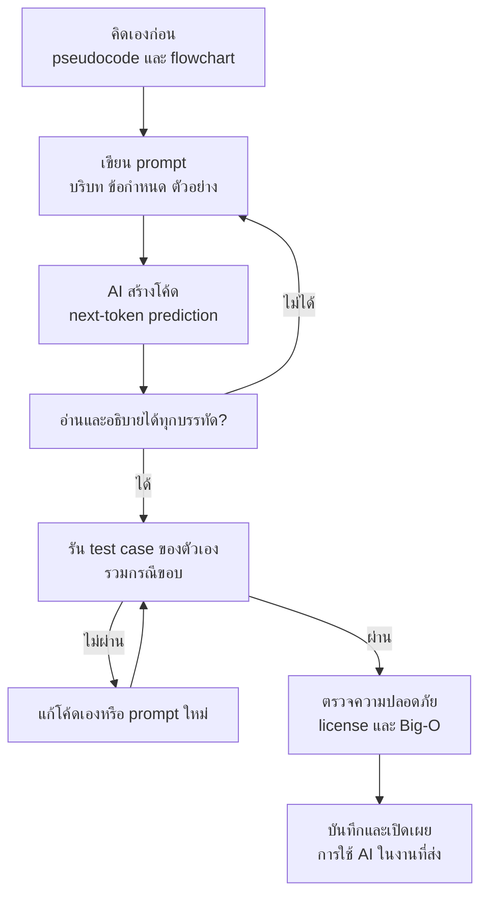

## 🎯 สิ่งที่จะได้เรียนรู้
- อธิบายหลักการทำงานเบื้องต้นของ AI coding assistant ที่สร้างบน Large Language Model (LLM) แบบทำนายโทเคนถัดไป (next-token prediction)
- เขียน prompt ที่ชัดเจน มีบริบท ข้อกำหนด และตัวอย่าง เพื่อให้ได้โค้ดที่ตรงความต้องการ
- ตรวจสอบโค้ดที่ AI สร้างด้วยการอ่าน การเขียน test case และการวิเคราะห์ความซับซ้อน
- ระบุความเสี่ยงด้านความปลอดภัย ลิขสิทธิ์/สัญญาอนุญาต และความเป็นส่วนตัวของข้อมูล
- ใช้ AI อย่างซื่อสัตย์ทางวิชาการตามนโยบายรายวิชา (อนุญาตให้ใช้ได้ โดยต้องเปิดเผยการใช้งาน)

## 📖 เนื้อหาและคำอธิบาย

### AI Coding Assistant คืออะไร
เครื่องมือที่ใช้ LLM ช่วยงานเขียนโปรแกรม ตัวอย่างที่นิยม ได้แก่ **GitHub Copilot** (ฝังใน VS Code/IDE ให้คำแนะนำแบบ inline และมีโหมดแชต), **Claude** และ **Claude Code** ของ Anthropic, **ChatGPT** ของ OpenAI และ editor ที่ออกแบบรอบ AI เช่น **Cursor** รูปแบบการใช้งานหลัก ๆ มี 3 ระดับ

| ระดับ | ลักษณะ | ตัวอย่างงาน |
|---|---|---|
| **Inline completion** | เติมโค้ดต่อจากที่กำลังพิมพ์ | พิมพ์ชื่อฟังก์ชันแล้ว AI เสนอเนื้อหาฟังก์ชัน |
| **Chat assistant** | ถาม-ตอบ อธิบาย แก้บั๊ก | "ช่วยอธิบาย error นี้" "เขียน test ให้หน่อย" |
| **Agent** | วางแผนและลงมือหลายขั้น แก้ไฟล์ รันคำสั่ง | "เพิ่มระบบบันทึกคะแนนสูงสุดลงไฟล์" (ดู [Agentic AI](/concept/agentic-ai)) |

### ทำงานอย่างไร: Next-token prediction
LLM ส่วนใหญ่ในปัจจุบันใช้สถาปัตยกรรม **Transformer** (Vaswani et al., 2017) ฝึกจากข้อความและโค้ดจำนวนมหาศาล โดยหลักการพื้นฐานคือ

1. แบ่งข้อความเป็น **token** (ชิ้นคำ/สัญลักษณ์ เช่น `def`, `_score`, `(`)
2. ดูบริบท (prompt + โค้ดรอบ ๆ) แล้วคำนวณ **ความน่าจะเป็นของ token ถัดไป**
3. เลือก token แล้วนำไปต่อท้ายบริบท ทำซ้ำจนได้คำตอบ

เขียนเป็นสมการอย่างง่าย: โมเดลประมาณค่า $P(x_t \mid x_1, x_2, \dots, x_{t-1})$

> [!note] ผลที่ตามมาสำคัญ
> โมเดล "สร้างข้อความที่น่าจะเป็น" ไม่ได้ "รันโค้ดเพื่อพิสูจน์ว่าถูก" จึงเกิด **hallucination** ได้ เช่น เรียกฟังก์ชันหรือ library ที่ไม่มีอยู่จริง หรือเขียนโค้ดที่ดูถูกแต่ผิดตรรกะ เอกสารของ GitHub Copilot เองก็ระบุว่าคำแนะนำอาจดูถูกต้อง แต่ผิดทั้ง syntax หรือความหมาย และแนะนำให้ตรวจและทดสอบก่อนใช้เสมอ

อุปมา: AI coding assistant เหมือน **รุ่นพี่ที่อ่านโค้ดมาเยอะมาก พิมพ์เร็ว แต่บางครั้งมั่นใจเกินไป** เราต้องเป็นคนตัดสินใจและรับผิดชอบสุดท้าย

### การเขียน Prompt ที่ดี
สรุปจากคำแนะนำ prompt engineering ของ GitHub Copilot และ Anthropic

| หลักการ | Prompt ไม่ดี | Prompt ดี |
|---|---|---|
| ระบุเป้าหมายกว้างก่อน แล้วลงรายละเอียด | "เขียนเกม" | "เขียนเกมทายตัวเลข 1–100 ใน Python แบบ text-based" |
| ระบุข้อกำหนดชัดเจน | "รับ input" | "ถ้าผู้ใช้พิมพ์ไม่ใช่ตัวเลข ให้แจ้งเตือนและถามใหม่ ไม่นับเป็นครั้งที่ทาย" |
| ให้ตัวอย่าง input/output | — | "เช่น ทาย 50 → แสดง 'มากไป'" |
| แบ่งงานใหญ่เป็นขั้นเล็ก | ขอทั้งเกมในครั้งเดียว | ขอ (1) ฟังก์ชันตรวจ input (2) ลูปหลัก (3) ระบบคะแนน ทีละส่วน |
| ขอสิ่งที่ช่วยตรวจสอบ | — | "ขอ test case กรณีขอบ และบอก Big-O ของฟังก์ชัน" |
| หลีกเลี่ยงความกำกวม | "แก้อันนี้ให้หน่อย" | "แก้ฟังก์ชัน `check_guess` ในไฟล์ `game.py` ที่คืนค่าผิดเมื่อทายถูกพอดี" |

### วงจรการทำงานกับ AI อย่างรับผิดชอบ
1. **คิดเองก่อน:** เขียน pseudocode/flowchart (ดู 01_การคิดเชิงคำนวณแบบเจาะลึก)
2. **Prompt:** ให้บริบท ข้อกำหนด ตัวอย่าง
3. **อ่านและทำความเข้าใจ:** ถ้าอธิบายโค้ดทีละบรรทัดไม่ได้ อย่าเพิ่งใช้
4. **ทดสอบ:** เขียน test case เอง รวมถึงกรณีขอบ (ค่าว่าง ค่าติดลบ ค่ามาก)
5. **ตรวจความปลอดภัยและประสิทธิภาพ:** มีรหัสผ่านฝังในโค้ดไหม รับ input อย่างปลอดภัยไหม Big-O เหมาะสมไหม
6. **บันทึกและเปิดเผย:** จด prompt ที่ใช้และส่วนที่ AI ช่วย

### ความเสี่ยงที่ต้องรู้

| ความเสี่ยง | รายละเอียด | วิธีลดความเสี่ยง |
|---|---|---|
| **โค้ดไม่ปลอดภัย** | งานวิจัยของ Pearce et al. (IEEE S&P 2022) ทดสอบ Copilot ใน 89 สถานการณ์ที่เกี่ยวกับช่องโหว่ CWE สำคัญ พบว่าโปรแกรมที่สร้างประมาณ 40% มีช่องโหว่ | ตรวจตาม secure coding, ใช้ linter/scanner, code review |
| **ความมั่นใจเกินจริง** | Perry et al. (arXiv 2022) พบว่าผู้ใช้ที่มี AI ช่วยเขียนโค้ดที่ปลอดภัยน้อยกว่า แต่กลับเชื่อว่าโค้ดตัวเองปลอดภัยมากกว่า | อย่าเชื่อโดยไม่ตรวจ ยิ่งเป็นงานด้านความปลอดภัยยิ่งต้องระวัง |
| **Hallucination / Misinformation** | อ้าง API หรือแพ็กเกจที่ไม่มีจริง (OWASP LLM09: Misinformation) | ตรวจกับเอกสารทางการ ก่อน `pip install` ตรวจว่าแพ็กเกจมีจริงและน่าเชื่อถือ |
| **รั่วไหลข้อมูล** | วาง API key รหัสผ่าน หรือข้อมูลส่วนบุคคลลงใน prompt (OWASP LLM02) | ห้ามใส่ความลับและข้อมูลส่วนบุคคลใน prompt (เชื่อมกับ [PDPA](/concept/pdpa)) |
| **ลิขสิทธิ์และสัญญาอนุญาต** | โค้ดที่สร้างอาจตรงกับโค้ดสาธารณะที่มี license กำกับ GitHub มีตัวเลือกบล็อกหรือแสดงแหล่งที่มาเมื่อโค้ดตรงกับ public code | ตรวจ license ของโค้ดที่ตรงกัน และอ้างอิงแหล่งที่มา |

### นโยบายความซื่อสัตย์ทางวิชาการของรายวิชา
รายวิชานี้ **อนุญาตให้ใช้ AI ได้ โดยต้องเปิดเผย (disclose)** สอดคล้องกับหลักของ ACM Code of Ethics เรื่องความซื่อสัตย์และการให้เครดิตผลงานผู้อื่น แนวปฏิบัติ:
- ระบุในรายงาน/README ว่าใช้เครื่องมือใด ใช้ทำส่วนไหน และแนบ prompt สำคัญ
- ผู้เรียนต้องอธิบายและแก้ไขโค้ดที่ส่งได้ด้วยตัวเอง (อาจถูกสุ่มถามระหว่างนำเสนอ)
- ความรับผิดชอบต่อบั๊กและความถูกต้องเป็นของผู้ส่งงาน ไม่ใช่ของ AI

> [!note] ตัวอย่างข้อความเปิดเผยการใช้ AI
> "ใช้ GitHub Copilot ช่วยเขียนฟังก์ชัน `draw_board()` และใช้ Claude ช่วยอธิบาย error `IndexError` ผู้จัดทำได้ตรวจสอบ ทดสอบ และแก้ไขโค้ดทั้งหมดด้วยตนเอง (prompt แนบในภาคผนวก)"

## 🧩 ตัวอย่างประกอบ / Worked Example

**สถานการณ์:** ผู้เรียน prompt ว่า "เขียนฟังก์ชัน Python รับ dict ชื่อผู้เล่นกับคะแนน แล้วคืนชื่อผู้ที่ได้คะแนนสูงสุด" AI ให้โค้ด `top_player_ai` มา ผู้เรียน **ไม่เชื่อทันที** แต่เขียน test case เองรวมกรณีขอบ

```python
# โค้ดที่ "AI สร้างให้" (ยังไม่ได้ตรวจ)
def top_player_ai(scores):
    best_name, best_score = None, 0          # สมมติว่าคะแนนต่ำสุดคือ 0
    for name, score in scores.items():
        if score > best_score:
            best_name, best_score = name, score
    return best_name

# โค้ดที่ผู้เรียนแก้หลังจากทดสอบ
def top_player_fixed(scores):
    if not scores:                            # กรณีขอบ: ไม่มีผู้เล่น
        return None
    return max(scores, key=scores.get)        # เลือก key ที่มีค่าสูงสุด

# ชุดทดสอบที่ผู้เรียนเขียนเอง (ครอบคลุมกรณีปกติและกรณีขอบ)
tests = [
    ({"Aek": 50, "Ploy": 80, "Nok": 65}, "Ploy"),   # กรณีปกติ
    ({"Aek": -5, "Ploy": -2}, "Ploy"),              # คะแนนติดลบทั้งหมด (เกมหักคะแนน)
    ({}, None),                                     # ไม่มีผู้เล่น
]

for func in (top_player_ai, top_player_fixed):
    passed = 0
    for data, expected in tests:
        result = func(data)
        ok = result == expected
        passed += ok
        if not ok:
            print(f"  [FAIL] {func.__name__}({data}) = {result!r}, ควรได้ {expected!r}")
    print(f"{func.__name__}: ผ่าน {passed}/{len(tests)} กรณี")
```

```output
  [FAIL] top_player_ai({'Aek': -5, 'Ploy': -2}) = None, ควรได้ 'Ploy'
top_player_ai: ผ่าน 2/3 กรณี
top_player_fixed: ผ่าน 3/3 กรณี
```

**บทเรียนจากตัวอย่าง**
1. โค้ดของ AI ผ่านกรณีปกติ จึง "ดูเหมือนถูก" แต่มีสมมติฐานซ่อนอยู่ (`best_score = 0`) ซึ่งพังเมื่อคะแนนติดลบ
2. บั๊กนี้หาเจอได้เพราะผู้เรียน **คิดกรณีขอบเอง** ไม่ได้ขอให้ AI เขียน test ให้ตัวเองแล้วเชื่อตาม
3. ทั้งสองเวอร์ชันมีความซับซ้อน O(n) — ตรวจได้ด้วยความรู้จาก [Big-O Notation](/concept/big-o-notation)

> [!tip] เคล็ดลับ
> หลังได้โค้ดจาก AI ให้ถามต่อว่า "โค้ดนี้มีสมมติฐานอะไรบ้าง และจะพังในกรณีใด" แล้วนำคำตอบมาเขียนเป็น test ที่เรารันเอง

## 🗺️ แผนภาพสรุป



## ⚠️ ความเข้าใจผิดที่พบบ่อย
1. **"AI เข้าใจโค้ดและรันทดสอบให้แล้ว"** — LLM สร้างข้อความตามความน่าจะเป็น ถ้าเครื่องมือไม่ได้รันโค้ดจริง คำตอบก็ยังไม่ผ่านการพิสูจน์ แม้แต่เครื่องมือแบบ agent ที่รันได้ ผู้ใช้ก็ยังต้องตรวจผลเอง
2. **"โค้ดรันได้ไม่มี error แปลว่าถูก"** — syntax ถูกไม่ได้แปลว่าตรรกะถูก ดังตัวอย่าง `top_player_ai` ที่รันได้แต่ผิดเมื่อคะแนนติดลบ
3. **"ใช้ AI = โกง"** — ในรายวิชานี้ใช้ได้ถ้าเปิดเผยและเข้าใจงานที่ส่ง สิ่งที่ผิดคือการปกปิด หรือส่งงานที่อธิบายไม่ได้ว่าทำงานอย่างไร
4. **"ใส่ข้อมูลอะไรลงไปใน prompt ก็ได้"** — prompt อาจถูกเก็บหรือประมวลผลบนเซิร์ฟเวอร์ภายนอก ห้ามใส่รหัสผ่าน API key หรือข้อมูลส่วนบุคคลของผู้อื่น

## 🔗 เชื่อมโยงกับรายวิชา
- แผนสัปดาห์: [สัปดาห์ที่ 4: Algorithms & Programming Paradigms](/module/04) (หัวข้อการทำงานร่วมกับ AI ในการเขียนโค้ด)
- แนวคิด AI ที่ลงมือทำงานหลายขั้นเอง: [Agentic AI](/concept/agentic-ai) และพื้นฐาน LLM: [RAG และ LLM](/concept/rag-llm)
- ใช้วิเคราะห์โค้ดของ AI ด้วย [Big-O Notation](/concept/big-o-notation)
- ประเด็นจริยธรรมและทรัพย์สินทางปัญญาเชิงลึกใน [สัปดาห์ที่ 13: Computer Ethics & Intellectual Property](/module/13) และความปลอดภัยใน [สัปดาห์ที่ 12: Cybersecurity & Trust Architecture](/module/12)
- ใน **Mini-Project 1: Simple Text/2D Game in Python** ให้แนบ "AI usage log" (เครื่องมือ, prompt, ส่วนที่แก้เอง) ตาม [Lab 04 - Algorithm Flowchart and Module 1 Presentation](/lab/04) และ [กิจกรรมปฏิบัติการและโครงงาน](/docs/labs-projects)

## ❓ คำถามทบทวน
1. อธิบายด้วยคำพูดของตนเองว่า "next-token prediction" คืออะไร และทำไมทำให้เกิด hallucination ได้
<details><summary>ดูแนวคำตอบ</summary>

โมเดลดูข้อความก่อนหน้าแล้วเลือก token ถัดไปที่มีความน่าจะเป็นสูง ทำซ้ำไปเรื่อย ๆ โดยไม่ได้ตรวจสอบความจริงหรือรันโค้ด จึงอาจสร้างชื่อฟังก์ชันหรือแพ็กเกจที่ "ฟังดูเป็นไปได้" แต่ไม่มีอยู่จริง
</details>

2. จงปรับ prompt "เขียนโค้ดเกมงูให้หน่อย" ให้ดีขึ้น
<details><summary>ดูแนวคำตอบ</summary>

ตัวอย่าง: "เขียนเกมงูด้วย Python และ pygame ขนาดกระดาน 20x20 ช่อง ควบคุมด้วยลูกศร งูยาวขึ้น 1 ช่องเมื่อกินอาหาร เกมจบเมื่อชนกำแพงหรือตัวเอง ขอเฉพาะฟังก์ชันอัปเดตตำแหน่งงูก่อน พร้อม test case 3 กรณี และอธิบาย Big-O"
</details>

3. ทำไมผู้เรียนควรเขียน test case เอง แทนที่จะให้ AI เขียนทั้งโค้ดและ test
<details><summary>ดูแนวคำตอบ</summary>

เพราะถ้า AI มีความเข้าใจผิดเดียวกันทั้งในโค้ดและ test ชุดทดสอบจะผ่านทั้งที่โค้ดผิด การคิดกรณีขอบเองช่วยตรวจสมมติฐานที่ AI ซ่อนไว้ และยังเป็นหลักฐานว่าผู้เรียนเข้าใจโจทย์
</details>

4. ระบุความเสี่ยง 3 ข้อเมื่อนำโค้ดจาก AI ไปใช้ในงานจริง
<details><summary>ดูแนวคำตอบ</summary>

(1) ช่องโหว่ด้านความปลอดภัย เช่น SQL injection หรือรหัสผ่านฝังในโค้ด (2) ปัญหาลิขสิทธิ์/license เมื่อโค้ดตรงกับ public code (3) ข้อมูลรั่วไหลจากการใส่ความลับใน prompt และอาจรวมถึง hallucination ของ API ที่ไม่มีจริง
</details>

5. หากใช้ Claude ช่วยแก้บั๊กใน Mini-Project ต้องทำอะไรบ้างให้เป็นไปตามนโยบายรายวิชา
<details><summary>ดูแนวคำตอบ</summary>

ระบุชื่อเครื่องมือ ส่วนของงานที่ใช้ และแนบ prompt สำคัญในรายงาน ตรวจสอบและทดสอบโค้ดที่แก้ด้วยตนเอง และต้องอธิบายการทำงานของโค้ดนั้นได้เมื่อถูกถามระหว่างนำเสนอ
</details>

## 📚 แหล่งอ้างอิง
- [GitHub Docs — GitHub Copilot documentation](https://docs.github.com/en/copilot)
- [GitHub Docs — Responsible use: GitHub Copilot inline suggestions (ข้อจำกัด ความปลอดภัย และ public code matching)](https://docs.github.com/en/copilot/responsible-use/copilot-code-completion)
- [GitHub Docs — Prompt engineering for GitHub Copilot Chat](https://docs.github.com/en/copilot/concepts/prompting/prompt-engineering)
- [Anthropic Docs — Prompt engineering overview](https://docs.anthropic.com/en/docs/build-with-claude/prompt-engineering/overview)
- [OWASP — Top 10 for LLM Applications (2025)](https://genai.owasp.org/llm-top-10/)
- [Pearce, H. et al. (2021). Asleep at the Keyboard? Assessing the Security of GitHub Copilot's Code Contributions. arXiv:2108.09293 (IEEE S&P 2022)](https://arxiv.org/abs/2108.09293)
- [Perry, N. et al. (2022). Do Users Write More Insecure Code with AI Assistants? arXiv:2211.03622](https://arxiv.org/abs/2211.03622)
- [Vaswani, A. et al. (2017). Attention Is All You Need. arXiv:1706.03762](https://arxiv.org/abs/1706.03762)
- [ACM Code of Ethics and Professional Conduct (PDF)](https://www.acm.org/binaries/content/assets/about/acm-code-of-ethics-and-professional-conduct.pdf)
