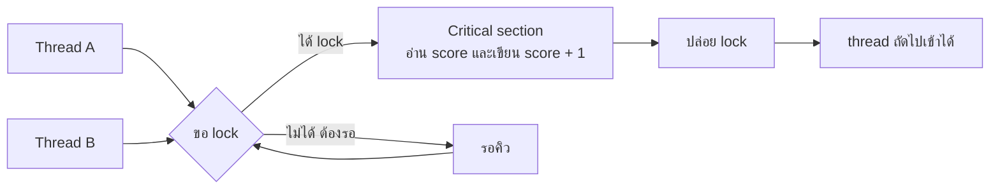

## 🎯 สิ่งที่จะได้เรียนรู้
- อธิบายว่า version control และ Git คืออะไร และช่วยการทำงานเป็นทีมอย่างไร
- ใช้คำสั่ง Git พื้นฐาน: `init`, `add`, `commit`, `branch`/`switch`, `merge`, `push`/`pull` และเข้าใจ pull request
- แก้ merge conflict เบื้องต้นได้
- แยกความแตกต่างระหว่าง concurrency กับ parallelism และอธิบาย thread
- อธิบาย race condition และป้องกันด้วย `threading.Lock` ใน Python

## 📖 เนื้อหาและคำอธิบาย

> [!note] สองหัวข้อนี้เกี่ยวกันอย่างไร
> ทั้ง Git และ concurrency แก้ปัญหาเดียวกันในระดับต่างกัน คือ **"เมื่อหลายฝ่ายแก้ข้อมูลเดียวกันพร้อมกัน จะไม่ให้งานทับกันได้อย่างไร"** — Git จัดการระดับ "คนหลายคนแก้ไฟล์" ส่วน lock จัดการระดับ "thread หลายตัวแก้ตัวแปร"

### ส่วนที่ 1: Version Control ด้วย Git

**Version control** คือระบบบันทึกประวัติการเปลี่ยนแปลงไฟล์ ทำให้ย้อนกลับไปเวอร์ชันเก่า ดูว่าใครแก้อะไรเมื่อไร และให้หลายคนทำงานคู่ขนานได้ หนังสือ *Pro Git* อธิบายว่า Git เป็น **distributed version control system** ทุกคนมีสำเนาประวัติทั้งหมดในเครื่อง ไม่ต้องพึ่งเซิร์ฟเวอร์กลางตลอดเวลา

อุปมา: Git เหมือน **การเซฟเกมเป็นจุด ๆ (save point)** ทุก commit คือจุดเซฟที่ย้อนกลับมาได้ และ branch คือการแยกเซฟไปลองเส้นทางใหม่โดยไม่กระทบเซฟหลัก

**พื้นที่ 3 ส่วนของ Git**

| พื้นที่ | ความหมาย | อุปมา |
|---|---|---|
| **Working directory** | ไฟล์ที่เรากำลังแก้อยู่ | โต๊ะทำงาน |
| **Staging area (index)** | ไฟล์ที่เลือกแล้วว่าจะบันทึกใน commit ถัดไป | กล่องพัสดุที่กำลังแพ็ก |
| **Repository (.git)** | ประวัติ commit ทั้งหมด | โกดังเก็บพัสดุที่ปิดผนึกแล้ว |

**คำศัพท์และคำสั่งสำคัญ**

| แนวคิด | ความหมาย | คำสั่งตัวอย่าง |
|---|---|---|
| **Repository** | โฟลเดอร์โปรเจกต์ที่ Git ติดตาม | `git init`, `git clone <url>` |
| **Commit** | ภาพบันทึก (snapshot) ของโปรเจกต์ ณ เวลาหนึ่ง พร้อมข้อความอธิบาย | `git add game.py` แล้ว `git commit -m "..."` |
| **Branch** | เส้นพัฒนาแยก เป็นตัวชี้ (pointer) ไปยัง commit | `git switch -c feature/score` |
| **Merge** | รวมการเปลี่ยนแปลงจาก branch หนึ่งเข้าอีก branch | `git merge feature/score` |
| **Remote** | สำเนา repository บนเซิร์ฟเวอร์ เช่น GitHub | `git push`, `git pull` |
| **Pull Request (PR)** | คำขอให้ทีมรีวิวและรวม branch เข้า main บน GitHub | สร้างผ่านเว็บ GitHub |
| **Conflict** | Git รวมอัตโนมัติไม่ได้ เพราะสองฝ่ายแก้บรรทัดเดียวกัน | แก้ไฟล์เอง แล้ว `add` + `commit` |

**Pull Request** ตามเอกสาร GitHub คือการแจ้งว่าเราได้ push การเปลี่ยนแปลงไปยัง branch หนึ่ง และขอให้ผู้อื่นรีวิว อภิปราย และอนุมัติก่อน merge เข้า branch หลัก จึงเป็นจุดตรวจคุณภาพโค้ดของทีม (รวมถึงตรวจโค้ดที่ได้จาก AI)

> [!tip] เคล็ดลับการเขียน commit
> commit ทีละเรื่องเล็ก ๆ และเขียนข้อความบอก "ทำอะไร" ให้ชัด เช่น `แก้บั๊ก HP ติดลบเมื่อโดนโจมตี` ดีกว่า `update` หรือ `แก้ไข`

### ส่วนที่ 2: Concurrency และ Parallelism

| ประเด็น | Concurrency (การทำงานพร้อมกันเชิงจัดการ) | Parallelism (การทำงานขนานจริง) |
|---|---|---|
| นิยาม | จัดการหลายงานที่ **คาบเกี่ยวกันในช่วงเวลา** สลับกันทำ | ทำหลายงาน **ในขณะเดียวกันจริง ๆ** |
| ต้องใช้หลายคอร์ไหม | ไม่จำเป็น ทำได้บนคอร์เดียว | ต้องมีหลายคอร์/หลายหน่วยประมวลผล |
| อุปมา | พ่อครัวคนเดียวต้มน้ำ ระหว่างรอก็หั่นผัก สลับไปมา | พ่อครัวสามคน แต่ละคนทำเมนูของตัวเองพร้อมกัน |
| ตัวอย่าง | เกมรอรับปุ่มกด เล่นเสียง และวาดภาพสลับกัน | ประมวลผลภาพหลายส่วนบน GPU พร้อมกัน |

**Thread** คือหน่วยการทำงานย่อยภายในโปรแกรมเดียว (process) thread หลายตัวใน process เดียว **ใช้หน่วยความจำร่วมกัน** จึงแชร์ตัวแปรกันได้สะดวก แต่ก็เป็นต้นเหตุของปัญหาด้วย

> [!note] Python กับ GIL
> CPython แบบมาตรฐานมี **Global Interpreter Lock (GIL)** ที่อนุญาตให้รัน bytecode ทีละ thread ทำให้ thread ใน Python เหมาะกับงานที่รอ I/O (เช่นรอเครือข่าย/ไฟล์) มากกว่างานคำนวณหนัก ตั้งแต่ Python 3.13 มี **free-threaded build** ที่ปิด GIL ได้ (PEP 703) อย่างไรก็ตาม **GIL ไม่ได้ป้องกัน race condition ในโค้ดของเรา** เพราะ thread ยังถูกสลับกลางคันระหว่างขั้นอ่านกับขั้นเขียนได้

### Race Condition
**Race condition** เกิดเมื่อผลลัพธ์ของโปรแกรมขึ้นกับ "ลำดับเวลา" ที่ thread ได้ทำงาน ซึ่งควบคุมไม่ได้ ตัวอย่างคลาสสิกคือ `score = score + 1` ซึ่งจริง ๆ มี 3 ขั้น: **อ่าน → บวก → เขียน**

ลองดูกรณีสอง thread เพิ่มคะแนนพร้อมกัน เริ่มที่ `score = 10`:

| ลำดับ | Thread A | Thread B | ค่า score |
|---|---|---|---|
| 1 | อ่าน score = 10 | | 10 |
| 2 | | อ่าน score = 10 | 10 |
| 3 | เขียน 10 + 1 = 11 | | 11 |
| 4 | | เขียน 10 + 1 = 11 | **11** (ควรเป็น 12!) |

การบวกของ A หายไป เรียกว่า **lost update** วิธีแก้คือกำหนด **critical section** แล้วใช้ **lock (mutex)** ให้มี thread เดียวเข้าไปได้ทีละตัว เหมือนห้องน้ำที่มีกุญแจดอกเดียว ใครถือกุญแจคนนั้นเข้าได้ คนอื่นต้องรอ

## 🧩 ตัวอย่างประกอบ / Worked Example

### ตัวอย่างที่ 1: ทำงานเป็นทีมกับ Git จนเกิดและแก้ conflict

สถานการณ์: ทีม Mini-Project สองคน คนหนึ่งเพิ่ม HP ใน `main` อีกคนลด HP ใน branch โหมดยาก

```bash
# 1) เริ่ม repository และ commit แรก
git init
git add game.py
git commit -m "เพิ่มค่าตั้งต้นของเกม"        # game.py มี MAX_HP = 100

# 2) เพื่อนแยก branch ทำโหมดยาก
git switch -c feature/hard-mode
#    (แก้ MAX_HP = 50)
git commit -am "ลด HP สำหรับโหมดยาก"

# 3) อีกคนกลับมาที่ main แล้วแก้บรรทัดเดียวกัน
git switch main
#    (แก้ MAX_HP = 120)
git commit -am "เพิ่ม HP ให้ผู้เล่นใหม่"

# 4) รวม branch -> เกิด conflict เพราะแก้บรรทัดเดียวกัน
git merge feature/hard-mode
```

```output
Auto-merging game.py
CONFLICT (content): Merge conflict in game.py
Automatic merge failed; fix conflicts and then commit the result.
```

Git ใส่ **conflict markers** ลงในไฟล์ให้เราเลือก:

```text
<<<<<<< HEAD
MAX_HP = 120
=======
MAX_HP = 50
>>>>>>> feature/hard-mode
speed = 5
```

ส่วนบน (`HEAD`) คือของ branch ปัจจุบัน (main) ส่วนล่างคือของ `feature/hard-mode` ทีมคุยกันแล้วตัดสินใจเก็บทั้งสองแบบเป็นค่าคงที่แยกกัน:

```bash
# 5) แก้ไฟล์ด้วยมือ ลบ markers ออก เช่น
#    MAX_HP = 120
#    HARD_MODE_MAX_HP = 50
git add game.py
git commit -m "รวมโหมดยาก: แยกค่า HP ปกติและโหมดยาก"
git log --oneline --graph --all     # ดูประวัติแบบกราฟ
git push origin main                # ส่งขึ้น GitHub (ถ้าตั้ง remote แล้ว)
```

> [!warning] ข้อควรระวัง
> conflict ไม่ใช่ error ของ Git แต่เป็นการที่ Git **ไม่กล้าตัดสินใจแทนคน** การ `pull` บ่อย ๆ และแบ่งงานให้คนละไฟล์/คนละฟังก์ชันจะช่วยลด conflict

### ตัวอย่างที่ 2: Race condition และการแก้ด้วย Lock ใน Python

จำลองเกมที่มี 4 thread ช่วยกันเพิ่มคะแนน คนละ 1,000 ครั้ง ค่าที่ถูกต้องคือ 4,000

```python
import threading
import time

score = 0                     # ข้อมูลที่ใช้ร่วมกัน (shared state)
lock = threading.Lock()

def add_points_unsafe(times):
    global score
    for _ in range(times):
        current = score       # 1) อ่านค่า
        time.sleep(0)         # จำลองการถูกสลับ thread ระหว่างอ่านกับเขียน
        score = current + 1   # 2) เขียนค่ากลับ (อาจทับงานของ thread อื่น)

def add_points_safe(times):
    global score
    for _ in range(times):
        with lock:            # ทีละ thread เท่านั้นที่เข้าส่วนนี้ได้ (critical section)
            current = score
            time.sleep(0)
            score = current + 1

def run(worker, n_threads=4, times=1000):
    global score
    score = 0
    threads = [threading.Thread(target=worker, args=(times,)) for _ in range(n_threads)]
    for t in threads:
        t.start()
    for t in threads:
        t.join()              # รอให้ทุก thread ทำงานเสร็จ
    return score

print("คาดหวัง      :", 4 * 1000)
print("ไม่ใช้ lock  :", run(add_points_unsafe))
print("ใช้ lock     :", run(add_points_safe))
```

```output
คาดหวัง      : 4000
ไม่ใช้ lock  : 1178
ใช้ lock     : 4000
```

**อธิบายผล:** แบบไม่ใช้ lock ได้ค่าน้อยกว่า 4,000 มาก และ **ได้ค่าไม่เท่ากันในแต่ละครั้งที่รัน** (ทดลองรันสองครั้งได้ 1000 และ 1178) เพราะ thread ถูกสลับระหว่างอ่านกับเขียนและทับงานกัน ส่วนแบบใช้ `with lock:` ได้ 4,000 ทุกครั้ง แลกกับการที่ thread ต้องต่อคิวกันในส่วนนั้น

> [!tip] เคล็ดลับ
> `time.sleep(0)` ในตัวอย่างใส่ไว้เพื่อ "บังคับ" ให้เห็นปัญหาชัดขึ้น ในโปรแกรมจริง race condition อาจเกิดนาน ๆ ครั้ง ทำให้หาบั๊กยากมาก จึงควรป้องกันตั้งแต่ออกแบบ

## 🗺️ แผนภาพสรุป



## ⚠️ ความเข้าใจผิดที่พบบ่อย
1. **"Git กับ GitHub คือสิ่งเดียวกัน"** — Git คือโปรแกรม version control ที่ทำงานในเครื่องเรา ส่วน GitHub คือบริการโฮสต์ repository ออนไลน์ที่เพิ่มฟีเจอร์ทีม เช่น pull request และ issue
2. **"Commit แล้วงานขึ้น GitHub ทันที"** — commit บันทึกในเครื่องเท่านั้น ต้อง `git push` จึงจะส่งขึ้น remote
3. **"Concurrency กับ parallelism คือคำเดียวกัน"** — concurrency คือการจัดการหลายงานที่คาบเกี่ยวกัน (สลับกันได้บนคอร์เดียว) ส่วน parallelism คือการทำพร้อมกันจริงบนหลายคอร์
4. **"Python มี GIL แล้วไม่ต้องใช้ lock"** — GIL ป้องกันโครงสร้างภายในของ interpreter แต่ไม่รับประกันว่าลำดับ อ่าน-แก้-เขียน ในโค้ดเราจะไม่ถูกขัดจังหวะ ต้องใช้ lock เองเมื่อแชร์ข้อมูลที่ถูกแก้ไข

## 🔗 เชื่อมโยงกับรายวิชา
- แผนสัปดาห์: [สัปดาห์ที่ 4: Algorithms & Programming Paradigms](/module/04)
- ข้อมูลแบบ immutable ใน Functional Programming ช่วยลด race condition: 03_OOP_vs_Functional
- การตรวจโค้ดจาก AI ผ่าน pull request: 04_AI_Coding_Assistants
- ต่อยอด CI/CD และการทำงานเป็นทีมในระดับระบบใน [สัปดาห์ที่ 14: Applied System Engineering & DevOps](/module/14) และ transaction/การล็อกข้อมูลใน [สัปดาห์ที่ 5: Database & Data Management](/module/05)
- ใน **Mini-Project 1: Simple Text/2D Game in Python** ให้ทีมเก็บโค้ดใน Git repository, ใช้ branch ต่อฟีเจอร์ และส่งงานผ่าน pull request ตาม [Lab 04 - Algorithm Flowchart and Module 1 Presentation](/lab/04) และ [กิจกรรมปฏิบัติการและโครงงาน](/docs/labs-projects)

## ❓ คำถามทบทวน
1. อธิบายความต่างของ `git add`, `git commit` และ `git push`
<details><summary>ดูแนวคำตอบ</summary>

`git add` ย้ายการเปลี่ยนแปลงจาก working directory ไปยัง staging area; `git commit` บันทึกสิ่งที่อยู่ใน staging เป็น snapshot ใน repository ในเครื่อง; `git push` ส่ง commit ในเครื่องขึ้นไปยัง remote เช่น GitHub
</details>

2. ทำไมควรสร้าง branch ใหม่สำหรับแต่ละฟีเจอร์ แทนที่จะแก้ใน `main` โดยตรง
<details><summary>ดูแนวคำตอบ</summary>

เพื่อแยกงานที่ยังไม่เสร็จออกจากโค้ดหลักที่ใช้งานได้ ทดลองได้โดยไม่ทำให้ main พัง หลายคนทำงานคู่ขนานได้ และเปิด pull request ให้ทีมรีวิวก่อนรวม
</details>

3. ถ้าเห็นข้อความ `<<<<<<< HEAD` ในไฟล์ หมายความว่าอะไร และต้องทำอย่างไรต่อ
<details><summary>ดูแนวคำตอบ</summary>

หมายถึงเกิด merge conflict ส่วนระหว่าง `<<<<<<< HEAD` กับ `=======` คือเนื้อหาของ branch ปัจจุบัน และส่วนถึง `>>>>>>>` คือของอีก branch ต้องแก้ไฟล์ให้เหลือเนื้อหาที่ถูกต้อง ลบ markers ออก แล้ว `git add` และ `git commit`
</details>

4. จงยกตัวอย่าง concurrency ที่ไม่ใช่ parallelism ในชีวิตประจำวัน
<details><summary>ดูแนวคำตอบ</summary>

นักศึกษาคนเดียวทำการบ้านสองวิชาสลับกัน ระหว่างรอไฟล์ดาวน์โหลดก็ไปทำอีกวิชา งานทั้งสองคืบหน้าในช่วงเวลาเดียวกัน แต่ไม่ได้ทำพร้อมกันจริงในขณะใดขณะหนึ่ง (มีผู้ทำคนเดียว)
</details>

5. ในตัวอย่างโค้ด ทำไมแบบไม่ใช้ lock จึงได้คะแนนน้อยกว่า 4,000 และไม่เท่ากันทุกครั้ง
<details><summary>ดูแนวคำตอบ</summary>

เพราะ thread หลายตัวอ่านค่า `score` เดิมก่อนที่ thread อื่นจะเขียนค่าใหม่ แล้วต่างก็เขียนทับกัน ทำให้การบวกบางครั้งหายไป (lost update) และลำดับการสลับ thread แตกต่างกันในแต่ละการรัน ผลจึงไม่แน่นอน
</details>

## 📚 แหล่งอ้างอิง
- [Chacon, S., & Straub, B. *Pro Git* (2nd ed.) — หนังสือออนไลน์ฟรี](https://git-scm.com/book/en/v2)
- [Pro Git — Basic Branching and Merging (รวมถึง merge conflicts)](https://git-scm.com/book/en/v2/Git-Branching-Basic-Branching-and-Merging)
- [GitHub Docs — About pull requests](https://docs.github.com/en/pull-requests/collaborating-with-pull-requests/proposing-changes-to-your-work-with-pull-requests/about-pull-requests)
- [Software Carpentry — Version Control with Git](https://swcarpentry.github.io/git-novice/)
- [Python Documentation — threading: Thread-based parallelism (Lock)](https://docs.python.org/3/library/threading.html)
- [Python Documentation — Python support for free threading](https://docs.python.org/3/howto/free-threading-python.html)
- [PEP 703 — Making the Global Interpreter Lock Optional in CPython](https://peps.python.org/pep-0703/)
