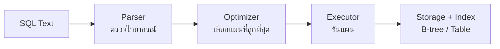
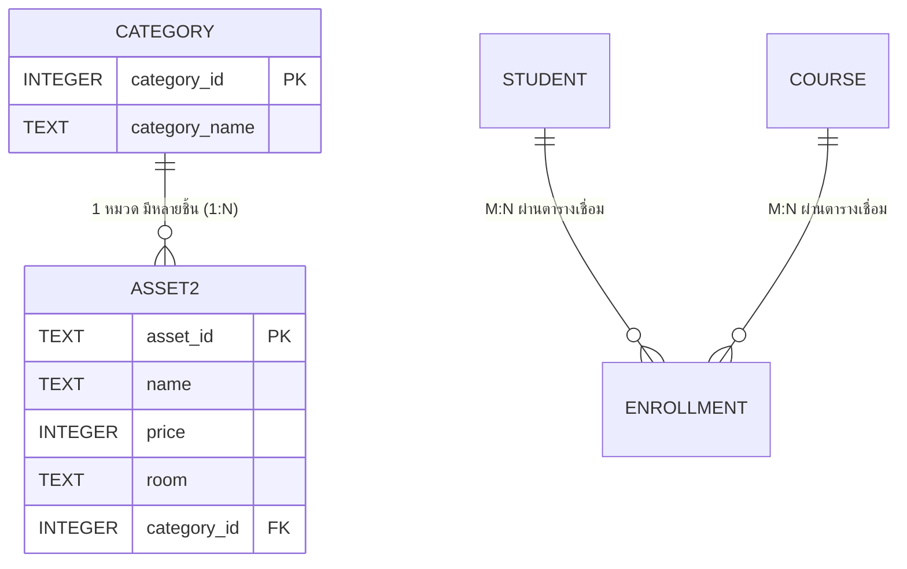
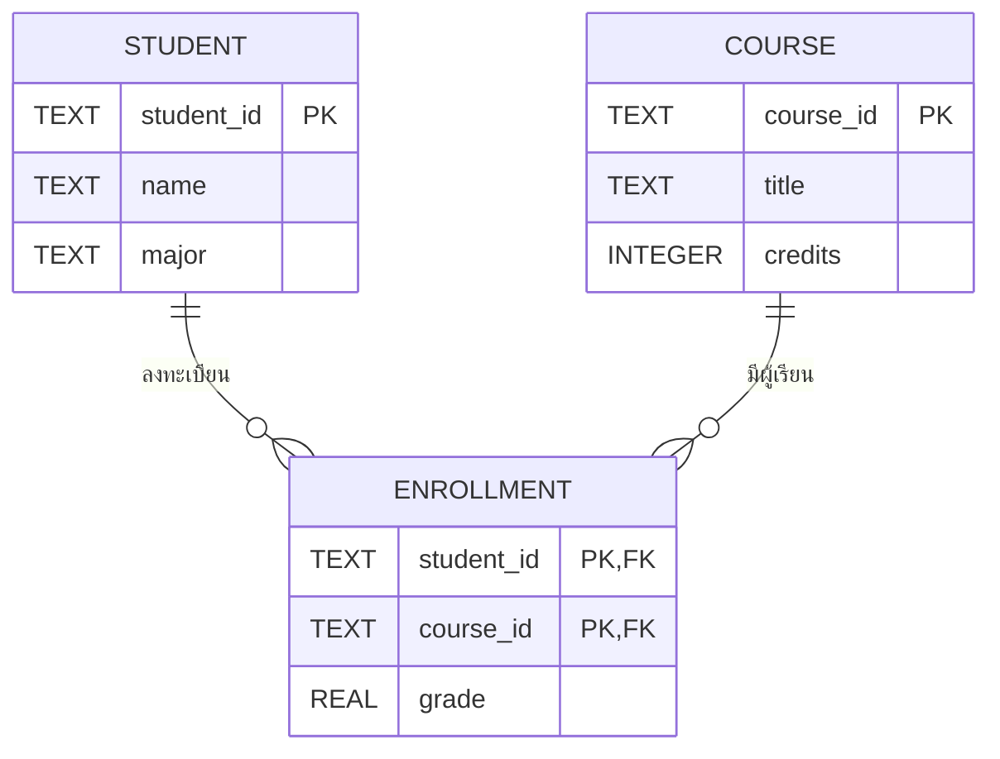

## 🎯 สิ่งที่จะได้เรียนรู้

- อธิบายองค์ประกอบของโมเดลเชิงสัมพันธ์: table, row, column, primary key, foreign key
- แปลง ER diagram เป็น schema จริง โดยใช้ตัวอย่าง `Student` / `Course` / `Enrollment`
- เขียน SQL พื้นฐาน `SELECT`, `JOIN`, `GROUP BY`, `HAVING`
- ใช้ `WHERE`/`ORDER BY`/`LIMIT`/`BETWEEN`/`LIKE`, aggregate, `INSERT`/`UPDATE`/`DELETE` และแยกความต่างของ `DELETE`/`DROP`/`TRUNCATE`
- ออกแบบความสัมพันธ์ 1:N (FK อยู่ฝั่ง N) เทียบกับ M:N (ตารางเชื่อม)
- อธิบาย normalization ระดับ 1NF, 2NF, 3NF และปัญหาที่มันแก้ได้
- เข้าใจว่า index (B-tree), transaction (ACID) และ query optimizer ทำงานอยู่ "หลังฉาก" อย่างไร

## 📖 เนื้อหาและคำอธิบาย

### 1. RDBMS คืออะไร: ห้องสมุดที่มีบรรณารักษ์

ลองนึกถึงห้องสมุด หนังสือคือ **ข้อมูล** ชั้นหนังสือคือ **ตาราง** บัตรรายการคือ **index** ส่วนบรรณารักษ์ที่รับคำขอ ไปหยิบหนังสือ และบันทึกการยืมคืนไม่ให้ผิดพลาดคือ **DBMS (Database Management System)**

RDBMS (Relational DBMS) เก็บข้อมูลตามโมเดลเชิงสัมพันธ์ที่ E. F. Codd เสนอไว้ในปี 1970 ข้อมูลทุกอย่างอยู่ในรูป **relation (ตาราง)** ตัวอย่างเช่น PostgreSQL, MySQL, SQLite, Oracle และ SQL Server ผู้ใช้บอกแค่ว่า *ต้องการอะไร* ด้วยภาษา SQL ซึ่งเป็นภาษาแบบ declarative ส่วนวิธีไปหาข้อมูลนั้น DBMS เป็นผู้ตัดสินใจเอง

| คำศัพท์ | ความหมาย | ตัวอย่าง |
|---|---|---|
| Table / Relation | ชุดข้อมูลของสิ่งเดียวกัน | `Student` |
| Row / Tuple | ข้อมูล 1 รายการ | นักศึกษา 68001 |
| Column / Attribute | คุณสมบัติหนึ่งของข้อมูล | `name`, `major` |
| Primary Key (PK) | ค่าที่ระบุแต่ละแถวได้ไม่ซ้ำและไม่เป็น NULL | `student_id` |
| Foreign Key (FK) | คอลัมน์ที่อ้างถึง PK ของอีกตาราง | `Enrollment.student_id` |
| Composite Key | PK ที่ประกอบด้วยหลายคอลัมน์ | `(student_id, course_id)` |

### 2. จาก ER Diagram สู่ Schema

**ER (Entity-Relationship) model** ใช้ออกแบบระดับแนวคิดก่อนลงมือสร้างตาราง ในระบบทะเบียน มีสอง entity คือ *Student* และ *Course* ความสัมพันธ์ระหว่างกันเป็นแบบ **many-to-many (M:N)** เพราะนักศึกษาหนึ่งคนลงได้หลายวิชา และวิชาหนึ่งก็มีนักศึกษาได้หลายคน

ฐานข้อมูลเชิงสัมพันธ์เก็บ M:N ในตารางเดียวโดยตรงไม่ได้ จึงต้องสร้าง **ตารางเชื่อม (junction table)** ชื่อ `Enrollment` ขึ้นมา ตารางนี้มี FK สองตัว และเก็บข้อมูลของความสัมพันธ์นั้นด้วย เช่น `grade`

### 3. Normalization: จัดตู้เสื้อผ้าไม่ให้ของซ้ำ

ถ้าเก็บทุกอย่างในตารางเดียว เช่น `(student_id, name, course_id, course_title, grade)` ชื่อวิชาจะถูกเขียนซ้ำทุกครั้งที่มีคนลงวิชานั้น สิ่งนี้ทำให้เกิด **anomaly** 3 แบบ

- **Update anomaly:** ถ้าแก้ชื่อวิชาแค่บางแถว ข้อมูลจะขัดแย้งกันเอง
- **Insert anomaly:** เพิ่มวิชาใหม่ไม่ได้ถ้ายังไม่มีใครลงทะเบียน
- **Delete anomaly:** ถ้าลบนักศึกษาคนสุดท้ายของวิชา ข้อมูลวิชาก็หายไปด้วย

| ระดับ | เงื่อนไข (อย่างย่อ) | ตัวอย่างการละเมิด |
|---|---|---|
| **1NF** | ทุกช่องเก็บค่าเดียว (atomic) และไม่มีกลุ่มข้อมูลซ้ำ | `courses = "MA101, PG101"` ในช่องเดียว |
| **2NF** | อยู่ใน 1NF และทุกคอลัมน์ที่ไม่ใช่ key ขึ้นกับ PK *ทั้งก้อน* (ไม่มี partial dependency) | ใน PK `(student_id, course_id)` คอลัมน์ `course_title` ขึ้นกับ `course_id` เพียงส่วนเดียว |
| **3NF** | อยู่ใน 2NF และไม่มี transitive dependency (non-key ขึ้นกับ non-key) | `Student(student_id, major_id, major_name)` ซึ่ง `major_name` ขึ้นกับ `major_id` |

> [!tip] วิธีจำแบบดั้งเดิม
> คอลัมน์ทุกตัวต้องขึ้นกับ "the key (1NF), the whole key (2NF), and nothing but the key (3NF)"

ในงานจริงบางครั้งมีการทำ **denormalization** โดยตั้งใจ เพื่อให้อ่านข้อมูลได้เร็วขึ้น แต่ควรทำหลังจากออกแบบให้ normalized ก่อน และต้องมีเหตุผลรองรับ

### 4. Index และ B-tree: สารบัญของหนังสือ

ถ้าไม่มี index การหา `WHERE course_id = 'MA101'` ต้องอ่านทุกแถว (**full table scan**) ซึ่งใช้เวลา $O(n)$ index ส่วนใหญ่ใน RDBMS ใช้โครงสร้าง **B-tree** ซึ่งเป็นต้นไม้ที่สมดุล แต่ละโหนดมีลูกได้หลายตัว ทำให้ต้นไม้เตี้ย การค้นหาจึงใช้เวลาประมาณ $O(\log n)$ และรองรับทั้งการค้นแบบเท่ากับ (`=`) และแบบช่วง (`<`, `BETWEEN`, `ORDER BY`)

PostgreSQL สร้าง B-tree เป็นค่าเริ่มต้นเมื่อสั่ง `CREATE INDEX` และยังมีชนิดอื่นให้เลือก เช่น Hash, GiST, GIN, BRIN

> [!warning] index ไม่ได้ฟรี
> ทุกครั้งที่ `INSERT`/`UPDATE`/`DELETE` ระบบต้องปรับ index ทุกตัวที่เกี่ยวข้องด้วย และ index ยังกินพื้นที่ดิสก์ จึงควรสร้างเฉพาะคอลัมน์ที่ใช้ค้นหรือ JOIN บ่อย

### 5. Transaction และ ACID: การโอนเงินต้องไม่ค้างครึ่งทาง

**Transaction** คือกลุ่มคำสั่งที่ต้องสำเร็จทั้งหมดหรือไม่เกิดขึ้นเลย เช่น โอนเงิน 500 บาทจาก A ไป B ต้องหักจาก A **และ** เพิ่มให้ B เสมอ

| คุณสมบัติ | ความหมาย | กลไกที่ใช้ทำให้เกิด (ตัวอย่าง) |
|---|---|---|
| **A**tomicity | ทำครบทั้งหมดหรือไม่ทำเลย | `ROLLBACK`, undo log |
| **C**onsistency | หลังจบ ข้อมูลยังเคารพกฎ (constraint) | PK, FK, `CHECK`, `NOT NULL` |
| **I**solation | ธุรกรรมที่ทำพร้อมกันไม่รบกวนกัน | locking, MVCC, isolation level |
| **D**urability | เมื่อ `COMMIT` แล้ว ข้อมูลไม่หายแม้ไฟดับ | Write-Ahead Log (WAL), fsync |

**Write-Ahead Logging (WAL)** ใน PostgreSQL มีหลักว่า การเปลี่ยนแปลงต้องถูกบันทึกลง log บนดิสก์ *ก่อน* จะเขียนลงไฟล์ข้อมูลจริง ถ้าระบบล่ม ก็นำ log มาเล่นซ้ำ (redo) เพื่อกู้ข้อมูลได้ ส่วน SQLite ใช้ rollback journal หรือเปิดโหมด WAL ได้เช่นกัน

### 6. Query Optimizer: GPS ของฐานข้อมูล

SQL บอกแค่จุดหมาย ส่วน **query planner/optimizer** ทำหน้าที่เหมือน GPS ที่เลือกเส้นทาง เช่น จะใช้ index หรือ scan ทั้งตาราง และจะ JOIN ตารางไหนก่อน ด้วยวิธี nested loop, hash join หรือ merge join การตัดสินใจนี้อาศัย **สถิติของข้อมูล** (cost-based optimization) เราดูแผนที่ระบบเลือกได้ด้วย `EXPLAIN` ใน PostgreSQL หรือ `EXPLAIN QUERY PLAN` ใน SQLite



## 🧩 ตัวอย่างประกอบ / Worked Example

**โจทย์:** สร้างฐานข้อมูลทะเบียนเรียนด้วย SQLite แล้วหาว่านักศึกษาคนใดมีเกรดเฉลี่ยมากกว่า 3.00

**ขั้นที่ 1: สร้าง schema จาก ER**

```sql
-- SQLite ต้องเปิดการตรวจ foreign key เองทุกครั้งที่เชื่อมต่อ
PRAGMA foreign_keys = ON;

CREATE TABLE Student (
  student_id TEXT PRIMARY KEY,          -- PK: รหัสนักศึกษา
  name       TEXT NOT NULL,
  major      TEXT
);

CREATE TABLE Course (
  course_id TEXT PRIMARY KEY,
  title     TEXT NOT NULL,
  credits   INTEGER CHECK (credits > 0) -- กฎ Consistency
);

-- ตารางเชื่อม M:N ใช้ composite primary key
CREATE TABLE Enrollment (
  student_id TEXT REFERENCES Student(student_id),
  course_id  TEXT REFERENCES Course(course_id),
  grade      REAL,
  PRIMARY KEY (student_id, course_id)
);
```

**ขั้นที่ 2: ใส่ข้อมูลตัวอย่าง**

```sql
INSERT INTO Student VALUES ('68001','สมชาย','CPE'), ('68002','สมหญิง','CPE'), ('68003','มานี','IT');
INSERT INTO Course  VALUES ('EN001019','แก่นวิศวกรรมคอมพิวเตอร์',3), ('MA101','แคลคูลัส 1',3), ('PG101','การเขียนโปรแกรม',3);
INSERT INTO Enrollment VALUES
  ('68001','EN001019',4.0), ('68001','MA101',3.0),
  ('68002','EN001019',3.5), ('68002','PG101',4.0),
  ('68003','MA101',2.5);
```

**ขั้นที่ 3: JOIN + GROUP BY + HAVING**

```sql
-- รวมผลรายคน แล้วกรองเฉพาะกลุ่มที่ค่าเฉลี่ย > 3.00
SELECT s.name,
       COUNT(*)               AS n_courses,
       ROUND(AVG(e.grade), 2) AS gpa
FROM Student s
JOIN Enrollment e ON e.student_id = s.student_id
GROUP BY s.student_id, s.name
HAVING AVG(e.grade) > 3.00   -- HAVING กรองหลังรวมกลุ่ม ส่วน WHERE กรองก่อน
ORDER BY gpa DESC;
```

```output
name    | n_courses | gpa
สมหญิง  | 2         | 3.75
สมชาย   | 2         | 3.5
```

(การคำนวณเกรดเฉลี่ยจริงต้องถ่วงน้ำหนักด้วยหน่วยกิต ในตัวอย่างนี้ทุกวิชามี 3 หน่วยกิตเท่ากัน ผลจึงตรงกัน)

**ขั้นที่ 4: ดูผลของ index และ constraint**

```sql
CREATE INDEX idx_enroll_course ON Enrollment(course_id);
EXPLAIN QUERY PLAN SELECT * FROM Enrollment WHERE course_id = 'MA101';

-- ลองใส่นักศึกษาที่ไม่มีอยู่จริง ระบบต้องปฏิเสธ
INSERT INTO Enrollment VALUES ('99999','MA101',4.0);
```

```output
SEARCH Enrollment USING INDEX idx_enroll_course (course_id=?)
Error: FOREIGN KEY constraint failed
```

**ขั้นที่ 5: Transaction**

```sql
BEGIN;
UPDATE Enrollment SET grade = 3.5 WHERE student_id = '68003' AND course_id = 'MA101';
-- ถ้าตรวจแล้วพบความผิดพลาด ให้ใช้ ROLLBACK; เพื่อยกเลิก
COMMIT;  -- ยืนยันผล (Durability)
```

## 🧾 คำสั่ง SQL ที่ต้องรู้ (พร้อมตัวอย่าง)

ส่วนนี้รวมคำสั่ง SQL ที่ใช้บ่อยที่สุด ทุกตัวอย่างรันจริงด้วย SQLite 3.50 (ผ่านโมดูล `sqlite3` ของ Python) ผลลัพธ์แสดงในรูปแบบ `คอลัมน์ | คอลัมน์` และ **รันต่อเนื่องตามลำดับ** ดังนั้นตัวอย่างหลังจะเห็นผลของคำสั่ง `INSERT`/`UPDATE`/`DELETE` ก่อนหน้า

> [!note] ลำดับการเขียนคำสั่ง SELECT
> `SELECT … FROM … WHERE … GROUP BY … HAVING … ORDER BY … LIMIT …` ต้องเขียนตามลำดับนี้เสมอ ส่วนลำดับที่ DBMS ประมวลผลจริงคือ `FROM → WHERE → GROUP BY → HAVING → SELECT → ORDER BY → LIMIT`

### 7.1 CREATE TABLE: สร้างตารางตัวอย่าง

```sql
CREATE TABLE students (
  student_id TEXT PRIMARY KEY,                       -- PK ห้ามซ้ำ ห้าม NULL
  first_name TEXT NOT NULL,
  last_name  TEXT NOT NULL,
  gender     TEXT CHECK (gender IN ('ชาย','หญิง')),
  faculty    TEXT,
  gpa        REAL CHECK (gpa BETWEEN 0 AND 4)        -- กฎ Consistency
);
INSERT INTO students VALUES
 ('65001','สมชาย','ศรีสุข','ชาย','วิศวกรรมศาสตร์',3.25),
 ('65002','สมหญิง','ใจดี','หญิง','วิศวกรรมศาสตร์',3.80),
 ('65003','มานี','ศรีวงศ์','หญิง','วิทยาศาสตร์',3.45),
 ('65004','ปิติ','แสนดี','ชาย','วิทยาศาสตร์',2.75),
 ('65005','ชูใจ','ทองคำ','หญิง','บริหารธุรกิจ',3.10),
 ('65006','วีระ','ศรีสมบูรณ์','ชาย','บริหารธุรกิจ',2.40),
 ('65007','กานดา','มีสุข','หญิง','วิศวกรรมศาสตร์',3.55),
 ('65008','ธนา','พูลผล','ชาย','วิศวกรรมศาสตร์',2.95);

CREATE TABLE Asset (
  asset_id TEXT PRIMARY KEY,
  name     TEXT NOT NULL,
  category TEXT,
  price    INTEGER,
  room     TEXT
);
INSERT INTO Asset VALUES
 ('A001','Notebook Dell','คอมพิวเตอร์',25900,'EN-301'),
 ('A002','Projector Epson','โสตทัศนูปกรณ์',18500,'EN-301'),
 ('A003','Raspberry Pi 5','บอร์ดทดลอง',3200,'EN-405'),
 ('A004','Desktop HP','คอมพิวเตอร์',21000,'EN-405'),
 ('A005','Arduino Uno','บอร์ดทดลอง',850,'EN-405'),
 ('A006','Smart TV 65"','โสตทัศนูปกรณ์',32000,'EN-201');
SELECT * FROM students;
```

```output
student_id | first_name | last_name | gender | faculty | gpa
65001 | สมชาย | ศรีสุข | ชาย | วิศวกรรมศาสตร์ | 3.25
65002 | สมหญิง | ใจดี | หญิง | วิศวกรรมศาสตร์ | 3.8
65003 | มานี | ศรีวงศ์ | หญิง | วิทยาศาสตร์ | 3.45
65004 | ปิติ | แสนดี | ชาย | วิทยาศาสตร์ | 2.75
65005 | ชูใจ | ทองคำ | หญิง | บริหารธุรกิจ | 3.1
65006 | วีระ | ศรีสมบูรณ์ | ชาย | บริหารธุรกิจ | 2.4
65007 | กานดา | มีสุข | หญิง | วิศวกรรมศาสตร์ | 3.55
65008 | ธนา | พูลผล | ชาย | วิศวกรรมศาสตร์ | 2.95
```

### 7.2 SELECT + WHERE กับ AND / OR

`AND` ต้องจริง **ทุกเงื่อนไข** ส่วน `OR` จริง **อย่างน้อยหนึ่งเงื่อนไข** ค่าข้อความต้องอยู่ใน `'...'` (single quote)

```sql
-- นักศึกษาวิศวะ "และ" gpa ตั้งแต่ 3.00
SELECT first_name, faculty, gpa FROM students
WHERE faculty = 'วิศวกรรมศาสตร์' AND gpa >= 3.00;
```

```output
first_name | faculty | gpa
สมชาย | วิศวกรรมศาสตร์ | 3.25
สมหญิง | วิศวกรรมศาสตร์ | 3.8
กานดา | วิศวกรรมศาสตร์ | 3.55
```

```sql
-- นักศึกษาคณะวิทยาศาสตร์ "หรือ" บริหารธุรกิจ (เขียนสั้นได้ว่า faculty IN ('วิทยาศาสตร์','บริหารธุรกิจ'))
SELECT first_name, faculty FROM students
WHERE faculty = 'วิทยาศาสตร์' OR faculty = 'บริหารธุรกิจ';
```

```output
first_name | faculty
มานี | วิทยาศาสตร์
ปิติ | วิทยาศาสตร์
ชูใจ | บริหารธุรกิจ
วีระ | บริหารธุรกิจ
```

> [!tip] ระวังลำดับ AND/OR
> `AND` ทำก่อน `OR` เสมอ (เหมือน × ทำก่อน +) ถ้าผสมกันให้ใส่วงเล็บ เช่น `WHERE (faculty = 'วิทยาศาสตร์' OR faculty = 'บริหารธุรกิจ') AND gender = 'หญิง'`

### 7.3 ORDER BY (ASC เป็นค่าเริ่มต้น / DESC) และ LIMIT

```sql
SELECT first_name, gpa FROM students ORDER BY gpa;   -- ไม่ระบุ = ASC (น้อยไปมาก)
```

```output
first_name | gpa
วีระ | 2.4
ปิติ | 2.75
ธนา | 2.95
ชูใจ | 3.1
สมชาย | 3.25
มานี | 3.45
กานดา | 3.55
สมหญิง | 3.8
```

```sql
-- 3 อันดับแรกที่ gpa สูงสุด: เรียงมากไปน้อย (DESC) แล้วตัดด้วย LIMIT
SELECT first_name, gpa FROM students ORDER BY gpa DESC LIMIT 3;
```

```output
first_name | gpa
สมหญิง | 3.8
กานดา | 3.55
มานี | 3.45
```

### 7.4 BETWEEN: ช่วงค่าแบบรวมขอบ

`gpa BETWEEN 3.00 AND 3.50` มีความหมายเท่ากับ `gpa >= 3.00 AND gpa <= 3.50` (รวมค่าขอบทั้งสองฝั่ง)

```sql
SELECT first_name, gpa FROM students
WHERE gpa BETWEEN 3.00 AND 3.50 ORDER BY gpa;
```

```output
first_name | gpa
ชูใจ | 3.1
สมชาย | 3.25
มานี | 3.45
```

### 7.5 LIKE กับ wildcard `%` และ `_`

| รูปแบบ | ความหมาย | ตัวอย่างที่ตรง |
|---|---|---|
| `'ศรี%'` | **ขึ้นต้น** ด้วย "ศรี" (`%` = อักขระกี่ตัวก็ได้ รวม 0 ตัว) | ศรีสุข, ศรีวงศ์ |
| `'%สุข'` | **ลงท้าย** ด้วย "สุข" | ศรีสุข, มีสุข |
| `'%สุข%'` | **มี** "สุข" อยู่ตรงไหนก็ได้ | ศรีสุข, มีสุข, สุขใจ |
| `'EN-4__'` | `_` = อักขระ **1 ตัวพอดี** (ในที่นี้ 2 ตัวหลัง EN-4) | EN-405 (แต่ไม่ตรง EN-4051) |

```sql
SELECT first_name, last_name FROM students WHERE last_name LIKE 'ศรี%';
```

```output
first_name | last_name
สมชาย | ศรีสุข
มานี | ศรีวงศ์
วีระ | ศรีสมบูรณ์
```

```sql
SELECT first_name, last_name FROM students WHERE last_name LIKE '%สุข%';
```

```output
first_name | last_name
สมชาย | ศรีสุข
กานดา | มีสุข
```

```sql
SELECT asset_id, name, room FROM Asset WHERE room LIKE 'EN-4__';
```

```output
asset_id | name | room
A003 | Raspberry Pi 5 | EN-405
A004 | Desktop HP | EN-405
A005 | Arduino Uno | EN-405
```

> [!note] ข้อควรรู้
> ใน SQLite `LIKE` ไม่สนตัวพิมพ์เล็ก/ใหญ่ของตัวอักษรอังกฤษ (`'a%'` ตรงกับ "Arduino") แต่ใน PostgreSQL `LIKE` สนตัวพิมพ์ ถ้าไม่ต้องการให้สนต้องใช้ `ILIKE`

### 7.6 Aggregate function: COUNT / SUM / AVG / MAX / MIN

aggregate รวมหลายแถวให้เหลือค่าเดียว ถ้าไม่มี `GROUP BY` จะรวมทั้งตาราง

```sql
SELECT COUNT(*) AS n, ROUND(AVG(gpa), 2) AS avg_gpa,
       MAX(gpa) AS max_gpa, MIN(gpa) AS min_gpa
FROM students;
```

```output
n | avg_gpa | max_gpa | min_gpa
8 | 3.16 | 3.8 | 2.4
```

ถ้ามี `GROUP BY` จะได้ผล **หนึ่งแถวต่อหนึ่งกลุ่ม**

```sql
SELECT faculty, COUNT(*) AS n, ROUND(AVG(gpa), 2) AS avg_gpa
FROM students GROUP BY faculty ORDER BY n DESC;
```

```output
faculty | n | avg_gpa
วิศวกรรมศาสตร์ | 4 | 3.39
วิทยาศาสตร์ | 2 | 3.1
บริหารธุรกิจ | 2 | 2.75
```

```sql
-- มูลค่ารวมของครุภัณฑ์แต่ละหมวด
SELECT category, COUNT(*) AS n, SUM(price) AS total_price
FROM Asset GROUP BY category ORDER BY total_price DESC;
```

```output
category | n | total_price
โสตทัศนูปกรณ์ | 2 | 50500
คอมพิวเตอร์ | 2 | 46900
บอร์ดทดลอง | 2 | 4050
```

> [!warning] กฎของ GROUP BY
> คอลัมน์ใน `SELECT` ที่ไม่ได้อยู่ใน aggregate ต้องอยู่ใน `GROUP BY` ด้วย (เช่น `faculty`) SQLite ยอมให้ละเมิดได้แต่จะได้ค่าจากแถวใดแถวหนึ่งแบบไม่แน่นอน ส่วน PostgreSQL จะแจ้ง error

### 7.7 HAVING vs WHERE

| | `WHERE` | `HAVING` |
|---|---|---|
| ทำงานเมื่อไร | **ก่อน** รวมกลุ่ม (กรองทีละแถว) | **หลัง** รวมกลุ่ม (กรองทีละกลุ่ม) |
| ใช้ aggregate ได้ไหม | ไม่ได้ | ได้ เช่น `HAVING AVG(gpa) > 3` |
| ตัวอย่าง | `WHERE gender = 'หญิง'` | `HAVING COUNT(*) >= 2` |

```sql
-- กรองเฉพาะนักศึกษาหญิงก่อน (WHERE) แล้วเหลือเฉพาะคณะที่มีนักศึกษาหญิงตั้งแต่ 2 คน (HAVING)
SELECT faculty, ROUND(AVG(gpa), 2) AS avg_gpa
FROM students
WHERE gender = 'หญิง'
GROUP BY faculty
HAVING COUNT(*) >= 2;
```

```output
faculty | avg_gpa
วิศวกรรมศาสตร์ | 3.67
```

> [!note] ทำไมได้ 3.67 ไม่ใช่ 3.68?
> ค่าเฉลี่ยจริงคือ 3.675 แต่คอมพิวเตอร์เก็บทศนิยมแบบเลขฐานสอง (floating point) ทำให้ 3.675 ถูกเก็บเป็นค่าที่น้อยกว่าเล็กน้อย (ประมาณ 3.67499…) `ROUND(…, 2)` จึงปัดเป็น 3.67 — ผลลัพธ์นี้ถูกต้องตามที่ SQLite คำนวณจริง

```sql
-- ผิด: ใช้ aggregate ใน WHERE
SELECT faculty FROM students WHERE AVG(gpa) > 3 GROUP BY faculty;
```

```output
Error: misuse of aggregate: AVG()
```

### 7.8 INSERT INTO … VALUES

ควรระบุชื่อคอลัมน์ทุกครั้ง โค้ดจะไม่พังเมื่อมีการเพิ่มคอลัมน์ในภายหลัง

```sql
INSERT INTO students (student_id, first_name, last_name, gender, faculty, gpa)
VALUES ('65009', 'นภา', 'ศรีอ่อน', 'หญิง', 'วิทยาศาสตร์', 3.90);
SELECT * FROM students WHERE student_id = '65009';
```

```output
(1 rows affected)
student_id | first_name | last_name | gender | faculty | gpa
65009 | นภา | ศรีอ่อน | หญิง | วิทยาศาสตร์ | 3.9
```

### 7.9 UPDATE … SET … WHERE

```sql
-- ย้ายโปรเจกเตอร์ไปห้อง EN-302 และปรับราคา (แก้ได้หลายคอลัมน์ คั่นด้วย ,)
UPDATE Asset SET price = 19900, room = 'EN-302' WHERE asset_id = 'A002';
SELECT * FROM Asset WHERE asset_id = 'A002';
```

```output
(1 rows affected)
asset_id | name | category | price | room
A002 | Projector Epson | โสตทัศนูปกรณ์ | 19900 | EN-302
```

### 7.10 DELETE FROM … WHERE … AND …

```sql
-- ลบด้วยชื่อ "และ" นามสกุล เพื่อไม่ให้ลบคนชื่อซ้ำผิดคน (ดีที่สุดคือลบด้วย PK)
DELETE FROM students WHERE first_name = 'ปิติ' AND last_name = 'แสนดี';
SELECT COUNT(*) AS n FROM students;   -- หลัง INSERT มี 9 คน ลบแล้วเหลือ 8
```

```output
(1 rows affected)
n
8
```

> [!warning] UPDATE / DELETE ที่ไม่มี WHERE มีผลกับ "ทุกแถว"
> `UPDATE students SET gpa = 4.00;` จะเปลี่ยน gpa ของทุกคนเป็น 4.00 และ `DELETE FROM students;` จะลบข้อมูลทั้งตาราง โดยไม่มีคำเตือนใด ๆ
> แนวปฏิบัติที่ดี: (1) รัน `SELECT … WHERE …` ด้วยเงื่อนไขเดียวกันก่อน เพื่อดูว่าจะโดนกี่แถว (2) ครอบด้วย `BEGIN; … ROLLBACK;` ถ้ายังไม่แน่ใจ (3) สำรองข้อมูลก่อนแก้ไขจำนวนมาก

### 7.11 DELETE vs DROP TABLE vs TRUNCATE

| คำสั่ง | ลบอะไร | โครงสร้างตารางยังอยู่ไหม | ใช้ WHERE ได้ไหม | ประเภท |
|---|---|---|---|---|
| `DELETE FROM t WHERE …` | เฉพาะแถวที่ตรงเงื่อนไข (ไม่มี WHERE = ทุกแถว) | อยู่ | ได้ | DML (rollback ได้ใน transaction) |
| `TRUNCATE TABLE t` | ทุกแถว เร็วกว่า DELETE เพราะไม่ลบทีละแถว | อยู่ | ไม่ได้ | DDL (ใน MySQL/Oracle rollback ไม่ได้ แต่ PostgreSQL rollback ได้) |
| `DROP TABLE t` | ทั้งข้อมูล **และ** ตัวตาราง (schema, index) | **ไม่อยู่** | ไม่ได้ | DDL |

```sql
CREATE TABLE temp_log (id INTEGER, msg TEXT);
INSERT INTO temp_log VALUES (1,'a'), (2,'b'), (3,'c');
DELETE FROM temp_log;                 -- ลบทุกแถว ตารางยังอยู่
SELECT COUNT(*) AS n FROM temp_log;
DROP TABLE temp_log;                  -- ลบตารางทิ้งทั้งตาราง
SELECT COUNT(*) AS n FROM temp_log;
```

```output
(3 rows affected)
(3 rows affected)
n
0
Error: no such table: temp_log
```

> [!note] SQLite ไม่มีคำสั่ง TRUNCATE
> ถ้าสั่ง `TRUNCATE TABLE Asset;` ใน SQLite จะได้ `Error: near "TRUNCATE": syntax error` ให้ใช้ `DELETE FROM t;` (ไม่มี WHERE) แทน ซึ่ง SQLite จะลบแบบเร็ว (truncate optimization) ให้เองโดยอัตโนมัติ

### 7.12 ความสัมพันธ์ 1:N และ JOIN: Category 1:N Asset

ตาราง `Asset` ข้างบนเก็บชื่อหมวด (`category`) เป็นข้อความซ้ำในทุกแถว ถ้าจะเปลี่ยนชื่อหมวดต้องแก้หลายแถว (update anomaly) จึงควรแยกออกเป็นตาราง `Category`

หลักการของ **1:N (one-to-many)**: หมวดหนึ่งมีครุภัณฑ์ได้หลายชิ้น แต่ครุภัณฑ์หนึ่งชิ้นอยู่ได้หมวดเดียว ให้ **วาง FK ไว้ฝั่ง N (ฝั่ง "หลาย")** คือ `Asset.category_id` โดยไม่ต้องสร้างตารางเชื่อม ต่างจาก **M:N** ของ `Student`–`Course` ที่ต้องมีตาราง `Enrollment` เพราะทั้งสองฝั่งเป็น "หลาย"

| ความสัมพันธ์ | ตัวอย่าง | วิธีสร้างตาราง |
|---|---|---|
| 1:1 | นักศึกษา 1 คน มีบัตรนักศึกษา 1 ใบ | FK ฝั่งใดก็ได้ + `UNIQUE` |
| **1:N** | Category 1 หมวด มี Asset หลายชิ้น | **FK อยู่ฝั่ง N** (`Asset.category_id`) |
| **M:N** | Student ลงหลาย Course และ Course มีหลาย Student | **ตารางเชื่อม** `Enrollment` ที่มี FK 2 ตัว |

```sql
CREATE TABLE Category (
  category_id   INTEGER PRIMARY KEY,
  category_name TEXT NOT NULL UNIQUE
);
CREATE TABLE Asset2 (
  asset_id    TEXT PRIMARY KEY,
  name        TEXT NOT NULL,
  price       INTEGER,
  room        TEXT,
  category_id INTEGER NOT NULL REFERENCES Category(category_id)  -- FK ฝั่ง N
);
INSERT INTO Category VALUES (1,'คอมพิวเตอร์'), (2,'โสตทัศนูปกรณ์'), (3,'บอร์ดทดลอง'), (4,'เฟอร์นิเจอร์');
-- ย้ายข้อมูลจากตารางเดิม โดยแปลงชื่อหมวดเป็นรหัสหมวด
INSERT INTO Asset2
SELECT a.asset_id, a.name, a.price, a.room, c.category_id
FROM Asset a JOIN Category c ON c.category_name = a.category;

-- INNER JOIN: ดึงชื่อหมวดกลับมาแสดงคู่กับครุภัณฑ์
SELECT a.asset_id, a.name, c.category_name, a.price
FROM Asset2 a
JOIN Category c ON a.category_id = c.category_id
ORDER BY a.price DESC;
```

```output
asset_id | name | category_name | price
A006 | Smart TV 65" | โสตทัศนูปกรณ์ | 32000
A001 | Notebook Dell | คอมพิวเตอร์ | 25900
A004 | Desktop HP | คอมพิวเตอร์ | 21000
A002 | Projector Epson | โสตทัศนูปกรณ์ | 19900
A003 | Raspberry Pi 5 | บอร์ดทดลอง | 3200
A005 | Arduino Uno | บอร์ดทดลอง | 850
```

`INNER JOIN` แสดงเฉพาะแถวที่จับคู่ได้ ถ้าต้องการให้หมวดที่ยังไม่มีครุภัณฑ์แสดงด้วย ให้ใช้ `LEFT JOIN`

```sql
SELECT c.category_name, COUNT(a.asset_id) AS n_assets
FROM Category c
LEFT JOIN Asset2 a ON a.category_id = c.category_id
GROUP BY c.category_id
ORDER BY n_assets DESC;
```

```output
category_name | n_assets
คอมพิวเตอร์ | 2
โสตทัศนูปกรณ์ | 2
บอร์ดทดลอง | 2
เฟอร์นิเจอร์ | 0
```

FK ป้องกันไม่ให้ครุภัณฑ์อ้างถึงหมวดที่ไม่มีอยู่ (ต้องเปิด `PRAGMA foreign_keys = ON;` ก่อน)

```sql
INSERT INTO Asset2 VALUES ('A099', 'เก้าอี้', 1500, 'EN-201', 9);   -- ไม่มี category_id = 9
```

```output
Error: FOREIGN KEY constraint failed
```



### 7.13 สรุปคำสั่ง (Cheat Sheet)

| กลุ่ม | คำสั่ง | ใช้ทำอะไร |
|---|---|---|
| DDL (โครงสร้าง) | `CREATE TABLE`, `DROP TABLE`, `ALTER TABLE` | สร้าง/ลบ/แก้โครงสร้างตาราง |
| DML (ข้อมูล) | `INSERT`, `UPDATE`, `DELETE` | เพิ่ม/แก้/ลบแถว |
| DQL (สอบถาม) | `SELECT … WHERE … GROUP BY … HAVING … ORDER BY … LIMIT` | ดึงข้อมูล |
| TCL (transaction) | `BEGIN`, `COMMIT`, `ROLLBACK` | ยืนยันหรือยกเลิกการเปลี่ยนแปลง |

ฝึกเขียนคำสั่งเหล่านี้กับข้อมูลนักศึกษาจาก CSV บน Google Colab ได้ที่ [Lab 05 - Database Design and SQL](/lab/05)

## 🗺️ แผนภาพสรุป



## ⚠️ ความเข้าใจผิดที่พบบ่อย

- **"สร้าง index ทุกคอลัมน์จะเร็วที่สุด"** ไม่จริง การเขียนข้อมูลจะช้าลงและเปลืองพื้นที่ ควรเลือกเฉพาะคอลัมน์ที่ใช้ค้นหรือ JOIN บ่อย
- **"FK ทำงานอัตโนมัติใน SQLite"** การบังคับ FK ใน SQLite ปิดอยู่โดยค่าเริ่มต้น ต้องสั่ง `PRAGMA foreign_keys = ON;` ทุกครั้งที่เชื่อมต่อ
- **"WHERE กับ HAVING ใช้แทนกันได้"** `WHERE` กรองแถวก่อนรวมกลุ่ม `HAVING` กรองหลังรวมกลุ่ม และใช้กับ aggregate อย่าง `AVG()` ได้
- **"Normalize ให้สูงที่สุดเสมอ"** ระดับ 3NF หรือ BCNF มักเพียงพอ บางระบบ เช่น data warehouse ตั้งใจ denormalize เพื่อให้วิเคราะห์ได้เร็ว
- **"Consistency ใน ACID = Consistency ใน CAP"** เป็นคนละความหมาย ACID หมายถึงข้อมูลเคารพกฎ ส่วน CAP หมายถึงทุก node เห็นข้อมูลล่าสุดตรงกัน (ดู 02_การขยายระบบด้วย_NoSQL)

## 🔗 เชื่อมโยงกับรายวิชา

- แผนสัปดาห์: [สัปดาห์ที่ 5: Database & Data Management](/module/05) · ภาพรวม: 00_Overview - ฐานข้อมูล
- พื้นฐาน $O(\log n)$ ของ B-tree เชื่อมกับ [Big-O Notation](/concept/big-o-notation) ใน [สัปดาห์ที่ 4: Algorithms & Programming Paradigms](/module/04)
- **Mini-Project 2 "Asset Management Web App":** ใน Lab สัปดาห์นี้ให้ออกแบบ ER ของระบบครุภัณฑ์ เช่น `Asset`, `Category`, `Location`, `Borrowing` แล้วสร้างใน SQLite ใช้ FK เชื่อม `Borrowing` กับ `Asset` และสร้าง index บนคอลัมน์ที่ค้นบ่อย เช่น `asset_code` ดูรายละเอียดที่ [กิจกรรมปฏิบัติการและโครงงาน](/docs/labs-projects)
- เรื่องถัดไป: 02_การขยายระบบด้วย_NoSQL และ 05_Data_Privacy_and_Security (การเขียน SQL ให้ปลอดภัย)

## ❓ คำถามทบทวน

1. ทำไมความสัมพันธ์ M:N ระหว่าง Student กับ Course ต้องใช้ตาราง `Enrollment`?
<details><summary>ดูแนวคำตอบ</summary>
โมเดลเชิงสัมพันธ์เก็บได้ช่องละค่าเดียว (1NF) ถ้าใส่รายวิชาหลายวิชาไว้ในแถวของนักศึกษาจะละเมิด 1NF ตารางเชื่อมจึงแยกการลงทะเบียน 1 ครั้งเป็น 1 แถว มี FK ชี้ไปทั้งสองตาราง และเก็บข้อมูลของความสัมพันธ์อย่าง grade ได้
</details>

2. ตาราง `(student_id, course_id, course_title, grade)` ที่มี PK เป็น `(student_id, course_id)` ละเมิด normal form ระดับใด เพราะอะไร?
<details><summary>ดูแนวคำตอบ</summary>
ละเมิด 2NF เพราะ `course_title` ขึ้นกับ `course_id` ซึ่งเป็นเพียงส่วนหนึ่งของ PK (partial dependency) วิธีแก้คือย้าย `course_title` ไปไว้ในตาราง `Course`
</details>

3. อธิบาย Atomicity และ Durability ด้วยตัวอย่างการโอนเงิน
<details><summary>ดูแนวคำตอบ</summary>
Atomicity: ถ้าหักเงิน A แล้วระบบล่มก่อนเพิ่มให้ B ธุรกรรมต้องถูก rollback ทั้งหมด ไม่ปล่อยให้เงินหายไปครึ่งทาง Durability: เมื่อ COMMIT แล้ว แม้ไฟดับทันที ผลการโอนต้องยังอยู่ เพราะถูกบันทึกลง WAL หรือ journal บนดิสก์แล้ว
</details>

4. ทำไม B-tree index จึงช่วยทั้ง `WHERE id = 5` และ `WHERE price BETWEEN 100 AND 200`?
<details><summary>ดูแนวคำตอบ</summary>
B-tree เก็บ key เรียงลำดับในต้นไม้ที่สมดุล การหาค่าเดียวจึงไล่จากรากถึงใบในเวลา O(log n) ส่วนการค้นแบบช่วง เมื่อเจอจุดเริ่มต้นแล้วก็อ่านใบที่เรียงต่อกันไปได้เลย โดยไม่ต้อง scan ทั้งตาราง
</details>

5. เขียน SQL หาจำนวนนักศึกษาในแต่ละรายวิชา แสดงเฉพาะวิชาที่มีมากกว่า 1 คน
<details><summary>ดูแนวคำตอบ</summary>

```sql
SELECT c.title, COUNT(e.student_id) AS n_students
FROM Course c JOIN Enrollment e ON e.course_id = c.course_id
GROUP BY c.course_id, c.title
HAVING COUNT(e.student_id) > 1;
```
จากข้อมูลตัวอย่างจะได้ "แก่นวิศวกรรมคอมพิวเตอร์" (2 คน) และ "แคลคูลัส 1" (2 คน)
</details>

## 📚 แหล่งอ้างอิง

- Silberschatz, A., Korth, H. F., & Sudarshan, S. (2019). *Database System Concepts* (7th ed.). McGraw-Hill. [db-book.com](https://www.db-book.com/)
- PostgreSQL Documentation. *Transactions* (tutorial). [postgresql.org](https://www.postgresql.org/docs/current/tutorial-transactions.html)
- PostgreSQL Documentation. *Index Types* และ *Write-Ahead Logging (WAL)*. [indexes-types](https://www.postgresql.org/docs/current/indexes-types.html) · [wal-intro](https://www.postgresql.org/docs/current/wal-intro.html)
- PostgreSQL Documentation. *Using EXPLAIN*. [postgresql.org](https://www.postgresql.org/docs/current/using-explain.html)
- SQLite Documentation. *SQLite Foreign Key Support* และ *Query Planning*. [foreignkeys](https://www.sqlite.org/foreignkeys.html) · [queryplanner](https://www.sqlite.org/queryplanner.html)
