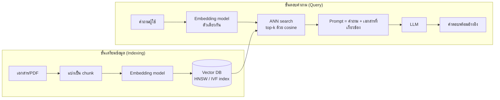

## 🎯 สิ่งที่จะได้เรียนรู้

- อธิบายว่า **embedding** คืออะไร และทำไมจึงทำให้คอมพิวเตอร์ "ค้นตามความหมาย" ได้
- คำนวณ **cosine similarity** ด้วยมือจากเวกเตอร์ขนาดเล็ก
- เข้าใจว่าทำไมต้องใช้ **ANN (Approximate Nearest Neighbor)** และรู้จัก HNSW กับ IVF ในระดับแนวคิด
- เขียน SQL ด้วย **pgvector** เพื่อเก็บและค้นเวกเตอร์ใน PostgreSQL
- อธิบายบทบาทของ vector database ในระบบ **RAG (Retrieval-Augmented Generation)**

## 📖 เนื้อหาและคำอธิบาย

### 1. ปัญหาของ Keyword Search

ถ้าผู้ใช้พิมพ์ว่า "วิธีดูแลลูกแมว" แต่เอกสารในระบบเขียนว่า "การเลี้ยงแมวเด็ก" การค้นด้วย `LIKE '%ลูกแมว%'` จะไม่เจอ เพราะคำไม่ตรงกัน ทั้งที่ความหมายใกล้กันมาก **Semantic search** แก้ปัญหานี้ด้วยการเปรียบเทียบ *ความหมาย* แทน *ตัวอักษร*

### 2. Embedding: พิกัดของความหมาย

**Embedding** คือการแปลงข้อมูล เช่น ข้อความ รูปภาพ หรือเสียง ให้เป็น **เวกเตอร์ตัวเลข** ด้วยโมเดล machine learning โดยข้อมูลที่ความหมายใกล้กันจะได้เวกเตอร์ที่อยู่ใกล้กันในปริภูมิ (vector space)

> [!note] อุปมา: แผนที่เมือง
> ให้นึกภาพว่าทุกประโยคถูกปักหมุดบนแผนที่ ประโยคเรื่องแมวไปกระจุกอยู่ย่านหนึ่ง ประโยคเรื่องหุ้นอยู่อีกย่าน การค้นหาจึงเท่ากับถามว่า "หมุดไหนอยู่ใกล้หมุดคำถามที่สุด" ต่างกันตรงที่แผนที่จริงมี 2 มิติ แต่ embedding มีหลายร้อยถึงหลายพันมิติ

ตัวอย่างเช่น โมเดล `all-MiniLM-L6-v2` ของ Sentence-Transformers ให้เวกเตอร์ 384 มิติ ส่วน embedding API เชิงพาณิชย์มักให้เวกเตอร์ขนาดใหญ่กว่านั้น ข้อสำคัญคือ **ต้องใช้โมเดลเดียวกัน** ทั้งตอนสร้าง embedding ของเอกสารและของคำถาม

### 3. การวัดความใกล้ (Similarity / Distance)

**Cosine similarity** วัดมุมระหว่างเวกเตอร์สองตัว โดยไม่สนความยาว

$$
\cos(\theta) = \frac{\mathbf{a}\cdot\mathbf{b}}{\lVert\mathbf{a}\rVert\,\lVert\mathbf{b}\rVert} = \frac{\sum_{i} a_i b_i}{\sqrt{\sum_i a_i^2}\,\sqrt{\sum_i b_i^2}}
$$

ค่าอยู่ระหว่าง −1 ถึง 1 ค่า 1 คือทิศเดียวกัน (ความหมายเหมือนกัน) ค่า 0 คือตั้งฉาก (ไม่เกี่ยวข้องกัน) ส่วน **cosine distance** = $1 - \cos(\theta)$ ยิ่งน้อยยิ่งใกล้

| ตัววัด | สูตรย่อ | ตัวดำเนินการใน pgvector | ใช้เมื่อ |
|---|---|---|---|
| Euclidean (L2) | $\sqrt{\sum (a_i-b_i)^2}$ | `<->` | ระยะทางเชิงเรขาคณิต |
| Inner product | $\sum a_i b_i$ | `<#>` (คืนค่าติดลบ) | เวกเตอร์ normalize แล้ว ต้องการความเร็ว |
| Cosine distance | $1-\cos\theta$ | `<=>` | ข้อความ/semantic search (นิยมที่สุด) |
| L1 (Manhattan) | $\sum \lvert a_i-b_i\rvert$ | `<+>` | งานเฉพาะทาง |

### 4. ทำไมต้อง ANN Index

ถ้ามีเอกสาร 10 ล้านชิ้น การเทียบคำถามกับทุกชิ้น (**exact k-NN / brute force**) ต้องคำนวณ 10 ล้านครั้งต่อคำถาม ช้าเกินไปสำหรับแอปจริง **ANN (Approximate Nearest Neighbor)** จึงยอมแลกความแม่นยำเล็กน้อย (วัดด้วย **recall** ว่าเจอเพื่อนบ้านจริงกี่เปอร์เซ็นต์) เพื่อความเร็วที่สูงขึ้นมาก

| เทคนิค | แนวคิด | อุปมา | ข้อดี / ข้อแลกเปลี่ยน |
|---|---|---|---|
| **Flat (brute force)** | เทียบทุกตัว | ถามทุกคนในเมือง | แม่นยำ 100% แต่ช้าเมื่อข้อมูลมาก |
| **IVF (Inverted File)** | จัดกลุ่มเวกเตอร์เป็น *lists/clusters* ก่อน (เช่น k-means) แล้วค้นเฉพาะกลุ่มที่ใกล้คำถาม | ไปเฉพาะอำเภอที่น่าจะใช่ | สร้าง index เร็ว ใช้หน่วยความจำน้อย แต่ recall ขึ้นกับจำนวนกลุ่มที่ค้น (`probes`) |
| **HNSW (Hierarchical Navigable Small World)** | กราฟหลายชั้น ชั้นบนเชื่อมไกล ชั้นล่างเชื่อมใกล้ ค้นแบบกระโดดลงทีละชั้น | ขึ้นทางด่วนก่อน แล้วค่อยเข้าซอย | ค้นเร็วและ recall สูง แต่สร้างช้าและกินหน่วยความจำมากกว่า |

HNSW เสนอโดย Malkov และ Yashunin (2016/2018) และเป็นวิธีที่ระบบส่วนใหญ่ใช้ในปัจจุบัน เช่น pgvector, Milvus, Qdrant ส่วนไลบรารี FAISS ของ Meta รวม index หลายแบบ เช่น Flat, IVF, HNSW และ PQ ไว้ในที่เดียว

### 5. Vector Database แบบแยก vs แบบส่วนขยาย

- **ระบบเฉพาะทาง (purpose-built):** Pinecone, Milvus, Weaviate, Qdrant ออกแบบมาเพื่อเวกเตอร์ขนาดใหญ่โดยตรง
- **ส่วนขยายของฐานข้อมูลเดิม:** **pgvector** บน PostgreSQL หรือชนิด `VECTOR` ใน SQL Server 2025 ข้อดีคือเก็บเวกเตอร์ไว้ข้างข้อมูลตารางเดิม JOIN และกรองด้วย `WHERE` ได้ในคำสั่งเดียว และได้ ACID ด้วย

### 6. บทบาทใน RAG

LLM ไม่รู้ข้อมูลภายในองค์กรและอาจ "แต่ง" คำตอบ (hallucination) ได้ **RAG** (Lewis et al., 2020) แก้ปัญหานี้โดย **ค้นเอกสารที่เกี่ยวข้องก่อน** แล้วส่งให้ LLM ใช้เป็นบริบทในการตอบ vector database คือหัวใจของขั้น "Retrieval" ดูภาพรวมที่ [RAG และ LLM](/concept/rag-llm)

## 🧩 ตัวอย่างประกอบ / Worked Example

**โจทย์:** มีเอกสาร 3 ชิ้น และคำถาม "แมวชอบนอนตรงไหน" สมมติว่าโมเดลแปลงเป็นเวกเตอร์ 3 มิติ (ของจริงมีหลายร้อยมิติ) โดยมิติที่ 1 ≈ "เรื่องแมว", มิติที่ 2 ≈ "เรื่องการเงิน", มิติที่ 3 ≈ "เรื่องอาหาร"

| | ข้อความ | เวกเตอร์ |
|---|---|---|
| q | แมวชอบนอนตรงไหน | [0.9, 0.1, 0.2] |
| A | แมวนอนบนโซฟา | [0.8, 0.2, 0.1] |
| B | ลูกแมวกินปลา | [0.7, 0.1, 0.5] |
| C | ราคาหุ้นวันนี้ | [0.1, 0.9, 0.3] |

**ขั้นที่ 1: คำนวณ cosine(q, A) ด้วยมือ**

- dot product: $0.9(0.8) + 0.1(0.2) + 0.2(0.1) = 0.72 + 0.02 + 0.02 = 0.76$
- $\lVert q\rVert = \sqrt{0.81+0.01+0.04} = \sqrt{0.86} \approx 0.9274$
- $\lVert A\rVert = \sqrt{0.64+0.04+0.01} = \sqrt{0.69} \approx 0.8307$
- $\cos = 0.76 / (0.9274 \times 0.8307) \approx 0.9866$

**ขั้นที่ 2: ตรวจด้วย Python**

```python
import numpy as np

docs = {"แมวนอนบนโซฟา": [0.8, 0.2, 0.1],
        "ลูกแมวกินปลา": [0.7, 0.1, 0.5],
        "ราคาหุ้นวันนี้": [0.1, 0.9, 0.3]}
q = np.array([0.9, 0.1, 0.2])  # เวกเตอร์ของคำถาม

def cosine(a, b):
    # dot product หารด้วยผลคูณความยาวของเวกเตอร์ทั้งสอง
    return float(a @ b / (np.linalg.norm(a) * np.linalg.norm(b)))

# เรียงจากคล้ายมากไปน้อย
for text, s in sorted(((t, cosine(q, np.array(v))) for t, v in docs.items()), key=lambda x: -x[1]):
    print(f"{s:.4f}  distance={1-s:.4f}  {text}")
```

```output
0.9866  distance=0.0134  แมวนอนบนโซฟา
0.9214  distance=0.0786  ลูกแมวกินปลา
0.2713  distance=0.7287  ราคาหุ้นวันนี้
```

เอกสาร A ใกล้ที่สุด ส่วน C ไม่เกี่ยวข้องเลย แม้คำถามกับ A จะมีคำว่า "แมว" และ "นอน" ร่วมกันก็จริง แต่ B ซึ่งไม่มีคำว่า "นอน" ก็ยังได้คะแนนสูง นี่คือข้อดีของการค้นตามความหมาย

**ขั้นที่ 3: ทำแบบเดียวกันด้วย pgvector**

```sql
CREATE EXTENSION IF NOT EXISTS vector;          -- เปิดใช้ส่วนขยาย (ครั้งเดียวต่อฐานข้อมูล)

CREATE TABLE docs (
  id        bigserial PRIMARY KEY,
  content   text,
  category  text,
  embedding vector(3)                            -- ของจริง เช่น vector(384)
);

INSERT INTO docs (content, category, embedding) VALUES
  ('แมวนอนบนโซฟา',  'pet',     '[0.8,0.2,0.1]'),
  ('ลูกแมวกินปลา',   'pet',     '[0.7,0.1,0.5]'),
  ('ราคาหุ้นวันนี้',  'finance', '[0.1,0.9,0.3]');

-- สร้าง HNSW index สำหรับ cosine distance
CREATE INDEX ON docs USING hnsw (embedding vector_cosine_ops);

-- ค้น 2 อันดับที่ใกล้ที่สุด และกรอง metadata ไปพร้อมกัน (hybrid filter)
SELECT content, ROUND((embedding <=> '[0.9,0.1,0.2]')::numeric, 4) AS cos_distance
FROM docs
WHERE category = 'pet'
ORDER BY embedding <=> '[0.9,0.1,0.2]'
LIMIT 2;
```

```output
   content     | cos_distance
---------------+--------------
 แมวนอนบนโซฟา  |       0.0134
 ลูกแมวกินปลา   |       0.0786
```

> [!tip] ข้อสังเกต
> index จะถูกใช้เมื่อ `ORDER BY` ใช้ตัวดำเนินการ distance เรียงจากน้อยไปมาก (ASC) และมี `LIMIT` กำกับ ถ้าข้อมูลมีแค่ไม่กี่แถวอย่างในตัวอย่างนี้ optimizer อาจเลือก scan ทั้งตารางแทน ซึ่งถือเป็นเรื่องปกติ

## 🗺️ แผนภาพสรุป



## ⚠️ ความเข้าใจผิดที่พบบ่อย

- **"Vector DB เก็บความรู้ และ LLM จะ 'จำ' ข้อมูลนั้นได้"** vector DB แค่ *ค้น* ข้อความที่เกี่ยวข้องแล้วแนบไปกับ prompt ตัวโมเดลไม่ได้ถูกฝึกใหม่
- **"ANN ให้ผลถูกต้องเหมือน brute force เสมอ"** ANN เป็นการประมาณ อาจพลาดเพื่อนบ้านจริงบางตัว ต้องปรับพารามิเตอร์ เช่น `ef_search` ของ HNSW หรือ `probes` ของ IVF เพื่อสมดุลระหว่าง recall กับความเร็ว
- **"ใช้ embedding จากคนละโมเดลมาเทียบกันได้"** ไม่ได้ เวกเตอร์จากต่างโมเดลอยู่คนละปริภูมิ ถ้าเปลี่ยนโมเดลต้องสร้าง embedding ใหม่ทั้งหมด
- **"Cosine similarity สูง = ข้อมูลถูกต้อง"** ความคล้ายเชิงความหมายไม่ได้รับประกันว่าข้อเท็จจริงถูก เอกสารที่ล้าสมัยก็อาจได้คะแนนสูงได้
- **"ต้องทิ้ง SQL แล้วย้ายไป vector DB"** ระบบจริงนิยม **hybrid search** ที่ผสม vector, keyword และ metadata filter ซึ่ง pgvector ทำได้ใน SQL คำสั่งเดียว

## 🔗 เชื่อมโยงกับรายวิชา

- แนวคิดหลัก: [Vector Database](/concept/vector-database) · [RAG และ LLM](/concept/rag-llm) · แผนสัปดาห์: [สัปดาห์ที่ 5: Database & Data Management](/module/05)
- ต่อยอดใน [สัปดาห์ที่ 9: AI & Machine Learning Foundations](/module/09) (เวกเตอร์และระยะทางใน ML) และ [สัปดาห์ที่ 10: Generative AI & Modern Robotics](/module/10) (สร้าง chatbot แบบ RAG)
- **Mini-Project 2 "Asset Management Web App":** ระบบหลักใช้ SQLite ตามปกติ งานเสริม (optional) คือเพิ่มช่อง "ค้นหาครุภัณฑ์ด้วยคำอธิบาย" เช่น พิมพ์ "เครื่องฉายภาพห้องประชุม" แล้วพบ "Projector Epson" ทำได้โดยเก็บ embedding ของชื่อและคำอธิบายครุภัณฑ์ไว้ในคอลัมน์ BLOB แล้วคำนวณ cosine ใน Python หรือใช้ส่วนขยายอย่าง sqlite-vec ดู [กิจกรรมปฏิบัติการและโครงงาน](/docs/labs-projects)

## ❓ คำถามทบทวน

1. Keyword search กับ vector search ต่างกันอย่างไร จงยกตัวอย่างที่ keyword search ล้มเหลว
<details><summary>ดูแนวคำตอบ</summary>
Keyword search จับคู่ตัวอักษรหรือคำที่ตรงกัน ส่วน vector search เทียบความใกล้ของ embedding ซึ่งแทนความหมาย ตัวอย่างเช่น ค้น "รถยนต์ไฟฟ้า" แล้วไม่เจอเอกสารที่เขียนว่า "EV" หรือ "ยานยนต์พลังงานแบตเตอรี่" แต่ vector search เจอ เพราะความหมายใกล้กัน
</details>

2. คำนวณ cosine similarity ของ a = [1, 0] และ b = [1, 1]
<details><summary>ดูแนวคำตอบ</summary>
a·b = 1, ‖a‖ = 1, ‖b‖ = √2 ≈ 1.4142 จึงได้ cos = 1/1.4142 ≈ 0.7071 (มุม 45°) และ cosine distance ≈ 0.2929
</details>

3. HNSW กับ IVF ต่างกันอย่างไรในเชิงแนวคิด และควรเลือกแบบใดเมื่อหน่วยความจำจำกัด?
<details><summary>ดูแนวคำตอบ</summary>
IVF แบ่งเวกเตอร์เป็นกลุ่มแล้วค้นเฉพาะกลุ่มที่ใกล้คำถาม ส่วน HNSW สร้างกราฟหลายชั้นแล้วกระโดดเข้าหาเป้าหมาย HNSW มักเร็วกว่าและ recall สูงกว่า แต่ใช้หน่วยความจำและเวลาสร้างมากกว่า เมื่อหน่วยความจำจำกัด IVF (หรือ IVF ร่วมกับการบีบอัดแบบ PQ) จึงเหมาะกว่า
</details>

4. ทำไมการเก็บเวกเตอร์ใน PostgreSQL ด้วย pgvector จึงอาจดีกว่าแยกไปใช้ vector DB ต่างหาก สำหรับโปรเจกต์ขนาดเล็กถึงกลาง?
<details><summary>ดูแนวคำตอบ</summary>
ข้อมูลเวกเตอร์กับข้อมูลธุรกิจอยู่ในที่เดียวกัน จึงกรองด้วย WHERE และ JOIN ได้ในคำสั่งเดียว มี ACID, backup และสิทธิ์การเข้าถึงแบบเดิม ไม่ต้องดูแลระบบเพิ่มและไม่ต้อง sync ข้อมูลข้ามระบบ
</details>

5. ใน RAG ถ้าเปลี่ยน embedding model ใหม่ ต้องทำอะไรกับข้อมูลเดิมใน vector DB?
<details><summary>ดูแนวคำตอบ</summary>
ต้องสร้าง embedding ของเอกสารทั้งหมดใหม่ด้วยโมเดลใหม่ (re-embed) และสร้าง index ใหม่ เพราะเวกเตอร์ของคำถามจากโมเดลใหม่เทียบกับเวกเตอร์จากโมเดลเก่าไม่ได้ ถ้ามิติเปลี่ยนก็ต้องแก้ชนิดคอลัมน์ด้วย
</details>

## 📚 แหล่งอ้างอิง

- pgvector. *Open-source vector similarity search for Postgres* (README: operators `<->`, `<#>`, `<=>`, `<+>`; HNSW และ IVFFlat). [github.com/pgvector/pgvector](https://github.com/pgvector/pgvector)
- Malkov, Y. A., & Yashunin, D. A. (2016/2018). *Efficient and robust approximate nearest neighbor search using Hierarchical Navigable Small World graphs*. IEEE TPAMI. [arXiv:1603.09320](https://arxiv.org/abs/1603.09320)
- Lewis, P., et al. (2020). *Retrieval-Augmented Generation for Knowledge-Intensive NLP Tasks*. NeurIPS. [arXiv:2005.11401](https://arxiv.org/abs/2005.11401)
- FAISS Wiki. *Faiss indexes*. [github.com/facebookresearch/faiss](https://github.com/facebookresearch/faiss/wiki/Faiss-indexes)
- Sentence-Transformers Documentation. *Quickstart*. [sbert.net](https://www.sbert.net/docs/quickstart.html)
- Microsoft Learn. *Vectors in SQL Server*. [learn.microsoft.com](https://learn.microsoft.com/en-us/sql/sql-server/ai/vectors?view=sql-server-ver17)
