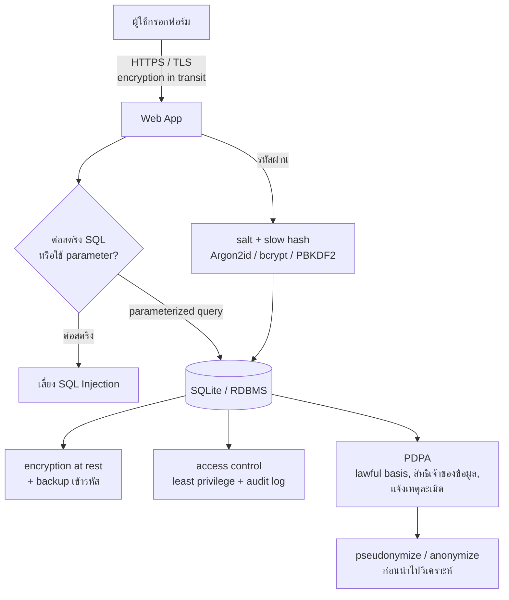

## 🎯 สิ่งที่จะได้เรียนรู้

- อธิบาย encryption at rest, encryption in transit และหลัก least privilege ใน access control
- เข้าใจว่า **SQL injection** เกิดขึ้นได้อย่างไร และป้องกันด้วย **parameterized query** ใน Python `sqlite3`
- เก็บรหัสผ่านอย่างถูกวิธีด้วย **salted, slow hashing** แทนการเก็บข้อความตรง ๆ หรือเข้ารหัสแบบถอดกลับได้
- สรุปสาระสำคัญของ **PDPA** ได้แก่ ข้อมูลส่วนบุคคล ฐานทางกฎหมาย/ความยินยอม สิทธิของเจ้าของข้อมูล และบทบาทของผู้ควบคุม/ผู้ประมวลผลข้อมูล
- แยก **anonymization** กับ **pseudonymization** ได้ และเลือกเทคนิค data masking ให้เหมาะกับงาน

## 📖 เนื้อหาและคำอธิบาย

### 1. Security กับ Privacy ต่างกันอย่างไร

- **Security (ความมั่นคงปลอดภัย):** ปกป้องข้อมูลจากการเข้าถึง แก้ไข หรือทำลายโดยไม่ได้รับอนุญาต ตามหลัก [CIA Triad](/concept/cia-triad) (Confidentiality, Integrity, Availability)
- **Privacy (ความเป็นส่วนตัว):** ใช้ข้อมูลส่วนบุคคลอย่างถูกต้อง ชอบธรรม และตามความคาดหมายของเจ้าของข้อมูล

> [!note] อุปมา
> Security คือกุญแจและกล้องวงจรปิดของบ้าน Privacy คือการตกลงกันว่าใครเข้าห้องไหนได้ และเอาของออกไปใช้ทำอะไรได้บ้าง บ้านที่ล็อกแน่นหนาแต่เจ้าของบ้านเอารูปแขกไปขายต่อ ก็ยังละเมิดความเป็นส่วนตัวอยู่ดี

ระบบที่ไม่ปลอดภัยย่อมรักษาความเป็นส่วนตัวไม่ได้ แต่ระบบที่ปลอดภัยก็ยังละเมิดความเป็นส่วนตัวได้ ถ้าใช้ข้อมูลเกินวัตถุประสงค์

### 2. ชั้นการป้องกันข้อมูล (Defense in Depth)

| ชั้น | ปกป้องจาก | เทคนิคตัวอย่าง |
|---|---|---|
| **Encryption in transit** | การดักฟังระหว่างส่ง (man-in-the-middle) | HTTPS/TLS, การเชื่อมต่อฐานข้อมูลแบบ TLS |
| **Encryption at rest** | ดิสก์/backup หลุดหรือถูกขโมย | full-disk encryption, Transparent Data Encryption (TDE), เข้ารหัสไฟล์ backup |
| **Access control** | ผู้ใช้ภายในเข้าถึงเกินสิทธิ์ | least privilege, RBAC, `GRANT`/`REVOKE`, แยกบัญชีแอปกับบัญชีผู้ดูแล |
| **Application security** | การโจมตีผ่าน input | parameterized query, input validation, OWASP Top 10 |
| **Auditing & monitoring** | การกระทำผิดที่ไม่มีใครเห็น | audit log, แจ้งเตือนเมื่อพบการ query ผิดปกติ |

**Hashing ≠ Encryption:** การเข้ารหัส (encryption) ถอดกลับได้ถ้ามีกุญแจ เหมาะกับข้อมูลที่ต้องอ่านคืน เช่น เลขบัญชี ส่วน hashing เป็นฟังก์ชันทางเดียว เหมาะกับ **รหัสผ่าน** ที่ระบบแค่ต้องตรวจว่าตรงกันหรือไม่ OWASP แนะนำให้ใช้อัลกอริทึมที่ "ช้าโดยตั้งใจ" และมี **salt** (ค่าสุ่มต่อผู้ใช้) เช่น Argon2id, scrypt, bcrypt หรือ PBKDF2 ห้ามใช้ MD5 หรือ SHA-256 รอบเดียว เพราะเร็วเกินไป ผู้โจมตีจึงเดารหัสได้หลายพันล้านครั้งต่อวินาทีด้วย GPU

### 3. SQL Injection: เมื่อข้อมูลกลายเป็นคำสั่ง

SQL injection เกิดเมื่อนำ input ของผู้ใช้ไป **ต่อสตริง** เป็นคำสั่ง SQL โดยตรง ผู้โจมตีจึงแทรกโค้ด SQL ของตัวเองเข้าไปได้ ใน OWASP Top 10 (2021) หมวด *A03: Injection* ยังเป็นหนึ่งในความเสี่ยงสำคัญของเว็บแอปพลิเคชัน

วิธีป้องกันหลักคือ **parameterized query (prepared statement)** ซึ่งส่งโครงคำสั่งกับข้อมูลแยกกัน ฐานข้อมูลจึงถือว่า input เป็น "ค่า" เสมอ ไม่ใช่ "คำสั่ง" เหมือนการกรอกแบบฟอร์มที่มีช่องกำหนดไว้ ไม่ว่าจะเขียนอะไรลงช่อง "ชื่อ" มันก็เป็นได้แค่ชื่อ

### 4. PDPA: พระราชบัญญัติคุ้มครองข้อมูลส่วนบุคคล พ.ศ. 2562

ประกาศในราชกิจจานุเบกษาเมื่อ 27 พฤษภาคม 2562 และบังคับใช้เต็มรูปแบบตั้งแต่ **1 มิถุนายน 2565** หน่วยงานกำกับคือ **สำนักงานคณะกรรมการคุ้มครองข้อมูลส่วนบุคคล (สคส. / PDPC)** สาระสำคัญที่วิศวกรควรรู้มีดังนี้ (ดูภาพรวมที่ [PDPA](/concept/pdpa))

- **ข้อมูลส่วนบุคคล:** ข้อมูลที่ทำให้ระบุตัวบุคคลได้ ไม่ว่าทางตรงหรือทางอ้อม เช่น ชื่อ รหัสนักศึกษา อีเมล IP address ภาพใบหน้า
- **ข้อมูลอ่อนไหว (sensitive data, มาตรา 26):** เช่น เชื้อชาติ ศาสนา ข้อมูลสุขภาพ ความพิการ ข้อมูลชีวภาพ (biometric) และพันธุกรรม มีเงื่อนไขเข้มงวดกว่า โดยหลักต้องได้ **ความยินยอมโดยชัดแจ้ง**
- **ฐานทางกฎหมาย (lawful basis):** ความยินยอม (consent) เป็นเพียงหนึ่งในหลายฐาน ฐานอื่นได้แก่ การปฏิบัติตามสัญญา หน้าที่ตามกฎหมาย ประโยชน์โดยชอบด้วยกฎหมาย (legitimate interest) และประโยชน์สำคัญต่อชีวิต
- **ความยินยอมที่ใช้ได้:** ต้องขอโดยชัดแจ้ง แยกจากเรื่องอื่น ใช้ภาษาที่เข้าใจง่าย ไม่บังคับเป็นเงื่อนไขของบริการที่ไม่เกี่ยวข้อง และ **ถอนได้ง่ายเท่ากับตอนให้**
- **สิทธิของเจ้าของข้อมูล:** ได้รับแจ้งวัตถุประสงค์ ขอเข้าถึงและขอสำเนา ขอให้โอนย้ายข้อมูล (portability) คัดค้าน ขอให้ลบหรือทำให้ระบุตัวไม่ได้ ขอให้ระงับการใช้ และขอแก้ไขให้ถูกต้อง
- **เหตุละเมิดข้อมูล (data breach):** ผู้ควบคุมข้อมูลต้องแจ้ง สคส. โดยไม่ชักช้า และภายใน 72 ชั่วโมงนับแต่ทราบเหตุเท่าที่ทำได้ (เว้นแต่ไม่มีความเสี่ยงต่อสิทธิของบุคคล) และหากมีความเสี่ยงสูงต้องแจ้งเจ้าของข้อมูลด้วย

| บทบาท | นิยาม | ตัวอย่างในระบบครุภัณฑ์ |
|---|---|---|
| **เจ้าของข้อมูล (Data Subject)** | บุคคลที่ข้อมูลระบุถึง | นักศึกษา/อาจารย์ผู้ยืม |
| **ผู้ควบคุมข้อมูล (Data Controller)** | ผู้มีอำนาจตัดสินใจเรื่องการเก็บ ใช้ เปิดเผยข้อมูล | มหาวิทยาลัย / คณะ |
| **ผู้ประมวลผลข้อมูล (Data Processor)** | ผู้ดำเนินการตามคำสั่งของผู้ควบคุม | ผู้ให้บริการ cloud hosting ที่รันเว็บแอป |
| **DPO (เจ้าหน้าที่คุ้มครองข้อมูล)** | ผู้ให้คำแนะนำและตรวจสอบการปฏิบัติตามกฎหมาย | DPO ของมหาวิทยาลัย |

> [!warning] ข้อควรระวัง
> สรุปนี้มีไว้เพื่อการเรียนรู้ ไม่ใช่คำปรึกษาทางกฎหมาย ถ้าจะนำไปใช้กับระบบจริง ให้ตรวจสอบตัวบท พ.ร.บ. และประกาศของ สคส. ฉบับล่าสุด และปรึกษา DPO ขององค์กร

### 5. Privacy by Design และการลดความเสี่ยงของข้อมูล

หลักการสำคัญ (สอดคล้องกับ PDPA และ GDPR) ได้แก่ **data minimization** (เก็บเท่าที่จำเป็น), **purpose limitation** (ใช้ตามวัตถุประสงค์ที่แจ้ง), **storage limitation** (กำหนดระยะเวลาเก็บและลบเมื่อหมดความจำเป็น) และ **privacy by default**

| เทคนิค | วิธีการ | ย้อนกลับเป็นตัวบุคคลได้? | ยังเป็นข้อมูลส่วนบุคคลตามกฎหมาย? |
|---|---|---|---|
| **Pseudonymization** | แทนตัวระบุด้วยรหัสแฝง เช่น `68001` → `P-7f3a` โดยเก็บตารางจับคู่หรือกุญแจแยกไว้ | ได้ ถ้ามีข้อมูลเพิ่มเติม (กุญแจ) | **ใช่** ยังต้องปฏิบัติตามกฎหมาย |
| **Anonymization** | ลบหรือแปลงข้อมูลจนระบุตัวไม่ได้อย่างถาวร เช่น รวมกลุ่ม (aggregation) หรือ generalization (อายุ 19 → "18–24") | ไม่ได้ (ถ้าทำถูกต้อง) | โดยทั่วไป **ไม่ใช่** |
| **Data masking** | ซ่อนบางส่วนตอนแสดงผล เช่น `08x-xxx-1234` | ข้อมูลจริงยังอยู่ในฐานข้อมูล | ใช่ |

> [!tip] การทำ anonymization ยากกว่าที่คิด
> แค่ลบชื่อออกยังไม่พอ การรวม "วันเกิด + เพศ + รหัสไปรษณีย์" อาจระบุตัวบุคคลได้ (re-identification) จึงต้องพิจารณา quasi-identifier ทั้งหมด

## 🧩 ตัวอย่างประกอบ / Worked Example

**โจทย์:** ระบบ login ของ Asset Management Web App ใช้ SQLite มาดูว่าโค้ดแบบไม่ปลอดภัยถูกโจมตีอย่างไร แล้วแก้ทั้งเรื่อง SQL injection และการเก็บรหัสผ่าน

**ขั้นที่ 1: เตรียมตารางผู้ใช้ที่เก็บ salt + hash (ไม่เก็บรหัสผ่านจริง)**

```python
import sqlite3, hashlib, os, hmac

conn = sqlite3.connect(":memory:")  # ใช้ฐานข้อมูลในหน่วยความจำเพื่อทดลอง
conn.execute("""CREATE TABLE users(
    id INTEGER PRIMARY KEY, username TEXT UNIQUE,
    pw_salt BLOB, pw_hash BLOB)""")

def hash_password(password, salt=None):
    # salt สุ่ม 16 ไบต์ต่อผู้ใช้ รหัสผ่านเหมือนกันจึงได้ hash ต่างกัน
    salt = salt or os.urandom(16)
    # PBKDF2-HMAC-SHA256 วนซ้ำ 600,000 รอบ ทำให้การเดารหัสช้าลงมาก
    h = hashlib.pbkdf2_hmac("sha256", password.encode(), salt, 600_000)
    return salt, h

conn.execute("INSERT INTO users(username, pw_salt, pw_hash) VALUES (?, ?, ?)",
             ("somchai", *hash_password("S3cret!pass")))
conn.execute("INSERT INTO users(username, pw_salt, pw_hash) VALUES (?, ?, ?)",
             ("admin", *hash_password("Adm1n!")))
conn.commit()  # ยืนยันการเปลี่ยนแปลง (INSERT/UPDATE/DELETE) ให้บันทึกลงฐานข้อมูลจริง
```

> [!warning] อย่าลืม `conn.commit()`
> โมดูล `sqlite3` ของ Python จะเปิด transaction ให้อัตโนมัติเมื่อเจอคำสั่งที่แก้ข้อมูล (`INSERT`/`UPDATE`/`DELETE`) ถ้าไม่เรียก `conn.commit()` การเปลี่ยนแปลงจะยังค้างอยู่ใน transaction และ **ถูก rollback ทิ้งเมื่อปิด connection** (`conn.close()`) หรือเมื่อโปรแกรมจบ เปิดไฟล์ฐานข้อมูลใหม่จะไม่เห็นข้อมูลที่เพิ่มไป นี่คือหลัก **Durability** ใน ACID: ข้อมูลจะคงทนก็ต่อเมื่อ `COMMIT` แล้วเท่านั้น (ดูหัวข้อ Transaction และ ACID ใน 01_กลไกเบื้องหลัง_RDBMS)
> ตัวอย่างนี้ใช้ `":memory:"` ซึ่งข้อมูลหายเมื่อปิดโปรแกรมอยู่แล้ว แต่ในระบบจริงที่ใช้ไฟล์ เช่น `sqlite3.connect("assets.db")` ต้อง commit ทุกครั้ง หรือใช้ `with conn:` ซึ่งจะ commit ให้เมื่อสำเร็จ และ rollback ให้เมื่อเกิด exception

**ขั้นที่ 2: โค้ดที่มีช่องโหว่ (ห้ามทำ)**

```python
evil = "' OR '1'='1"          # input จากผู้โจมตี
# ❌ ต่อสตริงตรง ๆ คำสั่งที่ได้คือ ... WHERE username = '' OR '1'='1'
unsafe_sql = f"SELECT username FROM users WHERE username = '{evil}'"
print("unsafe:", conn.execute(unsafe_sql).fetchall())
```

```output
unsafe: [('admin',), ('somchai',)]
```

เงื่อนไข `'1'='1'` เป็นจริงเสมอ ผู้โจมตีจึงได้รายชื่อผู้ใช้ทุกคนไปโดยไม่ต้องรู้รหัสผ่าน

**ขั้นที่ 3: แก้ด้วย parameterized query**

```python
# ✅ ใช้ placeholder "?" แล้วส่งค่าแยกเป็น tuple ไลบรารีจะ bind ค่าให้อย่างปลอดภัย
safe = conn.execute("SELECT username FROM users WHERE username = ?", (evil,)).fetchall()
print("safe:", safe)
```

```output
safe: []
```

ฐานข้อมูลมองว่ามีคนชื่อ `' OR '1'='1` จริง ๆ ซึ่งไม่มีอยู่ ผลจึงว่าง

**ขั้นที่ 4: ตรวจรหัสผ่านตอน login**

```python
def login(username, password):
    row = conn.execute("SELECT pw_salt, pw_hash FROM users WHERE username = ?",
                       (username,)).fetchone()
    if row is None:
        return False
    _, candidate = hash_password(password, row[0])   # hash ด้วย salt เดิมของผู้ใช้
    return hmac.compare_digest(candidate, row[1])     # เทียบแบบเวลาคงที่ กัน timing attack

print(login("somchai", "S3cret!pass"), login("somchai", "wrong"))
```

```output
True False
```

> [!tip] ในงานจริง
> ควรใช้ไลบรารีที่ผ่านการตรวจสอบแล้ว เช่น `argon2-cffi` หรือ `bcrypt` และอย่าเขียนกลไก login เองทั้งหมด ตัวอย่างนี้ใช้เฉพาะ standard library เพื่อให้เห็นหลักการ

## 🗺️ แผนภาพสรุป



## ⚠️ ความเข้าใจผิดที่พบบ่อย

- **"เข้ารหัสรหัสผ่านด้วย AES ก็ปลอดภัยแล้ว"** ถ้ากุญแจหลุด รหัสผ่านทุกตัวจะถูกถอดได้ทันที รหัสผ่านควรเก็บด้วย slow hash และ salt
- **"ใช้ `.replace("'", "")` กรองก็พอ"** การกรองเองพลาดได้ง่ายและมีวิธีหลบเลี่ยงหลายแบบ วิธีหลักต้องเป็น parameterized query ส่วน input validation เป็นชั้นเสริม
- **"PDPA ต้องขอ consent ทุกครั้ง"** consent เป็นเพียงหนึ่งในหลายฐานทางกฎหมาย หลายกรณีใช้ฐานสัญญาหรือหน้าที่ตามกฎหมายได้ การขอ consent ทั้งที่ไม่จำเป็นอาจสร้างปัญหาเมื่อเจ้าของข้อมูลถอนความยินยอม
- **"ข้อมูลที่ hash หรือแทนด้วยรหัสแล้วไม่ใช่ข้อมูลส่วนบุคคล"** นั่นคือ pseudonymization ซึ่งยังเป็นข้อมูลส่วนบุคคล เพราะย้อนกลับได้เมื่อมีข้อมูลเพิ่มเติม หรือเดาจากค่าที่เป็นไปได้ เช่น hash ของรหัสนักศึกษาที่มีรูปแบบจำกัด
- **"HTTPS แล้วข้อมูลปลอดภัยทุกขั้น"** TLS ปกป้องเฉพาะระหว่างส่ง ข้อมูลบนดิสก์ ใน backup และใน log ยังต้องป้องกันแยกต่างหาก

## 🔗 เชื่อมโยงกับรายวิชา

- กฎหมายและจริยธรรม: [PDPA](/concept/pdpa) · [สัปดาห์ที่ 13: Computer Ethics & Intellectual Property](/module/13) · [การกำกับดูแล จริยธรรม และกฎหมาย](/docs/theme-governance)
- ความมั่นคงปลอดภัย: [CIA Triad](/concept/cia-triad) · [Zero-Trust Architecture](/concept/zero-trust-architecture) · [สัปดาห์ที่ 12: Cybersecurity & Trust Architecture](/module/12) (Lab การเข้ารหัสผ่าน)
- ข้อมูลส่วนบุคคลใน vector DB/RAG: ระวังการนำเอกสารที่มีข้อมูลส่วนบุคคลไปทำ embedding (ดู 03_แนวคิดของ_Vector_Database และ [RAG และ LLM](/concept/rag-llm))
- **Mini-Project 2 "Asset Management Web App":** ข้อกำหนดขั้นต่ำด้านความปลอดภัยของโปรเจกต์ (1) ทุก query ใน SQLite ต้องใช้ placeholder `?` (2) ตาราง `users` เก็บเฉพาะ salt + hash (3) เก็บข้อมูลผู้ยืมเท่าที่จำเป็น เช่น รหัสและชื่อ ไม่เก็บเลขบัตรประชาชน (4) หน้าแสดงประวัติการยืมให้ mask ข้อมูลติดต่อ (5) มีหน้าประกาศความเป็นส่วนตัว (privacy notice) สั้น ๆ ดู [กิจกรรมปฏิบัติการและโครงงาน](/docs/labs-projects) และแผนสัปดาห์ [สัปดาห์ที่ 5: Database & Data Management](/module/05)

## ❓ คำถามทบทวน

1. ทำไม parameterized query จึงป้องกัน SQL injection ได้ ในขณะที่การต่อสตริงทำไม่ได้?
<details><summary>ดูแนวคำตอบ</summary>
การต่อสตริงทำให้ input ของผู้ใช้กลายเป็นส่วนหนึ่งของคำสั่ง SQL ฐานข้อมูลจึงตีความเครื่องหมาย `'` หรือ `OR` ที่แทรกมาเป็นไวยากรณ์ ส่วน parameterized query ส่งโครงคำสั่งที่ compile แล้วกับค่าข้อมูลแยกกัน ค่าที่ bind เข้ามาจึงเป็นได้แค่ข้อมูล ไม่ถูกตีความเป็นคำสั่ง
</details>

2. ทำไมการเก็บรหัสผ่านด้วย SHA-256 รอบเดียวโดยไม่มี salt จึงไม่ปลอดภัย?
<details><summary>ดูแนวคำตอบ</summary>
SHA-256 คำนวณได้เร็วมาก ผู้โจมตีจึงใช้ GPU เดารหัสได้จำนวนมหาศาลต่อวินาที และถ้าไม่มี salt รหัสผ่านที่เหมือนกันจะได้ hash เหมือนกัน ทำให้ใช้ตารางคำนวณล่วงหน้า (rainbow table) ได้ ควรใช้ slow hash ที่มี salt ต่อผู้ใช้ เช่น Argon2id, bcrypt หรือ PBKDF2 ที่มีจำนวนรอบสูง
</details>

3. ในระบบยืมครุภัณฑ์ของคณะ ใครเป็น data controller และใครเป็น data processor?
<details><summary>ดูแนวคำตอบ</summary>
มหาวิทยาลัยหรือคณะเป็น data controller เพราะเป็นผู้ตัดสินใจว่าจะเก็บข้อมูลอะไร เพื่ออะไร ส่วนผู้ให้บริการ cloud หรือบริษัทภายนอกที่ดูแลระบบตามคำสั่งเป็น data processor นักศึกษาและอาจารย์ผู้ยืมเป็น data subject
</details>

4. จงเปรียบเทียบ pseudonymization กับ anonymization และบอกว่าแบบใดยังอยู่ภายใต้ PDPA
<details><summary>ดูแนวคำตอบ</summary>
Pseudonymization แทนตัวระบุด้วยรหัสแฝง และย้อนกลับได้ถ้ามีกุญแจหรือตารางจับคู่ จึงยังเป็นข้อมูลส่วนบุคคลและอยู่ภายใต้ PDPA Anonymization ทำให้ระบุตัวบุคคลไม่ได้อย่างถาวร เช่น รวมเป็นสถิติกลุ่ม ถ้าทำได้จริง โดยทั่วไปจะไม่ถือเป็นข้อมูลส่วนบุคคลแล้ว
</details>

5. Encryption at rest กับ encryption in transit ป้องกันภัยคนละแบบอย่างไร ยกตัวอย่างละ 1 สถานการณ์
<details><summary>ดูแนวคำตอบ</summary>
Encryption in transit (TLS/HTTPS) ป้องกันการดักข้อมูลระหว่างส่ง เช่น ผู้ไม่หวังดีดักแพ็กเก็ตใน Wi-Fi สาธารณะ Encryption at rest ป้องกันข้อมูลที่เก็บอยู่ เช่น โน้ตบุ๊กหรือดิสก์ backup ที่มีฐานข้อมูลถูกขโมย ถ้าไม่มีกุญแจก็อ่านไฟล์ไม่ได้
</details>

## 📚 แหล่งอ้างอิง

- พระราชบัญญัติคุ้มครองข้อมูลส่วนบุคคล พ.ศ. 2562. *ราชกิจจานุเบกษา* เล่ม 136 ตอนที่ 69 ก (27 พฤษภาคม 2562) และเอกสารแนวปฏิบัติของ สคส. [pdpc.or.th (PDPC Book)](https://www.pdpc.or.th/pdpc-book/)
- IAPP. *Thailand's PDPC clarifies data breach notification requirements*. [iapp.org](https://www.iapp.org/news/a/thailand-s-pdpc-clarifies-data-breach-notification-requirements)
- OWASP. *SQL Injection Prevention Cheat Sheet* และ *Password Storage Cheat Sheet*. [SQLi](https://cheatsheetseries.owasp.org/cheatsheets/SQL_Injection_Prevention_Cheat_Sheet.html) · [Password Storage](https://cheatsheetseries.owasp.org/cheatsheets/Password_Storage_Cheat_Sheet.html)
- OWASP Top 10:2021. *A03 Injection*. [owasp.org](https://owasp.org/Top10/A03_2021-Injection/)
- Python Documentation. *sqlite3 — DB-API 2.0 interface for SQLite databases* (placeholders) และ *hashlib* (`pbkdf2_hmac`). [sqlite3](https://docs.python.org/3/library/sqlite3.html) · [hashlib](https://docs.python.org/3/library/hashlib.html)
- NIST SP 800-122. *Guide to Protecting the Confidentiality of Personally Identifiable Information (PII)*. [csrc.nist.gov](https://csrc.nist.gov/pubs/sp/800/122/final)
- GDPR Art. 4 (นิยาม pseudonymisation เพื่อเปรียบเทียบ). [gdpr-info.eu](https://gdpr-info.eu/art-4-gdpr/)
