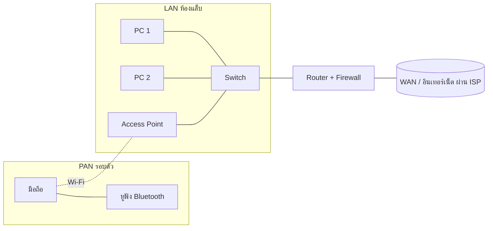

ยินดีต้อนรับสู่วิชาในสัปดาห์นี้ครับ ในฐานะวิศวกรคอมพิวเตอร์ การทำความเข้าใจ "สถาปัตยกรรมเครือข่าย" ถือเป็นรากฐานที่สำคัญที่สุดในการออกแบบและวิเคราะห์ระบบสื่อสาร วันนี้เราจะมาเจาะลึกโมเดลอ้างอิงที่สำคัญสองแบบ ได้แก่ **OSI Model** (Open Systems Interconnection) และ **TCP/IP Model** ซึ่งเป็นบรรทัดฐานของการสื่อสารบนอินเทอร์เน็ตในปัจจุบัน

## 1. OSI Model: โครงสร้างอ้างอิง 7 เลเยอร์

OSI Model เป็นกรอบแนวคิดที่แบ่งการทำงานของเครือข่ายออกเป็น 7 ระดับชั้น เพื่อให้วิศวกรและผู้พัฒนาสามารถแยกแยะปัญหาและพัฒนาโปรโตคอลได้อย่างเป็นระบบ

*   **Layer 1: Physical Layer** เกี่ยวข้องกับการส่งผ่านบิตข้อมูลดิบ (0 และ 1) ผ่านสื่อนำสัญญาณ เช่น สายทองแดง สายใยแก้วนำแสง หรือคลื่นวิทยุ
*   **Layer 2: Data Link Layer** รับผิดชอบการรับส่งข้อมูลระหว่างโหนดที่เชื่อมต่อกันโดยตรง (Node-to-Node) จัดการเรื่อง MAC Address และการตรวจจับข้อผิดพลาด (Error Detection) เช่น Ethernet, Wi-Fi
*   **Layer 3: Network Layer** ทำหน้าที่หาเส้นทาง (Routing) ข้ามเครือข่ายต่างๆ โดยใช้ IP Address เป็นตัวระบุตำแหน่ง เช่น IPv4, IPv6
*   **Layer 4: Transport Layer** จัดการการส่งมอบข้อมูลจากต้นทางถึงปลายทาง (End-to-End) ควบคุมความน่าเชื่อถือผ่าน TCP หรือเน้นความเร็วผ่าน UDP
*   **Layer 5: Session Layer** ควบคุมการสร้าง บำรุงรักษา และยุติเซสชันการสื่อสารระหว่างแอปพลิเคชัน
*   **Layer 6: Presentation Layer** จัดการรูปแบบข้อมูล การเข้ารหัส (Encryption) และการบีบอัดข้อมูล เพื่อให้ระบบปลายทางเข้าใจตรงกัน
*   **Layer 7: Application Layer** เป็นอินเทอร์เฟซที่แอปพลิเคชันใช้โต้ตอบกับเครือข่าย เช่น HTTP, FTP, SMTP

## 2. TCP/IP Model: มาตรฐานทางปฏิบัติ

แม้ OSI Model จะยอดเยี่ยมในเชิงทฤษฎี แต่ **TCP/IP Model** คือสิ่งที่ถูกใช้งานจริงในการสร้างอินเทอร์เน็ต โดยยุบรวมชั้นต่างๆ ให้กระชับขึ้นเหลือ 4 เลเยอร์หลัก:

1.  **Network Access Layer** (รวม Layer 1-2 ของ OSI) จัดการการเชื่อมต่อทางกายภาพและ Data Link
2.  **Internet Layer** (เทียบเท่า Layer 3 ของ OSI) แกนกลางคือโปรโตคอล IP ที่ทำหน้าที่ Routing โคตรโครงข่ายทั้งหมด
3.  **Transport Layer** (เทียบเท่า Layer 4 ของ OSI) ทำหน้าที่ควบคุมการส่งมอบผ่าน TCP/UDP 
4.  **Application Layer** (รวม Layer 5-7 ของ OSI) รวบรวมโปรโตคอลระดับสูงทั้งหมดไว้ด้วยกัน

### การเปรียบเทียบสถาปัตยกรรม

ความแตกต่างที่สำคัญคือ OSI แยกหน้าที่ของ Session และ Presentation ออกมาอย่างชัดเจน ในขณะที่ TCP/IP มองว่าหน้าที่เหล่านี้ควรเป็นความรับผิดชอบของซอฟต์แวร์ประยุกต์ การเข้าใจทั้งสองโมเดลจะช่วยให้ผู้เรียนสามารถประยุกต์ใช้ในการทำ Network Troubleshooting และการออกแบบสถาปัตยกรรมซอฟต์แวร์ได้อย่างมีประสิทธิภาพ

ในโลกความจริง (Real-world Implementation) การส่งผ่านข้อมูล (Encapsulation) จะเริ่มต้นจากเลเยอร์บนสุด โดยแต่ละเลเยอร์จะทำการแนบส่วนหัว (Header) ของตนเองลงไปจนถึงเลเยอร์ล่างสุด ก่อนที่จะส่งผ่านสื่อสัญญาณ ขบวนการนี้คือหัวใจสำคัญของการทำงานร่วมกันระหว่างอุปกรณ์หลากยี่ห้อ

จงจำไว้เสมอว่า ระบบที่แข็งแกร่งต้องเริ่มต้นจากสถาปัตยกรรมพื้นฐานที่มั่นคงครับ

## 3. ประเภทของเครือข่ายตามขอบเขต (PAN, LAN, MAN, WAN)

นอกจากการแบ่งเครือข่ายเป็นเลเยอร์แล้ว เรายังแบ่งเครือข่ายตาม **ขนาดพื้นที่ที่ครอบคลุม (Geographic Scope)** ได้เป็น 4 ประเภทหลัก เรียงจากเล็กไปใหญ่

| ประเภท | ชื่อเต็ม | พื้นที่ครอบคลุม | ผู้เป็นเจ้าของ/ดูแล | ความเร็วโดยทั่วไป | ตัวอย่าง |
| :--- | :--- | :--- | :--- | :--- | :--- |
| **PAN** | Personal Area Network | รอบตัวบุคคล ประมาณ 1–10 เมตร | ตัวผู้ใช้เอง | ต่ำ–ปานกลาง (Bluetooth หลัก Mbps) | มือถือเชื่อมหูฟัง Bluetooth, Smartwatch, เมาส์ไร้สาย |
| **LAN** | Local Area Network | ภายในอาคาร/ห้อง/บ้าน/วิทยาเขต (หลักร้อยเมตร–ไม่กี่กิโลเมตร) | องค์กรหรือเจ้าของบ้าน (เป็นเจ้าของอุปกรณ์เอง) | สูง (Ethernet 100 Mbps–10 Gbps, Wi-Fi หลักร้อย Mbps ขึ้นไป) | เครือข่ายห้องแล็บคอมพิวเตอร์, Wi-Fi ในบ้าน |
| **MAN** | Metropolitan Area Network | ระดับเมือง (หลักสิบกิโลเมตร) | หน่วยงานรัฐ เทศบาล หรือผู้ให้บริการโทรคมนาคม | ปานกลาง–สูง (มักใช้ใยแก้วนำแสง) | เครือข่ายเชื่อมสำนักงานเทศบาลทั้งเมือง, เครือข่ายเคเบิลในเมือง |
| **WAN** | Wide Area Network | ระดับประเทศ/ทวีป/ทั่วโลก | ผู้ให้บริการ (ISP/Telco) เป็นหลัก องค์กรมักเช่าใช้ | แตกต่างกันมาก โดยทั่วไปต่ำกว่า LAN และมี Latency สูงกว่า | **อินเทอร์เน็ต** (WAN ที่ใหญ่ที่สุด), เครือข่ายเชื่อมสาขาธนาคารทั่วประเทศ |

> [!note] ตัวเลขความเร็วในตารางเป็นค่าโดยประมาณ
> ความเร็วจริงขึ้นอยู่กับเทคโนโลยีที่ใช้ (เช่น Wi-Fi รุ่นใด, สายแบบใด) จุดที่ควรจำคือ **แนวโน้ม**: เครือข่ายยิ่งกว้าง ค่า Latency มักยิ่งสูงขึ้น และองค์กรมักต้อง "เช่า" แทน "เป็นเจ้าของ"

### LAN vs WAN: ต่างกันอย่างไร

| ประเด็น | LAN | WAN |
| :--- | :--- | :--- |
| ขอบเขต | พื้นที่จำกัด เช่น อาคารเดียว | ข้ามเมือง ข้ามประเทศ |
| ความเป็นเจ้าของ | องค์กรเป็นเจ้าของสายและอุปกรณ์เอง | ใช้โครงข่ายของผู้ให้บริการ (ISP) และจ่ายค่าบริการ |
| ความเร็ว / Latency | เร็วสูง Latency ต่ำ (ระดับ ms หรือต่ำกว่า) | ช้ากว่าเมื่อเทียบต่อค่าใช้จ่าย Latency สูงกว่า (สิบ–ร้อย ms) |
| อุปกรณ์หลัก | Switch, Access Point | Router, Modem, สายใยแก้วของ ISP |
| ค่าใช้จ่ายต่อเนื่อง | ต่ำ (ลงทุนครั้งเดียว) | มีค่าเช่าวงจร/ค่าอินเทอร์เน็ตรายเดือน |

**ตัวอย่างให้เห็นภาพ:** คอมพิวเตอร์ 40 เครื่องในห้องแล็บที่ต่อเข้า Switch ตัวเดียวกันคือ **LAN** เมื่อเราเปิดเว็บไซต์ที่อยู่ในต่างประเทศ ข้อมูลจะวิ่งออกจาก LAN ผ่าน Router ของมหาวิทยาลัย เข้าสู่เครือข่ายของ ISP ซึ่งเป็นส่วนหนึ่งของ **WAN** (อินเทอร์เน็ต)

## 4. อุปกรณ์เครือข่าย (Network Devices)

อุปกรณ์แต่ละชนิดทำงานใน **เลเยอร์ของ OSI** ต่างกัน ซึ่งบอกได้ว่ามัน "ฉลาด" แค่ไหน และมันอ่านข้อมูลอะไรในการตัดสินใจ

| อุปกรณ์ | OSI Layer | ข้อมูลที่ใช้ตัดสินใจ | หน้าที่หลัก |
| :--- | :--- | :--- | :--- |
| **Repeater** | L1 Physical | ไม่อ่านข้อมูลเลย (มองเป็นสัญญาณ) | ขยาย/ฟื้นฟูสัญญาณให้ส่งได้ไกลขึ้น |
| **Hub** | L1 Physical | ไม่อ่านที่อยู่ | รับสัญญาณจากพอร์ตหนึ่งแล้ว **กระจายออกทุกพอร์ต** (broadcast) ทำให้ชนกันง่ายและสิ้นเปลืองแบนด์วิดท์ ปัจจุบันแทบไม่ใช้แล้ว |
| **Switch** | L2 Data Link | **MAC Address** | เรียนรู้ว่า MAC ใดอยู่พอร์ตไหน (MAC Address Table) แล้วส่งเฟรมไป **เฉพาะพอร์ตปลายทาง** ใช้เชื่อมอุปกรณ์ภายใน LAN เดียวกัน |
| **Access Point (AP)** | L2 Data Link (หลัก) | MAC Address | ให้อุปกรณ์ไร้สายเชื่อมเข้ากับ LAN แบบมีสายผ่าน Wi-Fi |
| **Router** | L3 Network | **IP Address** | หาเส้นทาง (**Routing**) และส่งต่อแพ็กเก็ต **ระหว่างเครือข่ายที่ต่างกัน** เช่น จาก LAN ของคณะออกสู่อินเทอร์เน็ต ใช้ตาราง Routing Table |
| **Modem** | L1 Physical | — | **Mo**dulate/**Dem**odulate: แปลงสัญญาณดิจิทัลของคอมพิวเตอร์ให้เป็นสัญญาณที่ส่งผ่านสื่อของ ISP ได้ (สายโทรศัพท์ DSL, เคเบิล, ใยแก้ว ONT) และแปลงกลับ |
| **Firewall** | L3–L4 (และ L7 สำหรับ Next-Generation Firewall) | IP, Port, Protocol, (เนื้อหาแอปพลิเคชัน) | **กรองทราฟฟิกตามกฎ (Rules)** ที่กำหนด เช่น อนุญาตพอร์ต 443 แต่บล็อกพอร์ต 23 เพื่อป้องกันการเข้าถึงที่ไม่ได้รับอนุญาต |

> [!tip] วิธีจำ: Hub vs Switch vs Router
> - **Hub** = ตะโกนบอกทุกคนในห้อง (ไม่รู้ว่าใครเป็นใคร)
> - **Switch** = รู้จักทุกคนในห้องจาก "ชื่อเล่น" (MAC) และยื่นจดหมายให้ถูกคน
> - **Router** = บุรุษไปรษณีย์ที่รู้ "ที่อยู่บ้าน" (IP) และส่งจดหมายข้ามเมืองได้

> [!note] อุปกรณ์ในบ้านมักเป็น "ทุกอย่างในกล่องเดียว"
> เราเตอร์ Wi-Fi ที่ ISP ให้มา มักรวม Modem/ONT + Router + Switch หลายพอร์ต + Access Point + Firewall พื้นฐาน + DHCP Server ไว้ในเครื่องเดียว แต่ในเชิงหลักการ ต้องแยกหน้าที่ของแต่ละส่วนให้ออก

คำถามทบทวน (คลิกเพื่อดูเฉลย)

1. อุปกรณ์ใดใช้ MAC Address ในการส่งต่อเฟรมภายใน LAN? — **Switch (Layer 2)**
2. อุปกรณ์ใดเชื่อมเครือข่ายสองเครือข่ายที่ต่างกันโดยใช้ IP Address? — **Router (Layer 3)**
3. อุปกรณ์ใดทำหน้าที่กรองแพ็กเก็ตตามกฎที่ผู้ดูแลกำหนด? — **Firewall**
4. อินเทอร์เน็ตจัดเป็นเครือข่ายประเภทใด? — **WAN**
5. หูฟัง Bluetooth ที่เชื่อมกับมือถือจัดเป็นเครือข่ายประเภทใด? — **PAN**

ดูเพิ่มเติม: [TCP-IP Model](/concept/tcp-ip-model)
