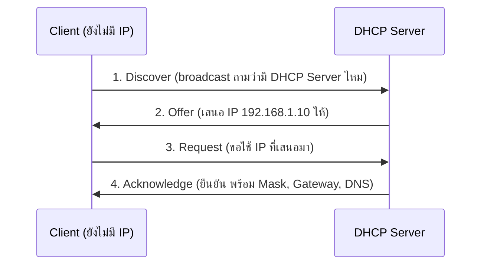

สวัสดีครับนักศึกษาทุกท่าน เมื่อเราได้ทำความเข้าใจโครงสร้างเครือข่ายไปแล้ว สิ่งต่อไปที่ขับเคลื่อนการทำงานของอินเทอร์เน็ตคือ **"โปรโตคอล"** (Protocols) หรือข้อตกลงและมาตรฐานที่ทำให้อุปกรณ์ต่าง ๆ สามารถคุยกันรู้เรื่อง ในบทนี้ เราจะมาวิเคราะห์โปรโตคอลหลักที่เป็นกระดูกสันหลังของอินเทอร์เน็ต และแนวโน้มการสื่อสารในยุคสมัยใหม่

## โปรโตคอลหัวใจสำคัญ: IP, TCP และ UDP

ระบบเครือข่ายยุคปัจจุบันยืนอยู่บนฐานของโปรโตคอลสามตัวนี้เป็นหลัก:

1.  **Internet Protocol (IP):** ทำหน้าที่เป็นเสมือนที่อยู่ไปรษณีย์ในโลกดิจิทัล การเปลี่ยนผ่านจาก **IPv4** สู่ **IPv6** เป็นสิ่งจำเป็นเนื่องจากจำนวนอุปกรณ์ IoT และสมาร์ทโฟนที่เพิ่มขึ้นอย่างมหาศาล IPv6 ไม่ได้เพิ่มแค่จำนวน Address space แต่ยังปรับปรุงโครงสร้าง Header ให้ประมวลผลได้เร็วขึ้นและรองรับ IPsec ในตัว
2.  **Transmission Control Protocol (TCP):** หาก IP คือที่อยู่ไปรษณีย์ TCP คือบริการไปรษณีย์แบบลงทะเบียน TCP รับประกันการส่งมอบข้อมูล (Reliability) โดยการใช้กระบวนการ 3-way Handshake (SYN, SYN-ACK, ACK) และมีการควบคุมความคับคั่ง (Congestion Control) เหมาะกับการท่องเว็บ (HTTP/HTTPS) การส่งอีเมล หรือโอนย้ายไฟล์
3.  **User Datagram Protocol (UDP):** เป็นบริการไปรษณีย์ด่วนพิเศษที่ไม่มีการรับประกันการส่งถึงมือ UDP ลด Overhead ลงอย่างมาก จึงมีความเร็วสูง เหมาะกับแอปพลิเคชันแบบ Real-time เช่น การสตรีมมิ่งวิดีโอ (Video Streaming) การประชุมออนไลน์ (VoIP) และเกมออนไลน์

## การสื่อสารสมัยใหม่ (Modern Communications)

ในระดับ Application Layer โปรโตคอลการสื่อสารมีการพัฒนาไปไกลกว่า HTTP/1.1 ที่เราคุ้นเคย:

*   **HTTP/2 และ HTTP/3:** HTTP/2 นำเสนอเทคนิค Multiplexing แก้ปัญหา Head-of-line blocking ในระดับแอปพลิเคชัน ส่วน **HTTP/3** ถือเป็นการก้าวกระโดดโดยเปลี่ยนไปใช้โปรโตคอลขนส่งแบบใหม่ชื่อ **QUIC** (ทำงานบน UDP แทน TCP) ทำให้ลด Latency ในการเชื่อมต่อเบื้องต้นได้อย่างมาก เหมาะสำหรับเครือข่ายมือถือที่มีการเปลี่ยนเซลล์ไซต์บ่อยครั้ง
*   **WebSockets:** การสื่อสารแบบดั้งเดิมของเว็บเป็นแบบ Request-Response (Client ต้องถาม Server ถึงจะตอบ) แต่ WebSockets ช่วยเปิดช่องทางการเชื่อมต่อแบบ Full-duplex สองทางตลอดเวลา (Persistent Connection) ทำให้ Server สามารถส่งข้อมูล (Push) มายัง Client ได้แบบเรียลไทม์ เช่น ระบบแชท หรือแดชบอร์ดหุ้น
*   **gRPC:** เป็นเฟรมเวิร์ก RPC สมัยใหม่ที่พัฒนาโดย Google นิยมใช้สื่อสารระหว่าง Microservices แทน REST API ดั้งเดิม gRPC ใช้ HTTP/2 เป็นแกนหลัก และเข้ารหัสข้อมูลเป็น Binary ด้วย Protocol Buffers ทำให้ขนาดเล็กลง ประมวลผลได้เร็ว และมีประสิทธิภาพสูงกว่า JSON มาก

การเลือกใช้โปรโตคอลให้เหมาะสมกับลักษณะงาน (Use-case) เป็นทักษะที่สำคัญของวิศวกรซอฟต์แวร์และสถาปนิกเครือข่าย การออกแบบระบบที่ลด Latency และเพิ่ม Throughput จะเป็นตัวแปรสำคัญที่กำหนดความสำเร็จของแอปพลิเคชันในระดับสเกลใหญ่ครับ

## การกำหนดเลขที่อยู่ IP (IP Addressing)

ทุกอุปกรณ์ที่สื่อสารบนเครือข่าย IP ต้องมี **IP Address** เพื่อระบุตัวตนและตำแหน่ง เหมือนบ้านเลขที่

### IPv4 vs IPv6

| ประเด็น | IPv4 | IPv6 |
| :--- | :--- | :--- |
| ขนาด | **32 บิต** | **128 บิต** |
| รูปแบบการเขียน | เลขฐานสิบ 4 ชุด คั่นด้วยจุด (**Dotted Decimal**) แต่ละชุด 0–255 | เลขฐานสิบหก (**Hexadecimal**) **8 กลุ่ม** กลุ่มละ 16 บิต คั่นด้วย `:` |
| ตัวอย่าง | `192.168.1.10` | `2001:0db8:0000:0000:0000:ff00:0042:8329` ย่อเป็น `2001:db8::ff00:42:8329` |
| จำนวนที่อยู่ | $2^{32} \approx 4.3$ พันล้าน (4,294,967,296) | $2^{128} \approx 3.4 \times 10^{38}$ |
| สถานะ | ที่อยู่สาธารณะใกล้หมด ต้องพึ่ง NAT | ที่อยู่เพียงพอสำหรับ IoT จำนวนมหาศาล |

> [!tip] กฎการย่อ IPv6
> 1) ตัดเลข 0 นำหน้าในแต่ละกลุ่มได้ (`0db8` → `db8`) 2) กลุ่มที่เป็น 0 ติดกันหลายกลุ่ม ย่อเป็น `::` ได้ **เพียงครั้งเดียว** ต่อที่อยู่

### Private IP vs Public IP

**Private IP** ใช้ภายในเครือข่ายส่วนตัว (บ้าน ห้องแล็บ บริษัท) แต่ละเครือข่ายใช้ซ้ำกันได้ เพราะ Router บนอินเทอร์เน็ตจะไม่ส่งต่อที่อยู่กลุ่มนี้ กำหนดไว้ใน **RFC 1918** มี 3 ช่วง

| ช่วง (CIDR) | ขอบเขตที่อยู่ | ตัวอย่างการใช้งาน |
| :--- | :--- | :--- |
| `10.0.0.0/8` | 10.0.0.0 – 10.255.255.255 | เครือข่ายองค์กรขนาดใหญ่ มหาวิทยาลัย |
| `172.16.0.0/12` | 172.16.0.0 – 172.31.255.255 | องค์กรขนาดกลาง, เครือข่ายภายในของ Docker |
| `192.168.0.0/16` | 192.168.0.0 – 192.168.255.255 | เราเตอร์บ้านทั่วไป เช่น `192.168.1.1` |

**Public IP** คือที่อยู่ที่ไม่ซ้ำกันทั่วโลก ใช้บนอินเทอร์เน็ต ได้รับจัดสรรผ่าน ISP ตัวอย่างที่ควรรู้จัก

- `8.8.8.8` — Public DNS ของ Google
- `1.1.1.1` — Public DNS ของ Cloudflare

> [!warning] จุดที่มักสับสน
> `172.16.x.x` ถึง `172.31.x.x` เป็น Private แต่ `172.32.0.1` **ไม่ใช่** Private เพราะอยู่นอกช่วง /12 ส่วน `127.0.0.1` คือ **Loopback** (หมายถึงเครื่องตัวเอง หรือ localhost) ไม่ได้อยู่ใน RFC 1918

### NAT (Network Address Translation)

เนื่องจาก IPv4 สาธารณะมีจำกัด Router จึงใช้ **NAT** แปลงที่อยู่ Private ของหลายเครื่องในบ้านให้ออกอินเทอร์เน็ตด้วย Public IP เพียงตัวเดียว (รูปแบบที่ใช้กันมากคือ PAT หรือ NAT Overload ซึ่งแยกแต่ละการเชื่อมต่อด้วยหมายเลขพอร์ต)

```text
[PC     192.168.1.10:51000] ──┐
                              ├──> [Router + NAT] ── 203.0.113.5:40001 / :40002 ──> อินเทอร์เน็ต
[มือถือ 192.168.1.11:52000] ──┘
```

ผลพลอยได้: อุปกรณ์ภายนอกไม่สามารถเริ่มการเชื่อมต่อเข้ามาหาเครื่องในบ้านได้โดยตรง (เว้นแต่ตั้งค่า Port Forwarding)

### DHCP: แจก IP อัตโนมัติ

**DHCP (Dynamic Host Configuration Protocol)** ทำให้เราไม่ต้องตั้งค่า IP เอง เมื่อเชื่อมต่อ Wi-Fi เครื่องจะได้รับค่าต่อไปนี้จาก DHCP Server

| ค่าที่ได้รับ | ความหมาย | ตัวอย่าง |
| :--- | :--- | :--- |
| **IP Address** | ที่อยู่ของเครื่องเรา | `192.168.1.10` |
| **Subnet Mask** | บอกว่าส่วนใดของ IP คือ "เครือข่าย" ส่วนใดคือ "เครื่อง" | `255.255.255.0` (= /24) |
| **Default Gateway** | Router ที่ใช้ส่งข้อมูลออกนอกเครือข่าย | `192.168.1.1` |
| **DNS Server** | เครื่องที่ใช้แปลงชื่อโดเมนเป็น IP | `8.8.8.8` |
| (Lease Time) | ระยะเวลาที่ยืม IP นี้ได้ก่อนต้องต่ออายุ | 24 ชั่วโมง |

ขั้นตอนการขอ IP มี 4 ขั้น จำว่า **DORA**



## โพรโทคอลชั้นประยุกต์ (Application Layer Protocols)

แต่ละบริการจะ "รอฟัง" ที่ **หมายเลขพอร์ต (Port Number)** มาตรฐาน เพื่อให้ Client รู้ว่าต้องติดต่อที่ "ประตู" บานไหนของเซิร์ฟเวอร์

| Protocol | Port (มาตรฐาน) | Transport | หน้าที่ |
| :--- | :--- | :--- | :--- |
| **HTTP** | 80 | TCP | รับส่งหน้าเว็บแบบไม่เข้ารหัส |
| **HTTPS** | 443 | TCP (HTTP/3 ใช้ UDP/QUIC) | HTTP ที่เข้ารหัสด้วย **TLS** ป้องกันการดักฟังและการปลอมแปลงข้อมูล |
| **DNS** | 53 | UDP (และ TCP) | แปลงชื่อโดเมนเป็น IP Address เช่น `ksu.ac.th` → IP |
| **DHCP** | 67 (Server) / 68 (Client) | UDP | แจก IP, Subnet Mask, Gateway, DNS อัตโนมัติ |
| **SMTP** | 25 (ระหว่างเมลเซิร์ฟเวอร์) / 587 (Client ส่งเมลเข้าเซิร์ฟเวอร์) | TCP | **ส่ง** อีเมล |
| **POP3** | 110 (995 แบบ TLS) | TCP | **รับ** อีเมล โดยดาวน์โหลดมาเก็บที่เครื่อง |
| **IMAP** | 143 (993 แบบ TLS) | TCP | **รับ/อ่าน** อีเมล โดยซิงก์กับเซิร์ฟเวอร์ (อ่านได้หลายอุปกรณ์) |
| **FTP** | 20 (Data) / 21 (Control) | TCP | โอนย้ายไฟล์ (ไม่เข้ารหัส) |
| **SSH** | 22 | TCP | **เข้าควบคุมเครื่องระยะไกลอย่างปลอดภัย** (เข้ารหัส) ใช้แทน Telnet (พอร์ต 23) |
| **MQTT** | 1883 / 8883 (TLS) | TCP | ส่งข้อความแบบ Publish/Subscribe น้ำหนักเบา สำหรับ IoT |

> [!tip] จำง่าย
> SMTP = **S**end Mail ส่วน POP3/IMAP = รับเมล | โพรโทคอลที่มี "S" ต่อท้าย (HTTPS, SMTPS, IMAPS) คือเวอร์ชันที่เข้ารหัสด้วย TLS

## เครื่องมือตรวจสอบเครือข่าย (Network Diagnostic Tools)

### 1. `ping` — ติดต่อถึงไหม และช้าแค่ไหน

`ping` ส่งแพ็กเก็ต **ICMP Echo Request** ไปยังปลายทาง แล้วรอ **Echo Reply** กลับมา ใช้ทดสอบ **Reachability** (ติดต่อถึงหรือไม่) วัด **Round-Trip Time (RTT)** หรือ Latency และดู **Packet Loss**

```bash
ping 8.8.8.8
```

```output
Pinging 8.8.8.8 with 32 bytes of data:
Reply from 8.8.8.8: bytes=32 time=21ms TTL=117
Reply from 8.8.8.8: bytes=32 time=20ms TTL=117
Reply from 8.8.8.8: bytes=32 time=22ms TTL=117
Reply from 8.8.8.8: bytes=32 time=21ms TTL=117

Ping statistics for 8.8.8.8:
    Packets: Sent = 4, Received = 4, Lost = 0 (0% loss),
Approximate round trip times in milli-seconds:
    Minimum = 20ms, Maximum = 22ms, Average = 21ms
```

**วิธีอ่าน:** `time=21ms` คือ RTT ไป-กลับ ส่วน `Lost = 0 (0% loss)` คือไม่มีแพ็กเก็ตหาย ถ้าขึ้น `Request timed out` แปลว่าไม่ได้รับคำตอบ (ปลายทางล่ม เส้นทางขาด หรือ Firewall บล็อก ICMP) บน Linux/macOS ใช้ `ping -c 4 8.8.8.8` เพื่อจำกัดให้ส่ง 4 ครั้ง (ตัวเลขในตัวอย่างเป็นค่าสมมติ ผลจริงขึ้นกับเครือข่าย)

### 2. `tracert` (Windows) / `traceroute` (Linux/macOS) — ดูเส้นทางทีละ Hop

แสดง Router แต่ละตัว (**Hop**) ที่แพ็กเก็ตวิ่งผ่านจนถึงปลายทาง โดยอาศัยการเพิ่มค่า TTL ทีละ 1

```bash
tracert 8.8.8.8
```

```output
Tracing route to dns.google [8.8.8.8] over a maximum of 30 hops:
  1     1 ms     1 ms     1 ms  192.168.1.1
  2     5 ms     4 ms     6 ms  10.120.0.1
  3    12 ms    11 ms    12 ms  203.0.113.17
  4     *        *        *     Request timed out.
  5    21 ms    20 ms    21 ms  dns.google [8.8.8.8]
Trace complete.
```

**วิธีอ่าน:** Hop 1 มักเป็น Default Gateway (เราเตอร์บ้าน/ห้องแล็บ) แต่ละแถวมีเวลา 3 ครั้ง ถ้าเวลากระโดดสูงที่ Hop ใด แสดงว่าช่วงนั้นอาจเป็นคอขวด ส่วน `*` คือ Router ตัวนั้นไม่ตอบกลับ (มักถูกตั้งค่าไว้ไม่ให้ตอบ ไม่ได้แปลว่าเครือข่ายเสียเสมอไป)

### 3. `nslookup` / `dig` — สอบถาม DNS

ใช้ถามว่า **ชื่อโดเมนนี้มี IP อะไร** (domain → IP)

```bash
nslookup google.com
```

```output
Server:  dns.google
Address:  8.8.8.8

Non-authoritative answer:
Name:    google.com
Addresses:  2404:6800:4001:80e::200e
          142.250.199.14
```

**วิธีอ่าน:** `Server` คือ DNS Server ที่เราถาม `Addresses` คือ IPv6/IPv4 ของโดเมน คำว่า "Non-authoritative" แปลว่าได้คำตอบจาก DNS ตัวกลาง (Cache) ไม่ใช่จากเซิร์ฟเวอร์เจ้าของโดเมนโดยตรง บน Linux/macOS ใช้ `dig google.com +short` (IP ที่ได้อาจต่างกันตามพื้นที่และเวลา)

### 4. `ipconfig /all` (Windows) / `ip a` (Linux) / `ifconfig` (macOS) — ดูการตั้งค่าของเครื่องตัวเอง

```bash
ipconfig /all
```

```output
Wireless LAN adapter Wi-Fi:
   Physical Address. . . . . . . . . : 3C-52-82-AB-CD-EF
   DHCP Enabled. . . . . . . . . . . : Yes
   IPv4 Address. . . . . . . . . . . : 192.168.1.10(Preferred)
   Subnet Mask . . . . . . . . . . . : 255.255.255.0
   Default Gateway . . . . . . . . . : 192.168.1.1
   DHCP Server . . . . . . . . . . . : 192.168.1.1
   DNS Servers . . . . . . . . . . . : 8.8.8.8
```

**วิธีอ่าน:** `Physical Address` คือ MAC Address (Layer 2) `IPv4 Address` คือ Private IP ที่ได้จาก DHCP และ `Default Gateway` คือ Router ทางออก ถ้าเห็น IP ขึ้นต้นด้วย `169.254.x.x` แปลว่า **ขอ IP จาก DHCP ไม่สำเร็จ** (เครื่องตั้งค่าเองแบบ APIPA)

> [!tip] ลำดับการไล่ปัญหา "เน็ตใช้ไม่ได้"
> 1) `ipconfig` ได้ IP ไหม → 2) `ping` Default Gateway → 3) `ping 8.8.8.8` (ออกอินเทอร์เน็ตได้ไหม) → 4) `nslookup google.com` (DNS ทำงานไหม) ถ้าข้อ 3 ผ่านแต่ข้อ 4 ไม่ผ่าน แสดงว่าปัญหาอยู่ที่ DNS

ดูเพิ่มเติม: [TCP-IP Model](/concept/tcp-ip-model) และ [สัปดาห์ที่ 6: Computer Networks & Internet](/module/06)
