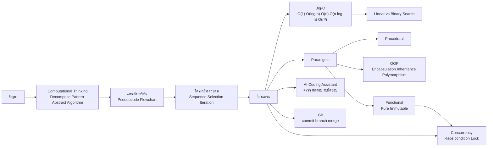

## 🎯 ขอบเขตที่ต้องทบทวน

| สัปดาห์ | หัวข้อ | CLO |
| :--- | :--- | :--- |
| W4 | การคิดเชิงคำนวณ, คุณสมบัติอัลกอริทึม, pseudocode/flowchart, โครงสร้างควบคุม, Big-O, linear vs binary search, Procedural/OOP/Functional, AI coding assistants, version control และ concurrency | CLO3 |

**หลังทบทวนไฟล์นี้ ผู้เรียนควร:**
1. แตกปัญหาด้วยหลักการคิดเชิงคำนวณ 4 ขั้น แล้วเขียนเป็น pseudocode/flowchart ได้
2. อ่าน Big-O จากโค้ด (ลูปเดี่ยว ลูปซ้อน การแบ่งครึ่ง) และเลือกอัลกอริทึม/โครงสร้างข้อมูลที่เหมาะสมได้
3. เปรียบเทียบกระบวนทัศน์ Procedural, OOP และ Functional พร้อมยกตัวอย่างได้
4. อธิบายการใช้ AI assistant อย่างรับผิดชอบ, หลักการพื้นฐานของ Git และปัญหา race condition ได้

> [!tip] ข้อสอบส่วนนี้วัด "การคิด" มากกว่า syntax
> โจทย์อัตนัยมักให้เขียน pseudocode พร้อมบอก Big-O หรือให้โค้ดสั้น ๆ แล้วถามความซับซ้อน — ไม่จำเป็นต้องจำ syntax ภาษาใดภาษาหนึ่งเป๊ะ แต่ตรรกะต้องถูก

## 🧠 สรุปแก่นความรู้ (Key Concepts Summary)

### 1. การคิดเชิงคำนวณ (Computational Thinking)

| ขั้น | ความหมาย | ตัวอย่างในเกม |
| :--- | :--- | :--- |
| Decomposition | แบ่งปัญหาใหญ่เป็นปัญหาย่อย | เกม = รับอินพุต + อัปเดตสถานะ + แสดงผล |
| Pattern Recognition | หาสิ่งที่ซ้ำกัน | ศัตรูทุกตัวมี HP และโจมตีเหมือนกัน |
| Abstraction | ตัดรายละเอียดที่ไม่จำเป็น | มองศัตรูเป็นแค่ (ชื่อ, HP, พลังโจมตี) |
| Algorithm Design | เขียนขั้นตอนชัดเจน | ลูปผลัดตาโจมตีจนฝ่ายหนึ่ง HP ≤ 0 |

**คุณสมบัติของอัลกอริทึมที่ดี:** มีอินพุต, มีเอาต์พุต, ทุกขั้นชัดเจน (definiteness), **จบได้ในจำนวนขั้นจำกัด (finiteness)**, ทำได้จริง (effectiveness) และควรถูกต้องกับทุกอินพุตที่กำหนด

**โครงสร้างควบคุม 3 แบบ:** ลำดับ (sequence), เงื่อนไข (selection: if/else), วนซ้ำ (iteration: for/while) — ทุกอัลกอริทึมเขียนได้ด้วย 3 แบบนี้

### 2. Big-O Notation
**[Big-O Notation](/concept/big-o-notation)** บอก "อัตราการเติบโต" ของจำนวนขั้นเมื่อข้อมูล $n$ ใหญ่ขึ้น (มักพิจารณา worst case) โดย **ตัดค่าคงที่และพจน์ที่โตช้ากว่าทิ้ง** เช่น $3n^2 + 5n + 2 \rightarrow O(n^2)$

| Big-O | ชื่อ | ตัวอย่าง | $n = 1{,}000$ (ขั้นโดยประมาณ) |
| :--- | :--- | :--- | :--- |
| $O(1)$ | Constant | `lst[i]`, `x in set` (เฉลี่ย) | 1 |
| $O(\log n)$ | Logarithmic | binary search | ≈ 10 |
| $O(n)$ | Linear | linear search, หาค่าสูงสุด | 1,000 |
| $O(n \log n)$ | Linearithmic | merge sort, `sorted()` | ≈ 10,000 |
| $O(n^2)$ | Quadratic | ลูปซ้อน 2 ชั้น, bubble sort | 1,000,000 |
| $O(2^n)$ | Exponential | brute force ทุก subset | มากเกินคำนวณได้จริง |

**กฎอ่าน Big-O จากโค้ด:** ลูปเดี่ยวถึง $n$ → $O(n)$; ลูปซ้อนสองชั้นถึง $n$ → $O(n^2)$; ลดขนาดปัญหาลงครึ่งทุกรอบ → $O(\log n)$; โค้ดต่อกันเป็นลำดับ → เอาพจน์ที่ใหญ่สุด

### 3. Linear Search vs Binary Search

| ประเด็น | Linear Search | Binary Search |
| :--- | :--- | :--- |
| เงื่อนไข | ข้อมูลไม่ต้องเรียง | **ข้อมูลต้องเรียงแล้ว** |
| วิธี | ตรวจทีละตัว | เทียบตัวกลาง ตัดครึ่งที่ไม่ใช่ทิ้ง |
| Worst case | $O(n)$ | $O(\log n)$ |

### 4. กระบวนทัศน์การเขียนโปรแกรม (Programming Paradigms)

| กระบวนทัศน์ | แนวคิดหลัก | จุดเด่น | ข้อควรระวัง |
| :--- | :--- | :--- | :--- |
| Procedural | ลำดับคำสั่ง + ฟังก์ชัน ทำงานกับข้อมูลที่แชร์ | ตรงไปตรงมา เหมาะกับงานเล็ก | โปรแกรมใหญ่แล้ว state กระจัดกระจาย |
| **OOP** | รวมข้อมูล (attribute) + พฤติกรรม (method) เป็น object | จำลองโลกจริง, reuse ผ่าน inheritance | ลำดับชั้น class ซับซ้อนเกินไปได้ |
| **Functional** | ฟังก์ชันบริสุทธิ์ (pure), ข้อมูลไม่เปลี่ยนค่า (immutable), higher-order functions | ทดสอบง่าย, ปลอดภัยกับงานขนาน | ต้องเปลี่ยนวิธีคิดจากการแก้ค่าตัวแปร |

**4 เสาหลักของ OOP:** Encapsulation (ซ่อนข้อมูลภายใน), Abstraction (เปิดเผยเฉพาะส่วนที่จำเป็น), Inheritance (สืบทอดคุณสมบัติ), Polymorphism (เมธอดชื่อเดียวกันทำงานต่างกันตามชนิด object)

**Pure function** = ให้ผลเหมือนเดิมเสมอเมื่ออินพุตเหมือนเดิม และไม่มี side effect (ไม่แก้ตัวแปรภายนอก ไม่พิมพ์ ไม่เขียนไฟล์)

### 5. AI Coding Assistants อย่างรับผิดชอบ
- ใช้ AI (เช่น GitHub Copilot, Cursor) เพื่อร่างโค้ด สร้าง test case และอธิบายโค้ด แต่ **ผู้เขียนต้องอ่าน รัน ทดสอบ และรับผิดชอบเอง**
- syntax ที่ถูกต้อง ≠ อัลกอริทึมที่ถูกต้อง: ต้องตรวจ edge case (list ว่าง, ค่าติดลบ) และ complexity
- ระวัง: ข้อมูลลับ/โค้ดขององค์กรที่ส่งเข้า AI, ลิขสิทธิ์, และความซื่อสัตย์ทางวิชาการ (ระบุว่าใช้ AI ตามที่ผู้สอนกำหนด) — ต่อยอดใน W13 และสัมพันธ์กับ [Agentic AI](/concept/agentic-ai)

### 6. Version Control และ Concurrency
- **Git:** `commit` = บันทึกภาพรวมของโค้ด ณ ขณะหนึ่ง, `branch` = แนวพัฒนาแยก, `merge` = รวมกลับ, `push/pull` = ซิงก์กับ remote (เช่น GitHub) เกิด **merge conflict** เมื่อสอง branch แก้บรรทัดเดียวกัน
- **Concurrency vs Parallelism:** concurrency = จัดการหลายงานสลับกันในช่วงเวลาเดียวกัน; parallelism = ทำหลายงาน **พร้อมกันจริง** บนหลายคอร์
- **Race condition:** หลาย thread อ่าน–แก้–เขียนตัวแปรร่วมพร้อมกัน ผลลัพธ์ขึ้นกับจังหวะเวลา แก้ด้วย **lock/mutex** หรือหลีกเลี่ยง shared mutable state (แนวคิด functional)

## 🗺️ Concept Map



## 🧮 โจทย์ตัวอย่างพร้อมวิธีทำ (Worked Problems)

### โจทย์ 1: Pseudocode หาค่าสูงสุดพร้อม Big-O
**โจทย์:** เขียน pseudocode หาคะแนนสูงสุดในลิสต์ `scores` ทดลองกับ `[72, 85, 60, 91, 78]` และระบุ Big-O

**วิธีทำ:**
```text
FUNCTION find_max(scores)
    IF scores is empty THEN RETURN "no data"
    max ← scores[0]
    FOR i ← 1 TO length(scores) - 1
        IF scores[i] > max THEN
            max ← scores[i]
    RETURN max
```
Trace: max = 72 → 85 (85 > 72) → คงที่ (60) → 91 (91 > 85) → คงที่ (78) → **ผลลัพธ์ 91**

Big-O: วนตรวจทุกตัวหนึ่งครั้ง → **$O(n)$** และ **ต้องตรวจทุกตัว** เพราะข้อมูลไม่เรียง ค่าสูงสุดอาจอยู่ตำแหน่งสุดท้าย (สังเกตว่าเราจัดการกรณี list ว่างด้วย — เป็น edge case ที่ AI มักลืม)

### โจทย์ 2: อ่าน Big-O จากโค้ด
**โจทย์:** หา Big-O ของแต่ละฟังก์ชัน
```python
def a(nums):                 # (ก)
    total = 0
    for x in nums:
        total += x
    return total

def b(nums):                 # (ข)
    for i in range(len(nums)):
        for j in range(len(nums)):
            if i != j and nums[i] == nums[j]:
                return True
    return False

def c(n):                    # (ค)
    steps = 0
    while n > 1:
        n = n // 2
        steps += 1
    return steps
```
**วิธีทำ:**
- (ก) ลูปเดียววิ่ง $n$ รอบ → $O(n)$
- (ข) ลูปซ้อนสองชั้น รอบละ $n$ → $n \times n$ → $O(n^2)$ (worst case คือไม่มีค่าซ้ำ ต้องวนครบ)
- (ค) $n$ ลดลงครึ่งทุกรอบ จำนวนรอบ ≈ $\log_2 n$ → $O(\log n)$
- **ต่อยอด:** (ข) ปรับเป็น $O(n)$ ได้ด้วย `set` เช่น `return len(set(nums)) != len(nums)` เพราะการเพิ่ม/ค้นใน set เป็น $O(1)$ โดยเฉลี่ย

### โจทย์ 3: Binary search ใช้กี่รอบ
**โจทย์:** ข้อมูลนักศึกษา 1,000,000 รายการเรียงตามรหัสแล้ว ถ้าใช้ linear search กับ binary search จะต้องเปรียบเทียบอย่างมากกี่ครั้ง

**วิธีทำ:**
- Linear search worst case = $1{,}000{,}000$ ครั้ง
- Binary search ตัดครึ่งทุกรอบ ต้องหา $k$ ที่น้อยที่สุดซึ่ง $2^k \ge 1{,}000{,}000$
$$2^{19} = 524{,}288 < 10^6 \le 2^{20} = 1{,}048{,}576 \Rightarrow k = 20$$
- **คำตอบ:** binary search ใช้อย่างมากประมาณ **20 ครั้ง** เร็วกว่าราว 50,000 เท่า — แต่มีเงื่อนไขว่าข้อมูลต้องเรียงแล้ว ถ้าต้องเรียงเองก่อนจะมีค่าใช้จ่าย $O(n \log n)$ ซึ่งคุ้มเมื่อค้นหาหลายครั้ง

### โจทย์ 4: OOP vs Functional กับโจทย์เดียวกัน
**โจทย์:** ลด HP ของศัตรูเมื่อถูกโจมตี เขียนแบบ OOP และแบบ Functional

**วิธีทำ:**
```python
# OOP: ข้อมูล + พฤติกรรมอยู่ใน object, สถานะถูกแก้ภายใน (encapsulation)
class Enemy:
    def __init__(self, name, hp):
        self.name = name
        self._hp = hp            # ซ่อนไว้ แก้ผ่านเมธอดเท่านั้น

    def take_damage(self, dmg):
        self._hp = max(0, self._hp - dmg)

# Functional: pure function คืนค่าใหม่ ไม่แก้ของเดิม (immutable)
def take_damage(enemy: dict, dmg: int) -> dict:
    return {**enemy, "hp": max(0, enemy["hp"] - dmg)}

goblin = {"name": "Goblin", "hp": 30}
hit = take_damage(goblin, 12)    # goblin ยังเป็น 30, hit เป็น 18
```
**ข้อสรุป:** OOP เหมาะเมื่อมี "สิ่งของ" หลายชนิดที่มีพฤติกรรมร่วม (polymorphism เช่น `Boss` สืบทอดจาก `Enemy`) ส่วน functional ทดสอบง่ายเพราะผลลัพธ์ขึ้นกับอินพุตเท่านั้น และไม่มีปัญหา shared state

### โจทย์ 5: Race condition
**โจทย์:** สอง thread รัน `counter = counter + 1` คนละ 1,000 ครั้ง ทำไมผลอาจไม่ถึง 2,000

**วิธีทำ:** คำสั่งนี้แยกเป็น 3 ขั้น อ่าน → บวก → เขียน ถ้าลำดับเป็น T1 อ่าน 5, T2 อ่าน 5, T1 เขียน 6, T2 เขียน 6 → บวกไปสองครั้งแต่ค่าเพิ่มแค่ 1 (lost update) **แก้ไข:** ครอบส่วนอ่าน–แก้–เขียนด้วย lock เช่น `with lock: counter += 1` (Python `threading.Lock`) เพื่อให้ทีละ thread เท่านั้นที่เข้าได้

## ⚠️ จุดที่มักตอบผิด
- **"Big-O คือเวลาเป็นวินาที"** — ผิด Big-O คืออัตราการเติบโต ไม่ขึ้นกับความเร็วเครื่อง
- **ไม่ตัดค่าคงที่** — $O(2n)$ ต้องเขียนเป็น $O(n)$; $O(n^2 + n)$ เป็น $O(n^2)$
- **ใช้ binary search กับข้อมูลที่ไม่เรียง** — ได้คำตอบผิด
- **"ลูปสองชั้นเป็น $O(n^2)$ เสมอ"** — ต้องดูขอบเขตจริง เช่น ลูปในวิ่งคงที่ 10 รอบ → $O(n)$
- **"OOP ดีกว่า Functional"** — ไม่มีกระบวนทัศน์ที่ดีที่สุดทุกงาน ภาษาสมัยใหม่อย่าง Python รองรับหลายแบบ
- **"โค้ดจาก AI รันได้แปลว่าถูก"** — ต้องทดสอบ edge case และตรวจ complexity เสมอ
- **สับสน concurrency กับ parallelism** — concurrency ไม่จำเป็นต้องทำพร้อมกันจริง

## ✍️ แบบฝึกหัดทบทวน

**1. (ปรนัย)** ข้อใด **ไม่ใช่** คุณสมบัติของอัลกอริทึม
ก. ต้องจบในจำนวนขั้นจำกัด ข. ทุกขั้นต้องชัดเจน ค. ต้องเขียนด้วยภาษา Python ง. มีเอาต์พุต

<details><summary>ดูเฉลย</summary>

**ค.** อัลกอริทึมเป็นอิสระจากภาษา จะเขียนด้วย pseudocode, flowchart หรือภาษาใดก็ได้
</details>

**2. (ปรนัย)** $f(n) = 4n^2 + 100n + 7$ มี Big-O เท่าใด
ก. $O(4n^2)$ ข. $O(n)$ ค. $O(n^2)$ ง. $O(100n)$

<details><summary>ดูเฉลย</summary>

**ค.** ตัดค่าคงที่และพจน์ที่โตช้ากว่า เหลือ $O(n^2)$
</details>

**3. (ปรนัย)** การตรวจว่า `x` อยู่ใน Python `set` มีความซับซ้อนเฉลี่ยเท่าใด
ก. $O(1)$ ข. $O(\log n)$ ค. $O(n)$ ง. $O(n^2)$

<details><summary>ดูเฉลย</summary>

**ก.** set ใช้ hash table จึงเป็น $O(1)$ โดยเฉลี่ย ขณะที่ `x in list` เป็น $O(n)$
</details>

**4. (ปรนัย)** หลักการ OOP ข้อใดที่ทำให้ `Boss` และ `Slime` มีเมธอด `attack()` ชื่อเดียวกันแต่ทำงานต่างกัน
ก. Encapsulation ข. Polymorphism ค. Abstraction ง. Immutability

<details><summary>ดูเฉลย</summary>

**ข.** Polymorphism
</details>

**5. (อัตนัยสั้น)** ข้อมูลเรียงแล้ว 1,024 ตัว binary search ต้องเปรียบเทียบอย่างมากกี่ครั้ง

<details><summary>ดูเฉลย</summary>

worst case $= \lfloor \log_2 n \rfloor + 1 = \lfloor \log_2 1024 \rfloor + 1 = 10 + 1 = 11$ ครั้ง (ตัดครึ่ง 10 ครั้งจนเหลือ 1 ตัว แล้วเทียบตัวสุดท้ายอีกครั้ง) — ระดับ Big-O คือ $O(\log n)$ ประมาณ 10 ครั้ง ใช้สูตรเดียวกับโจทย์ 3: $\lfloor \log_2 10^6 \rfloor + 1 = 19 + 1 = 20$
</details>

**6. (อัตนัยสั้น)** ฟังก์ชันต่อไปนี้เป็น pure function หรือไม่ เพราะอะไร
```python
total = 0
def add(x):
    global total
    total += x
    return total
```

<details><summary>ดูเฉลย</summary>

**ไม่ใช่** เพราะแก้ตัวแปรภายนอก (side effect) และเรียก `add(5)` ซ้ำได้ผลไม่เหมือนเดิม
</details>

**7. (อัตนัยสั้น)** ระบุข้อควรระวัง 2 ข้อเมื่อใช้ AI coding assistant ทำงานส่ง

<details><summary>ดูเฉลย</summary>

(1) ต้องรันและทดสอบเอง โดยเฉพาะ edge case เพราะ AI อาจให้โค้ดที่ดูถูกแต่ตรรกะผิด (2) ต้องปฏิบัติตามกติกาความซื่อสัตย์ทางวิชาการและระบุการใช้ AI รวมทั้งไม่ส่งข้อมูลลับหรือข้อมูลส่วนบุคคลเข้าเครื่องมือ
</details>

**8. (วิเคราะห์)** เพื่อนสองคนแก้ไฟล์ `game.py` บรรทัดเดียวกันใน branch ต่างกัน แล้ว merge จะเกิดอะไรขึ้น และควรแก้อย่างไร

<details><summary>ดูเฉลย</summary>

เกิด **merge conflict** Git จะทำเครื่องหมายส่วนที่ขัดแย้งในไฟล์ ผู้ merge ต้องเลือกหรือรวมโค้ดด้วยตนเอง ทดสอบ แล้ว commit ผลการแก้ไข การ commit/pull บ่อยและแบ่งงานตามไฟล์/ฟังก์ชันช่วยลด conflict
</details>

## 🔗 อ่านทบทวนเพิ่มเติม
- [สัปดาห์ที่ 4: Algorithms & Programming Paradigms](/module/04)
- แนวคิด: [Big-O Notation](/concept/big-o-notation) · [Agentic AI](/concept/agentic-ai)
- เชื่อมโยง: [สัปดาห์ที่ 3: Digital Logic & Modern Processors](/module/03) (ตรรกะเงื่อนไขในวงจร ↔ if/else ในโปรแกรม) · [สัปดาห์ที่ 5: Database & Data Management](/module/05) (index ช่วยให้ค้นหาเร็วกว่า $O(n)$) · กลับหน้า [สัปดาห์ที่ 8: Midterm Examination](/module/08)

## 📚 แหล่งอ้างอิง
1. Cormen, T. H., Leiserson, C. E., Rivest, R. L., & Stein, C. (2022). *Introduction to Algorithms* (4th ed.). MIT Press. — นิยามอัลกอริทึม, asymptotic notation, binary search, merge sort
2. Python Software Foundation. *TimeComplexity* (ความซับซ้อนของ operation ใน CPython). [wiki.python.org](https://wiki.python.org/moin/TimeComplexity)
3. Python Software Foundation. *Functional Programming HOWTO.* [docs.python.org](https://docs.python.org/3/howto/functional.html) และ *threading — Thread-based parallelism* (Lock). [docs.python.org](https://docs.python.org/3/library/threading.html)
4. Chacon, S., & Straub, B. *Pro Git* (2nd ed.). [git-scm.com](https://git-scm.com/book/en/v2)
5. GitHub. *GitHub Copilot documentation.* [docs.github.com](https://docs.github.com/en/copilot)
6. ACM/IEEE-CS/AAAI. (2024). *Computer Science Curricula 2023 (CS2023)* — Software Development Fundamentals, Algorithmic Foundations. [ACM Digital Library](https://dl.acm.org/doi/book/10.1145/3664191)
