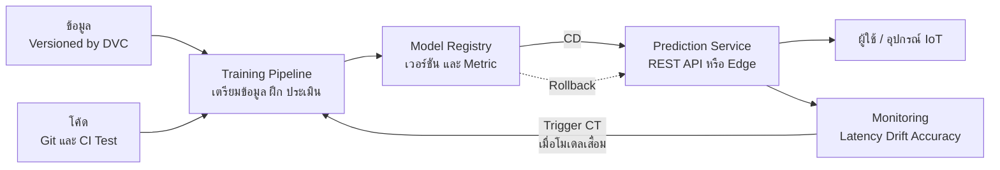

## 🎯 สิ่งที่จะได้เรียนรู้

- อธิบายว่าทำไมโมเดลที่แม่นยำใน notebook จึง **ล้มเหลวได้เมื่อใช้งานจริง (production)**
- อธิบายความหมายของ **MLOps** และความต่างจาก DevOps
- อธิบายแนวคิด **CI / CD / CT (Continuous Training)** ในระบบ ML
- อธิบายความจำเป็นของ **versioning** ข้อมูล + โค้ด + โมเดล และบทบาทของ **model registry**
- อธิบาย **ระดับความพร้อมของ MLOps (level 0, 1, 2)** ตามแนวทางของ Google Cloud
- ให้บริการโมเดลผ่าน **REST API ด้วย FastAPI** และรู้จักทางเลือกการ deploy บน **edge device**

## 📖 เนื้อหาและคำอธิบาย

### 1. ทำไมโมเดลจึงพังเมื่อออกสู่โลกจริง

**อุปมา: นักเรียนที่ทำข้อสอบเก่าได้เต็ม** แต่เมื่อเจอข้อสอบปีนี้ที่รูปแบบเปลี่ยน คะแนนกลับตก โมเดล ML ก็เช่นกัน คะแนนบน test set เป็นแค่จุดเริ่มต้น

สาเหตุที่พบบ่อย
- **Training-serving skew** — ข้อมูลตอนใช้งานถูกเตรียมต่างจากตอนฝึก เช่น ตอนฝึกใช้หน่วย °C แต่ระบบจริงส่งมาเป็น °F
- **Data drift / concept drift** — โลกเปลี่ยน ข้อมูลใหม่ไม่เหมือนข้อมูลฝึก (ดูไฟล์วงจรชีวิตข้อมูล)
- **ทำซ้ำไม่ได้ (not reproducible)** — ไม่รู้ว่าโมเดลที่ใช้อยู่ฝึกด้วยข้อมูลชุดไหน โค้ดเวอร์ชันไหน
- **ไม่มีการเฝ้าดู** — โมเดลเสื่อมไปเรื่อย ๆ โดยไม่มีใครรู้
- **ปัญหาด้านระบบ** — ตอบช้า รับโหลดไม่ไหว dependency ไม่ตรงกัน

บทความ *Hidden Technical Debt in Machine Learning Systems* (Sculley et al., NeurIPS 2015) ชี้ว่า **โค้ดส่วนที่เป็นโมเดล ML เป็นเพียงส่วนเล็ก ๆ** ของระบบจริง ส่วนที่เหลือคือการเก็บข้อมูล ตรวจสอบข้อมูล จัดการ feature โครงสร้างพื้นฐานสำหรับให้บริการ และการ monitor ซึ่งล้วนสร้าง "หนี้ทางเทคนิค" ได้ถ้าไม่ดูแลอย่างเป็นระบบ

### 2. MLOps คืออะไร

**MLOps (Machine Learning Operations)** คือแนวปฏิบัติที่นำหลักของ **DevOps** (อัตโนมัติ ทดสอบ ส่งมอบต่อเนื่อง) มาใช้กับวงจรชีวิตของระบบ ML เพื่อให้การฝึก ประเมิน deploy และ monitor โมเดลเป็นกระบวนการที่ **ทำซ้ำได้ ตรวจสอบได้ และอัตโนมัติ**

| ประเด็น | DevOps (ซอฟต์แวร์ทั่วไป) | MLOps (ระบบ ML) |
|---|---|---|
| สิ่งที่ต้อง version | โค้ด | โค้ด **+ ข้อมูล + โมเดล + hyperparameter** |
| การทดสอบ | unit / integration test | ทั้งนั้น **+ ตรวจคุณภาพข้อมูล + ประเมินคุณภาพโมเดล** |
| เหตุที่ต้อง release ใหม่ | แก้บั๊ก เพิ่มฟีเจอร์ | ทั้งนั้น **+ ข้อมูลเปลี่ยน โมเดลเสื่อม** |
| การเสื่อมสภาพ | โค้ดไม่เสื่อมเอง | โมเดล **เสื่อมได้เอง** เมื่อโลกเปลี่ยน |
| Pipeline | CI / CD | CI / CD **+ CT (Continuous Training)** |

### 3. CI, CD และ CT

- **CI (Continuous Integration)** — ทุกครั้งที่แก้โค้ด ระบบรันทดสอบอัตโนมัติ ในระบบ ML รวมถึงทดสอบ schema ของข้อมูลและทดสอบโค้ดเตรียม feature
- **CD (Continuous Delivery)** — ส่งมอบซอฟต์แวร์ได้อัตโนมัติ ในระบบ ML คือการส่งมอบ *training pipeline* และ *บริการทำนาย (prediction service)*
- **CT (Continuous Training)** — คุณสมบัติเฉพาะของระบบ ML: **ฝึกโมเดลใหม่และนำขึ้นให้บริการโดยอัตโนมัติ** เมื่อเกิดเงื่อนไข เช่น ตามตารางเวลา เมื่อมีข้อมูลใหม่ หรือเมื่อประสิทธิภาพของโมเดลลดลง

### 4. Versioning และ Model Registry

**อุปมา: สมุดบันทึกสูตรอาหาร** ถ้าอาหารจานหนึ่งอร่อยมาก แต่จำไม่ได้ว่าใช้วัตถุดิบล็อตไหน สูตรเวอร์ชันไหน อบกี่นาที ก็ทำซ้ำไม่ได้ โมเดล ML ต้องบันทึก 3 อย่างคู่กันเสมอ

| สิ่งที่ต้อง version | เครื่องมือตัวอย่าง | เหตุผล |
|---|---|---|
| **โค้ด** | Git / GitHub | รู้ว่าใช้อัลกอริทึมและขั้นเตรียมข้อมูลเวอร์ชันไหน |
| **ข้อมูล** | DVC (Data Version Control) | ข้อมูลเปลี่ยน โมเดลก็เปลี่ยน แม้โค้ดเหมือนเดิม |
| **โมเดล + metadata** | MLflow Model Registry | รู้ว่าโมเดลไหนอยู่ใน production, metric เท่าไร, ย้อนกลับ (rollback) ได้ |

**Model registry** เป็นเหมือน "คลังโมเดล" ที่เก็บทุกเวอร์ชันพร้อมข้อมูลกำกับ (lineage: ฝึกจากข้อมูลและโค้ดชุดไหน) และสถานะ เช่น กำลังทดสอบ หรือใช้งานจริง ทำให้ทีมตรวจสอบและสลับเวอร์ชันได้อย่างปลอดภัย

### 5. ระดับความพร้อมของ MLOps (Google Cloud)

บทความ *MLOps: Continuous delivery and automation pipelines in machine learning* ของ Google Cloud แบ่งความพร้อมเป็น 3 ระดับ

| ระดับ | ชื่อ | ลักษณะ | เหมาะกับ |
|---|---|---|---|
| **Level 0** | Manual process | ทุกขั้นทำด้วยมือผ่าน notebook/script, ส่งไฟล์โมเดลให้ทีมวิศวกรไป deploy, release นาน ๆ ครั้ง, monitor น้อยหรือไม่มี | งานทดลอง โปรเจกต์นักศึกษา |
| **Level 1** | ML pipeline automation | ทำ training pipeline เป็นอัตโนมัติ จึงทำ **CT** ได้ มีการตรวจข้อมูล/ตรวจโมเดลในไปป์ไลน์ อาจมี feature store | โมเดลที่ข้อมูลเปลี่ยนบ่อย |
| **Level 2** | CI/CD pipeline automation | เพิ่ม CI/CD ให้ตัวไปป์ไลน์เอง มี ML metadata store และ model registry ทดลองไอเดียใหม่แล้วนำขึ้นระบบได้เร็ว | องค์กรที่มีหลายโมเดลใน production |

ในระดับ 1 การฝึกใหม่อาจถูกกระตุ้นได้หลายแบบ เช่น สั่งด้วยมือ ตามตารางเวลา เมื่อมีข้อมูลใหม่ เมื่อประสิทธิภาพของโมเดลลดลง หรือเมื่อการกระจายของ feature เปลี่ยนไปอย่างมีนัยสำคัญ

> [!note] Mini-Project 3 อยู่ระดับไหน
> โปรเจกต์ในรายวิชานี้เริ่มต้นที่ **Level 0** ได้ แต่ควรมี "นิสัย MLOps" ตั้งแต่แรก คือ เก็บโค้ดใน Git บันทึกเวอร์ชันข้อมูลและโมเดล และเขียน log ผลการทำนาย

### 6. รูปแบบการนำโมเดลไปใช้งาน (Deployment Patterns)

| รูปแบบ | ทำงานอย่างไร | ตัวอย่าง | ข้อดี / ข้อจำกัด |
|---|---|---|---|
| **Batch prediction** | ทำนายทีละมากตามรอบเวลา เก็บผลไว้ในฐานข้อมูล | สรุปความเสี่ยงห้องร้อนทุกเช้า | ง่าย ประหยัด / ไม่ทันที |
| **Online serving (REST API)** | ส่ง request แล้วได้คำตอบทันที | แอปถาม API ว่า "ตอนนี้ร้อนไหม" | ยืดหยุ่น / ต้องมี server และเครือข่าย |
| **Edge / on-device** | รันโมเดลบนอุปกรณ์ปลายทาง | ESP32 ตัดสินใจเปิดพัดลมเอง | เร็ว ทำงานแม้ไม่มีเน็ต ข้อมูลไม่ออกนอกอุปกรณ์ / โมเดลต้องเล็กมาก |

สำหรับ edge deployment โมเดลมักถูกแปลงและย่อขนาด (เช่น quantization) ด้วยเครื่องมืออย่าง **LiteRT** (ชื่อใหม่ของ TensorFlow Lite) ซึ่งมีรุ่นสำหรับไมโครคอนโทรลเลอร์ ดูต่อที่ [TinyML และ Edge AI](/concept/tinyml-edge-ai)

### 7. Monitoring: เฝ้าดูอะไรบ้าง

- **ระดับระบบ:** latency, จำนวน request, error rate, การใช้ CPU/หน่วยความจำ
- **ระดับข้อมูล:** การกระจายของ input เทียบกับข้อมูลฝึก (drift), ค่าหาย, ค่านอกช่วง
- **ระดับโมเดล:** accuracy เมื่อได้คำตอบจริงภายหลัง, สัดส่วนการทำนายแต่ละ class
- **ระดับความรับผิดชอบ:** ผลกระทบต่อกลุ่มผู้ใช้ต่าง ๆ, การตรวจสอบย้อนหลัง (audit) ตามแนวคิด Govern–Map–Measure–Manage ของ NIST AI RMF

## 🧩 ตัวอย่างประกอบ / Worked Example

**โจทย์:** นำโมเดลจำแนกดอก Iris ไปให้บริการเป็น REST API ที่มี **เวอร์ชันของโมเดล** กำกับในทุกคำตอบ

**ขั้นที่ 1 — ฝึกและบันทึกโมเดลพร้อม metadata** (รันใน Google Colab ได้)

```python
# train_model.py : ฝึกโมเดลและบันทึกเป็นไฟล์พร้อมเวอร์ชัน
import joblib
from sklearn.datasets import load_iris
from sklearn.ensemble import RandomForestClassifier

iris = load_iris()
model = RandomForestClassifier(n_estimators=100, random_state=42)  # random_state ทำให้ทำซ้ำได้
model.fit(iris.data, iris.target)

# บันทึกโมเดล + ชื่อ class + เวอร์ชัน ไว้ในไฟล์เดียว
bundle = {"model": model,
          "classes": [str(c) for c in iris.target_names],
          "version": "1.0.0"}
joblib.dump(bundle, "iris_model_v1.joblib")

# ทดสอบโหลดกลับมาใช้ (เลียนแบบสิ่งที่ server จะทำ)
loaded = joblib.load("iris_model_v1.joblib")
proba = loaded["model"].predict_proba([[6.7, 3.0, 5.2, 2.3]])[0]
best = int(proba.argmax())
print(loaded["classes"][best], round(float(proba[best]), 2))
```

```output
virginica 1.0
```

**ขั้นที่ 2 — สร้าง API ด้วย FastAPI** (รันบนเครื่องตนเองหลัง `pip install fastapi uvicorn scikit-learn joblib`)

```python
# app.py : บริการทำนายผ่าน REST API
import joblib
from fastapi import FastAPI
from pydantic import BaseModel

bundle = joblib.load("iris_model_v1.joblib")   # โหลดโมเดลครั้งเดียวตอนเริ่ม server
app = FastAPI(title="Iris Classifier")

class Flower(BaseModel):          # กำหนดรูปแบบ input ให้ FastAPI ตรวจสอบอัตโนมัติ
    sepal_length: float
    sepal_width: float
    petal_length: float
    petal_width: float

@app.get("/health")
def health():
    # ให้ระบบ monitoring ตรวจว่าบริการยังทำงานอยู่
    return {"status": "ok", "model_version": bundle["version"]}

@app.post("/predict")
def predict(f: Flower):
    x = [[f.sepal_length, f.sepal_width, f.petal_length, f.petal_width]]
    proba = bundle["model"].predict_proba(x)[0]
    best = int(proba.argmax())
    # คืนเวอร์ชันโมเดลทุกครั้ง เพื่อให้ตรวจย้อนหลังได้ว่าคำตอบมาจากโมเดลไหน
    return {"prediction": bundle["classes"][best],
            "confidence": round(float(proba[best]), 2),
            "model_version": bundle["version"]}
```

**ขั้นที่ 3 — รันและทดสอบ**

```bash
uvicorn app:app --reload
curl -X POST http://127.0.0.1:8000/predict \
     -H "Content-Type: application/json" \
     -d '{"sepal_length": 6.7, "sepal_width": 3.0, "petal_length": 5.2, "petal_width": 2.3}'
```

```output
{"prediction":"virginica","confidence":1.0,"model_version":"1.0.0"}
```

> [!tip] ทดลองผ่านเบราว์เซอร์
> FastAPI สร้างหน้าเอกสาร API แบบโต้ตอบได้ให้อัตโนมัติที่ `http://127.0.0.1:8000/docs` กดลองส่ง request ได้โดยไม่ต้องใช้ curl

**มองแบบ MLOps:** ตัวอย่างนี้ยังเป็น Level 0 ถ้าจะยกระดับ ควร (1) เก็บ `train_model.py` และ `app.py` ใน Git (2) บันทึกเวอร์ชันข้อมูลที่ใช้ฝึก (3) log input และผลทำนายทุก request เพื่อตรวจ drift (4) ทำ CI ให้รันทดสอบ `/predict` อัตโนมัติก่อน deploy (เชื่อมกับ DevOps ใน Week 14)

## 🗺️ แผนภาพสรุป



## ⚠️ ความเข้าใจผิดที่พบบ่อย

- **"ฝึกโมเดลได้ accuracy สูงแล้ว งานเสร็จ"** — การ deploy, monitor และดูแลต่อเนื่องคืองานส่วนใหญ่ของระบบ ML จริง
- **"MLOps คือเครื่องมือ"** — MLOps คือ *แนวปฏิบัติและวัฒนธรรม* เครื่องมืออย่าง MLflow หรือ DVC เป็นเพียงตัวช่วย
- **"Version แค่โค้ดก็พอ"** — โค้ดเดิมกับข้อมูลใหม่ให้โมเดลคนละตัว ต้อง version ข้อมูลและโมเดลด้วย
- **"Retrain ยิ่งบ่อยยิ่งดี"** — ถ้าไม่มีขั้นประเมินและเปรียบเทียบกับโมเดลเดิมก่อนนำขึ้นระบบ อาจได้โมเดลที่แย่ลงโดยไม่รู้ตัว
- **"MLOps จำเป็นเฉพาะบริษัทใหญ่"** — โปรเจกต์เล็กก็ได้ประโยชน์จากนิสัยพื้นฐาน เช่น Git, การบันทึกเวอร์ชัน และ log ผลทำนาย

## 🔗 เชื่อมโยงกับรายวิชา

- แนวคิดหลัก: [MLOps](/concept/mlops) · แผนการสอน: [สัปดาห์ที่ 9: AI & Machine Learning Foundations](/module/09)
- CI/CD และ DevOps เต็มรูปแบบ: [สัปดาห์ที่ 14: Applied System Engineering & DevOps](/module/14)
- โครงสร้างพื้นฐานคลาวด์ที่ใช้ให้บริการโมเดล: [สัปดาห์ที่ 7: Data Center & Cloud Infrastructure](/module/07)
- Deploy บนอุปกรณ์ปลายทาง: [TinyML และ Edge AI](/concept/tinyml-edge-ai), [Edge Computing](/concept/edge-computing), [สัปดาห์ที่ 11: Embedded Systems & IoT](/module/11)
- เรียกใช้ GenAI API (อีกรูปแบบของ model serving): [สัปดาห์ที่ 10: Generative AI & Modern Robotics](/module/10), [Agentic AI](/concept/agentic-ai)
- ความปลอดภัยของ API และโมเดล: [สัปดาห์ที่ 12: Cybersecurity & Trust Architecture](/module/12), [Zero-Trust Architecture](/concept/zero-trust-architecture)
- ความรับผิดชอบและการตรวจสอบย้อนหลัง: [สัปดาห์ที่ 13: Computer Ethics & Intellectual Property](/module/13)
- **Mini-Project 3 (Smart Environment Monitor):** ออกแบบสถาปัตยกรรมใน [Lab 09 - ML Basics and IoT Architecture](/lab/09) ให้ระบุว่าโมเดลจะรันที่ไหน (server API หรือบน ESP32) ข้อมูลไหลผ่าน MQTT อย่างไร และจะ monitor/retrain โมเดลเมื่อใด

## ❓ คำถามทบทวน

1. ทำไมต้อง monitor โมเดลหลัง deploy ทั้งที่ผ่านการทดสอบด้วย test set แล้ว

<details><summary>ดูแนวคำตอบ</summary>

เพราะ test set สะท้อนข้อมูลในอดีตเท่านั้น หลัง deploy ข้อมูลจริงอาจเปลี่ยน (data/concept drift) หรือถูกเตรียมต่างไปจากตอนฝึก (training-serving skew) โมเดลจึงเสื่อมได้โดยไม่มีข้อผิดพลาดของโค้ดเลย การ monitor ช่วยตรวจพบและกระตุ้นการ retrain หรือ rollback
</details>

2. CT (Continuous Training) ต่างจาก CI/CD อย่างไร

<details><summary>ดูแนวคำตอบ</summary>

CI/CD เน้นทดสอบและส่งมอบ *ซอฟต์แวร์* เมื่อโค้ดเปลี่ยน ส่วน CT เป็นคุณสมบัติเฉพาะของระบบ ML คือการฝึกโมเดลใหม่และนำขึ้นให้บริการโดยอัตโนมัติเมื่อ *ข้อมูลหรือประสิทธิภาพ* เปลี่ยน แม้โค้ดไม่เปลี่ยน
</details>

3. จงอธิบายความต่างของ MLOps Level 0 และ Level 1 ตามแนวทางของ Google Cloud

<details><summary>ดูแนวคำตอบ</summary>

Level 0 ทำทุกขั้นด้วยมือผ่าน notebook ส่งไฟล์โมเดลต่อให้ทีมอื่น deploy นาน ๆ ครั้งและแทบไม่มี monitoring ส่วน Level 1 ทำ training pipeline เป็นอัตโนมัติ มีการตรวจข้อมูลและโมเดลในไปป์ไลน์ และฝึกใหม่อัตโนมัติ (CT) ได้เมื่อมีตัวกระตุ้น เช่น ข้อมูลใหม่หรือประสิทธิภาพลดลง
</details>

4. ทำไม API ในตัวอย่างจึงคืนค่า `model_version` ทุกครั้ง

<details><summary>ดูแนวคำตอบ</summary>

เพื่อให้ตรวจย้อนหลัง (traceability) ได้ว่าคำตอบแต่ละครั้งมาจากโมเดลเวอร์ชันใด เมื่อพบปัญหาจะรู้ว่าต้องตรวจโมเดล ข้อมูล และโค้ดชุดไหน และ rollback ได้ถูกเวอร์ชัน
</details>

5. สำหรับระบบเปิดพัดลมอัตโนมัติในห้องเรียน ควรเลือก deploy แบบ REST API บน server หรือรันบน ESP32 จงให้เหตุผล

<details><summary>ดูแนวคำตอบ</summary>

ถ้าโมเดลเล็ก (เช่น regression หรือ tree ขนาดเล็ก) การรันบน ESP32 ตอบสนองเร็ว ทำงานได้แม้เน็ตหลุด และข้อมูลไม่ต้องออกจากห้อง แต่อัปเดตโมเดลยากกว่า ส่วน REST API อัปเดตโมเดลและ monitor ได้ง่าย แต่พึ่งพาเครือข่าย อาจผสมทั้งสองแบบ คือ ตัดสินใจบนบอร์ด และส่งข้อมูลขึ้น server เพื่อ monitor และ retrain
</details>

## 📚 แหล่งอ้างอิง

1. Google Cloud. *MLOps: Continuous delivery and automation pipelines in machine learning.* <https://docs.cloud.google.com/architecture/mlops-continuous-delivery-and-automation-pipelines-in-machine-learning>
2. Sculley, D. et al. (2015). *Hidden Technical Debt in Machine Learning Systems*. NeurIPS 2015. <https://papers.nips.cc/paper/5656-hidden-technical-debt-in-machine-learning-systems>
3. NIST. (2023). *AI Risk Management Framework (AI RMF 1.0)*. <https://www.nist.gov/itl/ai-risk-management-framework>
4. FastAPI documentation. *First Steps.* <https://fastapi.tiangolo.com/tutorial/first-steps/>
5. MLflow documentation. *MLflow Model Registry.* <https://mlflow.org/docs/latest/ml/model-registry/>
6. Google for Developers. *Machine Learning Crash Course: Production ML systems.* <https://developers.google.com/machine-learning/crash-course/production-ml-systems>
7. Google AI Edge. *LiteRT* (เดิมชื่อ TensorFlow Lite). <https://ai.google.dev/edge/litert> · ml-ops.org. *MLOps Principles.* <https://ml-ops.org/content/mlops-principles>
