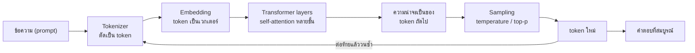

## 🎯 สิ่งที่จะได้เรียนรู้
- แยกความแตกต่างระหว่าง **discriminative model** (จำแนก/ตัดสิน) กับ **generative model** (สร้างข้อมูลใหม่) ได้
- อธิบายว่า LLM ทำงานโดย "ทำนาย token ถัดไป" ซ้ำ ๆ และเข้าใจคำว่า **token**, **embedding**, **context window**
- เข้าใจแนวคิด (intuition) ของ **Transformer** และ **self-attention** โดยไม่ต้องใช้คณิตศาสตร์หนัก
- อธิบายขั้นตอนการสร้าง LLM: **pre-training → fine-tuning → RLHF** ได้
- คาดการณ์ผลของการปรับ **temperature / sampling** ต่อคำตอบได้
- รู้จัก generative model ประเภทอื่น เช่น **diffusion model** สำหรับสร้างภาพ

## 📖 เนื้อหาและคำอธิบาย

### 1. Generative vs Discriminative: "กรรมการ" กับ "จิตรกร"
ในสัปดาห์ที่ 9 เราเห็น model ที่ตอบว่า "ภาพนี้คือแมวหรือสุนัข" หรือ "อีเมลนี้เป็น spam หรือไม่" model แบบนี้เรียกว่า **discriminative** คือเรียนรู้เส้นแบ่งระหว่างกลุ่ม เปรียบเหมือน **กรรมการตัดสินการประกวดวาดภาพ** ที่บอกได้ว่าภาพไหนเข้าเกณฑ์ แต่ไม่ได้วาดเอง

**Generative model** เรียนรู้ "รูปแบบการกระจายตัวของข้อมูล" จนสามารถ **สร้างตัวอย่างใหม่** ที่คล้ายข้อมูลที่เคยเห็น เปรียบเหมือน **จิตรกร** ที่ดูภาพมานับล้านภาพจนวาดภาพใหม่ได้เอง

| ประเด็น | Discriminative model | Generative model |
|---|---|---|
| คำถามที่ตอบ | "สิ่งนี้คือคลาสอะไร?" | "สร้างสิ่งใหม่ที่เหมือนข้อมูลจริงได้ไหม?" |
| ผลลัพธ์ | label / ตัวเลข / ความน่าจะเป็นของคลาส | ข้อความ ภาพ เสียง โค้ด |
| ตัวอย่าง | spam filter, จำแนกภาพ, ทำนายราคา | แชตบอต LLM (ข้อความ/โค้ด), diffusion model (ภาพ) |
| ความเสี่ยงหลัก | ทำนายผิด / มีอคติ | สร้างเนื้อหาผิดแต่ฟังดูน่าเชื่อ (hallucination) |

### 2. Token: หน่วยเล็กที่สุดที่ LLM มองเห็น
LLM ไม่ได้อ่านข้อความเป็น "ตัวอักษร" หรือ "คำ" แบบมนุษย์ แต่ตัดข้อความเป็นชิ้นเรียกว่า **token** ด้วยโปรแกรมที่เรียกว่า **tokenizer** หนึ่ง token อาจเป็นทั้งคำ ส่วนหนึ่งของคำ หรือเครื่องหมายวรรคตอน เช่น `unbelievable` อาจถูกตัดเป็น `un` + `believ` + `able` จากนั้นแต่ละ token ถูกแทนด้วยเลข ID

> [!note]
> ภาษาไทยไม่เว้นวรรคระหว่างคำ และ tokenizer จำนวนมากถูกสร้างจากข้อมูลที่ภาษาอังกฤษเป็นส่วนใหญ่ ข้อความไทยจึง **มักใช้จำนวน token มากกว่า** ข้อความอังกฤษที่ความหมายเท่ากัน ซึ่งมีผลต่อค่าใช้จ่าย API และพื้นที่ใน context window — จำนวนจริงขึ้นกับแต่ละ model ควรทดลองนับด้วย tokenizer ของผู้ให้บริการนั้นเอง

### 3. Embedding: เปลี่ยน token เป็น "พิกัดความหมาย"
เลข ID ไม่มีความหมายในตัวเอง LLM จึงแปลงแต่ละ token เป็น **embedding** คือเวกเตอร์ (ชุดตัวเลขหลายร้อยถึงหลายพันมิติ) ที่ถูกเรียนรู้จนคำที่ความหมายใกล้กันอยู่ใกล้กันในอวกาศเวกเตอร์ เช่น "แมว" อยู่ใกล้ "สุนัข" มากกว่า "รถยนต์" เปรียบเหมือน **แผนที่ที่จัดวางคำตามความหมาย** แนวคิดนี้คือหัวใจของ [Vector Database](/concept/vector-database) และ RAG ในหัวข้อถัดไป

### 4. Transformer และ Self-Attention (แบบเข้าใจง่าย)
สถาปัตยกรรม **Transformer** ถูกเสนอในบทความ *Attention Is All You Need* (Vaswani et al., 2017) และกลายเป็นพื้นฐานของ LLM สมัยใหม่ แนวคิดสำคัญคือ **self-attention**: ขณะประมวลผล token หนึ่ง model จะ "หันไปมอง" token อื่นทั้งหมดในบริบท แล้วให้น้ำหนักว่าตัวไหนเกี่ยวข้องมากที่สุด

ตัวอย่าง: *"นักศึกษาวางโน้ตบุ๊กบนโต๊ะ เพราะ**มัน**หนักเกินไป"* — เพื่อเข้าใจว่า "มัน" หมายถึงอะไร model ควรให้น้ำหนัก (attention) กับ "โน้ตบุ๊ก" มากกว่า "โต๊ะ"

เปรียบเทียบง่าย ๆ: self-attention เหมือน **การประชุมกลุ่ม** ที่ทุกคน (token) ตั้งคำถาม (**Query**) แล้วเทียบกับป้ายชื่อของคนอื่น (**Key**) จากนั้นรับข้อมูล (**Value**) จากคนที่ตรงกับคำถามมากที่สุด ทุกคนทำพร้อมกันแบบขนาน จึงเหมาะกับการคำนวณบน GPU ต่างจาก RNN รุ่นก่อนที่ต้องอ่านทีละคำตามลำดับ Transformer จะซ้อนชั้น attention แบบนี้หลายสิบชั้น ทำให้จับความสัมพันธ์ได้ทั้งระดับไวยากรณ์และความหมาย

### 5. LLM สร้างข้อความอย่างไร: ทำนาย token ถัดไปซ้ำ ๆ
LLM แบบ GPT เป็น **autoregressive**: รับข้อความทั้งหมดที่มี → คำนวณความน่าจะเป็นของ token ถัดไปทุกตัวในคลังคำ → เลือกมา 1 ตัว → ต่อท้ายข้อความ → วนซ้ำจนจบ เหมือน **ระบบเดาคำบนคีย์บอร์ดมือถือที่อ่านบริบทได้ยาวมากและฉลาดกว่ามาก**

สิ่งสำคัญ: model ไม่ได้ "ค้นความจริงจากฐานข้อมูล" แต่สร้างข้อความที่ **น่าจะเป็นทางสถิติ** จึงอาจผิดได้แม้ฟังดูมั่นใจ (ดูไฟล์ 05 เรื่องข้อจำกัด)

### 6. วงจรชีวิตการสร้าง LLM
| ขั้นตอน | ทำอะไร | เปรียบเทียบ |
|---|---|---|
| **Pre-training** | ฝึกทำนาย token ถัดไปจากข้อความจำนวนมหาศาล (self-supervised ไม่ต้องติด label เอง) | อ่านหนังสือทั้งห้องสมุด |
| **Fine-tuning / Instruction tuning** | ฝึกต่อด้วยตัวอย่างคำสั่ง-คำตอบคุณภาพดี เพื่อให้ทำตามคำสั่งได้ | ฝึกงานกับพี่เลี้ยง |
| **RLHF** (Reinforcement Learning from Human Feedback) | ให้มนุษย์จัดอันดับคำตอบ ฝึก reward model แล้วใช้ปรับ LLM ให้ตอบตรงความต้องการและปลอดภัยขึ้น (Ouyang et al., 2022) | รับ feedback จากผู้ใช้แล้วปรับปรุง |

> [!tip]
> งาน GPT-3 (Brown et al., 2020) แสดงว่า model ที่ใหญ่พอสามารถทำงานใหม่ได้จากตัวอย่างใน prompt เพียงไม่กี่ตัว (**few-shot / in-context learning**) โดยไม่ต้องฝึกใหม่ นี่คือเหตุผลที่ **prompt engineering** — การเขียนคำสั่ง ให้ตัวอย่าง และกำหนดรูปแบบผลลัพธ์ — มีผลต่อคุณภาพคำตอบมาก

### 7. Context Window: หน่วยความจำระยะสั้น
**Context window** คือจำนวน token สูงสุดที่ model รับได้ในหนึ่งครั้ง (รวม system prompt + ประวัติแชต + เอกสารแนบ + คำตอบ) สิ่งที่อยู่นอกหน้าต่างนี้ model "มองไม่เห็น" เปรียบเหมือน **ไวท์บอร์ด** ที่เขียนได้จำกัด เมื่อเต็มต้องลบของเก่า งานวิจัย *Lost in the Middle* (Liu et al., 2023) ยังพบว่า model มักใช้ข้อมูลที่อยู่ช่วงกลางของบริบทยาวได้ไม่ดีเท่าช่วงต้นและท้าย ดังนั้น "ใส่ข้อมูลเยอะ" ไม่ได้แปลว่า "model ใช้ข้อมูลได้ครบ"

### 8. Temperature และ Sampling
หลังคำนวณความน่าจะเป็น ระบบต้อง **เลือก** token หนึ่งตัว:
- **Greedy**: เลือกตัวที่ความน่าจะเป็นสูงสุดเสมอ → คงเส้นคงวาแต่อาจซ้ำซาก
- **Temperature (T)**: T ต่ำ (เช่น 0–0.3) → การกระจายแหลม คำตอบแน่นอน เหมาะกับงานข้อเท็จจริง/โค้ด; T สูง (เช่น 1.0 ขึ้นไป) → การกระจายแบน หลากหลาย สร้างสรรค์ แต่เสี่ยงหลุดประเด็น
- **Top-k / Top-p (nucleus sampling)**: สุ่มเฉพาะจากกลุ่ม token ที่น่าจะเป็นสูงสุด ตัด "หางยาว" ของตัวเลือกที่ไม่สมเหตุสมผลทิ้ง

### 9. Generative model อื่น ๆ: Diffusion สำหรับภาพ
LLM ไม่ใช่ generative AI แบบเดียว **Diffusion model** (Ho et al., 2020) สร้างภาพโดยเริ่มจาก **สัญญาณรบกวน (noise) ล้วน ๆ** แล้วค่อย ๆ "ลบ noise" ทีละขั้นจนกลายเป็นภาพ เหมือน **ประติมากรที่สกัดหินทีละนิดจนเห็นรูปปั้น** เมื่อใช้ข้อความเป็นเงื่อนไขกำกับ (ผ่าน text embedding) จะได้ระบบ text-to-image

| ประเภท | ข้อมูลที่สร้าง | หลักการโดยย่อ |
|---|---|---|
| LLM (Transformer, autoregressive) | ข้อความ โค้ด | ทำนาย token ถัดไปซ้ำ ๆ |
| Diffusion model | ภาพ (และขยายไปเสียง/วิดีโอ) | เริ่มจาก noise แล้ว denoise ทีละขั้น |
| GAN (Generative Adversarial Network) | ภาพ | generator แข่งกับ discriminator |
| Multimodal model | ข้อความ + ภาพ (+ เสียง) | แปลงหลายสื่อเป็น token/embedding ในพื้นที่ร่วมกัน |

## 🧩 ตัวอย่างประกอบ / Worked Example
**โจทย์:** บริบทคือ *"วันนี้ฝนตก ฉันจึงพก ..."* สมมติว่า model ให้คะแนนดิบ (logits) แก่ token ผู้สมัคร 4 ตัว จงดูว่า temperature เปลี่ยนความน่าจะเป็นอย่างไร

**ขั้นตอน:**
1. model คำนวณ logits (คะแนนดิบ ยังไม่ใช่ความน่าจะเป็น)
2. หาร logits ด้วย temperature T
3. ใช้ **softmax** แปลงเป็นความน่าจะเป็นที่รวมกันได้ 1
4. สุ่มเลือก token ตามความน่าจะเป็น (sampling) หรือเลือกตัวสูงสุด (greedy)

```python
import numpy as np

# บริบท: "วันนี้ฝนตก ฉันจึงพก ..."
# สมมติว่า model คำนวณคะแนนดิบ (logits) ให้ token ผู้สมัครแต่ละตัว
tokens = ["ร่ม", "เสื้อกันฝน", "หนังสือ", "แว่นกันแดด"]
logits = np.array([3.0, 2.0, 0.5, -1.0])

def softmax_with_temperature(logits, T):
    # หารด้วย temperature ก่อน แล้วแปลงเป็นความน่าจะเป็นด้วย softmax
    z = logits / T
    z = z - z.max()              # กันตัวเลขล้น (numerical stability)
    p = np.exp(z)
    return p / p.sum()

for T in [0.5, 1.0, 2.0]:
    probs = softmax_with_temperature(logits, T)
    pretty = ", ".join(f"{t}={p:.2f}" for t, p in zip(tokens, probs))
    print(f"T={T}: {pretty}")

# สุ่มเลือก token ถัดไป 1,000 ครั้งที่ T=1.0 (กำหนด seed เพื่อให้ผลซ้ำได้)
rng = np.random.default_rng(42)
probs = softmax_with_temperature(logits, 1.0)
samples = rng.choice(len(tokens), size=1000, p=probs)
counts = np.bincount(samples, minlength=len(tokens))
print("สุ่ม 1000 ครั้ง:", dict(zip(tokens, counts.tolist())))
print("greedy (เลือกตัวมากสุดเสมอ):", tokens[int(np.argmax(logits))])
```

```output
T=0.5: ร่ม=0.88, เสื้อกันฝน=0.12, หนังสือ=0.01, แว่นกันแดด=0.00
T=1.0: ร่ม=0.68, เสื้อกันฝน=0.25, หนังสือ=0.06, แว่นกันแดด=0.01
T=2.0: ร่ม=0.49, เสื้อกันฝน=0.30, หนังสือ=0.14, แว่นกันแดด=0.07
สุ่ม 1000 ครั้ง: {'ร่ม': 679, 'เสื้อกันฝน': 257, 'หนังสือ': 51, 'แว่นกันแดด': 13}
greedy (เลือกตัวมากสุดเสมอ): ร่ม
```

**ข้อสังเกต:** ที่ T=0.5 "ร่ม" ได้ความน่าจะเป็นเกือบทั้งหมด (คำตอบแน่นอน) ส่วนที่ T=2.0 แม้แต่ "แว่นกันแดด" ก็มีโอกาสถูกเลือก 7% (สร้างสรรค์ขึ้นแต่เพี้ยนง่ายขึ้น) และแม้ที่ T=1.0 การสุ่ม 1,000 ครั้งก็ยังได้ "แว่นกันแดด" 13 ครั้ง — นี่คือเหตุผลหนึ่งที่ LLM ตอบคำถามเดิมไม่เหมือนเดิมทุกครั้ง และทำไมบางครั้งจึง "หลุด" คำตอบแปลก ๆ ออกมา

## 🗺️ แผนภาพสรุป


## ⚠️ ความเข้าใจผิดที่พบบ่อย
- **"LLM ค้นคำตอบจากอินเทอร์เน็ตทุกครั้ง"** — LLM เปล่า ๆ ตอบจากรูปแบบที่เรียนรู้ไว้ตอน training เท่านั้น ความรู้จึงมีวันตัด (knowledge cutoff) การใช้ข้อมูลล่าสุดต้องมีระบบเสริม เช่น RAG หรือ web search tool
- **"LLM เข้าใจและคิดเหมือนมนุษย์"** — model จับรูปแบบภาษาได้ดีมาก แต่กลไกคือการคำนวณความน่าจะเป็นของ token ไม่ควรสรุปว่ามีความเข้าใจหรือเจตนาแบบมนุษย์
- **"ตั้ง temperature = 0 แล้วคำตอบจะถูกต้องเสมอ"** — temperature ต่ำทำให้ **คงเส้นคงวา** ไม่ได้ทำให้ **ถูกต้อง** คำตอบที่ผิดก็ผิดซ้ำได้อย่างมั่นใจ
- **"Context window ใหญ่ = model จำทุกอย่างที่เคยคุย"** — model ไม่มีความจำถาวรในตัว สิ่งที่ "จำได้" คือสิ่งที่แอปพลิเคชันส่งเข้า context ในครั้งนั้นเท่านั้น
- **"Generative AI = แชตบอต"** — ยังรวมถึงการสร้างภาพ เสียง วิดีโอ โค้ด และข้อมูลสังเคราะห์ (synthetic data)

## 🔗 เชื่อมโยงกับรายวิชา
- แผนสัปดาห์: [สัปดาห์ที่ 10: Generative AI & Modern Robotics](/module/10) · พื้นฐาน neural network: [สัปดาห์ที่ 9: AI & Machine Learning Foundations](/module/09)
- แนวคิด: [RAG และ LLM](/concept/rag-llm) · [Agentic AI](/concept/agentic-ai) · [Vector Database](/concept/vector-database) (embedding คือข้อมูลที่ vector DB เก็บ)
- ฮาร์ดแวร์: Transformer คำนวณแบบขนานจึงพึ่ง GPU/accelerator ([สัปดาห์ที่ 3: Digital Logic & Modern Processors](/module/03)) และ data center ([สัปดาห์ที่ 7: Data Center & Cloud Infrastructure](/module/07))
- จริยธรรมและลิขสิทธิ์ของข้อมูลที่ใช้ฝึก: [สัปดาห์ที่ 13: Computer Ethics & Intellectual Property](/module/13)
- **Mini-Project 3 "Smart Environment Monitor"** และ [Lab 10 - GenAI API and ESP32 Sensors](/lab/10): เมื่อเรียก GenAI API เพื่อสรุปค่าจาก sensor ให้ตั้ง temperature ต่ำ (งานสรุปข้อเท็จจริง) และส่งเฉพาะข้อมูลที่จำเป็น (เช่นค่าสรุปรายชั่วโมงแทนค่าดิบทุกวินาที) เพื่อประหยัด token

## ❓ คำถามทบทวน
1. จงอธิบายความต่างระหว่าง discriminative model กับ generative model พร้อมยกตัวอย่างอย่างละ 1 ระบบ
<details><summary>ดูแนวคำตอบ</summary>

Discriminative model เรียนรู้การแยกแยะ/จำแนก เช่น spam filter ที่ตอบว่าเป็น spam หรือไม่ ส่วน generative model เรียนรู้รูปแบบของข้อมูลจนสร้างข้อมูลใหม่ได้ เช่น LLM ที่เขียนข้อความ หรือ diffusion model ที่สร้างภาพจากคำบรรยาย
</details>

2. Self-attention ช่วยให้ model ตีความประโยค "นักศึกษาวางโน้ตบุ๊กบนโต๊ะ เพราะมันหนักเกินไป" ได้อย่างไร
<details><summary>ดูแนวคำตอบ</summary>

ขณะประมวลผลคำว่า "มัน" model คำนวณน้ำหนักความเกี่ยวข้องกับ token อื่นทุกตัวในบริบท และให้น้ำหนักกับ "โน้ตบุ๊ก" สูง จึงดึงข้อมูลจากคำนั้นมารวมในการตีความ ทำให้เข้าใจว่าสิ่งที่หนักคือโน้ตบุ๊ก
</details>

3. ถ้าต้องการให้ LLM สรุปค่าอุณหภูมิจาก sensor อย่างคงเส้นคงวา ควรตั้ง temperature สูงหรือต่ำ เพราะอะไร
<details><summary>ดูแนวคำตอบ</summary>

ควรตั้งต่ำ (เช่น 0–0.3) เพราะทำให้การกระจายความน่าจะเป็นแหลมขึ้น model เลือก token ที่น่าจะเป็นที่สุดเกือบเสมอ ผลจึงคงเส้นคงวา แต่ยังต้องตรวจตัวเลขกับข้อมูลจริง เพราะ temperature ต่ำไม่ได้รับประกันความถูกต้อง
</details>

4. Pre-training, fine-tuning และ RLHF ต่างกันอย่างไร
<details><summary>ดูแนวคำตอบ</summary>

Pre-training ฝึกทำนาย token ถัดไปจากข้อความจำนวนมหาศาลโดยไม่ต้องติด label เพื่อเรียนรู้ภาษาและความรู้ทั่วไป; fine-tuning ฝึกต่อด้วยชุดข้อมูลเฉพาะ (เช่นคู่คำสั่ง-คำตอบ) ให้ทำตามคำสั่งหรือเชี่ยวชาญงานเฉพาะ; RLHF ใช้การจัดอันดับคำตอบโดยมนุษย์สร้าง reward model แล้วปรับ LLM ให้ตอบสอดคล้องกับความต้องการและความปลอดภัยมากขึ้น
</details>

5. Diffusion model สร้างภาพต่างจากที่ LLM สร้างข้อความอย่างไร
<details><summary>ดูแนวคำตอบ</summary>

LLM สร้างผลลัพธ์ทีละ token ต่อท้ายไปเรื่อย ๆ (autoregressive) ส่วน diffusion model เริ่มจากภาพที่เป็น noise ทั้งภาพ แล้วค่อย ๆ ลบ noise ทีละขั้นจนได้ภาพสมบูรณ์ โดยอาจใช้ข้อความเป็นเงื่อนไขกำกับว่าจะให้ภาพออกมาเป็นอะไร
</details>

## 📚 แหล่งอ้างอิง
- Vaswani, A., Shazeer, N., Parmar, N., et al. (2017). *Attention Is All You Need.* arXiv:1706.03762. https://arxiv.org/abs/1706.03762
- Brown, T. B., Mann, B., Ryder, N., et al. (2020). *Language Models are Few-Shot Learners.* arXiv:2005.14165. https://arxiv.org/abs/2005.14165
- Ouyang, L., Wu, J., Jiang, X., et al. (2022). *Training language models to follow instructions with human feedback.* arXiv:2203.02155. https://arxiv.org/abs/2203.02155
- Ho, J., Jain, A., & Abbeel, P. (2020). *Denoising Diffusion Probabilistic Models.* arXiv:2006.11239. https://arxiv.org/abs/2006.11239
- Liu, N. F., et al. (2023). *Lost in the Middle: How Language Models Use Long Contexts.* arXiv:2307.03172. https://arxiv.org/abs/2307.03172
