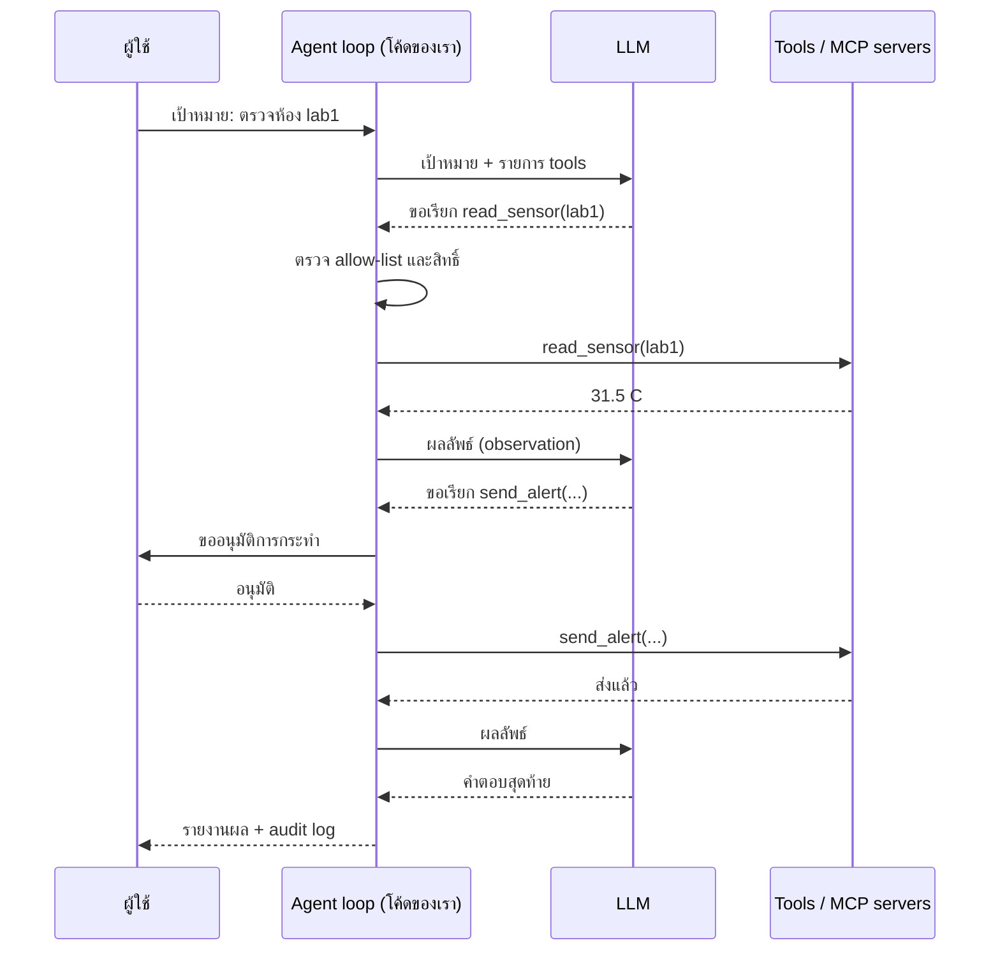

## 🎯 สิ่งที่จะได้เรียนรู้
- อธิบายความต่างระหว่าง **แชตบอต (chatbot)**, **workflow** และ **agent** ได้
- ระบุองค์ประกอบของ agent: **LLM + tools + memory + planning loop**
- เข้าใจแนวคิด **ReAct** (คิด → ทำ → สังเกต) และกลไก **tool use / function calling**
- อธิบายบทบาทของ **Model Context Protocol (MCP)** ในการเชื่อม AI กับระบบภายนอก
- ออกแบบ **guardrails**, **human-in-the-loop** และหลัก **least privilege** ให้ agent ได้

## 📖 เนื้อหาและคำอธิบาย

### 1. จาก "ผู้ตอบ" สู่ "ผู้ลงมือทำ"
แชตบอตทั่วไปรับคำถามแล้วตอบเป็นข้อความ จบในหนึ่งรอบ ส่วน **AI agent** รับ **เป้าหมาย** แล้ววางแผน เรียกเครื่องมือ ตรวจผล และทำซ้ำหลายรอบจนงานเสร็จ

เปรียบเทียบ: แชตบอตเหมือน **ผู้เชี่ยวชาญที่ตอบคำถามทางโทรศัพท์** ส่วน agent เหมือน **ผู้ช่วยที่ได้รับมอบหมายงาน** — ไปค้นข้อมูล เปิดไฟล์ กรอกแบบฟอร์ม แล้วกลับมารายงาน

บทความ *Building effective agents* ของ Anthropic (2024) แยกระบบ agentic ออกเป็น 2 แบบ:
- **Workflow** — LLM และเครื่องมือทำงานตาม **เส้นทางที่โปรแกรมเมอร์กำหนดไว้ล่วงหน้า** เช่น prompt chaining, routing, parallelization, orchestrator-workers, evaluator-optimizer
- **Agent** — LLM **ตัดสินใจเองแบบไดนามิก** ว่าจะทำขั้นตอนใดและใช้เครื่องมือใด

บทความเดียวกันแนะนำให้ **เริ่มจากวิธีที่ง่ายที่สุด** และเพิ่มความซับซ้อนเมื่อจำเป็นจริงเท่านั้น เพราะ agent ยิ่งอิสระยิ่งมีต้นทุน ความหน่วง และโอกาสผิดพลาดสะสมมากขึ้น

| ประเด็น | Chatbot | Workflow | Agent |
|---|---|---|---|
| ใครกำหนดขั้นตอน | ไม่มีขั้นตอน (ถาม-ตอบ) | โปรแกรมเมอร์ (fixed path) | LLM ตัดสินใจเอง |
| ใช้เครื่องมือ | ไม่มี / น้อย | ตามที่กำหนด | เลือกเองตามสถานการณ์ |
| จำนวนรอบ | 1 รอบ | คงที่ | ไม่แน่นอน (ต้องมีเพดาน) |
| คาดการณ์ได้ | สูง | สูง | ต่ำกว่า |
| เหมาะกับ | ถาม-ตอบทั่วไป | งานที่ขั้นตอนชัดเจน | งานเปิด ขั้นตอนเดาล่วงหน้าไม่ได้ |

### 2. องค์ประกอบของ Agent
1. **LLM (สมอง)** — ตีความเป้าหมาย ตัดสินใจขั้นต่อไป
2. **Tools (มือ)** — ฟังก์ชันที่เรียกได้ เช่น ค้นเว็บ query ฐานข้อมูล อ่าน sensor ส่งอีเมล รันโค้ด
3. **Memory (ความจำ)** — ระยะสั้น: ประวัติใน context window; ระยะยาว: บันทึกในไฟล์/ฐานข้อมูล/vector DB (ใช้ RAG ดึงกลับมา)
4. **Planning loop (วงจรควบคุม)** — โค้ดที่วนเรียก LLM → ทำตาม → ส่งผลกลับ จนเสร็จหรือถึงเพดานรอบ

### 3. ReAct: Reason + Act
**ReAct** (Yao et al., 2022) เสนอให้ LLM สลับระหว่าง **การให้เหตุผล (reasoning)** กับ **การลงมือ (acting)** แล้ว **สังเกตผล (observation)** ก่อนคิดต่อ:

```text
Thought:     ต้องรู้อุณหภูมิห้อง lab1 ก่อน
Action:      read_sensor(room="lab1")
Observation: 31.5 °C
Thought:     เกินเกณฑ์ 30 °C ควรแจ้งเตือน
Action:      send_alert("lab1 ร้อนเกิน 30°C")
Observation: ส่งแล้ว
Answer:      lab1 = 31.5 °C เกินเกณฑ์ และแจ้งเตือนแล้ว
```

ข้อดีคือ model ได้ข้อมูลจริงจากโลกภายนอกมาแก้ความเข้าใจระหว่างทาง แทนการเดาทั้งหมดในครั้งเดียว และมนุษย์อ่านร่องรอยการทำงานย้อนหลังได้

### 4. Tool Use / Function Calling ทำงานอย่างไร
จุดสำคัญที่มือใหม่มักเข้าใจผิด: **LLM ไม่ได้รันเครื่องมือเอง** ขั้นตอนจริงคือ
1. แอปพลิเคชันส่ง **รายการเครื่องมือ** (ชื่อ คำอธิบาย และ schema ของพารามิเตอร์ มักเป็น JSON Schema) ไปพร้อมข้อความ
2. LLM ตอบกลับเป็น **คำขอเรียกเครื่องมือแบบมีโครงสร้าง** เช่น `{"name": "read_sensor", "args": {"room": "lab1"}}`
3. **โค้ดของเรา** ตรวจสอบ แล้วจึงรันฟังก์ชันจริง
4. ส่งผลลัพธ์กลับเข้า context ให้ LLM ตัดสินใจขั้นต่อไป

ดังนั้น "ด่านตรวจ" ทั้งหมด (สิทธิ์ การอนุมัติ การบันทึก log) จึงอยู่ใน **โค้ดของเรา** ซึ่งเป็นจุดที่วิศวกรควบคุมได้ คำอธิบายเครื่องมือที่ชัดเจนก็สำคัญ เพราะ model เลือกใช้เครื่องมือจากชื่อและคำอธิบายเหล่านี้

### 5. Model Context Protocol (MCP): "USB-C สำหรับแอป AI"
ถ้าทุกแอป AI ต้องเขียนตัวเชื่อมกับทุกระบบเอง จะเกิดงานซ้ำซ้อนมหาศาล **MCP** เป็นมาตรฐานเปิด (open-source standard) สำหรับเชื่อมแอป AI กับระบบภายนอก เอกสารทางการเปรียบเทียบว่าเหมือน **พอร์ต USB-C** ที่ทำให้อุปกรณ์ต่าง ๆ เชื่อมกันด้วยมาตรฐานเดียว

| องค์ประกอบ | หน้าที่ |
|---|---|
| **MCP Host** | แอป AI ที่ผู้ใช้ใช้งาน เป็นผู้ประสานการเชื่อมต่อ |
| **MCP Client** | ส่วนประกอบในโฮสต์ที่รักษาการเชื่อมต่อกับเซิร์ฟเวอร์หนึ่งตัว |
| **MCP Server** | โปรแกรมที่เปิดให้ใช้ความสามารถ ทำงานได้ทั้งบนเครื่อง (local) และระยะไกล (remote) |
| Primitives ฝั่ง server | **Tools** (ฟังก์ชันที่สั่งทำงานได้), **Resources** (ข้อมูลบริบท), **Prompts** (แม่แบบคำสั่ง) |

ด้านเทคนิค MCP ใช้รูปแบบข้อความ **JSON-RPC 2.0** และรองรับการสื่อสารผ่าน **stdio** (โปรเซสบนเครื่องเดียวกัน) และ **Streamable HTTP** (เซิร์ฟเวอร์ระยะไกล) — เชื่อมกับเรื่อง protocol ใน [สัปดาห์ที่ 6: Computer Networks & Internet](/module/06)

> [!warning]
> การต่อ MCP server เท่ากับ **มอบสิทธิ์** ให้ agent เข้าถึงระบบนั้น ควรใช้เฉพาะเซิร์ฟเวอร์ที่เชื่อถือได้ ให้สิทธิ์เท่าที่จำเป็น และระวังว่าผลลัพธ์จากเครื่องมือก็อาจมีคำสั่งแฝง (prompt injection) ได้

### 6. Multi-Agent Systems
งานใหญ่อาจแบ่งให้หลาย agent ทำร่วมกัน เช่นรูปแบบ **orchestrator-workers**: agent หัวหน้าแตกงานย่อยให้ agent ลูกทีมแต่ละตัว (ค้นข้อมูล เขียนโค้ด ตรวจทาน) แล้วรวมผล เปรียบเหมือน **หัวหน้าโครงงานกับสมาชิกกลุ่ม** ข้อดีคือแต่ละตัวมี context สั้นและโฟกัส ข้อเสียคือต้นทุนสูงขึ้นและประสานงานยากขึ้น

### 7. Guardrails, Human-in-the-Loop และ Least Privilege
เมื่อ AI "ลงมือทำ" ได้ ความผิดพลาดจะไม่ใช่แค่ "ข้อความผิด" แต่เป็น "การกระทำผิด" เช่น ลบไฟล์ ส่งอีเมลผิดคน OWASP Top 10 for LLM Applications 2025 จัด **Excessive Agency (LLM06)** — การให้ระบบมีหน้าที่ สิทธิ์ หรือความอิสระมากเกินจำเป็น — เป็นความเสี่ยงสำคัญ แนวป้องกันหลัก:

| มาตรการ | ตัวอย่างในทางปฏิบัติ |
|---|---|
| **Least privilege** | ให้เครื่องมืออ่านอย่างเดียวถ้าไม่จำเป็นต้องเขียน; ใช้บัญชี/token ที่สิทธิ์จำกัดเฉพาะงาน |
| **Allow-list เครื่องมือ** | agent เรียกได้เฉพาะเครื่องมือที่ลงทะเบียนไว้ ตรวจพารามิเตอร์ตาม schema |
| **Human-in-the-loop** | การกระทำที่ย้อนกลับไม่ได้ (ส่ง ลบ จ่ายเงิน) ต้องให้มนุษย์กดอนุมัติ |
| **เพดานรอบ/งบประมาณ** | จำกัดจำนวนขั้น เวลา และจำนวน token กันวนไม่รู้จบ |
| **Sandboxing** | รันโค้ดที่ agent เขียนในสภาพแวดล้อมแยก (เช่น container) |
| **Audit log** | บันทึกทุก tool call และผลลัพธ์ เพื่อตรวจสอบย้อนหลัง |

## 🧩 ตัวอย่างประกอบ / Worked Example
**โจทย์:** สร้าง agent loop ขนาดเล็กที่ตรวจอุณหภูมิห้อง Lab และแจ้งเตือนเมื่อร้อนเกิน 30 °C โดยมีด่านควบคุม 3 ชั้น: allow-list, การขออนุมัติจากมนุษย์ และเพดานจำนวนรอบ

เพื่อให้รันได้โดยไม่ต้องมี API key เราใช้ `fake_llm` จำลองการตัดสินใจของ LLM (ของจริงคือการเรียก API พร้อมแนบรายการเครื่องมือ)

```python
# ---------- เครื่องมือ (tools) ที่ agent ได้รับอนุญาตให้ใช้ ----------
def read_sensor(room):
    data = {"lab1": 31.5, "lab2": 26.0}          # ค่าจำลองจาก ESP32
    return {"room": room, "temp_c": data.get(room)}

def send_alert(message):
    return {"status": "sent", "message": message}

TOOLS = {"read_sensor": read_sensor, "send_alert": send_alert}
NEEDS_APPROVAL = {"send_alert"}                  # เครื่องมือที่มีผลข้างเคียง ต้องให้คนอนุมัติ
MAX_STEPS = 5                                    # กัน agent วนไม่รู้จบ

# ---------- "LLM" จำลอง: ของจริงคือการเรียก API พร้อมแนบรายการ tools ----------
def fake_llm(history):
    last = history[-1]
    if last["role"] == "user":
        return {"type": "tool_call", "name": "read_sensor", "args": {"room": "lab1"}}
    if last.get("tool") == "read_sensor" and last["result"]["temp_c"] > 30:
        return {"type": "tool_call", "name": "send_alert",
                "args": {"message": "lab1 ร้อนเกิน 30°C"}}
    return {"type": "final", "text": "ตรวจแล้ว lab1 = 31.5°C เกินเกณฑ์ และแจ้งเตือนแล้ว"}

def human_approves(name, args):
    print(f"  [ขออนุมัติ] {name}({args}) -> อนุมัติ")
    return True                                  # ในระบบจริงต้องรอคนกดยืนยัน

# ---------- Agent loop: คิด -> เรียกเครื่องมือ -> สังเกตผล -> วนซ้ำ ----------
history = [{"role": "user", "content": "ห้อง lab1 ร้อนเกินไปไหม ถ้าใช่ให้แจ้งเตือน"}]
for step in range(1, MAX_STEPS + 1):
    action = fake_llm(history)
    if action["type"] == "final":
        print(f"step {step}: คำตอบสุดท้าย -> {action['text']}")
        break
    name, args = action["name"], action["args"]
    if name not in TOOLS:                        # allow-list: ไม่รู้จัก = ไม่ทำ
        print(f"step {step}: ปฏิเสธเครื่องมือ {name}")
        break
    if name in NEEDS_APPROVAL and not human_approves(name, args):
        break
    result = TOOLS[name](**args)
    print(f"step {step}: {name}({args}) -> {result}")
    history.append({"role": "tool", "tool": name, "result": result})
```

```output
step 1: read_sensor({'room': 'lab1'}) -> {'room': 'lab1', 'temp_c': 31.5}
  [ขออนุมัติ] send_alert({'message': 'lab1 ร้อนเกิน 30°C'}) -> อนุมัติ
step 2: send_alert({'message': 'lab1 ร้อนเกิน 30°C'}) -> {'status': 'sent', 'message': 'lab1 ร้อนเกิน 30°C'}
step 3: คำตอบสุดท้าย -> ตรวจแล้ว lab1 = 31.5°C เกินเกณฑ์ และแจ้งเตือนแล้ว
```

**สังเกต:** `read_sensor` (อ่านอย่างเดียว) ทำงานได้ทันที แต่ `send_alert` (มีผลข้างเคียงต่อโลกภายนอก) ต้องผ่านการอนุมัติก่อน และ `MAX_STEPS` รับประกันว่าแม้ LLM จะสับสน loop ก็จะหยุดภายใน 5 รอบ ลองแก้ `fake_llm` ให้ขอเรียกเครื่องมือชื่อ `delete_all_data` แล้วดูว่า allow-list หยุดมันได้อย่างไร

## 🗺️ แผนภาพสรุป


## ⚠️ ความเข้าใจผิดที่พบบ่อย
- **"LLM รันเครื่องมือเองได้"** — LLM แค่ **ขอ** เรียกเครื่องมือ โค้ดของแอปเป็นผู้ตัดสินใจและรันจริง จึงเป็นจุดที่ต้องใส่การตรวจสอบ
- **"ยิ่ง agent อิสระมากยิ่งดี"** — งานที่ขั้นตอนชัดเจน workflow ธรรมดามักถูกกว่า เร็วกว่า และคาดการณ์ได้มากกว่า ความอิสระควรเพิ่มเมื่อจำเป็นเท่านั้น
- **"ใส่คำว่า 'ห้ามทำสิ่งอันตราย' ใน prompt ก็ปลอดภัยแล้ว"** — prompt ถูกหลอกหรือเพิกเฉยได้ การควบคุมที่เชื่อถือได้ต้องอยู่ใน **โค้ดและสิทธิ์ของระบบ** เช่น allow-list และ token ที่สิทธิ์จำกัด
- **"MCP คือ AI model ตัวหนึ่ง"** — MCP เป็น **protocol** สำหรับเชื่อมต่อ ไม่ใช่ model และไม่ได้กำหนดว่าแอปจะใช้ LLM อย่างไร
- **"Agent มีความจำถาวรในตัว"** — ความจำระยะยาวต้องถูกออกแบบเพิ่ม เช่นเก็บลงฐานข้อมูลแล้วดึงกลับด้วย RAG

## 🔗 เชื่อมโยงกับรายวิชา
- แผนสัปดาห์: [สัปดาห์ที่ 10: Generative AI & Modern Robotics](/module/10) · แนวคิด: [Agentic AI](/concept/agentic-ai) · [RAG และ LLM](/concept/rag-llm) · [Vector Database](/concept/vector-database) (ความจำระยะยาว)
- โครงสร้าง loop, ฟังก์ชัน และการจัดการ error: [สัปดาห์ที่ 4: Algorithms & Programming Paradigms](/module/04)
- Protocol, API และ JSON-RPC: [สัปดาห์ที่ 6: Computer Networks & Internet](/module/06)
- สิทธิ์การเข้าถึง, least privilege, audit log: [สัปดาห์ที่ 12: Cybersecurity & Trust Architecture](/module/12)
- ความรับผิดชอบเมื่อ AI ลงมือทำแทนมนุษย์: [สัปดาห์ที่ 13: Computer Ethics & Intellectual Property](/module/13)
- **Mini-Project 3 "Smart Environment Monitor"** ([Lab 10 - GenAI API and ESP32 Sensors](/lab/10)): ออกแบบ agent ที่มีเครื่องมือ `read_sensor` (อ่านอย่างเดียว) และ `summarize_with_genai` สรุปสภาพห้อง ส่วนการแจ้งเตือนหรือสั่งเปิดพัดลมให้ผ่านการอนุมัติหรือกฎที่โปรแกรมไว้ตายตัว

## ❓ คำถามทบทวน
1. Agentic AI ต่างจากแชตบอตทั่วไปอย่างไร
<details><summary>ดูแนวคำตอบ</summary>

แชตบอตรับคำถามแล้วตอบเป็นข้อความในรอบเดียว ส่วน agent รับเป้าหมาย แล้ววางแผน เรียกเครื่องมือ สังเกตผล และวนซ้ำหลายรอบจนงานเสร็จ โดย LLM เป็นผู้ตัดสินใจขั้นตอนต่อไปเอง ทำให้ทำงานหลายขั้นตอนในโลกจริงได้ แต่ก็ต้องมีการควบคุมมากขึ้น
</details>

2. อธิบายขั้นตอนของ function calling และบอกว่าควรวางด่านตรวจความปลอดภัยไว้ที่ใด
<details><summary>ดูแนวคำตอบ</summary>

แอปส่งรายการเครื่องมือพร้อม schema ให้ LLM → LLM ตอบเป็นคำขอเรียกเครื่องมือแบบมีโครงสร้าง → โค้ดของแอปตรวจสอบแล้วรันฟังก์ชันจริง → ส่งผลกลับให้ LLM ด่านตรวจ (allow-list, ตรวจพารามิเตอร์, ขออนุมัติ, log) ควรอยู่ในโค้ดของแอประหว่างขั้นที่ LLM ขอและขั้นที่รันจริง
</details>

3. MCP คืออะไร และองค์ประกอบ host / client / server ทำหน้าที่อะไร
<details><summary>ดูแนวคำตอบ</summary>

MCP เป็นมาตรฐานเปิดสำหรับเชื่อมแอป AI กับระบบภายนอก (เปรียบเหมือน USB-C) Host คือแอป AI ที่ประสานการเชื่อมต่อ, client คือส่วนในโฮสต์ที่ดูแลการเชื่อมต่อกับเซิร์ฟเวอร์หนึ่งตัว, server คือโปรแกรมที่เปิดให้ใช้ tools, resources และ prompts
</details>

4. จงเสนอ guardrails อย่างน้อย 3 ข้อสำหรับ agent ที่ส่งอีเมลแทนผู้ใช้ได้
<details><summary>ดูแนวคำตอบ</summary>

เช่น (1) ให้มนุษย์อนุมัติก่อนส่งทุกครั้ง (human-in-the-loop) (2) least privilege — ส่งได้เฉพาะผู้รับในโดเมนที่อนุญาต และไม่มีสิทธิ์ลบอีเมล (3) เพดานจำนวนอีเมลต่อชั่วโมง (4) audit log ทุกการส่ง (5) ถือว่าเนื้อหาอีเมลที่อ่านเข้ามาเป็นข้อมูลไม่น่าเชื่อถือ ไม่ทำตามคำสั่งที่ฝังอยู่
</details>

5. เมื่อใดควรใช้ workflow แทน agent
<details><summary>ดูแนวคำตอบ</summary>

เมื่องานมีขั้นตอนชัดเจนและคาดการณ์ได้ล่วงหน้า เช่น "อ่าน sensor → สรุป → บันทึก" ทุกชั่วโมง workflow ที่กำหนดเส้นทางไว้จะถูกกว่า เร็วกว่า ทดสอบง่าย และคาดการณ์ผลได้ ส่วน agent เหมาะกับงานเปิดที่ไม่รู้ล่วงหน้าว่าต้องกี่ขั้นตอน
</details>

## 📚 แหล่งอ้างอิง
- Anthropic. (2024, December 19). *Building effective agents.* https://www.anthropic.com/engineering/building-effective-agents
- Anthropic. *Writing effective tools for AI agents—using AI agents.* https://www.anthropic.com/engineering/writing-tools-for-agents
- Yao, S., Zhao, J., Yu, D., et al. (2022). *ReAct: Synergizing Reasoning and Acting in Language Models.* arXiv:2210.03629. https://arxiv.org/abs/2210.03629
- Model Context Protocol. *What is the Model Context Protocol (MCP)?* และ *Architecture overview.* https://modelcontextprotocol.io/docs/getting-started/intro · https://modelcontextprotocol.io/docs/learn/architecture
- OWASP GenAI Security Project. *OWASP Top 10 for LLM Applications 2025* (LLM06: Excessive Agency). https://genai.owasp.org/llm-top-10/
