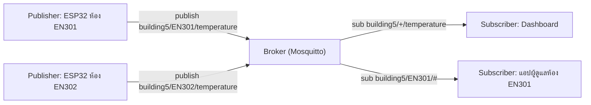

ในการพัฒนาระบบ IoT การเลือกโปรโตคอลการสื่อสารข้อมูลเป็นเรื่องของศิลปะและวิศวกรรมที่ต้องหาจุดสมดุล (Trade-off) ระหว่างประสิทธิภาพ ความน่าเชื่อถือ และทรัพยากรที่มีจำกัด โปรโตคอลอินเทอร์เน็ตดั้งเดิมอย่าง HTTP มีขนาดของส่วนหัว (Header) ใหญ่เกินไป การรักษาการเชื่อมต่อและการบริโภคพลังงานจึงไม่ตอบโจทย์อุปกรณ์ขนาดเล็ก ด้วยเหตุนี้ มาตรฐานโปรโตคอลเฉพาะทางอย่าง MQTT, CoAP และ Zigbee จึงถูกพัฒนาขึ้นมาเพื่อปิดจุดอ่อนเหล่านี้

## 1. MQTT (Message Queuing Telemetry Transport)
MQTT เป็นโปรโตคอลในระดับแอปพลิเคชัน (Application Layer) ที่ทำงานอยู่บนสแตก TCP/IP ได้รับการยอมรับให้เป็นมาตรฐานหลักทางอุตสาหกรรม (OASIS Standard)
- **โมเดลการทำงาน**: ใช้สถาปัตยกรรมแบบ **Publish / Subscribe (Pub-Sub)** อุปกรณ์ (Client) ไม่จำเป็นต้องรู้ที่อยู่ IP ของกันและกัน แต่จะสื่อสารผ่านเซิร์ฟเวอร์ตัวกลางที่เรียกว่า **Broker** โดยอ้างอิงผ่านเส้นทางข้อมูล หรือ "Topic" (ตัวอย่างเช่น `building1/floor2/temperature`)
- **การรับประกันการส่งข้อมูล (Quality of Service - QoS)**: เป็นฟีเจอร์เด่นของ MQTT ที่ให้วิศวกรเลือกระดับความน่าเชื่อถือได้ 3 ระดับ:
  - **QoS 0**: ส่งเพียงครั้งเดียว (At most once / Fire-and-forget) ไม่มีการยืนยันการรับ ใช้แบนด์วิดท์ต่ำสุด
  - **QoS 1**: ส่งจนกว่าจะได้รับการยืนยัน (At least once) มั่นใจได้ว่าข้อมูลถึงแน่ แต่อาจเกิดข้อมูลซ้ำซ้อน
  - **QoS 2**: ส่งถึงเป้าหมายและแน่ใจว่าได้รับเพียงข้อความเดียว (Exactly once) ใช้แบนด์วิดท์สูงสุด เหมาะกับข้อมูลด้านการเงินหรือคำสั่งเครื่องจักรที่ห้ามซ้ำ
- **ความเหมาะสม**: เหมาะกับระบบที่มีการสตรีมข้อมูลบ่อยๆ, ระบบที่ต้องการผ่าน Firewall ได้ง่าย และเครือข่ายที่ไม่เสถียร

### 1.1 บทบาทของผู้เกี่ยวข้องใน MQTT

| บทบาท | หน้าที่ | ตัวอย่าง |
|---|---|---|
| **Publisher** | ส่ง (publish) ข้อความไปยัง Topic หนึ่ง โดยไม่ต้องรู้ว่าใครรับ | ESP32 ที่อ่านอุณหภูมิแล้วส่งไปที่ `building5/EN301/temperature` |
| **Subscriber** | สมัครรับ (subscribe) Topic ที่สนใจ แล้วรับข้อความเมื่อมีผู้ส่งเข้ามา | Dashboard, แอปมือถือ, สคริปต์บันทึกลงฐานข้อมูล |
| **Broker** | เซิร์ฟเวอร์ตัวกลางที่รับข้อความทั้งหมด แล้วกระจาย (route) ไปยัง Subscriber ที่ Topic ตรงกัน | Eclipse Mosquitto, HiveMQ, EMQX |
| **Topic** | ชื่อช่องทางแบบลำดับชั้น (hierarchical) คั่นด้วย `/` ใช้จับคู่ผู้ส่งกับผู้รับ | `building5/EN301/humidity` |

> [!note] Client หนึ่งตัวเป็นได้ทั้งสองบทบาท
> อุปกรณ์เดียวกันเป็นได้ทั้ง Publisher (ส่งค่าเซนเซอร์) และ Subscriber (รอรับคำสั่งเปิด/ปิดรีเลย์) พร้อมกัน — Publisher กับ Subscriber ไม่ได้เชื่อมต่อกันโดยตรง (decoupled) ทุกข้อความผ่าน Broker



### 1.2 การออกแบบลำดับชั้น Topic และ Wildcard

Topic แบ่งเป็นระดับ (level) ด้วยเครื่องหมาย `/` เช่น `building5/EN301/temperature` มี 3 ระดับ คือ อาคาร → ห้อง → ชนิดข้อมูล Topic แยกตัวพิมพ์เล็ก/ใหญ่ (case-sensitive) Publisher ต้องส่งไปยัง Topic ที่ระบุชัดเจนเสมอ ส่วน **wildcard ใช้ได้เฉพาะตอน subscribe** (ใน Topic Filter) เท่านั้น

| Wildcard | ความหมาย | กฎ | ตัวอย่าง |
|---|---|---|---|
| `+` | Single-level: แทน **หนึ่งระดับพอดี** | ต้องอยู่เต็มระดับ เช่น `building5/+/temperature` (เขียน `EN+` ไม่ได้) | `building5/+/temperature` = อุณหภูมิทุกห้องในอาคาร 5 |
| `#` | Multi-level: แทน **ระดับนี้และทุกระดับย่อยที่ตามมา** | ต้องเป็นตัวอักษร **ตัวสุดท้าย** ของ filter และอยู่เต็มระดับ (`building5/#` ถูก, `building5/#/temperature` ผิด) | `building5/#` = ทุกข้อความของอาคาร 5 |

**ตัวอย่างการออกแบบ:** ห้อง EN301 ในอาคาร 5 มีเซนเซอร์ 2 ตัว ส่งข้อมูลไปที่
- `building5/EN301/temperature`
- `building5/EN301/humidity`

และห้องข้างเคียง EN302 ส่ง `building5/EN302/temperature`

| Subscription (Topic Filter) | `building5/EN301/temperature` | `building5/EN301/humidity` | `building5/EN302/temperature` |
|---|:---:|:---:|:---:|
| `building5/EN301/temperature` | ✔ | ✘ | ✘ |
| `building5/EN301/+` | ✔ | ✔ | ✘ |
| `building5/+/temperature` | ✔ | ✘ | ✔ |
| `building5/EN301/#` | ✔ | ✔ | ✘ |
| `building5/#` | ✔ | ✔ | ✔ |
| `+/+/humidity` | ✘ | ✔ | ✘ |
| `building5/+` | ✘ | ✘ | ✘ |

> [!warning] จุดที่มักพลาด
> - `building5/+` จับได้เฉพาะ Topic ที่มี **2 ระดับพอดี** จึงไม่ตรงกับ `building5/EN301/temperature` (3 ระดับ)
> - ตามข้อกำหนด MQTT `building5/#` จับ Topic `building5` (ระดับแม่) ได้ด้วย
> - Topic ที่ขึ้นต้นด้วย `$` (เช่น `$SYS/...` ซึ่งเป็นสถิติของ Broker) จะไม่ถูกจับโดย filter ที่ขึ้นต้นด้วย `#` หรือ `+`
> - หลีกเลี่ยงการขึ้นต้นด้วย `/` (เช่น `/building5/...`) เพราะจะเกิดระดับว่างเพิ่มหนึ่งระดับ และไม่ตรงกับ `building5/...`

ตัวอย่างการทดลองด้วยเครื่องมือของ Mosquitto:

```bash
# Terminal 1: สมัครรับอุณหภูมิทุกห้องในอาคาร 5 (-v = แสดงชื่อ topic ด้วย)
mosquitto_sub -h localhost -t "building5/+/temperature" -v

# Terminal 2: ส่งค่าจากห้อง EN301
mosquitto_pub -h localhost -t "building5/EN301/temperature" -m "27.5"
mosquitto_pub -h localhost -t "building5/EN301/humidity" -m "61"
```

ผลลัพธ์ที่ Terminal 1 (ตัวอย่าง):

```output
building5/EN301/temperature 27.5
```

ข้อความ humidity ไม่แสดง เพราะไม่ตรงกับ filter `building5/+/temperature`

### 1.3 เปรียบเทียบ MQTT กับ HTTP

| ประเด็น | MQTT | HTTP (REST) |
|---|---|---|
| รูปแบบการสื่อสาร | Publish/Subscribe ผ่าน Broker (หนึ่งต่อหลาย) | Request/Response ระหว่าง Client กับ Server (หนึ่งต่อหนึ่ง) |
| Header overhead | Fixed header เล็กมาก ขั้นต่ำ **2 byte** (binary) | Header เป็นข้อความ (text) มักหลายร้อย byte ต่อ request |
| การเชื่อมต่อ | เปิด TCP ค้างไว้ (persistent) พร้อม keep-alive | เชื่อมต่อแบบ request ต่อ request (อาจใช้ keep-alive ช่วงสั้น) |
| การได้ข้อมูลใหม่ | **Push** — Broker ส่งให้ทันทีเมื่อมีข้อความ | **Poll** — Client ต้องถามซ้ำ ๆ (หรือเสริมด้วย WebSocket/SSE) |
| ความน่าเชื่อถือ | QoS 0/1/2, retained message, Last Will | อาศัย TCP และการ retry ของแอปเอง |
| เหมาะกับ | Telemetry เซนเซอร์จำนวนมาก, เครือข่ายไม่เสถียร, แจ้งเตือนแบบ real-time | Web/Mobile API, CRUD ข้อมูล, ดาวน์โหลดไฟล์, บริการที่ต้องมี URL ชัดเจน |

<details><summary>ดูเฉลย: ถ้าต้องการรับ "ทุกค่าของห้อง EN301 เท่านั้น" ควร subscribe อะไร</summary>

ใช้ `building5/EN301/#` (หรือ `building5/EN301/+` หากทุก Topic มีแค่ 3 ระดับ) ส่วน `building5/#` กว้างเกินไปเพราะได้ข้อมูลทุกห้องในอาคาร
</details>

## 2. CoAP (Constrained Application Protocol)
CoAP คือโปรโตคอลที่ถูกออกแบบมาโดย IETF ให้เป็นเสมือน "HTTP ย่อส่วน" สำหรับอุปกรณ์ Constrained Devices โดยทำงานอยู่บน **UDP** แทน TCP
- **โมเดลการทำงาน**: ใช้โครงสร้างแบบ **Request / Response** เหมือน HTTP รองรับคำสั่ง RESTful API มาตรฐาน (GET, POST, PUT, DELETE) และมี URI ให้เข้าถึงข้อมูลได้โดยตรง
- **จุดเด่นทางวิศวกรรม**: การเลือกใช้ UDP ทำให้ไม่ต้องเสียเวลาและแบนด์วิดท์ไปกับกระบวนการ 3-Way Handshake แบบ TCP แถมยังใช้ระบบการบีบอัด Header ข้อมูล และเพื่อชดเชยความน่าเชื่อถือที่หายไปของ UDP ตัว CoAP เองมีกลไก Confirmable Message ภายในตัว
- **ความเหมาะสม**: เหมาะสำหรับเครือข่าย Low-Power Lossy Networks (LLNs) ที่มีแบนด์วิดท์ต่ำเป็นพิเศษ แบนด์วิดท์ไม่แน่นอน หรือระบบฝังตัวแบตเตอรี่เล็กที่ต้องการสื่อสารด้วยรูปแบบ REST

## 3. Zigbee (IEEE 802.15.4)
ในขณะที่ MQTT และ CoAP สนใจเฉพาะ Application Layer โปรโตคอล **Zigbee** ถือเป็นโปรโตคอลแบบครบวงจร (Full Stack) ที่ครอบคลุมตั้งแต่ชั้น Physical Layer ไปจนจบที่ Application Layer โดยอิงตามมาตรฐานเครือข่ายไร้สายระยะสั้น IEEE 802.15.4
- **โมเดลการทำงาน**: ความโดดเด่นสูงสุดคือการสร้างเครือข่ายแบบ **Mesh Topology (เครือข่ายตาข่าย)** โหนด (Node) แต่ละตัวในระบบจะทำหน้าที่เป็น Router ช่วยส่งทอดสัญญาณข้อมูลให้กันและกันไปจนถึงจุดหมาย ทำให้เครือข่ายมีความทนทาน หากโหนดหนึ่งเสีย โหนดอื่นจะหาเส้นทางใหม่เพื่อส่งต่อข้อมูลได้เองโดยอัตโนมัติ (Self-healing Route)
- **จุดเด่นทางวิศวกรรม**: อัตราการใช้พลังงานที่ต่ำมาก (Ultra-low Power Consumption) เซนเซอร์ที่เป็น End-device สามารถเข้าโหมด Deep Sleep และใช้พลังงานจากถ่านกระดุม (Coin-cell battery) ได้นาน 1-2 ปี
- **ความเหมาะสม**: การวางระบบ Smart Home ครบวงจร, โคมไฟอัจฉริยะ, และ Building Automation ที่ต้องการจำนวนโหนดหนาแน่นในพื้นที่ปิด

**บทสรุปการตัดสินใจ:** ในการออกแบบระบบสถาปัตยกรรม วิศวกรคอมพิวเตอร์พึงจำไว้เสมอว่า "ไม่มีโปรโตคอลใดดีที่สุด" MQTT เก่งด้านความน่าเชื่อถือและความยืดหยุ่นผ่านอินเทอร์เน็ต CoAP เก่งด้านความเบาและการจำลองสถาปัตยกรรมเว็บมาใช้อุปกรณ์ขนาดเล็ก และ Zigbee เก่งเรื่องเครือข่าย Mesh พลังงานต่ำในพื้นที่กายภาพ การเลือกโปรโตคอลที่ถูกต้องจึงเป็นขั้นตอนแรกสู่ความสำเร็จของโปรเจกต์ IoT
