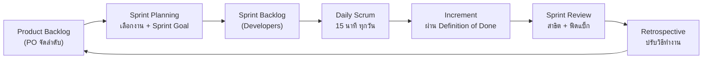

ในอุตสาหกรรมเทคโนโลยีที่มีการแข่งขันสูง ความเร็วในการปรับตัวและตอบสนองความต้องการของตลาด (Time to Market) คือความได้เปรียบที่สำคัญที่สุด ด้วยเหตุนี้ รูปแบบการทำงานดั้งเดิมจึงถูกท้าทาย และนำไปสู่การเกิดแนวคิด **Agile** ที่ต่อยอดไปสู่การเกิดวัฒนธรรม **DevOps** แบบเบ็ดเสร็จ

## 1. ปรัชญาการทำงานแบบ Agile (ความคล่องตัว)

Agile ไม่ใช่โปรแกรมหรือเทคโนโลยี แต่เป็น **"ระบบความเชื่อ" (Mindset)** ที่มุ่งเน้นความคล่องตัว ความยืดหยุ่น และคุณค่าที่ผู้ใช้จะได้รับ โดยมีรากฐานมาจาก Agile Manifesto ที่ปฏิเสธเอกสารอันหนาเตอะและการวางแผนที่ตายตัว 

หลักการสำคัญของ Agile ได้แก่:
- ให้ความสำคัญกับการสื่อสารระหว่างบุคคล มากกว่ากระบวนการที่แข็งทื่อ
- เน้นสร้างซอฟต์แวร์ที่ทำงานได้จริงอย่างรวดเร็ว ให้ลูกค้าเห็นผลลัพธ์ต่อเนื่อง
- ยินดีต้อนรับความเปลี่ยนแปลง แม้ในช่วงท้ายของการพัฒนา

**Scrum** เป็นเฟรมเวิร์กของ Agile ที่ได้รับความนิยมสูงสุด แบ่งงานเป็นรอบการพัฒนาสั้นๆ ที่เรียกว่า **Sprint** (ปกติ 2-4 สัปดาห์) มีกระบวนการยืนคุยกันสั้นๆ ทุกวัน (Daily Stand-up) เพื่อตรวจเช็กความคืบหน้า และมีการทบทวนผลลัพธ์ (Sprint Review) ทำให้ทีมประเมินสถานการณ์และปรับพวงมาลัยทิศทางโปรเจกต์ได้ทันท่วงที นอกจากนี้ยังมีเครื่องมืออย่าง **Kanban** ที่ช่วยทำให้เห็นภาพรวมของงาน (Workflow) ลดคอขวดในกระบวนการทำงานได้อย่างมีประสิทธิภาพ

## 1.1 บทบาทใน Scrum (Scrum Roles / Accountabilities)

**Scrum Team** คือทีมเล็ก ๆ หนึ่งทีม (โดยทั่วไปไม่เกิน 10 คน) ที่ไม่มีลำดับขั้นภายในและไม่แบ่งเป็นทีมย่อย ทุกคนมุ่งไปที่ **เป้าหมายผลิตภัณฑ์ (Product Goal)** เดียวกัน Scrum Guide ฉบับปี 2020 กำหนด **ความรับผิดชอบ (accountabilities)** ไว้ 3 แบบ

| บทบาท | รับผิดชอบเรื่อง | สิ่งที่ทำจริง | สิ่งที่ **ไม่ใช่** |
|---|---|---|---|
| **Product Owner (PO)** | เพิ่มคุณค่าสูงสุดของผลิตภัณฑ์ | กำหนดและสื่อสาร Product Goal · เขียนและจัดลำดับความสำคัญของ **Product Backlog** · ตัดสินใจว่าจะทำอะไรก่อน-หลัง | ไม่ใช่คณะกรรมการ (ต้องเป็น **คนเดียว**) และไม่ใช่คนสั่งว่าต้องเขียนโค้ดอย่างไร |
| **Scrum Master (SM)** | ประสิทธิผลของทีม Scrum | สอนและโค้ชให้ทีมใช้ Scrum ได้ถูก · ช่วยขจัดอุปสรรค (impediment) · ดูแลให้ event ต่าง ๆ เกิดขึ้นและได้ผล · ช่วย PO ดูแล Backlog | ไม่ใช่หัวหน้าหรือผู้จัดการโครงการที่สั่งงาน แต่เป็น **ผู้นำแบบรับใช้ (servant leader)** |
| **Developers** | สร้างส่วนเพิ่มของงานที่ใช้งานได้จริง (**Increment**) ทุก Sprint | วางแผน **Sprint Backlog** · ทำงานให้ผ่าน **Definition of Done** · ปรับแผนทุกวันใน Daily Scrum · รับผิดชอบคุณภาพร่วมกัน | ไม่ได้หมายถึงโปรแกรมเมอร์อย่างเดียว ผู้ทดสอบ นักออกแบบ วิศวกรฮาร์ดแวร์ ก็คือ Developers |

> [!tip] จำง่าย ๆ
> **PO ตอบว่า "ทำอะไร และทำอะไรก่อน" (What & Why)** · **Developers ตอบว่า "ทำอย่างไร" (How)** · **Scrum Master ดูแลให้ "วิธีทำงานแบบ Scrum ได้ผล"**

### อีเวนต์และอาร์ทิแฟกต์ที่แต่ละบทบาทใช้

| อีเวนต์ (Event) | ระยะเวลาสูงสุด (Sprint 1 เดือน) | ใครเป็นหลัก | ผลลัพธ์ |
|---|---|---|---|
| **Sprint** | ไม่เกิน 1 เดือน | ทั้งทีม | Increment ที่ผ่าน Definition of Done |
| **Sprint Planning** | 8 ชั่วโมง | ทั้งทีม (PO เสนอเป้าหมาย Developers เลือกงาน) | Sprint Goal + Sprint Backlog |
| **Daily Scrum** | 15 นาที | Developers | แผนงานของวันถัดไป |
| **Sprint Review** | 4 ชั่วโมง | ทั้งทีม + ผู้มีส่วนได้ส่วนเสีย | ฟีดแบ็ก และปรับ Product Backlog |
| **Sprint Retrospective** | 3 ชั่วโมง | ทั้งทีม (SM ช่วยดำเนินการ) | สิ่งที่จะปรับปรุงวิธีทำงานใน Sprint ถัดไป |

ถ้า Sprint สั้นกว่า 1 เดือน event อื่น ๆ (ยกเว้น Daily Scrum) มักใช้เวลาสั้นลงตามสัดส่วน

| อาร์ทิแฟกต์ (Artifact) | ใครดูแล | ข้อผูกมัด (Commitment) |
|---|---|---|
| **Product Backlog** — รายการทุกสิ่งที่ผลิตภัณฑ์ต้องมี เรียงตามความสำคัญ | Product Owner | **Product Goal** |
| **Sprint Backlog** — งานที่เลือกมาทำใน Sprint นี้ + แผนการทำ | Developers | **Sprint Goal** |
| **Increment** — ส่วนของผลิตภัณฑ์ที่เสร็จและใช้งานได้ | Developers | **Definition of Done** |

### ตัวอย่าง: ใช้ Scrum กับโครงงานประยุกต์ของทีม 5 คน

| สมาชิก | บทบาท | ตัวอย่างงานใน Sprint (2 สัปดาห์) |
|---|---|---|
| คนที่ 1 | **Product Owner** (ทำงานเป็น Developer ด้วยได้ในทีมนักศึกษา) | เขียน user story เช่น "ในฐานะเจ้าหน้าที่ ฉันต้องการเห็นอุณหภูมิห้องแบบเรียลไทม์" และจัดลำดับ Backlog หลังคุยกับอาจารย์ (ผู้มีส่วนได้ส่วนเสีย) |
| คนที่ 2 | **Scrum Master** (และเป็น Developer ด้วย) | นัด Daily Scrum 15 นาที, ติดตามว่าใครติดปัญหาเรื่องบอร์ด ESP32 แล้วช่วยหาทางออก, ดำเนินการ Retrospective |
| คนที่ 3–5 | **Developers** | ต่อเซนเซอร์และ MQTT, ทำ Dashboard, เขียนเทสต์ใน CI/CD ให้งานผ่าน Definition of Done |

ตัวอย่าง **Definition of Done** ของทีม: โค้ดอยู่ใน `main` ผ่าน pull request ที่มีคนรีวิว · CI รันเทสต์ผ่าน · deploy ขึ้นเว็บได้ · README อัปเดตแล้ว

> [!warning] ความเข้าใจผิดที่พบบ่อย
> - **"Scrum Master คือหัวหน้าทีม"** — ผิด SM ไม่สั่งงาน แต่ช่วยให้ทีมจัดการตัวเองได้ (self-managing)
> - **"PO หลายคนช่วยกันตัดสินใจ"** — ผิด PO ต้องเป็นคนเดียว แม้จะรับฟังผู้มีส่วนได้ส่วนเสียหลายคน
> - **"Daily Scrum คือการรายงานความคืบหน้าให้หัวหน้า"** — ผิด เป็นการที่ Developers วางแผนร่วมกันเพื่อไปสู่ Sprint Goal
> - **"Sprint Review กับ Retrospective เหมือนกัน"** — ผิด Review ตรวจ **ผลงาน** ส่วน Retrospective ตรวจ **วิธีทำงาน**

คำถามทบทวน: Scrum Roles

1. **ใครเป็นผู้จัดลำดับความสำคัญของ Product Backlog** — Product Owner
2. **ใครรับผิดชอบสร้าง Increment ที่ผ่าน Definition of Done** — Developers
3. **ทีมพบว่ารออนุมัติเครื่องเซิร์ฟเวอร์จากฝ่ายไอทีนานจนงานหยุด ใครควรช่วยขจัดอุปสรรคนี้** — Scrum Master
4. **Daily Scrum ใช้เวลาเท่าใดและเพื่ออะไร** — 15 นาที ให้ Developers ตรวจความคืบหน้าสู่ Sprint Goal และปรับแผนของวันถัดไป
5. **อาร์ทิแฟกต์ใดมี Sprint Goal เป็นข้อผูกมัด** — Sprint Backlog

**อ้างอิง:** Schwaber, K., & Sutherland, J. (2020). *The Scrum Guide.* [scrumguides.org](https://scrumguides.org/scrum-guide.html)

## 2. การผสานสปิริต Agile สู่ DevOps

Agile ประสบความสำเร็จอย่างมากในการทำให้ทีม Developer เขียนโค้ดได้อย่างรวดเร็วและตรงใจลูกค้า แต่ปัญหาคอขวดใหม่ดันไปตกอยู่ที่ทีม Operations (ผู้ดูแลเซิร์ฟเวอร์) ที่กังวลว่าการเปลี่ยนโค้ดบ่อยๆ จะทำให้ระบบร่ม 

**DevOps (Development + Operations)** จึงก้าวเข้ามาเพื่ออุดช่องโหว่นี้ เป้าหมายของ DevOps คือการสร้างวงจรชีวิตแอปพลิเคชันที่ไร้รอยต่อ โดยอิงจากหลักการที่เรียกว่า **CALMS**:
- **C - Culture:** การสร้างวัฒนธรรมร่วมกันระหว่างทีม ไม่โทษกันเมื่อเกิดความผิดพลาด (Blameless Culture)
- **A - Automation:** ใช้กระบวนการอัตโนมัติทำงานซ้ำซากแทนมนุษย์ เช่น ระบบ CI/CD, Automated Testing รวมถึงการทำ Infrastructure as Code (IaC) ที่มองเซิร์ฟเวอร์เป็นเหมือนโค้ด
- **L - Lean:** ตัดทอนสิ่งที่ไร้ค่าออกไป ส่งมอบงานทีละชิ้นเล็กๆ แต่บ่อยครั้ง (Small Batches)
- **M - Measurement:** ใช้ข้อมูล (Data-driven) ตรวจวัดประสิทธิผล เก็บ Log คอย Monitor ทุกองค์ประกอบของระบบ
- **S - Sharing:** วัฒนธรรมแห่งการเปิดเผยและแชร์ความรู้ร่วมกันข้ามทีม

สรุปง่ายๆ คือ **Agile** ช่วยขับเคลื่อนทิศทางการสร้างซอฟต์แวร์ให้ตอบโจทย์ลูกค้าอย่างยืดหยุ่น ส่วน **DevOps** ทำให้ซอฟต์แวร์นั้นสามารถนำขึ้นไประบบโปรดักชันจริงได้อย่างปลอดภัยและรวดเร็วที่สุด การเรียนรู้ศาสตร์ทั้งสองนี้จึงเป็นคุณสมบัติที่ขาดไม่ได้สำหรับวิศวกรคอมพิวเตอร์ในโลกอุตสาหกรรมปัจจุบัน
