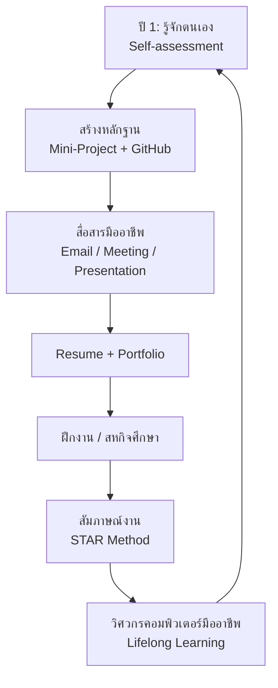

## 🎯 สิ่งที่จะได้เรียนรู้
- อธิบายสมรรถนะความพร้อมสู่การทำงาน (career readiness) ที่นายจ้างคาดหวังนอกเหนือจากทักษะเทคนิค
- เขียนอีเมลและเข้าร่วมประชุมอย่างมืออาชีพ รวมถึงการติดต่อหน่วยงานก่อนไปดูงาน
- เริ่มสร้าง portfolio บน GitHub และ resume ฉบับแรกตั้งแต่ปี 1
- วางแผนเส้นทางฝึกงาน/สหกิจศึกษา (Cooperative Education) และเตรียมตัวสัมภาษณ์

## 📖 เนื้อหาและคำอธิบาย

### 1. ทำไมต้องเตรียมตั้งแต่ปี 1
รายงาน *Future of Jobs Report 2025* ของ World Economic Forum ชี้ว่าทักษะที่นายจ้างให้ความสำคัญไม่ได้มีเพียงทักษะเทคโนโลยี (เช่น AI and big data, networks and cybersecurity) แต่รวมถึง analytical thinking, resilience/flexibility, creative thinking และ curiosity and lifelong learning ด้วย ส่วนหลักสูตร CE2016 ของ ACM/IEEE ก็กำหนดให้การเตรียมความพร้อมสู่วิชาชีพ (professional practice) เป็นส่วนหนึ่งของการศึกษาวิศวกรรมคอมพิวเตอร์

> [!note]
> ทักษะเหล่านี้สะสมได้จากกิจกรรมในรายวิชา เช่น Mini-Project 4 โมดูล การทำงานกลุ่ม และรายงานการดูงานสัปดาห์นี้ ไม่ต้องรอปี 4

### 2. สมรรถนะความพร้อมสู่การทำงาน (NACE Career Readiness)
สมาคม NACE (National Association of Colleges and Employers) กำหนดสมรรถนะ 8 ด้าน ปรับใช้กับนักศึกษา CE ได้ดังนี้

| สมรรถนะ | ความหมายในบริบท CE | หลักฐานที่สร้างได้ในรายวิชานี้ |
|---|---|---|
| Career & Self-Development | รู้จุดแข็ง/จุดอ่อน วางแผนเรียนรู้ | self-assessment ใน 04_บทบาทอาชีพและทักษะวิศวกรคอมพิวเตอร์ยุคใหม่ |
| Communication | อธิบายเรื่องเทคนิคให้คนทั่วไปเข้าใจ | สไลด์นำเสนอ Week 16 |
| Critical Thinking | วิเคราะห์ปัญหา ใช้หลักฐานตัดสินใจ | รายงานการดูงาน (evidence vs opinion) |
| Equity & Inclusion | เคารพความหลากหลายในทีม (NACE ระบุว่าอยู่ระหว่างทบทวน) | การแบ่งงานกลุ่มอย่างเป็นธรรม |
| Leadership | ริเริ่ม ประสานทีม | หัวหน้าโมดูล Mini-Project |
| Professionalism | ตรงต่อเวลา รับผิดชอบ มีจริยธรรม | ส่งงานตรงเวลา, ปฏิบัติตามกฎสถานที่ดูงาน |
| Teamwork | ทำงานร่วมกัน จัดการความขัดแย้ง | ใช้ Git branch/PR ทำงานกลุ่ม |
| Technology | ใช้เครื่องมืออย่างเหมาะสมและปลอดภัย | GitHub, IDE, AI tools พร้อมเปิดเผยการใช้ |

### 3. การสื่อสารอย่างมืออาชีพ
**อีเมล:** หัวเรื่องชัดเจน, คำขึ้นต้นสุภาพ, แนะนำตัว (ชื่อ-สาขา-มหาวิทยาลัย), วัตถุประสงค์ในย่อหน้าแรก, ปิดท้ายด้วยชื่อและช่องทางติดต่อ ใช้อีเมลมหาวิทยาลัยแทนอีเมลส่วนตัว

**การประชุม/การฟังบรรยาย:** มาก่อนเวลา 10–15 นาที, ปิดเสียงโทรศัพท์, จดบันทึก, ถามคำถามที่เตรียมไว้ (ไม่ถามข้อมูลลับ), กล่าวขอบคุณ และส่งอีเมลขอบคุณภายใน 1–2 วัน

**การประชุมออนไลน์:** ตั้งชื่อแสดงผลเป็นชื่อจริง, ปิดไมค์เมื่อไม่พูด, ขออนุญาตก่อนบันทึกวิดีโอ

### 4. Portfolio, GitHub และ Resume

| องค์ประกอบ | สิ่งที่ควรมี | ข้อผิดพลาดที่พบบ่อย |
|---|---|---|
| GitHub Profile README | สร้าง repository ชื่อเดียวกับ username แบบ public มีไฟล์ README.md แนะนำตัวและทักษะ | ว่างเปล่า ไม่มีคำอธิบาย |
| Project Repository | README อธิบายปัญหา วิธีติดตั้ง ภาพหน้าจอ สิ่งที่ตนทำ | commit API key/รหัสผ่านขึ้น repo |
| Resume (1 หน้า) | การศึกษา, โครงงาน (ผลลัพธ์ที่วัดได้), ทักษะ, กิจกรรม | ใส่ข้อมูลส่วนตัวเกินจำเป็น เช่น เลขบัตรประชาชน |
| LinkedIn/Portfolio site | สรุปโครงงานพร้อมลิงก์ | ข้อมูลไม่ตรงกับ resume |

> [!warning]
> ก่อน push โค้ดขึ้น public repo ตรวจว่าไม่มี secret, ข้อมูลส่วนบุคคล หรือข้อมูลจากหน่วยงานที่ไปดูงาน (เชื่อมกับ [สัปดาห์ที่ 12: Cybersecurity & Trust Architecture](/module/12))

### 5. ฝึกงานและสหกิจศึกษา
- **ฝึกงาน (Internship):** ระยะสั้น มักช่วงปิดภาคฤดูร้อน เน้นเรียนรู้สภาพการทำงาน
- **สหกิจศึกษา (Cooperative Education):** ทำงานเต็มเวลาในสถานประกอบการเป็นภาคการศึกษา มีโครงงานและรายงาน มีอาจารย์นิเทศ — ตรวจสอบเงื่อนไข หน่วยกิต และกำหนดการกับคณะ/สาขาของตนเอง
- เคล็ดลับ: ใช้การดูงานสัปดาห์นี้สำรวจว่าองค์กรใดรับนักศึกษาฝึกงาน และบทบาทใดที่สนใจ

### 6. การเตรียมตัวสัมภาษณ์
ใช้โครงสร้าง **STAR** (Situation, Task, Action, Result) ตอบคำถามเชิงพฤติกรรม เตรียมอธิบายโครงงานของตนเองใน 2 นาที และเตรียมคำถามกลับ 2–3 ข้อ

## 🧩 ตัวอย่างประกอบ / กรณีศึกษา

**ก. ตัวอย่างอีเมลติดต่อขอเข้าดูงาน**
> เรื่อง: ขออนุญาตเข้าศึกษาดูงานศูนย์ข้อมูล — นักศึกษาวิศวกรรมคอมพิวเตอร์ มหาวิทยาลัยกาฬสินธุ์
>
> เรียน ฝ่ายประชาสัมพันธ์ บริษัท ...
>
> ข้าพเจ้า นาย/นางสาว ... นักศึกษาชั้นปีที่ 1 สาขาวิศวกรรมคอมพิวเตอร์ มหาวิทยาลัยกาฬสินธุ์ ในนามตัวแทนรายวิชา EN-001-019 แก่นวิศวกรรมคอมพิวเตอร์ ขออนุญาตนำนักศึกษาจำนวน ... คน พร้อมอาจารย์ผู้ควบคุม เข้าศึกษาดูงานในช่วงวันที่ ... เพื่อเรียนรู้การบริหารจัดการศูนย์ข้อมูลและบทบาทวิศวกร ทั้งนี้นักศึกษาจะปฏิบัติตามระเบียบด้านความปลอดภัยและการถ่ายภาพของบริษัทอย่างเคร่งครัด
>
> รายละเอียดเพิ่มเติมตามหนังสือราชการที่แนบมา ขอขอบพระคุณเป็นอย่างสูง
>
> ด้วยความเคารพ / ชื่อ-นามสกุล / อีเมลมหาวิทยาลัย / เบอร์โทร

**ข. ตัวอย่างคำถาม-คำตอบสัมภาษณ์ฝึกงาน (STAR)**

*คำถาม:* "เล่าประสบการณ์ที่ทีมมีปัญหาแล้วคุณช่วยแก้ไข"

*ตัวอย่างคำตอบ:* "(S) ใน Mini-Project IoT สมาชิกสองคนแก้ไฟล์เดียวกันจนโค้ดชนกันบ่อย (T) ผมรับหน้าที่จัดระบบการทำงานร่วมกัน (A) จึงเสนอให้แยก branch ต่อฟีเจอร์และรีวิวผ่าน Pull Request พร้อมเขียนขั้นตอนใน README (R) ทีมส่งงานทันกำหนดและไม่เกิด conflict ใหญ่อีก ผมได้เรียนรู้ว่าการตกลงกระบวนการตั้งแต่ต้นสำคัญพอ ๆ กับโค้ด"

**ค. คำถามที่ควรถามวิทยากร (ไม่ละเมิดข้อมูลลับ)**
1. ทักษะใดที่บัณฑิตใหม่มักขาดเมื่อเริ่มงาน
2. หนึ่งวันทำงานของวิศวกรในทีมนี้เป็นอย่างไร
3. องค์กรเรียนรู้เทคโนโลยีใหม่ (เช่น AI) อย่างไร
4. นักศึกษาปี 1 ควรเริ่มฝึกอะไรเพื่อเตรียมฝึกงานที่นี่

## 🗺️ แผนภาพสรุป

## ⚠️ ข้อควรระวัง / ความเข้าใจผิดที่พบบ่อย
- **"เก่งเทคนิคอย่างเดียวพอ"** — นายจ้างประเมินการสื่อสาร การทำงานเป็นทีม และความรับผิดชอบควบคู่กันเสมอ
- **ความลับของสถานประกอบการ:** ระหว่างดูงานหรือฝึกงาน อาจได้รับข้อมูลภายใน ต้องปฏิบัติตาม NDA/ข้อตกลง และหลัก ACM Code of Ethics ข้อ 1.7 (Honor confidentiality) ห้ามนำไปโพสต์ในโซเชียลหรือใส่ใน portfolio
- **การถ่ายภาพ:** ขออนุญาตก่อนทุกครั้ง หลายพื้นที่ (ห้องเซิร์ฟเวอร์ ห้องควบคุม) ห้ามถ่ายโดยเด็ดขาด
- **PDPA:** resume คือข้อมูลส่วนบุคคลของตนเอง ไม่ควรใส่เลขบัตรประชาชน ศาสนา หรือข้อมูลอ่อนไหว และห้ามเผยแพร่ภาพ/ชื่อของพนักงานหรือวิทยากรโดยไม่ได้รับความยินยอมตาม [PDPA](/concept/pdpa)
- **ใช้ AI เขียน resume:** ทำได้แต่ต้องตรวจความถูกต้อง ห้ามแต่งประสบการณ์ที่ไม่มีจริง

## 🔗 เชื่อมโยงกับรายวิชา
- [สัปดาห์ที่ 15: Academic Visits & Computer Industry Tour](/module/15)
- [สัปดาห์ที่ 13: Computer Ethics & Intellectual Property](/module/13) (จริยธรรมวิชาชีพ, ความลับ)
- [สัปดาห์ที่ 14: Applied System Engineering & DevOps](/module/14) (Git, Agile, ทำงานเป็นทีม)
- [สัปดาห์ที่ 12: Cybersecurity & Trust Architecture](/module/12) · [Zero-Trust Architecture](/concept/zero-trust-architecture)
- [สัปดาห์ที่ 16: Final Project Presentation](/module/16) (ทักษะนำเสนอ)
- [PDPA](/concept/pdpa) · [การวัดและประเมินผล](/docs/assessment) · [กิจกรรมปฏิบัติการและโครงงาน](/docs/labs-projects)

## ❓ คำถามทบทวน / กิจกรรมสะท้อนคิด
1. เลือกสมรรถนะ NACE 2 ด้านที่ตนเองยังอ่อน และเสนอกิจกรรมที่จะพัฒนาภายในภาคการศึกษาหน้า

ดูแนวคำตอบ

ตัวอย่าง: Communication — ฝึกนำเสนอโครงงานต่อเพื่อน 5 นาทีและขอ feedback; Teamwork — ใช้ GitHub Issues แบ่งงานในโครงงานกลุ่ม ควรระบุหลักฐานที่จะเก็บ (สไลด์, ลิงก์ repo)

2. ระบุข้อผิดพลาด 3 จุดในอีเมล: "หัวเรื่อง: (ว่าง) / ถึงพี่ๆ ครับ อยากไปดูงานครับ ว่างวันไหนบ้าง"

ดูแนวคำตอบ

(1) ไม่มีหัวเรื่อง (2) คำขึ้นต้นไม่เป็นทางการและไม่แนะนำตัว (3) ไม่ระบุวัตถุประสงค์ จำนวนคน ช่วงวันที่ และช่องทางติดต่อ ไม่มีหนังสือจากมหาวิทยาลัยประกอบ

3. เพราะเหตุใดจึงไม่ควร push ไฟล์ `.env` ขึ้น GitHub และจะป้องกันอย่างไร

ดูแนวคำตอบ

ไฟล์ `.env` มักมี API key/รหัสผ่าน หากเปิดเผยผู้อื่นนำไปใช้ได้ (ละเมิด Confidentiality) ป้องกันโดยเพิ่มใน `.gitignore`, ใช้ไฟล์ `.env.example` ที่ไม่มีค่าจริง และ revoke key ทันทีถ้าเผลอ push

4. เขียนคำตอบแบบ STAR สำหรับคำถาม "เล่าถึงครั้งที่คุณต้องเรียนรู้เทคโนโลยีใหม่อย่างรวดเร็ว"

ดูแนวคำตอบ

ควรมีครบ 4 ส่วน เช่น S: ต้องใช้ MQTT ใน Mini-Project IoT ซึ่งไม่เคยใช้ T: ทำให้บอร์ดส่งข้อมูลได้ภายใน 1 สัปดาห์ A: อ่านเอกสารทางการ ทดลองกับ broker ทดสอบ R: ระบบส่งข้อมูลได้ และสรุปขั้นตอนไว้ใน README ให้เพื่อน

5. สะท้อนคิด: หลังดูงาน องค์กรแบบใดที่คุณอยากไปฝึกงาน เพราะอะไร

ดูแนวคำตอบ

คำตอบเปิด ควรอ้างสิ่งที่สังเกตได้จริงจากการดูงาน (บทบาท เทคโนโลยี วัฒนธรรมทีม) และเชื่อมกับเป้าหมายอาชีพของตนเอง

## 📚 แหล่งอ้างอิง
1. World Economic Forum. (2025, January 7). *Future of Jobs Report 2025*. https://reports.weforum.org/docs/WEF_Future_of_Jobs_Report_2025.pdf
2. National Association of Colleges and Employers (NACE). *Career Readiness: Competencies*. https://www.naceweb.org/career-readiness/competencies/career-readiness-defined
3. GitHub Docs. *Managing your profile README*. https://docs.github.com/en/account-and-profile/setting-up-and-managing-your-github-profile/customizing-your-profile/managing-your-profile-readme
4. ACM. (2018). *ACM Code of Ethics and Professional Conduct*. https://www.acm.org/code-of-ethics
5. ACM/IEEE-CS Joint Task Force. (2016). *Computer Engineering Curricula 2016 (CE2016)*. https://www.acm.org/binaries/content/assets/education/ce2016-final-report.pdf
