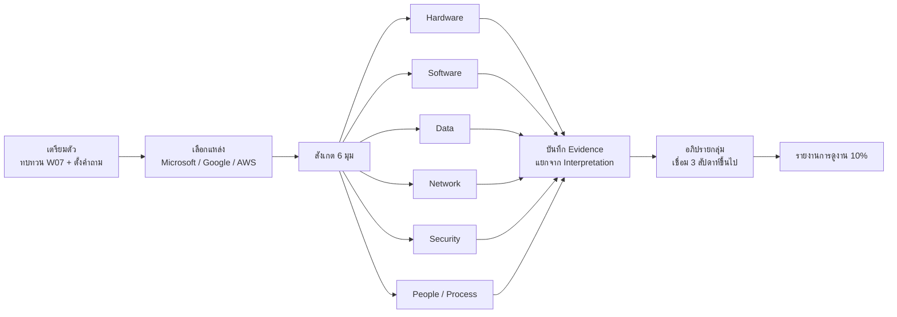

## 🎯 สิ่งที่จะได้เรียนรู้
- รู้จักแหล่ง virtual tour และสื่อทางการของบริษัทเทคโนโลยีระดับโลก (Microsoft, Google, AWS)
- ใช้กรอบสังเกต 6 มุม (Hardware, Software, Data, Network, Security, People/Process) เก็บหลักฐานอย่างเป็นระบบ
- แยกข้อเท็จจริงที่บริษัทเปิดเผย (official claim) ออกจากการตีความของตนเอง
- นำผลการทัศนศึกษาเสมือนจริงไปใช้ในรายงานการดูงาน (10% ของคะแนน)

## 📖 เนื้อหาและคำอธิบาย

### 1. ทำไมต้อง Virtual Field Trip
ศูนย์ข้อมูลระดับ hyperscale แทบไม่เปิดให้บุคคลภายนอกเข้าชม เพราะเหตุผลด้านความปลอดภัย การทัศนศึกษาเสมือนจริงจึงช่วยให้ผู้เรียน "เห็น" ภายในได้อย่างปลอดภัย ไม่มีค่าใช้จ่าย ดูซ้ำได้ และใช้เสริมหรือทดแทนการดูงานจริงเมื่อหน่วยงานไม่สะดวก

> [!note]
> Virtual tour เป็นสื่อที่บริษัทจัดทำเอง จึงมีลักษณะเป็นการประชาสัมพันธ์ด้วย ผู้เรียนควรอ่านอย่างมีวิจารณญาณ และระบุในรายงานว่าข้อมูลมาจาก "แหล่งของบริษัท"

### 2. แหล่งทัศนศึกษาเสมือนจริงที่ตรวจสอบแล้ว

| แหล่ง | รูปแบบ | สิ่งที่เห็นได้ | เหมาะกับสัปดาห์ |
|---|---|---|---|
| Microsoft Virtual Datacenter Tour (datacenters.microsoft.com/tour) | ทัวร์ 3 มิติแบบนำทางเอง แบ่งเป็นห้อง | Lobby, Network Room, Server Room, Mechanical Area, Innovation Room, Operations Room, Circular Center, Quantum Room, AI Server Room | W06, W07, W10, W14 |
| Google Data Centers (datacenters.google) | วิดีโอซีรีส์ *Discovering Data Centers*, แผนที่ที่ตั้ง, photo gallery, หน้าประสิทธิภาพพลังงาน | การออกแบบ ระบบเย็น ความปลอดภัยกายภาพ การเลือกทำเล storage, encryption, networking, พลังงานยั่งยืน | W05, W06, W07, W12 |
| AWS Data Centers (aws.amazon.com/compliance/data-center/) | หน้าเว็บอธิบาย Data Center Layers และ Data Center Controls | 4 layer (Perimeter, Infrastructure, Data, Environmental), การควบคุมการเข้าถึง การทำลายสื่อบันทึกตาม NIST 800-88 | W07, W12 |

> [!tip]
> ทีมเล็ก 3–4 คน แบ่งกันดูคนละแหล่ง แล้วนำมาเปรียบเทียบกัน จะได้มุมมองที่หลากหลายกว่าดูแหล่งเดียว

### 3. กรอบสังเกต 6 มุม (6 Observation Lenses)

| มุมมอง | คำถามนำ | ตัวอย่างสิ่งที่อาจพบ |
|---|---|---|
| Hardware | ใช้อุปกรณ์อะไร ออกแบบเองหรือซื้อมาตรฐาน | rack, server, GPU/AI accelerator, ระบบเย็น |
| Software | ซอฟต์แวร์ใดควบคุมและจัดการระบบ | virtualization, orchestration, ระบบ monitoring |
| Data | ข้อมูลถูกเก็บ สำรอง และเข้ารหัสอย่างไร | replication, encryption at rest/in transit |
| Network | เชื่อมต่อภายในและระหว่างศูนย์ข้อมูลอย่างไร | fiber, switch, backbone ระหว่าง region |
| Security | ป้องกันทางกายภาพและไซเบอร์อย่างไร | รั้ว, biometric, ผู้ดูแลรักษาความปลอดภัย, การทำลายดิสก์ |
| People/Process | ใครทำงาน ทำงานอย่างไร | ทีม operations 24/7, การซ่อมบำรุงเชิงป้องกัน, ความยั่งยืน |

### 4. ขั้นตอนทัศนศึกษาเสมือนจริง (Before–During–After)
1. **ก่อน (15 นาที):** อ่าน [สัปดาห์ที่ 7: Data Center & Cloud Infrastructure](/module/07) ทบทวน [PUE](/concept/pue) และ Tier เตรียมคำถาม 3 ข้อต่อมุมมอง
2. **ระหว่าง (45 นาที):** เดินทัวร์ทีละห้อง จดสิ่งที่เห็นลงใบงาน ระบุแหล่ง (ชื่อห้อง/ตอนของวิดีโอ/หัวข้อหน้าเว็บ) และเวลาที่เข้าถึง
3. **หลัง (30 นาที):** อภิปรายกลุ่ม เปรียบเทียบระหว่างบริษัท และเชื่อมกับรายวิชาอย่างน้อย 3 สัปดาห์

## 🧩 ตัวอย่างประกอบ / กรณีศึกษา

**ใบงาน Virtual Tour Worksheet (ตัวอย่างที่กรอกบางส่วน)**

ข้อมูลทั่วไป: แหล่ง = Microsoft Virtual Datacenter Tour · วันที่เข้าชม = ... · ผู้บันทึก = ...

| มุมมอง | สิ่งที่สังเกต (Evidence) | แหล่ง/ตำแหน่ง | เชื่อมสัปดาห์ | การตีความของฉัน (Interpretation) | คำถามที่ยังสงสัย |
|---|---|---|---|---|---|
| Hardware | มีห้องเฉพาะสำหรับ AI server แยกจาก server room ทั่วไป | AI Server Room | W09, W10 | งาน AI ต้องการพลังงานและระบบเย็นต่างจากงานทั่วไป | ใช้ liquid cooling ในห้องนี้หรือไม่ |
| Network | มี Network Room แยกเฉพาะ | Network Room | W06 | การแยกห้องเครือข่ายช่วยจัดการและป้องกันจุดเสี่ยง | เชื่อมต่อระหว่าง region อย่างไร |
| Security | (ตัวอย่างจาก AWS) การรักษาความปลอดภัยแบ่งเป็น 4 layer | AWS Data Center Layers | W12 | สอดคล้องแนวคิด defense in depth | layer ใดมีการตรวจสอบบ่อยที่สุด |
| People/Process | มีห้อง Operations | Operations Room | W14 | มีทีมเฝ้าระวังคล้าย NOC/SOC | ทำงานเป็นกะอย่างไร |
| Data | ... | ... | W05 | ... | ... |
| Software | ... | ... | W14 | ... | ... |

**ตัวอย่างย่อหน้าสรุปเปรียบเทียบ:**
*"จากการทัศนศึกษาเสมือนจริง ทั้ง Microsoft และ AWS แสดงให้เห็นว่าความปลอดภัยของศูนย์ข้อมูลเริ่มตั้งแต่ระดับกายภาพ โดย AWS อธิบายเป็น 4 layer เริ่มจาก perimeter ส่วน Google นำเสนอผ่านวิดีโอเรื่องความปลอดภัยทางกายภาพและการปฏิบัติการ ข้าพเจ้าเห็นว่าแนวคิดนี้สอดคล้องกับ defense in depth ใน Week 12 อย่างไรก็ตาม ข้อมูลทั้งหมดมาจากสื่อของบริษัท จึงยังไม่สามารถยืนยันรายละเอียดการปฏิบัติงานจริงได้"*

## 🗺️ แผนภาพสรุป

## ⚠️ ข้อควรระวัง / ความเข้าใจผิดที่พบบ่อย
- **"สิ่งที่เห็นใน tour คือทุกอย่างของศูนย์ข้อมูลจริง"** — ไม่ใช่ บริษัทเลือกแสดงเฉพาะส่วนที่เปิดเผยได้ ส่วนที่อ่อนไหวจะไม่ถูกแสดง
- **อย่าสรุปตัวเลขเอง:** หากไม่มีตัวเลขในแหล่งทางการ (เช่น จำนวนเซิร์ฟเวอร์) ให้บรรยายเชิงคุณภาพ ห้ามเดา
- **ลิขสิทธิ์ภาพ:** ภาพหน้าจอจาก tour เป็นลิขสิทธิ์ของบริษัท ใช้ในรายงานเพื่อการศึกษาได้อย่างจำกัด ต้องระบุแหล่ง ห้ามนำไปเผยแพร่เชิงพาณิชย์
- **เมื่อดูงานจริงต่อจาก virtual tour:** กฎต่างกันโดยสิ้นเชิง ต้องขออนุญาตก่อนถ่ายภาพ ห้ามถ่ายหน้าจอ dashboard บัตรพนักงาน หรือใบหน้าบุคคล และปฏิบัติตามข้อตกลงรักษาความลับ ภาพบุคคลถือเป็นข้อมูลส่วนบุคคลตาม [PDPA](/concept/pdpa)
- **ลิงก์อาจเปลี่ยน:** บันทึกวันที่เข้าถึงทุกครั้ง หากลิงก์เสียให้ค้นจากหน้าแรกของบริษัท

## 🔗 เชื่อมโยงกับรายวิชา
- [สัปดาห์ที่ 15: Academic Visits & Computer Industry Tour](/module/15)
- [สัปดาห์ที่ 7: Data Center & Cloud Infrastructure](/module/07) · [PUE](/concept/pue) · [Liquid Cooling](/concept/liquid-cooling)
- [สัปดาห์ที่ 6: Computer Networks & Internet](/module/06) · [สัปดาห์ที่ 5: Database & Data Management](/module/05)
- [สัปดาห์ที่ 12: Cybersecurity & Trust Architecture](/module/12) · [Zero-Trust Architecture](/concept/zero-trust-architecture) · [CIA Triad](/concept/cia-triad)
- [สัปดาห์ที่ 14: Applied System Engineering & DevOps](/module/14)
- [PDPA](/concept/pdpa) · [การวัดและประเมินผล](/docs/assessment)

## ❓ คำถามทบทวน / กิจกรรมสะท้อนคิด
1. เพราะเหตุใดศูนย์ข้อมูล hyperscale จึงมักไม่เปิดให้เข้าชม และ virtual tour ช่วยแก้ปัญหานี้อย่างไร

ดูแนวคำตอบ

เพราะความปลอดภัยทางกายภาพและความลับของข้อมูลลูกค้า (Confidentiality, Availability) virtual tour ให้ผู้เรียนเห็นแนวคิดการออกแบบโดยไม่ต้องเข้าพื้นที่จริง แต่มีข้อจำกัดว่าแสดงเฉพาะสิ่งที่บริษัทเลือกเปิดเผย

2. จงเขียน Evidence และ Interpretation แยกกันจากข้อสังเกต: "Microsoft มีห้อง AI Server Room แยก แสดงว่า AI สำคัญมาก"

ดูแนวคำตอบ

Evidence: ทัวร์ของ Microsoft มีห้องชื่อ AI Server Room แยกจาก Server Room ทั่วไป · Interpretation: บริษัทอาจให้ความสำคัญกับโครงสร้างพื้นฐานสำหรับ AI เป็นพิเศษ ซึ่งอาจเกี่ยวกับความต้องการพลังงาน/ระบบเย็นที่ต่างไป (ต้องตรวจสอบเพิ่ม)

3. เปรียบเทียบแนวทางการนำเสนอเรื่องความปลอดภัยของ AWS และ Google

ดูแนวคำตอบ

AWS อธิบายเป็นโครงสร้าง 4 layer และรายการ controls ที่เป็นทางการ (เหมาะกับการตรวจสอบ/compliance) ส่วน Google ใช้วิดีโอเล่าเรื่องความปลอดภัยทางกายภาพและการปฏิบัติการ ทั้งสองสะท้อนหลัก defense in depth

4. เลือก 1 มุมมองจาก 6 มุม แล้วตั้งคำถามที่จะถามวิทยากรหากได้ไปดูงานจริง โดยไม่ละเมิดข้อมูลลับ

ดูแนวคำตอบ

ตัวอย่าง (People/Process): "ทีม operations ใช้กระบวนการใดในการตัดสินใจเมื่อเกิดเหตุขัดข้อง" — ถามเชิงกระบวนการ ไม่ถามรายชื่อลูกค้า ที่ตั้ง หรือการตั้งค่าระบบรักษาความปลอดภัย

5. สะท้อนคิด: สิ่งใดใน virtual tour ที่ทำให้คุณเข้าใจเนื้อหา Week 07 ชัดขึ้นที่สุด

ดูแนวคำตอบ

คำตอบเปิด ควรระบุสิ่งที่เห็น (ห้อง/ตอนวิดีโอ) แนวคิดที่ชัดขึ้น (เช่น ระบบเย็น, redundancy) และสิ่งที่ยังสงสัย

## 📚 แหล่งอ้างอิง
1. Microsoft. *Microsoft Datacenters — Virtual Datacenter Tour*. https://datacenters.microsoft.com/tour/
2. Google. *Discovering Data Centers: Learn how our data centers work*. https://datacenters.google/discovering-data-centers/
3. Amazon Web Services. *AWS Data Centers — Data Center Layers*. https://aws.amazon.com/compliance/data-center/data-centers/
4. Amazon Web Services. *Data Center Controls*. https://aws.amazon.com/compliance/data-center/controls/
5. Uptime Institute. *Tier Classification System*. https://uptimeinstitute.com/tiers
