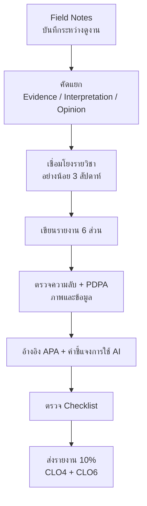

## 🎯 สิ่งที่จะได้เรียนรู้
- จัดโครงสร้างรายงานการดูงานตามที่รายวิชากำหนด (คิดเป็น 10% ของคะแนน ประเมิน CLO4 และ CLO6)
- แยก **หลักฐาน (evidence)** ออกจาก **ความคิดเห็น (opinion)** และเขียนการตีความที่มีเหตุผลรองรับ
- เชื่อมโยงสิ่งที่สังเกตกับเนื้อหารายวิชาอย่างน้อย 3 สัปดาห์
- อ้างอิงแหล่งข้อมูลอย่างถูกต้อง รักษาความซื่อสัตย์ทางวิชาการ และเปิดเผยการใช้ AI

## 📖 เนื้อหาและคำอธิบาย

### 1. รายงานนี้ประเมินอะไร
ตาม [การวัดและประเมินผล](/docs/assessment) รายงานการดูงานมีน้ำหนัก 10% และวัด 2 ผลลัพธ์
- **CLO4** — ประยุกต์ความรู้วิศวกรรมคอมพิวเตอร์กับปัญหาจริง → แสดงผ่านการเชื่อมสิ่งที่เห็นกับหัวข้อที่เรียน
- **CLO6** — ความรับผิดชอบและการสื่อสารเชิงวิชาชีพ → แสดงผ่านการเขียนที่เป็นระบบ การเคารพความลับ และ PDPA

### 2. โครงสร้างรายงาน 6 ส่วน (ตามรายวิชา)

| ส่วน | เนื้อหา | ความยาวแนะนำ | เคล็ดลับ |
|---|---|---|---|
| 1. ข้อมูลทั่วไป | หน่วยงาน วันเวลา ผู้บรรยาย (ระบุตำแหน่งได้ หากได้รับอนุญาต) รูปแบบ (onsite/virtual) | ไม่กี่บรรทัด | ระบุแหล่ง virtual tour และวันที่เข้าถึง |
| 2. สิ่งที่สังเกต/เรียนรู้ | เทคโนโลยี กระบวนการ การจัดองค์กร (ใช้กรอบ 6 มุม) | ~1 หน้า | เขียนเป็น evidence ที่ตรวจสอบได้ |
| 3. การเชื่อมโยงรายวิชา ≥ 3 หัวข้อ | ระบุสัปดาห์ แนวคิด และเหตุผล | ~1 หน้า | ส่วนที่ได้คะแนน CLO4 มากที่สุด |
| 4. บทบาทอาชีพ + ทักษะ | ตำแหน่งงานที่พบ หน้าที่ ทักษะที่ต้องการ | ½ หน้า | เชื่อมกับ skills-gap ของตนเอง |
| 5. ข้อคิด/คำถามที่ยังสงสัย | reflection + คำถามต่อยอด | ½ หน้า | ซื่อตรง บอกสิ่งที่ยังไม่เข้าใจได้ |
| 6. ภาพประกอบ | เฉพาะที่ได้รับอนุญาต พร้อมคำบรรยายและที่มา | ตามเหมาะสม | ตัดใบหน้า/ข้อมูลลับออก |

ปิดท้ายด้วย **เอกสารอ้างอิง** และ **คำชี้แจงการใช้ AI** (ถ้ามี)

### 3. Evidence vs Opinion vs Interpretation

| ประเภท | นิยาม | ตัวอย่าง | ใช้อย่างไร |
|---|---|---|---|
| Evidence (หลักฐาน) | สิ่งที่เห็น/ได้ยิน/อ่านได้จริง ระบุแหล่งได้ | "วิทยากรอธิบายว่ามีระบบไฟสองเส้นทางจ่าย" | เป็นฐานของทุกข้อสรุป |
| Interpretation (การตีความ) | การเชื่อมหลักฐานกับทฤษฎีอย่างมีเหตุผล | "สอดคล้องกับนิยาม Tier III" | ต้องอ้างหลักฐานและแนวคิดที่เรียน |
| Opinion (ความคิดเห็น) | ความรู้สึก/การตัดสินคุณค่า | "ศูนย์ข้อมูลนี้ทันสมัยมาก" | ใช้ได้ในส่วน reflection เท่านั้น และควรบอกเหตุผล |

> [!tip]
> สูตรเขียนย่อหน้าเชื่อมโยง: **เห็นอะไร (Evidence) → เชื่อมกับสัปดาห์ใด/แนวคิดใด (Link) → แปลว่าอะไร (Interpretation) → ยังสงสัยอะไร (Question)**

### 4. การอ้างอิงแหล่งข้อมูล
- ใช้รูปแบบเดียวกันทั้งเล่ม (แนะนำ APA 7) ทั้งการอ้างในเนื้อหาและรายการอ้างอิง
- แหล่งที่ควรใช้: เอกสาร/เว็บไซต์ทางการของหน่วยงาน มาตรฐาน (เช่น Uptime Institute, The Green Grid) และเอกสารประกอบรายวิชา
- ข้อมูลจากวิทยากรอ้างเป็น "การบรรยาย" พร้อมวันที่ (อาจไม่ระบุชื่อบุคคลหากไม่ได้รับอนุญาต)
- ห้ามใส่ตัวเลข (เช่น PUE เงินเดือน มูลค่าตลาด) โดยไม่มีแหล่งอ้างอิงที่ตรวจสอบได้

### 5. ความซื่อสัตย์ทางวิชาการและการเปิดเผยการใช้ AI
APA Style แนะนำให้อธิบายวิธีที่ใช้เครื่องมือ generative AI ในงาน (เช่น ในส่วนวิธีการ) ระบุ prompt และข้อความที่ได้ที่เกี่ยวข้อง โดยอาจแนบ transcript เต็มในภาคผนวก และไม่ระบุ AI เป็นผู้แต่ง ในรายงานนี้ให้ปฏิบัติดังนี้
- ใช้ AI ช่วย **ตรวจภาษา จัดโครงร่าง หรืออธิบายแนวคิด** ได้ แต่ **ข้อสังเกตและ reflection ต้องมาจากประสบการณ์จริงของตนเอง**
- ตรวจสอบทุกข้อเท็จจริงและแหล่งอ้างอิงที่ AI ให้มา เพราะ AI อาจสร้างแหล่งอ้างอิงที่ไม่มีอยู่จริง
- ห้ามป้อนข้อมูลลับของหน่วยงานหรือข้อมูลส่วนบุคคลลงในเครื่องมือ AI สาธารณะ
- ปฏิบัติตามนโยบาย AI ของรายวิชา/อาจารย์ผู้สอน ซึ่งมีลำดับความสำคัญเหนือแนวทางทั่วไป

## 🧩 ตัวอย่างประกอบ / กรณีศึกษา

**ก. โครงร่างรายงาน (Template)**
```text
รายงานการดูงาน — EN-001-019 แก่นวิศวกรรมคอมพิวเตอร์
ชื่อ-สกุล / รหัสนักศึกษา / กลุ่ม
1. ข้อมูลทั่วไป: หน่วยงาน ..., วันที่ ..., รูปแบบ onsite/virtual, ผู้บรรยาย ...
2. สิ่งที่สังเกต (6 มุม): Hardware / Software / Data / Network / Security / People-Process
3. การเชื่อมโยงรายวิชา: (ก) W.. ... (ข) W.. ... (ค) W.. ...
4. บทบาทอาชีพที่พบ: ตำแหน่ง - หน้าที่ - ทักษะ - ช่องว่างทักษะของฉัน
5. ข้อคิดและคำถามที่ยังสงสัย
6. ภาพประกอบ (ได้รับอนุญาต) พร้อมคำบรรยายและที่มา
เอกสารอ้างอิง (APA 7)
คำชี้แจงการใช้ AI: เครื่องมือ / ใช้ทำอะไร / ส่วนใดเป็นงานของตนเอง
```

**ข. ตัวอย่างย่อหน้าส่วนที่ 3 (เชื่อมโยงรายวิชา)**
> *"(Evidence) ระหว่างการดูงาน วิทยากรอธิบายว่าห้องเซิร์ฟเวอร์จัดแถวแบบ hot aisle/cold aisle และมีแผนติดตั้งระบบระบายความร้อนด้วยของเหลวสำหรับเซิร์ฟเวอร์ GPU (Link) ซึ่งเชื่อมโยงกับ Week 07 เรื่องการจัดการความร้อนและตัวชี้วัด PUE (Interpretation) ข้าพเจ้าเข้าใจว่าการแยกลมร้อนและลมเย็นช่วยลดพลังงานที่ใช้กับระบบเย็น ทำให้ค่า PUE เข้าใกล้ 1.0 มากขึ้น และงาน AI ที่ใช้พลังงานต่อ rack สูงทำให้ระบบอากาศอย่างเดียวอาจไม่เพียงพอ (Question) อย่างไรก็ตาม ข้าพเจ้ายังสงสัยว่าระบบของเหลวส่งผลต่อการใช้น้ำของศูนย์ข้อมูลอย่างไร"*

**ค. ตัวอย่างคำชี้แจงการใช้ AI**
> *"ข้าพเจ้าใช้ [ชื่อเครื่องมือ AI] เพื่อตรวจคำผิดและปรับสำนวนในส่วนที่ 2 และ 5 เมื่อวันที่ ... โดยใช้ prompt ว่า 'ช่วยตรวจคำผิดและปรับภาษาให้เป็นทางการ โดยไม่เปลี่ยนเนื้อหา' เนื้อหาข้อสังเกต การเชื่อมโยง และข้อคิดเห็นทั้งหมดเป็นของข้าพเจ้า และข้าพเจ้าได้ตรวจสอบแหล่งอ้างอิงทุกรายการด้วยตนเอง"*

**ง. Checklist ก่อนส่ง (สอดคล้อง rubric)**

| # | เกณฑ์ | ✔ |
|---|---|---|
| 1 | ครบ 6 ส่วนตามโครงร่าง + อ้างอิง | ☐ |
| 2 | ส่วนที่ 2 ใช้ evidence ที่ระบุแหล่ง/สถานที่ได้ | ☐ |
| 3 | เชื่อมโยง ≥ 3 สัปดาห์ แต่ละข้อมีเหตุผล ไม่ใช่แค่ระบุชื่อสัปดาห์ (CLO4) | ☐ |
| 4 | ระบุบทบาทอาชีพและทักษะ พร้อมเชื่อมกับตนเอง | ☐ |
| 5 | มี reflection และคำถามที่ยังสงสัยอย่างน้อย 1 ข้อ | ☐ |
| 6 | ภาพทุกภาพได้รับอนุญาต ไม่มีใบหน้า/บัตร/หน้าจอข้อมูลลับ (CLO6) | ☐ |
| 7 | ไม่มีข้อมูลลับของหน่วยงาน และไม่มีข้อมูลส่วนบุคคลโดยไม่ได้รับความยินยอม | ☐ |
| 8 | ตัวเลขทุกตัวมีแหล่งอ้างอิง | ☐ |
| 9 | อ้างอิงรูปแบบเดียวกันทั้งเล่ม | ☐ |
| 10 | มีคำชี้แจงการใช้ AI (ถ้าใช้) | ☐ |

## 🗺️ แผนภาพสรุป



## ⚠️ ข้อควรระวัง / ความเข้าใจผิดที่พบบ่อย
- **เขียนเป็นบันทึกการเดินทาง:** "ออกเดินทาง 8 โมง กินข้าว..." ไม่ใช่เนื้อหาวิชาการ ให้เน้นสิ่งที่เรียนรู้
- **เชื่อมโยงแบบผิวเผิน:** แค่เขียน "เกี่ยวกับ Week 07" ไม่พอ ต้องอธิบายว่าเกี่ยวอย่างไร
- **ความลับของหน่วยงาน:** ห้ามเปิดเผยผังอาคาร ที่ตั้งอุปกรณ์สำคัญ ชื่อลูกค้า การตั้งค่าระบบความปลอดภัย หรือข้อมูลที่ได้รับแจ้งว่าเป็นความลับ ตามหลัก ACM Code of Ethics ข้อ 1.7 (Honor confidentiality)
- **การถ่ายภาพ:** ใช้เฉพาะภาพที่ได้รับอนุญาต ตรวจภาพก่อนใส่รายงานว่าไม่มีหน้าจอ dashboard รหัสผ่านบนกระดาษ หรือป้ายชื่อ rack
- **PDPA:** ภาพหรือชื่อบุคคลที่ระบุตัวตนได้เป็นข้อมูลส่วนบุคคล ต้องได้รับความยินยอมก่อนเผยแพร่ ห้ามโพสต์รายงานที่มีข้อมูลเหล่านี้ลงโซเชียล ([PDPA](/concept/pdpa))
- **คัดลอกจากเพื่อนหรือ AI:** ถือเป็นการละเมิดความซื่อสัตย์ทางวิชาการ reflection ที่ไม่ได้มาจากประสบการณ์จริงตรวจพบได้ง่าย

## 🔗 เชื่อมโยงกับรายวิชา
- [สัปดาห์ที่ 15: Academic Visits & Computer Industry Tour](/module/15) · [การวัดและประเมินผล](/docs/assessment)
- [สัปดาห์ที่ 7: Data Center & Cloud Infrastructure](/module/07) · [PUE](/concept/pue) · [Liquid Cooling](/concept/liquid-cooling)
- [สัปดาห์ที่ 12: Cybersecurity & Trust Architecture](/module/12) · [Zero-Trust Architecture](/concept/zero-trust-architecture) · [CIA Triad](/concept/cia-triad)
- [สัปดาห์ที่ 13: Computer Ethics & Intellectual Property](/module/13) (ลิขสิทธิ์ การอ้างอิง จริยธรรม)
- [สัปดาห์ที่ 14: Applied System Engineering & DevOps](/module/14)
- [สัปดาห์ที่ 16: Final Project Presentation](/module/16) (นำผลการดูงานไปใช้ในการนำเสนอ)
- [PDPA](/concept/pdpa)

## ❓ คำถามทบทวน / กิจกรรมสะท้อนคิด
1. จัดประเภทข้อความต่อไปนี้เป็น Evidence / Interpretation / Opinion: (ก) "ห้องเซิร์ฟเวอร์เย็นมาก น่าทำงาน" (ข) "ประตูห้องเซิร์ฟเวอร์ต้องสแกนบัตรและลายนิ้วมือ" (ค) "การยืนยันตัวตนสองปัจจัยนี้สอดคล้องกับหลัก Zero Trust"
<details><summary>ดูแนวคำตอบ</summary>

(ก) Opinion (ข) Evidence (ค) Interpretation — เชื่อมหลักฐาน (ข) กับแนวคิด Week 12
</details>

2. ปรับข้อความ "การดูงานครั้งนี้เกี่ยวกับ Week 06" ให้เป็นการเชื่อมโยงที่สมบูรณ์
<details><summary>ดูแนวคำตอบ</summary>

ตัวอย่าง: "วิทยากรอธิบายว่าศูนย์ข้อมูลเชื่อมต่อกับผู้ให้บริการเครือข่ายหลายราย (Evidence) ซึ่งเชื่อมกับ Week 06 เรื่องเครือข่ายและ redundancy (Link) ทำให้หากเส้นทางหนึ่งขัดข้อง ข้อมูลยังส่งผ่านเส้นทางอื่นได้ เป็นการเพิ่ม Availability (Interpretation)"
</details>

3. ภาพหมู่ที่มีพนักงานบริษัทอยู่ด้านหลัง และมีหน้าจอ dashboard ติดมาด้วย ควรจัดการอย่างไรก่อนใส่รายงาน
<details><summary>ดูแนวคำตอบ</summary>

ตรวจว่าได้รับอนุญาตให้ถ่าย/เผยแพร่หรือไม่ เบลอหรือครอปใบหน้าพนักงานที่ไม่ได้ให้ความยินยอม และเบลอหน้าจอ dashboard ทั้งหมด หากไม่แน่ใจให้ไม่ใช้ภาพนั้น
</details>

4. นักศึกษาใช้ AI สรุปเนื้อหาจากวิดีโอ virtual tour ต้องเปิดเผยอย่างไร และต้องตรวจอะไรเพิ่ม
<details><summary>ดูแนวคำตอบ</summary>

ระบุชื่อเครื่องมือ วันที่ใช้ งานที่ให้ทำ (สรุปเนื้อหา) และ prompt ในคำชี้แจงการใช้ AI จากนั้นตรวจสรุปกับวิดีโอต้นฉบับ อ้างอิงวิดีโอต้นฉบับ (ไม่ใช่อ้าง AI เป็นแหล่งข้อมูล) และเขียน reflection ด้วยตนเอง
</details>

5. สะท้อนคิด: การเขียนรายงานนี้ช่วยพัฒนาสมรรถนะใดของคุณบ้าง เชื่อมกับ CLO4/CLO6 อย่างไร
<details><summary>ดูแนวคำตอบ</summary>

คำตอบเปิด เช่น การคิดเชิงวิเคราะห์ (แยกหลักฐาน/ความเห็น) และการประยุกต์ความรู้ (CLO4) การสื่อสารเชิงวิชาชีพและความรับผิดชอบต่อข้อมูล (CLO6)
</details>

## 📚 แหล่งอ้างอิง
1. American Psychological Association. *Citing generative AI in APA Style: Part 1—Reference formats*. APA Style Blog. https://apastyle.apa.org/blog/cite-generative-ai-references
2. American Psychological Association. *AI references (APA Style)*. https://apastyle.apa.org/style-grammar-guidelines/references/examples/ai-references
3. American Psychological Association. *How to cite ChatGPT*. APA Style Blog. https://apastyle.apa.org/blog/how-to-cite-chatgpt
4. ACM. (2018). *ACM Code of Ethics and Professional Conduct*. https://www.acm.org/code-of-ethics
5. กระทรวงดิจิทัลเพื่อเศรษฐกิจและสังคม. *พระราชบัญญัติคุ้มครองข้อมูลส่วนบุคคล พ.ศ. 2562*. https://mdes.go.th/law/detail/3577-Personal-Data-Protection-Act-B-E--2562--2019-
