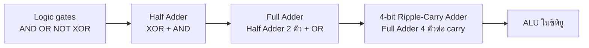
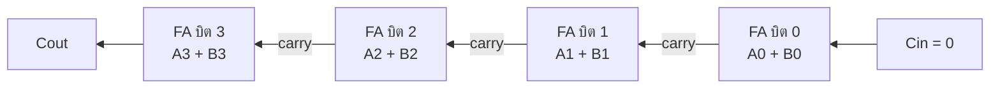

# 🧪 Lab 03: วงจรตรรกะและการประมวลผลข้อมูล

> **โมดูล:** Module 1 - Foundation & Programming (Mini-Project 1)
> **เวลาที่ใช้:** 2 ชั่วโมง (ในห้องปฏิบัติการ) + เวลาศึกษาด้วยตนเอง

## 🎯 จุดประสงค์การทดลอง (Objectives)
- จำลองวงจรด้วย Logisim และเขียนเงื่อนไข/ตรรกะ (If-Else/Boolean) สำหรับกลไกเกม
- ประยุกต์ใช้ความรู้จากภาคทฤษฎี (สัปดาห์ที่ 3) สู่การปฏิบัติจริง
- เสริมสร้างทักษะการทำงานกลุ่มผ่าน Mini-Project

## 🛠️ เครื่องมือที่ต้องใช้ (Prerequisites & Tools)
- เครื่องคอมพิวเตอร์และอินเทอร์เน็ต พร้อม Python 3 และ VS Code (หรือ Google Colab)
- **Logisim Evolution** (ฟรี, open source) ดาวน์โหลดตัวติดตั้งตามระบบปฏิบัติการจาก [github.com/logisim-evolution/logisim-evolution/releases](https://github.com/logisim-evolution/logisim-evolution/releases) (ตัวติดตั้ง `.msi`/`.dmg`/`.deb` มี Java มาให้แล้ว)
- ทบทวนตารางความจริงและ half/full adder ใน [[01_พื้นฐานวงจรตรรกะสู่การออกแบบชิป]] และ [[Boolean Algebra และ Logic Gates]]
- repository ของทีมที่มี `main.py` และ `save_system.py` จาก Lab 01–02

> [!note] ผลลัพธ์ในใบงานนี้
> ทุก output ได้จากการรันจริง (Python 3.14.3) โค้ดในส่วนที่ 1 เขียนต่อกันในไฟล์เดียว `logic_lab.py` (หรือ notebook เดียวกัน) **ต้องรันตามลำดับ** เพราะส่วนหลังเรียกใช้ฟังก์ชันของส่วนก่อน

---

## 🕒 ส่วนที่ 1: ทฤษฎีประยุกต์ประจำสัปดาห์ (1 ชั่วโมง)

**ภาพรวม:** สร้างวงจรบวกเลขฐานสองแบบเดียวกับที่อยู่ใน ALU ของ CPU สองวิธี คือ (ก) ต่อเกตจริงใน Logisim และ (ข) จำลองด้วยฟังก์ชัน Python แล้วตรวจว่าผลตรงกัน



### ขั้นตอนที่ 1: สร้าง Half Adder ใน Logisim Evolution (15 นาที)

1. เปิด Logisim Evolution จะได้วงจรว่างชื่อ `main`
2. จากแถบซ้าย **Wiring > Pin** วาง Pin 2 ตัวทางซ้าย (input) ตั้งชื่อ `A`, `B` ในช่อง **Label** ของแผง Properties
3. วาง Pin อีก 2 ตัวทางขวา เปลี่ยน **Output?** เป็น `Yes` ตั้งชื่อ `S` (Sum) และ `C` (Carry)
4. จาก **Gates** วาง **XOR Gate** และ **AND Gate** อย่างละ 1 ตัว
5. ลากสายจากปลาย Pin ไปขาเกต: `A`, `B` เข้าทั้ง XOR และ AND, XOR ออกที่ `S`, AND ออกที่ `C` (สายสีเขียวเข้ม = 0, เขียวสว่าง = 1, สีน้ำเงิน = ยังไม่ต่อ, สีแดง = ต่อผิด)
6. เลือก **Poke Tool** (รูปมือ) คลิก Pin `A`, `B` สลับ 0/1 ให้ครบ 4 กรณี และบันทึกค่า `S`, `C`
7. เมนู **Project > Analyze Circuit** แท็บ **Table** โปรแกรมจะสร้างตารางความจริงให้ เทียบกับที่บันทึกเอง
8. บันทึกไฟล์เป็น `half_adder.circ`

### ขั้นตอนที่ 2: Full Adder และ 4-bit Adder ใน Logisim (15 นาที)

1. **Project > Add Circuit...** ตั้งชื่อ `full_adder` วาง input `A`, `B`, `Cin` และ output `S`, `Cout`
2. ต่อวงจร: `XOR(A, B)` → `XOR(ผลนั้น, Cin)` = `S` และ `OR(AND(A, B), AND(XOR(A, B), Cin))` = `Cout`
3. ทดสอบครบ 8 กรณีด้วย Poke Tool หรือ Analyze Circuit
4. กลับไปวงจร `main` ลาก `full_adder` จาก Explorer ซ้ายมือมาวางเป็น **subcircuit** 4 ตัว ต่อ `Cout` ของตัวที่ 0 เข้า `Cin` ของตัวที่ 1 ไปเรื่อย ๆ และให้ `Cin` ของตัวแรกเป็น **Wiring > Constant** ค่า 0
5. ทดสอบ `0101 + 0011` (5 + 3) ต้องได้ `S = 1000` และ `Cout = 0` แล้วลอง `1111 + 0001` สังเกตว่า `Cout = 1`

> [!tip] ประหยัดเวลาด้วย Splitter
> แทนการวาง Pin 1 บิต 8 ตัว ให้วาง Pin แบบ **Data Bits = 4** แล้วใช้ **Wiring > Splitter** แยกเป็น 4 เส้น และใช้ Poke Tool คลิกแต่ละบิตของ Pin ได้โดยตรง

### ขั้นตอนที่ 3: เกตตรรกะและตารางความจริงด้วย Python

`itertools.product([0, 1], repeat=n)` สร้างทุกชุดค่าของ input `n` ตัว (2ⁿ แถว) ซึ่งก็คือแถวของตารางความจริง

```python
from itertools import product

# เกตพื้นฐาน: รับบิต 0/1 คืนบิต 0/1
def AND(a, b):  return a & b
def OR(a, b):   return a | b
def NOT(a):     return 1 - a
def NAND(a, b): return NOT(AND(a, b))
def NOR(a, b):  return NOT(OR(a, b))
def XOR(a, b):  return a ^ b
def XNOR(a, b): return NOT(XOR(a, b))

def truth_table(func, n_inputs, names=None):
    """พิมพ์ตารางความจริงของฟังก์ชัน func ที่มี n_inputs ขา"""
    names = names or [chr(ord("A") + i) for i in range(n_inputs)]
    print(" ".join(names), "| Y")
    for bits in product([0, 1], repeat=n_inputs):   # (0,0), (0,1), (1,0), (1,1)
        print(" ".join(map(str, bits)), "|", func(*bits))

gates = {"AND": AND, "OR": OR, "NAND": NAND, "NOR": NOR, "XOR": XOR, "XNOR": XNOR}
print("A B | " + " ".join(f"{g:>4}" for g in gates))
for a, b in product([0, 1], repeat=2):
    print(f"{a} {b} | " + " ".join(f"{f(a, b):>4}" for f in gates.values()))
```

```output
A B |  AND   OR NAND  NOR  XOR XNOR
0 0 |    0    0    1    1    0    1
0 1 |    0    1    1    0    1    0
1 0 |    0    1    1    0    1    0
1 1 |    1    1    0    0    0    1
```

ใช้ `truth_table()` กับนิพจน์ 3 input ใดก็ได้ผ่าน `lambda`

```python
# นิพจน์ 3 อินพุต: Y = (A AND B) OR (NOT C)
truth_table(lambda a, b, c: OR(AND(a, b), NOT(c)), 3)
```

```output
A B C | Y
0 0 0 | 1
0 0 1 | 0
0 1 0 | 1
0 1 1 | 0
1 0 0 | 1
1 0 1 | 0
1 1 0 | 1
1 1 1 | 1
```

- `&`, `|`, `^` คือ **bitwise operator** ที่ทำงานกับบิตจริง เมื่อ input เป็น 0/1 จึงตรงกับ AND, OR, XOR พอดี
- `NOT(a)` ใช้ `1 - a` เพราะ `~a` ของ Python ให้ผลแบบ two's complement (`~1 == -2`) ไม่ใช่ 0

### ขั้นตอนที่ 4: Half Adder และ Full Adder ด้วย Python

```python
def half_adder(a, b):
    s = XOR(a, b)       # Sum
    c = AND(a, b)       # Carry
    return s, c

def full_adder(a, b, cin):
    s1, c1 = half_adder(a, b)        # half adder ตัวที่ 1: A + B
    s, c2 = half_adder(s1, cin)      # half adder ตัวที่ 2: ผลรวม + Cin
    cout = OR(c1, c2)
    return s, cout

print("Half Adder")
print("A B | S C")
for a, b in product([0, 1], repeat=2):
    print(a, b, "|", *half_adder(a, b))

print("\nFull Adder")
print("A B Cin | S Cout")
for a, b, cin in product([0, 1], repeat=3):
    s, cout = full_adder(a, b, cin)
    print(f"{a} {b}  {cin}  | {s}  {cout}")
```

```output
Half Adder
A B | S C
0 0 | 0 0
0 1 | 1 0
1 0 | 1 0
1 1 | 0 1

Full Adder
A B Cin | S Cout
0 0  0  | 0  0
0 0  1  | 1  0
0 1  0  | 1  0
0 1  1  | 0  1
1 0  0  | 1  0
1 0  1  | 0  1
1 1  0  | 0  1
1 1  1  | 1  1
```

ตารางนี้ต้อง **ตรงกับ** Analyze Circuit ของ Logisim ในขั้นตอนที่ 1–2 ทุกแถว ถ้าไม่ตรง แสดงว่าต่อสายในวงจรผิด

### ขั้นตอนที่ 5: 4-bit Ripple-Carry Adder

นำ full adder 4 ตัวมาต่อกัน โดย carry ของบิตต่ำส่งไปบิตถัดไป ("ripple" = ระลอกคลื่น)



```python
def to_bits(n, width=4):
    """แปลงจำนวนเต็มเป็น list ของบิต เรียงจาก LSB (บิตขวาสุด) ไปหา MSB"""
    return [(n >> i) & 1 for i in range(width)]

def from_bits(bits):
    return sum(bit << i for i, bit in enumerate(bits))

def ripple_carry_adder(a_bits, b_bits):
    """บวกเลขฐานสองทีละบิตจาก LSB ส่ง carry ต่อไปยัง full adder ตัวถัดไป"""
    carry = 0
    result = []
    for a, b in zip(a_bits, b_bits):
        s, carry = full_adder(a, b, carry)
        result.append(s)
    return result, carry

def add4(x, y):
    bits, cout = ripple_carry_adder(to_bits(x), to_bits(y))
    a_str = format(x, "04b")
    b_str = format(y, "04b")
    s_str = "".join(map(str, reversed(bits)))       # กลับให้ MSB อยู่ซ้ายเพื่อแสดงผล
    note = "  <- overflow (เกิน 4 บิต)" if cout else ""
    print(f"{a_str} ({x:>2}) + {b_str} ({y:>2}) = Cout {cout}, S {s_str} ({from_bits(bits):>2}){note}")

add4(0b0101, 0b0011)    # 5 + 3
add4(0b0110, 0b0111)    # 6 + 7
add4(0b1001, 0b1000)    # 9 + 8
add4(0b1111, 0b0001)    # 15 + 1
```

```output
0101 ( 5) + 0011 ( 3) = Cout 0, S 1000 ( 8)
0110 ( 6) + 0111 ( 7) = Cout 0, S 1101 (13)
1001 ( 9) + 1000 ( 8) = Cout 1, S 0001 ( 1)  <- overflow (เกิน 4 บิต)
1111 (15) + 0001 ( 1) = Cout 1, S 0000 ( 0)  <- overflow (เกิน 4 บิต)
```

- `(n >> i) & 1` เลื่อนบิตไปขวา `i` ตำแหน่งแล้วเก็บเฉพาะบิตสุดท้าย คือการอ่านบิตที่ `i`
- ผลรวมที่เกิน 15 ใส่ใน 4 บิตไม่พอ บิตที่ 5 จึงไปอยู่ที่ `Cout` เช่น 9 + 8 = 17 = `1 0001` นี่คือ **overflow** ที่ CPU ต้องตั้ง flag แจ้งโปรแกรม
- adder แบบนี้ต้องรอ carry วิ่งผ่านทุกบิต ยิ่งบิตมากยิ่งช้า CPU จริงจึงใช้ **carry-lookahead adder** ที่คำนวณ carry ล่วงหน้า

### ขั้นตอนที่ 6: แปลงเลขฐานด้วย `bin`, `hex`, `int`

```python
n = 202
print(bin(n), oct(n), hex(n))                 # ฐานสิบ -> ฐาน 2, 8, 16
print(format(n, "08b"), format(n, "X"))       # 8 บิตเต็ม และฐานสิบหกแบบไม่มี 0x
print(int("11001010", 2), int("CA", 16), int("0x2F", 16), int("1101", 2))   # ฐานอื่น -> ฐานสิบ

def to_base(n, base):
    """แปลงฐานสิบเป็นฐาน base ด้วยวิธีหารสั้น (เก็บเศษ แล้วอ่านจากล่างขึ้นบน)"""
    digits = "0123456789ABCDEF"
    if n == 0:
        return "0"
    out = ""
    while n > 0:
        n, r = divmod(n, base)
        out = digits[r] + out
    return out

print(to_base(202, 2), to_base(202, 16), to_base(2026, 8))
```

```output
0b11001010 0o312 0xca
11001010 CA
202 202 47 13
11001010 CA 3752
```

| ฟังก์ชัน | ทิศทาง | ตัวอย่าง | ผล |
|---|---|---|---|
| `bin(n)` | ฐาน 10 → ฐาน 2 (มี `0b`) | `bin(202)` | `'0b11001010'` |
| `hex(n)` | ฐาน 10 → ฐาน 16 (มี `0x`) | `hex(202)` | `'0xca'` |
| `format(n, "08b")` | ฐาน 2 เติม 0 ให้ครบ 8 หลัก | `format(5, "08b")` | `'00000101'` |
| `int(s, base)` | ฐานใดก็ได้ → ฐาน 10 | `int("CA", 16)` | `202` |

### ขั้นตอนที่ 7: บันทึกผลการสังเกต

1. Half adder บวก `1 + 1` ได้ `S` และ `C` เท่าใด อธิบายความหมายในเลขฐานสอง
2. ทำไม full adder จึงต้องมี input `Cin` เพิ่มจาก half adder
3. `add4(0b1001, 0b1000)` ได้ `S = 0001` ถ้าโปรแกรมไม่ตรวจ `Cout` จะเกิดปัญหาอะไร
4. แปลง `1101₂` และ `0x2F` เป็นฐานสิบ แล้วตรวจด้วย `int()`
5. วงจร Logisim กับฟังก์ชัน Python ให้ตารางความจริงตรงกันหรือไม่ ถ้าไม่ตรงพบจุดผิดที่ใด

<details><summary>ดูเฉลย</summary>

1. `S = 0`, `C = 1` คือ `1 + 1 = 10₂` (สองในฐานสิบ) บิตผลรวมเป็น 0 และทด 1 ไปหลักถัดไป
2. เพราะเมื่อบวกเลขหลายบิต ทุกหลักยกเว้นหลักแรกต้องบวก **ตัวทดจากหลักก่อนหน้า** ด้วย จึงมี input 3 ตัว (A, B, Cin) ส่วน half adder รับได้แค่ 2 ตัว ใช้ได้เฉพาะหลักแรก
3. ผลจะผิดเป็น 1 แทน 17 โดยไม่มีใครรู้ (silent overflow) ในเกมอาจทำให้คะแนนหรือ HP วนกลับเป็นค่าน้อย ๆ ภาษาอย่าง C ที่ใช้จำนวนเต็มขนาดคงที่มีปัญหานี้จริง ส่วน `int` ของ Python ขยายขนาดอัตโนมัติจึงไม่ overflow
4. `1101₂ = 8 + 4 + 0 + 1 = 13` และ `0x2F = 2×16 + 15 = 47` ตรงกับผล `int("1101", 2)` และ `int("0x2F", 16)` ในขั้นตอนที่ 6
5. ต้องตรงกันทุกแถว จุดผิดที่พบบ่อยคือสายไม่เชื่อมจริง (จุดต่อไม่มีวงกลม) ต่อ Cin ผิดตำแหน่ง หรือใช้ OR แทน XOR ใน S
</details>

---

## 🚀 ส่วนที่ 2: งานพัฒนา Mini-Project (1 ชั่วโมง + การบ้าน)

- **เป้าหมายสัปดาห์นี้:** ใส่ **Game Logic** ให้เกม ได้แก่ เงื่อนไขชนะ/แพ้ การต่อสู้ และเงื่อนไขพิเศษ ด้วย `if/elif/else` และ boolean operator (`and`, `or`, `not`)
- **โจทย์:** เขียน `game_logic.py` ที่มีฟังก์ชันตรวจเงื่อนไขอย่างน้อย 3 ฟังก์ชัน ทดสอบครบทุกกรณีด้วยตารางความจริง แล้วเรียกใช้ใน game loop

### ขั้นตอนที่ 1: จากเกตตรรกะสู่เงื่อนไขในเกม

| วงจรตรรกะ | Python | ตัวอย่างในเกม |
|---|---|---|
| AND | `a and b` | เปิดประตูได้ถ้า **มีกุญแจ และ** ไม่ใช่กลางคืน |
| OR | `a or b` | ชนะถ้า **ฆ่าบอส หรือ** มีทอง ≥ 100 |
| NOT | `not a` | ศัตรูโจมตีได้ถ้า **ไม่** ถูกแช่แข็ง |
| XOR | `a != b` | กับดักทำงานเมื่อคันโยก 2 อัน **อยู่ต่างตำแหน่งกัน** |
| ตารางความจริง | ลูป `for` ทุกกรณี | ทดสอบว่าเงื่อนไขถูกทุกกรณีก่อนใส่ในเกม |

### ขั้นตอนที่ 2: เขียน `game_logic.py`

```python
import random

def can_open_door(has_key, is_night, hp):
    # ประตูเปิดได้เมื่อ มีกุญแจ และ (ไม่ใช่กลางคืน หรือ HP มากกว่า 50)
    return has_key and (not is_night or hp > 50)

def check_game_over(player, monster):
    """คืนค่า 'win', 'lose' หรือ None (เกมยังไม่จบ)"""
    if player["hp"] <= 0:
        return "lose"
    if monster["hp"] <= 0 or player["gold"] >= 100:      # ชนะได้ 2 ทาง
        return "win"
    return None

def attack(attacker, defender, rng):
    critical = rng.random() < 0.2                  # โอกาสคริติคอล 20%
    dodged = defender["agility"] > 7 and rng.random() < 0.3
    if dodged:
        return f"{defender['name']} หลบได้!"
    damage = attacker["atk"] * (2 if critical else 1) - defender["defense"]
    damage = max(damage, 1)                         # อย่างน้อยต้องโดน 1
    defender["hp"] -= damage
    return f"{attacker['name']} โจมตี {damage}{' (คริติคอล!)' if critical else ''} -> {defender['name']} HP {max(defender['hp'], 0)}"

# ทดสอบเงื่อนไขประตูทุกกรณีด้วยตารางความจริง
print("has_key is_night hp>50 | open")
for has_key in (False, True):
    for is_night in (False, True):
        for hp in (30, 80):
            print(f"{has_key!s:>7} {is_night!s:>8} {hp > 50!s:>5} | {can_open_door(has_key, is_night, hp)}")

rng = random.Random(42)     # กำหนด seed เพื่อให้ผลซ้ำได้ (ทดสอบ/ดีบักง่าย)
player = {"name": "ผู้กล้า", "hp": 40, "atk": 12, "defense": 3, "agility": 8, "gold": 20}
monster = {"name": "ก็อบลิน", "hp": 35, "atk": 9, "defense": 2, "agility": 5}
print()
turn = 1
while (result := check_game_over(player, monster)) is None:
    print(f"เทิร์น {turn}:", attack(player, monster, rng))
    if monster["hp"] > 0:
        print("        ", attack(monster, player, rng))
    turn += 1
print("ผลการต่อสู้:", "ชนะ" if result == "win" else "แพ้")
```

```output
has_key is_night hp>50 | open
  False    False False | False
  False    False  True | False
  False     True False | False
  False     True  True | False
   True    False False | True
   True    False  True | True
   True     True False | False
   True     True  True | True

เทิร์น 1: ผู้กล้า โจมตี 10 -> ก็อบลิน HP 25
         ผู้กล้า หลบได้!
เทิร์น 2: ผู้กล้า โจมตี 10 -> ก็อบลิน HP 15
         ก็อบลิน โจมตี 6 -> ผู้กล้า HP 34
เทิร์น 3: ผู้กล้า โจมตี 10 -> ก็อบลิน HP 5
         ก็อบลิน โจมตี 15 (คริติคอล!) -> ผู้กล้า HP 19
เทิร์น 4: ผู้กล้า โจมตี 22 (คริติคอล!) -> ก็อบลิน HP 0
ผลการต่อสู้: ชนะ
```

- `can_open_door` คือวงจร `Y = K AND (NOT N OR H)` เขียนเป็น Python ตารางความจริง 8 แถวยืนยันว่าเปิดได้ **เฉพาะเมื่อมีกุญแจ** และกลางคืนต้องมี HP > 50
- `and`/`or` ของ Python เป็น **short-circuit**: `defender["agility"] > 7 and rng.random() < 0.3` ถ้าเงื่อนไขแรกเป็นเท็จจะไม่สุ่มเลย
- `random.Random(42)` กำหนด **seed** ทำให้ลำดับตัวเลขสุ่มเหมือนเดิมทุกครั้ง ใช้ตอนทดสอบหรือดีบัก เวลาเล่นจริงใช้ `random.Random()` ไม่ต้องใส่ seed
- `while (result := ...) is None` ใช้ **walrus operator** (`:=`, Python 3.8+) กำหนดค่าและตรวจในบรรทัดเดียว
- `max(damage, 1)` และ `max(hp, 0)` กันค่าติดลบ เป็นการคิดถึง **edge case** แบบเดียวกับการตรวจ overflow ในส่วนที่ 1

> [!warning] ลำดับของเงื่อนไขมีผล
> ใน `check_game_over` ตรวจ `player["hp"] <= 0` **ก่อน** เงื่อนไขชนะ ถ้าผู้เล่นกับมอนสเตอร์ HP หมดพร้อมกัน เกมนี้จะถือว่าแพ้ ทีมต้องตัดสินใจกติกานี้เองและเขียนลงใน README

### ขั้นตอนที่ 3: ต่อเข้ากับเกมของทีม

1. ย้ายฟังก์ชันตรวจเงื่อนไขทั้งหมดไปไว้ใน `game_logic.py` แล้ว `from game_logic import check_game_over, attack` ใน `main.py`
2. เรียก `check_game_over()` ทุกรอบของ game loop (ตำแหน่ง "ตรวจเงื่อนไขจบ" ใน flowchart ของ Lab 01)
3. ค่าสถานะใหม่ (เช่น `gold`, `has_key`) ต้องเพิ่มใน `DEFAULT_STATE` ของ `save_system.py` ด้วย เพื่อให้ Save/Load จำค่าได้

### งานที่ทีมต้องทำต่อ (การบ้าน)

1. ออกแบบกติกาอย่างน้อย **3 เงื่อนไขที่ใช้ boolean operator ผสมกัน** (เช่น ร้านค้าเปิดเมื่อ `level >= 3 and not is_wanted`) เขียนเป็นตารางความจริงใน README
2. เขียนฟังก์ชันทดสอบด้วย `assert` เช่น `assert can_open_door(False, False, 100) is False` อย่างน้อย 5 ข้อ ในไฟล์ `test_game_logic.py` และรันให้ผ่าน
3. เพิ่มระดับความยาก (ง่าย/ปกติ/ยาก) ที่เปลี่ยนค่าพลังมอนสเตอร์ด้วย `if/elif/else`
4. (ท้าทาย) เก็บค่าสถานะหลายอย่างเป็น **bit flag** ในจำนวนเต็มตัวเดียว เช่น `HAS_KEY = 0b001`, `HAS_MAP = 0b010` ตรวจด้วย `flags & HAS_KEY` และตั้งค่าด้วย `flags |= HAS_MAP`

---

## ✍️ แบบฝึกหัด

**ข้อ 1.** เขียนตารางความจริงของ `Y = NOT (A OR B)` และบอกว่าเท่ากับเกตใด

<details><summary>ดูเฉลย</summary>

| A | B | A OR B | Y |
|---|---|---|---|
| 0 | 0 | 0 | 1 |
| 0 | 1 | 1 | 0 |
| 1 | 0 | 1 | 0 |
| 1 | 1 | 1 | 0 |

เท่ากับ **NOR** ตรวจด้วย `truth_table(lambda a, b: NOT(OR(a, b)), 2)` ได้
</details>

**ข้อ 2.** ใช้ 4-bit adder บวก `0111 + 0110` ได้ `S` และ `Cout` เท่าใด

<details><summary>ดูเฉลย</summary>

7 + 6 = 13 = `1101₂` ไม่เกิน 15 จึงได้ `S = 1101`, `Cout = 0`
</details>

**ข้อ 3.** ถ้าต้องการบวกเลข 8 บิต ต้องใช้ full adder กี่ตัว และต้องแก้ฟังก์ชัน `add4` ตรงไหน

<details><summary>ดูเฉลย</summary>

ใช้ full adder **8 ตัว** (บิตแรกจะใช้ half adder แทนก็ได้ เพราะ Cin = 0) ในโค้ดแก้ `to_bits(x)` เป็น `to_bits(x, 8)` และ `format(x, "04b")` เป็น `"08b"` ส่วน `ripple_carry_adder` ไม่ต้องแก้เพราะวนตามจำนวนบิตอยู่แล้ว
</details>

**ข้อ 4.** เงื่อนไข `if hp > 0 or has_potion and not is_poisoned:` ทำงานอย่างไรเมื่อ `hp = 0`, `has_potion = True`, `is_poisoned = True`

<details><summary>ดูเฉลย</summary>

ลำดับความสำคัญคือ `not` > `and` > `or` จึงอ่านเป็น `hp > 0 or (has_potion and (not is_poisoned))` = `False or (True and False)` = **False** ถ้าตั้งใจให้ความหมายต่างจากนี้ต้องใส่วงเล็บเอง ควรใส่วงเล็บเสมอเพื่อให้อ่านง่าย
</details>

---

## 📝 เกณฑ์การส่งงานและการประเมิน (Deliverables & Rubric)
- ส่งรายงานความคืบหน้า (Progress Log) เป็นไฟล์ Markdown ผ่าน GitHub
- ส่งโค้ดต้นฉบับผ่าน Repository ของกลุ่ม
- ให้ฟีดแบ็กความสมบูรณ์โดยพิจารณาจากเกณฑ์ของ CLO2, CLO3

| หัวข้อ | สิ่งที่ตรวจ |
|---|---|
| Logisim | ไฟล์ `.circ` ของ half adder, full adder และ 4-bit adder พร้อมภาพหน้าจอผลทดสอบ `0101 + 0011` และ `1111 + 0001` |
| Python ส่วนที่ 1 | `logic_lab.py` รันได้ ตารางความจริงตรงกับ Logisim และตอบคำถามบันทึกผล 5 ข้อ |
| Game Logic | `game_logic.py` มีเงื่อนไขอย่างน้อย 3 ข้อที่ใช้ `and`/`or`/`not` และเรียกใช้ใน game loop จริง |
| การทดสอบ | ตารางความจริงของเงื่อนไขใน README และ `assert` อย่างน้อย 5 ข้อที่รันผ่าน |

## 🔗 ลิงก์ที่เกี่ยวข้อง
- ⬅️ กลับไปยังสารบัญ Lab: [[_index|สารบัญ Lab]]
- 📚 กลับไปยังเนื้อหาสัปดาห์: [[Week 03]] · [[Week 03 - Digital Logic & Modern Processors]]
- 📖 ทฤษฎีประกอบ: [[01_พื้นฐานวงจรตรรกะสู่การออกแบบชิป]] · [[Boolean Algebra และ Logic Gates]] · [[von Neumann Architecture]]
- ⬅️ แล็บก่อนหน้า: [[Lab 02 - Hardware Specs and Data Extraction]] | ➡️ แล็บถัดไป: [[Lab 04 - Algorithm Flowchart and Module 1 Presentation]]
