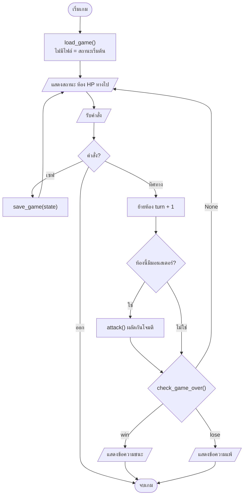
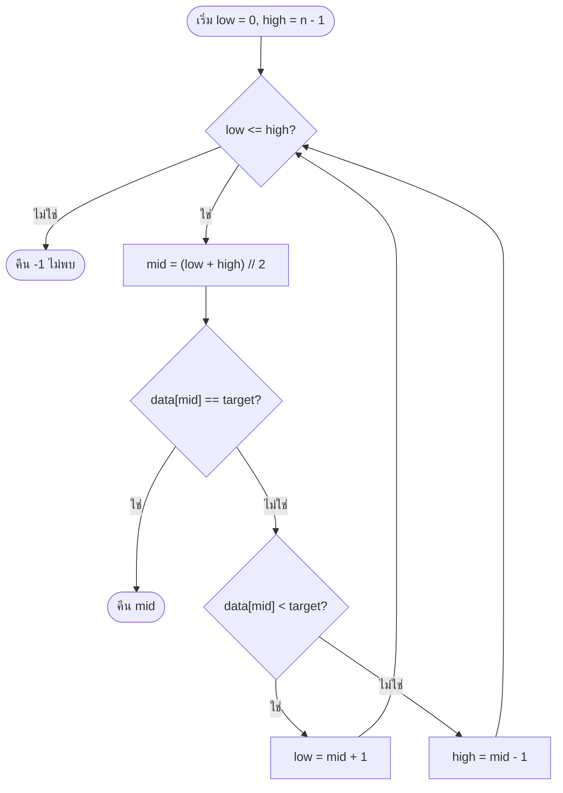

# 🧪 Lab 04: อัลกอริทึมและสรุป Mini-Project 1

> **โมดูล:** Module 1 - Foundation & Programming (Mini-Project 1)
> **เวลาที่ใช้:** 2 ชั่วโมง (ในห้องปฏิบัติการ) + เวลาศึกษาด้วยตนเอง

## 🎯 จุดประสงค์การทดลอง (Objectives)
- วิเคราะห์ Big-O วาด Flowchart และนำเสนอเกมที่พัฒนาขึ้น
- ประยุกต์ใช้ความรู้จากภาคทฤษฎี (สัปดาห์ที่ 4) สู่การปฏิบัติจริง
- เสริมสร้างทักษะการทำงานกลุ่มผ่าน Mini-Project

## 🛠️ เครื่องมือที่ต้องใช้ (Prerequisites & Tools)
- เครื่องคอมพิวเตอร์และอินเทอร์เน็ต พร้อม Python 3 และ VS Code (หรือ Google Colab)
- เครื่องมือวาดผังงาน: **draw.io** ([app.diagrams.net](https://app.diagrams.net/), ใช้ผ่าน browser ได้ทันที หรือ extension **Draw.io Integration** ใน VS Code) หรือเขียน **mermaid** ใน Markdown (GitHub แสดงผลให้อัตโนมัติ)
- ทบทวน [[02_การวิเคราะห์ความซับซ้อน_Big_O]] และ [[Big-O Notation]]
- repository ของทีมที่มีเกมจาก Lab 01–03 (game loop, Save/Load, Game Logic)

> [!note] ผลลัพธ์ในใบงานนี้
> output ได้จากการรันจริง (Python 3.14.3, Windows 11) **จำนวนขั้น (steps) จะเท่ากันทุกเครื่อง** แต่ **เวลา (ms) ขึ้นกับความเร็วเครื่องและงานอื่นที่รันอยู่** อาจต่างจากใบงานหลายเท่า ให้ดูแนวโน้มการเติบโต ไม่ใช่ตัวเลขเป๊ะ ๆ

---

## 🕒 ส่วนที่ 1: ทฤษฎีประยุกต์ประจำสัปดาห์ (1 ชั่วโมง)

**ภาพรวม:** แทนอัลกอริทึมด้วย flowchart แล้ววัดประสิทธิภาพจริงของการค้นหา 2 แบบ เพื่อดูว่าเมื่อข้อมูลโตจาก 10 เป็น 1,000,000 ตัว จำนวนขั้นของแต่ละแบบโตอย่างไร และตรงกับ Big-O หรือไม่

### ขั้นตอนที่ 1: วาด Flowchart ของ Game Loop (15 นาที)

ใช้สัญลักษณ์มาตรฐานของผังงาน

| สัญลักษณ์ | ความหมาย | ใน mermaid |
|---|---|---|
| วงรี | เริ่มต้น / สิ้นสุด | `A(["เริ่ม"])` |
| สี่เหลี่ยมผืนผ้า | การประมวลผล | `B["hp = hp - damage"]` |
| สี่เหลี่ยมด้านขนาน | รับเข้า / แสดงผล | `C[/"รับคำสั่ง"/]` |
| สี่เหลี่ยมข้าวหลามตัด | การตัดสินใจ (ใช่/ไม่ใช่) | `D{"hp <= 0?"}` |
| ลูกศร | ทิศทางการทำงาน | `A --> B` |

ตัวอย่าง flowchart ของเกมที่มี Save/Load (Lab 02) และการต่อสู้ (Lab 03) ครบแล้ว ทีมต้องวาดของเกมตัวเองให้ **ตรงกับโค้ดจริง**



> [!tip] วาดใน draw.io
> เปิด app.diagrams.net > **Create New Diagram** > เลือก template **Flowchart** ลากสัญลักษณ์จากหมวด Flowchart ทางซ้าย ลากเส้นเชื่อมจากจุดสีน้ำเงินที่ขอบ shape แล้ว **File > Export as > PNG** บันทึกเป็น `docs/flowchart.png` ใน repository (หรือบันทึก `.drawio` ไว้แก้ภายหลังด้วย)

### ขั้นตอนที่ 2: เขียน Linear Search และ Binary Search

สร้างไฟล์ `search.py` ทั้งสองฟังก์ชันคืนค่า `(index, จำนวนครั้งที่เปรียบเทียบ)` เพื่อนับขั้นได้

```python
def linear_search(data, target):
    """ไล่ดูทีละตัวจากซ้ายไปขวา คืน (index, จำนวนครั้งที่เปรียบเทียบ)"""
    steps = 0
    for i, value in enumerate(data):
        steps += 1
        if value == target:
            return i, steps
    return -1, steps

def binary_search(data, target):
    """data ต้องเรียงจากน้อยไปมากแล้ว ตัดช่วงค้นหาทีละครึ่ง"""
    low, high = 0, len(data) - 1
    steps = 0
    while low <= high:
        steps += 1
        mid = (low + high) // 2
        if data[mid] == target:
            return mid, steps
        elif data[mid] < target:
            low = mid + 1          # target อยู่ครึ่งขวา
        else:
            high = mid - 1         # target อยู่ครึ่งซ้าย
    return -1, steps

scores = [12, 25, 31, 47, 58, 63, 77, 84, 90, 99]
print(linear_search(scores, 77))
print(binary_search(scores, 77))
print(binary_search(scores, 50))     # ไม่พบ
```

```output
(6, 7)
(6, 4)
(-1, 4)
```

- หา 77 ที่ index 6: linear ต้องดู 7 ตัว ส่วน binary ดูแค่ 4 ครั้ง (index 4 → 7 → 5 → 6)
- กรณีไม่พบ linear ต้องดู **ครบทุกตัว** ส่วน binary หยุดเมื่อ `low > high`
- binary search ใช้ได้ **เฉพาะข้อมูลที่เรียงแล้ว** ถ้าข้อมูลไม่เรียงต้อง `sorted()` ก่อน ซึ่งใช้เวลา O(n log n)

แผนภาพการตัดสินใจของ binary search ในแต่ละรอบ



### ขั้นตอนที่ 3: วัดจำนวนขั้นและเวลาเมื่อ n โตขึ้น

เขียนต่อในไฟล์ `search.py` (ใช้ฟังก์ชันจากขั้นตอนที่ 2) ค้นหาตัวสุดท้ายของลิสต์ ซึ่งเป็น **กรณีแย่ที่สุด (worst case)** ของ linear search

```python
import math
import time

print(f"{'n':>9} | {'linear steps':>12} | {'binary steps':>12} | {'log2(n)':>7} | {'linear ms':>9} | {'binary ms':>9}")
print("-" * 74)
for n in [10, 100, 1_000, 10_000, 100_000, 1_000_000]:
    data = list(range(n))       # ข้อมูลเรียงแล้ว: 0, 1, 2, ..., n-1
    target = n - 1              # กรณีแย่ที่สุดของ linear search: ตัวสุดท้าย

    t0 = time.perf_counter()
    _, lin_steps = linear_search(data, target)
    t_lin = (time.perf_counter() - t0) * 1000

    t0 = time.perf_counter()
    _, bin_steps = binary_search(data, target)
    t_bin = (time.perf_counter() - t0) * 1000

    print(f"{n:>9,} | {lin_steps:>12,} | {bin_steps:>12} | {math.log2(n):>7.1f} | {t_lin:>9.3f} | {t_bin:>9.4f}")
```

```output
        n | linear steps | binary steps | log2(n) | linear ms | binary ms
--------------------------------------------------------------------------
       10 |           10 |            4 |     3.3 |     0.004 |    0.0029
      100 |          100 |            7 |     6.6 |     0.006 |    0.0020
    1,000 |        1,000 |           10 |    10.0 |     0.050 |    0.0024
   10,000 |       10,000 |           14 |    13.3 |     0.515 |    0.0028
  100,000 |      100,000 |           17 |    16.6 |     5.627 |    0.0063
1,000,000 |    1,000,000 |           20 |    19.9 |    52.671 |    0.0084
```

**อ่านผล**

- **linear steps = n พอดี** ข้อมูลเพิ่ม 10 เท่า จำนวนขั้นเพิ่ม 10 เท่า และเวลาก็เพิ่มราว 10 เท่า (0.515 → 5.627 → 52.671 ms) นี่คือ **O(n)**
- **binary steps ≈ ⌈log₂ n⌉** ข้อมูลเพิ่ม 10 เท่า จำนวนขั้นเพิ่มแค่ 3–4 ขั้น (log₂ 10 ≈ 3.3) ข้อมูลล้านตัวใช้เพียง 20 ขั้น นี่คือ **O(log n)**
- ที่ n = 10 เวลาของทั้งสองแบบแทบไม่ต่างกัน เพราะเวลาคงที่ (overhead ของการเรียกฟังก์ชันและจับเวลา) มีผลมากกว่าตัวอัลกอริทึม Big-O บอกพฤติกรรมเมื่อ **n ใหญ่** เท่านั้น
- เวลาเป็นการวัดครั้งเดียว จึงแกว่งได้ ถ้าต้องการค่าที่นิ่งกว่าให้ใช้ `timeit` วัดซ้ำหลายรอบ (ดูตัวอย่างใน [[02_การวิเคราะห์ความซับซ้อน_Big_O]])

### ขั้นตอนที่ 4: ตารางวิเคราะห์ Big-O

| การทำงาน | Best case | Worst case | Big-O (worst) | ตัวอย่างในเกม |
|---|---|---|---|---|
| อ่าน `list[i]` หรือ `dict[key]` | 1 ขั้น | 1 ขั้น | O(1) | `ROOMS[room][direction]` |
| Linear search | 1 (เจอตัวแรก) | n (ตัวสุดท้าย/ไม่พบ) | O(n) | หาไอเทมใน inventory ที่ไม่เรียง |
| Binary search | 1 (เจอตรงกลาง) | ⌊log₂ n⌋ + 1 | O(log n) | หาอันดับในตาราง high score ที่เรียงแล้ว |
| `sorted(list)` | n log n | n log n | O(n log n) | เรียง high score ก่อนแสดงผล |
| ลูปซ้อน 2 ชั้น | n² | n² | O(n²) | ตรวจการชนกันของวัตถุทุกคู่ในเกม 2D |

| n | O(1) | O(log n) | O(n) | O(n log n) | O(n²) |
|---|---|---|---|---|---|
| 10 | 1 | 3.3 | 10 | 33 | 100 |
| 1,000 | 1 | 10 | 1,000 | 9,966 | 1,000,000 |
| 1,000,000 | 1 | 19.9 | 1,000,000 | 19,931,569 | 10¹² |

### ขั้นตอนที่ 5: บันทึกผลการสังเกต

1. จากตาราง n = 100,000 กับ 1,000,000 จำนวนขั้นของ linear และ binary เพิ่มขึ้นกี่เท่า สอดคล้องกับ Big-O อย่างไร
2. ทำไมเวลาที่วัดได้ของแต่ละคนในห้องจึงไม่เท่ากัน แต่จำนวนขั้นเท่ากัน
3. ถ้าค้นหาในลิสต์ที่ **ยังไม่เรียง** เพียง 1 ครั้ง ควรใช้ linear หรือ sort แล้ว binary search เพราะอะไร
4. ถ้าต้องค้นหาซ้ำ 10,000 ครั้งในลิสต์เดิมขนาด 1,000,000 ตัว ควรเลือกวิธีใด และมีโครงสร้างข้อมูลอื่นที่ดีกว่าหรือไม่

<details><summary>ดูเฉลย</summary>

1. linear เพิ่มจาก 100,000 เป็น 1,000,000 ขั้น (**10 เท่า**) ตรงกับ O(n) ที่โตตาม n ส่วน binary เพิ่มจาก 17 เป็น 20 ขั้น (**เพิ่ม 3 ขั้น** ไม่ใช่เพิ่มเป็นเท่าตัว) ตรงกับ O(log n) ที่ n เพิ่ม 10 เท่าแล้วขั้นเพิ่มประมาณ log₂ 10 ≈ 3.3
2. จำนวนขั้นขึ้นกับ **อัลกอริทึมและข้อมูล** เท่านั้น แต่เวลาขึ้นกับ **ฮาร์ดแวร์** (ความเร็ว CPU, cache, RAM จาก [[Lab 02 - Hardware Specs and Data Extraction|Lab 02]]) และโปรแกรมอื่นที่รันพร้อมกัน นี่คือเหตุผลที่วัดอัลกอริทึมด้วย Big-O แทนการจับเวลา
3. ใช้ **linear search** เพราะเป็น O(n) ส่วนการ sort ก่อนเป็น O(n log n) ซึ่งช้ากว่าการไล่หาครั้งเดียวอยู่แล้ว
4. ควร **sort ครั้งเดียว** (O(n log n)) แล้วใช้ binary search 10,000 ครั้ง (ครั้งละ ~20 ขั้น) แทน linear ที่อาจต้อง 10,000 × 1,000,000 = 10¹⁰ ขั้น และถ้าต้องการแค่ "มีหรือไม่มี" ใช้ **`set` หรือ `dict`** ที่ค้นหาเฉลี่ย O(1) จะเร็วที่สุด
</details>

---

## 🚀 ส่วนที่ 2: งานพัฒนา Mini-Project (1 ชั่วโมง + การบ้าน)

- **เป้าหมายสัปดาห์นี้:** ปิดงาน **Mini-Project 1: Simple Text/2D Game** ให้เล่นได้ครบตั้งแต่ต้นจนจบ พร้อมนำเสนอและสาธิตการเล่น
- **โจทย์:** (1) ตรวจเกมตาม checklist ด้านล่าง (2) ใส่ flowchart และตาราง Big-O ของฟังก์ชันหลักใน README (3) เตรียมสไลด์นำเสนอ 5–7 นาทีพร้อม demo สด

### ขั้นตอนที่ 1: Checklist ความสมบูรณ์ของเกม

| ฟีเจอร์ | มาจาก | ผ่าน? |
|---|---|---|
| game loop รับคำสั่ง แสดงสถานะ และจบเกมได้ | Lab 01 | ☐ |
| คำสั่งผิดหรือพิมพ์ว่างไม่ทำให้เกม crash | Lab 01 | ☐ |
| Save/Load ด้วย JSON รองรับกรณีไม่มีไฟล์และไฟล์เสีย | Lab 02 | ☐ |
| เงื่อนไขชนะ/แพ้ และ game logic อย่างน้อย 3 เงื่อนไข | Lab 03 | ☐ |
| `assert` ทดสอบ game logic รันผ่าน | Lab 03 | ☐ |
| ใช้การค้นหาหรือเรียงข้อมูลอย่างน้อย 1 จุด (เช่น high score, หาไอเทม) พร้อมระบุ Big-O | Lab 04 | ☐ |
| flowchart ใน `docs/` ตรงกับโค้ดจริง | Lab 04 | ☐ |
| README มีวิธีรัน กติกา System Requirements สมาชิกและหน้าที่ | Lab 01–02 | ☐ |
| สมาชิกทุกคนมี commit ใน repository | ทั้งโมดูล | ☐ |

### ขั้นตอนที่ 2: วิเคราะห์ Big-O ของโค้ดเกมตัวเอง

เลือกฟังก์ชันหลักอย่างน้อย 3 ฟังก์ชันแล้วกรอกตารางนี้ใน README

| ฟังก์ชัน | หน้าที่ | n คืออะไร | Big-O | เหตุผล |
|---|---|---|---|---|
| `update()` | ย้ายห้องตามคำสั่ง | - | O(1) | อ่านจาก dict ครั้งเดียว |
| `find_item(inventory, name)` | หาไอเทม | จำนวนไอเทม | O(n) | ไล่ดูทีละชิ้น |
| `show_top_scores(scores)` | เรียงและแสดง 5 อันดับ | จำนวนคะแนน | O(n log n) | ใช้ `sorted()` |

### ขั้นตอนที่ 3: โครงสไลด์นำเสนอ (5–7 นาที)

| สไลด์ | เนื้อหา | เวลา |
|---|---|---|
| 1. ชื่อเกมและทีม | ชื่อเกม แนวเกม สมาชิกและบทบาท | 0:30 |
| 2. แนวคิดและกติกา | เป้าหมาย เงื่อนไขชนะ/แพ้ คำสั่งหลัก | 1:00 |
| 3. Flowchart | game loop และจุดตัดสินใจสำคัญ | 1:00 |
| 4. เทคนิคที่ใช้ | Save/Load (JSON), Game Logic (boolean), การค้นหา + Big-O | 1:00 |
| 5. Demo สด | เล่นจริงตั้งแต่เริ่มจนชนะหรือแพ้ แสดง Save/Load | 2:00 |
| 6. ปัญหาที่พบและบทเรียน | bug ที่แก้, conflict ใน Git, สิ่งที่จะทำต่อ | 0:30 |
| ถาม-ตอบ | ทุกคนในทีมต้องตอบคำถามเกี่ยวกับส่วนที่ตนรับผิดชอบได้ | 2:00 |

### ขั้นตอนที่ 4: Demo checklist (ทำก่อนขึ้นนำเสนอ)

- [ ] `git pull` เวอร์ชันล่าสุดจาก `main` บนเครื่องที่ใช้ demo และรัน `python main.py` ผ่าน
- [ ] เตรียมไฟล์เซฟตัวอย่าง (เช่น `demo_save.json`) ที่อยู่ก่อนฉากสำคัญ จะได้ไม่ต้องเล่นตั้งแต่ต้น
- [ ] เขียน "บทเล่น" (ลำดับคำสั่งที่จะพิมพ์) ไว้ล่วงหน้า และซ้อมให้จบในเวลา 2 นาที
- [ ] ขยายฟอนต์ Terminal ให้คนหลังห้องอ่านออก (`Ctrl+=` ใน VS Code)
- [ ] สำรอง **วิดีโออัดหน้าจอ** การเล่น 1–2 นาที (Windows: `Win+G` Xbox Game Bar หรือ `Win+Shift+R` ใน Snipping Tool) ไว้เปิดแทนถ้า demo สดมีปัญหา
- [ ] ปิดการแจ้งเตือนและแท็บที่ไม่เกี่ยวข้องบนเครื่องที่ฉายจอ

### งานที่ทีมต้องทำต่อ (การบ้าน)

1. แก้ทุกข้อใน checklist ขั้นตอนที่ 1 ให้ผ่าน แล้ว commit ครั้งสุดท้ายพร้อม tag เวอร์ชัน: `git tag v1.0` และ `git push origin v1.0`
2. เพิ่มฟีเจอร์ที่ใช้การค้นหาอย่างน้อย 1 จุด เช่น ตารางคะแนนสูงสุดที่เรียงแล้วใช้ binary search หาอันดับของผู้เล่น
3. สมาชิกแต่ละคนเขียนสะท้อนคิด 3–5 บรรทัดใน `docs/progress-log.md`: ทำส่วนไหน เรียนรู้อะไร และใช้ AI ช่วยตรงไหนบ้าง (เปิดเผยตามหลักความซื่อสัตย์ทางวิชาการ)

---

## 📝 เกณฑ์การส่งงานและการประเมิน (Deliverables & Rubric)
- ส่งรายงานความคืบหน้า (Progress Log) เป็นไฟล์ Markdown ผ่าน GitHub
- ส่งโค้ดต้นฉบับผ่าน Repository ของกลุ่ม
- ให้ฟีดแบ็กความสมบูรณ์โดยพิจารณาจากเกณฑ์ของ CLO3, CLO6

**ส่วนที่ 1 (รายบุคคล):** `search.py` รันได้ พร้อมตารางผลการวัดของเครื่องตัวเองและคำตอบบันทึกผล 4 ข้อ

**Mini-Project 1 (รายกลุ่ม)** ใช้เกณฑ์ 3 ระดับแบบเดียวกับ rubric การนำเสนอโครงงานใน [[การวัดและประเมินผล]]

| เกณฑ์ | ดีมาก (3) | ดี (2) | พอใช้ (1) |
|---|---|---|---|
| เกมทำงานได้ | เล่นจบได้ทุกเส้นทาง ไม่ crash แม้พิมพ์ผิด Save/Load ใช้ได้ | เล่นจบได้ มี bug เล็กน้อย | crash หรือเล่นไม่จบ |
| Game logic และอัลกอริทึม | เงื่อนไข ≥ 3 ข้อมี `assert` ทดสอบ ใช้การค้นหาพร้อมวิเคราะห์ Big-O ถูกต้อง | มีเงื่อนไขครบ แต่ทดสอบ/วิเคราะห์ไม่ครบ | เงื่อนไขพื้นฐานเท่านั้น |
| Flowchart และเอกสาร | flowchart ตรงกับโค้ด README ครบทุกหัวข้อ | มีครบแต่บางส่วนไม่ตรงกับโค้ด | ขาดเอกสารสำคัญ |
| การนำเสนอและ demo | ตรงเวลา demo ราบรื่น มีแผนสำรอง | demo ได้แต่ติดขัด | demo ไม่ได้หรือเกินเวลามาก |
| การทำงานเป็นทีม | ทุกคนมี commit และตอบคำถามส่วนของตนได้ | ส่วนใหญ่มีส่วนร่วม | พึ่งบางคน |

## 🔗 ลิงก์ที่เกี่ยวข้อง
- ⬅️ กลับไปยังสารบัญ Lab: [[_index|สารบัญ Lab]]
- 📚 กลับไปยังเนื้อหาสัปดาห์: [[Week 04]] · [[Week 04 - Algorithms & Programming Paradigms]]
- 📖 ทฤษฎีประกอบ: [[01_การคิดเชิงคำนวณแบบเจาะลึก]] · [[02_การวิเคราะห์ความซับซ้อน_Big_O]] · [[Big-O Notation]] · [[05_Version_Control_และ_Concurrency]]
- ⬅️ แล็บก่อนหน้า: [[Lab 03 - Logic Circuit and Data Processing]] | ➡️ แล็บถัดไป (Module 2): [[Lab 05 - Database Design and SQL]]
