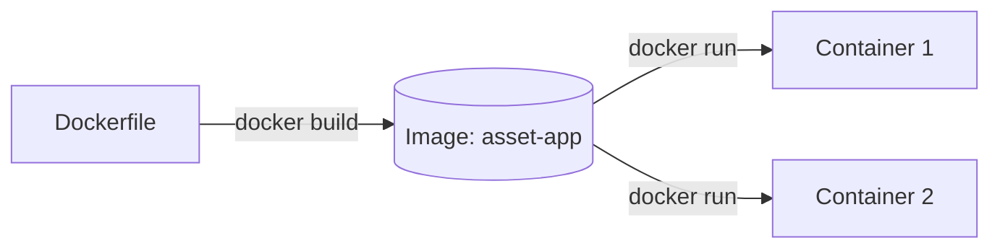

# 🧪 Lab 07: สถาปัตยกรรมคลาวด์และการ Deploy

> **โมดูล:** Module 2 - Web Development (Mini-Project 2)
> **เวลาที่ใช้:** 2 ชั่วโมง (ในห้องปฏิบัติการ) + เวลาศึกษาด้วยตนเอง

## 🎯 จุดประสงค์การทดลอง (Objectives)
- บรรจุเว็บแอปด้วย Docker และทดลอง Deploy บน Cloud
- ประยุกต์ใช้ความรู้จากภาคทฤษฎี (สัปดาห์ที่ 7) สู่การปฏิบัติจริง
- เสริมสร้างทักษะการทำงานกลุ่มผ่าน Mini-Project

## 🛠️ เครื่องมือที่ต้องใช้ (Prerequisites & Tools)
- เครื่องคอมพิวเตอร์และอินเทอร์เน็ต
- Docker Desktop / Docker Engine, แอป asset-app จาก Lab 06, บัญชี GitHub (และบัญชี PaaS ถ้าทำงานทางเลือก)

---

## 🕒 ส่วนที่ 1: บรรจุแอปลงคอนเทนเนอร์ด้วย Docker (1 ชั่วโมง)

ทบทวนทฤษฎีที่ [[Week 07 - Data Center & Cloud Infrastructure]] ก่อนเริ่ม แล็บนี้ใช้แอป `asset-app` (Flask) ที่สร้างใน [[Lab 06 - Network Simulation and API Router]]

> [!note] สิ่งที่ต้องติดตั้ง
> **Docker Desktop** (Windows/macOS) หรือ Docker Engine (Linux) ตรวจสอบด้วย `docker --version` บน Windows ต้องเปิด Docker Desktop ให้ทำงานก่อนใช้คำสั่ง

### แนวคิดสำคัญ: Image vs Container, Build vs Run

| คำศัพท์ | ความหมาย | อุปมา |
| :--- | :--- | :--- |
| **Dockerfile** | ไฟล์ข้อความที่เขียน "สูตร" การสร้าง Image ทีละขั้น | สูตรอาหาร |
| **Image** | แม่แบบแบบอ่านอย่างเดียว (Read-only) ที่มี OS ขนาดเล็ก + Runtime + โค้ด + Library | อาหารแช่แข็งที่ทำเสร็จแล้ว / แม่พิมพ์ |
| **Container** | **อินสแตนซ์ที่กำลังทำงาน** ซึ่งสร้างจาก Image (Image เดียวสร้างได้หลาย Container) | อาหารที่อุ่นแล้วกำลังเสิร์ฟ |
| `docker build` | อ่าน Dockerfile แล้ว **สร้าง Image** | ทำอาหารตามสูตรแล้วแช่แข็งเก็บไว้ |
| `docker run` | นำ Image มา **สร้างและเริ่ม Container** | นำออกมาอุ่นและเสิร์ฟ |



### ขั้นตอนที่ 1: เตรียมไฟล์ในโฟลเดอร์ `asset-app`

```text
asset-app/
├── app.py              # จาก Lab 06
├── requirements.txt
└── Dockerfile
```

สร้าง `requirements.txt` ที่มีบรรทัดเดียว

```text
flask
```

### ขั้นตอนที่ 2: เขียน `Dockerfile`

```dockerfile
# 1) เริ่มจาก Image ที่มี Python ติดตั้งไว้แล้ว (slim = ขนาดเล็ก)
FROM python:3.12-slim

# 2) กำหนดโฟลเดอร์ทำงานภายในคอนเทนเนอร์
WORKDIR /app

# 3) คัดลอกรายการ Library แล้วติดตั้งก่อน (ช่วยให้ build ครั้งต่อไปเร็วขึ้นด้วย Layer Cache)
COPY requirements.txt .
RUN pip install --no-cache-dir -r requirements.txt

# 4) คัดลอกโค้ดของเรา
COPY . .

# 5) บอกว่าแอปฟังที่พอร์ต 5000 (เป็นเอกสารประกอบ ไม่ได้เปิดพอร์ตเอง)
EXPOSE 5000

# 6) คำสั่งที่จะรันเมื่อ Container เริ่มทำงาน
CMD ["python", "app.py"]
```

> [!warning] ต้องใช้ host="0.0.0.0"
> ใน `app.py` ต้องรันด้วย `app.run(host="0.0.0.0", port=5000)` ถ้าใช้ค่าเริ่มต้น `127.0.0.1` แอปจะรับเฉพาะการเชื่อมต่อจาก **ภายใน** Container ทำให้เบราว์เซอร์บนเครื่องเราเข้าไม่ได้

### ขั้นตอนที่ 3: Build Image

```bash
docker build -t asset-app .
```

`-t asset-app` คือตั้งชื่อ (tag) ให้ Image และ `.` คือใช้โฟลเดอร์ปัจจุบันเป็น Build Context

```output
[+] Building 25.3s (10/10) FINISHED
 => [1/5] FROM docker.io/library/python:3.12-slim
 => [2/5] WORKDIR /app
 => [3/5] COPY requirements.txt .
 => [4/5] RUN pip install --no-cache-dir -r requirements.txt
 => [5/5] COPY . .
 => exporting to image
 => => naming to docker.io/library/asset-app:latest
```

### ขั้นตอนที่ 4: ดูรายการ Image

```bash
docker images
```

```output
REPOSITORY   TAG       IMAGE ID       CREATED          SIZE
asset-app    latest    3f2a9c1b7d4e   30 seconds ago   140MB
```

### ขั้นตอนที่ 5: Run Container

```bash
docker run -d -p 5000:5000 --name asset-container asset-app
```

| ตัวเลือก | ความหมาย |
| :--- | :--- |
| `-d` | รันเบื้องหลัง (detached) ไม่ค้างหน้าจอ |
| `-p 5000:5000` | **Port Mapping** รูปแบบ `พอร์ตเครื่องเรา:พอร์ตใน Container` |
| `--name` | ตั้งชื่อ Container ให้เรียกง่าย |

ทดสอบด้วยเบราว์เซอร์ `http://localhost:5000/assets` หรือ `curl -i http://localhost:5000/assets` ควรได้ `HTTP/1.1 200 OK` พร้อม JSON เหมือน Lab 06

### ขั้นตอนที่ 6: ตรวจสอบ ดู Log และหยุด Container

```bash
docker ps                      # ดู Container ที่กำลังทำงาน
docker logs asset-container    # ดู Log ของแอป
docker stop asset-container    # หยุด Container
docker ps -a                   # ดูทั้งหมด รวมที่หยุดแล้ว
docker rm asset-container      # ลบ Container (Image ยังอยู่)
```

```output
CONTAINER ID   IMAGE       COMMAND           CREATED         STATUS         PORTS                    NAMES
a1b2c3d4e5f6   asset-app   "python app.py"   2 minutes ago   Up 2 minutes   0.0.0.0:5000->5000/tcp   asset-container
```

**วิธีอ่าน:** `STATUS: Up` แปลว่ากำลังทำงาน และ `PORTS: 0.0.0.0:5000->5000/tcp` คือพอร์ต 5000 ของเครื่องเราส่งต่อไปยังพอร์ต 5000 ใน Container

> [!tip] ทดลองเพิ่ม
> รัน Container ตัวที่สองจาก Image เดิมด้วย `docker run -d -p 5001:5000 --name asset2 asset-app` แล้วเปิด `http://localhost:5001/assets` จะเห็นว่า **Image เดียวสร้างได้หลาย Container** และแต่ละตัวมีข้อมูลในหน่วยความจำแยกกัน

### คำถามท้ายส่วนที่ 1
1. Image กับ Container ต่างกันอย่างไร? ยกตัวอย่างจากแล็บนี้
2. `docker build` กับ `docker run` ทำหน้าที่ต่างกันอย่างไร?
3. ถ้าเปลี่ยนเป็น `-p 8080:5000` ต้องเปิด URL ใด?
4. หลัง `docker stop` แล้ว `docker start asset-container` ข้อมูลที่ POST เพิ่มไว้ยังอยู่หรือไม่? ถ้า `docker rm` แล้ว `docker run` ใหม่ล่ะ? เพราะอะไร
5. Container ต่างจาก Virtual Machine (VM) อย่างไรในแง่ขนาดและความเร็วในการเริ่มทำงาน?

---

## 🚀 ส่วนที่ 2: Mini-Project 2 — รันหลายบริการและ Deploy ขึ้นคลาวด์ (1 ชั่วโมง + การบ้าน)

- **เป้าหมายสัปดาห์นี้:** ทำให้ Asset Management Web App รันได้เหมือนกันทุกเครื่องด้วย Docker และ (ทางเลือก) ออนไลน์ผ่าน PaaS
- **โจทย์:** เพิ่ม `Dockerfile` และ `compose.yaml` ลงใน Repository ของกลุ่ม แล้วให้สมาชิกทุกคนรันด้วยคำสั่งเดียวได้

### งาน A: Docker Compose (รันด้วยคำสั่งเดียว)

สร้างไฟล์ `compose.yaml` (หรือ `docker-compose.yml`)

```yaml
services:
  api:
    build: .
    ports:
      - "5000:5000"
    restart: unless-stopped
    # สัปดาห์ถัดไปสามารถเพิ่มบริการฐานข้อมูล เช่น postgres ไว้ใน services เดียวกันได้
```

```bash
docker compose up -d --build   # build และ run ทุกบริการ
docker compose ps              # ดูสถานะ
docker compose down            # หยุดและลบ Container ทั้งหมด
```

### งาน B (ทางเลือก): Deploy บน PaaS

ตัวอย่างขั้นตอนกับบริการ PaaS ที่รองรับ Docker เช่น Render (ขั้นตอนและเงื่อนไขแพ็กเกจฟรีอาจเปลี่ยนแปลง ให้ตรวจสอบเอกสารของผู้ให้บริการ)

1. Push โค้ดพร้อม `Dockerfile` ขึ้น GitHub
2. สร้าง Web Service ใหม่ เลือก Repository ของกลุ่ม ระบบจะตรวจพบ Dockerfile แล้ว Build ให้
3. ตั้งค่าพอร์ตให้ตรงกับแอป (5000) หรือแก้แอปให้อ่านพอร์ตจาก Environment Variable `PORT`
4. ทดสอบ `https://<ชื่อแอป>.onrender.com/assets`

> [!note] เชื่อมโยงทฤษฎี
> การ Deploy แบบนี้คือ **PaaS**: เราส่งแค่โค้ด/Image ส่วนผู้ให้บริการดูแลเซิร์ฟเวอร์ OS เครือข่าย และ HTTPS ให้ (ดู IaaS / PaaS / SaaS ในเนื้อหาสัปดาห์ที่ 7) ส่วน Vercel เหมาะกับ Frontend (เช่น Next.js) มากกว่า Backend ที่เป็น Container

### งานมอบหมายในทีม
- **DevOps:** เขียน Dockerfile, compose.yaml และเพิ่มไฟล์ `.dockerignore` (เช่น `venv/`, `__pycache__/`)
- **Backend:** ทำให้แอปอ่านพอร์ตจาก Environment Variable
- **Docs:** เขียนวิธีรันโปรเจกต์ด้วย Docker ไว้ใน README พร้อมภาพหน้าจอผล `docker ps`

---

## 📝 เกณฑ์การส่งงานและการประเมิน (Deliverables & Rubric)
- ส่งรายงานความคืบหน้า (Progress Log) เป็นไฟล์ Markdown ผ่าน GitHub
- ส่งโค้ดต้นฉบับผ่าน Repository ของกลุ่ม
- ให้ฟีดแบ็กความสมบูรณ์โดยพิจารณาจากเกณฑ์ของ CLO2, CLO4

## 🔗 ลิงก์ที่เกี่ยวข้อง
- ⬅️ กลับไปยังสารบัญ Lab: [[_index|สารบัญ Lab]]
- 📚 กลับไปยังเนื้อหาสัปดาห์: [[Week 07]]
