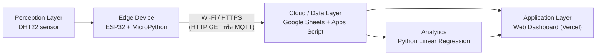

# 🧪 Lab 09: พื้นฐาน ML และสถาปัตยกรรม IoT

> **โมดูล:** Module 3 - IoT & Smart Systems (Mini-Project 3)
> **เวลาที่ใช้:** 2 ชั่วโมง (ในห้องปฏิบัติการ) + เวลาศึกษาด้วยตนเอง

## 🎯 จุดประสงค์การทดลอง (Objectives)
- รัน Linear Regression ง่ายๆ และวางผังสถาปัตยกรรม Smart Environment Monitor
- ประยุกต์ใช้ความรู้จากภาคทฤษฎี (สัปดาห์ที่ 9) สู่การปฏิบัติจริง
- เสริมสร้างทักษะการทำงานกลุ่มผ่าน Mini-Project

## 🛠️ เครื่องมือที่ต้องใช้ (Prerequisites & Tools)
- เครื่องคอมพิวเตอร์และอินเทอร์เน็ต
- Python 3.10 ขึ้นไป (หรือ Google Colab) พร้อมไลบรารี `numpy` และ `scikit-learn` (`pip install numpy scikit-learn`)
- เครื่องมือวาดผัง (draw.io / Mermaid) สำหรับวางสถาปัตยกรรม IoT

---

## 🕒 ส่วนที่ 1: การถดถอยเชิงเส้น (Linear Regression) ด้วย Python (1 ชั่วโมง)

> [!note] ทำไมต้องเรียน Linear Regression ในโมดูล IoT
> ข้อมูลจากเซนเซอร์ (อุณหภูมิ ความชื้น) เป็นตัวเลขต่อเนื่อง งาน ML ที่ง่ายที่สุดคือ "ทำนายค่าตัวเลข" เช่น ทำนายอุณหภูมิในชั่วโมงถัดไป หรือแปลงค่า analog ของเซนเซอร์เป็นหน่วยจริง (calibration) ซึ่งก็คือการหาเส้นตรงที่เข้ากับข้อมูลมากที่สุด

### 1.1 Model: สมการเส้นตรง

$$\hat{y} = mx + c$$

| สัญลักษณ์ | ความหมาย |
|---|---|
| $x$ | input (feature) เช่น ชั่วโมงของวัน |
| $\hat{y}$ (y-hat) | ค่าที่ model **ทำนาย** |
| $y$ | ค่า **จริง** จาก dataset |
| $m$ | ความชัน (slope / weight): $x$ เพิ่ม 1 หน่วย $\hat{y}$ เพิ่ม $m$ หน่วย |
| $c$ | จุดตัดแกน y (intercept / bias): ค่า $\hat{y}$ เมื่อ $x = 0$ |

"การ train" คือการหาค่า $m$ และ $c$ ที่ทำให้ $\hat{y}$ ใกล้ $y$ มากที่สุด

```python
def my_linear(m, c, x):
    return m * x + c

print(my_linear(0.625, 1, 7))
print(my_linear(2, 1, 10))
```

```output
5.375
21
```

**อธิบาย:** ฟังก์ชันรับ parameter `m`, `c` และ input `x` แล้วคืนค่า $mx + c$
- $m=0.625, c=1, x=7$: $0.625 \times 7 + 1 = 4.375 + 1 = 5.375$
- $m=2, c=1, x=10$: $2 \times 10 + 1 = 21$ (ผลเป็น `int` เพราะทุกตัวเป็นจำนวนเต็ม)

> [!tip] ฝึกคิดในใจ
> ทำนายด้วยมือก่อนรันโค้ดทุกครั้ง: คูณ $m$ กับ $x$ ก่อน แล้วค่อยบวก $c$ (คูณก่อนบวก)

### 1.2 Residual / Error: ทำนายพลาดไปเท่าไร

$$e_i = y_i - \hat{y}_i$$

ตัวอย่าง dataset 5 จุด กับ model $m=2, c=1$ (คือ $\hat{y} = 2x + 1$)

| $i$ | $x$ | $y$ (จริง) | $\hat{y}=2x+1$ | $e = y-\hat{y}$ | $\lvert e\rvert$ | $e^2$ |
|---|---|---|---|---|---|---|
| 1 | 1 | 3 | 3 | 0 | 0 | 0 |
| 2 | 2 | 4 | 5 | −1 | 1 | 1 |
| 3 | 3 | 9 | 7 | 2 | 2 | 4 |
| 4 | 4 | 9 | 9 | 0 | 0 | 0 |
| 5 | 5 | 13 | 11 | 2 | 2 | 4 |
| **รวม** | | | | **3** | **5** | **9** |

- $e > 0$ แปลว่า model ทำนาย **ต่ำกว่า** ค่าจริง, $e < 0$ แปลว่าทำนาย **สูงกว่า**
- ผลรวม $e$ ดิบๆ ไม่ใช่ตัววัดที่ดี เพราะค่าบวกกับค่าลบหักล้างกันได้

### 1.3 ตัววัดความผิดพลาด 3 ตัว: MAE, MSE, RMSE

| Metric | สูตร | ค่าจากตารางข้างบน | หน่วย |
|---|---|---|---|
| **MAE** (Mean Absolute Error) | $\text{MAE} = \frac{1}{N}\sum_{i=1}^{N} \lvert e_i \rvert$ | $5/5 = 1.0$ | เดียวกับ $y$ |
| **MSE** (Mean Squared Error) | $\text{MSE} = \frac{1}{N}\sum_{i=1}^{N} e_i^2$ | $9/5 = 1.8$ | หน่วยของ $y$ ยกกำลังสอง |
| **RMSE** (Root MSE) | $\text{RMSE} = \sqrt{\text{MSE}}$ | $\sqrt{1.8} \approx 1.3416$ | เดียวกับ $y$ |

```python
def my_linear(m, c, x):
    return m * x + c

xs = [1, 2, 3, 4, 5]
ys = [3, 4, 9, 9, 13]
m, c = 2, 1

y_hat = [my_linear(m, c, x) for x in xs]
errors = [y - yh for y, yh in zip(ys, y_hat)]   # e = y - y_hat
N = len(xs)
mae  = sum(abs(e) for e in errors) / N
mse  = sum(e ** 2 for e in errors) / N
rmse = mse ** 0.5
print("y_hat  =", y_hat)
print("errors =", errors)
print("sum(errors) =", sum(errors))
print("MAE  =", mae)
print("MSE  =", mse)
print("RMSE =", round(rmse, 4))
```

```output
y_hat  = [3, 5, 7, 9, 11]
errors = [0, -1, 2, 0, 2]
sum(errors) = 3
MAE  = 1.0
MSE  = 1.8
RMSE = 1.3416
```

**อธิบายโค้ด:**
- `zip(ys, y_hat)` จับคู่ค่าจริงกับค่าทำนายทีละตำแหน่ง
- `abs(e)` = ค่าสัมบูรณ์ (ใช้ใน MAE), `e ** 2` = ยกกำลังสอง (ใช้ใน MSE)
- `mse ** 0.5` = รากที่สอง (เทียบเท่า `math.sqrt(mse)`)

#### ทำไม MSE ต้อง "ยกกำลังสอง"
1. **ไม่หักล้างกัน (no cancellation):** $(-2)^2 = 2^2 = 4$ error ทั้งบวกและลบกลายเป็นบวกหมด (ผลรวม $e$ ดิบอาจเป็น 0 ทั้งที่ทำนายผิดทุกจุด)
2. **ลงโทษ error ใหญ่หนักกว่า (penalize large errors):** error 1 → 1, error 2 → 4, error 4 → 16 ค่าที่ผิดมากจุดเดียวดัน MSE ขึ้นแรง (MSE/RMSE จึงไวต่อ outlier มากกว่า MAE)
3. **หาอนุพันธ์ได้ทุกจุด (differentiable):** $e^2$ เป็นเส้นโค้งเรียบ ส่วน $\lvert e \rvert$ มีมุมหักที่ $e=0$ จึงหาอนุพันธ์ตรงนั้นไม่ได้ ซึ่ง Gradient Descent (ข้อ 1.5) ต้องใช้อนุพันธ์
4. **RMSE** ถอดรากกลับเพื่อให้หน่วยเท่ากับ $y$ (เช่น °C) อ่านง่ายกว่า MSE (°C²)

> [!note] ความสัมพันธ์ที่ควรจำ
> $\text{RMSE} \ge \text{MAE}$ เสมอ และจะเท่ากันเมื่อ $\lvert e_i \rvert$ ทุกตัวเท่ากัน ยิ่ง RMSE ห่างจาก MAE มาก แปลว่ามี error ก้อนใหญ่ปนอยู่

### 1.4 Spot the Bug: ตัวแปรชื่อ `mse` แต่คำนวณ MAE

```python
xs = [1, 2, 3, 4, 5]
ys = [3, 4, 9, 9, 13]
m, c = 2, 1
y_hat = [m * x + c for x in xs]

mse = 0
for y, yh in zip(ys, y_hat):
    mse += abs(y - yh)          # BUG: abs() -> this is MAE, not MSE
mse = mse / len(ys)
print("mse (buggy)   =", mse)

mse_ok = 0
for y, yh in zip(ys, y_hat):
    mse_ok += (y - yh) ** 2     # FIX: square the error
mse_ok = mse_ok / len(ys)
print("mse (correct) =", mse_ok)
```

```output
mse (buggy)   = 1.0
mse (correct) = 1.8
```

> [!warning] ชื่อตัวแปรไม่ได้รับประกันว่าคำนวณถูก
> โค้ดชุดแรกตั้งชื่อว่า `mse` แต่ใช้ `abs()` จึงได้ **MAE** (1.0) ไม่ใช่ MSE (1.8) วิธีจับ bug คือดูว่าในลูปทำอะไรกับ error: `abs(...)` = MAE, `(...) ** 2` = MSE, ถ้ามี `** 0.5` หรือ `sqrt` ตอนท้ายด้วย = RMSE

### 1.5 Gradient Descent: ให้คอมพิวเตอร์ปรับ m และ c เอง

**Loss function** ใช้ MSE

$$L(m, c) = \frac{1}{N}\sum_{i=1}^{N}(\hat{y}_i - y_i)^2 = \frac{1}{N}\sum_{i=1}^{N}(mx_i + c - y_i)^2$$

> [!warning] Sign convention (สำคัญมาก)
> ในส่วน Gradient Descent นี้กำหนด $e_i = \hat{y}_i - y_i$ (**ทำนาย ลบ จริง** ซึ่งกลับด้านกับข้อ 1.2) จะได้ gradient
> $$\frac{\partial L}{\partial m} = \frac{2}{N}\sum_{i=1}^{N} e_i x_i \qquad \frac{\partial L}{\partial c} = \frac{2}{N}\sum_{i=1}^{N} e_i$$
> และอัปเดตแบบ **ลบ** gradient (เดินลงเขา)
> $$m \leftarrow m - \text{lr}\cdot\frac{\partial L}{\partial m} \qquad c \leftarrow c - \text{lr}\cdot\frac{\partial L}{\partial c}$$
> ถ้าใช้ $e = y - \hat{y}$ แทน สูตร gradient จะมีเครื่องหมายลบนำหน้า ($-\frac{2}{N}\sum e_i x_i$) ผลลัพธ์สุดท้ายเหมือนกัน แต่ห้ามผสมสองแบบในโค้ดเดียวกัน

ที่มาของสูตร (chain rule): $\frac{\partial}{\partial m}(mx_i+c-y_i)^2 = 2(mx_i+c-y_i)\cdot x_i = 2e_i x_i$ และ $\frac{\partial}{\partial c}(mx_i+c-y_i)^2 = 2e_i \cdot 1$

#### ตัวอย่างคำนวณ 1 รอบเต็ม (one worked iteration)

ข้อมูล `xs=[0,1,2,3]`, `ys=[1,3,4,8]` เริ่มที่ $m=2, c=1$, $\text{lr}=0.05$, $N=4$

| $x$ | $y$ | $\hat{y}=2x+1$ | $e=\hat{y}-y$ | $e \cdot x$ |
|---|---|---|---|---|
| 0 | 1 | 1 | 0 | 0 |
| 1 | 3 | 3 | 0 | 0 |
| 2 | 4 | 5 | 1 | 2 |
| 3 | 8 | 7 | −1 | −3 |
| **รวม** | | | **0** | **−1** |

1. $\text{grad}_m = \frac{2}{4}\times(-1) = -0.5$
2. $\text{grad}_c = \frac{2}{4}\times 0 = 0$
3. $m = 2 - 0.05\times(-0.5) = 2 + 0.025 = 2.025$
4. $c = 1 - 0.05\times 0 = 1$

gradient ของ $m$ เป็นลบ การลบ gradient จึงทำให้ $m$ **เพิ่มขึ้น** (เส้นชันขึ้นเพื่อไล่จุด $x=3, y=8$)

```python
xs = [0, 1, 2, 3]
ys = [1, 3, 4, 8]
m, c, lr = 2, 1, 0.05
N = len(xs)

e = [(m * x + c) - y for x, y in zip(xs, ys)]   # e = y_hat - y
print("e =", e)
grad_m = (2 / N) * sum(ei * xi for ei, xi in zip(e, xs))
grad_c = (2 / N) * sum(e)
print("grad_m =", grad_m, " grad_c =", grad_c)
m = m - lr * grad_m
c = c - lr * grad_c
print("new m =", round(m, 4), " new c =", round(c, 4))
```

```output
e = [0, 0, 1, -1]
grad_m = -0.5  grad_c = 0.0
new m = 2.025  new c = 1.0
```

#### Training loop หลายรอบ: loss ลดลงเรื่อยๆ

```python
def train(xs, ys, m=2.0, c=1.0, lr=0.05, epochs=10, show_every=1):
    N = len(xs)
    for epoch in range(epochs + 1):
        e = [(m * x + c) - y for x, y in zip(xs, ys)]   # e = y_hat - y
        loss = sum(ei ** 2 for ei in e) / N              # MSE
        if epoch % show_every == 0:
            print(f"epoch {epoch:4d}: m={m:8.4f} c={c:8.4f} loss={loss:10.4f}")
        if epoch == epochs:
            break
        grad_m = (2 / N) * sum(ei * xi for ei, xi in zip(e, xs))
        grad_c = (2 / N) * sum(e)
        m -= lr * grad_m
        c -= lr * grad_c
    return m, c

xs = [0, 1, 2, 3]
ys = [1, 3, 4, 8]
train(xs, ys, lr=0.05, epochs=5)
print("--- lr=0.05, 1000 epochs ---")
train(xs, ys, lr=0.05, epochs=1000, show_every=250)
```

```output
epoch    0: m=  2.0000 c=  1.0000 loss=    0.5000
epoch    1: m=  2.0250 c=  1.0000 loss=    0.4897
epoch    2: m=  2.0412 c=  0.9963 loss=    0.4849
epoch    3: m=  2.0524 c=  0.9904 loss=    0.4820
epoch    4: m=  2.0605 c=  0.9835 loss=    0.4798
epoch    5: m=  2.0668 c=  0.9761 loss=    0.4780
--- lr=0.05, 1000 epochs ---
epoch    0: m=  2.0000 c=  1.0000 loss=    0.5000
epoch  250: m=  2.1999 c=  0.7002 loss=    0.4500
epoch  500: m=  2.2000 c=  0.7000 loss=    0.4500
epoch  750: m=  2.2000 c=  0.7000 loss=    0.4500
epoch 1000: m=  2.2000 c=  0.7000 loss=    0.4500
```

**สังเกต:** epoch 1 ตรงกับที่คำนวณมือ ($m=2.025, c=1$) และ loss ลดลงทุกรอบจน **converge** ที่ $m=2.2, c=0.7$, loss $=0.45$ ซึ่งเป็นค่าต่ำสุดที่เส้นตรงทำได้กับข้อมูลชุดนี้ (loss ไม่เป็น 0 เพราะ 4 จุดนี้ไม่ได้อยู่บนเส้นตรงเดียวกัน)

#### ผลของ Learning Rate

```python
# ใช้ฟังก์ชัน train() เดิม (จัด format ตัวเลขให้กว้างขึ้น)
print("=== lr = 0.5 (too big) ===")
train(xs, ys, lr=0.5, epochs=5)
print("=== lr = 0.001 (too small) ===")
train(xs, ys, lr=0.001, epochs=1000, show_every=250)
```

```output
=== lr = 0.5 (too big) ===
epoch   0: m=    2.0000 c=    1.0000 loss=      0.5000
epoch   1: m=    2.2500 c=    1.0000 loss=      0.5938
epoch   2: m=    1.6250 c=    0.6250 loss=      1.7422
epoch   3: m=    3.7500 c=    1.5625 loss=     13.6133
epoch   4: m=   -2.9688 c=   -1.6250 loss=    135.4136
epoch   5: m=   18.6094 c=    8.4531 loss=   1384.6693
=== lr = 0.001 (too small) ===
epoch   0: m=    2.0000 c=    1.0000 loss=      0.5000
epoch 250: m=    2.0638 c=    0.9755 loss=      0.4783
epoch 500: m=    2.0870 c=    0.9394 loss=      0.4709
epoch 750: m=    2.1031 c=    0.9066 loss=      0.4655
epoch 1000: m=    2.1166 c=    0.8781 loss=      0.4615
```

| Learning rate | อาการ | สาเหตุ |
|---|---|---|
| ใหญ่เกินไป (0.5) | **Diverge / oscillate**: $m$ แกว่งข้ามไปมา (2.25 → 1.63 → 3.75 → −2.97 → 18.6) loss พุ่งเป็นพัน | ก้าวยาวเกินจนกระโดดข้ามจุดต่ำสุดไปไกลกว่าเดิมทุกรอบ |
| พอดี (0.05) | **Converge**: loss ลดลงสม่ำเสมอ ถึง 0.45 ภายใน 250 รอบ | ขนาดก้าวเหมาะสม |
| เล็กเกินไป (0.001) | **ช้ามาก**: 1000 รอบ loss ยัง 0.4615 ($m$ ยังไม่ถึง 2.2) | ก้าวสั้นจนต้องใช้รอบจำนวนมาก |

### 1.6 เทียบกับ scikit-learn `LinearRegression`

```python
import numpy as np
from sklearn.linear_model import LinearRegression
from sklearn.metrics import mean_absolute_error, mean_squared_error

X = np.array([0, 1, 2, 3]).reshape(-1, 1)   # sklearn needs 2-D X
y = np.array([1, 3, 4, 8])

model = LinearRegression()
model.fit(X, y)
print("m (coef_)      =", round(model.coef_[0], 4))
print("c (intercept_) =", round(model.intercept_, 4))

y_pred = model.predict(X)
print("y_pred =", np.round(y_pred, 2))
mse = mean_squared_error(y, y_pred)
print("MAE  =", round(mean_absolute_error(y, y_pred), 4))
print("MSE  =", round(mse, 4))
print("RMSE =", round(np.sqrt(mse), 4))
print("predict x=4 :", round(model.predict([[4]])[0], 4))
```

```output
m (coef_)      = 2.2
c (intercept_) = 0.7
y_pred = [0.7 2.9 5.1 7.3]
MAE  = 0.55
MSE  = 0.45
RMSE = 0.6708
predict x=4 : 9.5
```

**อธิบาย:**
- `reshape(-1, 1)` แปลง `[0,1,2,3]` เป็นเมทริกซ์ 4 แถว × 1 คอลัมน์ เพราะ scikit-learn ต้องการ `X` แบบ 2 มิติ (แถว = ตัวอย่าง, คอลัมน์ = feature)
- `fit()` หาค่า $m, c$ ด้วยวิธี Ordinary Least Squares (คำนวณคำตอบโดยตรง ไม่ต้องวนลูป) ได้ `coef_[0]` = $m$ = 2.2 และ `intercept_` = $c$ = 0.7 **ตรงกับ** Gradient Descent ที่ converge แล้ว
- MSE = 0.45 ตรงกับ loss สุดท้ายของ training loop
- `predict([[4]])` = $2.2\times4+0.7 = 9.5$

| | Gradient Descent (เขียนเอง) | scikit-learn |
|---|---|---|
| ผลลัพธ์ | $m=2.2, c=0.7$ (หลังประมาณ 250 รอบ, lr=0.05) | $m=2.2, c=0.7$ |
| ต้องเลือก lr / epochs | ต้องเลือก | ไม่ต้อง |
| ข้อดี | เข้าใจกลไก ขยายไปใช้กับ Neural Network ได้ | สั้น เร็ว แม่นยำ |

### 1.7 แบบฝึกหัด

**ข้อ 1.** `my_linear(0.5, 3, 8)` และ `my_linear(-1.5, 10, 4)` ได้ค่าเท่าไร

<details><summary>ดูเฉลย</summary>

- $0.5\times8+3 = 7.0$
- $-1.5\times4+10 = -6+10 = 4.0$

</details>

**ข้อ 2.** model $\hat{y}=3x-2$ ข้อมูล $x=[1,2,3]$, $y=[2,3,8]$ จงหา error ($e=y-\hat{y}$), MAE, MSE, RMSE

<details><summary>ดูเฉลย</summary>

- $\hat{y} = [1, 4, 7]$, $e = [1, -1, 1]$
- MAE $= (1+1+1)/3 = 1.0$
- MSE $= (1+1+1)/3 = 1.0$
- RMSE $= \sqrt{1} = 1.0$ (เท่ากันหมดเพราะ $\lvert e \rvert$ ทุกตัวเท่ากัน)

</details>

**ข้อ 3.** model A มี error `[1, -1, 1, -1]` model B มี error `[0, 0, 0, 4]` จงคำนวณ mean(e), MAE, MSE, RMSE ของทั้งสอง และอธิบายว่าทำไมต้องยกกำลังสอง

<details><summary>ดูเฉลย</summary>

```output
A MAE = 1.0  MSE = 1.0  RMSE = 1.0  mean(e) = 0.0
B MAE = 1.0  MSE = 4.0  RMSE = 2.0  mean(e) = 1.0
```

- model A มี mean(e) = 0 ทั้งที่ผิดทุกจุด แสดงว่าค่าเฉลี่ย error ดิบหักล้างกันได้ จึงต้องใช้ $\lvert e \rvert$ หรือ $e^2$
- MAE ของทั้งสองเท่ากัน (1.0) แต่ MSE ของ B สูงกว่ามาก (4.0) เพราะ error ก้อนใหญ่ (4) ถูกยกกำลังสองเป็น 16 แสดงว่า MSE ลงโทษ error ใหญ่หนักกว่า

</details>

**ข้อ 4.** โค้ดต่อไปนี้ผิดตรงไหน
```python
rmse = sum(abs(y - yh) for y, yh in zip(ys, y_hat)) / len(ys)
```

<details><summary>ดูเฉลย</summary>

ตั้งชื่อ `rmse` แต่คำนวณ **MAE** (ใช้ `abs` และไม่ได้ถอดราก) แก้เป็น
```python
mse = sum((y - yh) ** 2 for y, yh in zip(ys, y_hat)) / len(ys)
rmse = mse ** 0.5
```

</details>

**ข้อ 5.** จากตัวอย่าง Gradient Descent ในข้อ 1.5 ถ้าเริ่มที่ $m=2, c=1$ แต่ใช้ $\text{lr}=0.1$ หลัง 1 รอบ $m$ และ $c$ เป็นเท่าไร

<details><summary>ดูเฉลย</summary>

gradient ยังเท่าเดิม (grad_m = −0.5, grad_c = 0) เพราะขึ้นกับ $m, c$ ปัจจุบันและข้อมูลเท่านั้น
- $m = 2 - 0.1\times(-0.5) = 2.05$
- $c = 1 - 0.1\times0 = 1$

</details>

**ข้อ 6.** ถ้ารัน training แล้ว loss เป็น `0.5, 0.59, 1.74, 13.6, 135.4, ...` ควรแก้อย่างไร

<details><summary>ดูเฉลย</summary>

loss เพิ่มขึ้นแบบทวีคูณ คือ **diverge** เพราะ learning rate ใหญ่เกินไป ให้ลด lr (เช่น จาก 0.5 เป็น 0.05) ถ้า loss ลดลงแต่ช้ามาก ให้เพิ่ม lr หรือเพิ่มจำนวน epochs

</details>

**ข้อ 7.** ทำไมต้อง `reshape(-1, 1)` ก่อน `model.fit(X, y)` และ `coef_` กับ `intercept_` คืออะไรในสมการ $\hat{y}=mx+c$

<details><summary>ดูเฉลย</summary>

scikit-learn ต้องการ `X` เป็น 2 มิติ (จำนวนตัวอย่าง × จำนวน feature) แม้มี feature เดียว `coef_[0]` คือ $m$ (slope) และ `intercept_` คือ $c$

</details>

---

## 🚀 ส่วนที่ 2: งานพัฒนา Mini-Project: วางผังสถาปัตยกรรม Smart Environment Monitor (1 ชั่วโมง + การบ้าน)

- **เป้าหมายสัปดาห์นี้:** วาดผังสถาปัตยกรรม IoT ของ Mini-Project 3 ให้ครบทุกชั้น และระบุจุดที่จะนำ ML (Linear Regression) มาใช้
- **โจทย์:** ออกแบบระบบวัดอุณหภูมิ/ความชื้นในห้องเรียน ส่งข้อมูลขึ้นคลาวด์ แสดงผลบน Dashboard และทำนายแนวโน้มอุณหภูมิ
- มอบหมายงานภายในทีม

### 2.1 สถาปัตยกรรม IoT (ใช้เป็นแม่แบบ)



| ชั้น (Layer) | หน้าที่ | เทคโนโลยีใน Mini-Project 3 | Lab ที่เกี่ยวข้อง |
|---|---|---|---|
| Perception | วัดค่าทางกายภาพ | DHT22 / DHT11 (อุณหภูมิ, ความชื้น) | [[Lab 10 - GenAI API and ESP32 Sensors]] |
| Network / Edge | อ่านเซนเซอร์ ส่งข้อมูลผ่าน Wi-Fi | ESP32, `urequests` (HTTP) หรือ MQTT | [[Lab 11 - MQTT Data Transmission]] |
| Data / Cloud | เก็บข้อมูลเป็นแถวตามเวลา | Google Sheets + Apps Script Web App | [[Lab 12 - Security Implementation and Module 3 Presentation]] |
| Application | แสดงผลและวิเคราะห์ | Dashboard HTML/JS, Linear Regression ทำนายแนวโน้ม | Lab 12 |

แนวคิดการประมวลผลที่ขอบเครือข่ายดูเพิ่มเติมที่ [[Edge Computing]] และ [[TinyML และ Edge AI]]

### 2.2 งานที่ต้องทำ
1. วาดผังสถาปัตยกรรมของกลุ่ม (Mermaid หรือ draw.io) ระบุชื่ออุปกรณ์ โปรโตคอล และทิศทางข้อมูล
2. ออกแบบรูปแบบข้อมูล 1 แถว เช่น `timestamp | temp | humi | room`
3. ระบุโจทย์ ML 1 ข้อ เช่น "ใช้ชั่วโมงของวัน ($x$) ทำนายอุณหภูมิ ($y$)" และเลือก metric ที่ใช้วัดผล (MAE หรือ RMSE มีหน่วยเป็น °C)
4. มอบหมายงาน: Hardware (ESP32 + เซนเซอร์), Backend (Apps Script), Frontend (Dashboard), Data/ML (Python)

---

## 📝 เกณฑ์การส่งงานและการประเมิน (Deliverables & Rubric)
- ส่งรายงานความคืบหน้า (Progress Log) เป็นไฟล์ Markdown ผ่าน GitHub
- ส่งโค้ดต้นฉบับผ่าน Repository ของกลุ่ม
- ให้ฟีดแบ็กความสมบูรณ์โดยพิจารณาจากเกณฑ์ของ CLO1, CLO4

## 🔗 ลิงก์ที่เกี่ยวข้อง
- ⬅️ กลับไปยังสารบัญ Lab: [[_index|สารบัญ Lab]]
- 📚 กลับไปยังเนื้อหาสัปดาห์: [[Week 09]]
- ➡️ Lab ถัดไป: [[Lab 10 - GenAI API and ESP32 Sensors]]
