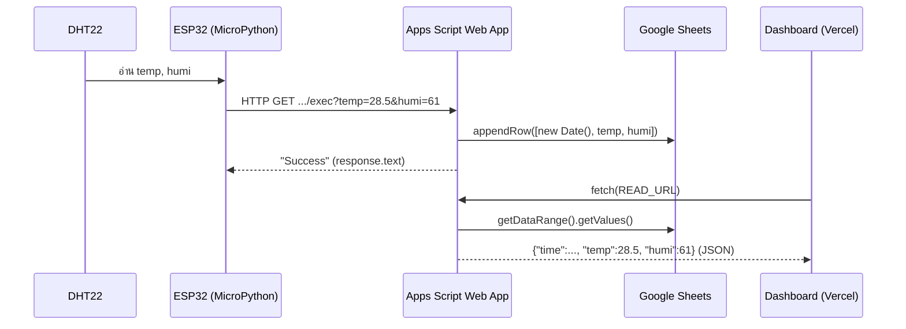

# 🧪 Lab 12: ความปลอดภัยไซเบอร์และนำเสนอ IoT

> **โมดูล:** Module 3 - IoT & Smart Systems (Mini-Project 3)
> **เวลาที่ใช้:** 2 ชั่วโมง (ในห้องปฏิบัติการ) + เวลาศึกษาด้วยตนเอง

## 🎯 จุดประสงค์การทดลอง (Objectives)
- ทดสอบเพิ่มการเข้ารหัสข้อมูล / นำเสนอ Smart Environment Monitor
- ประยุกต์ใช้ความรู้จากภาคทฤษฎี (สัปดาห์ที่ 12) สู่การปฏิบัติจริง
- เสริมสร้างทักษะการทำงานกลุ่มผ่าน Mini-Project

## 🛠️ เครื่องมือที่ต้องใช้ (Prerequisites & Tools)
- เครื่องคอมพิวเตอร์และอินเทอร์เน็ต
- บอร์ด ESP32 ติดตั้ง MicroPython พร้อมเซนเซอร์ DHT11/DHT22 (จาก [[Lab 10 - GenAI API and ESP32 Sensors]])
- บัญชี Google (Google Sheets + Apps Script)
- บัญชี GitHub และ Vercel (ฟรี) สำหรับ deploy Dashboard
- Thonny IDE หรือ VS Code

---

## 🕒 ส่วนที่ 1: ทฤษฎีประยุกต์: ความปลอดภัยของระบบ IoT (1 ชั่วโมง)

ระบบ Smart Environment Monitor มีข้อมูลไหลผ่าน 3 จุด และแต่ละจุดมีความเสี่ยงต่างกัน วิเคราะห์ด้วย [[CIA Triad]]

| จุด | ความเสี่ยง | หลัก CIA ที่กระทบ | วิธีป้องกัน |
|---|---|---|---|
| ESP32 → Cloud (ระหว่างทาง) | ดักฟังข้อมูล / แก้ไขข้อมูลกลางทาง (Man-in-the-Middle) | Confidentiality, Integrity | ใช้ **HTTPS** (TLS เข้ารหัสข้อมูลระหว่างทาง) |
| Web App URL (ประตูรับข้อมูล) | ใครมี URL ก็ยิงข้อมูลปลอมเข้า Sheet ได้ | Integrity | **Secret token** + ตรวจสอบค่า (validation) |
| Source code / Repository | รหัส Wi-Fi หรือ key หลุดขึ้น GitHub สาธารณะ | Confidentiality | แยกไฟล์ `secrets.py` และใส่ใน `.gitignore` |
| Cloud (ถูกยิงถี่ๆ) | Sheet เต็ม / ระบบช้า (DoS) | Availability | Rate limiting |

> [!note] การเข้ารหัส (Encryption) ที่ใช้จริงใน Lab นี้
> URL ของ Google Apps Script Web App เป็น `https://` เสมอ ข้อมูลที่ ESP32 ส่งจึงถูกเข้ารหัสด้วย TLS ระหว่างทาง แต่ **HTTPS ไม่ได้ซ่อน URL จากปลายทาง** เช่น server log หรือ history ของเบราว์เซอร์ และไม่ได้ยืนยันว่าผู้ส่งเป็นบอร์ดของเราจริง จึงต้องมีมาตรการเพิ่มในหัวข้อ E

ขั้นตอนในชั่วโมงแรก:
1. วาดเส้นทางข้อมูลของกลุ่ม (เซนเซอร์ → ESP32 → Apps Script → Google Sheets → Dashboard) แล้วระบุความเสี่ยงอย่างน้อย 1 ข้อในแต่ละจุดตามตารางข้างบน
2. ตรวจ repository ของกลุ่มว่ามีรหัส Wi-Fi, token หรือ URL ลับอยู่ในโค้ดหรือไม่ ถ้ามีให้ย้ายไป `secrets.py` และเพิ่มชื่อไฟล์ใน `.gitignore`
3. บันทึกผลการสังเกต: จุดเสี่ยงที่พบ และมาตรการที่จะทำในส่วนที่ 2

แนวคิดเพิ่มเติม: [[Zero-Trust Architecture]] (ไม่เชื่อ request ใดโดยอัตโนมัติ ต้องตรวจทุกครั้ง) และ [[PDPA]] (ถ้าข้อมูลระบุตัวบุคคลได้)

---

## 🚀 ส่วนที่ 2: งานพัฒนา Mini-Project: ส่งข้อมูลตัวรับรู้ขึ้น Google Sheets และสร้าง Dashboard (1 ชั่วโมง + การบ้าน)

- **เป้าหมายสัปดาห์นี้:** ให้ Mini-Project 3 Smart Environment Monitor เก็บข้อมูลอุณหภูมิ/ความชื้นลง Google Sheets อัตโนมัติ และแสดงผลบน Dashboard ออนไลน์ พร้อมมาตรการความปลอดภัย
- **โจทย์:** สร้าง Write API (รับข้อมูล), Read API (ส่งข้อมูลล่าสุด), โค้ด ESP32 ส่งข้อมูลทุก 10–60 วินาที และหน้าเว็บ Dashboard บน Vercel ที่ refresh เองทุก 30 วินาที
- **มอบหมายงานภายในทีม:** Hardware (ESP32), Backend (Apps Script), Frontend (Dashboard), Security & Presentation

### ภาพรวมการไหลของข้อมูล



### A. Write API ด้วย Google Apps Script (รับข้อมูลลง Sheet)

**เตรียม Sheet:** สร้าง Google Sheets ใหม่ แถวที่ 1 พิมพ์หัวตาราง `Timestamp | Temp | Humi` แล้วไปที่เมนู **Extensions → Apps Script** วางโค้ดนี้

```javascript
function doGet(e) {
  var temp = e.parameter.temp;
  var humi = e.parameter.humi;
  var sheet = SpreadsheetApp.getActiveSpreadsheet().getActiveSheet();
  sheet.appendRow([new Date(), temp, humi]);
  return ContentService.createTextOutput("Success");
}
```

**อธิบายทีละบรรทัด:**

| บรรทัด | ความหมาย |
|---|---|
| `function doGet(e)` | ฟังก์ชันพิเศษที่ Apps Script เรียกอัตโนมัติเมื่อมี **HTTP GET** เข้ามาที่ URL ของ Web App, `e` คือ event object ที่เก็บข้อมูลของ request |
| `e.parameter.temp` | อ่านค่าจาก **query string** (ส่วนหลัง `?` ใน URL) เช่น `...exec?temp=28.5&humi=61` ได้ `e.parameter.temp = "28.5"` (ได้เป็น **string** เสมอ) ถ้ามี key ซ้ำ `e.parameter` คืนค่าแรก (ต้องการทุกค่าใช้ `e.parameters` ซึ่งคืนเป็น array) |
| `SpreadsheetApp.getActiveSpreadsheet()` | เปิดไฟล์ Spreadsheet ที่ script นี้ผูกอยู่ (script สร้างจากเมนู Extensions ของไฟล์นั้น) |
| `.getActiveSheet()` | เลือก sheet (แท็บ) ที่ active ซึ่งใน Web App มักเป็นแท็บแรก |
| `sheet.appendRow([...])` | เพิ่มข้อมูล **1 แถวใหม่ต่อท้าย** แถวสุดท้ายที่มีข้อมูล แต่ละสมาชิกของ array ลง 1 คอลัมน์: A = เวลา, B = temp, C = humi |
| `new Date()` | เวลาปัจจุบันของ server ตอนรับข้อมูล (timestamp) ESP32 จึงไม่ต้องส่งเวลามาเอง |
| `ContentService.createTextOutput("Success")` | สร้าง response เป็นข้อความธรรมดา ข้อความนี้คือสิ่งที่ `print(response.text)` แสดงบน ESP32 |

**`getActiveSheet()` vs `getSheetByName("Log")`**

```javascript
// ระบุชื่อแท็บตรงๆ: ปลอดภัยกว่าเมื่อไฟล์มีหลาย sheet
var sheet = SpreadsheetApp.getActiveSpreadsheet().getSheetByName("Log");
```

| | `getActiveSheet()` | `getSheetByName("Log")` |
|---|---|---|
| เลือก sheet อย่างไร | แท็บที่ active (ไม่ระบุชื่อ) | แท็บชื่อ `Log` ตรงตัว (ตัวพิมพ์เล็ก/ใหญ่ต้องตรง) |
| ไฟล์มีแท็บเดียว | ใช้ได้ | ใช้ได้ |
| ไฟล์มีหลายแท็บ (เช่น `Log`, `Summary`, `Chart`) | เสี่ยงเขียนผิดแท็บถ้ามีการสลับ/ย้ายลำดับแท็บ | เขียนถูกแท็บเสมอ |
| ถ้าไม่มีแท็บชื่อนั้น | ไม่เกิดกรณีนี้ | คืนค่า `null` แล้ว `appendRow` จะ error |

> [!tip] แนะนำให้ใช้ `getSheetByName()` ในโปรเจกต์จริง
> เพราะ Mini-Project มักเพิ่มแท็บสรุปหรือกราฟภายหลัง การระบุชื่อแท็บทำให้ข้อมูลไม่ไปปนแท็บอื่น

**Deploy เป็น Web App:**
1. กด **Deploy → New deployment**
2. ที่ "Select type" เลือก **Web app**
3. **Execute as: Me** (script รันด้วยสิทธิ์เจ้าของ จึงเขียนลง Sheet ของเราได้ โดยผู้เรียกไม่ต้องล็อกอิน)
4. **Who has access: Anyone** (ESP32 ไม่มีบัญชี Google จึงต้องเปิดให้เรียกได้โดยไม่ล็อกอิน ซึ่งเป็นเหตุผลที่ต้องมีมาตรการในหัวข้อ E)
5. กด **Deploy** อนุญาตสิทธิ์ (Authorize access) แล้วคัดลอก **Web app URL** ที่ลงท้ายด้วย `/exec` ค่านี้คือ `WEB_APP_URL`
6. ทดสอบในเบราว์เซอร์: `WEB_APP_URL?temp=25&humi=60` ต้องเห็นคำว่า `Success` และมีแถวใหม่ใน Sheet

> [!warning] แก้โค้ดแล้วต้อง deploy ใหม่
> URL `/exec` รันโค้ดของ **เวอร์ชันที่ deploy** ไว้ ถ้าแก้โค้ดต้องไปที่ **Deploy → Manage deployments → Edit → Version: New version** แล้วกด Deploy มิฉะนั้นจะยังรันโค้ดเก่า (URL `/dev` ใช้ทดสอบโค้ดล่าสุดได้ แต่เปิดได้เฉพาะคนที่มีสิทธิ์แก้ไข script)

### B. ฝั่ง ESP32: ส่งข้อมูลด้วย MicroPython `urequests`

**การสร้าง URL (ต่อ string):** ค่าตัวเลขต้องแปลงเป็น string ด้วย `str()` ก่อนนำมาต่อกับ `+`

```python
WEB_APP_URL = "https://script.google.com/macros/s/AKfy.../exec"
t = 28.5
h = 61
send_url = WEB_APP_URL + "?temp=" + str(t) + "&humi=" + str(h)
print(send_url)
send_url2 = WEB_APP_URL + "?temp=" + str(t) + "&humi=" + str(h) + "&room=EN301"
print(send_url2)
room = "EN301"
send_url3 = f"{WEB_APP_URL}?temp={t}&humi={h}&room={room}"
print(send_url3)
print(send_url2 == send_url3)
```

```output
https://script.google.com/macros/s/AKfy.../exec?temp=28.5&humi=61
https://script.google.com/macros/s/AKfy.../exec?temp=28.5&humi=61&room=EN301
https://script.google.com/macros/s/AKfy.../exec?temp=28.5&humi=61&room=EN301
True
```

(โค้ดส่วนนี้เป็น Python ล้วน รันบนคอมพิวเตอร์ได้ ผลข้างบนรันจริง)

**กฎของ query string:**
- `?` คั่นระหว่าง URL กับข้อมูล (ใช้ **ครั้งเดียว**)
- `&` คั่นระหว่างคู่ข้อมูลแต่ละคู่
- รูปแบบ `key=value` โดยชื่อ key ต้องตรงกับที่ Apps Script อ่าน (`e.parameter.temp`, `e.parameter.humi`, `e.parameter.room`)
- f-string (`f"...{t}..."`) แปลงค่าเป็น string ให้อัตโนมัติ ไม่ต้องใช้ `str()`
- ถ้าเพิ่ม `room` ฝั่ง Apps Script ต้องอ่าน `var room = e.parameter.room;` และเพิ่มใน `appendRow([new Date(), temp, humi, room])` ด้วย ไม่อย่างนั้นค่าจะถูกส่งมาแต่ไม่ถูกบันทึก

**โปรแกรมเต็มบน ESP32:**

```python
import network, urequests, dht
from machine import Pin
from time import sleep
from secrets import WIFI_SSID, WIFI_PASS, WEB_APP_URL   # แยกความลับออกจากโค้ดหลัก

wlan = network.WLAN(network.STA_IF)
wlan.active(True)
wlan.connect(WIFI_SSID, WIFI_PASS)
while not wlan.isconnected():
    sleep(0.5)
print("Wi-Fi connected:", wlan.ifconfig()[0])

sensor = dht.DHT22(Pin(4))

while True:
    try:
        sensor.measure()
        t = sensor.temperature()
        h = sensor.humidity()
        send_url = WEB_APP_URL + "?temp=" + str(t) + "&humi=" + str(h)
        response = urequests.get(send_url)   # HTTP GET, data in query string
        print(response.text)                 # ข้อความจาก createTextOutput -> "Success"
        response.close()                     # คืนหน่วยความจำ/socket
    except Exception as err:
        print("Error:", err)
    sleep(10)                                # ส่งทุก 10 วินาที
```

ผลที่คาดว่าจะเห็นใน Thonny (ทุก 10 วินาที):
```output
Wi-Fi connected: 192.168.1.45
Success
Success
```

| ส่วน | อธิบาย |
|---|---|
| `urequests.get(send_url)` | ส่ง **HTTP GET** ข้อมูลอยู่ใน **query string** ของ URL Apps Script จึงเรียก `doGet(e)` |
| `response.text` | body ของ response เป็น string ซึ่งก็คือ `"Success"` ที่ `createTextOutput` ส่งกลับ |
| `response.close()` | ปิดการเชื่อมต่อ ESP32 มี RAM และจำนวน socket จำกัด ถ้าไม่ปิด ส่งไปสักพักจะเกิด error หน่วยความจำไม่พอ (`ENOMEM`) |
| `try/except` | Wi-Fi หลุดหรือเซนเซอร์อ่านพลาดชั่วคราวจะไม่ทำให้โปรแกรมหยุด |
| `sleep(10)` | หน่วงเวลาระหว่างการส่งแต่ละครั้ง (หน่วยวินาที) |

> [!note] Redirect ของ Apps Script
> Google Apps Script ตอบ request แรกด้วยการ redirect ไปยัง URL ชั่วคราวที่ `script.googleusercontent.com` ซึ่งเป็นที่อยู่ของผลลัพธ์จริง (เอกสาร ContentService ระบุว่า client ต้อง follow redirect) `urequests` รุ่นเก่าบางรุ่นไม่รองรับ redirect จึงอาจ error หรือได้ `response.text` ที่ไม่ใช่ `Success` แม้แถวจะถูกบันทึกแล้ว ถ้าเจอกรณีนี้ให้อัปเดตไลบรารี (`import mip; mip.install("urequests")`) แล้วทดสอบกับบอร์ดของกลุ่มอีกครั้ง

**จำนวนแถวที่เกิดขึ้น (ไม่นับเวลาที่ใช้ส่ง):**

$$\text{แถวต่อชั่วโมง} = \frac{3600}{\text{ช่วงเวลา (วินาที)}} \qquad \text{แถวต่อวัน} = \text{แถวต่อชั่วโมง}\times 24$$

```python
for interval in [10, 30, 60, 300]:
    per_hour = 3600 // interval
    per_day = per_hour * 24
    print(f"sleep({interval:>3}) -> {per_hour:>4} rows/hour, {per_day:>5} rows/day")
```

```output
sleep( 10) ->  360 rows/hour,  8640 rows/day
sleep( 30) ->  120 rows/hour,  2880 rows/day
sleep( 60) ->   60 rows/hour,  1440 rows/day
sleep(300) ->   12 rows/hour,   288 rows/day
```

> [!tip] เลือกช่วงเวลาให้เหมาะกับงาน
> อุณหภูมิห้องเปลี่ยนช้า `sleep(60)` (1,440 แถว/วัน) ก็เพียงพอ และประหยัดโควตาของ Google กับพื้นที่ใน Sheet มากกว่า `sleep(10)` (8,640 แถว/วัน) ถึง 6 เท่า ในความเป็นจริงรอบหนึ่งใช้เวลา `sleep` + เวลาส่ง (มักเป็นวินาที) จำนวนแถวจริงจึงน้อยกว่าที่คำนวณเล็กน้อย

### C. Read API: ส่งข้อมูลล่าสุดเป็น JSON

Dashboard ต้อง "อ่าน" ข้อมูลกลับ แนะนำให้สร้าง Apps Script แยกอีกโปรเจกต์ (ผูกกับ Sheet เดียวกัน) แล้ว deploy เป็น Web App อีก URL หนึ่ง (`READ_URL`) หรือรวมใน `doGet` เดียวโดยแยกด้วย parameter เช่น `?action=read`

```javascript
function doGet(e) {
  var sheet = SpreadsheetApp.getActiveSpreadsheet().getSheetByName("Log");
  var rows = sheet.getDataRange().getValues();   // 2-D array of all rows
  var last = rows[rows.length - 1];              // last row = newest data
  var data = {
    time: last[0],
    temp: last[1],
    humi: last[2]
  };
  return ContentService
    .createTextOutput(JSON.stringify(data))
    .setMimeType(ContentService.MimeType.JSON);
}
```

| บรรทัด | ความหมาย |
|---|---|
| `getDataRange()` | ช่วงเซลล์ทั้งหมดที่มีข้อมูล (จาก A1 ถึงแถว/คอลัมน์สุดท้ายที่มีข้อมูล) |
| `.getValues()` | คืนเป็น **array 2 มิติ** `rows[แถว][คอลัมน์]` index เริ่มที่ 0 โดย `rows[0]` คือหัวตาราง |
| `rows[rows.length - 1]` | แถว **สุดท้าย** (array ยาว n ช่อง index สุดท้ายคือ n − 1) เป็นข้อมูลล่าสุดเพราะ `appendRow` ต่อท้ายเสมอ |
| `last[0]`, `last[1]`, `last[2]` | คอลัมน์ A (เวลา), B (temp), C (humi) ของแถวนั้น |
| `JSON.stringify(data)` | แปลง object เป็นข้อความ JSON เช่น `{"time":"2026-10-12T03:15:00.000Z","temp":28.5,"humi":61}` |
| `.setMimeType(ContentService.MimeType.JSON)` | บอก client ว่า response เป็น JSON (`application/json`) เพื่อให้ `res.json()` ฝั่งเว็บแปลงได้ถูกต้อง |

ตัวอย่าง: Sheet มี 4 แถว (หัวตาราง + ข้อมูล 3 แถว) จะได้ `rows.length = 4` และ `rows[3]` คือข้อมูลล่าสุด

**ส่งหลายแถวเพื่อทำกราฟ (ข้อมูล 20 แถวล่าสุด):**

```javascript
function doGet(e) {
  var sheet = SpreadsheetApp.getActiveSpreadsheet().getSheetByName("Log");
  var rows = sheet.getDataRange().getValues();
  var recent = rows.slice(1).slice(-20);   // ตัดหัวตาราง แล้วเอา 20 แถวท้าย
  var list = recent.map(function (r) {
    return { time: r[0], temp: r[1], humi: r[2] };
  });
  return ContentService
    .createTextOutput(JSON.stringify(list))
    .setMimeType(ContentService.MimeType.JSON);
}
```

### D. Dashboard HTML/JavaScript และ deploy บน Vercel

สร้างโฟลเดอร์ `dashboard/` มีไฟล์ `index.html`

```html
<!DOCTYPE html>
<html lang="th">
<head>
  <meta charset="UTF-8">
  <meta name="viewport" content="width=device-width, initial-scale=1">
  <title>Smart Environment Monitor</title>
  <style>
    body { font-family: sans-serif; text-align: center; background: #f4f6f8; }
    .card { display: inline-block; margin: 12px; padding: 20px 32px;
            background: #fff; border-radius: 12px; box-shadow: 0 2px 6px #0002; }
    .value { font-size: 2.5rem; font-weight: bold; }
  </style>
</head>
<body>
  <h1>Smart Environment Monitor (EN301)</h1>
  <div class="card">อุณหภูมิ<div class="value"><span id="temp">--</span> °C</div></div>
  <div class="card">ความชื้น<div class="value"><span id="humi">--</span> %</div></div>
  <p>อัปเดตล่าสุด: <span id="time">--</span></p>

  <script>
    const WEB_APP_URL = "https://script.google.com/macros/s/AKfy.../exec"; // READ_URL

    function load() {
      fetch(WEB_APP_URL)
        .then(res => res.json())
        .then(d => {
          document.getElementById("temp").innerText = d.temp;
          document.getElementById("humi").innerText = d.humi;
          document.getElementById("time").innerText = new Date(d.time).toLocaleString("th-TH");
        })
        .catch(err => console.error("โหลดข้อมูลไม่สำเร็จ:", err));
    }

    load();                       // โหลดทันทีเมื่อเปิดหน้า
    setInterval(load, 30000);     // แล้วโหลดซ้ำทุก 30,000 ms = 30 วินาที
  </script>
</body>
</html>
```

| โค้ด | ความหมาย |
|---|---|
| `fetch(WEB_APP_URL)` | ส่ง HTTP GET ไปที่ Read API คืนค่าเป็น `Promise` (ทำงานแบบ asynchronous ไม่ทำให้หน้าเว็บค้าง) |
| `.then(res => res.json())` | เมื่อได้ response ให้อ่าน body แล้วแปลงจาก JSON เป็น JavaScript object |
| `.then(d => {...})` | `d` คือ object `{time, temp, humi}` นำค่าไปใส่ในหน้าเว็บ |
| `document.getElementById("temp").innerText = d.temp` | หา element ที่มี `id="temp"` แล้วเปลี่ยนข้อความเป็นค่าอุณหภูมิ |
| `.catch(...)` | จัดการกรณีเน็ตหลุดหรือ URL ผิด |
| `setInterval(load, 30000)` | เรียกฟังก์ชัน `load` ซ้ำทุก 30000 มิลลิวินาที (หน่วยของ `setInterval` เป็น **ms**) ส่งชื่อฟังก์ชัน `load` ไม่ใช่ `load()` |

> [!warning] ข้อผิดพลาดที่พบบ่อย
> - `setInterval(load(), 30000)` ผิด เพราะ `load()` เรียกฟังก์ชันทันทีหนึ่งครั้งแล้วส่ง **ผลลัพธ์** (`undefined`) ให้ setInterval ต้องเขียน `setInterval(load, 30000)`
> - `setInterval(load, 30)` คือทุก 30 **มิลลิวินาที** ไม่ใช่ 30 วินาที จะยิง request ถี่มากจนโดนจำกัดโควตา
> - Read API ต้องใช้ `.setMimeType(ContentService.MimeType.JSON)` และ Web App ต้องตั้ง Who has access เป็น Anyone มิฉะนั้น `res.json()` จะได้หน้า HTML ล็อกอินแทน JSON

**(ทางเลือก) กราฟด้วย Chart.js จาก CDN** ใช้ Read API แบบหลายแถว (array)

```html
<canvas id="chart" height="120"></canvas>
<script src="https://cdn.jsdelivr.net/npm/chart.js@4.4.1/dist/chart.umd.min.js"></script>
<script>
  const READ_LIST_URL = "https://script.google.com/macros/s/AKfy.../exec";
  let chart;

  function loadChart() {
    fetch(READ_LIST_URL)
      .then(res => res.json())
      .then(rows => {
        const labels = rows.map(r => new Date(r.time).toLocaleTimeString("th-TH"));
        const temps  = rows.map(r => r.temp);
        const humis  = rows.map(r => r.humi);
        if (chart) chart.destroy();            // ลบกราฟเก่าก่อนวาดใหม่
        chart = new Chart(document.getElementById("chart"), {
          type: "line",
          data: {
            labels: labels,
            datasets: [
              { label: "Temp (°C)", data: temps },
              { label: "Humidity (%)", data: humis }
            ]
          }
        });
      });
  }
  loadChart();
  setInterval(loadChart, 30000);
</script>
```

`rows.map(r => r.temp)` แปลง array ของ object เป็น array ของตัวเลข เช่น `[{temp:28.5,...},{temp:28.7,...}]` เป็น `[28.5, 28.7]` ซึ่งเป็นรูปแบบที่ Chart.js ต้องการ

**Deploy static HTML ขึ้น Vercel** (Dashboard เป็น static site ไม่มี server ของเราเอง ข้อมูลมาจาก Apps Script)

| วิธี | ขั้นตอน |
|---|---|
| **ผ่าน GitHub (แนะนำ)** | 1) `git add . && git commit -m "Add dashboard" && git push` ขึ้น repo ของกลุ่ม 2) เข้า vercel.com → **Add New → Project** → Import repo 3) Framework Preset เลือก **Other**, Root Directory ชี้ไปที่โฟลเดอร์ `dashboard` 4) กด **Deploy** ได้ URL `https://ชื่อโปรเจกต์.vercel.app` ทุกครั้งที่ `git push` Vercel จะ deploy ใหม่ให้อัตโนมัติ |
| **Drag & drop / CLI** | ลากโฟลเดอร์ที่มี `index.html` ลงหน้า deploy ของ Vercel หรือใช้คำสั่ง `npx vercel` ในโฟลเดอร์นั้น |

### E. ความปลอดภัยของการส่งข้อมูล (หัวใจของ Lab 12)

> [!warning] ความเสี่ยงของการส่งข้อมูลผ่าน GET + query string
> 1. **URL มองเห็นได้:** ข้อมูลอยู่ใน URL ซึ่งถูกบันทึกใน server log, history ของเบราว์เซอร์ และอาจติดไปกับภาพหน้าจอ/การแชร์ลิงก์ (HTTPS เข้ารหัสระหว่างทาง แต่ปลายทางยังเห็น URL เต็ม)
> 2. **ใครมี URL ก็เขียนข้อมูลปลอมได้:** เปิด `WEB_APP_URL?temp=999&humi=-5` ในเบราว์เซอร์ก็เพิ่มแถวปลอมได้ทันที (กระทบ Integrity)
> 3. **ไม่มีการยืนยันตัวตน (no authentication):** Web App ตั้งเป็น Anyone ทำให้ Apps Script ไม่รู้ว่าผู้ส่งคือ ESP32 ของเราหรือคนอื่น
> 4. **ยิงถี่ได้ไม่จำกัด:** สคริปต์วนลูปส่งเป็นพันครั้งจะทำให้ Sheet เต็มขยะและใช้โควตาหมด (กระทบ Availability)

**มาตรการป้องกัน:**

| มาตรการ | ทำอย่างไร | ป้องกันอะไร |
|---|---|---|
| **HTTPS** | ใช้ URL `https://` เสมอ (Apps Script บังคับอยู่แล้ว) | ดักฟัง/แก้ข้อมูลระหว่างทาง |
| **Secret token** | ESP32 ส่ง `&key=...` ด้วย Apps Script ตรวจก่อนบันทึก ไม่ตรงให้ปฏิเสธ | คนที่รู้แค่ URL ยิงข้อมูลปลอม |
| **POST + JSON body (`doPost`)** | ย้ายข้อมูลและ token ไปไว้ใน body แทน URL | ข้อมูล/token โผล่ใน log และ history |
| **Input validation** | แปลงเป็นตัวเลขและตรวจช่วง เช่น temp −40 ถึง 80 °C, humi 0–100 % (ช่วงวัดของ DHT22) | ค่าผิดปกติ/ข้อความแปลกปลอม |
| **Rate limiting** | ปฏิเสธถ้าส่งถี่กว่าที่กำหนด (เช่น ไม่เกิน 1 ครั้งต่อ 5 วินาที) | การยิงถล่ม (flooding) |
| **ไม่ hard-code ความลับ** | เก็บรหัส Wi-Fi/token ใน `secrets.py` ที่อยู่ใน `.gitignore`, ฝั่ง Apps Script เก็บใน Script Properties | ความลับหลุดขึ้น GitHub สาธารณะ |

**Write API ที่ปลอดภัยขึ้น (GET + token + validation):**

```javascript
function doGet(e) {
  var SECRET = PropertiesService.getScriptProperties().getProperty("API_KEY");
  if (e.parameter.key !== SECRET) {
    return ContentService.createTextOutput("Unauthorized");
  }
  var temp = Number(e.parameter.temp);
  var humi = Number(e.parameter.humi);
  if (isNaN(temp) || isNaN(humi) || temp < -40 || temp > 80 || humi < 0 || humi > 100) {
    return ContentService.createTextOutput("Invalid data");
  }
  var sheet = SpreadsheetApp.getActiveSpreadsheet().getSheetByName("Log");
  sheet.appendRow([new Date(), temp, humi]);
  return ContentService.createTextOutput("Success");
}
```

- เก็บค่า `API_KEY` ที่ **Project Settings → Script Properties** แทนการพิมพ์ลงในโค้ด
- `Number("28.5")` แปลง string เป็นตัวเลข ถ้าแปลงไม่ได้ (เช่น `"abc"`) จะได้ `NaN` ซึ่งตรวจด้วย `isNaN()`

**แบบ POST + JSON body:**

```javascript
function doPost(e) {
  var body = JSON.parse(e.postData.contents);   // raw text of POST body
  var SECRET = PropertiesService.getScriptProperties().getProperty("API_KEY");
  if (body.key !== SECRET) {
    return ContentService.createTextOutput("Unauthorized");
  }
  var sheet = SpreadsheetApp.getActiveSpreadsheet().getSheetByName("Log");
  sheet.appendRow([new Date(), Number(body.temp), Number(body.humi)]);
  return ContentService.createTextOutput("Success");
}
```

```python
# ESP32 side
payload = {"key": API_KEY, "temp": t, "humi": h}
response = urequests.post(WEB_APP_URL, json=payload)   # data in body, not in URL
print(response.text)
response.close()
```

**Rate limiting อย่างง่ายด้วย CacheService:**

```javascript
var cache = CacheService.getScriptCache();
if (cache.get("recent")) {
  return ContentService.createTextOutput("Too many requests");
}
cache.put("recent", "1", 5);   // จำไว้ 5 วินาที ระหว่างนี้ request ใหม่จะถูกปฏิเสธ
```

> [!note] ข้อจำกัดที่ควรรู้
> token ที่อยู่ในเฟิร์มแวร์ ESP32 ยังถูกอ่านออกได้ถ้าคนร้ายได้ตัวบอร์ด และ Read API ที่เปิดเป็น Anyone ทำให้ใครก็อ่านข้อมูลล่าสุดได้ (ยอมรับได้สำหรับอุณหภูมิห้อง แต่ห้ามใช้กับข้อมูลส่วนบุคคลตาม [[PDPA]]) มาตรการข้างบนคือ "ลดความเสี่ยง" ไม่ใช่ "ปลอดภัย 100%"

`secrets.py` (อยู่บน ESP32 เท่านั้น ห้าม commit):
```python
WIFI_SSID = "your-ssid"
WIFI_PASS = "your-wifi-password"
WEB_APP_URL = "https://script.google.com/macros/s/AKfy.../exec"
API_KEY = "change-me"
```
และใน `.gitignore` เพิ่มบรรทัด `secrets.py`

### F. แบบฝึกหัด

**ข้อ 1.** ถ้า ESP32 เรียก `...exec?temp=31.2&humi=55` แล้ว `e.parameter.temp` มีค่าเท่าไร และเป็นชนิดข้อมูลอะไร

<details><summary>ดูเฉลย</summary>

`"31.2"` เป็น **string** ค่าจาก query string เป็นข้อความเสมอ ถ้าจะเปรียบเทียบเชิงตัวเลขต้องแปลงด้วย `Number()` ก่อน

</details>

**ข้อ 2.** `sheet.appendRow([new Date(), temp, humi])` ทำอะไร และข้อมูลลงคอลัมน์ไหน

<details><summary>ดูเฉลย</summary>

เพิ่ม **1 แถวใหม่ต่อท้าย** แถวสุดท้ายที่มีข้อมูล คอลัมน์ A = เวลาปัจจุบัน (timestamp จาก server), B = temp, C = humi

</details>

**ข้อ 3.** ไฟล์ Sheet มี 3 แท็บ `Log`, `Summary`, `Chart` ควรใช้ `getActiveSheet()` หรือ `getSheetByName("Log")` เพราะอะไร

<details><summary>ดูเฉลย</summary>

`getSheetByName("Log")` เพราะระบุแท็บปลายทางชัดเจน ข้อมูลจะลงแท็บ `Log` เสมอ ส่วน `getActiveSheet()` ขึ้นกับว่าแท็บไหน active ซึ่งอาจเขียนผิดแท็บเมื่อไฟล์มีหลายแท็บ

</details>

**ข้อ 4.** จงเขียนบรรทัดสร้าง `send_url` ที่ส่ง `t`, `h` และ `room=EN301` ทั้งแบบต่อ string และแบบ f-string

<details><summary>ดูเฉลย</summary>

```python
send_url = WEB_APP_URL + "?temp=" + str(t) + "&humi=" + str(h) + "&room=EN301"
send_url = f"{WEB_APP_URL}?temp={t}&humi={h}&room=EN301"
```
ใช้ `?` ครั้งเดียวก่อนคู่แรก คู่ต่อไปคั่นด้วย `&` และฝั่ง Apps Script ต้องอ่าน `e.parameter.room` และเพิ่มลง `appendRow` ด้วย

</details>

**ข้อ 5.** `print(response.text)` บน ESP32 จะแสดงอะไร (ใช้ Write API ในหัวข้อ A) และทำไมต้องเรียก `response.close()`

<details><summary>ดูเฉลย</summary>

แสดง `Success` ซึ่งเป็นข้อความที่ `ContentService.createTextOutput("Success")` ส่งกลับ ต้อง `close()` เพื่อคืน socket และหน่วยความจำ เพราะ ESP32 มี RAM จำกัด ถ้าไม่ปิดจะเกิด error หน่วยความจำไม่พอหลังส่งไปหลายครั้ง

</details>

**ข้อ 6.** ESP32 ส่งข้อมูลทุก `sleep(10)` และทุก `sleep(60)` จะได้ข้อมูลกี่แถวต่อชั่วโมงและต่อวัน (ไม่คิดเวลาที่ใช้ส่ง) และถ้าต้องการไม่เกิน 100 แถวต่อชั่วโมงต้อง sleep อย่างน้อยกี่วินาที

<details><summary>ดูเฉลย</summary>

- `sleep(10)`: $3600/10 = 360$ แถว/ชั่วโมง, $360\times24 = 8{,}640$ แถว/วัน
- `sleep(60)`: $3600/60 = 60$ แถว/ชั่วโมง, $60\times24 = 1{,}440$ แถว/วัน
- ไม่เกิน 100 แถว/ชั่วโมง: $3600/100 = 36$ วินาที ขึ้นไป

</details>

**ข้อ 7.** Sheet มีหัวตาราง 1 แถวและข้อมูล 50 แถว `rows.length` เท่ากับเท่าไร และข้อมูลล่าสุดอยู่ที่ index ใด

<details><summary>ดูเฉลย</summary>

`rows.length = 51` ข้อมูลล่าสุดคือ `rows[50]` ซึ่งก็คือ `rows[rows.length - 1]` (index เริ่มที่ 0 และ `rows[0]` เป็นหัวตาราง)

</details>

**ข้อ 8.** ทำไม Read API ต้องมี `.setMimeType(ContentService.MimeType.JSON)` และ `JSON.stringify` ทำหน้าที่อะไร

<details><summary>ดูเฉลย</summary>

`createTextOutput` รับได้แค่ข้อความ จึงต้องใช้ `JSON.stringify` แปลง object เป็นข้อความ JSON ก่อน ส่วน `setMimeType(...JSON)` บอก client ว่าเนื้อหาเป็น JSON (`application/json`) เพื่อให้ `res.json()` ฝั่ง Dashboard แปลงกลับเป็น object ได้

</details>

**ข้อ 9.** โค้ด `setInterval(load(), 30)` ผิดกี่จุด จงแก้ให้ refresh ทุก 30 วินาที

<details><summary>ดูเฉลย</summary>

ผิด 2 จุด: (1) `load()` ถูกเรียกทันทีและส่งผลลัพธ์แทนตัวฟังก์ชัน ต้องเป็น `load` (2) หน่วยเป็นมิลลิวินาที 30 วินาที = `30000` ที่ถูกคือ `setInterval(load, 30000)`

</details>

**ข้อ 10.** เพื่อนในห้องเปิด `WEB_APP_URL?temp=999&humi=-5` ในเบราว์เซอร์ แล้วมีแถวปลอมเพิ่มใน Sheet ระบบมีจุดอ่อนอะไร และเสนอวิธีแก้อย่างน้อย 3 วิธี

<details><summary>ดูเฉลย</summary>

จุดอ่อน: Web App เปิดให้ Anyone เรียกได้โดยไม่มีการยืนยันตัวตน และไม่ตรวจสอบค่า ใครรู้ URL ก็เขียนข้อมูลได้ (กระทบ Integrity ใน CIA Triad)

วิธีแก้:
1. เพิ่ม secret token (`&key=...` หรือใน body) และตรวจใน Apps Script
2. ตรวจช่วงค่า (temp −40 ถึง 80, humi 0–100) ค่า 999 และ −5 จะถูกปฏิเสธ
3. เปลี่ยนเป็น `doPost` + JSON body เพื่อไม่ให้ข้อมูลและ token อยู่ใน URL
4. ทำ rate limiting และเก็บ URL/token ไว้ใน `secrets.py` ที่ไม่ขึ้น GitHub

</details>

---

### การนำเสนอ Module 3 (Smart Environment Monitor)

ใช้เวลากลุ่มละ 7–10 นาที ครอบคลุมหัวข้อต่อไปนี้
1. ผังสถาปัตยกรรม (จาก [[Lab 09 - ML Basics and IoT Architecture]]) และเส้นทางข้อมูลจริงของกลุ่ม
2. Demo สด: ESP32 ส่งข้อมูล → แถวใหม่ใน Google Sheets → ค่าบน Dashboard (Vercel) เปลี่ยนภายใน 30 วินาที
3. มาตรการความปลอดภัยที่ทำจริงอย่างน้อย 2 ข้อจากหัวข้อ E พร้อมสาธิตว่า request ที่ไม่มี token ถูกปฏิเสธ
4. ปัญหาที่พบและวิธีแก้ (เช่น redirect, ลืม deploy เวอร์ชันใหม่, ลืม `response.close()`)

---

## 📝 เกณฑ์การส่งงานและการประเมิน (Deliverables & Rubric)
- ส่งรายงานความคืบหน้า (Progress Log) เป็นไฟล์ Markdown ผ่าน GitHub
- ส่งโค้ดต้นฉบับผ่าน Repository ของกลุ่ม
- ให้ฟีดแบ็กความสมบูรณ์โดยพิจารณาจากเกณฑ์ของ CLO4, CLO5, CLO6

## 🔗 ลิงก์ที่เกี่ยวข้อง
- ⬅️ กลับไปยังสารบัญ Lab: [[_index|สารบัญ Lab]]
- 📚 กลับไปยังเนื้อหาสัปดาห์: [[Week 12]]
- ⬅️ Lab ก่อนหน้า: [[Lab 11 - MQTT Data Transmission]]
