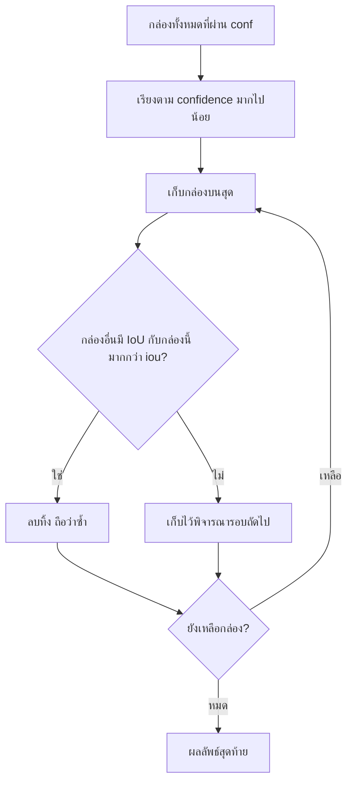

# 🧪 Lab 13: จริยธรรม AI และพื้นฐานวิทัศน์คอมพิวเตอร์

> **โมดูล:** Module 4 - Computer Vision (Mini-Project 4)
> **เวลาที่ใช้:** 2 ชั่วโมง (ในห้องปฏิบัติการ) + เวลาศึกษาด้วยตนเอง

## 🎯 จุดประสงค์การทดลอง (Objectives)
- วิเคราะห์อคติใน AI และดึงสตรีมภาพกล้องมาทำ Object Detection
- ประยุกต์ใช้ความรู้จากภาคทฤษฎี (สัปดาห์ที่ 13) สู่การปฏิบัติจริง
- เสริมสร้างทักษะการทำงานกลุ่มผ่าน Mini-Project

## 🛠️ เครื่องมือที่ต้องใช้ (Prerequisites & Tools)
- เครื่องคอมพิวเตอร์และอินเทอร์เน็ต, บัญชี Google สำหรับ **Google Colab** (Runtime → Change runtime type → **T4 GPU** จะเร็วขึ้น แต่ CPU ก็รันได้)
- Python library: `ultralytics` (ติดตั้งใน Colab ด้วย `pip`)
- ภาพทดสอบ เช่น `dogs.png` หรือภาพถนน/ห้องเรียนที่ถ่ายเอง (อัปโหลดผ่านแถบ Files ด้านซ้ายของ Colab)
- พื้นฐานที่ควรทบทวน: [[03_การเรียนรู้เชิงลึก_Deep_Learning_เบื้องต้น|Deep Learning เบื้องต้น]], [[01_จริยธรรมยุคดิจิทัลและ_AI_Ethics|AI Ethics]]

---

## 🕒 ส่วนที่ 1: ทฤษฎีประยุกต์ประจำสัปดาห์ (1 ชั่วโมง)

### 1.1 อคติใน AI (AI Bias) โดยย่อ

**AI Bias** คือการที่ model ให้ผลลัพธ์ไม่เป็นธรรมหรือผิดพลาดอย่างเป็นระบบกับคนหรือสิ่งของบางกลุ่ม สาเหตุหลักคือ **dataset bias**: ข้อมูลที่ใช้ train ไม่เป็นตัวแทนของโลกจริงทั้งหมด

| แหล่งของอคติ | ตัวอย่างในงาน Object Detection |
|---|---|
| **แสงและสภาพแวดล้อม** | dataset ส่วนใหญ่ถ่ายตอนกลางวัน ทำให้ model ตรวจจับคนหรือรถตอนกลางคืนหรือตอนฝนตกได้แย่ลง |
| **สีผิวและลักษณะบุคคล** | ถ้าภาพคนบางสีผิวในชุดข้อมูลมีน้อย model อาจตรวจจับคนกลุ่มนั้นด้วย confidence ต่ำกว่าหรือพลาดไปเลย (false negative) |
| **วัตถุเฉพาะภูมิภาค** | COCO มีภาพจากบริบทตะวันตกเป็นส่วนใหญ่ รถตุ๊กตุ๊ก รถซาเล้ง หรือรถอีแต๋นจึงอาจถูกทายเป็น `car`/`motorcycle` ผิด หรือไม่ถูกตรวจจับเลย |
| **มุมกล้อง/ความละเอียด** | ภาพจากกล้องวงจรปิดมุมสูงความละเอียดต่ำต่างจากภาพถ่ายระดับสายตาใน dataset |

> [!warning] ผลกระทบในงานจริง
> ถ้านำระบบตรวจจับคนไปใช้ในรถยนต์ไร้คนขับหรือระบบรักษาความปลอดภัย การตรวจจับพลาดกับคนบางกลุ่มอาจเป็นอันตรายถึงชีวิตหรือทำให้เกิดการเลือกปฏิบัติ วิศวกรจึงต้องทดสอบ model แยกตามกลุ่ม (แสง, สีผิว, ภูมิภาค) ไม่ใช่ดูแค่ accuracy รวม

นักศึกษาจะทดลองเรื่องนี้กับ model จริงในหัวข้อ 1.8

### 1.2 การตรวจจับวัตถุด้วย YOLO11 (Ultralytics) บน Google Colab

**Object Detection** บอกว่าในภาพมีวัตถุ *อะไร* (class) อยู่ *ตรงไหน* (bounding box) และ *มั่นใจเท่าไร* (confidence) ต่างจาก **Image Classification** ที่บอกได้แค่ว่าทั้งภาพเป็นอะไร

**YOLO** (You Only Look Once) เป็นตระกูล model ที่มองภาพครั้งเดียวแล้วทำนายทุกกล่องพร้อมกัน จึงเร็วพอใช้แบบ real-time **YOLO11** ของ Ultralytics มีหลายขนาดดังนี้

| ไฟล์ model | ขนาด | ลักษณะ |
|---|---|---|
| `yolo11n.pt` | **n = nano** | เล็กและเร็วที่สุด แต่แม่นน้อยที่สุด เหมาะกับ Colab, CPU และอุปกรณ์ edge |
| `yolo11s.pt` | s = small | สมดุลระหว่างความเร็วกับความแม่น |
| `yolo11m.pt` | m = medium | แม่นขึ้นแต่ช้าลง |
| `yolo11l.pt`, `yolo11x.pt` | large, extra-large | แม่นที่สุด ต้องใช้ GPU |

model เหล่านี้ train ไว้แล้ว (pretrained) บน **COCO dataset** ซึ่งมี **80 classes**

#### ขั้นตอนที่ 1: ติดตั้งและโหลด model

```python
# เซลล์ที่ 1: ติดตั้ง library (ใน Colab ใส่ ! นำหน้าคำสั่ง shell)
!pip install ultralytics
```

```python
# เซลล์ที่ 2: import และโหลด model
from ultralytics import YOLO

model = YOLO('yolo11n.pt')   # ถ้ายังไม่มีไฟล์ จะดาวน์โหลด weights ให้อัตโนมัติ
```

#### ขั้นตอนที่ 2: ทำนาย (predict) บนภาพ

```python
results = model('dogs.png', conf=0.35, iou=0.25)

results[0].show()            # แสดงภาพที่วาดกล่องแล้ว
results[0].save('out.jpg')   # บันทึกภาพผลลัพธ์
```

- `model(...)` คืนค่าเป็น **list ของ `Results`** หนึ่งตัวต่อหนึ่งภาพ ภาพเดียวจึงใช้ `results[0]`
- `conf=0.35` คือ confidence threshold
- `iou=0.25` คือ IoU threshold ที่ใช้ในขั้นตอน NMS

> [!note] ค่า default ของ Ultralytics (ตามเอกสาร Predict mode)
> `conf=0.25`, `iou=0.7`, `classes=None` (แสดงทุก class)

### 1.3 Confidence threshold (`conf`)

ทุกกล่องที่ model ทำนายมี **confidence score** ระหว่าง 0 ถึง 1 กล่องที่ได้คะแนน **ต่ำกว่า `conf` จะถูกทิ้ง**

| ปรับ `conf` | ผลที่เห็น | ข้อดี | ข้อเสีย |
|---|---|---|---|
| **ลดลง** (เช่น 0.5 → 0.2) | กล่อง **มากขึ้น** | เจอวัตถุครบขึ้น (recall สูงขึ้น) | มี **false positive** (กล่องผิดหรือทายมั่ว) มากขึ้น |
| **เพิ่มขึ้น** (เช่น 0.5 → 0.8) | กล่อง **น้อยลง** | กล่องที่เหลือแม่นมาก (precision สูงขึ้น) | อาจ **พลาดวัตถุจริง** (false negative) โดยเฉพาะวัตถุเล็ก มืด หรือถูกบัง |

> [!tip] จำง่าย ๆ
> `conf` ต่ำคือ "เห็นอะไรก็ตีกรอบ" ส่วน `conf` สูงคือ "ตีกรอบเฉพาะที่มั่นใจมาก" งานที่ห้ามพลาด (เช่น ตรวจจับคนข้ามถนน) มักตั้ง `conf` ต่ำกว่างานที่ต้องการลดการแจ้งเตือนผิด

### 1.4 Intersection over Union (IoU)

**IoU** วัดว่ากล่องสองกล่องซ้อนทับกันมากแค่ไหน

$$
\text{IoU} = \frac{\text{Area of Overlap}}{\text{Area of Union}} = \frac{|A \cap B|}{|A| + |B| - |A \cap B|}
$$

- IoU = 0 คือไม่ซ้อนทับกันเลย
- IoU = 1 คือกล่องตรงกันพอดี

**ตัวอย่างตัวเลข:** ถ้าพื้นที่ซ้อนทับเท่ากับ 40 และพื้นที่ union เท่ากับ 100 จะได้ $\text{IoU} = 40/100 = 0.4$

**ตัวอย่างพิกัด:** กล่อง A = (0,0)–(10,10) มีพื้นที่ 100 และกล่อง B = (5,5)–(15,15) มีพื้นที่ 100 ส่วนที่ซ้อนกันคือ (5,5)–(10,10) = 5×5 = 25
union = 100 + 100 − 25 = 175 จึงได้ IoU = 25/175 ≈ **0.1429**

```python
def iou(box_a, box_b):
    """box = (x1, y1, x2, y2) มุมซ้ายบน -> มุมขวาล่าง"""
    # 1) หาพิกัดของพื้นที่ซ้อนทับ (intersection)
    x1 = max(box_a[0], box_b[0])
    y1 = max(box_a[1], box_b[1])
    x2 = min(box_a[2], box_b[2])
    y2 = min(box_a[3], box_b[3])
    inter = max(0, x2 - x1) * max(0, y2 - y1)   # ไม่ซ้อนกัน -> ความกว้าง/สูงติดลบ -> 0
    # 2) พื้นที่ของแต่ละกล่อง
    area_a = (box_a[2] - box_a[0]) * (box_a[3] - box_a[1])
    area_b = (box_b[2] - box_b[0]) * (box_b[3] - box_b[1])
    # 3) union = A + B - intersection (ไม่นับส่วนซ้อนซ้ำสองครั้ง)
    union = area_a + area_b - inter
    return inter / union if union > 0 else 0.0

a = (0, 0, 10, 10)    # area 100
b = (5, 5, 15, 15)    # area 100, ซ้อนทับ 5x5 = 25
c = (20, 20, 30, 30)  # ไม่ซ้อนทับเลย
print("IoU(a, b) =", round(iou(a, b), 4))
print("IoU(a, a) =", iou(a, a))
print("IoU(a, c) =", iou(a, c))
```

```output
IoU(a, b) = 0.1429
IoU(a, a) = 1.0
IoU(a, c) = 0.0
```

### 1.5 Non-Maximum Suppression (NMS) และพารามิเตอร์ `iou`

model มักทำนายหลายกล่องซ้อนกันบนวัตถุชิ้นเดียว **NMS** จะเก็บกล่องที่ดีที่สุดไว้หนึ่งกล่องแล้วลบกล่องซ้ำทิ้ง (ทำแยกทีละ class) โดยมีขั้นตอนดังนี้

1. **เรียง** กล่องทั้งหมดตาม confidence จากมากไปน้อย
2. **เก็บ** กล่องที่ confidence สูงสุดไว้ในผลลัพธ์
3. **ลบ** กล่องที่เหลือซึ่งมี **IoU กับกล่องนั้นมากกว่า `iou` threshold** เพราะถือว่าเป็นวัตถุชิ้นเดียวกัน
4. **ทำซ้ำ** ข้อ 2–3 กับกล่องที่เหลือจนไม่เหลือกล่องให้พิจารณา



**ลองเขียน NMS เอง** (ใช้ฟังก์ชัน `iou` จากหัวข้อ 1.4) ตัวอย่างนี้มี 4 กล่อง กล่อง 0.92 กับ 0.85 แทบทับกัน (IoU ≈ 0.875) กล่อง 0.70 อยู่ติดกัน (IoU กับกล่อง 0.92 ≈ 0.333) ส่วนกล่อง 0.60 อยู่ไกลออกไป

```python
def nms(dets, iou_thr):
    dets = sorted(dets, key=lambda d: d[1], reverse=True)  # 1) เรียงตาม conf
    keep = []
    while dets:
        best = dets.pop(0)                                 # 2) เก็บกล่องบนสุด
        keep.append(best)
        dets = [d for d in dets if iou(best[0], d[0]) <= iou_thr]  # 3) ลบกล่องที่ซ้ำ
    return keep                                            # 4) วนจนหมด

dets = [((10, 10, 110, 210), 0.92),
        ((15, 12, 115, 215), 0.85),
        ((60, 10, 160, 210), 0.70),
        ((300, 50, 380, 200), 0.60)]
for thr in (0.25, 0.5, 0.9):
    kept = nms(dets, thr)
    print(f"iou={thr}: เหลือ {len(kept)} กล่อง ->", [c for _, c in kept])
```

```output
iou=0.25: เหลือ 2 กล่อง -> [0.92, 0.6]
iou=0.5: เหลือ 3 กล่อง -> [0.92, 0.7, 0.6]
iou=0.9: เหลือ 4 กล่อง -> [0.92, 0.85, 0.7, 0.6]
```

| ปรับ `iou` | พฤติกรรม NMS | ผลที่เห็น |
|---|---|---|
| **ต่ำ** (เช่น 0.25) | ลบกล่องอย่างเข้มงวด แค่ซ้อนกันเล็กน้อยก็ลบ | กล่องซ้อนน้อยลง แต่ **วัตถุที่อยู่ชิดกัน (เช่น คนยืนเบียดกัน) อาจถูกรวมเหลือกล่องเดียว** ในตัวอย่าง กล่อง 0.70 ซึ่งอาจเป็นวัตถุอีกชิ้นถูกลบไปด้วย |
| **สูง** (เช่น 0.9) | ลบเฉพาะกล่องที่ทับกันเกือบสนิท | เหลือ **กล่องซ้ำ (duplicate) บนวัตถุเดียวกัน** มากขึ้น เช่น กล่อง 0.92 และ 0.85 อยู่ทั้งคู่ |

> [!warning] อย่าสับสน `conf` กับ `iou`
> `conf` กรองกล่อง **ตามความมั่นใจของแต่ละกล่อง** ส่วน `iou` ใช้ใน NMS เพื่อกรอง **กล่องที่ซ้อนกัน** ลำดับการทำงานคือกรองด้วย `conf` ก่อน แล้วจึงทำ NMS

### 1.6 กรองเฉพาะบาง class ด้วย `classes`

```python
results = model('street.jpg', conf=0.35, classes=[0, 2])   # เฉพาะ person และ car
```

`classes` รับ **list ของ class id** ใน COCO ตัวอย่างบางส่วน (ตรวจสอบกับไฟล์ `coco.yaml` ของ Ultralytics แล้ว) มีดังนี้

| id | name | id | name |
|---|---|---|---|
| 0 | person | 15 | cat |
| 1 | bicycle | 16 | dog |
| 2 | car | 56 | chair |
| 3 | motorcycle | 57 | couch |
| 5 | bus | 60 | dining table |
| 7 | truck | 62 | tv |
| 9 | traffic light | 63 | laptop |

> [!tip] ไม่ต้องจำ id ทั้งหมด
> สั่ง `print(model.names)` จะได้ dict เช่น `{0: 'person', 1: 'bicycle', 2: 'car', ...}` ครบทั้ง 80 classes

### 1.7 อ่านผลลัพธ์ทีละกล่อง

`results[0].boxes` เก็บกล่องทั้งหมดของภาพแรก แต่ละ `box` มี attribute สำคัญดังนี้

| attribute | ความหมาย | ตัวอย่าง |
|---|---|---|
| `box.cls` | class id เป็น tensor ต้องแปลงด้วย `int` | `tensor([16.])` → `16` |
| `box.conf` | confidence แปลงด้วย `float` | `tensor([0.89])` → `0.89` |
| `box.xyxy` | พิกัด `[x1, y1, x2, y2]` หน่วย pixel | `tensor([[34., 50., 310., 400.]])` |
| `model.names` | dict ที่แปลง id เป็นชื่อ class | `model.names[16]` → `'dog'` |

```python
for box in results[0].boxes:
    name = model.names[int(box.cls)]
    score = float(box.conf)
    x1, y1, x2, y2 = box.xyxy[0].tolist()
    print(name, round(score, 2), [round(v) for v in (x1, y1, x2, y2)])
```

ตัวอย่างผลลัพธ์ (ค่าจริงขึ้นกับภาพและเวอร์ชันของ model)

```output
dog 0.89 [34 50 310 400]
dog 0.81 [290 70 560 410]
```

**นับจำนวนวัตถุแต่ละ class:**

```python
from collections import Counter
counts = Counter(model.names[int(b.cls)] for b in results[0].boxes)
print(counts)        # ตัวอย่างผลลัพธ์: Counter({'person': 3, 'car': 2})
```

#### โจทย์ตัวอย่าง (แนวข้อสอบ)

> รัน `results = model(img, conf=0.4)` โดย model ทำนายได้ 3 กล่องคือ **person 0.91, person 0.38, chair 0.55** เมื่อรันลูป `for box in results[0].boxes: print(model.names[int(box.cls)], float(box.conf))` จะพิมพ์อะไรออกมา

<details><summary>ดูเฉลย</summary>

กล่องที่ confidence **ต่ำกว่า 0.4** ถูกทิ้งก่อนคืนผลลัพธ์ ดังนั้น `person 0.38` จึงหายไป

```output
person 0.91
chair 0.55
```

พิมพ์ออกมา 2 บรรทัด ถ้าเพิ่ม `classes=[0]` จะเหลือเพียง `person 0.91`
</details>

### 1.8 การทดลองเรื่องอคติ (บันทึกผลการสังเกต)

1. เตรียมภาพ 4 ชุด ชุดละ 3–5 ภาพ ได้แก่ (ก) คนตอนกลางวัน (ข) คนตอนกลางคืนหรือแสงน้อย (ค) คนที่มีสีผิวและการแต่งกายหลากหลาย (ง) ยานพาหนะท้องถิ่น เช่น รถตุ๊กตุ๊ก รถซาเล้ง รถอีแต๋น
2. รัน `model(img, conf=0.25)` กับทุกภาพแล้วบันทึกผลลงตาราง

| ชุดภาพ | จำนวนวัตถุจริง | ตรวจจับได้ | confidence เฉลี่ย | class ที่ทายผิด |
|---|---|---|---|---|
| (ก) กลางวัน | | | | |
| (ข) แสงน้อย | | | | |
| (ค) หลากหลายบุคคล | | | | |
| (ง) ยานพาหนะท้องถิ่น | | | | |

3. อภิปรายว่าชุดใดได้ผลแย่ที่สุดและเพราะอะไร พร้อมเสนอวิธีลดอคติ เช่น เก็บข้อมูลจากบริบทไทยเพิ่ม, fine-tune model ด้วย dataset ของตัวเอง, ประเมินผลแยกกลุ่ม และระบุข้อจำกัดของระบบไว้ในเอกสาร (model card)

---

## 🚀 ส่วนที่ 2: งานพัฒนา Mini-Project (1 ชั่วโมง + การบ้าน)

- **เป้าหมายสัปดาห์นี้:** สร้างระบบนับวัตถุจากภาพหรือวิดีโอด้วย YOLO11 เพื่อใช้เป็นแกนของ Mini-Project 4
- **โจทย์:** เขียน notebook ที่ (1) รับภาพหรือวิดีโอ (2) ตรวจจับเฉพาะ class ที่สนใจด้วย `classes=[...]` (3) นับจำนวนต่อ class แล้วแสดงผล (4) ทดลองปรับ `conf` อย่างน้อย 3 ค่า และ `iou` อย่างน้อย 2 ค่า แล้วสรุปเป็นตาราง (5) แนบผลการทดลองเรื่องอคติจากหัวข้อ 1.8
- ตัวอย่างหัวข้อ: นับคนเข้าห้องเรียน, นับรถหน้าคณะ, ตรวจจับคนและเก้าอี้ในห้องสมุด (`classes=[0, 56]`)
- **มอบหมายงานภายในทีม:** ผู้เตรียม dataset และภาพทดสอบ, ผู้เขียนโค้ดบน Colab, ผู้ทดลองปรับพารามิเตอร์และบันทึกผล, ผู้เขียนรายงานเรื่องอคติและจริยธรรม

> [!tip] ใช้กับวิดีโอหรือกล้อง
> `model('video.mp4', stream=True)` คืน generator ทีละเฟรม ช่วยประหยัดหน่วยความจำ การใช้ webcam (`source=0`) ทำได้เมื่อรันบนเครื่องตัวเอง แต่ใช้โดยตรงบน Colab ไม่ได้

---

## ✍️ แบบฝึกหัด

**ข้อ 1.** กล่อง A = (0,0)–(4,4) และกล่อง B = (2,2)–(6,6) จงหา IoU

<details><summary>ดูเฉลย</summary>

ส่วนซ้อนทับคือ (2,2)–(4,4) = 2×2 = 4 และแต่ละกล่องมีพื้นที่ 16
union = 16 + 16 − 4 = 28 ดังนั้น IoU = 4/28 ≈ **0.143**
</details>

**ข้อ 2.** ผู้ใช้บ่นว่า "มีกรอบซ้อนกันหลายกรอบบนหมาตัวเดียว" ควรปรับ `iou` ขึ้นหรือลง

<details><summary>ดูเฉลย</summary>

ควร **ลด `iou`** เช่น จาก 0.7 เป็น 0.4 เพื่อให้ NMS ลบกล่องที่ซ้อนกันเข้มงวดขึ้น แต่ถ้าลดมากเกินไป หมาสองตัวที่อยู่ชิดกันอาจเหลือกล่องเดียว
</details>

**ข้อ 3.** เปลี่ยน `conf` จาก 0.5 เป็น 0.8 จำนวนกล่องจะเปลี่ยนอย่างไร และเสี่ยงต่อความผิดพลาดชนิดใด

<details><summary>ดูเฉลย</summary>

กล่องจะ **น้อยลง** และกล่องที่เหลือแม่นขึ้น (precision สูงขึ้น) แต่เสี่ยงต่อ **false negative** คือพลาดวัตถุที่มีอยู่จริงแต่ model มั่นใจไม่ถึง 0.8
</details>

**ข้อ 4.** เขียนคำสั่งตรวจจับเฉพาะ **คน** และ **เก้าอี้** ในภาพ `room.jpg` โดยใช้ confidence ขั้นต่ำ 0.5

<details><summary>ดูเฉลย</summary>

```python
results = model('room.jpg', conf=0.5, classes=[0, 56])
```
</details>

**ข้อ 5.** ถ้า `int(box.cls)` ได้ 2 แล้ว `model.names[int(box.cls)]` จะคืนค่าอะไร และทำไมต้องใช้ `int(...)`

<details><summary>ดูเฉลย</summary>

คืนค่า `'car'` ที่ต้องใช้ `int(...)` เพราะ `box.cls` เป็น tensor ทศนิยม (เช่น `tensor([2.])`) แต่ key ของ dict `model.names` เป็นจำนวนเต็ม
</details>

**ข้อ 6.** `yolo11n.pt` กับ `yolo11x.pt` ต่างกันอย่างไร และควรเลือกตัวไหนสำหรับ Raspberry Pi

<details><summary>ดูเฉลย</summary>

`n` (nano) เล็กและเร็วที่สุดแต่แม่นน้อยกว่า ส่วน `x` (extra-large) แม่นที่สุดแต่ช้าและใช้หน่วยความจำมาก Raspberry Pi ไม่มี GPU จึงควรเลือก **`yolo11n.pt`**
</details>

**ข้อ 7.** model ตรวจจับคนตอนกลางคืนได้แย่กว่าตอนกลางวันมาก นี่คืออคติแบบใด และแก้อย่างไร

<details><summary>ดูเฉลย</summary>

เป็น **dataset bias** ด้านเงื่อนไขแสง เพราะข้อมูล train มีภาพกลางคืนน้อย วิธีแก้คือเก็บภาพแสงน้อยเพิ่มแล้ว fine-tune, ทำ data augmentation ด้านความสว่าง, ประเมินผลแยกตามสภาพแสง และระบุข้อจำกัดนี้ในเอกสารของระบบ
</details>

---

## 📝 เกณฑ์การส่งงานและการประเมิน (Deliverables & Rubric)
- ส่งรายงานความคืบหน้า (Progress Log) เป็นไฟล์ Markdown ผ่าน GitHub
- ส่งโค้ดต้นฉบับผ่าน Repository ของกลุ่ม
- ให้ฟีดแบ็กความสมบูรณ์โดยพิจารณาจากเกณฑ์ของ CLO4, CLO5

## 🔗 ลิงก์ที่เกี่ยวข้อง
- ⬅️ กลับไปยังสารบัญ Lab: [[_index|สารบัญ Lab]]
- 📚 กลับไปยังเนื้อหาสัปดาห์: [[Week 13]]
- 🧠 ทฤษฎีที่เกี่ยวข้อง: [[01_จริยธรรมยุคดิจิทัลและ_AI_Ethics|จริยธรรมยุคดิจิทัลและ AI Ethics]], [[03_การเรียนรู้เชิงลึก_Deep_Learning_เบื้องต้น|Deep Learning เบื้องต้น]]
- ➡️ Lab ถัดไป: [[Lab 14 - CI-CD Pipeline and System Integration]]
