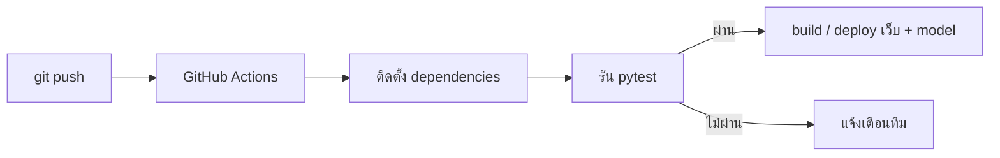
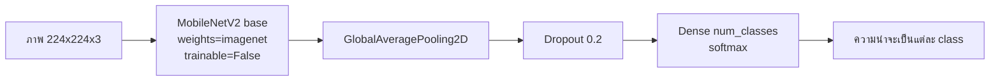

# 🧪 Lab 14: การบูรณาการระบบและ DevOps

> **โมดูล:** Module 4 - Computer Vision (Mini-Project 4)
> **เวลาที่ใช้:** 2 ชั่วโมง (ในห้องปฏิบัติการ) + เวลาศึกษาด้วยตนเอง

## 🎯 จุดประสงค์การทดลอง (Objectives)
- ทดลองทำ CI/CD เบื้องต้น และผสาน CV เข้ากับ Web หรือ IoT ของเดิม
- ประยุกต์ใช้ความรู้จากภาคทฤษฎี (สัปดาห์ที่ 14) สู่การปฏิบัติจริง
- เสริมสร้างทักษะการทำงานกลุ่มผ่าน Mini-Project

## 🛠️ เครื่องมือที่ต้องใช้ (Prerequisites & Tools)
- เครื่องคอมพิวเตอร์และอินเทอร์เน็ต, **Google Colab** (เลือก Runtime แบบ **T4 GPU**)
- TensorFlow/Keras (ติดตั้งมาใน Colab แล้ว), NumPy, Matplotlib
- ชุดภาพของกลุ่ม เช่น ภาพใบไม้ 3 ชนิด หรือภาพขยะ 4 ประเภท จำนวนรวมประมาณ 1,000 ภาพ
- บัญชี GitHub สำหรับส่วน CI/CD
- พื้นฐานที่ควรทบทวน: [[02_โครงข่ายประสาทเทียม_Neural_Networks|Neural Networks]], [[03_การเรียนรู้เชิงลึก_Deep_Learning_เบื้องต้น|Deep Learning เบื้องต้น]], [[03_กระบวนการ_CI_CD|กระบวนการ CI/CD]], [[04_MLOps_และ_AIOps|MLOps และ AIOps]]

---

## 🕒 ส่วนที่ 1: ทฤษฎีประยุกต์ประจำสัปดาห์ (1 ชั่วโมง)

### 1.1 CI/CD สำหรับงาน AI โดยย่อ

- **CI (Continuous Integration):** ทุกครั้งที่ push โค้ดขึ้น GitHub ระบบจะรันการตรวจสอบอัตโนมัติ เช่น lint และ unit test เพื่อจับข้อผิดพลาดตั้งแต่เนิ่น ๆ
- **CD (Continuous Delivery/Deployment):** เมื่อการตรวจสอบผ่าน ระบบจะ build และนำขึ้นใช้งาน เช่น deploy เว็บที่เรียกใช้ model
- ในงาน ML (**MLOps**) pipeline ยังครอบคลุมการ train, ประเมินผล, เก็บเวอร์ชันของ model และตรวจว่า accuracy ไม่ตกลงก่อน deploy



ตัวอย่าง workflow `.github/workflows/ci.yml` ขั้นต่ำ:

```yaml
name: CI
on: [push, pull_request]
jobs:
  test:
    runs-on: ubuntu-latest
    steps:
      - uses: actions/checkout@v4
      - uses: actions/setup-python@v5
        with:
          python-version: "3.11"
      - run: pip install -r requirements.txt
      - run: pytest -q          # เช่น ทดสอบว่าฟังก์ชัน preprocess คืนภาพขนาด (1, 224, 224, 3)
```

เนื้อหาหลักของ Lab นี้คือการสร้าง model จำแนกภาพที่จะนำไปผสานกับระบบเดิมในส่วนที่ 2

### 1.2 การจำแนกภาพด้วย CNN และ Transfer Learning (MobileNetV2)

#### Transfer Learning คืออะไร

การ train CNN จากศูนย์ต้องใช้ภาพหลักแสนถึงหลักล้านภาพและใช้เวลานาน **Transfer Learning** คือการ **นำ model ที่ train มาแล้วบน ImageNet** (ประมาณ 1.4 ล้านภาพ, 1,000 classes) มาใช้ต่อ ชั้นต้น ๆ ของ CNN ได้เรียนรู้ feature ทั่วไปไว้แล้ว เช่น ขอบ เส้น พื้นผิว และรูปทรง ซึ่งใช้ได้กับภาพเกือบทุกชนิด เราจึงเพิ่มแค่ "หัว" (classifier head) ใหม่สำหรับ class ของเราแล้ว train เฉพาะส่วนนั้น

**MobileNetV2** เป็น CNN ขนาดเล็กที่ออกแบบสำหรับมือถือและอุปกรณ์ edge ขนาด input มาตรฐานคือ **224×224×3**



#### ขั้นตอนที่ 1: เตรียมข้อมูลด้วย ImageDataGenerator

จัดโฟลเดอร์ให้ **หนึ่งโฟลเดอร์ย่อยต่อหนึ่ง class** แล้ว Keras จะใช้ชื่อโฟลเดอร์เป็นชื่อ class

```
dataset/
├── cat/      (ภาพแมว)
├── dog/      (ภาพหมา)
└── rabbit/   (ภาพกระต่าย)
```

```python
import numpy as np
import tensorflow as tf
from tensorflow.keras.preprocessing.image import ImageDataGenerator

IMG_SIZE = (224, 224)
BATCH = 32

datagen = ImageDataGenerator(
    rescale=1./255,          # แปลงค่าพิกเซล 0-255 เป็น 0-1
    rotation_range=20,       # หมุนภาพแบบสุ่มไม่เกิน ±20 องศา
    horizontal_flip=True,    # กลับภาพซ้าย-ขวาแบบสุ่ม
    validation_split=0.2     # แบ่ง 20% เป็น validation
)

train_gen = datagen.flow_from_directory(
    'dataset/', target_size=IMG_SIZE, batch_size=BATCH,
    class_mode='categorical', subset='training')      # 80%

val_gen = datagen.flow_from_directory(
    'dataset/', target_size=IMG_SIZE, batch_size=BATCH,
    class_mode='categorical', subset='validation')    # 20%

num_classes = train_gen.num_classes
print(train_gen.class_indices)
```

ตัวอย่างผลลัพธ์ (ภาพรวม 1,000 ภาพ, 3 classes)

```output
Found 800 images belonging to 3 classes.
Found 200 images belonging to 3 classes.
{'cat': 0, 'dog': 1, 'rabbit': 2}
```

- **`validation_split=0.2`** กับ **`subset='training'/'validation'`** ทำงานคู่กัน: ภาพ 1,000 ภาพจะถูกแบ่งเป็น **800 ภาพสำหรับ train** และ **200 ภาพสำหรับ validation**
- **Data Augmentation** (`rotation_range`, `horizontal_flip`) สร้างภาพที่แตกต่างเล็กน้อยแบบสุ่มในทุก epoch จึงเหมือนมีข้อมูลมากขึ้นโดยไม่ต้องเก็บภาพเพิ่ม และช่วยลด overfitting เพราะ model ต้องเรียนรู้รูปร่างของวัตถุจริง ไม่ใช่จำตำแหน่งหรือทิศทางเดิม
- `class_mode='categorical'` ให้ label เป็นแบบ one-hot เช่น `[0, 1, 0]` ซึ่งต้องใช้คู่กับ loss `categorical_crossentropy`

> [!tip] validation ไม่ควรถูก augment
> โค้ดด้านบนใช้ `datagen` ตัวเดียว ภาพ validation จึงถูกหมุนและกลับด้วย งานจริงควรสร้าง generator แยกสำหรับ validation ที่มีแค่ `rescale=1./255, validation_split=0.2` เพื่อวัดผลกับภาพจริงที่ไม่ถูกดัดแปลง

> [!note] ImageDataGenerator เป็น API แบบ legacy
> เอกสาร TensorFlow ระบุว่า `ImageDataGenerator` ไม่แนะนำให้ใช้กับโค้ดใหม่ วิธีปัจจุบันคือ `tf.keras.utils.image_dataset_from_directory` คู่กับ preprocessing layers
> ```python
> train_ds = tf.keras.utils.image_dataset_from_directory(
>     'dataset/', validation_split=0.2, subset='training', seed=42,
>     image_size=(224, 224), batch_size=32, label_mode='categorical')
> augment = tf.keras.Sequential([
>     tf.keras.layers.RandomFlip('horizontal'),
>     tf.keras.layers.RandomRotation(20 / 360),   # factor เป็นสัดส่วนของ 1 รอบ ไม่ใช่องศา
> ])
> ```
> ข้อสอบ Lab ยังใช้ `ImageDataGenerator` จึงต้องเข้าใจทั้งสองแบบ

#### ขั้นตอนที่ 2: โหลด MobileNetV2 และแช่แข็ง (freeze) base

```python
from tensorflow.keras.applications import MobileNetV2
from tensorflow.keras import layers, models

base_model = MobileNetV2(weights='imagenet',
                         include_top=False,
                         input_shape=(224, 224, 3))
base_model.trainable = False
```

| argument | ความหมาย |
|---|---|
| `weights='imagenet'` | โหลด weights ที่ train มาแล้วบน ImageNet (ถ้าใช้ `None` จะสุ่ม weights ใหม่ ซึ่งไม่ใช่ transfer learning) |
| `include_top=False` | **ตัดหัว classifier เดิมที่มี 1,000 classes ของ ImageNet ออก** เหลือเฉพาะส่วนดึง feature เพื่อให้เราใส่หัวใหม่ตามจำนวน class ของเราเอง |
| `input_shape=(224,224,3)` | ภาพสี RGB ขนาด 224×224 |

**ทำไมต้อง `base_model.trainable = False`**
- weights ที่เรียนรู้มาแล้วจะไม่ถูกแก้ไข (freeze) จึง train เฉพาะหัวใหม่ซึ่งมีพารามิเตอร์น้อย ทำให้ **เร็ว**
- **ใช้ข้อมูลน้อย** ก็ได้ผลดี (หลักร้อยถึงหลักพันภาพ)
- **ป้องกันไม่ให้ feature ที่ดีถูกทำลาย** ในช่วงแรกหัวใหม่ยังเป็นค่าสุ่มและให้ gradient ขนาดใหญ่ ถ้าไม่ freeze gradient นี้จะไหลย้อนไปทำลาย weights ของ base

#### ขั้นตอนที่ 3: ต่อหัว classifier ใหม่

```python
inputs = tf.keras.Input(shape=(224, 224, 3))
x = base_model(inputs, training=False)     # ให้ BatchNorm ทำงานแบบ inference เสมอ
x = layers.GlobalAveragePooling2D()(x)     # (7, 7, 1280) -> เวกเตอร์ 1280 ค่า
x = layers.Dropout(0.2)(x)                 # สุ่มปิด 20% ของ unit ตอน train
outputs = layers.Dense(num_classes, activation='softmax')(x)
model = models.Model(inputs, outputs)
```

| layer | หน้าที่ |
|---|---|
| `GlobalAveragePooling2D()` | หาค่าเฉลี่ยของ feature map แต่ละช่อง แปลง tensor 3 มิติเป็นเวกเตอร์ 1 มิติ ใช้พารามิเตอร์น้อยกว่า `Flatten` มาก |
| `Dropout(0.2)` | **สุ่มปิด 20% ของ unit ในแต่ละรอบการ train** ทำให้ model ไม่พึ่ง neuron ใด neuron หนึ่งมากเกินไป จึงลด **overfitting** (ตอน predict จะไม่ปิด unit ใด) |
| `Dense(num_classes, activation='softmax')` | **หนึ่ง neuron ต่อหนึ่ง class** ส่วน softmax แปลงผลเป็นความน่าจะเป็นที่ **รวมกันได้ 1** เช่น `[0.08, 0.87, 0.05]` |

> [!note] แบบ Sequential ที่มักพบในตัวอย่าง
> `models.Sequential([base_model, layers.GlobalAveragePooling2D(), layers.Dropout(0.2), layers.Dense(num_classes, activation='softmax')])` ให้โครงสร้างเดียวกัน แต่แบบ Functional ด้านบนส่ง `training=False` ได้ชัดเจน ซึ่งเอกสาร Keras แนะนำเพื่อให้ BatchNormalization อยู่ใน inference mode ตอน fine-tune

#### ขั้นตอนที่ 4: compile

```python
model.compile(optimizer='adam',
              loss='categorical_crossentropy',
              metrics=['accuracy'])
model.summary()
```

- **optimizer `adam`** ปรับ learning rate ของแต่ละพารามิเตอร์ให้อัตโนมัติ และเป็นค่าเริ่มต้นที่ใช้ได้ดีในงานส่วนใหญ่
- **loss `categorical_crossentropy`** ใช้เมื่อ label เป็น one-hot (`class_mode='categorical'`) ถ้า label เป็นเลข class เช่น `1` (`class_mode='sparse'`) ให้ใช้ **`sparse_categorical_crossentropy`**
- **metrics `accuracy`** คือสัดส่วนภาพที่ทายถูก

#### ขั้นตอนที่ 5: train พร้อม EarlyStopping

```python
from tensorflow.keras.callbacks import EarlyStopping

early_stopping = EarlyStopping(monitor='val_accuracy',
                               patience=20,
                               restore_best_weights=True)

history = model.fit(train_gen,
                    validation_data=val_gen,
                    epochs=50,
                    callbacks=[early_stopping])
```

| argument | ความหมาย |
|---|---|
| `monitor='val_accuracy'` | เฝ้าดู accuracy ของชุด validation (ค่า default ของ Keras คือ `val_loss`) |
| `patience=20` | ถ้า `val_accuracy` **ไม่ดีขึ้นติดต่อกัน 20 epochs** ให้หยุด train ทันที แม้ยังไม่ถึง 50 epochs |
| `restore_best_weights=True` | เมื่อหยุด จะ **คืน weights ของ epoch ที่ `val_accuracy` ดีที่สุด** ถ้าเป็น `False` (ค่า default) model จะใช้ weights ของ epoch สุดท้าย ซึ่งอาจ overfit แล้ว |

**ตัวอย่าง:** ถ้า `val_accuracy` สูงสุดที่ epoch 18 และไม่ดีขึ้นอีกเลย การ train จะหยุดหลังจบ epoch 38 (18 + 20) แล้วคืน weights ของ epoch 18

#### ขั้นตอนที่ 6: อ่านกราฟ `history`

```python
import matplotlib.pyplot as plt

plt.plot(history.history['accuracy'], label='train accuracy')
plt.plot(history.history['val_accuracy'], label='val accuracy')
plt.xlabel('epoch'); plt.ylabel('accuracy'); plt.legend(); plt.show()
```

`history.history` เป็น dict ที่มี key `'loss'`, `'accuracy'`, `'val_loss'` และ `'val_accuracy'` โดยแต่ละ key เก็บ list ค่าของทุก epoch

| รูปแบบกราฟ | การตีความ |
|---|---|
| train acc และ val acc เพิ่มขึ้นใกล้เคียงกัน | เรียนรู้ได้ดี |
| **train acc เพิ่มขึ้นเรื่อย ๆ แต่ val acc หยุดนิ่งหรือลดลง** (val loss เพิ่มขึ้น) | **Overfitting** คือ model จำชุด train แต่ใช้กับภาพใหม่ไม่ได้ |
| ทั้งคู่ต่ำ | **Underfitting** คือ model เรียนรู้ไม่พอ ควร train นานขึ้นหรือทำ fine-tuning |

**วิธีแก้ overfitting:**
1. **Early stopping** หยุดก่อน model เริ่มจำข้อมูล
2. **Data augmentation** เพิ่มความหลากหลายของภาพ
3. **Dropout** หรือเพิ่มอัตรา dropout
4. **เพิ่มข้อมูล** ให้มากและหลากหลายขึ้น
5. **ใช้ model ที่เรียบง่ายขึ้น** หรือ freeze layer มากขึ้น

#### ขั้นตอนที่ 7: ทำนายภาพใหม่ (Inference)

```python
from tensorflow.keras.utils import load_img, img_to_array

img = load_img('test.jpg', target_size=(224, 224))   # 1) โหลดและ resize เป็น 224x224
img_array = img_to_array(img)                        #    shape (224, 224, 3)
img_array = img_array / 255.0                        # 2) scale เหมือนตอน train (rescale=1./255)
img_array = np.expand_dims(img_array, axis=0)        # 3) เพิ่มมิติ batch -> (1, 224, 224, 3)

predictions = model.predict(img_array)               # 4) shape (1, num_classes)
idx = np.argmax(predictions[0])                      # 5) index ของ class ที่ความน่าจะเป็นสูงสุด

class_names = {v: k for k, v in train_gen.class_indices.items()}   # {0:'cat', 1:'dog', 2:'rabbit'}
print(predictions[0], '->', class_names[idx], f'{predictions[0][idx]:.2%}')
```

ตัวอย่างผลลัพธ์

```output
[0.06 0.89 0.05] -> dog 89.00%
```

- **ทำไมต้อง `/ 255.0`:** model เรียนรู้จากภาพที่อยู่ในช่วง 0–1 ถ้าส่งภาพช่วง 0–255 เข้าไป ผลจะผิดเพี้ยน การ preprocess ตอน inference **ต้องเหมือนตอน train ทุกประการ**
- **ทำไมต้อง `np.expand_dims`:** `model.predict` รับข้อมูลเป็น batch เสมอ ภาพเดียวจึงต้องเป็น batch ขนาด 1
- **`predictions[0]`** คือผลของภาพแรก (ภาพเดียว) ใน batch ส่วน `np.argmax` คืน **ตำแหน่ง (index)** ของค่าที่มากที่สุด ไม่ใช่ค่าความน่าจะเป็น

> [!note] เรื่อง preprocessing ของ MobileNetV2
> `tf.keras.applications.mobilenet_v2.preprocess_input` ทางการจะ scale ภาพเป็นช่วง [-1, 1] ส่วน Lab นี้ใช้ `rescale=1./255` (ช่วง [0, 1]) ซึ่งยังใช้ได้เพราะหัวใหม่และการ fine-tune จะปรับตาม แต่ถ้าต้องการผลดีที่สุดควรใช้ `preprocess_input` และต้องใช้แบบเดียวกันทั้งตอน train และ inference

#### ขั้นตอนที่ 8: Fine-tuning (ขั้นเสริม)

หลังจาก train หัวใหม่จนนิ่งแล้ว ให้ **ปลด freeze ชั้นบน ๆ ของ base** เพื่อปรับ feature ให้เข้ากับข้อมูลของเรามากขึ้น

```python
base_model.trainable = True
fine_tune_at = 100                              # MobileNetV2 มีประมาณ 150 กว่า layer
for layer in base_model.layers[:fine_tune_at]:
    layer.trainable = False                     # ชั้นล่าง (feature ทั่วไป) ยัง freeze ไว้

model.compile(optimizer=tf.keras.optimizers.Adam(learning_rate=1e-5),   # learning rate ต่ำมาก
              loss='categorical_crossentropy',
              metrics=['accuracy'])             # ต้อง compile ใหม่ทุกครั้งที่เปลี่ยน trainable

history_ft = model.fit(train_gen, validation_data=val_gen,
                       epochs=10, callbacks=[early_stopping])
```

- **ชั้นล่าง** เก็บ feature ทั่วไป (ขอบ สี พื้นผิว) จึงควร freeze ต่อไป ส่วน **ชั้นบน** เก็บ feature เฉพาะเจาะจงที่ควรปรับให้เข้ากับงานของเรา
- **learning rate ต่ำ (เช่น `1e-5`)** ทำให้ weights เดิมเปลี่ยนเพียงเล็กน้อย ถ้าใช้ learning rate สูงจะทำลาย feature ที่เรียนมาจาก ImageNet และ overfit ได้เร็ว
- **ต้อง `compile` ใหม่** หลังเปลี่ยนค่า `trainable` เพื่อให้การเปลี่ยนแปลงมีผล
- **BatchNormalization** ต้องอยู่ใน inference mode ซึ่งทำไว้แล้วด้วย `base_model(inputs, training=False)` ในขั้นตอนที่ 3 ไม่เช่นนั้นค่าสถิติ mean/variance จะถูกอัปเดตและทำให้สิ่งที่ model เรียนรู้ไว้พังทันที

> [!warning] ลำดับสำคัญ
> ต้อง train หัวใหม่ตอน base ถูก freeze **ให้เสร็จก่อน** แล้วจึง fine-tune ถ้า unfreeze ตั้งแต่แรก gradient จากหัวที่ยังสุ่มจะทำลาย weights ของ base

#### ขั้นตอนที่ 9: บันทึก model สำหรับนำไปใช้

```python
model.save('classifier.keras')                       # บันทึก
loaded = tf.keras.models.load_model('classifier.keras')   # โหลดกลับมาใช้ในเว็บหรือ API
```

---

## 🚀 ส่วนที่ 2: งานพัฒนา Mini-Project (1 ชั่วโมง + การบ้าน)

- **เป้าหมายสัปดาห์นี้:** นำ model จำแนกภาพ (และ/หรือ YOLO11 จาก [[Lab 13 - AI Bias and Object Detection|Lab 13]]) ไปผสานกับระบบ Web หรือ IoT ของกลุ่ม พร้อมตั้ง CI ขั้นต่ำ
- **โจทย์:**
  1. train MobileNetV2 กับ dataset ของกลุ่ม (อย่างน้อย 3 classes) แล้วรายงาน val accuracy พร้อมกราฟ `history`
  2. ห่อ model ด้วย API เล็ก ๆ (เช่น Flask/FastAPI endpoint `POST /predict` ที่รับภาพแล้วคืน `{"class": "dog", "confidence": 0.89}`) หรือส่งผลไปยังบอร์ด IoT
  3. เขียน unit test อย่างน้อย 2 ข้อ เช่น ฟังก์ชัน preprocess คืน shape `(1, 224, 224, 3)` และค่าพิกเซลอยู่ในช่วง 0–1
  4. เพิ่ม `.github/workflows/ci.yml` ให้รัน test ทุกครั้งที่ push (ไม่ต้องรวมไฟล์ model ขนาดใหญ่ไว้ใน repo)
- **มอบหมายงานภายในทีม:** ผู้เตรียม dataset, ผู้ train และปรับ model, ผู้พัฒนา API/การเชื่อมต่อ Web หรือ IoT, ผู้ดูแล GitHub Actions และเอกสาร

---

## ✍️ แบบฝึกหัด

**ข้อ 1.** ถ้าไม่ใส่ `include_top=False` จะเกิดอะไรขึ้น

<details><summary>ดูเฉลย</summary>

model จะมีหัว classifier เดิมของ ImageNet ที่ทายได้ **1,000 classes** ซึ่งไม่ตรงกับ class ของเรา และไม่สามารถต่อ `GlobalAveragePooling2D` และ `Dense(num_classes)` ได้ตามที่ออกแบบ ต้องใช้ `include_top=False` เพื่อตัดหัวเดิมออกแล้วใส่หัวใหม่
</details>

**ข้อ 2.** dataset มี 1,500 ภาพ ใช้ `validation_split=0.2` จะได้ภาพ train และ validation อย่างละกี่ภาพ

<details><summary>ดูเฉลย</summary>

train = 1,500 × 0.8 = **1,200 ภาพ** และ validation = 1,500 × 0.2 = **300 ภาพ** (ตัวเลขจริงอาจคลาดเล็กน้อยเพราะแบ่งแยกในแต่ละโฟลเดอร์ class)
</details>

**ข้อ 3.** model จำแนกผลไม้ 5 ชนิด ชั้นสุดท้ายควรเขียนอย่างไร และผลรวมของ output เป็นเท่าไร

<details><summary>ดูเฉลย</summary>

`Dense(5, activation='softmax')` ผลรวมของความน่าจะเป็นทั้ง 5 ค่า **เท่ากับ 1**
</details>

**ข้อ 4.** ตั้ง `EarlyStopping(monitor='val_accuracy', patience=20, restore_best_weights=True)` และ `epochs=50` ถ้า val_accuracy ดีที่สุดที่ epoch 12 แล้วไม่ดีขึ้นอีก การ train หยุดที่ epoch ใด และ model สุดท้ายใช้ weights จาก epoch ใด

<details><summary>ดูเฉลย</summary>

หยุดหลัง **epoch 32** (12 + 20) และเพราะตั้ง `restore_best_weights=True` model สุดท้ายจึงใช้ weights ของ **epoch 12**
</details>

**ข้อ 5.** กราฟแสดงว่า train accuracy เพิ่มถึง 0.99 แต่ val accuracy ลดจาก 0.85 เหลือ 0.70 คือปัญหาอะไร และเสนอวิธีแก้ 3 วิธี

<details><summary>ดูเฉลย</summary>

เป็น **overfitting** วิธีแก้ ได้แก่ early stopping (`restore_best_weights=True`), เพิ่ม data augmentation, เพิ่ม dropout, เก็บข้อมูลเพิ่ม และลดความซับซ้อนของ model หรือ freeze layer มากขึ้น (ตอบ 3 วิธีจากรายการนี้)
</details>

**ข้อ 6.** โค้ด inference นี้ผิดตรงไหน
```python
img = load_img('a.jpg', target_size=(224, 224))
x = img_to_array(img)
pred = model.predict(x)
```

<details><summary>ดูเฉลย</summary>

1. ไม่ได้ **หารด้วย 255.0** จึง scale ไม่ตรงกับตอน train (`rescale=1./255`)
2. ไม่ได้ **เพิ่มมิติ batch** เพราะ `x` มี shape `(224, 224, 3)` แต่ model ต้องการ `(1, 224, 224, 3)`

แก้เป็น `x = np.expand_dims(img_to_array(img) / 255.0, axis=0)` แล้วใช้ `np.argmax(pred[0])` หา class
</details>

**ข้อ 7.** `predictions[0] = [0.10, 0.25, 0.65]` และ `class_indices = {'cat': 0, 'dog': 1, 'rabbit': 2}` คำตอบของ model คืออะไร

<details><summary>ดูเฉลย</summary>

`np.argmax` = **2** จึงทายว่าเป็น **rabbit** ด้วยความน่าจะเป็น 65%
</details>

**ข้อ 8.** ทำไมตอน fine-tuning ต้องใช้ learning rate ต่ำ เช่น `1e-5` และต้องทำอะไรหลังเปลี่ยน `trainable`

<details><summary>ดูเฉลย</summary>

เพื่อให้ weights ที่ train มาแล้วจาก ImageNet **เปลี่ยนเพียงเล็กน้อย** ถ้าใช้ learning rate สูงจะทำลาย feature เดิมและ overfit ได้ง่าย เพราะกำลัง train model ใหญ่ด้วยข้อมูลน้อย และหลังเปลี่ยน `trainable` ต้อง **`compile` ใหม่** จึงจะมีผล
</details>

**ข้อ 9.** ถ้าใช้ `class_mode='sparse'` ต้องเปลี่ยน loss เป็นอะไร

<details><summary>ดูเฉลย</summary>

`sparse_categorical_crossentropy` เพราะ label เป็นเลข class (เช่น `2`) ไม่ใช่ one-hot (`[0, 0, 1]`)
</details>

---

## 📝 เกณฑ์การส่งงานและการประเมิน (Deliverables & Rubric)
- ส่งรายงานความคืบหน้า (Progress Log) เป็นไฟล์ Markdown ผ่าน GitHub
- ส่งโค้ดต้นฉบับผ่าน Repository ของกลุ่ม
- ให้ฟีดแบ็กความสมบูรณ์โดยพิจารณาจากเกณฑ์ของ CLO4, CLO6

## 🔗 ลิงก์ที่เกี่ยวข้อง
- ⬅️ กลับไปยังสารบัญ Lab: [[_index|สารบัญ Lab]]
- 📚 กลับไปยังเนื้อหาสัปดาห์: [[Week 14]]
- 🧠 ทฤษฎีที่เกี่ยวข้อง: [[03_กระบวนการ_CI_CD|กระบวนการ CI/CD]], [[04_MLOps_และ_AIOps|MLOps และ AIOps]], [[03_การเรียนรู้เชิงลึก_Deep_Learning_เบื้องต้น|Deep Learning เบื้องต้น]]
- ⬅️ Lab ก่อนหน้า: [[Lab 13 - AI Bias and Object Detection]] | ➡️ Lab ถัดไป: [[Lab 15 - Final Integration and Presentation Prep]]
