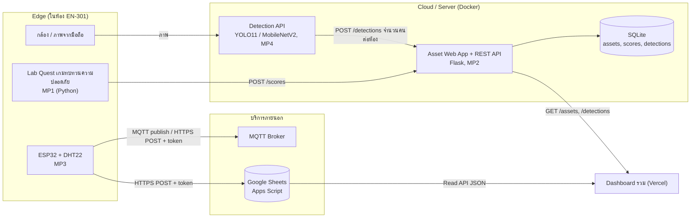

# 🧪 Lab 15: การเตรียมนำเสนอโครงงานประยุกต์รวม

> **โมดูล:** Module 4 - Computer Vision (Mini-Project 4)
> **เวลาที่ใช้:** 2 ชั่วโมง (ในห้องปฏิบัติการ) + เวลาศึกษาด้วยตนเอง

## 🎯 จุดประสงค์การทดลอง (Objectives)
- ปรับแต่งระบบ (Fine-tuning) และจัดทำสไลด์การดูงาน+ผลงาน Capstone
- ประยุกต์ใช้ความรู้จากภาคทฤษฎี (สัปดาห์ที่ 15) สู่การปฏิบัติจริง
- เสริมสร้างทักษะการทำงานกลุ่มผ่าน Mini-Project

## 🛠️ เครื่องมือที่ต้องใช้ (Prerequisites & Tools)
- เครื่องคอมพิวเตอร์และอินเทอร์เน็ต พร้อม Python 3, Git และ Docker Desktop
- ผลงาน 4 Mini-Projects ของกลุ่มใน repository:
  - **MP1** Simple Text/2D Game ([[Lab 04 - Algorithm Flowchart and Module 1 Presentation|Lab 04]])
  - **MP2** Asset Management Web App + SQLite + Docker ([[Lab 07 - Cloud Deployment and Docker|Lab 07]])
  - **MP3** Smart Environment Monitor: ESP32 + MQTT/Google Sheets + Dashboard ([[Lab 12 - Security Implementation and Module 3 Presentation|Lab 12]])
  - **MP4** AI Object Detection System: YOLO11 / MobileNetV2 + API + CI ([[Lab 13 - AI Bias and Object Detection|Lab 13]], [[Lab 14 - CI-CD Pipeline and System Integration|Lab 14]])
- เครื่องมือทำสไลด์ (Google Slides, PowerPoint หรือ Canva) และโปรแกรมอัดหน้าจอ (OBS Studio หรือ Snipping Tool ของ Windows)
- บันทึกจากการดูงาน/Virtual Tour ศูนย์ข้อมูลของสัปดาห์นี้ (ดู [[Week 15 - Academic Visits & Computer Industry Tour]])

> [!note] ผลลัพธ์ในใบงานนี้
> `smoke_test.py` และ `mock_server.py` ในขั้นตอนที่ 4 รันจริงด้วย Python 3.14.3 โดยใช้เฉพาะ library มาตรฐาน (ไม่ต้อง `pip install`) เวลาตอบสนอง (ms) ของแต่ละเครื่องจะต่างกัน

---

## 🕒 ส่วนที่ 1: ทฤษฎีประยุกต์: บูรณาการระบบและทดสอบแบบ End-to-End (1 ชั่วโมง)

**ภาพรวม:** ตลอดภาคเรียนทีมสร้าง 4 ระบบแยกกัน สัปดาห์นี้คือการ **ประกอบเป็นระบบเดียว** แบบที่วิศวกรทำในอุตสาหกรรม คือ กำหนดสถาปัตยกรรม → ตกลง "สัญญา" ของ interface → ทดสอบการเชื่อมต่อแบบ end-to-end → ตรวจความปลอดภัยและจริยธรรม ก่อนนำเสนอในสัปดาห์ที่ 16

### ขั้นตอนที่ 1: วาดสถาปัตยกรรมระบบรวม (15 นาที)

ตัวอย่างนี้ใช้โจทย์ **"Smart Lab: ห้องปฏิบัติการอัจฉริยะ"** ทีมเปลี่ยนโจทย์ได้ แต่ต้องมีครบทั้ง 4 Mini-Projects และเส้นทางข้อมูลที่เชื่อมกันจริงอย่างน้อย 3 เส้น



เส้นทางข้อมูลแต่ละเส้นสอดคล้องกับเนื้อหาสัปดาห์ใด ใช้ตารางนี้เป็นสไลด์ "สถาปัตยกรรม" และเป็นคำตอบเวลาถูกถามว่า "ระบบนี้ใช้ความรู้อะไรบ้าง"

| ส่วนประกอบ | มาจาก | ทำงานที่ | ความรู้ที่ใช้ |
|---|---|---|---|
| เกม Lab Quest | MP1 | เครื่องผู้เล่น | อัลกอริทึม, file I/O, game logic (W1–W4) |
| Web App + DB | MP2 | Docker container บน server/cloud | SQL, REST API, network, container (W5–W7) |
| Environment Monitor | MP3 | ESP32 (edge) + Google Sheets | IoT, MQTT, security token (W9–W12) |
| Detection API | MP4 | server ที่มี CPU/GPU | Computer vision, CI/CD, AI ethics (W13–W14) |
| Dashboard | MP2 + MP3 | Vercel (static hosting) | HTML/JS, fetch API |

> [!tip] เชื่อมกับการดูงานสัปดาห์นี้
> ระหว่าง Virtual Tour/ดูงานศูนย์ข้อมูล ให้จดว่า **ถ้าระบบของทีมต้องรองรับผู้ใช้ทั้งมหาวิทยาลัย** ส่วนประกอบใดต้องย้ายไปอยู่ใน data center, ต้องเพิ่ม redundancy ตรงไหน และใช้พลังงานมากที่สุดตรงไหน (มักเป็นส่วน AI inference) แล้วใส่เป็นสไลด์ "Next steps"

### ขั้นตอนที่ 2: ตกลง "สัญญา" ของ interface (Interface Contract)

ปัญหาที่พบบ่อยที่สุดตอนรวมระบบคือแต่ละคนเข้าใจรูปแบบข้อมูลไม่ตรงกัน ให้เขียนตารางนี้ใน `docs/interfaces.md` **ก่อน** เขียนโค้ดเชื่อม

| ID | ผู้ส่ง → ผู้รับ | Endpoint / Topic | Method | ข้อมูลตัวอย่าง (JSON) | การยืนยันตัวตน |
|---|---|---|---|---|---|
| IF-1 | เกม → Web | `/scores` | POST | `{"player": "somchai", "score": 120}` | API key ใน header |
| IF-2 | Web → Dashboard | `/assets` | GET | `[{"asset_id": "A001", "name": "Notebook Dell"}]` | ไม่ต้อง (อ่านอย่างเดียว) |
| IF-3 | ESP32 → Sheets | Apps Script `doPost` | POST | `{"temperature": 31.2, "humidity": 64}` | token |
| IF-4 | Sheets → Dashboard | Apps Script `doGet` | GET | `{"temperature": 31.2, "humidity": 64, "time": "..."}` | ไม่ต้อง |
| IF-5 | ESP32 → Broker | `building5/EN301/env` | MQTT publish | `{"t": 31.2, "h": 64}` | username/password ของ broker |
| IF-6 | CV → Web | `/detections` | POST | `{"room": "EN-301", "person": 3, "ts": "..."}` | API key |
| IF-7 | ผู้ใช้ → CV | `/predict` | POST | ภาพ → `{"class": "person", "confidence": 0.91}` | API key |

### ขั้นตอนที่ 3: Integration checklist

| # | รายการตรวจ | ผู้รับผิดชอบ | ผ่าน? |
|---|---|---|---|
| 1 | ทุกส่วนอยู่ใน repository เดียว (หรือ repo หลักมีลิงก์ไปทุก repo) แยกโฟลเดอร์ `game/`, `web/`, `iot/`, `cv/`, `docs/` | | ☐ |
| 2 | `docker compose up` รัน Web App + DB ได้ในคำสั่งเดียวบนเครื่องที่ไม่เคยรันมาก่อน | | ☐ |
| 3 | URL, token และ API key ทั้งหมดอยู่ใน `.env`/`secrets.py` ที่อยู่ใน `.gitignore` มี `.env.example` ให้คนอื่นดูรูปแบบ | | ☐ |
| 4 | ESP32 ส่งข้อมูลได้จริง และ Dashboard แสดงค่าใหม่ภายใน 30–60 วินาที | | ☐ |
| 5 | Detection API รับภาพแล้วคืน JSON ตาม IF-7 และส่งผลเข้า Web ตาม IF-6 | | ☐ |
| 6 | เกมส่งคะแนนเข้า Web ได้ และถ้าเชื่อมต่อไม่ได้ เกมยังเล่นต่อได้ (บันทึกลงไฟล์ JSON ไว้ส่งทีหลัง) | | ☐ |
| 7 | GitHub Actions (CI) จาก Lab 14 ผ่านเป็นสีเขียวบน commit ล่าสุด | | ☐ |
| 8 | ทุกส่วนจัดการ error: timeout, ข้อมูลผิดรูปแบบ, บริการปลายทางล่ม โดยไม่ crash | | ☐ |
| 9 | `smoke_test.py` (ขั้นตอนที่ 4) ผ่านครบทุกข้อ | | ☐ |

### ขั้นตอนที่ 4: เขียน Smoke Test แบบ End-to-End

**smoke test** คือการทดสอบสั้น ๆ ว่า "ระบบติดไหม" ทุกบริการตอบและคืนข้อมูลตามสัญญาหรือไม่ ใช้รันก่อน demo ทุกครั้ง สร้างไฟล์ `tests/smoke_test.py`

```python
"""smoke_test.py: ตรวจแบบ end-to-end ว่าทุกบริการของระบบรวมตอบสนอง และคืน JSON ตามรูปแบบที่ตกลงกันไว้"""
import json
import time
import urllib.error
import urllib.request

# เปลี่ยนเป็น URL จริงของกลุ่ม (เช่น http://localhost:5000 หรือ URL ที่ deploy แล้ว)
WEB_API = "http://127.0.0.1:8765"             # MP2 Asset Web App (Flask + SQLite ใน Docker)
SHEETS_READ_API = WEB_API + "/api/latest"     # MP3 Read API ของ Google Apps Script
CV_API = WEB_API                              # MP4 API ที่ห่อ model (Lab 14)

# (ชื่อการทดสอบ, method, URL, JSON body, key ที่ต้องมีในผลลัพธ์)
CHECKS = [
    ("MP2 รายการครุภัณฑ์", "GET",  WEB_API + "/assets",  None,                 ["asset_id", "name"]),
    ("MP3 ค่าเซนเซอร์ล่าสุด", "GET", SHEETS_READ_API,     None,                 ["temperature", "humidity"]),
    ("MP4 ทำนายภาพ",       "POST", CV_API + "/predict",  {"image": "test.jpg"}, ["class", "confidence"]),
    ("MP1 คะแนนสูงสุด",     "GET",  WEB_API + "/scores",  None,                 ["player", "score"]),
]

def run_check(method, url, body, keys, timeout=10):
    data = json.dumps(body).encode("utf-8") if body is not None else None
    req = urllib.request.Request(url, data=data, method=method,
                                 headers={"Content-Type": "application/json"})
    t0 = time.perf_counter()
    try:
        with urllib.request.urlopen(req, timeout=timeout) as resp:
            payload = json.loads(resp.read().decode("utf-8"))
            ms = (time.perf_counter() - t0) * 1000
            item = payload[0] if isinstance(payload, list) and payload else payload   # รองรับผลแบบ list
            missing = [k for k in keys if k not in item]
            if missing:
                return False, f"HTTP {resp.status} แต่ไม่มี key {missing}"
            return True, f"HTTP {resp.status} ({ms:.0f} ms)"
    except urllib.error.HTTPError as e:
        return False, f"HTTP {e.code}"
    except (urllib.error.URLError, TimeoutError) as e:
        return False, f"เชื่อมต่อไม่ได้ ({e.__class__.__name__})"
    except json.JSONDecodeError:
        return False, "ผลลัพธ์ไม่ใช่ JSON"

def main():
    passed = 0
    for name, method, url, body, keys in CHECKS:
        ok, detail = run_check(method, url, body, keys)
        passed += ok
        print(f"[{'PASS' if ok else 'FAIL'}] {name} | {method} {url.split('//')[1]} | {detail}")
    print(f"สรุป: ผ่าน {passed}/{len(CHECKS)}")
    return passed == len(CHECKS)

if __name__ == "__main__":
    main()
```

เพื่อฝึกก่อนชี้ไปที่ระบบจริง ให้ใช้เซิร์ฟเวอร์จำลอง `tests/mock_server.py` ซึ่ง **ตั้งใจไม่มี** `/scores` (จำลองว่ายังไม่ได้เชื่อมเกมเข้า Web)

```python
"""mock_server.py: เซิร์ฟเวอร์จำลองสำหรับฝึกรัน smoke test ก่อนชี้ไปที่ระบบจริงของกลุ่ม"""
import json
from http.server import BaseHTTPRequestHandler, HTTPServer

RESPONSES = {
    ("GET", "/assets"): [{"asset_id": "A001", "name": "Notebook Dell", "room_id": "EN-301"}],
    ("GET", "/api/latest"): {"temperature": 31.2, "humidity": 64, "time": "2026-10-12 10:15:00"},
    ("POST", "/predict"): {"class": "person", "confidence": 0.91},
    # ตั้งใจไม่มี /scores เพื่อดูว่า smoke test จับจุดที่ยังไม่ได้เชื่อมได้
}

class Handler(BaseHTTPRequestHandler):
    def _reply(self, method):
        body = RESPONSES.get((method, self.path))
        self.send_response(200 if body is not None else 404)
        self.send_header("Content-Type", "application/json")
        self.end_headers()
        self.wfile.write(json.dumps(body if body is not None else {"error": "not found"}).encode())

    def do_GET(self):
        self._reply("GET")

    def do_POST(self):
        self.rfile.read(int(self.headers.get("Content-Length", 0)))   # อ่าน body ทิ้ง
        self._reply("POST")

    def log_message(self, *args):   # ปิด log ของเซิร์ฟเวอร์ให้หน้าจอสะอาด
        pass

if __name__ == "__main__":
    print("mock server: http://127.0.0.1:8765  (กด Ctrl+C เพื่อหยุด)")
    HTTPServer(("127.0.0.1", 8765), Handler).serve_forever()
```

เปิด Terminal ที่ 1 รัน `python tests/mock_server.py` แล้วเปิด Terminal ที่ 2 รัน `python tests/smoke_test.py`

```output
[PASS] MP2 รายการครุภัณฑ์ | GET 127.0.0.1:8765/assets | HTTP 200 (41 ms)
[PASS] MP3 ค่าเซนเซอร์ล่าสุด | GET 127.0.0.1:8765/api/latest | HTTP 200 (1 ms)
[PASS] MP4 ทำนายภาพ | POST 127.0.0.1:8765/predict | HTTP 200 (1 ms)
[FAIL] MP1 คะแนนสูงสุด | GET 127.0.0.1:8765/scores | HTTP 404
สรุป: ผ่าน 3/4
```

กด `Ctrl+C` หยุด mock server แล้วรัน smoke test ซ้ำ (จำลองว่า server ล่มก่อน demo)

```output
[FAIL] MP2 รายการครุภัณฑ์ | GET 127.0.0.1:8765/assets | เชื่อมต่อไม่ได้ (URLError)
[FAIL] MP3 ค่าเซนเซอร์ล่าสุด | GET 127.0.0.1:8765/api/latest | เชื่อมต่อไม่ได้ (URLError)
[FAIL] MP4 ทำนายภาพ | POST 127.0.0.1:8765/predict | เชื่อมต่อไม่ได้ (URLError)
[FAIL] MP1 คะแนนสูงสุด | GET 127.0.0.1:8765/scores | เชื่อมต่อไม่ได้ (URLError)
สรุป: ผ่าน 0/4
```

- smoke test แยก **3 ระดับของความผิดพลาด**: เชื่อมต่อไม่ได้ (server ไม่ทำงาน/URL ผิด), HTTP error (เชื่อมได้แต่ endpoint ไม่มีหรือไม่มีสิทธิ์) และ JSON ไม่ตรงสัญญา (key หาย)
- ใช้ `urllib` ของ library มาตรฐาน จึงรันได้ทุกเครื่องและใน GitHub Actions โดยไม่ต้องติดตั้งอะไร (ถ้าทีมใช้ `requests` อยู่แล้วก็เปลี่ยนได้)
- `timeout=10` สำคัญมาก ถ้าไม่ใส่ โปรแกรมอาจค้างรอบริการที่ล่มนานจนเสียเวลา demo
- ถ้า `/predict` ของทีมรับภาพแบบ `multipart/form-data` (อัปโหลดไฟล์) ให้แยกทดสอบด้วย `curl -F "file=@test.jpg" <CV_API>/predict` หรือใช้ `requests.post(url, files={"file": open("test.jpg", "rb")})`
- MQTT ไม่ใช่ HTTP จึงทดสอบแยกด้วย `mosquitto_sub -h <broker> -t "building5/EN301/#" -v` ว่ามีข้อความใหม่เข้ามา (ดู [[Lab 11 - MQTT Data Transmission]])

### ขั้นตอนที่ 5: แผนทดสอบ End-to-End (Test Plan)

smoke test ตรวจทีละบริการ แต่ **end-to-end test** ตรวจทั้งเส้นทางข้อมูลจากต้นทางถึงปลายทางเหมือนผู้ใช้จริง เขียนใน `docs/test-plan.md`

| Test ID | สถานการณ์ | ขั้นตอน | ผลที่คาดหวัง | ผลจริง | ผ่าน? |
|---|---|---|---|---|---|
| E2E-01 | ข้อมูลอุณหภูมิถึง Dashboard | เป่าลมร้อน/จับเซนเซอร์ → รอ 60 วินาที → เปิด Dashboard | ค่าอุณหภูมิเพิ่มขึ้นและเวลาเป็นปัจจุบัน | | |
| E2E-02 | ตรวจจับคนแล้วบันทึก | ส่งภาพที่มี 3 คนเข้า Detection API | `/detections` มีแถวใหม่ `person = 3` และ Dashboard แสดงผล | | |
| E2E-03 | คะแนนเกมเข้าฐานข้อมูล | เล่นเกมจนจบ | `GET /scores` มีคะแนนล่าสุด | | |
| E2E-04 | ข้อมูลผิดรูปแบบ | POST `{"temperature": "abc"}` | ได้ HTTP 400 และ DB ไม่มีแถวขยะ | | |
| E2E-05 | ไม่มี token | POST ไปที่ Write API โดยไม่ใส่ token | ถูกปฏิเสธ (401/403 หรือข้อความ error) | | |
| E2E-06 | บริการปลายทางล่ม | หยุด container Web แล้วเล่นเกมจนจบ | เกมไม่ crash เก็บคะแนนไว้ในไฟล์ แล้วส่งได้เมื่อ Web กลับมา | | |
| E2E-07 | Restart ทั้งระบบ | `docker compose down` แล้ว `up` ใหม่ | ข้อมูลเดิมใน DB ยังอยู่ (ใช้ volume) | | |

### ขั้นตอนที่ 6: Security และ PDPA checklist

| ด้าน | รายการตรวจ | อ้างอิง | ผ่าน? |
|---|---|---|---|
| Confidentiality | ไม่มี password/token/API key ใน repository (ค้นด้วย `git log -p \| grep -i token` และเปิด Secret scanning ของ GitHub) | [[CIA Triad]] | ☐ |
| Confidentiality | ส่งข้อมูลผ่าน HTTPS / MQTT over TLS (8883) เมื่อออกนอกเครือข่ายห้อง | [[Lab 12 - Security Implementation and Module 3 Presentation\|Lab 12]] | ☐ |
| Integrity | SQL ใช้ placeholder `?` ทุกครั้ง ตรวจชนิดและช่วงค่าของข้อมูลจากเซนเซอร์/ผู้ใช้ | [[Lab 05 - Database Design and SQL\|Lab 05]] | ☐ |
| Availability | มี timeout/retry และระบบยังทำงานบางส่วนได้เมื่อบริการหนึ่งล่ม | ขั้นตอนที่ 5 | ☐ |
| PDPA | ภาพจากกล้องที่มีใบหน้าถือเป็น **ข้อมูลส่วนบุคคล** ติดป้ายแจ้งการเก็บภาพ บอกวัตถุประสงค์ (นับจำนวนคน) | [[PDPA]] | ☐ |
| PDPA | เก็บเฉพาะ **จำนวน** ที่นับได้ ไม่เก็บภาพดิบเกินจำเป็น (data minimization) กำหนดระยะเวลาลบ | [[05_กฎหมายคุ้มครองข้อมูลส่วนบุคคล_PDPA_และ_GDPR]] | ☐ |
| PDPA | ชื่อผู้เล่นในตารางคะแนนใช้ชื่อเล่น/นามแฝง ไม่ใช้รหัสนักศึกษาหรือชื่อจริงโดยไม่ได้รับความยินยอม | [[PDPA]] | ☐ |
| Licensing | ระบุ license ของ model/dataset/library ที่ใช้ (เช่น Ultralytics YOLO11 ใช้ AGPL-3.0) ใน README | [[04_ใบอนุญาตซอฟต์แวร์_Open_Source_vs_Proprietary]] | ☐ |

### ขั้นตอนที่ 7: สะท้อนคิดเรื่องจริยธรรมและอคติของ AI

ตอบในทีมแล้วสรุปเป็น 1 สไลด์ (ต่อยอดจากการทดลองอคติใน [[Lab 13 - AI Bias and Object Detection|Lab 13]])

1. model ของทีมถูกทดสอบกับภาพแบบใดบ้าง (แสงน้อย, มุมกล้อง, สีผิว, เครื่องแต่งกาย) มีกลุ่มใดที่ตรวจจับพลาดบ่อยกว่ากลุ่มอื่นหรือไม่
2. ถ้า model นับคนผิด ใครได้รับผลกระทบ (เช่น ปิดแอร์ทั้งที่ยังมีคนอยู่) และระบบควรมีมนุษย์ตรวจสอบตรงไหน (human-in-the-loop)
3. ข้อมูลใดในระบบที่ไม่ควรเก็บเลย และข้อมูลใดต้องขอความยินยอม
4. ทีมใช้ AI ช่วยเขียนโค้ด/สไลด์ตรงไหน และตรวจสอบความถูกต้องอย่างไร (เปิดเผยในสไลด์สุดท้าย ตามหลักใน [[01_จริยธรรมยุคดิจิทัลและ_AI_Ethics]])

<details><summary>ดูแนวคำตอบ</summary>

1. ตัวอย่างคำตอบที่ดีต้องมี **หลักฐาน** เช่น "ทดสอบ 40 ภาพ แสงปกติตรวจจับได้ 95% แต่ในห้องที่ปิดไฟเหลือ 60% และคนที่ใส่เสื้อสีเข้มนั่งหลังห้องถูกพลาดบ่อย" ไม่ใช่ตอบว่า "ไม่มีอคติ" โดยไม่ได้ทดสอบ
2. การนับต่ำกว่าจริงอาจทำให้ระบบอัตโนมัติปิดไฟ/แอร์ทั้งที่มีคน จึงควรให้ระบบ **แนะนำ** แล้วมีเจ้าหน้าที่ยืนยัน หรือตั้งเงื่อนไขว่าต้องนับได้ 0 ต่อเนื่องหลายนาทีก่อนสั่งงาน
3. ไม่ควรเก็บภาพใบหน้าดิบหรือระบุตัวบุคคล (ไม่จำเป็นต่อวัตถุประสงค์นับจำนวน) ส่วนชื่อจริงผู้เล่นหรือภาพที่จะใช้ในสไลด์ต้องขอความยินยอมจากเจ้าของข้อมูล
4. ระบุให้ชัด เช่น "ใช้ AI ช่วยร่างฟังก์ชัน retry และตรวจด้วย E2E-06" การเปิดเผยแสดงความรับผิดชอบ ไม่ใช่การยอมรับความผิด
</details>

---

## 🚀 ส่วนที่ 2: งานพัฒนา Mini-Project: เตรียมนำเสนอโครงงานรวม (1 ชั่วโมง + การบ้าน)

- **เป้าหมายสัปดาห์นี้:** ระบบรวมผ่าน smoke test และ E2E test หลัก มีเอกสารครบ และสไลด์พร้อมซ้อมสำหรับการนำเสนอใน [[Week 16 - Final Project Presentation]]
- **โจทย์:** (1) ปิด integration checklist (2) เขียน README ของระบบรวม (3) ทำสไลด์ตามโครงด้านล่าง (4) เตรียม demo และแผนสำรอง (5) ซ้อมตอบคำถามและประเมินกันเองด้วย peer-review rubric

### ขั้นตอนที่ 1: README ของระบบรวม

```markdown
# Smart Lab: ห้องปฏิบัติการอัจฉริยะ (ทีม XX)
สรุป 2–3 บรรทัด: ปัญหาที่แก้ และผู้ใช้คือใคร

## สถาปัตยกรรม
(ภาพ mermaid หรือ PNG จาก docs/architecture) + ตาราง interface จาก docs/interfaces.md

## โครงสร้าง repository
game/  web/  iot/  cv/  tests/  docs/

## วิธีติดตั้งและรัน
1. cp .env.example .env แล้วเติมค่า
2. docker compose up -d          (Web + DB)
3. python cv/api.py              (Detection API)
4. อัปโหลด iot/main.py ลง ESP32
5. python tests/smoke_test.py    ต้องผ่านทุกข้อ

## ผลการทดสอบ
ตาราง E2E test plan พร้อมผลจริง และค่าชี้วัด (เช่น accuracy, เวลาตอบสนอง)

## ข้อจำกัดและงานต่อยอด
## ความปลอดภัย / PDPA / License
## สมาชิกและหน้าที่ / การใช้ AI ช่วยพัฒนา
```

### ขั้นตอนที่ 2: โครงสไลด์และการแบ่งเวลา

สมมติเวลานำเสนอ 12 นาที + ถาม-ตอบ 5 นาที (ปรับตามที่อาจารย์ประกาศ) ใช้ประมาณ 1 สไลด์ต่อนาที

| ลำดับ | หัวข้อ | สิ่งที่ต้องมี | เวลา |
|---|---|---|---|
| 1 | Problem | ปัญหาจริงคืออะไร ใครเดือดร้อน ทำไมต้องแก้ | 1:00 |
| 2 | Architecture | ผังระบบรวมจากขั้นตอนที่ 1 และบอกว่าแต่ละส่วนมาจาก Mini-Project ใด | 2:00 |
| 3 | Demo | เล่าตามเส้นทางข้อมูล 1 เส้นตั้งแต่ต้นทางถึง Dashboard (ดูขั้นตอนที่ 3) | 4:00 |
| 4 | Results | ผล E2E test, accuracy ของ model, เวลาตอบสนอง, ผลทดสอบอคติ | 2:00 |
| 5 | Limitations | ข้อจำกัดที่รู้ เช่น แสงน้อย, broker สาธารณะ, ยังไม่รองรับผู้ใช้จำนวนมาก | 1:00 |
| 6 | Next steps | สิ่งที่จะทำต่อ และข้อคิดจากการดูงานศูนย์ข้อมูล | 1:00 |
| 7 | ทีมและการใช้ AI | บทบาทสมาชิก การเปิดเผยการใช้ AI | 1:00 |
| - | ถาม-ตอบ | ทุกคนตอบคำถามส่วนของตนได้ | 5:00 |

> [!tip] หลักการทำสไลด์ที่ดี
> 1 สไลด์ = 1 ประเด็น ใช้ภาพ/ผัง/ตัวเลขแทนข้อความยาว ตัวอักษรไม่เล็กกว่า 24pt ใส่หมายเลขสไลด์เพื่อให้ผู้ถามอ้างถึงได้ และใส่ตัวเลขผลลัพธ์จริงทุกครั้ง เช่น "ส่งข้อมูลสำเร็จ 98% จาก 500 ครั้ง" ดีกว่า "ระบบทำงานได้ดี"

### ขั้นตอนที่ 3: Demo และแผนสำรอง

**บทเดโม (demo script) ตัวอย่าง 4 นาที**

1. (0:00) เปิด Dashboard ให้เห็นค่าปัจจุบัน
2. (0:30) จับเซนเซอร์ DHT22 ให้อุ่นขึ้น ระหว่างรอค่าเปลี่ยน อธิบายเส้นทาง ESP32 → Sheets → Dashboard
3. (1:30) ส่งภาพห้องเรียนเข้า Detection API ให้เห็นกล่องตรวจจับ และจำนวนคนขึ้นบน Dashboard
4. (2:30) เล่นเกม 1 รอบสั้น ๆ จากไฟล์เซฟที่เตรียมไว้ คะแนนเข้าตารางบน Web
5. (3:30) กลับมาที่ Dashboard ให้เห็นค่าอุณหภูมิที่เปลี่ยนแล้ว

| ความเสี่ยง | สัญญาณเตือน | แผนสำรอง |
|---|---|---|
| Wi-Fi ห้องนำเสนอใช้ไม่ได้ | smoke test ขึ้น `URLError` | ใช้ hotspot มือถือ (ทดสอบไว้ก่อน) หรือรันทุกอย่างบน localhost |
| ESP32 ไม่ส่งข้อมูล | Dashboard ค่าไม่เปลี่ยนเกิน 2 นาที | เปิด Google Sheets ให้ดูข้อมูลย้อนหลัง หรือเปิดวิดีโอสำรอง |
| model ช้า/ตรวจจับพลาด | รอเกิน 10 วินาที | ใช้ภาพทดสอบที่รันผลไว้แล้ว และอธิบายเป็นข้อจำกัด |
| เครื่องที่ฉายจอไม่มีโปรแกรม | - | demo จากโน้ตบุ๊กของทีมเอง เตรียมสาย HDMI/USB-C |
| ทุกอย่างล่ม | - | **วิดีโอ demo 3–4 นาที** ที่อัดไว้ล่วงหน้า + ภาพหน้าจอทุกขั้นในสไลด์ภาคผนวก |

> [!warning] อัดวิดีโอสำรองก่อนวันนำเสนออย่างน้อย 1 วัน
> วิดีโอต้องแสดงระบบจริงที่ทำงานต่อเนื่อง (ไม่ตัดต่อจนเข้าใจผิด) ถ้าต้องเปิดวิดีโอแทน demo สด ให้บอกผู้ฟังตรง ๆ ว่าเป็นวิดีโอที่อัดไว้ แล้วอธิบายสาเหตุที่ demo สดไม่ได้ ซึ่งเป็นส่วนหนึ่งของ Limitations

### ขั้นตอนที่ 4: เตรียมถาม-ตอบ (Q&A)

แต่ละคนเตรียมคำตอบ 30–60 วินาทีสำหรับคำถามในส่วนที่ตนรับผิดชอบ และซ้อมให้เพื่อนในทีมถาม

| คำถามที่น่าจะถูกถาม | ใครตอบ | ประเด็นที่ต้องมีในคำตอบ |
|---|---|---|
| ถ้ามีผู้ใช้ 1,000 คนพร้อมกัน ส่วนไหนจะล่มก่อน | Web/Infra | SQLite เขียนพร้อมกันได้จำกัด, ย้ายไป PostgreSQL, scale container |
| ทำไมเลือก MQTT แทน HTTP สำหรับ ESP32 | IoT | น้ำหนักเบา, publish/subscribe, QoS, ประหยัดพลังงาน |
| accuracy ของ model เท่าไร วัดจากข้อมูลชุดไหน | CV | แยก train/validation, จำนวนภาพ, กรณีที่พลาด |
| ถ้ามีคนได้ token ของ ESP32 ไปจะเกิดอะไรขึ้น ป้องกันอย่างไร | Security | ส่งข้อมูลปลอมได้, หมุนเวียน token, ตรวจช่วงค่า, rate limit |
| ภาพจากกล้องขัดกับ PDPA ไหม | ทุกคน | วัตถุประสงค์, แจ้งเตือน, เก็บเฉพาะจำนวน, ระยะเวลาลบ |
| Big-O ของฟังก์ชันหลักในเกมคืออะไร | Game | ตอบจากตารางใน Lab 04 |
| ถ้ามีเวลาอีก 1 เดือนจะทำอะไรต่อ | หัวหน้าทีม | ตรงกับสไลด์ Next steps |

ถ้าตอบไม่ได้ ให้ตอบตรง ๆ ว่า "ยังไม่ได้ทดสอบประเด็นนี้ แต่คาดว่า… และจะตรวจสอบโดย…" ดีกว่าการเดาคำตอบ

### ขั้นตอนที่ 5: Peer Review (ซ้อมนำเสนอกับทีมอื่น)

จับคู่ทีม ซ้อมนำเสนอให้กันดูเต็มเวลา แล้วให้คะแนนด้วยแบบฟอร์มนี้ (เกณฑ์เดียวกับ rubric นำเสนอโครงงานใน [[การวัดและประเมินผล]])

| เกณฑ์ | 3 ดีมาก | 2 ดี | 1 พอใช้ | คะแนน | ข้อเสนอแนะ 1 ข้อ |
|---|---|---|---|---|---|
| ความถูกต้องเชิงเทคนิค | อธิบายถูก เชื่อมเนื้อหาหลายสัปดาห์ | ถูกเป็นส่วนใหญ่ | มีข้อผิดพลาดสำคัญ | | |
| การบูรณาการระบบ | เชื่อม 4 Mini-Projects มีข้อมูลไหลจริง ≥ 3 เส้น | เชื่อมได้บางส่วน | แยกกันเป็นชิ้น ๆ | | |
| Demo และหลักฐาน | demo ราบรื่น มีผลทดสอบเป็นตัวเลข | demo ได้แต่ติดขัด | ไม่มี demo/หลักฐาน | | |
| ความปลอดภัย จริยธรรม PDPA | ระบุความเสี่ยงและมาตรการที่ทำจริง | กล่าวถึงแต่ไม่ได้ทำ | ไม่กล่าวถึง | | |
| การสื่อสารและเวลา | ชัดเจน ตรงเวลา ±1 นาที | เข้าใจได้ เกินเวลาเล็กน้อย | ติดขัด/เกินเวลามาก | | |
| การตอบคำถาม | ตอบลึก ทุกคนตอบได้ | ตอบพื้นฐานได้ | ตอบไม่ได้ | | |

### งานที่ทีมต้องทำต่อ (การบ้าน)

1. แก้ทุกข้อที่ไม่ผ่านใน integration checklist, smoke test และ E2E test plan บันทึกผลจริงลงตาราง
2. นำข้อเสนอแนะจาก peer review มาแก้สไลด์ อย่างน้อย 3 จุด และบันทึกว่าแก้อะไรใน progress log
3. อัดวิดีโอ demo สำรอง อัปโหลดไว้ (เช่น Google Drive ที่แชร์ให้อาจารย์) และใส่ลิงก์ใน README
4. สร้าง tag ระบบรวม `git tag v-final` แล้ว push ก่อนวันนำเสนอ
5. ซ้อมนำเสนอเต็มเวลาอย่างน้อย 2 รอบ จับเวลาจริง

---

## 📝 เกณฑ์การส่งงานและการประเมิน (Deliverables & Rubric)
- ส่งรายงานความคืบหน้า (Progress Log) เป็นไฟล์ Markdown ผ่าน GitHub
- ส่งโค้ดต้นฉบับผ่าน Repository ของกลุ่ม
- ให้ฟีดแบ็กความสมบูรณ์โดยพิจารณาจากเกณฑ์ของ CLO4, CLO6

| หัวข้อ | สิ่งที่ตรวจ |
|---|---|
| สถาปัตยกรรมและ interface | ผังระบบรวมครบ 4 Mini-Projects และ `docs/interfaces.md` ระบุ endpoint, รูปแบบข้อมูล, การยืนยันตัวตน |
| การทดสอบ | `tests/smoke_test.py` ชี้ไปที่ระบบจริงและผ่านครบ, `docs/test-plan.md` มีผลจริงอย่างน้อย 5 กรณี |
| Security/PDPA/จริยธรรม | checklist ขั้นตอนที่ 6 ผ่าน ไม่มี secret ใน repo และมีสไลด์สะท้อนคิดเรื่องอคติ |
| เอกสาร | README ระบบรวมครบทุกหัวข้อ คนนอกทีมทำตามแล้วรันได้ |
| ความพร้อมนำเสนอ | สไลด์ตามโครง 7 ส่วน, demo script, วิดีโอสำรอง และแบบ peer review ที่ได้รับพร้อมสิ่งที่แก้ |

## 🔗 ลิงก์ที่เกี่ยวข้อง
- ⬅️ กลับไปยังสารบัญ Lab: [[_index|สารบัญ Lab]]
- 📚 กลับไปยังเนื้อหาสัปดาห์: [[Week 15]] · [[Week 15 - Academic Visits & Computer Industry Tour]] · ➡️ [[Week 16 - Final Project Presentation]]
- 📖 ทฤษฎีประกอบ: [[05_การเตรียมโครงงานประยุกต์_Capstone]] · [[05_การจัดทำรายงานและการประยุกต์ใช้ความรู้]] · [[01_ภาพรวมอุตสาหกรรมคอมพิวเตอร์และศูนย์ข้อมูล]] · [[CIA Triad]] · [[PDPA]]
- ⬅️ Lab ก่อนหน้า: [[Lab 14 - CI-CD Pipeline and System Integration]]
