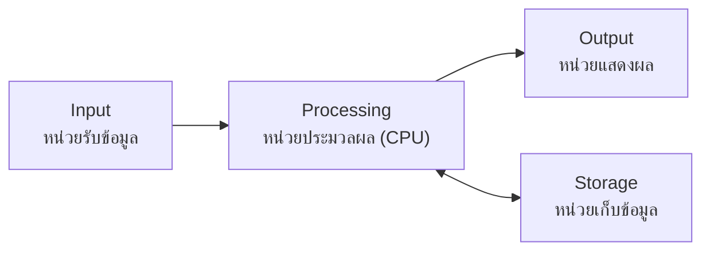

# สถาปัตยกรรมฮาร์ดแวร์สมัยใหม่ (Deep Dive)

> **หมวดหมู่:** เนื้อหาเชิงลึกประกอบการเรียนรู้ (Deep Dive Learning Content)

## 📖 เนื้อหาและคำอธิบาย
การทำความเข้าใจลึกซึ้งถึงสถาปัตยกรรมฮาร์ดแวร์สมัยใหม่เป็นหัวใจสำคัญของการรีดประสิทธิภาพคอมพิวเตอร์ให้ถึงขีดสุด ในโลกปัจจุบันที่ซอฟต์แวร์มีความซับซ้อน ซีพียู (CPU) ไม่ได้ทำหน้าที่เพียงแค่ประมวลผลคำสั่งทีละบรรทัดอีกต่อไป แต่ใช้สถาปัตยกรรมที่ก้าวหน้าอย่าง Instruction Pipelining, Cache Hierarchy และ Memory Management Unit (MMU)

### 1. Instruction Pipeline และ Superscalar Architecture
Pipeline คือเทคนิคที่อนุญาตให้ซีพียูสามารถทำงานหลายคำสั่งซ้อนทับกันได้ โดยแบ่งวงจรคำสั่งออกเป็นขั้นตอนย่อย เช่น Fetch, Decode, Execute และ Write-back ซีพียูยุคใหม่ก้าวไปอีกขั้นด้วย **Superscalar Architecture** ที่มี Execution Units หลายชุด ทำให้สามารถทำหลายคำสั่ง (Instruction) ได้ใน 1 Clock Cycle 
เพื่อป้องกัน Pipeline Stall จาก Data Hazard หรือ Control Hazard ซีพียูใช้เทคนิคอย่าง Branch Prediction และ Out-of-order Execution (OoOE) 

### 2. Cache Hierarchy (L1, L2, L3)
ความเร็วของ CPU และ Main Memory (RAM) แตกต่างกันอย่างมหาศาล สถาปัตยกรรม Cache จึงเข้ามาช่วยลด "Memory Wall"
- **L1 Cache:** แบ่งเป็น Instruction Cache (L1i) และ Data Cache (L1d) เล็กและเร็วที่สุด ฝังอยู่ในแต่ละ Core
- **L2 Cache:** ใหญ่กว่า L1 มักเป็นของแต่ละ Core เช่นกัน
- **L3 Cache:** ขนาดใหญ่ที่สุดและแชร์ร่วมกันระหว่างทุก Core 
การเข้าใจ Locality of Reference (Spatial & Temporal) ช่วยให้วิศวกรเขียนโค้ดที่เป็น Cache-friendly มากขึ้น ซึ่งมีผลโดยตรงต่อความเร็วในการประมวลผล

### 3. Memory Management Unit (MMU) และ Virtual Memory
MMU เป็นหน่วยฮาร์ดแวร์ที่รับผิดชอบการแปลง Virtual Address เป็น Physical Address ด้วยการใช้ Page Table ทำให้แต่ละโปรเซส (Process) มีพื้นที่หน่วยความจำของตัวเองแบบ Isolate แยกจากกัน ป้องกันโปรแกรมเขียนข้อมูลทับกัน นอกจากนี้ยังทำให้ระบบปฏิบัติการทำ Paging และ Swapping ไปยัง Storage ได้ เมื่อ RAM ไม่เพียงพอ

Translation Lookaside Buffer (TLB) ทำหน้าที่เสมือนแคชของ Page Table ช่วยลดความล่าช้าในการแปลง Address หากเกิด TLB Miss ระบบจะต้องดึงข้อมูลจากโครงสร้าง Page Table ในหน่วยความจำหลัก ซึ่งกินเวลาอย่างมาก

```c
// ตัวอย่างการออกแบบ Data Structure ที่ Cache-friendly
struct Player {
    int id;
    float position[3]; // ข้อมูลที่ใช้ร่วมกันบ่อยอยู่ติดกัน (Spatial Locality)
};
```

### 4. องค์ประกอบหลักของคอมพิวเตอร์ (Input–Processing–Output–Storage)
คอมพิวเตอร์ทุกเครื่อง ตั้งแต่โทรศัพท์มือถือจนถึงเซิร์ฟเวอร์ ทำงานตามแบบจำลองพื้นฐาน 4 หน่วย คือ รับข้อมูลเข้า → ประมวลผล → แสดงผล และมีหน่วยเก็บข้อมูลไว้ใช้ภายหลัง



| หน่วย | หน้าที่ | ตัวอย่างอุปกรณ์ |
|---|---|---|
| **Input** (รับข้อมูลเข้า) | แปลงข้อมูลจากโลกภายนอกเป็นสัญญาณดิจิทัล | keyboard, mouse, scanner, microphone, sensor (เช่น เซนเซอร์อุณหภูมิ), กล้อง |
| **Processing** (ประมวลผล) | คำนวณและตัดสินใจตามคำสั่งของโปรแกรม | CPU (และ GPU สำหรับงานขนาน) |
| **Output** (แสดงผล) | แปลงผลลัพธ์ดิจิทัลให้มนุษย์หรืออุปกรณ์อื่นรับรู้ | monitor, printer, speaker |
| **Storage** (เก็บข้อมูล) | เก็บโปรแกรมและข้อมูลไว้ถาวร | SSD, HDD, USB flash drive |

**หน้าที่ของชิ้นส่วนหลัก (สรุปบรรทัดเดียว):**

| ชิ้นส่วน | หน้าที่ |
|---|---|
| **CPU** | "สมอง" ของเครื่อง ดึงคำสั่งมาถอดรหัสและประมวลผล |
| **RAM** | หน่วยความจำหลักชั่วคราว เก็บโปรแกรมและข้อมูลที่กำลังใช้งานอยู่ |
| **Storage (SSD/HDD)** | เก็บไฟล์ โปรแกรม และระบบปฏิบัติการแบบถาวร แม้ปิดเครื่อง |
| **Motherboard** | แผงวงจรหลักที่เชื่อมทุกชิ้นส่วนเข้าด้วยกันผ่านบัสและช่องเสียบ |
| **Power Supply (PSU)** | แปลงไฟบ้าน (AC) เป็นไฟกระแสตรง (DC) แรงดันต่าง ๆ จ่ายให้ทุกชิ้นส่วน |
| **GPU** | ประมวลผลกราฟิกและงานคำนวณขนานจำนวนมาก (เช่น เทรน AI) |

> [!tip] ตัวอย่างในชีวิตจริง
> เมื่อพิมพ์ข้อความใน LINE: keyboard บนจอ (Input) → CPU ประมวลผลข้อความ (Processing) → ข้อความขึ้นบนหน้าจอ (Output) → ประวัติแชตถูกบันทึกลง flash storage ของมือถือ (Storage)

### 5. หน่วยความจำแบบลบเลือนได้ vs ไม่ลบเลือน (Volatile vs Non-volatile)

| ประเภท | ความหมาย | ตัวอย่าง | ใช้ทำอะไร |
|---|---|---|---|
| **Volatile** (ลบเลือนได้) | ข้อมูล **หายไปเมื่อไฟดับ/ปิดเครื่อง** | Register, Cache (SRAM), RAM (DRAM) | เก็บข้อมูลที่ CPU กำลังทำงานด้วย ต้องเร็วมาก |
| **Non-volatile** (ไม่ลบเลือน) | ข้อมูล **ยังอยู่แม้ปิดเครื่อง** | ROM (เช่น firmware BIOS/UEFI), Flash memory, SSD, HDD | เก็บโปรแกรมและไฟล์ระยะยาว |

> [!warning] จุดที่นักศึกษามักสับสน
> "RAM 16 GB" กับ "SSD 512 GB" ไม่ใช่สิ่งเดียวกัน RAM คือพื้นที่ทำงานชั่วคราว (volatile) ส่วน SSD คือที่เก็บถาวร (non-volatile) ถ้าไฟดับขณะพิมพ์รายงานแล้วยังไม่กด Save งานที่อยู่ใน RAM จะหายไป

### 6. ทำไมหน่วยความจำที่เร็วจึงเล็กและแพง
ความเร็ว ขนาด และราคาของหน่วยความจำขึ้นกับ **เทคโนโลยีที่ใช้สร้างเซลล์เก็บบิต** และ **ระยะห่างจาก CPU**

| เทคโนโลยี | โครงสร้างต่อ 1 บิต | ลักษณะ | ใช้ที่ไหน |
|---|---|---|---|
| **SRAM** (Static RAM) | ประมาณ 6 ทรานซิสเตอร์ (6T cell) | เร็วมาก ไม่ต้อง refresh แต่ใช้พื้นที่บนชิปมาก → แพงต่อบิต | Cache L1/L2/L3 |
| **DRAM** (Dynamic RAM) | 1 ทรานซิสเตอร์ + 1 ตัวเก็บประจุ (capacitor) | หนาแน่นกว่า ถูกกว่า แต่ประจุรั่วจึงต้อง **refresh** เป็นระยะ ช้ากว่า SRAM | Main memory (RAM) |
| **NAND Flash** | ทรานซิสเตอร์ชนิดพิเศษ (floating gate / charge trap) ที่กักประจุไว้ได้แม้ไม่มีไฟ | ไม่ลบเลือน ราคาถูกต่อ GB แต่ช้ากว่า DRAM มาก | SSD, USB drive, memory card |

ยิ่ง **อยู่ใกล้ CPU** (อยู่บนชิปเดียวกัน) สัญญาณยิ่งเดินทางสั้น จึงเร็ว แต่พื้นที่บนชิปมีจำกัดและแพง จึงทำให้มีขนาดเล็ก เกิดเป็น **Memory Hierarchy** (ลำดับชั้นหน่วยความจำ):

| ระดับ | เวลาเข้าถึง (โดยประมาณ) | ขนาดทั่วไป (โดยประมาณ) |
|---|---|---|
| Register | < 1 ns | ไม่กี่ร้อยไบต์–KB |
| L1 Cache | ~1 ns | หลักสิบ KB ต่อ core |
| L2 Cache | ~ไม่กี่ ns | หลักร้อย KB–ไม่กี่ MB |
| L3 Cache | ~สิบ ns | หลาย MB |
| RAM (DRAM) | ~หลายสิบถึง ~100 ns | หลาย GB |
| SSD (NVMe) | ~หลายสิบ µs | หลักร้อย GB–TB |
| HDD | ~หลาย ms (ต้องรอจานหมุนและหัวอ่านเคลื่อนที่) | หลาย TB |

> [!note] ค่าตัวเลขเป็นค่าประมาณ
> ตัวเลขในตารางเป็น **ลำดับขนาด (order of magnitude) โดยประมาณ** ที่อ้างอิงกันทั่วไป ค่าจริงขึ้นกับรุ่นของฮาร์ดแวร์ ประเด็นสำคัญคือแต่ละชั้นต่างกันหลายเท่าตัว เช่น HDD ช้ากว่า RAM ในระดับ **หมื่นถึงแสนเท่า (โดยประมาณ)**

### 7. เมื่อเปิดโปรแกรมหนึ่งโปรแกรม เกิดอะไรขึ้น
สมมติดับเบิลคลิกเปิดโปรแกรม `game.exe` ที่อยู่บน SSD:


1. **Storage → RAM:** ระบบปฏิบัติการ (OS loader) อ่านไฟล์โปรแกรมจาก SSD แล้วคัดลอกโค้ดและข้อมูลที่จำเป็นลง RAM จากนั้นสร้าง process ใหม่
2. **RAM → Cache:** เมื่อ CPU เริ่มรันคำสั่ง ข้อมูลจาก RAM จะถูกดึงเป็นก้อน (cache line) เข้าสู่ cache
3. **Cache → Register:** คำสั่งและข้อมูลที่ต้องใช้ทันทีถูกโหลดเข้า register
4. **Execute:** CPU ทำวงรอบ Fetch–Decode–Execute ซ้ำไปเรื่อย ๆ ผลลัพธ์ถูกเขียนกลับ register/cache/RAM
5. **Save:** เมื่อผู้ใช้กดบันทึก ข้อมูลใน RAM จะถูกเขียนกลับลง Storage (non-volatile) จึงไม่หายเมื่อปิดเครื่อง

> [!tip] ทำไมเปิดโปรแกรมครั้งแรกช้ากว่าครั้งที่สอง
> ครั้งแรกต้องอ่านจาก Storage ซึ่งช้าที่สุด ครั้งต่อมา OS มักยังเก็บข้อมูลบางส่วนไว้ใน RAM (file cache) จึงเปิดได้เร็วขึ้น

### 8. RAM ไม่พอทำให้เครื่องช้าลงอย่างไร
เมื่อเปิดโปรแกรมหลายตัวจนใช้ RAM เกินที่มี OS จะพึ่ง **Virtual Memory** (ดูหัวข้อ 3) ซึ่งแบ่งหน่วยความจำเป็นก้อนขนาดเท่ากันเรียกว่า **page** และให้แต่ละโปรแกรมเห็นพื้นที่ที่ใหญ่กว่า RAM จริง

- **Paging / Swapping:** page ที่ไม่ค่อยได้ใช้จะถูกย้ายออกจาก RAM ไปเก็บใน **swap space / page file** บน SSD หรือ HDD
- **Page fault:** เมื่อโปรแกรมต้องการ page ที่ถูกย้ายไปอยู่บนดิสก์ CPU ต้องรอให้ OS อ่าน page นั้นกลับเข้า RAM ก่อน (และอาจต้องย้าย page อื่นออกไปแทน)
- **Thrashing:** ถ้า RAM น้อยเกินไปมาก ระบบจะเสียเวลาส่วนใหญ่ไปกับการสลับ page เข้า–ออกดิสก์ แทนที่จะทำงานจริง เครื่องจะ "ค้าง" และดิสก์ทำงานตลอดเวลา

**ทำไมถึงช้ามาก:** จากตาราง memory hierarchy การเข้าถึง RAM ใช้เวลาระดับ ~100 ns แต่ SSD ใช้ระดับหลายสิบ µs และ HDD ระดับหลาย ms หมายความว่าการอ่าน page จากดิสก์ช้ากว่าการอ่านจาก RAM **หลายร้อยถึงหลายหมื่นเท่า (โดยประมาณ)**

> [!tip] ตัวอย่าง
> โน้ตบุ๊ก RAM 8 GB เปิด Chrome 40 แท็บ + VS Code + Docker พร้อมกัน ระบบเริ่มใช้ page file มาก ทำให้สลับหน้าต่างช้า วิธีแก้คือปิดโปรแกรมที่ไม่ใช้ หรือเพิ่ม RAM

<details><summary>ดูเฉลย: ทำไมเพิ่ม RAM ช่วยให้เครื่องเร็วขึ้น แต่เพิ่มความจุ SSD ไม่ช่วย?</summary>

เพราะความช้าเกิดจาก **การ swap ข้อมูลระหว่าง RAM กับดิสก์** เมื่อ RAM ไม่พอ การเพิ่ม RAM ลดจำนวน page fault ทำให้ข้อมูลอยู่ในหน่วยความจำที่เร็วกว่า ส่วนการเพิ่มความจุ SSD เพียงเพิ่มที่เก็บถาวร ไม่ได้ลดการ swap (การเปลี่ยนจาก HDD เป็น SSD ช่วยได้บ้างเพราะ SSD เร็วกว่า แต่ก็ยังช้ากว่า RAM มาก)
</details>

**อ้างอิง:**
- *Operating System Concepts* (10th ed.), Silberschatz et al.

---
*เนื้อหานี้เป็นส่วนขยายของวิชาแก่นวิศวกรรมคอมพิวเตอร์ เพื่อให้ผู้เรียนค้นคว้าเพิ่มเติมได้*