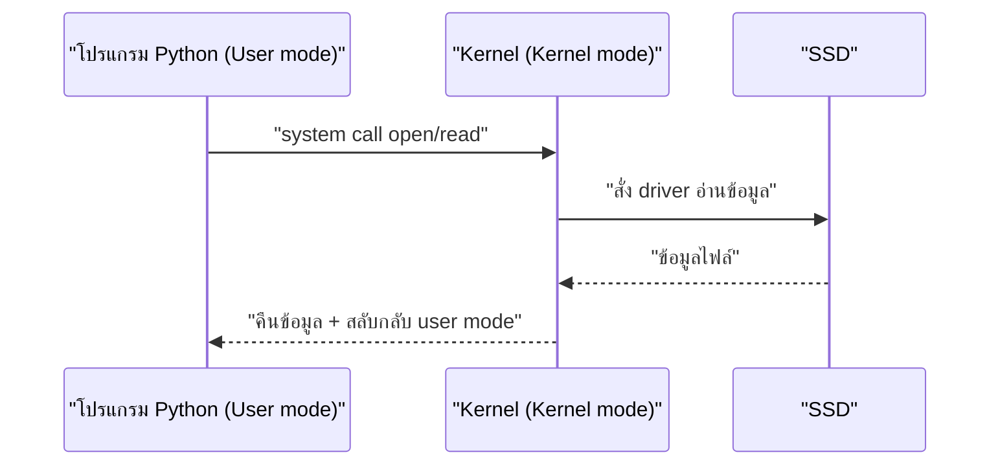
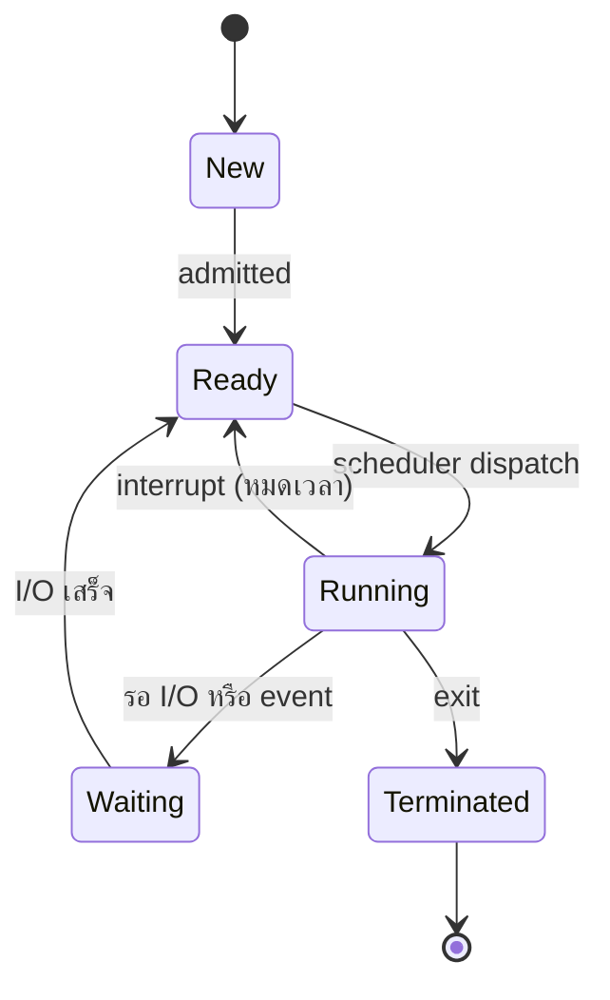

# ระบบปฏิบัติการและ Containers

> **หมวดหมู่:** เนื้อหาเชิงลึกประกอบการเรียนรู้ (Deep Dive Learning Content)

## 📖 เนื้อหาและคำอธิบาย
ในยุคของ Cloud-Native Application เทคโนโลยีที่พลิกโฉมการพัฒนาซอฟต์แวร์และการ Deploy ไม่ใช่ Virtual Machine (VM) อีกต่อไป แต่คือ **Container** เทคโนโลยีอย่าง Docker นำเสนอวิธีที่เบากว่า เร็วกว่า และคล่องตัวกว่าในการรันแอปพลิเคชัน 

### 1. ความแตกต่างระหว่าง Container และ Virtual Machine (VM)
VM แต่ละตัวจำเป็นต้องมี Guest OS ของตัวเองพร้อมกับ Kernel ทำให้มี Overhead มหาศาลในการใช้ RAM, CPU และ Storage รวมถึงใช้เวลาบูตนาน ในขณะที่ Container ทำงานโดยแชร์ OS Kernel ร่วมกับ Host Machine แต่แยกสภาพแวดล้อม (Environment) การทำงานออกจากกัน ทำให้ Container เริ่มทำงานได้ในระดับมิลลิวินาที และใช้ทรัพยากรน้อยมาก

### 2. เทคโนโลยีเบื้องหลัง: Linux Namespaces และ cgroups
Container ไม่ใช่เทคโนโลยีเวทมนตร์ แต่เกิดขึ้นจากฟีเจอร์หลักใน Linux Kernel:
- **Namespaces:** ทำหน้าที่ทำ Isolation ป้องกันไม่ให้ Container มองเห็นระบบอื่นๆ หรือ Container อื่น แบ่งออกเป็น PID (Process), NET (Network), IPC (Inter-Process Communication), MNT (Mount) และ USER ตัวอย่างเช่น PID Namespace ทำให้ Process ภายใน Container เข้าใจว่ามันเป็น PID 1
- **Control Groups (cgroups):** ทำหน้าที่จำกัดและตรวจสอบการใช้ทรัพยากร (Resource Allocation/Limiting) เช่น จำกัดว่า Container A ใช้ CPU ได้สูงสุด 2 Cores และ RAM ไม่เกิน 512MB เพื่อป้องกันปัญหา Noisy Neighbor หรือการผูกขาดทรัพยากร

### 3. Union File System (UnionFS)
Docker ใช้ระบบไฟล์แบบเลเยอร์ (Layered File System) ภาพ (Image) แต่ละเลเยอร์จะเป็น Read-only เมื่อมี Container ถูกสร้างขึ้นจาก Image ระบบจะสร้างเลเยอร์ Read/Write บางๆ (Container Layer) ไว้ชั้นบนสุด ทำให้แอปพลิเคชันสามารถทำงานและแก้ไขไฟล์ได้โดยไม่กระทบต้นฉบับ และทำให้การแชร์ Image เบามาก เพราะโหลดเพียงเลเยอร์ที่แตกต่างกันเท่านั้น

```bash
# ตัวอย่าง Dockerfile ที่ใช้การ Layering อย่างมีประสิทธิภาพ
FROM ubuntu:22.04
RUN apt-get update && apt-get install -y python3 # เลเยอร์ 1
COPY ./app /app                                  # เลเยอร์ 2
CMD ["python3", "/app/main.py"]                  # เลเยอร์ 3
```

การทำงานร่วมกันของ Namespaces, cgroups, และ UnionFS ทำให้เกิดนวัตกรรมระดับโลกอย่าง Kubernetes (K8s) ในการทำ Container Orchestration สำหรับจัดการแอปพลิเคชันที่สเกลได้อัตโนมัติ

### 4. หน้าที่หลักของระบบปฏิบัติการ (OS Functions)
ก่อนจะเข้าใจ Container ต้องเข้าใจก่อนว่า OS ทำอะไรบ้าง OS คือซอฟต์แวร์ที่เป็นตัวกลางระหว่างโปรแกรมของผู้ใช้กับฮาร์ดแวร์

| หน้าที่ | ความหมาย | ตัวอย่าง |
|---|---|---|
| **Process Management** | สร้าง/หยุด process และจัดสรรเวลา CPU ให้แต่ละโปรแกรม | เปิด Chrome กับ Spotify พร้อมกันได้ |
| **Memory Management** | จัดสรร RAM ให้แต่ละ process และทำ virtual memory | ป้องกันโปรแกรมหนึ่งเขียนทับหน่วยความจำของอีกโปรแกรม |
| **File System Management** | จัดเก็บไฟล์และโฟลเดอร์บน storage | NTFS (Windows), ext4 (Linux), APFS (macOS) |
| **Device (I/O) Management** | ควบคุมอุปกรณ์ผ่าน **device driver** | พิมพ์งานออก printer, รับเสียงจาก microphone |
| **Security / User Management** | ยืนยันตัวตน กำหนดสิทธิ์ผู้ใช้และไฟล์ | บัญชี admin vs user ทั่วไป, permission `rwx` ใน Linux |

### 5. การเรียกใช้ระบบ (System Call)
**System call** คือ "ช่องทางที่โปรแกรมของผู้ใช้ร้องขอบริการจาก Kernel ของ OS" เช่น ขออ่านไฟล์ ขอหน่วยความจำ หรือขอสร้าง process ใหม่ เพราะโปรแกรมทั่วไปไม่ได้รับอนุญาตให้สั่งฮาร์ดแวร์โดยตรง

**User mode vs Kernel mode:** CPU สมัยใหม่มีระดับสิทธิ์อย่างน้อย 2 ระดับ
- **User mode:** โปรแกรมทั่วไป (เช่น Python, เบราว์เซอร์) ทำงานด้วยสิทธิ์จำกัด เข้าถึงฮาร์ดแวร์โดยตรงไม่ได้ ถ้าโปรแกรมพังก็ไม่ทำให้ทั้งระบบล่ม
- **Kernel mode:** Kernel ของ OS ทำงานด้วยสิทธิ์เต็ม สั่งงานฮาร์ดแวร์และหน่วยความจำได้ทั้งหมด

เมื่อเรียก system call CPU จะ **สลับจาก user mode → kernel mode** ให้ kernel ทำงานแทน แล้วสลับกลับมาพร้อมผลลัพธ์

| System call (Linux/UNIX) | หน้าที่ |
|---|---|
| `open()` | เปิดไฟล์ ได้ file descriptor กลับมา |
| `read()` | อ่านข้อมูลจากไฟล์/อุปกรณ์ |
| `write()` | เขียนข้อมูลลงไฟล์/อุปกรณ์ (รวมถึงการพิมพ์ออกหน้าจอ) |
| `close()` | ปิดไฟล์ |
| `fork()` | สร้าง process ลูก (child) ที่เป็นสำเนาของ process ปัจจุบัน |
| `exec()` | แทนที่โปรแกรมใน process ด้วยโปรแกรมใหม่ |

**ตัวอย่าง: Python `open()` กลายเป็น system call**
```python
with open("data.txt") as f:   # Python เรียก system call open() ผ่านไลบรารีระบบ (libc)
    text = f.read()           # → system call read()
print(text)                   # → system call write() ไปยัง stdout (หน้าจอ)
```
เมื่อรันบน Linux สามารถดู system call ที่เกิดขึ้นจริงได้ด้วยคำสั่ง `strace python3 app.py` ซึ่งจะเห็นบรรทัดอย่าง `openat(...)`, `read(...)`, `write(...)` (Linux รุ่นใหม่ใช้ `openat` ซึ่งเป็นรูปแบบหนึ่งของ `open`)



> [!tip] เชื่อมกับ Container
> Container ทุกตัวบนเครื่องเดียวกันเรียก system call ไปยัง **Kernel ตัวเดียวกันของ Host** นี่คือเหตุผลที่ Container เบากว่า VM (ซึ่งมี Kernel ของตัวเอง)

### 6. การจัดการกระบวนการ (Process Management)
**Program vs Process**
- **Program** คือไฟล์คำสั่งที่เก็บอยู่บน storage (นิ่ง ๆ ไม่ได้ทำงาน) เช่น `notepad.exe`
- **Process** คือ **โปรแกรมที่กำลังทำงาน** มีหน่วยความจำ, ค่า register, สถานะ และหมายเลข PID ของตัวเอง โปรแกรมเดียวสามารถเป็นหลาย process ได้ (เช่น เปิด Notepad 3 หน้าต่าง)

**สถานะของ Process (Process States)**



| สถานะ | ความหมาย |
|---|---|
| **New** | กำลังถูกสร้าง |
| **Ready** | พร้อมทำงาน รอคิวใช้ CPU |
| **Running** | กำลังใช้ CPU อยู่ |
| **Waiting (Blocked)** | รอเหตุการณ์ เช่น รออ่านไฟล์ รอผู้ใช้พิมพ์ |
| **Terminated** | ทำงานเสร็จแล้ว รอ OS คืนทรัพยากร |

**CPU Scheduling และตัวอย่าง Round-Robin**
CPU หนึ่ง core รันได้ทีละ process OS จึงใช้ **scheduler** เลือกว่า process ใดได้ใช้ CPU ต่อไป วิธี **Round-Robin (RR)** ให้แต่ละ process ใช้ CPU ได้คราวละไม่เกิน **time quantum** แล้ววนกลับไปต่อท้ายคิว

ตัวอย่าง: quantum = 2 ms, ทุก process มาถึงเวลา 0 ตามลำดับ P1, P2, P3 — P1 ต้องใช้ 5 ms, P2 ใช้ 3 ms, P3 ใช้ 1 ms

| ช่วงเวลา (ms) | 0–2 | 2–4 | 4–5 | 5–7 | 7–8 | 8–9 |
|---|---|---|---|---|---|---|
| Process | P1 | P2 | P3 (เสร็จ) | P1 | P2 (เสร็จ) | P1 (เสร็จ) |

ผลลัพธ์: P3 เสร็จที่ 5 ms, P2 เสร็จที่ 8 ms, P1 เสร็จที่ 9 ms

**Context Switch:** ทุกครั้งที่สลับ process OS ต้อง **บันทึกสถานะ (register, PC ฯลฯ)** ของ process เดิมลงใน PCB (Process Control Block) แล้ว **โหลดสถานะ** ของ process ถัดไป การสลับนี้มีต้นทุน (overhead) ถ้า quantum สั้นเกินไปจะเสียเวลากับการสลับมาก

**Multitasking:** เพราะการสลับเกิดขึ้นเร็วมาก (หลายครั้งต่อวินาที) ผู้ใช้จึงรู้สึกว่าโปรแกรมหลายตัวทำงาน "พร้อมกัน" (concurrent) แม้ CPU core เดียวจะรันทีละ process ส่วน CPU หลาย core สามารถรันหลาย process พร้อมกันจริง (parallel)

<details><summary>ดูเฉลย: ถ้า quantum = 3 ms ในตัวอย่างเดียวกัน แต่ละ process เสร็จเมื่อใด?</summary>

ลำดับ: P1 (0–3), P2 (3–6, เสร็จ), P3 (6–7, เสร็จ), P1 (7–9, เสร็จ) → P2 เสร็จที่ 6 ms, P3 ที่ 7 ms, P1 ที่ 9 ms
</details>

**อ้างอิง:**
- Docker Documentation (2025)

---
*เนื้อหานี้เป็นส่วนขยายของวิชาแก่นวิศวกรรมคอมพิวเตอร์ เพื่อให้ผู้เรียนค้นคว้าเพิ่มเติมได้*