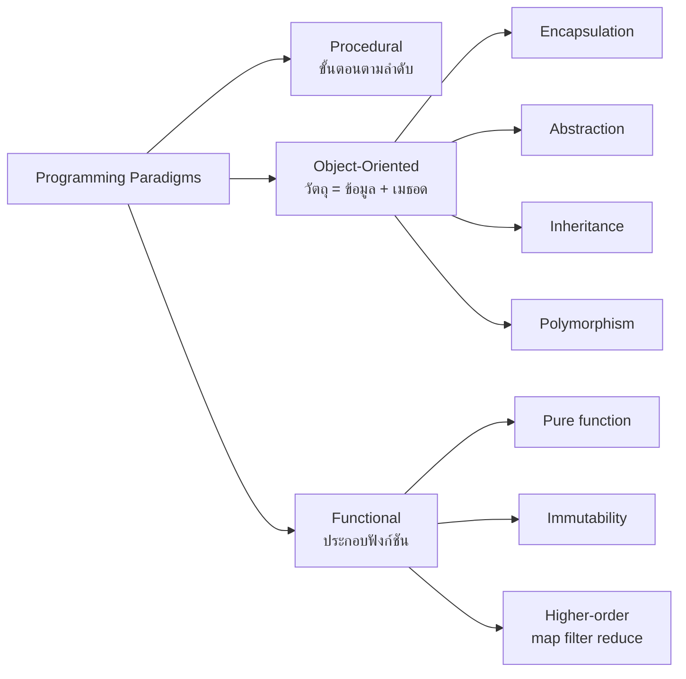

# การเขียนโปรแกรมเชิงวัตถุกับเชิงฟังก์ชัน (OOP vs Functional Programming)

> **หมวดหมู่:** เนื้อหาเชิงลึกประกอบการเรียนรู้ (Deep Dive Learning Content)

## 🎯 สิ่งที่จะได้เรียนรู้
- อธิบายความหมายของ programming paradigm และเปรียบเทียบ Procedural, Object-Oriented และ Functional
- อธิบาย 4 เสาหลักของ OOP ได้แก่ Encapsulation, Abstraction, Inheritance และ Polymorphism
- อธิบายแนวคิดหลักของ Functional Programming ได้แก่ pure function, immutability และ higher-order function (`map`, `filter`, `reduce`)
- เขียนโปรแกรมแก้ปัญหาเดียวกันทั้งสองแบบใน Python และเลือกแนวทางที่เหมาะกับงาน

## 📖 เนื้อหาและคำอธิบาย

### Programming Paradigm คืออะไร
Paradigm คือ "มุมมอง" หรือแนวคิดในการจัดโครงสร้างโปรแกรม เปรียบเหมือนวิธีจัดครัวร้านอาหาร
- **Procedural:** มีสูตรอาหารเป็นขั้นตอน 1, 2, 3 ทำตามลำดับ (เช่นภาษา C)
- **Object-Oriented (OOP):** แบ่งครัวเป็น "สถานี" แต่ละสถานีมีของและหน้าที่ของตัวเอง เช่น สถานีทอด สถานีย่าง สั่งงานผ่านหน้าที่ที่กำหนด
- **Functional (FP):** มองการทำอาหารเป็นสายพาน วัตถุดิบเข้า → แปลง → ออกเป็นจานใหม่ โดยไม่แก้วัตถุดิบเดิม

Python เป็นภาษา **multi-paradigm** ใช้ได้ทั้งสามแบบ และในงานจริงมักผสมกัน

### Object-Oriented Programming (OOP)
OOP จัดโปรแกรมเป็น **วัตถุ (object)** ที่รวม **ข้อมูล (attribute)** กับ **พฤติกรรม (method)** ไว้ด้วยกัน โดยสร้างจากแม่แบบที่เรียกว่า **คลาส (class)** เหมือนแม่พิมพ์ขนมที่ใช้ปั๊มขนมได้หลายชิ้น

**4 เสาหลักของ OOP**

| เสาหลัก | ความหมาย | อุปมา | ตัวอย่างในเกม |
|---|---|---|---|
| **Encapsulation** | ห่อข้อมูลและซ่อนการเข้าถึงโดยตรง ให้ใช้ผ่านเมธอด | ตู้ ATM ให้กดปุ่ม ไม่ให้เปิดตู้หยิบเงิน | HP แก้ได้ผ่าน `take_damage()` เท่านั้น |
| **Abstraction** | เปิดเผยเฉพาะสิ่งที่จำเป็นต่อผู้ใช้ | ขับรถรู้แค่พวงมาลัย ไม่ต้องรู้กลไกเครื่องยนต์ | เรียก `attack_damage()` โดยไม่ต้องรู้สูตรภายใน |
| **Inheritance** | คลาสลูกสืบทอดคุณสมบัติจากคลาสแม่ | ลูกได้นามสกุลและลักษณะจากพ่อแม่ | `Warrior` และ `Mage` สืบทอดจาก `Character` |
| **Polymorphism** | เมธอดชื่อเดียวกัน ทำงานต่างกันตามชนิดวัตถุ | คำสั่ง "เปิด" ใช้กับประตู ไฟ และแอปได้ | `attack_damage()` ของนักรบคูณสอง ของนักเวทย์บวกห้า |

> [!note] หมายเหตุเกี่ยวกับ Python
> Python ไม่มี `private` แบบบังคับเข้มงวดเหมือน Java การตั้งชื่อขึ้นต้นด้วย `_` (เช่น `_hp`) เป็น **ธรรมเนียม** ที่บอกว่า "อย่าแตะจากภายนอก" ตามที่ระบุใน Python Tutorial

### Functional Programming (FP)
FP มองโปรแกรมเป็นการ **ประกอบฟังก์ชัน** ที่แปลงข้อมูลจากอินพุตเป็นเอาต์พุต แนวคิดหลักมีดังนี้

- **Pure function:** ให้ผลเหมือนเดิมเสมอเมื่ออินพุตเหมือนเดิม และ **ไม่มี side effect** (ไม่แก้ตัวแปรภายนอก ไม่พิมพ์ ไม่เขียนไฟล์) เหมือนเครื่องคิดเลข กด 2 + 3 ได้ 5 ทุกครั้ง
- **Immutability:** ข้อมูลเมื่อสร้างแล้วไม่ถูกแก้ ถ้าต้องการเปลี่ยนให้สร้างค่าใหม่ (ใน Python เช่น `tuple`, `frozenset`, `str`)
- **Higher-order function:** ฟังก์ชันที่รับหรือคืนฟังก์ชัน เช่น
  - `map(f, data)` — แปลงทุกตัวด้วย f
  - `filter(pred, data)` — คัดเฉพาะตัวที่ pred เป็นจริง
  - `functools.reduce(f, data, init)` — รวบข้อมูลทั้งหมดเป็นค่าเดียว

### ตารางเปรียบเทียบ

| ประเด็น | OOP | Functional |
|---|---|---|
| หน่วยหลักของโปรแกรม | วัตถุ (ข้อมูล + เมธอด) | ฟังก์ชัน |
| สถานะ (state) | เก็บในวัตถุ เปลี่ยนแปลงได้ | หลีกเลี่ยงการเปลี่ยน สร้างค่าใหม่แทน |
| การนำกลับมาใช้ | inheritance, composition | ประกอบฟังก์ชันเล็ก ๆ เข้าด้วยกัน |
| ทดสอบ | ต้องเตรียมสถานะวัตถุก่อน | ง่าย เพราะผลขึ้นกับอินพุตเท่านั้น |
| งานพร้อมกัน (concurrency) | ระวัง race condition กับ state ที่แชร์ | ปลอดภัยกว่า เพราะข้อมูลไม่ถูกแก้ |
| เหมาะกับ | ระบบที่มีสิ่งของจำลองโลกจริง เช่น เกม GUI | งานแปลงข้อมูล data pipeline การคำนวณ |
| ภาษาที่เด่น | Java, C#, C++, Python | Haskell, Elixir, Clojure, และรองรับใน Python/JS |

## 🧩 ตัวอย่างประกอบ / Worked Example

**โจทย์:** ทีมฮีโร่ 3 ตัว (นักรบ พลัง 6, นักเวทย์ พลัง 8, NPC พลัง 3) โจมตีบอสที่มี HP 60 คนละครั้ง นักรบสร้างความเสียหาย 2 เท่าของพลัง นักเวทย์ได้พลัง + 5 และ NPC ได้เท่าพลัง จงหาว่าบอสเหลือ HP เท่าไร

**คำนวณด้วยมือก่อน:** 6×2 = 12, 8+5 = 13, 3 → รวม 28 → 60 − 28 = **32**

```python
# ===== แบบ OOP =====
class Character:                      # Abstraction: แม่แบบตัวละครทั่วไป
    def __init__(self, name, hp, power):
        self.name = name
        self._hp = hp                 # Encapsulation: ตั้งใจให้แก้ผ่านเมธอดเท่านั้น
        self.power = power

    @property
    def hp(self):
        return self._hp

    def take_damage(self, amount):
        self._hp = max(0, self._hp - amount)   # ป้องกัน HP ติดลบ

    def attack_damage(self):
        return self.power

class Warrior(Character):             # Inheritance: สืบทอดจาก Character
    def attack_damage(self):          # Polymorphism: เมธอดชื่อเดิม พฤติกรรมต่าง
        return self.power * 2

class Mage(Character):
    def attack_damage(self):
        return self.power + 5

party = [Warrior("Aek", 40, 6), Mage("Ploy", 25, 8), Character("Npc", 20, 3)]
boss = Character("Boss", 60, 10)
for hero in party:
    boss.take_damage(hero.attack_damage())   # เรียกแบบเดียวกัน ได้ผลตามชนิดวัตถุ
print("[OOP] Boss HP เหลือ:", boss.hp)

# ===== แบบ Functional =====
from functools import reduce

PARTY = (("warrior", 6), ("mage", 8), ("npc", 3))   # tuple = ข้อมูลเปลี่ยนแปลงไม่ได้

def attack_damage(kind, power):       # Pure function: อินพุตเดิม -> ผลเดิมเสมอ
    if kind == "warrior":
        return power * 2
    if kind == "mage":
        return power + 5
    return power

def apply_damage(hp, damage):         # คืนค่า HP ใหม่ ไม่แก้ตัวแปรเดิม
    return max(0, hp - damage)

damages = list(map(lambda m: attack_damage(*m), PARTY))   # map: แปลงทุกตัว
strong = list(filter(lambda d: d >= 10, damages))           # filter: คัดเฉพาะที่ >= 10
boss_hp = reduce(apply_damage, damages, 60)                 # reduce: รวบเป็นค่าเดียว
print("[FP] damages:", damages, "| strong hits:", strong)
print("[FP] Boss HP เหลือ:", boss_hp)
```

```output
[OOP] Boss HP เหลือ: 32
[FP] damages: [12, 13, 3] | strong hits: [12, 13]
[FP] Boss HP เหลือ: 32
```

**วิเคราะห์ผล**
- **OOP:** สถานะ (HP ของบอส) อยู่ในวัตถุ `boss` และ **ถูกแก้** ทุกครั้งที่เรียก `take_damage()` การเพิ่มอาชีพใหม่ เช่น `Archer` ทำได้โดยสร้างคลาสลูกใหม่ โดยไม่ต้องแก้โค้ดลูปเดิมเลย (ข้อดีของ polymorphism)
- **FP:** ไม่มีตัวแปรใดถูกแก้ `reduce` คำนวณ `apply_damage(apply_damage(apply_damage(60, 12), 13), 3)` = 32 ถ้าเรียกซ้ำกี่ครั้งก็ได้ผลเดิม จึงทดสอบง่ายมาก
- **การเรียก `reduce` ทีละขั้น:** 60 → 48 → 35 → 32

> [!tip] เคล็ดลับ
> สำหรับเกมใน Mini-Project แนวทางที่ใช้บ่อยคือ **ผสม** ใช้คลาสแทนตัวละคร/ฉาก (OOP) แต่เขียนสูตรคำนวณคะแนนหรือความเสียหายเป็น pure function เพื่อทดสอบได้ง่าย

## 🗺️ แผนภาพสรุป



## ⚠️ ความเข้าใจผิดที่พบบ่อย
1. **"OOP ดีกว่า FP" หรือ "FP ทันสมัยกว่า OOP"** — ไม่มีแบบใดดีกว่าเสมอ ขึ้นกับลักษณะปัญหา ภาษาสมัยใหม่ส่วนใหญ่รองรับทั้งสองแนวทาง และนักพัฒนามักผสมกัน
2. **"ใช้ class แล้วก็คือ OOP"** — ถ้าคลาสเป็นแค่ที่เก็บฟังก์ชันรวม ๆ โดยไม่มีการห่อหุ้มสถานะหรือ polymorphism ก็ยังไม่ได้ใช้ประโยชน์ของ OOP จริง
3. **"Inheritance ยิ่งลึกยิ่งดี"** — ลำดับชั้นที่ลึกทำให้โค้ดผูกกันแน่นและแก้ยาก หลายกรณีควรใช้ composition (วัตถุมีวัตถุอื่นเป็นส่วนประกอบ) แทน
4. **"FP คือแค่ใช้ map/filter"** — หัวใจของ FP คือ pure function และการไม่แก้ข้อมูล ถ้าใช้ `map` แต่ฟังก์ชันข้างในยังแก้ตัวแปร global ก็ไม่ใช่ FP ที่แท้จริง

## 🔗 เชื่อมโยงกับรายวิชา
- แผนสัปดาห์: [[Week 04 - Algorithms & Programming Paradigms]] (หัวข้อกระบวนทัศน์ Procedural, OOP, Functional)
- ความซับซ้อนของ `map`/`filter`/`reduce` ยังเป็น O(n) ตามจำนวนข้อมูล ดู [[Big-O Notation]] และ [[02_การวิเคราะห์ความซับซ้อน_Big_O]]
- ข้อดีของ immutability ต่องานพร้อมกัน เชื่อมกับ [[05_Version_Control_และ_Concurrency]]
- ใน **Mini-Project 1: Simple Text/2D Game in Python** ให้ออกแบบคลาส `Player`/`Enemy` และแยกสูตรคำนวณเป็น pure function ดู [[Lab 04 - Algorithm Flowchart and Module 1 Presentation]] และ [[กิจกรรมปฏิบัติการและโครงงาน]]

## ❓ คำถามทบทวน
1. จงอธิบาย Encapsulation และยกตัวอย่างว่าช่วยป้องกันบั๊กในเกมได้อย่างไร
<details><summary>ดูแนวคำตอบ</summary>

Encapsulation คือการห่อข้อมูลไว้ในวัตถุและให้แก้ผ่านเมธอดที่กำหนด เช่น HP แก้ผ่าน `take_damage()` ซึ่งมี `max(0, ...)` ป้องกัน HP ติดลบ ถ้าให้โค้ดส่วนอื่นแก้ `hp` ตรง ๆ อาจมีคนเผลอตั้งค่าติดลบหรือเกินค่าสูงสุด
</details>

2. ฟังก์ชันต่อไปนี้เป็น pure function หรือไม่ `def add_score(p): global total; total += p; return total`
<details><summary>ดูแนวคำตอบ</summary>

ไม่ใช่ เพราะแก้ตัวแปรภายนอก (`total`) ซึ่งเป็น side effect และเรียกด้วยอินพุตเดิมได้ผลต่างกันในแต่ละครั้ง แบบ pure คือ `def add_score(total, p): return total + p`
</details>

3. ถ้าจะเพิ่มอาชีพ `Archer` ที่สร้างความเสียหาย power + 3 ต้องแก้โค้ดแบบ OOP และแบบ FP อย่างไร
<details><summary>ดูแนวคำตอบ</summary>

OOP: สร้าง `class Archer(Character)` แล้ว override `attack_damage()` คืน `self.power + 3` ไม่ต้องแก้ลูปเดิม; FP: เพิ่มเงื่อนไข `if kind == "archer": return power + 3` ในฟังก์ชัน `attack_damage` และเพิ่ม tuple ใหม่ใน `PARTY` (หรือใช้ dict ที่ map ชื่ออาชีพไปยังฟังก์ชัน)
</details>

4. `reduce(apply_damage, [12, 13, 3], 60)` ทำงานทีละขั้นอย่างไร
<details><summary>ดูแนวคำตอบ</summary>

เริ่มจากค่าเริ่มต้น 60 → `apply_damage(60, 12)` = 48 → `apply_damage(48, 13)` = 35 → `apply_damage(35, 3)` = 32 จึงได้ผลลัพธ์ 32
</details>

5. ทำไม FP จึงมักถือว่าปลอดภัยกว่าในงานแบบหลาย thread
<details><summary>ดูแนวคำตอบ</summary>

เพราะข้อมูลไม่ถูกแก้ไข (immutable) และฟังก์ชันไม่มี side effect หลาย thread จึงอ่านข้อมูลเดียวกันพร้อมกันได้โดยไม่เกิด race condition ซึ่งเกิดจากการเขียนข้อมูลที่แชร์ร่วมกัน
</details>

## 📚 แหล่งอ้างอิง
- [Python Documentation — Tutorial: Classes](https://docs.python.org/3/tutorial/classes.html)
- [Python Documentation — Functional Programming HOWTO](https://docs.python.org/3/howto/functional.html)
- [Python Documentation — functools (reduce และเครื่องมือ higher-order function)](https://docs.python.org/3/library/functools.html)
- [Python Documentation — dataclasses (รวมถึง frozen dataclass สำหรับข้อมูล immutable)](https://docs.python.org/3/library/dataclasses.html)
- [Refactoring.Guru — Design Patterns (ตัวอย่างการออกแบบเชิงวัตถุ)](https://refactoring.guru/design-patterns)
