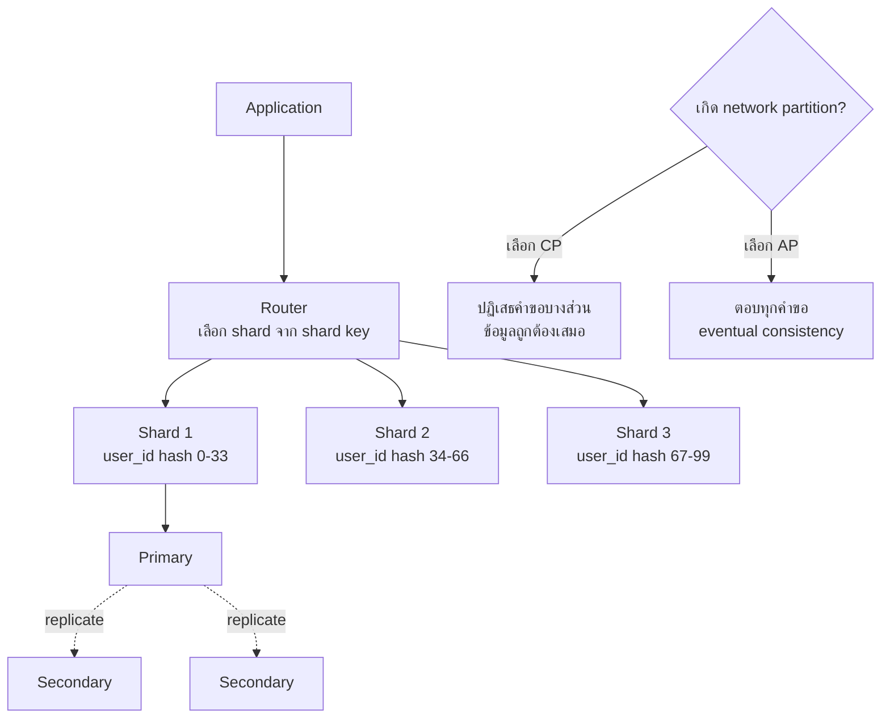

# การขยายระบบด้วยฐานข้อมูล NoSQL (Scaling with NoSQL)

> **หมวดหมู่:** เนื้อหาเชิงลึกประกอบการเรียนรู้ (Deep Dive Learning Content)

## 🎯 สิ่งที่จะได้เรียนรู้

- จำแนก NoSQL 4 ประเภทหลัก ได้แก่ document, key-value, wide-column และ graph พร้อมตัวอย่างระบบ
- อธิบาย CAP theorem และ eventual consistency ด้วยภาษาง่าย ๆ
- แยกความต่างระหว่าง vertical และ horizontal scaling รวมถึง sharding และ replication
- ออกแบบ JSON document และเลือกระหว่าง embedding กับ referencing ได้
- ตัดสินใจได้ว่างานแบบใดควรใช้ SQL และงานแบบใดควรใช้ NoSQL

## 📖 เนื้อหาและคำอธิบาย

### 1. ทำไมต้องมี NoSQL

RDBMS เหมาะมากกับข้อมูลที่มีโครงสร้างชัดและต้องการ ACID แต่เมื่อเว็บไซต์มีผู้ใช้หลายล้านคน ข้อมูลมีรูปแบบหลากหลาย และ schema เปลี่ยนบ่อย การขยายเครื่องเดียวให้ใหญ่ขึ้นเรื่อย ๆ ก็เริ่มแพงและมีขีดจำกัด

**NoSQL** (มักแปลว่า "Not only SQL") คือกลุ่มฐานข้อมูลที่ไม่ได้ใช้โมเดลตารางเชิงสัมพันธ์เป็นหลัก ส่วนใหญ่ออกแบบมาให้ **กระจายข้อมูลไปหลายเครื่อง** ได้ตั้งแต่ต้น และมี schema ที่ยืดหยุ่น

> [!note] อุปมา
> RDBMS เหมือนแบบฟอร์มราชการที่ทุกช่องกำหนดไว้แน่นอน NoSQL แบบ document เหมือนแฟ้มประวัติ ซึ่งแต่ละแฟ้มมีเอกสารแนบไม่เท่ากันได้

### 2. NoSQL 4 ประเภท

| ประเภท | โครงสร้างข้อมูล | ตัวอย่างระบบ | เหมาะกับ |
|---|---|---|---|
| **Document** | เอกสาร JSON/BSON ซ้อนกันได้ | MongoDB, Couchbase | แคตตาล็อกสินค้า, โปรไฟล์ผู้ใช้, CMS |
| **Key-Value** | คู่ `key → value` คล้าย dictionary | Redis, Amazon DynamoDB | cache, session, ตะกร้าสินค้า, leaderboard |
| **Wide-Column** | แถวที่มีคอลัมน์จำนวนมากและเปลี่ยนได้ จัดกลุ่มด้วย partition key | Apache Cassandra, HBase | log, time-series, IoT ที่เขียนข้อมูลจำนวนมาก |
| **Graph** | node และ edge (ความสัมพันธ์) | Neo4j | social network, recommendation, fraud detection |

ฐานข้อมูลเวกเตอร์ ([[Vector Database]]) ถือเป็นหมวดเฉพาะทางที่เกิดขึ้นใหม่ ดูได้ใน [[03_แนวคิดของ_Vector_Database]]

### 3. การขยายระบบ: Vertical vs Horizontal

- **Vertical scaling (scale up):** อัปเกรดเครื่องเดิมให้แรงขึ้น เพิ่ม CPU/RAM/SSD ทำได้ง่าย แต่มีเพดานและราคาสูง
- **Horizontal scaling (scale out):** เพิ่มจำนวนเครื่อง (node) แล้วแบ่งงานกัน ขยายได้เกือบไม่จำกัด แต่ระบบซับซ้อนขึ้น

เทคนิคหลักของ scale out มีสองแบบ

1. **Sharding (partitioning):** แบ่งข้อมูลเป็นส่วน ๆ ไปเก็บคนละเครื่องตาม **shard key** เช่น ใช้ `hash(user_id)` เลือกเครื่อง เปรียบเหมือนแบ่งสมุดโทรศัพท์เป็นเล่ม ก–ฉ, ช–ณ, ด–ฮ เป้าหมายคือ **เพิ่มความจุและ throughput**
2. **Replication:** ทำสำเนาข้อมูลชุดเดียวกันไว้หลายเครื่อง เช่น replica set ของ MongoDB ที่มี primary 1 ตัวและ secondary หลายตัว เป้าหมายคือ **ความทนทานต่อความล้มเหลว (high availability)** และกระจายการอ่าน

> [!tip] จำง่าย
> Sharding = แบ่งข้อมูล *ต่างกัน* ไปหลายที่ ส่วน Replication = เก็บข้อมูล *เหมือนกัน* ไว้หลายที่ ระบบจริงมักใช้ทั้งสองอย่างร่วมกัน

### 4. CAP Theorem

Eric Brewer เสนอแนวคิดนี้ในปี 2000 และ Gilbert กับ Lynch พิสูจน์อย่างเป็นทางการในปี 2002 สาระคือ ในระบบข้อมูลแบบกระจาย เมื่อเกิด **network partition** (เครือข่ายระหว่าง node ขาด) ระบบจะรับประกันได้เพียงอย่างใดอย่างหนึ่งจากสองข้อนี้

- **C — Consistency:** ทุก node ตอบข้อมูลล่าสุดที่ตรงกัน
- **A — Availability:** ทุกคำขอได้รับคำตอบเสมอ (แม้อาจไม่ใช่ข้อมูลล่าสุด)
- **P — Partition tolerance:** ระบบยังทำงานต่อได้แม้เครือข่ายขาดบางส่วน

ระบบกระจายจริงหลีกเลี่ยง partition ไม่ได้ ทางเลือกจึงเป็น **CP** (ยอมปฏิเสธบางคำขอเพื่อให้ข้อมูลถูกต้อง) หรือ **AP** (ตอบเสมอแต่ข้อมูลอาจยังไม่ตรงกันชั่วคราว) Brewer เองอธิบายไว้ในบทความปี 2012 ว่า "เลือก 2 ใน 3" เป็นการพูดแบบง่ายเกินไป เพราะในเวลาปกติที่ไม่มี partition ระบบให้ได้ทั้ง C และ A

**Eventual consistency:** ถ้าไม่มีการเขียนใหม่เข้ามา สุดท้ายทุก replica จะมีค่าตรงกัน ตัวอย่างเช่น ยอดไลก์ที่เพื่อนเห็นช้ากว่าเราไม่กี่วินาที ระบบอย่าง Cassandra ให้ผู้พัฒนาปรับ **consistency level** ได้ต่อคำสั่ง เช่น `ONE` หรือ `QUORUM`

| | SQL (RDBMS) | NoSQL |
|---|---|---|
| Schema | กำหนดล่วงหน้า (schema-on-write) | ยืดหยุ่น เปลี่ยนต่อเอกสารได้ |
| การขยาย | ถนัด scale up (scale out ได้แต่ยากกว่า) | ออกแบบมาเพื่อ scale out |
| ความสัมพันธ์ | JOIN หลายตารางได้ดี | มักฝังข้อมูลรวมกัน (denormalize) ยกเว้น graph DB |
| ธุรกรรม | ACID เต็มรูปแบบ | หลายระบบเน้น BASE/eventual แต่บางระบบ (เช่น MongoDB) รองรับ multi-document transaction |
| ตัวอย่างงาน | การเงิน, ทะเบียน, สต็อก | social feed, IoT, cache, catalog |

### 5. Embedding vs Referencing ใน Document DB

- **Embed (ฝัง):** ใส่ข้อมูลย่อยไว้ในเอกสารเดียวกัน อ่านครั้งเดียวได้ครบ เหมาะกับข้อมูลที่อ่านพร้อมกันเสมอและมีจำนวนไม่โตไม่จำกัด
- **Reference (อ้างอิง):** เก็บ `_id` ของอีกเอกสาร คล้าย FK เหมาะกับข้อมูลที่ใช้ร่วมกันหลายที่หรือมีจำนวนมาก

หลักการออกแบบของ MongoDB คือ **ออกแบบตามรูปแบบการเข้าถึงข้อมูล (access pattern)** ของแอป ต่างจาก RDBMS ที่เริ่มออกแบบจากโครงสร้างข้อมูล

## 🧩 ตัวอย่างประกอบ / Worked Example

**โจทย์:** ระบบยืมครุภัณฑ์ ต้องแสดงหน้า "รายละเอียดครุภัณฑ์" ซึ่งมีข้อมูลหลัก สเปก (แต่ละชนิดต่างกัน) และประวัติการซ่อมล่าสุด

**ขั้นที่ 1: แบบ RDBMS** ต้องใช้ตาราง `Asset`, `AssetSpec` (key/value) และ `Repair` แล้ว JOIN 3 ตาราง

**ขั้นที่ 2: แบบ Document** รวมข้อมูลไว้ในเอกสารเดียว

```json
{
  "_id": "KSU-CPE-0042",
  "name": "Notebook Lenovo ThinkPad",
  "category": "computer",
  "location": { "building": "วิศวกรรม 1", "room": "EN-301" },
  "specs": { "cpu": "Core i5", "ram_gb": 16, "ssd_gb": 512 },
  "repairs": [
    { "date": "2026-03-14", "issue": "เปลี่ยนแบตเตอรี่", "cost": 2500 }
  ],
  "borrower_id": "68001"
}
```

สังเกตว่า โปรเจกเตอร์อาจมี `specs` เป็น `{ "lumens": 3600 }` ได้เลยโดยไม่ต้องแก้ schema ส่วน `borrower_id` ใช้แบบ **reference** เพราะข้อมูลผู้ยืมใช้ร่วมกับระบบอื่น

**ขั้นที่ 3: ค้นหาด้วย Python (PyMongo)**

```python
from pymongo import MongoClient

client = MongoClient("mongodb://localhost:27017")  # เชื่อมต่อเครื่องทดสอบในเครื่องตัวเอง
assets = client["ksu"]["assets"]

# หาคอมพิวเตอร์ที่ RAM ตั้งแต่ 16 GB ขึ้นไป (ใช้ dot notation เข้าถึงฟิลด์ซ้อน)
for a in assets.find({"category": "computer", "specs.ram_gb": {"$gte": 16}},
                     {"_id": 1, "name": 1}):
    print(a)

# เพิ่มประวัติซ่อมใหม่เข้า array โดยไม่ต้องอ่านทั้งเอกสาร
assets.update_one({"_id": "KSU-CPE-0042"},
                  {"$push": {"repairs": {"date": "2026-10-01", "issue": "ล้างพัดลม", "cost": 300}}})
```

```output
{'_id': 'KSU-CPE-0042', 'name': 'Notebook Lenovo ThinkPad'}
```

**ขั้นที่ 4: คิดเรื่อง sharding** ถ้ามีครุภัณฑ์หลายล้านรายการจากหลายวิทยาเขต อาจเลือก shard key เป็น `campus` ร่วมกับ `_id` เพื่อให้คำขอส่วนใหญ่วิ่งไปที่ shard เดียว ควรหลีกเลี่ยง key ที่ค่าเพิ่มขึ้นเรื่อย ๆ อย่างวันที่ เพราะการเขียนใหม่ทั้งหมดจะไปกองอยู่ที่ shard สุดท้าย (hotspot)

## 🗺️ แผนภาพสรุป



## ⚠️ ความเข้าใจผิดที่พบบ่อย

- **"NoSQL ไม่มี schema เลย"** ที่จริงคือ schema ย้ายจากฐานข้อมูลไปอยู่ในโค้ดแอป (schema-on-read) ยังต้องออกแบบอยู่ดี และ MongoDB ก็มี schema validation ให้ใช้
- **"NoSQL เร็วกว่า SQL เสมอ"** ความเร็วขึ้นกับว่าออกแบบตรงกับ access pattern หรือไม่ งานที่ต้อง JOIN และรวมยอดซับซ้อน RDBMS มักทำได้ดีกว่า
- **"CAP คือเลือก 2 ใน 3 ได้ตามใจ"** P เลี่ยงไม่ได้ในระบบกระจาย การเลือกจริงคือ C หรือ A *ในขณะที่เกิด partition*
- **"NoSQL ไม่รองรับ transaction"** หลายระบบรองรับแล้ว เช่น MongoDB มี multi-document ACID transaction แต่มีต้นทุนด้านประสิทธิภาพ
- **"Replication = Backup"** ถ้าเผลอลบข้อมูล การลบก็จะถูก replicate ไปทุกเครื่องด้วย การสำรองข้อมูลจึงต้องทำแยกต่างหาก

## 🔗 เชื่อมโยงกับรายวิชา

- แผนสัปดาห์: [[Week 05 - Database & Data Management]] · ก่อนหน้า: [[01_กลไกเบื้องหลัง_RDBMS]]
- การกระจายข้อมูลข้ามเครื่องเชื่อมกับ [[Edge Computing และระบบกระจาย]] และ [[Week 07 - Data Center & Cloud Infrastructure]]
- Wide-column/time-series สำหรับข้อมูลเซนเซอร์ใน [[Week 11 - Embedded Systems & IoT]] (Mini-Project 3)
- **Mini-Project 2 "Asset Management Web App":** โปรเจกต์นี้ใช้ **SQLite** เป็นหลัก เพราะข้อมูลครุภัณฑ์มีโครงสร้างชัดและต้องการ FK/ACID ให้นักศึกษาลองเขียนเหตุผลสั้น ๆ ในรายงานว่า ถ้าระบบโตเป็นระดับประเทศ ส่วนใดอาจย้ายไปใช้ NoSQL (เช่น log การยืมคืนหรือ cache ของ session) ดู [[กิจกรรมปฏิบัติการและโครงงาน]]

## ❓ คำถามทบทวน

1. Sharding กับ Replication ต่างกันอย่างไร และแก้ปัญหาคนละเรื่องอย่างไร?
<details><summary>ดูแนวคำตอบ</summary>
Sharding แบ่งข้อมูลคนละส่วนไปไว้หลายเครื่อง เพื่อเพิ่มความจุและ throughput ในการเขียน Replication คัดลอกข้อมูลชุดเดียวกันไว้หลายเครื่อง เพื่อให้ระบบยังทำงานได้เมื่อเครื่องใดเครื่องหนึ่งล่ม และช่วยกระจายการอ่าน
</details>

2. ระบบธนาคารที่แสดงยอดเงินคงเหลือ ควรเลือก CP หรือ AP เมื่อเกิด partition? แล้วยอดไลก์บนโซเชียลล่ะ?
<details><summary>ดูแนวคำตอบ</summary>
ยอดเงินควรเป็น CP เพราะการแสดงหรือหักยอดผิดสร้างความเสียหายจริง จึงยอมปฏิเสธคำขอชั่วคราวได้ ส่วนยอดไลก์เป็น AP ได้ ผู้ใช้รับได้หากตัวเลขต่างกันไม่กี่วินาที แต่ระบบต้องตอบเสมอ
</details>

3. จงยกตัวอย่างงานที่เหมาะกับ NoSQL แต่ละประเภทอย่างละ 1 งาน
<details><summary>ดูแนวคำตอบ</summary>
Document: แคตตาล็อกสินค้าที่แต่ละชนิดมีคุณสมบัติต่างกัน Key-Value: เก็บ session หรือ cache ของหน้าเว็บ Wide-Column: บันทึกข้อมูลเซนเซอร์ IoT ปริมาณมาก Graph: ระบบแนะนำเพื่อนแบบ "เพื่อนของเพื่อน"
</details>

4. ในเอกสารครุภัณฑ์ ทำไมจึงฝัง `repairs` แต่ใช้ reference สำหรับ `borrower_id`?
<details><summary>ดูแนวคำตอบ</summary>
ประวัติซ่อมเป็นของครุภัณฑ์ชิ้นนั้นชิ้นเดียว และมักแสดงพร้อมกันเสมอ จึงฝังไว้เพื่อให้อ่านครั้งเดียวได้ครบ ส่วนข้อมูลผู้ยืมใช้ร่วมกับหลายระบบและเปลี่ยนแปลงได้ ถ้าฝังไว้จะเกิดข้อมูลซ้ำซ้อนและต้องตามแก้หลายที่ จึงอ้างอิงด้วย id
</details>

5. ทำไมการใช้ "วันที่สร้าง" เป็น shard key อาจทำให้เกิด hotspot?
<details><summary>ดูแนวคำตอบ</summary>
ค่าวันที่เพิ่มขึ้นตามเวลา ข้อมูลใหม่ทั้งหมดจึงตกไปอยู่ในช่วงสุดท้าย คือ shard เดียว shard นั้นจะรับภาระการเขียนเกือบทั้งหมด ขณะที่ shard อื่นว่าง ควรใช้ hashed key หรือ compound key แทน
</details>

## 📚 แหล่งอ้างอิง

- Kleppmann, M. (2017). *Designing Data-Intensive Applications*. O'Reilly. [dataintensive.net](https://dataintensive.net/)
- Brewer, E. (2012). *CAP Twelve Years Later: How the "Rules" Have Changed*. IEEE Computer / InfoQ. [infoq.com](https://www.infoq.com/articles/cap-twelve-years-later-how-the-rules-have-changed/)
- Gilbert, S., & Lynch, N. (2002). *Brewer's Conjecture and the Feasibility of Consistent, Available, Partition-Tolerant Web Services*. ACM SIGACT News. [PDF](https://users.ece.cmu.edu/~adrian/731-sp04/readings/GL-cap.pdf)
- MongoDB Manual. *Data Modeling*, *Sharding*, *Replication*. [data-modeling](https://www.mongodb.com/docs/manual/core/data-modeling-introduction/) · [sharding](https://www.mongodb.com/docs/manual/sharding/) · [replication](https://www.mongodb.com/docs/manual/replication/)
- Apache Cassandra Documentation. *Dynamo* (architecture: partitioning, replication, tunable consistency). [cassandra.apache.org](https://cassandra.apache.org/doc/latest/cassandra/architecture/dynamo.html)
- Redis Docs. *Data types*; Neo4j. *What is a graph database?* [redis.io](https://redis.io/docs/latest/develop/data-types/) · [neo4j.com](https://neo4j.com/docs/getting-started/graph-database/)
