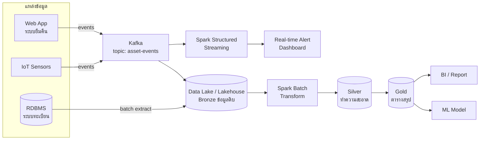

# สถาปัตยกรรมข้อมูลขนาดใหญ่และ Data Pipeline (Big Data Architecture)

> **หมวดหมู่:** เนื้อหาเชิงลึกประกอบการเรียนรู้ (Deep Dive Learning Content)

## 🎯 สิ่งที่จะได้เรียนรู้

- อธิบายลักษณะของ Big Data ด้วยกรอบ **5Vs**
- แยกความแตกต่างระหว่าง **batch processing** กับ **stream processing**
- เปรียบเทียบ **data lake**, **data warehouse** และ **lakehouse**
- อธิบายลำดับขั้นของ **ETL** และ **ELT** และบอกได้ว่าเมื่อใดควรใช้แบบใด
- รู้บทบาทของ **Hadoop, Spark, Kafka** ในระดับแนวคิด และอ่านแผนภาพ data pipeline ได้

## 📖 เนื้อหาและคำอธิบาย

### 1. เมื่อไหร่ข้อมูลจึง "ใหญ่"

Big Data ไม่ได้วัดจากขนาดอย่างเดียว ความหมายที่ใช้ได้จริงคือ **ข้อมูลที่เครื่องมือแบบเดิม (เครื่องเดียว / RDBMS เดียว) จัดการได้ไม่ทันหรือไม่คุ้ม** กรอบที่นิยมเริ่มจาก 3Vs (Volume, Velocity, Variety) ซึ่ง Doug Laney เสนอไว้เมื่อปี 2001 ต่อมามีการเพิ่มอีก 2V จนเป็น 5Vs

| V | ความหมาย | ตัวอย่างในมหาวิทยาลัย |
|---|---|---|
| **Volume** | ปริมาณมหาศาล (TB–PB) | log การใช้ Wi-Fi ของนักศึกษาทั้งวิทยาเขตทุกวัน |
| **Velocity** | ข้อมูลเข้ามาเร็วและต่อเนื่อง | เซนเซอร์ IoT วัดอุณหภูมิห้องทุก 5 วินาที |
| **Variety** | มีหลายรูปแบบ: structured, semi-structured (JSON), unstructured (ภาพ เสียง ข้อความ) | ตารางเกรด + ไฟล์ PDF รายงาน + ภาพจากกล้อง |
| **Veracity** | ความถูกต้องน่าเชื่อถือ มี noise หรือค่าหาย | ค่าเซนเซอร์ผิดปกติเพราะแบตใกล้หมด |
| **Value** | ต้องสร้างคุณค่าทางธุรกิจหรือการตัดสินใจได้ | ทำนายห้องเรียนที่คนแน่นเพื่อจัดตารางใหม่ |

### 2. Batch vs Stream: ซักผ้าทีละตะกร้า vs ก๊อกน้ำที่ไหลตลอด

- **Batch processing:** สะสมข้อมูลไว้แล้วประมวลผลทีเดียวเป็นรอบ เช่น สรุปยอดยืมครุภัณฑ์ทุกเที่ยงคืน เหมือนรอผ้าเต็มตะกร้าแล้วค่อยซัก
- **Stream processing:** ประมวลผลทันทีที่เหตุการณ์ (event) เข้ามา เช่น แจ้งเตือนเมื่ออุณหภูมิห้อง server เกิน 30°C เหมือนก๊อกน้ำที่ไหลตลอด ต้องรองรับให้ทัน

| ด้าน | Batch | Stream |
|---|---|---|
| Latency | นาทีถึงชั่วโมง | มิลลิวินาทีถึงวินาที |
| ข้อมูลเข้า | มีขอบเขตชัด (bounded) | ไม่มีจุดจบ (unbounded) |
| ตัวอย่างเครื่องมือ | Hadoop MapReduce, Spark (batch) | Kafka + Spark Structured Streaming, Apache Flink |
| งานตัวอย่าง | รายงานประจำวัน, train ML model | ตรวจจับการโกง, dashboard แบบ real-time |

### 3. ที่เก็บข้อมูล: Warehouse, Lake, Lakehouse

> [!note] อุปมา
> **Data warehouse** คือซูเปอร์มาร์เก็ต ของถูกคัด ติดป้าย และจัดเรียงพร้อมหยิบ **Data lake** คือโกดังขนาดใหญ่ ของทุกอย่างกองไว้ในสภาพเดิม ถูกและจุได้มาก แต่ถ้าไม่จัดการจะกลายเป็น "data swamp" **Lakehouse** คือโกดังที่ติดตั้งระบบจัดชั้นและบาร์โค้ดเข้าไป

| | Data Warehouse | Data Lake | Lakehouse |
|---|---|---|---|
| ข้อมูล | structured ที่ทำความสะอาดแล้ว | ทุกรูปแบบ ทั้งดิบและแปลงแล้ว | ทุกรูปแบบ |
| Schema | schema-on-write (กำหนดก่อนเขียน) | schema-on-read (ตีความตอนอ่าน) | มี schema และ enforce ได้บนไฟล์ใน lake |
| ที่เก็บ | ระบบเฉพาะ (columnar) | object storage ราคาถูก เช่น HDFS, S3 | object storage + open table format (Delta Lake, Apache Iceberg) |
| ผู้ใช้หลัก | นักวิเคราะห์ธุรกิจ, BI dashboard | data scientist, งาน ML | ทั้งสองกลุ่ม |
| ธุรกรรม | ACID | โดยทั่วไปไม่มี | ACID ผ่าน table format |

แนวคิด lakehouse ถูกอธิบายอย่างเป็นระบบในบทความของ Armbrust และคณะ (CIDR 2021) เป้าหมายคือลดการคัดลอกข้อมูลไปมาระหว่าง lake กับ warehouse

### 4. ETL vs ELT

- **ETL (Extract → Transform → Load):** ดึงข้อมูล แปลงหรือทำความสะอาดก่อน แล้วค่อยโหลดเข้า warehouse เป็นแบบดั้งเดิม เหมาะเมื่อปลายทางมีพลังประมวลผลจำกัด หรือต้องลบข้อมูลอ่อนไหวออกก่อนเข้าคลัง
- **ELT (Extract → Load → Transform):** โหลดข้อมูลดิบเข้า lake หรือ warehouse บนคลาวด์ก่อน แล้วใช้พลังประมวลผลปลายทางแปลงทีหลัง ยืดหยุ่นกว่า และเก็บข้อมูลดิบไว้ประมวลผลใหม่ได้

แนวทางที่นิยมในปัจจุบันคือ **medallion architecture** แบ่งข้อมูลเป็นชั้น **Bronze** (ดิบ) → **Silver** (ทำความสะอาดแล้ว) → **Gold** (สรุปพร้อมใช้)

### 5. เครื่องมือหลัก (ระดับแนวคิด)

- **Apache Hadoop:** ระบบยุคแรกที่ทำให้ big data แพร่หลาย ประกอบด้วย **HDFS** (แบ่งไฟล์เป็น block แล้วทำสำเนาไว้หลายเครื่อง), **MapReduce** (แบ่งงานเป็นขั้น map แล้ว reduce) และ **YARN** (จัดสรรทรัพยากร) แนวคิดสำคัญคือ **ย้ายโค้ดไปหาข้อมูล** แทนการย้ายข้อมูลมาหาโค้ด
- **Apache Spark:** engine วิเคราะห์ข้อมูลแบบรวมศูนย์ (unified) ประมวลผลในหน่วยความจำ เขียนได้ด้วย Python (PySpark), SQL, Scala มี DataFrame API คล้าย pandas แต่กระจายงานไปหลายเครื่อง ทำได้ทั้ง batch และ streaming (Structured Streaming)
- **Apache Kafka:** แพลตฟอร์ม **event streaming** แบบกระจาย ทำงานเหมือน "สายพานส่งข้อความ" ระหว่างระบบ **producer** เขียน event ลง **topic** ซึ่งแบ่งเป็น **partition** และทำสำเนาไว้หลาย broker ส่วน **consumer** อ่านตามลำดับได้ตามจังหวะของตัวเอง event ถูกเก็บไว้ตามระยะเวลา retention ที่ตั้งไว้ จึงอ่านย้อนหลังได้

> [!tip] ไม่ต้องจำทุกเครื่องมือ
> ให้จำ *บทบาท* แทน: **Ingest** (Kafka) → **Store** (HDFS/S3/Lakehouse) → **Process** (Spark/Flink) → **Serve** (Warehouse/Dashboard/ML) ชื่อเครื่องมือเปลี่ยนได้ แต่บทบาทยังเหมือนเดิม

## 🧩 ตัวอย่างประกอบ / Worked Example

**โจทย์:** มหาวิทยาลัยมี log การยืมคืนครุภัณฑ์จากทุกวิทยาเขตในไฟล์ CSV ต้องการรายงาน "จำนวนการยืมต่อวันแยกตามประเภท" ด้วย pipeline แบบ batch (ETL)

**ขั้นที่ 1: Extract** ข้อมูลดิบ `borrow_log.csv` (สังเกตว่าแถวสุดท้ายไม่มี `asset_id` ซึ่งเป็นปัญหาด้าน Veracity)

```text
ts,asset_id,category,campus,action
2026-10-01 08:15,A001,projector,main,borrow
2026-10-01 09:02,A002,notebook,main,borrow
2026-10-01 09:40,A003,notebook,somdet,borrow
2026-10-01 10:05,A001,projector,main,return
2026-10-01 13:20,A004,camera,somdet,borrow
2026-10-02 08:30,A002,notebook,main,return
2026-10-02 08:45,A005,notebook,main,borrow
2026-10-02 11:10,,notebook,main,borrow
```

**ขั้นที่ 2–3: Transform + Load ด้วย PySpark**

```python
from pyspark.sql import SparkSession
from pyspark.sql import functions as F

spark = SparkSession.builder.appName("borrow-report").getOrCreate()

# Extract: อ่าน CSV (ในระบบจริงอาจเป็นไฟล์นับพันใน data lake)
raw = spark.read.csv("borrow_log.csv", header=True)

# Transform: ทำความสะอาด (ตัดแถวที่ไม่มี asset_id) แล้วเก็บเฉพาะการยืม
clean = (raw.dropna(subset=["asset_id"])
            .filter(F.col("action") == "borrow")
            .withColumn("date", F.to_date("ts")))   # แปลง timestamp เป็นวันที่

# รวมกลุ่ม: Spark จะกระจายการนับไปทุกเครื่องใน cluster ให้อัตโนมัติ
report = (clean.groupBy("date", "category")
               .agg(F.count("*").alias("n_borrow"))
               .orderBy("date", F.desc("n_borrow"), "category"))

report.show()

# Load: เขียนผลเป็น Parquet (columnar) สำหรับ dashboard หรือ warehouse
report.write.mode("overwrite").parquet("gold/borrow_daily")
```

```output
+----------+---------+--------+
|      date| category|n_borrow|
+----------+---------+--------+
|2026-10-01| notebook|       2|
|2026-10-01|   camera|       1|
|2026-10-01|projector|       1|
|2026-10-02| notebook|       1|
+----------+---------+--------+
```

**ขั้นที่ 4: คิดต่อแบบ Stream** ถ้าอยากรู้ทันทีว่าครุภัณฑ์ใดถูกยืมเกินกำหนด แทนที่จะรอรายงานตอนเที่ยงคืน ให้เว็บแอปส่ง event `borrow`/`return` เข้า Kafka topic `asset-events` แล้วใช้ Spark Structured Streaming อ่านจาก topic นั้นอย่างต่อเนื่อง โค้ดส่วน transform แทบไม่ต้องเปลี่ยน เพราะ Spark ใช้ DataFrame API เดียวกันทั้ง batch และ stream

## 🗺️ แผนภาพสรุป



## ⚠️ ความเข้าใจผิดที่พบบ่อย

- **"Big Data = ข้อมูลเยอะอย่างเดียว"** Volume เป็นแค่มิติเดียว ข้อมูลไม่มากแต่เข้ามาเร็วมาก (Velocity) หรือหลากหลายมาก (Variety) ก็ต้องใช้สถาปัตยกรรมแบบ big data ได้
- **"Data lake มาแทน warehouse แล้ว"** ทั้งสองแบบตอบโจทย์ต่างกัน และ lakehouse ก็เป็นความพยายามรวมจุดแข็งของทั้งคู่ ไม่ได้ทำให้อีกแบบหายไป
- **"Kafka เป็นฐานข้อมูล"** Kafka เป็นแพลตฟอร์ม event streaming ที่เก็บ log ของเหตุการณ์ตามลำดับ มันไม่ได้ออกแบบมาให้ query แบบ SQL หรืออัปเดตทีละ record
- **"Spark ต้องใช้กับข้อมูลระดับ TB เท่านั้น"** ใช้กับข้อมูลเล็กได้ แต่ต้นทุนการกระจายงานอาจทำให้ช้ากว่า pandas ควรเลือกเครื่องมือให้เหมาะกับขนาดงาน
- **"ยิ่งเก็บข้อมูลมากยิ่งดี"** ข้อมูลส่วนบุคคลที่เก็บเกินจำเป็นคือความเสี่ยงทางกฎหมายและความปลอดภัย ควรยึดหลัก data minimization (ดู [[05_Data_Privacy_and_Security]])

## 🔗 เชื่อมโยงกับรายวิชา

- แผนสัปดาห์: [[Week 05 - Database & Data Management]] · ก่อนหน้า: [[02_การขยายระบบด้วย_NoSQL]]
- โครงสร้างพื้นฐานที่รัน cluster: [[Week 07 - Data Center & Cloud Infrastructure]] · การประมวลผลใกล้แหล่งข้อมูล: [[Edge Computing]]
- ข้อมูลเซนเซอร์แบบ stream ใน [[Week 11 - Embedded Systems & IoT]] (Mini-Project 3) และข้อมูลสำหรับ train model ใน [[Week 09 - AI & Machine Learning Foundations]] / [[MLOps]]
- **Mini-Project 2 "Asset Management Web App":** ฐานข้อมูล SQLite ของโปรเจกต์คือ "แหล่งข้อมูล (source)" ในแผนภาพ ให้นักศึกษาเพิ่มตาราง `borrow_log` ที่บันทึกทุกเหตุการณ์ยืมคืนพร้อม timestamp แล้วเขียนสคริปต์ Python (pandas) สรุปรายงานรายวัน ซึ่งเป็น ETL ขนาดเล็กที่ใช้หลักการเดียวกับระบบใหญ่ ดู [[กิจกรรมปฏิบัติการและโครงงาน]]

## ❓ คำถามทบทวน

1. ระบบแจ้งเตือนเมื่อห้อง server ร้อนเกินกำหนด กับรายงานสรุปการใช้ไฟฟ้ารายเดือน ควรใช้ batch หรือ stream เพราะอะไร?
<details><summary>ดูแนวคำตอบ</summary>
การแจ้งเตือนห้อง server ควรใช้ stream เพราะต้องตอบสนองภายในวินาทีก่อนอุปกรณ์เสียหาย ส่วนรายงานรายเดือนใช้ batch ได้ เพราะไม่ต้องการผลทันที และการประมวลผลทีเดียวเป็นรอบประหยัดทรัพยากรกว่า
</details>

2. Schema-on-write กับ schema-on-read ต่างกันอย่างไร และสัมพันธ์กับ warehouse/lake อย่างไร?
<details><summary>ดูแนวคำตอบ</summary>
Schema-on-write บังคับโครงสร้างตอนเขียนข้อมูล (แบบ warehouse) ข้อมูลจึงสะอาดพร้อมใช้ แต่ยืดหยุ่นน้อย Schema-on-read เก็บข้อมูลดิบไว้ก่อนแล้วค่อยตีความตอนอ่าน (แบบ lake) จึงยืดหยุ่นและรับข้อมูลได้ทุกรูปแบบ แต่ผู้ใช้ต้องทำความสะอาดข้อมูลเอง
</details>

3. ทำไมองค์กรที่ใช้ cloud warehouse สมัยใหม่จึงหันมาใช้ ELT มากขึ้น?
<details><summary>ดูแนวคำตอบ</summary>
cloud warehouse/lakehouse มีพลังประมวลผลสูงและขยายได้ จึงโหลดข้อมูลดิบเข้าไปก่อนแล้วค่อยแปลงด้วย SQL ปลายทางได้ ข้อดีคือเก็บข้อมูลดิบไว้ ถ้าเปลี่ยนกฎการแปลงก็ประมวลผลใหม่ได้โดยไม่ต้องดึงข้อมูลจากต้นทางอีก
</details>

4. อธิบายบทบาทของ producer, topic และ consumer ใน Kafka ด้วยตัวอย่างระบบยืมครุภัณฑ์
<details><summary>ดูแนวคำตอบ</summary>
เว็บแอปเป็น producer ที่ส่ง event "ยืม/คืน" เข้า topic `asset-events` ซึ่งทำหน้าที่เหมือนสมุดบันทึกเหตุการณ์ที่เรียงตามลำดับ ส่วน consumer เช่น ระบบแจ้งเตือน ระบบรายงาน และระบบ ML ต่างอ่าน topic เดียวกันได้อย่างอิสระตามจังหวะของตัวเอง
</details>

5. ในตัวอย่าง PySpark ข้อมูลแถวสุดท้ายถูกตัดทิ้ง เกี่ยวข้องกับ V ใด และในงานจริงควรทำอะไรเพิ่ม?
<details><summary>ดูแนวคำตอบ</summary>
เกี่ยวข้องกับ Veracity (ความถูกต้องของข้อมูล) ในงานจริงไม่ควรลบเงียบ ๆ ควรนับและบันทึกจำนวนแถวที่ไม่ผ่าน (data quality metrics) แยกเก็บไว้ตรวจสอบ (quarantine) และแจ้งเจ้าของระบบต้นทางให้แก้ที่สาเหตุ
</details>

## 📚 แหล่งอ้างอิง

- Apache Kafka. *Introduction* และ *Documentation*. [kafka.apache.org/intro](https://kafka.apache.org/intro) · [documentation](https://kafka.apache.org/documentation/)
- Apache Spark. *Spark Documentation* และ *Structured Streaming Programming Guide*. [spark.apache.org/docs](https://spark.apache.org/docs/latest/) · [structured streaming](https://spark.apache.org/docs/latest/structured-streaming-programming-guide.html)
- Apache Hadoop. *HDFS Architecture*. [hadoop.apache.org](https://hadoop.apache.org/docs/stable/hadoop-project-dist/hadoop-hdfs/HdfsDesign.html)
- Armbrust, M., Ghodsi, A., Xin, R., & Zaharia, M. (2021). *Lakehouse: A New Generation of Open Platforms that Unify Data Warehousing and Advanced Analytics*. CIDR 2021. [PDF](https://www.cidrdb.org/cidr2021/papers/cidr2021_paper17.pdf)
- Databricks Glossary. *Medallion Architecture*. [databricks.com](https://www.databricks.com/glossary/medallion-architecture)
- Kleppmann, M. (2017). *Designing Data-Intensive Applications* (Ch. 10–11: Batch and Stream Processing). O'Reilly. [dataintensive.net](https://dataintensive.net/)
