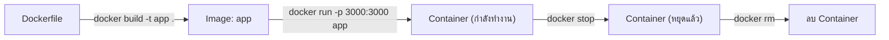

# เทคโนโลยีคอนเทนเนอร์ Docker และ Kubernetes (Container Technology)

## วิวัฒนาการจาก VM สู่ Container
ในขณะที่ Virtual Machine (VM) ต้องจำลองทั้งระบบปฏิบัติการ (Guest OS) ทำให้ใช้ทรัพยากรและเวลาในการเริ่มต้นระบบที่สูง เทคโนโลยี **Container** จึงถูกพัฒนาขึ้นมาแก้ปัญหานี้ คอนเทนเนอร์จะแชร์ระดับ OS Kernel ร่วมกัน (OS-level virtualization) ทำให้มีขนาดเล็ก โหลดเร็ว และใช้ทรัพยากรน้อยกว่ามาก

## Docker: มาตรฐานของการสร้างและรันคอนเทนเนอร์
**Docker** เป็นแพลตฟอร์มที่ได้รับความนิยมสูงสุดในการสร้างและจัดการคอนเทนเนอร์ หลักการทำงานของ Docker มีองค์ประกอบสำคัญคือ:
1. **Dockerfile:** ไฟล์ที่กำหนดขั้นตอนการสร้าง Container Image 
2. **Docker Image:** แพ็กเกจที่รวมแอปพลิเคชันและ Library ที่จำเป็นไว้ (Read-only)
3. **Docker Container:** คือ Image ที่กำลังถูกรันและทำงานอยู่ (Runtime)

### ตัวอย่าง Dockerfile สำหรับแอปพลิเคชัน Node.js
```dockerfile
# ใช้ Base Image เป็น Node.js เวอร์ชัน 18 (Alpine Linux ขนาดเล็ก)
FROM node:18-alpine

# กำหนดโฟลเดอร์ทำงานภายในคอนเทนเนอร์
WORKDIR /usr/src/app

# คัดลอกไฟล์ package.json และติดตั้ง dependencies
COPY package*.json ./
RUN npm install --production

# คัดลอกซอร์สโค้ดที่เหลือเข้าไป
COPY . .

# เปิดพอร์ต 3000 และรันแอปพลิเคชัน
EXPOSE 3000
CMD ["node", "server.js"]
```

### คำสั่ง Docker พื้นฐาน

ลำดับการทำงานหลักคือ **Dockerfile → (build) → Image → (run) → Container**



| คำสั่ง | หน้าที่ |
|---|---|
| `docker build -t app .` | อ่าน `Dockerfile` ในโฟลเดอร์ปัจจุบัน (`.` คือ build context) แล้วสร้าง **image** ชื่อ `app` (`-t` = tag) |
| `docker images` | แสดงรายการ image ที่มีในเครื่อง |
| `docker run -p 3000:3000 app` | สร้างและเริ่ม **container** จาก image `app` โดยเชื่อมพอร์ต `เครื่องจริง:คอนเทนเนอร์` (3000 → 3000) |
| `docker run -d --name web -p 3000:3000 app` | เหมือนด้านบน แต่รันเบื้องหลัง (`-d` = detached) และตั้งชื่อ container ว่า `web` |
| `docker ps` | แสดง container ที่ **กำลังทำงาน** (`docker ps -a` รวมตัวที่หยุดแล้ว) |
| `docker stop web` | หยุด container (ยังไม่ถูกลบ เริ่มใหม่ได้ด้วย `docker start web`) |
| `docker rm web` | ลบ container ที่หยุดแล้ว (image ยังอยู่; ลบ image ใช้ `docker rmi app`) |

**`docker build` กับ `docker run` ต่างกันอย่างไร**

| ประเด็น | `docker build` | `docker run` |
|---|---|---|
| Input | Dockerfile + ซอร์สโค้ด (build context) | Image |
| Output | **Image** (แม่แบบ read-only) | **Container** (สิ่งที่กำลังทำงานจริง) |
| ทำบ่อยแค่ไหน | ทุกครั้งที่แก้โค้ดหรือ Dockerfile | ทุกครั้งที่ต้องการรันแอป (รันได้หลาย container จาก image เดียว) |
| เปรียบเทียบ | เขียนแบบแปลนและหล่อแม่พิมพ์ | ใช้แม่พิมพ์ผลิตชิ้นงานออกมาใช้ |

ตัวอย่างการใช้งานกับ Dockerfile ด้านบน (ผลลัพธ์เป็น **ตัวอย่าง** ค่า ID เวลา และขนาดจะต่างกันในแต่ละเครื่อง):

```bash
docker build -t app .
docker images
```

```output
[+] Building 12.3s (10/10) FINISHED
 => [1/5] FROM docker.io/library/node:18-alpine
 => [2/5] WORKDIR /usr/src/app
 => [3/5] COPY package*.json ./
 => [4/5] RUN npm install --production
 => [5/5] COPY . .
 => exporting to image
 => => naming to docker.io/library/app:latest

REPOSITORY   TAG       IMAGE ID       CREATED          SIZE
app          latest    3f2a9c1d7b4e   10 seconds ago   182MB
```

```bash
docker run -d --name web -p 3000:3000 app
docker ps
```

```output
CONTAINER ID   IMAGE   COMMAND            CREATED         STATUS         PORTS                    NAMES
a81c4e2f90bd   app     "node server.js"   5 seconds ago   Up 4 seconds   0.0.0.0:3000->3000/tcp   web
```

จากนั้นเปิดเบราว์เซอร์ที่ `http://localhost:3000` จะเข้าถึงแอปในคอนเทนเนอร์ได้ เมื่อเลิกใช้งาน:

```bash
docker stop web
docker rm web
```

> [!warning] ข้อผิดพลาดที่พบบ่อย
> - ลืม `-p` → แอปทำงานในคอนเทนเนอร์แต่เข้าจากเครื่องจริงไม่ได้ (`EXPOSE` ใน Dockerfile เป็นเพียงการระบุพอร์ต ไม่ได้เปิดพอร์ตให้)
> - `docker rm` container ที่ยังทำงานอยู่ไม่ได้ ต้อง `docker stop` ก่อน (หรือใช้ `docker rm -f`)
> - แก้โค้ดแล้วไม่ `docker build` ใหม่ → container ยังรันโค้ดเวอร์ชันเก่าจาก image เดิม

<details><summary>ดูเฉลย: ถ้าต้องการรันแอปเดียวกัน 2 ชุดบนพอร์ต 3000 และ 3001 ของเครื่องจริง ต้องสั่งอย่างไร</summary>

ใช้ image เดิม แต่ map พอร์ตฝั่งเครื่องจริงต่างกัน

```bash
docker run -d --name web1 -p 3000:3000 app
docker run -d --name web2 -p 3001:3000 app
```

ทั้งสอง container ฟังพอร์ต 3000 ภายในของตัวเอง แต่เครื่องจริงเข้าถึงผ่าน 3000 และ 3001 ตามลำดับ
</details>

## Kubernetes (K8s): ระบบจัดการคอนเทนเนอร์ระดับคลัสเตอร์
เมื่อแอปพลิเคชันมีขนาดใหญ่ขึ้นและประกอบด้วยคอนเทนเนอร์นับร้อยหรือพันตัว (Microservices) การจัดการด้วยตนเองจะเป็นไปไม่ได้ **Kubernetes** หรือ K8s ซึ่งพัฒนาโดย Google จึงเข้ามามีบทบาทในฐานะ **Container Orchestration Engine**

ความสามารถหลักของ Kubernetes:
- **Self-healing:** รีสตาร์ทคอนเทนเนอร์ที่ล้มเหลวโดยอัตโนมัติ
- **Auto-scaling:** ขยายหรือลดจำนวนคอนเทนเนอร์ตามโหลดการทำงาน (CPU/Memory)
- **Load Balancing:** กระจายทราฟฟิกไปยังคอนเทนเนอร์ต่างๆ เพื่อไม่ให้โหลดกระจุกตัว
- **Rollouts & Rollbacks:** สามารถอัปเดตเวอร์ชันของแอปพลิเคชันแบบค่อยเป็นค่อยไป และถอยกลับได้หากเกิดปัญหา

### ตัวอย่างการประกาศ Kubernetes Deployment (YAML)
```yaml
apiVersion: apps/v1
kind: Deployment
metadata:
  name: web-app-deployment
spec:
  replicas: 3 # รันคอนเทนเนอร์ 3 ตัว (Pod)
  selector:
    matchLabels:
      app: web-app
  template:
    metadata:
      labels:
        app: web-app
    spec:
      containers:
      - name: web-app-container
        image: myregistry/web-app:v1.2
        ports:
        - containerPort: 3000
        resources:
          requests:
            memory: "128Mi"
            cpu: "250m"
          limits:
            memory: "256Mi"
            cpu: "500m"
```

## สรุป
การใช้งาน Docker ร่วมกับ Kubernetes เป็นมาตรฐานอุตสาหกรรมในยุค Cloud-Native เทคโนโลยีนี้ทำให้นักพัฒนาสามารถเขียนโค้ดและมั่นใจได้ว่าซอฟต์แวร์จะสามารถทำงานได้เหมือนกันในทุกสภาพแวดล้อม ตั้งแต่เครื่องแล็ปท็อปไปจนถึงศูนย์ข้อมูลระดับไฮเปอร์สเกล
