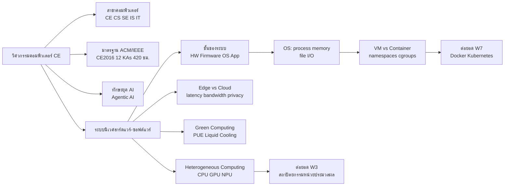

# ทบทวนภาพรวมวิศวกรรมคอมพิวเตอร์และระบบนิเวศ

> **หมวดหมู่:** เนื้อหาทบทวนก่อนสอบกลางภาค (Midterm Review)

## 🎯 ขอบเขตที่ต้องทบทวน

| สัปดาห์ | หัวข้อ | CLO |
| :--- | :--- | :--- |
| W1 | ขอบเขตวิศวกรรมคอมพิวเตอร์, ความต่าง CE/CS/SE/IS/IT, มาตรฐาน ACM/IEEE, ทักษะยุค AI-driven, Agentic AI | CLO1 |
| W2 | ระบบเป็นชั้น (layers), ระบบปฏิบัติการ, VM vs Container, Edge Computing, Green Computing, Heterogeneous Computing | CLO1 |

**หลังทบทวนไฟล์นี้ ผู้เรียนควร:**
1. อธิบายบทบาทของ CE และแยกแยะ CE/CS/SE/IS/IT จากตัวอย่างงานจริงได้
2. บอกได้ว่ากรอบ CE2016 คืออะไร มีโครงสร้างอย่างไร
3. อธิบายการทำงานร่วมกันของฮาร์ดแวร์–OS–แอปพลิเคชัน และหน้าที่หลักของ OS
4. เปรียบเทียบ Edge กับ Cloud และอธิบาย trade-off ด้าน latency, bandwidth, privacy และพลังงาน

> [!tip] โจทย์กลางภาคมักเป็นกรณีศึกษา
> ข้อสอบมักให้สถานการณ์ระบบหนึ่ง (เกม, ระบบกล้องในโรงงาน, เว็บแอป) แล้วถามว่า "งานนี้อยู่ในขอบเขตสาขาใด" "แต่ละชั้นของระบบทำอะไร" "ควรประมวลผลที่ Edge หรือ Cloud" ให้ฝึกตอบด้วย **เหตุผลเชิง trade-off** ไม่ใช่ท่องนิยามอย่างเดียว

## 🧠 สรุปแก่นความรู้ (Key Concepts Summary)

### 1. วิศวกรรมคอมพิวเตอร์คืออะไร
วิศวกรรมคอมพิวเตอร์ (Computer Engineering — CE) บูรณาการ **วิศวกรรมไฟฟ้า + วิทยาการคอมพิวเตอร์** เพื่อออกแบบระบบคอมพิวเตอร์ตั้งแต่วงจร ชิป ระบบฝังตัว ไปจนถึงซอฟต์แวร์ระบบ จุดเด่นคือการมองระบบ "ข้ามชั้น" ระหว่างฮาร์ดแวร์กับซอฟต์แวร์ วิวัฒนาการของสาขาเดินตามเทคโนโลยีอุปกรณ์: หลอดสุญญากาศ → ทรานซิสเตอร์ → วงจรรวม (IC) และไมโครโปรเซสเซอร์ → ยุคตัวเร่ง AI (GPU/NPU)

### 2. เปรียบเทียบสาขาคอมพิวเตอร์ (ตามกรอบ ACM/IEEE CC2020)

| สาขา | จุดเน้น | คำถามหลักที่สาขาตอบ | ตัวอย่างงาน |
| :--- | :--- | :--- | :--- |
| **CE** | ฮาร์ดแวร์ + ซอฟต์แวร์ระบบ | สร้างเครื่อง/ระบบให้คำนวณได้อย่างไร | ออกแบบบอร์ด IoT, firmware, ชิป |
| **CS** | ทฤษฎี อัลกอริทึม การคำนวณ | อะไรคำนวณได้ และทำให้มีประสิทธิภาพอย่างไร | อัลกอริทึม, AI, compiler |
| **SE** | กระบวนการพัฒนาซอฟต์แวร์ขนาดใหญ่ | สร้างซอฟต์แวร์ให้ถูกต้องและบำรุงรักษาได้อย่างไร | requirement, testing, DevOps |
| **IS** | เทคโนโลยี + กระบวนการธุรกิจ | ใช้ข้อมูลและระบบให้องค์กรได้ประโยชน์อย่างไร | ERP, BI, วิเคราะห์ระบบงาน |
| **IT** | ติดตั้ง ดูแล ให้บริการโครงสร้างพื้นฐาน | ทำให้ระบบใช้งานได้ต่อเนื่องและปลอดภัยอย่างไร | ดูแลเครือข่าย/เซิร์ฟเวอร์, helpdesk |

### 3. มาตรฐานหลักสูตร ACM/IEEE
- **CE2016** (ACM + IEEE Computer Society) กำหนด Body of Knowledge ของ CE เป็น **12 knowledge areas** รวม **420 core hours** และแนะนำคณิตศาสตร์อีกอย่างน้อย **120 ชั่วโมง** (1 core hour = การบรรยาย 50 นาที)
- ตัวอย่าง knowledge areas: CE-CAO (Computer Architecture and Organization), CE-DIG (Digital Design), CE-NWK (Computer Networks), CE-SEC (Information Security), CE-ESY (Embedded Systems), CE-SWD (Software Design)
- **CS2023** (ACM/IEEE-CS/AAAI) เป็นหลักสูตรอ้างอิงล่าสุดฝั่ง CS ที่ให้น้ำหนักกับ AI, security และ society/ethics มากขึ้น
- ความหมายต่อผู้เรียน: รายวิชานี้คือ "แผนที่" ที่พาไปแตะเกือบทุก knowledge area ก่อนลงลึกในปีถัดไป

### 4. ทักษะยุค AI-driven และ Agentic AI
- ทักษะที่เน้นในสัปดาห์ที่ 1: prompt engineering/fine-tuning เบื้องต้น, เข้าใจสถาปัตยกรรม LLM, ประเมินคุณภาพและอคติ (bias), การคิดเชิงระบบ
- **[[Agentic AI]]** คือระบบ AI ที่ไม่ได้แค่ตอบคำถาม แต่ **วางแผน → เรียกใช้เครื่องมือ → ตรวจผล → ทำซ้ำ** เพื่อบรรลุเป้าหมาย วิศวกรยังต้องเป็นผู้ตรวจสอบและรับผิดชอบผลลัพธ์

### 5. ระบบคอมพิวเตอร์เป็นชั้น (Layers)

| ชั้น | ตัวอย่าง | หน้าที่ |
| :--- | :--- | :--- |
| Application | เกม, เว็บเบราว์เซอร์ | ทำงานตามความต้องการผู้ใช้ |
| System software / OS | Linux, Windows, drivers | จัดการทรัพยากรและเป็นตัวกลางระหว่างโปรแกรมกับฮาร์ดแวร์ |
| Firmware | BIOS/UEFI, bootloader | เริ่มระบบ ควบคุมฮาร์ดแวร์ระดับต่ำ |
| Hardware | CPU, RAM, SSD, I/O, บัส | ประมวลผลและเก็บข้อมูลจริง |

**หน้าที่หลักของ OS 4 ประการ:** (1) จัดการกระบวนการ (process/CPU scheduling) (2) จัดการหน่วยความจำ (memory/virtual memory) (3) จัดการไฟล์ (file system) (4) จัดการอุปกรณ์ I/O (device drivers) — รวมถึงการควบคุมสิทธิ์และความปลอดภัย

### 6. Virtual Machine vs Container

| ประเด็น | Virtual Machine | Container |
| :--- | :--- | :--- |
| สิ่งที่จำลอง | ฮาร์ดแวร์ทั้งเครื่อง (ผ่าน hypervisor) | สภาพแวดล้อมระดับ process |
| Guest OS ของตัวเอง | มี | ไม่มี — ใช้ kernel ร่วมกับ host |
| เทคโนโลยีเบื้องหลัง | Hypervisor (Type 1 / Type 2) | Linux namespaces (แยกการมองเห็น) + cgroups (จำกัดทรัพยากร) + union file system (image เป็น layer) |
| ขนาด / เวลาเริ่มทำงาน | ใหญ่ (ระดับ GB) / ช้ากว่า | เล็ก (ระดับ MB) / เริ่มเร็ว |
| การแยกส่วน (isolation) | แข็งแรงกว่า | เบากว่า |

### 7. Edge Computing vs Cloud Computing
- **[[Edge Computing]]** คือการประมวลผลใกล้แหล่งกำเนิดข้อมูล (อุปกรณ์ เกตเวย์ หรือสถานีฐาน) แทนการส่งทุกอย่างขึ้นศูนย์ข้อมูลกลาง NIST เสนอ Fog Computing Conceptual Model เป็นชั้นกลางระหว่าง edge กับ cloud
- เหตุผลที่ใช้ Edge: **latency ต่ำ**, **ประหยัด bandwidth**, **privacy** (ข้อมูลอ่อนไหวไม่ต้องออกนอกพื้นที่), **ทำงาน offline ได้**
- Cloud ยังเหมาะกับ: การเทรนโมเดลใหญ่, การเก็บข้อมูลระยะยาว, การวิเคราะห์ภาพรวมจากหลายแหล่ง

### 8. Green Computing และ Heterogeneous Computing
- **Green Computing:** ออกแบบให้ใช้พลังงานคุ้มค่า ตัวชี้วัดของศูนย์ข้อมูลคือ **[[PUE]]** (ยิ่งใกล้ 1.0 ยิ่งดี) และใช้ **[[Liquid Cooling]]** กับชิป AI ที่ร้อนจัด (รายละเอียดการคำนวณอยู่ในไฟล์ทบทวน W6–W7)
- **Heterogeneous Computing:** ใช้หน่วยประมวลผลหลายชนิดร่วมกันบน SoC — CPU (งานลำดับ/ควบคุม), GPU (งานขนาน), NPU (งาน AI) — ส่งงานให้หน่วยที่ "เหมาะที่สุด" เพื่อได้ทั้งความเร็วและประหยัดพลังงาน

## 🗺️ Concept Map

## 🧮 โจทย์ตัวอย่างพร้อมวิธีทำ (Worked Problems)

### โจทย์ 1: จำแนกสาขาจากลักษณะงาน
**โจทย์:** จับคู่งานกับสาขาที่ "ตรงที่สุด" — (ก) ออกแบบบอร์ดเซนเซอร์วัดความชื้นพร้อมเขียน firmware (ข) พิสูจน์ว่าอัลกอริทึมจัดเรียงใหม่เร็วกว่าเดิม (ค) ดูแลเครือข่ายและบัญชีผู้ใช้ของมหาวิทยาลัย (ง) วิเคราะห์กระบวนการลงทะเบียนเรียนแล้วเสนอระบบใหม่ให้ผู้บริหาร (จ) วางกระบวนการทดสอบและ release แอปที่มีนักพัฒนา 50 คน

**วิธีทำ:** ถามตัวเองว่างานนั้น "สร้างอะไร" และ "เพื่อใคร"
- (ก) ข้ามชั้นฮาร์ดแวร์–ซอฟต์แวร์ → **CE**
- (ข) ทฤษฎีและประสิทธิภาพอัลกอริทึม → **CS**
- (ค) ให้บริการโครงสร้างพื้นฐาน → **IT**
- (ง) เชื่อมเทคโนโลยีกับกระบวนการองค์กร → **IS**
- (จ) กระบวนการพัฒนาซอฟต์แวร์ขนาดใหญ่ → **SE**

### โจทย์ 2: Map โครงงานเกมเข้ากับชั้นของระบบ
**โจทย์:** เกม Python ที่มีระบบ Save/Load (Lab W2) ทำงานผ่านชั้นใดบ้างเมื่อผู้เล่นกด "Save"

**วิธีทำ:**
1. **Application:** โค้ดเกมแปลงสถานะ (คะแนน, ด่าน) เป็น JSON แล้วเรียก `open()` และ `write()`
2. **OS:** system call ส่งต่อไปยัง file system ซึ่งตรวจสิทธิ์ จัดสรรบล็อกบนดิสก์ และพักข้อมูลใน buffer
3. **Driver/Firmware:** driver ของ SSD แปลงคำขอเป็นคำสั่งของอุปกรณ์
4. **Hardware:** SSD controller เขียนข้อมูลลง NAND flash

**ข้อสรุป:** โปรแกรมเมอร์ไม่ต้องรู้ว่าดิสก์ทำงานอย่างไร เพราะ OS ให้ **abstraction** — นี่คือเหตุผลที่ระบบถูกแบ่งเป็นชั้น

### โจทย์ 3: Edge หรือ Cloud — คิดจาก bandwidth และ latency
**โจทย์:** โรงงานติดกล้อง 100 ตัว แต่ละตัวส่งวิดีโอ 8 Mbps ต้องตรวจจับคนเข้าเขตอันตรายและสั่งหยุดเครื่องภายใน 50 ms อินเทอร์เน็ตขาออกของโรงงานคือ 500 Mbps และ round-trip time (RTT) ไป cloud ประมาณ 80 ms ควรออกแบบอย่างไร

**วิธีทำ:**
1. bandwidth ที่ต้องใช้ถ้าส่งวิดีโอทั้งหมดขึ้น cloud:
$$100 \times 8\ \text{Mbps} = 800\ \text{Mbps} > 500\ \text{Mbps}$$
→ ช่องสัญญาณไม่พอ
2. latency: เฉพาะ RTT ไป cloud ก็ 80 ms ซึ่งเกินงบ 50 ms แล้ว ยังไม่รวมเวลาประมวลผล
3. **คำตอบ:** ประมวลผลการตรวจจับที่ **Edge** (เกตเวย์ที่มี GPU/NPU ภายในโรงงาน) แล้วส่งขึ้น cloud เฉพาะเหตุการณ์ผิดปกติและสถิติสรุป เพื่อเก็บถาวรและใช้เทรนโมเดลรุ่นใหม่ — เป็นสถาปัตยกรรม **hybrid edge–cloud**

### โจทย์ 4: เลือก VM หรือ Container
**โจทย์:** (ก) ต้องรันแอป Windows รุ่นเก่าบนเซิร์ฟเวอร์ Linux (ข) ต้องรัน web API ตัวเดียวกัน 20 ชุดเพื่อรองรับโหลด

**วิธีทำ:**
- (ก) แอปต้องการ kernel ของ Windows แต่ container ใช้ kernel ร่วมกับ host (Linux) → ต้องใช้ **VM**
- (ข) ทุกชุดใช้ kernel Linux เดียวกัน ต้องการเริ่มเร็วและกินทรัพยากรน้อย → **Container**

## ⚠️ จุดที่มักตอบผิด
- **"CE = ซ่อมคอมพิวเตอร์"** — ผิด งานดูแลและซ่อมบำรุงใกล้เคียง IT มากกว่า CE เน้น "ออกแบบ" ระบบ
- **สับสน IS กับ IT** — IS มองที่ข้อมูลและกระบวนการธุรกิจ ส่วน IT มองที่การให้บริการโครงสร้างพื้นฐาน
- **"Container คือ VM ขนาดเล็ก"** — ไม่ถูกต้อง container ไม่มี guest OS และใช้ kernel ร่วมกับ host
- **"Edge จะมาแทน Cloud"** — ทั้งสองทำงานเสริมกัน งานเทรนโมเดลใหญ่และการเก็บข้อมูลระยะยาวยังอยู่บน cloud
- **ตัวเลข CE2016** — 12 knowledge areas และ 420 core hours (คณิตศาสตร์ 120 ชั่วโมงแยกต่างหาก) อย่าสลับกัน
- **namespaces vs cgroups** — namespaces = แยก "การมองเห็น" (isolation), cgroups = จำกัด "ปริมาณทรัพยากร" (limits)

## ✍️ แบบฝึกหัดทบทวน

**1. (ปรนัย)** ข้อใดอธิบายจุดเน้นของวิศวกรรมคอมพิวเตอร์ (CE) ได้ถูกต้องที่สุด
ก. ทฤษฎีความสามารถในการคำนวณ ข. การบูรณาการฮาร์ดแวร์และซอฟต์แวร์ ค. การวางระบบ ERP ให้องค์กร ง. การให้บริการ helpdesk

ดูเฉลย

**ข.** CE เชื่อมวิศวกรรมไฟฟ้ากับวิทยาการคอมพิวเตอร์ ส่วนข้อ ก. คือ CS, ค. คือ IS, ง. คือ IT

**2. (ปรนัย)** ตามกรอบ CE2016 body of knowledge ของ CE ประกอบด้วยกี่ knowledge areas และกี่ core hours
ก. 10 / 300 ข. 12 / 420 ค. 18 / 540 ง. 12 / 540

ดูเฉลย

**ข.** 12 knowledge areas, 420 core hours (เมื่อรวมคณิตศาสตร์ 120 ชั่วโมงจะเป็น 540 จึงเป็นตัวลวงของข้อ ง.)

**3. (ปรนัย)** กลไกใดของ Linux ที่ใช้ "จำกัด" ปริมาณ CPU/RAM ของ container
ก. namespaces ข. cgroups ค. hypervisor ง. BIOS

ดูเฉลย

**ข.** cgroups จำกัดและวัดการใช้ทรัพยากร ส่วน namespaces ทำหน้าที่แยกการมองเห็นระหว่าง container

**4. (อัตนัยสั้น)** บอกหน้าที่หลักของระบบปฏิบัติการ 4 ข้อ

ดูเฉลย

จัดการกระบวนการ (process scheduling), จัดการหน่วยความจำ, จัดการไฟล์ (file system), จัดการอุปกรณ์ I/O ผ่าน drivers (และควบคุมสิทธิ์/ความปลอดภัย)

**5. (อัตนัยสั้น)** ให้เหตุผล 3 ข้อที่รถยนต์ไร้คนขับต้องประมวลผลภาพที่ Edge

ดูเฉลย

(1) ต้องตัดสินใจในระดับมิลลิวินาที รอ RTT ไป cloud ไม่ได้ (2) ข้อมูลกล้องและเซนเซอร์มีปริมาณมหาศาล ส่งขึ้น cloud ทั้งหมดไม่คุ้มและ bandwidth ไม่พอ (3) ต้องทำงานต่อได้แม้สัญญาณเครือข่ายขาด

**6. (อัตนัยสั้น)** Heterogeneous computing ช่วยประหยัดพลังงานได้อย่างไร

ดูเฉลย

ส่งงานให้หน่วยที่ออกแบบมาเฉพาะ เช่น ให้ NPU ทำ matrix multiplication ของ AI แทน CPU ซึ่งใช้พลังงานต่อการคำนวณน้อยกว่ามาก ขณะที่ CPU ทำงานควบคุมและเงื่อนไขที่ตัวเองถนัด

**7. (วิเคราะห์)** นักศึกษาคนหนึ่งบอกว่า "เมื่อมี Agentic AI เขียนโค้ดและ deploy ให้ วิศวกรก็ไม่จำเป็นต้องเข้าใจระบบอีกต่อไป" จงโต้แย้ง

ดูเฉลย

AI agent อาจให้ผลลัพธ์ผิด มีอคติ หรือสร้างช่องโหว่ได้ วิศวกรต้องเข้าใจระบบเพื่อกำหนดเป้าหมายให้ชัด ตรวจสอบ ทดสอบ และรับผิดชอบผลลัพธ์ทางวิชาชีพ ความเข้าใจข้ามชั้นของระบบ (ตั้งแต่ hardware ถึง cloud) คือสิ่งที่ทำให้จับข้อผิดพลาดได้

## 🔗 อ่านทบทวนเพิ่มเติม
- [[Week 01 - Introduction to CE & IT]] · [[Week 02 - Hardware & Software Ecosystems]]
- แนวคิด: [[Agentic AI]] · [[Edge Computing]] · [[TinyML และ Edge AI]] · [[PUE]] · [[Liquid Cooling]]
- ต่อยอด: [[Week 03 - Digital Logic & Modern Processors]] · [[Week 07 - Data Center & Cloud Infrastructure]] · กลับหน้า [[Week 08 - Midterm Examination]]

## 📚 แหล่งอ้างอิง
1. ACM/IEEE-CS Joint Task Force. (2016). *Computer Engineering Curricula 2016 (CE2016).* [PDF](https://www.acm.org/binaries/content/assets/education/ce2016-final-report.pdf) — ยืนยัน 12 knowledge areas, 420 core hours และคณิตศาสตร์ 120 ชั่วโมง
2. ACM/IEEE-CS Task Force. (2020). *Computing Curricula 2020 (CC2020): Paradigms for Global Computing Education.* [PDF](https://www.acm.org/binaries/content/assets/education/curricula-recommendations/cc2020.pdf)
3. ACM/IEEE-CS/AAAI. (2024). *Computer Science Curricula 2023 (CS2023).* [ACM Digital Library](https://dl.acm.org/doi/book/10.1145/3664191)
4. Iorga, M., et al. (2018). *Fog Computing Conceptual Model* (NIST SP 500-325). [NIST CSRC](https://csrc.nist.gov/pubs/sp/500/325/final)
5. Docker Inc. *What is Docker? (Docker overview).* [docs.docker.com](https://docs.docker.com/get-started/docker-overview/)
6. Silberschatz, A., Galvin, P. B., & Gagne, G. (2018). *Operating System Concepts* (10th ed.). Wiley.
