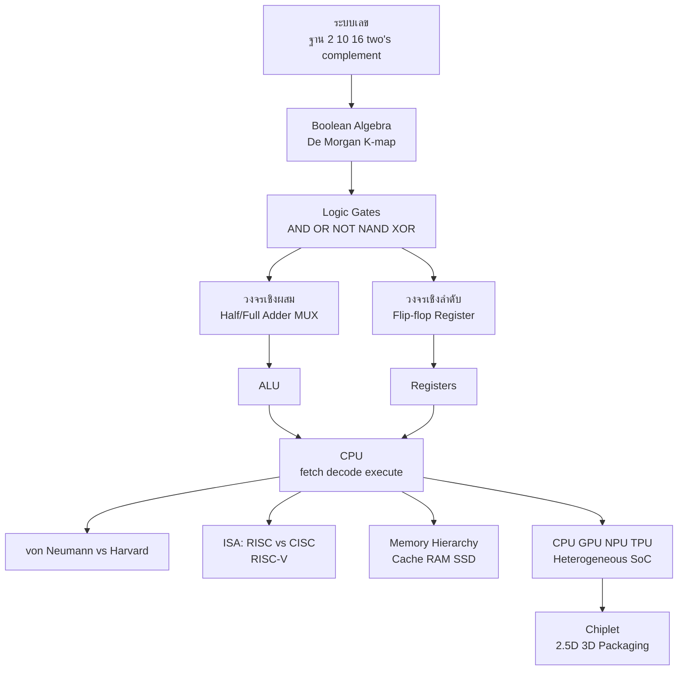

# ทบทวนสถาปัตยกรรมฮาร์ดแวร์และหน่วยประมวลผล

> **หมวดหมู่:** เนื้อหาทบทวนก่อนสอบกลางภาค (Midterm Review)

## 🎯 ขอบเขตที่ต้องทบทวน

| สัปดาห์ | หัวข้อ | CLO |
| :--- | :--- | :--- |
| W2 (ส่วนฮาร์ดแวร์) | องค์ประกอบฮาร์ดแวร์, memory hierarchy, cache L1/L2/L3, pipeline, virtual memory, heterogeneous SoC | CLO1 |
| W3 | ระบบเลข, Boolean algebra, logic gates, half/full adder, วงจรเชิงผสม/เชิงลำดับ, von Neumann vs Harvard, RISC-V, CPU/GPU/NPU/TPU, Chiplet | CLO2 |

**หลังทบทวนไฟล์นี้ ผู้เรียนควร:**
1. แปลงเลขฐาน 2/10/16 และหาค่า two's complement ได้
2. เขียนตารางความจริง ลดรูปนิพจน์บูลีน และออกแบบ half adder/full adder ได้
3. อธิบายวงรอบ fetch–decode–execute, von Neumann bottleneck และ memory hierarchy ได้
4. เปรียบเทียบ CPU/GPU/NPU/TPU, RISC vs CISC และอธิบายเหตุผลของ RISC-V และ Chiplet ได้

> [!note] ข้อสอบส่วนนี้มี "การคำนวณ" แน่นอน
> ฝึกมือ: แปลงเลขฐาน, ตารางความจริง, สมการ adder และสมการเวลา CPU ให้คล่อง แสดงวิธีทำทุกขั้นเพื่อเก็บคะแนนบางส่วน

## 🧠 สรุปแก่นความรู้ (Key Concepts Summary)

### 1. ระบบเลข (Number Systems)
- ฐานสอง (binary) ใช้ 0/1, ฐานสิบหก (hex) ใช้ 0–9, A–F โดย **1 หลัก hex = 4 บิต** จึงแปลง binary ↔ hex โดยจับกลุ่มทีละ 4 บิตได้ทันที
- ฐานสอง → ฐานสิบ: คูณแต่ละหลักด้วย $2^i$ แล้วรวม; ฐานสิบ → ฐานสอง: หารด้วย 2 ซ้ำ เก็บเศษจากล่างขึ้นบน
- **Two's complement** (แทนจำนวนลบ): กลับบิตทุกตัว (one's complement) แล้วบวก 1 ช่วงค่าของ $n$ บิตคือ $-2^{n-1}$ ถึง $2^{n-1}-1$ (8 บิต: −128 ถึง 127)

### 2. Boolean Algebra และ Logic Gates

| Gate | นิพจน์ | Output = 1 เมื่อ |
| :--- | :--- | :--- |
| AND | $A \cdot B$ | ทุกอินพุตเป็น 1 |
| OR | $A + B$ | มีอินพุตอย่างน้อยหนึ่งตัวเป็น 1 |
| NOT | $\overline{A}$ | อินพุตเป็น 0 |
| NAND | $\overline{A \cdot B}$ | ไม่ใช่ทุกตัวเป็น 1 |
| NOR | $\overline{A + B}$ | ทุกตัวเป็น 0 |
| XOR | $A \oplus B$ | อินพุตต่างกัน |

- **De Morgan:** $\overline{A \cdot B} = \overline{A} + \overline{B}$ และ $\overline{A + B} = \overline{A} \cdot \overline{B}$
- **NAND และ NOR เป็น universal gates** — สร้างเกตอื่นทุกชนิดได้จากเกตชนิดเดียว
- ลดรูปด้วยกฎพีชคณิตหรือ **K-map** (เหมาะกับ 3–5 ตัวแปร) ได้ SOP/POS ที่ใช้เกตน้อยลง → พื้นที่บนชิปเล็กลงและใช้พลังงานน้อยลง

### 3. วงจรเชิงผสม vs วงจรเชิงลำดับ

| ประเภท | ขึ้นกับ | มีหน่วยความจำ | ตัวอย่าง |
| :--- | :--- | :--- | :--- |
| Combinational | อินพุตปัจจุบันเท่านั้น | ไม่มี | half/full adder, multiplexer, decoder, ALU |
| Sequential | อินพุตปัจจุบัน + สถานะเดิม | มี (ใช้ clock) | flip-flop, register, counter |

- **Half adder:** $S = A \oplus B$, $C = A \cdot B$
- **Full adder:** $S = A \oplus B \oplus C_{in}$, $C_{out} = A \cdot B + C_{in}(A \oplus B)$ — นำ full adder หลายตัวต่อกันเป็น ripple-carry adder → ส่วนหนึ่งของ ALU

### 4. สถาปัตยกรรมหน่วยประมวลผล
- **[[von Neumann Architecture]]:** CPU (ALU + Control Unit + Registers), หน่วยความจำเดียวเก็บทั้ง **คำสั่งและข้อมูล**, I/O, บัส ทำงานตามวงรอบ **fetch → decode → execute** (โดยมี Program Counter ชี้คำสั่งถัดไป)
- **von Neumann bottleneck:** คำสั่งและข้อมูลใช้บัสร่วมกัน CPU จึงมักรอหน่วยความจำ
- **Harvard:** แยกหน่วยความจำ/บัสของคำสั่งและข้อมูล ดึงคำสั่งพร้อมอ่านข้อมูลได้ (พบใน microcontroller และ DSP)
- **Modified Harvard (ปัจจุบัน):** หน่วยความจำหลักร่วมกันแบบ von Neumann แต่แยก **L1 instruction cache (L1i)** กับ **L1 data cache (L1d)**
- **Pipeline:** แบ่งการทำคำสั่งเป็นขั้นและทำซ้อนกันเหมือนสายพาน เพิ่ม throughput (ไม่ได้ทำให้คำสั่งเดี่ยวเสร็จเร็วขึ้น); superscalar = ออกคำสั่งได้หลายคำสั่งต่อรอบ

### 5. Memory Hierarchy
register → L1 → L2 → L3 cache → RAM (DRAM) → SSD → HDD: **ยิ่งใกล้ CPU ยิ่งเร็ว แพงต่อบิต และเล็ก** ระบบทำงานได้ดีเพราะหลัก **locality** (temporal: ใช้ซ้ำเร็ว ๆ นี้, spatial: ใช้ข้อมูลข้างเคียง) ส่วน MMU และ **virtual memory** แปลงที่อยู่เสมือนเป็นที่อยู่จริง ทำให้แต่ละโปรแกรมมีพื้นที่หน่วยความจำแยกกัน

### 6. ISA: RISC vs CISC และ RISC-V

| ประเด็น | RISC | CISC |
| :--- | :--- | :--- |
| ชุดคำสั่ง | น้อย ง่าย ความยาวคงที่ | มาก ซับซ้อน ความยาวแปรผัน |
| การเข้าถึงหน่วยความจำ | เฉพาะ load/store | คำสั่งคำนวณอ้างหน่วยความจำได้ |
| ตัวอย่าง | **[[RISC-V]]**, ARM | x86 |

**RISC-V** เป็น ISA แบบเปิด (open standard, ดูแลโดย RISC-V International) ไม่ต้องเสียค่าลิขสิทธิ์ ออกแบบแบบ **modular**: base integer ISA (เช่น RV32I/RV64I) + ส่วนขยาย เช่น M (คูณ/หาร), A (atomic), F/D (ทศนิยม), C (คำสั่งบีบอัด), V (vector) มี integer registers 32 ตัว โดย `x0` มีค่าเป็นศูนย์เสมอ

### 7. หน่วยประมวลผลยุคใหม่และ Chiplet

| หน่วย | จุดแข็ง | งานที่เหมาะ |
| :--- | :--- | :--- |
| CPU | คอร์น้อยแต่ทรงพลัง เก่งงานลำดับ/เงื่อนไขซับซ้อน | OS, logic ของแอป |
| GPU | คอร์เล็กนับพัน ทำงานขนาน | กราฟิก, เทรน AI, matrix |
| NPU | วงจร MAC เฉพาะงาน neural network ประหยัดไฟ | AI inference บนมือถือ/โน้ตบุ๊ก |
| TPU | ASIC ของ Google ใช้ **systolic array** คูณเมทริกซ์ | เทรน/inference ใน data center |

- **Post-Moore era:** การย่อทรานซิสเตอร์แพงขึ้นมาก ชิปใหญ่ก้อนเดียว (monolithic) มี yield ต่ำ
- **[[Chiplet]]:** แบ่งชิปเป็นชิ้นเล็กเฉพาะหน้าที่ (อาจผลิตคนละ process node) แล้วต่อด้วย advanced packaging — **2.5D** (วางบน silicon interposer เช่นเชื่อม GPU กับ HBM) และ **3D stacking** (ซ้อนแนวตั้ง เชื่อมด้วย TSV)

## 🗺️ Concept Map

## 🧮 โจทย์ตัวอย่างพร้อมวิธีทำ (Worked Problems)

### โจทย์ 1: แปลงเลขฐาน
**โจทย์:** (ก) แปลง $1101_2$ และ $\text{0x2F}$ เป็นฐานสิบ (ข) แปลง $45_{10}$ เป็นฐานสองและฐานสิบหก

**วิธีทำ:**
- (ก) $1101_2 = 1\cdot2^3 + 1\cdot2^2 + 0\cdot2^1 + 1\cdot2^0 = 8+4+0+1 = 13_{10}$
- $\text{0x2F} = 2\cdot16^1 + 15\cdot16^0 = 32 + 15 = 47_{10}$
- (ข) หาร 2 ซ้ำ: 45→22 เศษ 1, 22→11 เศษ 0, 11→5 เศษ 1, 5→2 เศษ 1, 2→1 เศษ 0, 1→0 เศษ 1 อ่านเศษจากล่างขึ้นบน → $101101_2$
- จับกลุ่ม 4 บิตจากขวา: $0010\ 1101$ → $2$ และ $D$ → $\text{0x2D}$ (ตรวจ: $2\cdot16+13 = 45$ ✓)

### โจทย์ 2: Two's complement
**โจทย์:** แทน $-5$ ด้วย two's complement ขนาด 8 บิต แล้วตรวจว่า $5 + (-5) = 0$

**วิธีทำ:**
1. $+5 = 0000\ 0101$
2. กลับบิต: $1111\ 1010$
3. บวก 1: $1111\ 1011$ → นี่คือ $-5$
4. ตรวจ: $0000\ 0101 + 1111\ 1011 = 1\ 0000\ 0000$ ตัดบิตที่ 9 ทิ้ง (เกินขนาด 8 บิต) เหลือ $0000\ 0000$ ✓

### โจทย์ 3: ตารางความจริงและ Half Adder
**โจทย์:** ออกแบบวงจรบวกเลข 1 บิตสองตัว (A, B) ให้ได้ Sum (S) และ Carry (C)

**วิธีทำ:** เขียนตารางความจริงก่อน

| A | B | S | C |
| :-: | :-: | :-: | :-: |
| 0 | 0 | 0 | 0 |
| 0 | 1 | 1 | 0 |
| 1 | 0 | 1 | 0 |
| 1 | 1 | 0 | 1 |

- คอลัมน์ S เป็น 1 เมื่อ A ≠ B → $S = A \oplus B$ (XOR gate)
- คอลัมน์ C เป็น 1 เมื่อ A = B = 1 → $C = A \cdot B$ (AND gate)
- **ข้อสรุป:** half adder = XOR 1 ตัว + AND 1 ตัว เมื่อต้องรับตัวทดจากหลักก่อนหน้า ($C_{in}$) ต้องใช้ full adder

### โจทย์ 4: ลดรูปนิพจน์บูลีน
**โจทย์:** ลดรูป $F = A\overline{B} + AB + \overline{A}B$

**วิธีทำ:**
1. จับกลุ่ม: $A\overline{B} + AB = A(\overline{B} + B) = A \cdot 1 = A$
2. ได้ $F = A + \overline{A}B$
3. ใช้กฎ absorption $A + \overline{A}B = A + B$
4. **คำตอบ:** $F = A + B$ (OR gate ตัวเดียวแทนเกตหลายตัว) — ตรวจด้วยตารางความจริง: F = 0 เฉพาะกรณี A = B = 0 ✓

### โจทย์ 5: สมการเวลาประมวลผลของ CPU
**โจทย์:** โปรแกรมมี $2 \times 10^9$ คำสั่ง ค่า CPI เฉลี่ย 1.5 รันบน CPU 3 GHz ใช้เวลาเท่าใด และถ้าคอมไพเลอร์ใหม่ลด CPI เหลือ 1.2 จะเร็วขึ้นกี่เท่า

**วิธีทำ:** ใช้สมการ (Patterson & Hennessy)
$$\text{CPU time} = \frac{\text{Instruction count} \times \text{CPI}}{\text{Clock rate}}$$
- เดิม: $\dfrac{2\times10^9 \times 1.5}{3\times10^9} = 1.0$ วินาที
- ใหม่: $\dfrac{2\times10^9 \times 1.2}{3\times10^9} = 0.8$ วินาที
- Speedup $= 1.0 / 0.8 = 1.25$ เท่า
- **ข้อคิด:** ความเร็ว (GHz) ไม่ใช่ตัวแปรเดียว จำนวนคำสั่งและ CPI (ขึ้นกับ ISA และ compiler) มีผลเท่ากัน

## ⚠️ จุดที่มักตอบผิด
- **อ่านเศษผิดทิศ** เวลาแปลงฐานสิบเป็นฐานสอง — ต้องอ่านจาก **ล่างขึ้นบน**
- **ลืมบวก 1** ใน two's complement (ได้แค่ one's complement)
- **สับสน XOR กับ OR** — กรณี A = B = 1: OR ได้ 1 แต่ XOR ได้ 0
- **"Pipeline ทำให้คำสั่งเดี่ยวเร็วขึ้น"** — ผิด pipeline เพิ่ม throughput ส่วน latency ต่อคำสั่งไม่ลดลง
- **"Harvard ดีกว่าจึงแทน von Neumann หมดแล้ว"** — CPU ทั่วไปใช้ modified Harvard (แยกเฉพาะ L1 cache)
- **"RISC-V คือชิป/ยี่ห้อ CPU"** — RISC-V คือ **ISA** (ข้อกำหนดชุดคำสั่ง) บริษัทต่าง ๆ นำไปออกแบบชิปของตนเอง
- **"GPU ดีกว่า CPU ทุกงาน"** — GPU ด้อยกว่าในงานลำดับที่มีเงื่อนไขซับซ้อน

## ✍️ แบบฝึกหัดทบทวน

**1. (ปรนัย)** $\text{0xA7}$ มีค่าเท่าใดในฐานสิบ
ก. 107 ข. 167 ค. 177 ง. 170

ดูเฉลย

**ข.** $10 \times 16 + 7 = 167$

**2. (ปรนัย)** ข้อใดเป็น universal gate
ก. AND ข. XOR ค. NAND ง. OR

ดูเฉลย

**ค.** NAND (และ NOR) สร้างเกตอื่นได้ทั้งหมด

**3. (ปรนัย)** ปัญหา "von Neumann bottleneck" เกิดจากสาเหตุใด
ก. ALU มีจำนวนบิตน้อย ข. คำสั่งและข้อมูลใช้หน่วยความจำ/บัสร่วมกัน ค. ไม่มี cache ง. clock ช้า

ดูเฉลย

**ข.** CPU ต้องรอการดึงคำสั่งและข้อมูลผ่านเส้นทางเดียวกัน cache ช่วยบรรเทาแต่ไม่ใช่ต้นเหตุ

**4. (อัตนัยสั้น)** ค่าที่มากที่สุดและน้อยที่สุดที่แทนได้ด้วย two's complement 8 บิตคือเท่าใด

ดูเฉลย

$-2^7 = -128$ ถึง $2^7 - 1 = 127$

**5. (อัตนัยสั้น)** เขียนสมการ S และ $C_{out}$ ของ full adder แล้วคำนวณเมื่อ A = 1, B = 1, $C_{in}$ = 1

ดูเฉลย

$S = A \oplus B \oplus C_{in} = 1 \oplus 1 \oplus 1 = 1$; $C_{out} = AB + C_{in}(A \oplus B) = 1 + 1\cdot0 = 1$ → ผลบวก $1+1+1 = 3 = 11_2$ ✓

**6. (อัตนัยสั้น)** เรียงลำดับ RAM, L1 cache, SSD, register, L3 cache จากเร็วไปช้า และอธิบายว่าทำไม cache ทำให้ระบบเร็วขึ้น

ดูเฉลย

register → L1 cache → L3 cache → RAM → SSD; cache เก็บข้อมูลที่เพิ่งใช้หรืออยู่ใกล้กันไว้ใกล้ CPU ตามหลัก locality ทำให้ส่วนใหญ่ไม่ต้องรอ RAM ที่ช้ากว่า

**7. (อัตนัยสั้น)** ให้เหตุผล 2 ข้อที่ประเทศหรือบริษัทสตาร์ทอัพเลือก RISC-V

ดูเฉลย

(1) เป็น ISA เปิด ไม่ต้องจ่ายค่าลิขสิทธิ์ ลดต้นทุนและอุปสรรคทางกฎหมาย (2) ออกแบบแบบ modular เลือกเฉพาะส่วนขยายที่ต้องการหรือเพิ่มคำสั่งเฉพาะงาน (เช่น ตัวเร่ง AI) ได้ และลดการพึ่งพาเทคโนโลยีของบริษัท/ประเทศใดประเทศหนึ่ง

**8. (วิเคราะห์)** เหตุใดผู้ผลิตชิปจึงหันมาใช้ Chiplet แทนชิปขนาดใหญ่ก้อนเดียว

ดูเฉลย

ชิปก้อนใหญ่มีโอกาสมีจุดบกพร่องสูง (yield ต่ำ) และการผลิตบน node ล่าสุดแพงมาก Chiplet แบ่งเป็นชิ้นเล็กที่ yield ดีกว่า ใช้ node ล่าสุดเฉพาะส่วนที่จำเป็น (เช่นคอร์คำนวณ) และใช้ node เก่าที่ถูกกว่ากับส่วน I/O แล้วเชื่อมด้วย 2.5D/3D packaging

## 🔗 อ่านทบทวนเพิ่มเติม
- [[Week 02 - Hardware & Software Ecosystems]] · [[Week 03 - Digital Logic & Modern Processors]]
- แนวคิด: [[Boolean Algebra และ Logic Gates]] · [[von Neumann Architecture]] · [[RISC-V]] · [[Chiplet]] · [[Edge Computing]]
- กลับหน้า [[Week 08 - Midterm Examination]]

## 📚 แหล่งอ้างอิง
1. Patterson, D. A., & Hennessy, J. L. (2020). *Computer Organization and Design RISC-V Edition: The Hardware Software Interface* (2nd ed.). Morgan Kaufmann. [Elsevier](https://www.elsevier.com/books/computer-organization-and-design-risc-v-edition/patterson/978-0-12-820331-6) — สมการ CPU time, pipeline, memory hierarchy
2. RISC-V International. *RISC-V Ratified Specifications.* [riscv.org](https://riscv.org/specifications/)
3. RISC-V International. *The RISC-V Instruction Set Manual* (source repository). [GitHub](https://github.com/riscv/riscv-isa-manual)
4. ACM/IEEE-CS Joint Task Force. (2016). *CE2016* — knowledge areas CE-DIG (Digital Design) และ CE-CAO (Computer Architecture and Organization). [PDF](https://www.acm.org/binaries/content/assets/education/ce2016-final-report.pdf)
5. Mano, M. M., & Ciletti, M. D. *Digital Design* (6th ed.). Pearson.
