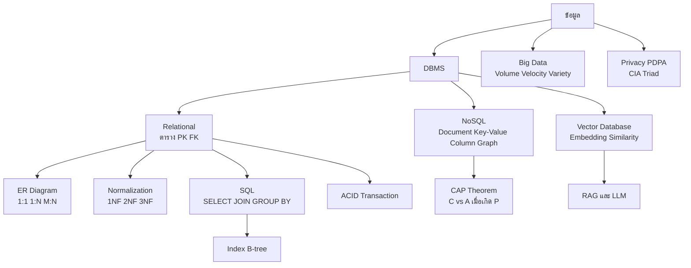
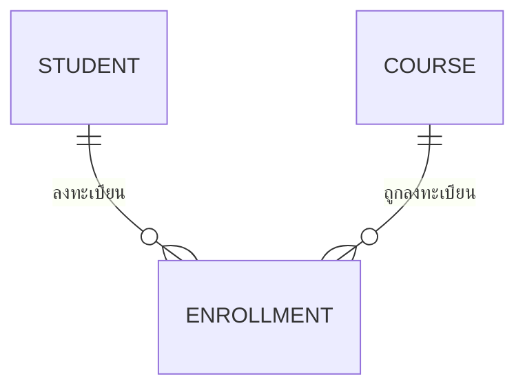

# ทบทวนระบบฐานข้อมูลและการจัดการข้อมูล

> **หมวดหมู่:** เนื้อหาทบทวนก่อนสอบกลางภาค (Midterm Review)

## 🎯 ขอบเขตที่ต้องทบทวน

| สัปดาห์ | หัวข้อ | CLO |
| :--- | :--- | :--- |
| W5 | DBMS, โมเดลเชิงสัมพันธ์, key, ER diagram, normalization, SQL, index, ACID, NoSQL 4 ประเภท, CAP, Big Data, Vector Database, data privacy/PDPA | CLO3 |

**หลังทบทวนไฟล์นี้ ผู้เรียนควร:**
1. ออกแบบ ER diagram และแปลงเป็นตารางที่มี PK/FK ถูกต้องได้
2. เขียน SQL `SELECT … JOIN … WHERE … GROUP BY … ORDER BY` แก้โจทย์ได้
3. อธิบาย normalization (1NF–3NF) และ ACID ด้วยตัวอย่างได้
4. เลือกระหว่าง SQL, NoSQL และ Vector Database ตามลักษณะงานพร้อมเหตุผลได้

> [!tip] ข้อสอบอัตนัยที่พบบ่อยที่สุดของส่วนนี้
> "ออกแบบ ER diagram ของระบบ X แล้วเขียน SQL อย่างน้อย 1 คำสั่งที่ใช้ JOIN" — ฝึกให้คล่องกับกรณี **many-to-many** ที่ต้องมีตารางเชื่อม (associative/junction table)

## 🧠 สรุปแก่นความรู้ (Key Concepts Summary)

### 1. DBMS และโมเดลเชิงสัมพันธ์
**DBMS** เป็นตัวกลางระหว่างแอปกับข้อมูล ทำหน้าที่จัดเก็บ ค้นหา ควบคุมสิทธิ์ รักษาความถูกต้อง และกู้คืนเมื่อระบบล่ม (เช่น PostgreSQL, MySQL, SQLite) โมเดลเชิงสัมพันธ์จัดข้อมูลเป็น **ตาราง (relation)** ประกอบด้วยแถว (tuple) และคอลัมน์ (attribute)

| คำศัพท์ | ความหมาย | ตัวอย่าง |
| :--- | :--- | :--- |
| Primary Key (PK) | ระบุแต่ละแถวไม่ซ้ำ และห้ามเป็น NULL | `Student.student_id` |
| Foreign Key (FK) | คอลัมน์ที่อ้างถึง PK ของอีกตาราง | `Enrollment.student_id` |
| Composite Key | PK ที่ประกอบด้วยหลายคอลัมน์ | `(student_id, course_id)` |
| Candidate Key | คอลัมน์ที่เป็น PK ได้ทั้งหมด (เลือกมาหนึ่งเป็น PK) | `student_id`, `email` |

### 2. ER Diagram และ Cardinality
- **Entity** (สิ่งที่เก็บข้อมูล เช่น Student), **Attribute** (คุณสมบัติ), **Relationship** (ความสัมพันธ์)
- Cardinality: **1:1**, **1:N** (เช่น อาจารย์ 1 คนสอนหลายวิชา → FK อยู่ฝั่ง N), **M:N** (นักศึกษาหลายคนลงหลายวิชา → **ต้องสร้างตารางเชื่อม** เช่น `Enrollment`)

### 3. Normalization

| ระดับ | เงื่อนไขโดยย่อ | ตัวอย่างการละเมิด |
| :--- | :--- | :--- |
| **1NF** | ทุกช่องเก็บค่าเดียว (atomic) ไม่มีกลุ่มซ้ำ | `courses = "MA101, PG101"` ในช่องเดียว |
| **2NF** | 1NF + คอลัมน์ non-key ขึ้นกับ PK ทั้งก้อน (ไม่มี partial dependency) | PK `(student_id, course_id)` แต่ `course_title` ขึ้นกับ `course_id` อย่างเดียว |
| **3NF** | 2NF + ไม่มี transitive dependency (non-key ขึ้นกับ non-key) | `major_name` ขึ้นกับ `major_id` ในตาราง Student |

เป้าหมายคือลด **ความซ้ำซ้อน** และป้องกัน **update/insert/delete anomaly**

### 4. SQL ที่ต้องเขียนได้
`SELECT` (เลือกคอลัมน์), `FROM`/`JOIN … ON` (เชื่อมตาราง), `WHERE` (กรองแถว **ก่อน** จัดกลุ่ม), `GROUP BY` + ฟังก์ชันรวม (`COUNT`, `AVG`, `SUM`), `HAVING` (กรอง **หลัง** จัดกลุ่ม), `ORDER BY … DESC` (เรียง) และคำสั่งแก้ข้อมูล `INSERT`, `UPDATE`, `DELETE`

**Index (B-tree)** ทำหน้าที่เหมือนสารบัญ ช่วยให้ค้นหาจาก $O(n)$ (scan ทั้งตาราง) เหลือประมาณ $O(\log n)$ แลกกับพื้นที่และการเขียนที่ช้าลงเล็กน้อย

### 5. ACID

| คุณสมบัติ | ความหมาย | ตัวอย่างกลไก |
| :--- | :--- | :--- |
| **A**tomicity | ทำครบทั้งหมดหรือไม่ทำเลย | `ROLLBACK` |
| **C**onsistency | หลังจบธุรกรรม ข้อมูลยังเคารพกฎ | PK, FK, `CHECK` |
| **I**solation | ธุรกรรมพร้อมกันไม่รบกวนกัน | locking, MVCC |
| **D**urability | `COMMIT` แล้วไม่หายแม้ไฟดับ | Write-Ahead Log (WAL) |

### 6. SQL vs NoSQL และ CAP

| ประเภท NoSQL | โครงสร้าง | ตัวอย่างระบบ | เหมาะกับ |
| :--- | :--- | :--- | :--- |
| Document | JSON/BSON ซ้อนกันได้ | MongoDB | แคตตาล็อกสินค้า, โปรไฟล์ |
| Key-Value | `key → value` | Redis | cache, session, leaderboard |
| Wide-Column | partition key + คอลัมน์ยืดหยุ่น | Cassandra | log, IoT, time-series |
| Graph | node + edge | Neo4j | social network, recommendation |

- SQL: schema ชัดเจน, JOIN ดี, ACID เต็มรูปแบบ, ถนัด scale up — NoSQL: schema ยืดหยุ่น, ออกแบบมาเพื่อ **scale out**, หลายระบบเน้น BASE/eventual consistency (บางระบบ เช่น MongoDB รองรับ multi-document transaction)
- **CAP theorem:** เมื่อเกิด **network partition (P)** ระบบกระจายต้องเลือกระหว่าง **Consistency (C)** กับ **Availability (A)** — ไม่ใช่ "เลือก 2 ใน 3 ตลอดเวลา"

### 7. Big Data และ Vector Database
- **Big Data** มักอธิบายด้วย Volume, Velocity, Variety (บางตำราเพิ่ม Veracity, Value) ใช้ data pipeline (ETL/ELT) เข้าสู่ data warehouse (ข้อมูลมีโครงสร้าง) หรือ data lake (ข้อมูลดิบทุกรูปแบบ)
- **[[Vector Database]]:** เก็บ **embedding** (เวกเตอร์ตัวเลขที่แทนความหมายของข้อความ/ภาพ) แล้วค้นหาด้วย **similarity search** (cosine similarity, ระยะทาง) ผ่านดัชนี ANN (เช่น HNSW) — เป็นหัวใจของ **[[RAG และ LLM|RAG]]** ที่ดึงเอกสารเกี่ยวข้องมาให้ LLM ตอบ
- เวกเตอร์กลายเป็นความสามารถของฐานข้อมูลหลัก เช่น ส่วนขยาย **pgvector** ของ PostgreSQL

### 8. Data Privacy
- **[[PDPA]]** (พ.ร.บ.คุ้มครองข้อมูลส่วนบุคคล พ.ศ. 2562): เก็บข้อมูลเท่าที่จำเป็น มีฐานทางกฎหมาย/ความยินยอม แจ้งวัตถุประสงค์ และคุ้มครองสิทธิเจ้าของข้อมูล
- เทคนิค: กำหนดสิทธิ์ตามบทบาท (least privilege), เข้ารหัสข้อมูล, ทำ masking/pseudonymization, ป้องกัน **SQL injection** ด้วย parameterized query — สอดคล้องกับ [[CIA Triad]]

## 🗺️ Concept Map



## 🧮 โจทย์ตัวอย่างพร้อมวิธีทำ (Worked Problems)

### โจทย์ 1: ออกแบบ ER และ schema ของระบบลงทะเบียนเรียน
**โจทย์:** นักศึกษาหนึ่งคนลงได้หลายวิชา หนึ่งวิชามีนักศึกษาหลายคน ต้องเก็บเกรดของแต่ละการลงทะเบียน ออกแบบตาราง

**วิธีทำ:**
1. Entities: `Student`, `Course` — ความสัมพันธ์ "ลงทะเบียน" เป็น **M:N**
2. M:N แตกเป็นตารางเชื่อม `Enrollment` ซึ่งเก็บ attribute ของความสัมพันธ์ (เกรด)
3. Schema:
```sql
CREATE TABLE Student (
    student_id TEXT PRIMARY KEY,
    name       TEXT NOT NULL,
    gpa        REAL CHECK (gpa BETWEEN 0 AND 4)
);
CREATE TABLE Course (
    course_id TEXT PRIMARY KEY,
    title     TEXT NOT NULL,
    credits   INTEGER
);
CREATE TABLE Enrollment (
    student_id TEXT REFERENCES Student(student_id),
    course_id  TEXT REFERENCES Course(course_id),
    grade      TEXT,
    PRIMARY KEY (student_id, course_id)   -- composite key กันลงซ้ำ
);
```


### โจทย์ 2: เขียน SQL
**โจทย์:** (ก) แสดงนักศึกษาที่ GPA มากกว่า 3.00 เรียงจากมากไปน้อย (ข) แสดงชื่อวิชาและจำนวนผู้ลงทะเบียน เฉพาะวิชาที่มีผู้ลงมากกว่า 30 คน

**วิธีทำ:**
```sql
-- (ก) กรองแถวด้วย WHERE แล้วเรียงด้วย ORDER BY ... DESC
SELECT student_id, name, gpa
FROM Student
WHERE gpa > 3.00
ORDER BY gpa DESC;

-- (ข) JOIN -> GROUP BY -> กรองผลรวมด้วย HAVING
SELECT c.title, COUNT(e.student_id) AS n_students
FROM Course AS c
JOIN Enrollment AS e ON e.course_id = c.course_id
GROUP BY c.course_id, c.title
HAVING COUNT(e.student_id) > 30
ORDER BY n_students DESC;
```
**เหตุผล:** ใน (ข) ต้องใช้ `HAVING` ไม่ใช่ `WHERE` เพราะเงื่อนไขอยู่บนค่าที่ได้หลังจัดกลุ่ม (`COUNT`)

### โจทย์ 3: Normalize ตารางที่ซ้ำซ้อน
**โจทย์:** ตาราง `Register(student_id, student_name, course_id, course_title, grade)` มี PK เป็น `(student_id, course_id)` มีปัญหาอะไร และแก้อย่างไร

**วิธีทำ:**
1. `student_name` ขึ้นกับ `student_id` เพียงส่วนเดียว และ `course_title` ขึ้นกับ `course_id` เพียงส่วนเดียว → **partial dependency** → ไม่ผ่าน 2NF
2. ผลเสีย: เปลี่ยนชื่อวิชาต้องแก้หลายแถว (update anomaly), เพิ่มวิชาใหม่ที่ยังไม่มีคนลงไม่ได้ (insert anomaly)
3. แยกเป็น `Student(student_id, student_name)`, `Course(course_id, course_title)`, `Enrollment(student_id, course_id, grade)` → ผ่าน 2NF และ 3NF (ไม่มี non-key ขึ้นกับ non-key)

### โจทย์ 4: ACID กับการโอนเงิน
**โจทย์:** โอนเงิน 500 บาทจากบัญชี A ไป B ไฟดับหลังหักเงิน A แต่ยังไม่เพิ่มเงิน B จะเกิดอะไรขึ้นถ้าใช้ transaction
```sql
BEGIN;
UPDATE account SET balance = balance - 500 WHERE id = 'A';
UPDATE account SET balance = balance + 500 WHERE id = 'B';
COMMIT;
```
**วิธีทำ:** เนื่องจากยังไม่ถึง `COMMIT` ระบบจะ **ยกเลิกทั้งธุรกรรม** เมื่อกู้คืน (Atomicity) เงินของ A จึงกลับเป็นค่าเดิม ไม่มีเงินหาย ถ้าไฟดับ **หลัง** `COMMIT` ข้อมูลทั้งสองบรรทัดต้องยังอยู่ (Durability ผ่าน WAL) และ `CHECK (balance >= 0)` ช่วยรักษา Consistency

### โจทย์ 5: Cosine similarity ใน Vector Database
**โจทย์:** embedding คำถาม $q = (1, 2, 2)$ เอกสาร $d_1 = (2, 1, 2)$ และ $d_2 = (-2, 1, 0)$ เอกสารใดเกี่ยวข้องกว่า

**วิธีทำ:**
$$\cos(q, d) = \frac{q \cdot d}{\lVert q \rVert \, \lVert d \rVert}$$
- $\lVert q \rVert = \sqrt{1+4+4} = 3$, $\lVert d_1 \rVert = \sqrt{4+1+4} = 3$, $\lVert d_2 \rVert = \sqrt{4+1+0} = \sqrt{5}$
- $q \cdot d_1 = 2+2+4 = 8 \Rightarrow \cos = 8/9 \approx 0.89$
- $q \cdot d_2 = -2+2+0 = 0 \Rightarrow \cos = 0$ (ตั้งฉาก ไม่เกี่ยวข้องกัน)
- **คำตอบ:** $d_1$ ใกล้เคียงความหมายของคำถามมากกว่า ระบบ RAG จะดึง $d_1$ ไปให้ LLM ใช้ตอบ

## ⚠️ จุดที่มักตอบผิด
- **ใส่ FK ผิดฝั่ง** ในความสัมพันธ์ 1:N — FK ต้องอยู่ฝั่ง "N"
- **ทำ M:N โดยไม่มีตารางเชื่อม** หรือเก็บรหัสวิชาหลายตัวในช่องเดียว (ผิด 1NF)
- **ใช้ `WHERE COUNT(...) > 30`** — ฟังก์ชันรวมต้องกรองด้วย `HAVING`
- **"PK ซ้ำได้ถ้าคอลัมน์อื่นต่างกัน"** — PK ต้องไม่ซ้ำและไม่เป็น NULL เสมอ
- **"NoSQL ไม่มี schema และไม่มี transaction เลย"** — schema ยืดหยุ่นแต่ยังต้องออกแบบ และบางระบบรองรับ transaction
- **CAP = "เลือก 2 ใน 3"** — ที่ถูกคือเมื่อเกิด partition ต้องเลือก C หรือ A
- **"Vector DB ค้นด้วยคำตรงตัว"** — vector search ค้นด้วย **ความหมาย** ส่วน keyword search ค้นด้วยคำ

## ✍️ แบบฝึกหัดทบทวน

**1. (ปรนัย)** ความสัมพันธ์ "นักศึกษาหลายคนลงหลายวิชา" ควรออกแบบอย่างไร
ก. ใส่ `course_id` ในตาราง Student ข. ใส่ `student_id` ในตาราง Course ค. สร้างตารางเชื่อม Enrollment ง. รวมเป็นตารางเดียว

<details><summary>ดูเฉลย</summary>

**ค.** ความสัมพันธ์ M:N ต้องแตกเป็นตารางเชื่อมที่มี FK ไปทั้งสองตาราง
</details>

**2. (ปรนัย)** คุณสมบัติ ACID ข้อใดรับประกันว่า "ข้อมูลที่ COMMIT แล้วไม่หายเมื่อไฟดับ"
ก. Atomicity ข. Consistency ค. Isolation ง. Durability

<details><summary>ดูเฉลย</summary>

**ง.** Durability (มักใช้ Write-Ahead Log)
</details>

**3. (ปรนัย)** ระบบ cache เก็บ session ผู้ใช้ที่ต้องอ่านเร็วมาก ควรใช้ฐานข้อมูลประเภทใด
ก. Graph ข. Key-Value ค. Wide-Column ง. Relational

<details><summary>ดูเฉลย</summary>

**ข.** Key-Value เช่น Redis ค้นหาด้วย key ได้รวดเร็ว
</details>

**4. (อัตนัยสั้น)** primary key กับ foreign key ต่างกันอย่างไร

<details><summary>ดูเฉลย</summary>

PK ระบุแต่ละแถวในตารางของตัวเองอย่างไม่ซ้ำและไม่เป็น NULL ส่วน FK คือคอลัมน์ที่อ้างอิง PK ของอีกตาราง เพื่อสร้างความสัมพันธ์และรักษา referential integrity
</details>

**5. (อัตนัยสั้น)** เขียน SQL หาค่า GPA เฉลี่ยของนักศึกษาทั้งหมด

<details><summary>ดูเฉลย</summary>

```sql
SELECT AVG(gpa) AS avg_gpa FROM Student;
```
</details>

**6. (อัตนัยสั้น)** อธิบายความต่างของ `WHERE` และ `HAVING`

<details><summary>ดูเฉลย</summary>

`WHERE` กรองแถวก่อนการจัดกลุ่ม ใช้ฟังก์ชันรวมไม่ได้ ส่วน `HAVING` กรองกลุ่มหลัง `GROUP BY` และใช้ฟังก์ชันรวม เช่น `COUNT`, `AVG` ได้
</details>

**7. (วิเคราะห์)** ระบบถาม–ตอบเอกสารระเบียบมหาวิทยาลัยด้วย LLM ควรใช้ฐานข้อมูลแบบใดเก็บเอกสาร และข้อมูลนักศึกษาที่ใช้ยืนยันตัวตนควรเก็บแบบใด

<details><summary>ดูเฉลย</summary>

เอกสารระเบียบ → ตัดเป็นชิ้นแล้วเก็บ embedding ใน **Vector Database** (หรือ pgvector) เพื่อค้นหาตามความหมายสำหรับ RAG ส่วนข้อมูลนักศึกษา → **Relational DB** ที่มี schema ชัดเจน, ACID, กำหนดสิทธิ์ได้ และต้องคุ้มครองตาม PDPA (เก็บเท่าที่จำเป็น เข้ารหัส จำกัดสิทธิ์)
</details>

**8. (วิเคราะห์)** โค้ด `"SELECT * FROM Student WHERE name = '" + user_input + "'"` มีความเสี่ยงอะไร และแก้อย่างไร

<details><summary>ดูเฉลย</summary>

เสี่ยง **SQL injection** เช่นผู้ใช้กรอก `' OR '1'='1` แล้วได้ข้อมูลทั้งตาราง แก้ด้วย parameterized query เช่น `cursor.execute("SELECT * FROM Student WHERE name = ?", (user_input,))` และจำกัดสิทธิ์บัญชีฐานข้อมูล
</details>

## 🔗 อ่านทบทวนเพิ่มเติม
- [[Week 05 - Database & Data Management]]
- แนวคิด: [[Vector Database]] · [[RAG และ LLM]] · [[PDPA]] · [[CIA Triad]] · [[Big-O Notation]] (index กับการค้นหา)
- เชื่อมโยง: [[Week 04 - Algorithms & Programming Paradigms]] · [[Week 06 - Computer Networks & Internet]] (API ที่อ่าน/เขียนฐานข้อมูล) · กลับหน้า [[Week 08 - Midterm Examination]]

## 📚 แหล่งอ้างอิง
1. Silberschatz, A., Korth, H. F., & Sudarshan, S. (2019). *Database System Concepts* (7th ed.). McGraw-Hill. [db-book.com](https://www.db-book.com/)
2. PostgreSQL Global Development Group. *Tutorial: Transactions* และ *Joins Between Tables.* [transactions](https://www.postgresql.org/docs/current/tutorial-transactions.html) · [joins](https://www.postgresql.org/docs/current/tutorial-join.html)
3. SQLite. *SELECT* (syntax และลำดับการประมวลผล WHERE/GROUP BY/HAVING). [sqlite.org](https://www.sqlite.org/lang_select.html)
4. Brewer, E. (2012). *CAP Twelve Years Later: How the "Rules" Have Changed.* [InfoQ](https://www.infoq.com/articles/cap-twelve-years-later-how-the-rules-have-changed/)
5. MongoDB. *Transactions* (multi-document ACID transactions). [mongodb.com](https://www.mongodb.com/docs/manual/core/transactions/)
6. pgvector. *Open-source vector similarity search for Postgres.* [GitHub](https://github.com/pgvector/pgvector)
