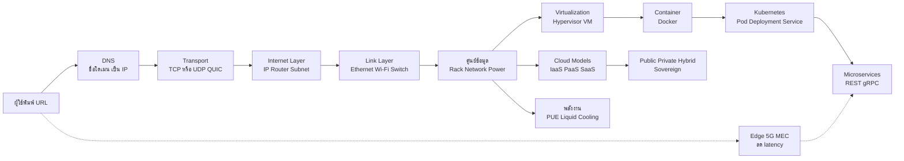

# ทบทวนเครือข่ายคอมพิวเตอร์และศูนย์ข้อมูล

> **หมวดหมู่:** เนื้อหาทบทวนก่อนสอบกลางภาค (Midterm Review)

## 🎯 ขอบเขตที่ต้องทบทวน

| สัปดาห์ | หัวข้อ | CLO |
| :--- | :--- | :--- |
| W6 | ประเภทเครือข่าย, OSI 7 ชั้น vs TCP/IP 4 ชั้น, IP/TCP/UDP/QUIC, DNS, DHCP, HTTP, subnet, อุปกรณ์เครือข่าย, cloud-native networking, Edge networks/5G, REST API | CLO1 |
| W7 | องค์ประกอบศูนย์ข้อมูล, virtualization (hypervisor), Docker/Kubernetes, IaaS/PaaS/SaaS, Public/Private/Hybrid/Sovereign Cloud, PUE, Liquid Cooling, Hyperscale | CLO2 |

**หลังทบทวนไฟล์นี้ ผู้เรียนควร:**
1. จัดโพรโทคอลเข้าชั้น OSI/TCP-IP และอธิบายสิ่งที่เกิดขึ้นเมื่อพิมพ์ URL ได้
2. เลือก TCP หรือ UDP ตามลักษณะงาน และคำนวณ subnet ขนาดเล็กได้
3. อธิบายความต่างของ VM, container และ Kubernetes รวมทั้งแยก IaaS/PaaS/SaaS ได้
4. คำนวณและตีความค่า PUE และอธิบายเหตุผลที่ศูนย์ข้อมูลยุค AI ต้องใช้ Liquid Cooling

> [!note] โจทย์บูรณาการที่เป็นไปได้
> "เว็บแอปเกมของนักศึกษา deploy บน cloud: อธิบายเส้นทางตั้งแต่ผู้เล่นพิมพ์ URL จนเห็นหน้าเว็บ แล้วบอกว่าแอปรันอยู่ในอะไร (VM/container) บนศูนย์ข้อมูลแบบใด" — ต้องเชื่อม W6 กับ W7 ให้ได้

## 🧠 สรุปแก่นความรู้ (Key Concepts Summary)

### 1. OSI vs TCP/IP

| OSI (7 ชั้น) | TCP/IP (4 ชั้น) | หน่วยข้อมูล (PDU) | ตัวอย่างโพรโทคอล/อุปกรณ์ |
| :--- | :--- | :--- | :--- |
| 7 Application / 6 Presentation / 5 Session | Application | data/message | HTTP, HTTPS (TLS), DNS, DHCP, SMTP |
| 4 Transport | Transport | segment (TCP) / datagram (UDP) | TCP, UDP, QUIC |
| 3 Network | Internet | packet | IPv4, IPv6, ICMP — **router** |
| 2 Data Link / 1 Physical | Link (Network Access) | frame / bits | Ethernet, Wi-Fi — **switch**, สาย, คลื่น |

**Encapsulation:** ข้อมูลจากชั้นบนถูกห่อด้วย header ของแต่ละชั้นขณะลงไปด้านล่าง และถูกแกะออกที่ปลายทาง

### 2. TCP vs UDP

| ประเด็น | TCP | UDP |
| :--- | :--- | :--- |
| การเชื่อมต่อ | connection-oriented (3-way handshake: SYN → SYN-ACK → ACK) | connectionless |
| ความน่าเชื่อถือ | รับประกันครบและเรียงลำดับ, ส่งซ้ำเมื่อหาย | ไม่รับประกัน |
| ควบคุม | flow control + congestion control | ไม่มี (แอปจัดการเอง) |
| Overhead / latency | สูงกว่า | ต่ำกว่า |
| เหมาะกับ | เว็บ, อีเมล, โอนไฟล์, ฐานข้อมูล | วิดีโอคอล, เกมออนไลน์, DNS query, สตรีมสด |

**QUIC** (ฐานของ HTTP/3) ทำงานบน UDP แต่สร้างความน่าเชื่อถือ การเข้ารหัส และ multiplexing ในตัว ลดเวลาเริ่มการเชื่อมต่อ

### 3. บริการพื้นฐานของอินเทอร์เน็ต
- **IP address:** IPv4 ยาว 32 บิต, IPv6 ยาว 128 บิต; **CIDR** เช่น `/24` = 24 บิตแรกเป็นส่วนเครือข่าย
- **DNS:** แปลงชื่อโดเมนเป็น IP (มักใช้ UDP port 53)
- **DHCP:** แจก IP, subnet mask, gateway, DNS ให้เครื่องอัตโนมัติ
- **HTTP/HTTPS:** port 80 / 443; HTTPS = HTTP บน TLS
- **ประเภทเครือข่าย:** PAN < LAN < MAN < WAN

### 4. Cloud-native, Edge และ API
- **Microservices** สื่อสารกันผ่าน **REST API** (HTTP methods: `GET` อ่าน, `POST` สร้าง, `PUT/PATCH` แก้, `DELETE` ลบ) หรือ **gRPC** (HTTP/2 + Protocol Buffers)
- **Service discovery** (หา service ปลายทางแม้ IP เปลี่ยน), **CNI/SDN** (เครือข่ายของ container ที่ควบคุมด้วยซอฟต์แวร์), **Service mesh** (จัดการ traffic, mTLS, observability ระหว่าง service)
- **Edge networks + 5G (MEC):** ย้ายการประมวลผลไปใกล้ผู้ใช้เพื่อลด latency — เชื่อม [[Edge Computing]]

### 5. ศูนย์ข้อมูลและ Virtualization
- **องค์ประกอบ:** rack/server, storage, network (spine-leaf), ไฟฟ้า (UPS, generator), ระบบทำความเย็น, ความปลอดภัยทางกายภาพ; Tier I–IV (Uptime Institute) บอกระดับความซ้ำซ้อนและความพร้อมใช้งาน
- **Hypervisor Type 1 (bare-metal):** ติดตั้งบนฮาร์ดแวร์ตรง เช่น VMware ESXi, Hyper-V, KVM — ใช้ในศูนย์ข้อมูล; **Type 2 (hosted):** รันบน OS เช่น VirtualBox — ใช้ทดสอบ/พัฒนา

### 6. Docker และ Kubernetes

| แนวคิด | ความหมาย |
| :--- | :--- |
| Image | แม่แบบอ่านอย่างเดียว สร้างจาก `Dockerfile` แบ่งเป็น layer |
| Container | instance ที่กำลังรันของ image |
| Registry | ที่เก็บ image เช่น Docker Hub |
| **Kubernetes** | ระบบ orchestration จัดการ container จำนวนมากบนคลัสเตอร์ |
| Pod | หน่วยเล็กที่สุดที่ Kubernetes deploy (มี container ≥ 1 ตัว) |
| Deployment / Service | กำหนดจำนวน replica และ rollout / ให้ endpoint คงที่และกระจายโหลด |

ความสามารถหลักของ Kubernetes: **self-healing, auto-scaling, load balancing, rolling update/rollback**

### 7. Cloud Service และ Deployment Models

| Model | ผู้ใช้ดูแล | ผู้ให้บริการดูแล | ตัวอย่าง |
| :--- | :--- | :--- | :--- |
| **IaaS** | OS, runtime, แอป, ข้อมูล | ฮาร์ดแวร์, เครือข่าย, virtualization | VM บน AWS EC2 |
| **PaaS** | แอปและข้อมูล | + OS และ runtime | Google App Engine, Heroku |
| **SaaS** | ข้อมูลและการตั้งค่าการใช้งาน | ทั้งระบบ | Gmail, Microsoft 365 |

- **Public** (multi-tenant, จ่ายตามใช้), **Private** (องค์กรเดียว ควบคุมสูง), **Hybrid** (ผสม), **Sovereign** (ข้อมูลและการดำเนินงานอยู่ภายใต้กฎหมายและเขตอำนาจของประเทศ)

### 8. พลังงานและความร้อน
$$\text{PUE} = \frac{\text{พลังงานรวมทั้งศูนย์ข้อมูล}}{\text{พลังงานของอุปกรณ์ IT}} \qquad \text{DCiE} = \frac{1}{\text{PUE}} \times 100\%$$
- **[[PUE]]** ต่ำสุดตามทฤษฎีคือ 1.0 (พลังงานทั้งหมดไปที่ IT) ส่วนเกินคือการทำความเย็นและการสูญเสียทางไฟฟ้า
- ชิป AI สมัยใหม่ใช้ไฟหลายร้อยวัตต์ถึงราว 1 kW ต่อชิป ทำให้ rack ร้อนเกินกว่าการระบายด้วยอากาศจะรับได้ → **[[Liquid Cooling]]**: direct-to-chip (ท่อของเหลวถึงแผ่นระบายบนชิป) และ immersion (จุ่มเซิร์ฟเวอร์ในของเหลวไม่นำไฟฟ้า)
- **Hyperscale:** ศูนย์ข้อมูลขนาดมหึมาของผู้ให้บริการคลาวด์ ใช้ฮาร์ดแวร์มาตรฐาน ระบบอัตโนมัติ และขยายแนวนอน (scale out)

## 🗺️ Concept Map

## 🧮 โจทย์ตัวอย่างพร้อมวิธีทำ (Worked Problems)

### โจทย์ 1: เกิดอะไรขึ้นเมื่อพิมพ์ `https://game.example.ac.th`
**วิธีทำ (ไล่ตามชั้น):**
1. **DHCP** (ทำไว้ก่อนแล้ว): เครื่องได้ IP, gateway และ DNS server
2. **DNS:** ถามหา IP ของ `game.example.ac.th` (มักใช้ UDP port 53)
3. **TCP 3-way handshake** กับ IP นั้นที่ port 443 (SYN → SYN-ACK → ACK)
4. **TLS handshake:** ตรวจ certificate และตกลงกุญแจเข้ารหัส
5. **HTTP request** `GET /` → load balancer ในศูนย์ข้อมูลส่งต่อไปยัง Pod ใน Kubernetes
6. แต่ละชั้นห่อข้อมูล (encapsulation) เป็น segment → packet → frame และ **router** ส่งต่อ packet ข้ามเครือข่ายตาม IP ปลายทาง
7. เซิร์ฟเวอร์ตอบ HTTP response (เช่น `200 OK` พร้อม HTML) เบราว์เซอร์แสดงผล

### โจทย์ 2: เลือก TCP หรือ UDP
**โจทย์:** (ก) ระบบส่งคะแนนสอบเข้าฐานข้อมูล (ข) เสียงในวิดีโอคอล (ค) ตำแหน่งผู้เล่นในเกมยิงออนไลน์ที่ส่ง 60 ครั้ง/วินาที (ง) ดาวน์โหลดไฟล์ติดตั้งโปรแกรม

**วิธีทำ:** ถามว่า "ข้อมูลหายได้ไหม" และ "ข้อมูลเก่ายังมีค่าหรือไม่"
- (ก) ห้ามหาย ห้ามผิดลำดับ → **TCP**
- (ข) ต้องการ latency ต่ำ เสียงที่มาช้าไม่มีประโยชน์ → **UDP**
- (ค) ตำแหน่งใหม่มาแทนตำแหน่งเก่าทุก ~16.7 ms การส่งซ้ำของเก่าเสียเวลาเปล่า → **UDP**
- (ง) ไฟล์ต้องครบทุกไบต์ → **TCP**

### โจทย์ 3: คำนวณ Subnet
**โจทย์:** เครือข่าย `192.168.10.0/26` มี subnet mask เท่าใด รองรับกี่ host และ IP ใดใช้ได้

**วิธีทำ:**
1. `/26` → 26 บิตแรกเป็น network → mask = `11111111.11111111.11111111.11000000` = **255.255.255.192**
2. บิต host = $32 - 26 = 6$ → จำนวนที่อยู่ $2^6 = 64$
3. host ที่ใช้ได้ $= 2^6 - 2 = 62$ (ลบ network address และ broadcast address)
4. Network = `192.168.10.0`, Broadcast = `192.168.10.63`, Host = **`192.168.10.1` – `192.168.10.62`**
5. Subnet ถัดไปเริ่มที่ `192.168.10.64/26`

### โจทย์ 4: คำนวณ PUE และพลังงานที่ประหยัดได้
**โจทย์:** ศูนย์ข้อมูลมีโหลด IT คงที่ 1,000 kW ใช้พลังงานรวม 1,500 kW (ระบายความร้อนด้วยอากาศ) หากเปลี่ยนเป็น immersion cooling แล้ว PUE เหลือ 1.05 จงหา (ก) PUE เดิม (ข) DCiE เดิม (ค) พลังงานที่ประหยัดได้ต่อปี

**วิธีทำ:**
- (ก) $\text{PUE} = \dfrac{1{,}500}{1{,}000} = 1.50$
- (ข) $\text{DCiE} = \dfrac{1}{1.50} \times 100\% \approx 66.7\%$ (มีเพียงราว 2 ใน 3 ของไฟฟ้าที่ไปถึงอุปกรณ์ IT)
- (ค) พลังงานรวมใหม่ $= 1.05 \times 1{,}000 = 1{,}050$ kW → ลดลง $1{,}500 - 1{,}050 = 450$ kW (ลดพลังงานรวม $450/1{,}500 = 30\%$)
$$450\ \text{kW} \times 8{,}760\ \text{h/ปี} = 3{,}942{,}000\ \text{kWh/ปี}$$
- **ข้อสังเกต:** PUE วัด "ประสิทธิภาพของสิ่งอำนวยความสะดวก" ไม่ได้วัดว่าเซิร์ฟเวอร์ทำงานคุ้มค่าเพียงใด ถ้าเซิร์ฟเวอร์ใช้งานต่ำ PUE ก็ยังดูดีได้

### โจทย์ 5: เลือก Cloud Service Model
**โจทย์:** (ก) ทีมอยากควบคุม OS เองเพื่อติดตั้ง GPU driver เฉพาะ (ข) นักศึกษาอยาก push โค้ด Node.js แล้วได้ URL ทันทีโดยไม่ดูแลเซิร์ฟเวอร์ (ค) คณะต้องการระบบอีเมลพร้อมใช้ (ง) หน่วยงานสาธารณสุขต้องเก็บข้อมูลผู้ป่วยภายใต้กฎหมายไทยเท่านั้น

**วิธีทำ:** (ก) **IaaS** — ได้ VM และดูแล OS เอง (ข) **PaaS** — ผู้ให้บริการดูแล OS/runtime (ค) **SaaS** — ใช้แอปสำเร็จรูป (ง) **Sovereign Cloud** (หรือ private cloud ในประเทศ) — ตอบโจทย์อธิปไตยของข้อมูลและ [[PDPA]]

## ⚠️ จุดที่มักตอบผิด
- **ใส่ switch กับ router ผิดชั้น** — switch ทำงานชั้น 2 (MAC/frame) ส่วน router ทำงานชั้น 3 (IP/packet)
- **"UDP แย่กว่า TCP"** — UDP ไม่ได้แย่ แต่เหมาะกับงานที่ต้องการความเร็วมากกว่าความครบถ้วน และ HTTP/3 ก็อยู่บน UDP (ผ่าน QUIC)
- **ลืมลบ 2** เวลาหาจำนวน host ใน subnet
- **"DNS ทำหน้าที่แจก IP"** — ผิด นั่นคือ DHCP; DNS แปลงชื่อเป็น IP
- **สลับตัวเศษ/ตัวส่วนของ PUE** — PUE = รวม ÷ IT จึงมีค่า ≥ 1 เสมอ ถ้าคำนวณได้น้อยกว่า 1 แปลว่าสลับกัน
- **"Kubernetes คือ container runtime"** — Kubernetes เป็นระบบ orchestration ที่สั่งงาน runtime (เช่น containerd) อีกชั้นหนึ่ง
- **"Sovereign cloud = private cloud"** — sovereign เน้นเขตอำนาจกฎหมายและผู้ดำเนินการในประเทศ ไม่จำเป็นต้องเป็นขององค์กรเดียว

## ✍️ แบบฝึกหัดทบทวน

**1. (ปรนัย)** โพรโทคอลใดทำงานในชั้น Transport
ก. IP ข. HTTP ค. UDP ง. Ethernet

ดูเฉลย

**ค.** UDP (และ TCP) อยู่ชั้น Transport, IP อยู่ชั้น Internet/Network, HTTP อยู่ชั้น Application, Ethernet อยู่ชั้น Link

**2. (ปรนัย)** ลำดับ 3-way handshake ของ TCP ที่ถูกต้องคือ
ก. ACK → SYN → SYN-ACK ข. SYN → SYN-ACK → ACK ค. SYN → ACK → FIN ง. SYN-ACK → SYN → ACK

ดูเฉลย

**ข.** SYN → SYN-ACK → ACK

**3. (ปรนัย)** ศูนย์ข้อมูลใช้พลังงานรวม 2.4 MW โดยอุปกรณ์ IT ใช้ 2.0 MW ค่า PUE เท่าใด
ก. 0.83 ข. 1.2 ค. 1.4 ง. 4.4

ดูเฉลย

**ข.** $2.4 / 2.0 = 1.2$ (ข้อ ก. คือการสลับตัวเศษและตัวส่วน)

**4. (ปรนัย)** ผู้ใช้บริการต้องดูแล OS เองในโมเดลใด
ก. SaaS ข. PaaS ค. IaaS ง. ไม่มีโมเดลใด

ดูเฉลย

**ค.** IaaS

**5. (อัตนัยสั้น)** เครือข่าย `10.0.5.0/28` มีจำนวน host ที่ใช้งานได้กี่เครื่อง และ broadcast address คืออะไร

ดูเฉลย

host bits $= 32 - 28 = 4$ → $2^4 - 2 = 14$ เครื่อง; ช่วง `10.0.5.0`–`10.0.5.15` จึงมี broadcast = `10.0.5.15` และ host = `10.0.5.1`–`10.0.5.14`

**6. (อัตนัยสั้น)** อธิบายความต่างระหว่าง Docker image กับ container

ดูเฉลย

image คือแม่แบบอ่านอย่างเดียวที่สร้างจาก Dockerfile (เป็น layer) ส่วน container คือ instance ที่กำลังรันของ image นั้น สร้างหลาย container จาก image เดียวได้

**7. (อัตนัยสั้น)** ระบุความสามารถของ Kubernetes 3 ข้อ

ดูเฉลย

self-healing (รีสตาร์ท/แทนที่ container ที่ล้ม), auto-scaling (เพิ่ม/ลด replica ตามโหลด), load balancing, rolling update และ rollback (ตอบ 3 ข้อใดก็ได้)

**8. (วิเคราะห์)** เหตุใดศูนย์ข้อมูลที่รันงานเทรน AI จึงหันมาใช้ Liquid Cooling และส่งผลต่อ PUE อย่างไร

ดูเฉลย

ชิป AI ใช้พลังงานและปล่อยความร้อนสูงมาก ความหนาแน่นต่อ rack เกินขีดจำกัดของการระบายด้วยอากาศ ของเหลวนำความร้อนได้ดีกว่าอากาศมาก จึงถ่ายเทความร้อนได้ตรงจุด ลดพลังงานที่ต้องใช้กับพัดลมและเครื่องปรับอากาศ ทำให้พลังงานส่วนที่ไม่ใช่ IT ลดลง ค่า PUE จึงเข้าใกล้ 1.0 มากขึ้น

## 🔗 อ่านทบทวนเพิ่มเติม
- [[Week 06 - Computer Networks & Internet]] · [[Week 07 - Data Center & Cloud Infrastructure]]
- แนวคิด: [[TCP-IP Model]] · [[Edge Computing]] · [[PUE]] · [[Liquid Cooling]] · [[Zero-Trust Architecture]] · [[PDPA]]
- เชื่อมโยง: [[Week 02 - Hardware & Software Ecosystems]] (VM vs container, Green Computing) · กลับหน้า [[Week 08 - Midterm Examination]]

## 📚 แหล่งอ้างอิง
1. Eddy, W. (Ed.). (2022). *RFC 9293: Transmission Control Protocol (TCP).* IETF. [rfc-editor.org](https://www.rfc-editor.org/rfc/rfc9293) · Postel, J. (1980). *RFC 768: User Datagram Protocol.* [rfc-editor.org](https://www.rfc-editor.org/rfc/rfc768)
2. Iyengar, J., & Thomson, M. (Eds.). (2021). *RFC 9000: QUIC.* IETF. [rfc-editor.org](https://www.rfc-editor.org/rfc/rfc9000) · Mockapetris, P. (1987). *RFC 1035: Domain Names — Implementation and Specification.* [rfc-editor.org](https://www.rfc-editor.org/rfc/rfc1035) · Fuller, V., & Li, T. (2006). *RFC 4632: CIDR.* [rfc-editor.org](https://www.rfc-editor.org/rfc/rfc4632)
3. Mell, P., & Grance, T. (2011). *The NIST Definition of Cloud Computing* (NIST SP 800-145). [NIST CSRC](https://csrc.nist.gov/pubs/sp/800/145/final)
4. The Green Grid. (2014). *PUE: A Comprehensive Examination of the Metric.* [thegreengrid.org](https://www.thegreengrid.org/en/resources/library-and-tools/20-PUE%3A-A-Comprehensive-Examination-of-the-Metric)
5. Kubernetes Documentation. *Overview* และ *Pods.* [kubernetes.io](https://kubernetes.io/docs/concepts/overview/) · [pods](https://kubernetes.io/docs/concepts/workloads/pods/) · Docker Docs. *Docker overview.* [docs.docker.com](https://docs.docker.com/get-started/docker-overview/)
6. Kurose, J. F., & Ross, K. W. (2021). *Computer Networking: A Top-Down Approach* (8th ed.). Pearson.
