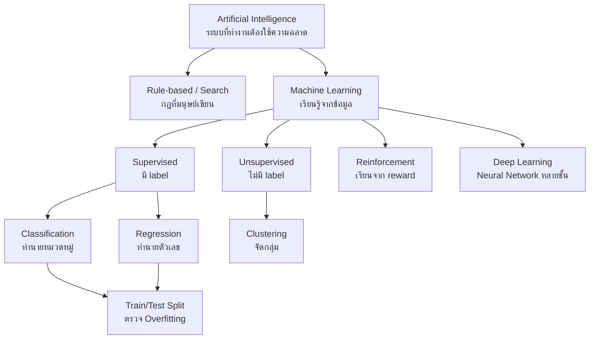

# แนวคิดพื้นฐานของ AI และ Machine Learning (AI & Machine Learning Fundamentals)

> **หมวดหมู่:** เนื้อหาเชิงลึกประกอบการเรียนรู้ (Deep Dive Learning Content)

## 🎯 สิ่งที่จะได้เรียนรู้

- แยกความแตกต่างระหว่าง **Artificial Intelligence (AI)**, **Machine Learning (ML)** และ **Deep Learning (DL)** ได้
- อธิบายนิยาม "การเรียนรู้" ของ Tom Mitchell ในรูป **Task (T), Performance (P), Experience (E)** ได้
- จำแนกโจทย์ว่าเป็น **supervised, unsupervised หรือ reinforcement learning** พร้อมยกตัวอย่าง
- ระบุ **feature** และ **label** ในชุดข้อมูล และอธิบายเหตุผลของการแบ่ง **train/test**
- อธิบายปัญหา **overfitting** และ **underfitting** ได้ด้วยภาษาของตนเอง
- ฝึก classifier ตัวแรกด้วย scikit-learn บน Google Colab

## 📖 เนื้อหาและคำอธิบาย

### 1. AI, ML และ DL: วงกลมซ้อนกัน

ลองนึกภาพ **ตุ๊กตาแม่ลูกดก (Matryoshka)** ที่ตัวใหญ่ครอบตัวเล็ก

- **AI** คือวงใหญ่สุด หมายถึงการสร้างระบบที่ทำงานซึ่งปกติต้องอาศัยความฉลาดของมนุษย์ เช่น วางแผน ให้เหตุผล เข้าใจภาษา มองเห็น ตำรา *Artificial Intelligence: A Modern Approach* (Russell & Norvig) มอง AI ว่าเป็นการศึกษา **agent** ที่รับรู้สภาพแวดล้อมและเลือกกระทำเพื่อให้บรรลุเป้าหมายได้ดีที่สุด
- **ML** คือวงกลางที่อยู่ใน AI: แทนที่จะเขียนกฎทุกข้อด้วยมือ เราให้คอมพิวเตอร์ **เรียนรู้รูปแบบ (pattern) จากข้อมูล**
- **DL** คือวงในสุดที่อยู่ใน ML: ใช้ **โครงข่ายประสาทเทียมหลายชั้น (deep neural networks)** เรียนรู้ feature เองจากข้อมูลดิบ เช่น ภาพ เสียง ข้อความ

> [!note] AI ไม่จำเป็นต้องเป็น ML เสมอ
> ระบบผู้เชี่ยวชาญ (expert system) ที่ใช้กฎ IF-THEN ซึ่งมนุษย์เขียนไว้ หรือโปรแกรมหมากรุกที่ใช้การค้นหา (search) ล้วน ๆ ก็นับเป็น AI ได้ แม้จะไม่ได้ "เรียนรู้" จากข้อมูลเลย

**Narrow AI กับ General AI:** ระบบ AI ที่ใช้งานจริงทุกวันนี้เป็น *narrow AI* คือเก่งเฉพาะงาน (แปลภาษา จดจำใบหน้า แนะนำสินค้า) ส่วน *general AI (AGI)* ที่ทำได้ทุกงานเหมือนมนุษย์ยังเป็นเป้าหมายเชิงวิจัยและเป็นประเด็นถกเถียงในวงการ

### 2. การเขียนโปรแกรมแบบเดิม vs Machine Learning

| ประเด็น | การเขียนโปรแกรมแบบดั้งเดิม | Machine Learning |
|---|---|---|
| Input | ข้อมูล + **กฎ** ที่มนุษย์เขียน | ข้อมูล + **คำตอบตัวอย่าง** |
| Output | คำตอบ | **โมเดล** (กฎที่เรียนรู้ได้) |
| เหมาะกับ | กฎชัดเจน เช่น คำนวณภาษี | กฎซับซ้อนหรือเขียนไม่ได้ เช่น แยกภาพแมว/สุนัข |
| เมื่อโลกเปลี่ยน | ต้องแก้โค้ดเอง | ฝึกใหม่ด้วยข้อมูลใหม่ (retrain) |

### 3. นิยามของ Tom Mitchell: T, P, E

Tom Mitchell (หนังสือ *Machine Learning*, 1997) ให้นิยามที่ถูกอ้างถึงบ่อยที่สุดนิยามหนึ่ง ใจความคือ โปรแกรมคอมพิวเตอร์ "เรียนรู้" จากประสบการณ์ **E** ในงาน **T** ที่วัดด้วย **P** ถ้าประสิทธิภาพในงาน T (วัดด้วย P) ดีขึ้นเมื่อได้ประสบการณ์ E เพิ่มขึ้น

ตัวอย่าง ระบบกรอง spam:
- **T (Task):** จำแนกอีเมลว่าเป็น spam หรือไม่
- **P (Performance):** สัดส่วนอีเมลที่จำแนกถูก (accuracy)
- **E (Experience):** อีเมลเก่าที่ผู้ใช้กด "รายงาน spam" ไว้แล้ว

### 4. สามรูปแบบหลักของการเรียนรู้

| รูปแบบ | ข้อมูลที่ได้ | เป้าหมาย | ตัวอย่างงาน | เปรียบเทียบ |
|---|---|---|---|---|
| **Supervised** | มี feature **และ label** | ทำนาย label ของข้อมูลใหม่ | ทำนายราคาบ้าน (regression), แยก spam (classification) | เรียนกับครูที่มีเฉลย |
| **Unsupervised** | มีแต่ feature ไม่มี label | หาโครงสร้าง/กลุ่มที่ซ่อนอยู่ | แบ่งกลุ่มลูกค้า (clustering), ลดมิติข้อมูล | จัดหนังสือกองใหญ่เป็นหมวดเองโดยไม่มีป้ายบอก |
| **Reinforcement** | สถานะ, การกระทำ, **รางวัล (reward)** | หานโยบาย (policy) ที่ได้รางวัลรวมสูงสุด | เล่นเกม, ควบคุมหุ่นยนต์เดิน | ฝึกสุนัขด้วยขนม |

ใน supervised learning ยังแบ่งย่อยได้เป็น
- **Classification** — label เป็นหมวดหมู่ เช่น "สุก/ดิบ", "setosa/versicolor/virginica"
- **Regression** — label เป็นตัวเลขต่อเนื่อง เช่น อุณหภูมิพรุ่งนี้ 31.4 °C (ตรงกับ Lab 09 ที่ใช้ Linear Regression)


ใน unsupervised learning นอกจาก clustering และการลดมิติแล้ว ยังมีงานสำคัญอีกอย่างคือ

#### การตรวจจับความผิดปกติ (Anomaly Detection)

**Anomaly Detection** คือการหาข้อมูลที่ "แตกต่างจากรูปแบบปกติ" อย่างมีนัยสำคัญ (outlier) โดยมากทำแบบ **unsupervised** เพราะในงานจริงเรามักมีข้อมูลปกติจำนวนมาก แต่แทบไม่มีตัวอย่างความผิดปกติที่ติด label ไว้ โมเดลจึงเรียนรู้ว่า "ปกติหน้าตาเป็นอย่างไร" แล้วแจ้งเตือนเมื่อข้อมูลใหม่อยู่ห่างจากรูปแบบนั้น

- **ตรวจจับการโกงบัตรเครดิต (fraud detection) โดยไม่มี label** — รายการที่ยอดเงิน เวลา หรือประเทศต่างจากพฤติกรรมเดิมของผู้ถือบัตรมาก เช่น ปกติใช้จ่าย 200–500 บาทในขอนแก่น แต่จู่ ๆ มีรายการ 45,000 บาทจากต่างประเทศตอนตีสาม
- **ตรวจจับเซนเซอร์เสียใน IoT** — เซนเซอร์อุณหภูมิในห้องเรียนที่ปกติอ่านได้ 25–32 °C แต่ส่งค่า 85 °C หรือค่าคงที่เดิมซ้ำนานหลายชั่วโมง (เชื่อมกับ Week 11)
- อื่น ๆ: ตรวจจับการบุกรุกเครือข่าย (intrusion detection), ตรวจหาชิ้นงานบกพร่องในสายการผลิต

อัลกอริทึมที่พบบ่อย: Isolation Forest, One-Class SVM, Local Outlier Factor (LOF), Autoencoder และวิธีสถิติอย่าง z-score

```python
# ตัวอย่าง: หาค่าผิดปกติของเซนเซอร์อุณหภูมิด้วย Isolation Forest (ไม่ใช้ label)
import numpy as np
from sklearn.ensemble import IsolationForest

temps = np.array([27.1, 27.4, 28.0, 27.8, 85.0, 27.6, 28.2, 27.9, -5.0, 27.5]).reshape(-1, 1)
model = IsolationForest(contamination=0.2, random_state=42).fit(temps)
print(model.predict(temps))   # 1 = ปกติ, -1 = ผิดปกติ
```

ผลลัพธ์ (ตัวอย่าง):

```output
[ 1  1  1  1 -1  1  1  1 -1  1]
```

*คำอธิบาย:* `contamination=0.2` คือสมมติว่ามีข้อมูลผิดปกติราว 20% โมเดลแยกค่า 85.0 และ -5.0 ออกมาได้ เพราะ "แยกออกจากกลุ่มได้ง่าย" (ใช้การแบ่งแบบสุ่มน้อยครั้ง) โดยไม่ต้องบอกล่วงหน้าว่าค่าใดผิด

#### สรุปประเภทงาน (Task Types) ของ ML

| ประเภทงาน | รูปแบบการเรียนรู้ | ผลลัพธ์ | ตัวอย่าง |
|---|---|---|---|
| **Classification** | Supervised | หมวดหมู่ (discrete) | แยกอีเมล spam/ไม่ใช่ spam, จำแนกพันธุ์ดอก Iris |
| **Regression** | Supervised | ตัวเลขต่อเนื่อง | ทำนายราคาบ้าน, ทำนายอุณหภูมิพรุ่งนี้ |
| **Clustering** | Unsupervised | กลุ่มที่ค้นพบเอง | แบ่งกลุ่มลูกค้าตามพฤติกรรมซื้อ |
| **Anomaly Detection** | Unsupervised (ส่วนใหญ่) | ปกติ / ผิดปกติ หรือคะแนนความผิดปกติ | ตรวจจับการโกงบัตรเครดิต, เซนเซอร์ IoT เสีย |
| **Dimensionality Reduction** | Unsupervised | ข้อมูลที่มีจำนวน feature น้อยลง | ใช้ PCA ลดข้อมูล 100 feature เหลือ 2 มิติเพื่อพล็อตกราฟ |

> [!warning] Anomaly Detection ≠ Classification เสมอไป
> ถ้ามี label "โกง/ไม่โกง" จำนวนมากพอ ก็ทำเป็น supervised classification ได้ แต่ในทางปฏิบัติตัวอย่างการโกงมีน้อยมาก (imbalanced) และรูปแบบการโกงใหม่ ๆ ไม่เคยมี label มาก่อน จึงนิยมใช้ anomaly detection แบบ unsupervised ร่วมด้วย

<details><summary>ดูเฉลย: โรงงานต้องการรู้ว่าเครื่องจักรเครื่องใดสั่นผิดปกติ โดยไม่มีประวัติว่าเคยเสียเมื่อไร ควรใช้งานประเภทใด</summary>

**Anomaly Detection (unsupervised)** — เพราะไม่มี label ว่าข้อมูลใดคือ "เสีย" โมเดลเรียนรู้รูปแบบการสั่นปกติจากข้อมูลเซนเซอร์ แล้วแจ้งเตือนเมื่อค่าเบี่ยงออกจากรูปแบบนั้น
</details>

### 5. Feature, Label, Model และ Prediction

ลองนึกถึงโจทย์ **แยกผลไม้** จากน้ำหนักและสี

| น้ำหนัก (g) | ค่าสี (0 = เขียว, 1 = แดง) | ชนิด (label) |
|---|---|---|
| 150 | 0.9 | แอปเปิล |
| 120 | 0.1 | มะนาว |
| 160 | 0.8 | แอปเปิล |

- **Feature (X):** คุณลักษณะที่ใช้ทำนาย คือ น้ำหนักและค่าสี
- **Label (y):** คำตอบที่ต้องการทำนาย คือ ชนิดผลไม้
- **Model:** ฟังก์ชัน $\hat{y} = f(X)$ ที่เรียนรู้จากข้อมูล
- **Training:** ขั้นตอนที่โมเดลปรับพารามิเตอร์ของตัวเองจากข้อมูลที่มี label
- **Inference / Prediction:** ขั้นตอนนำโมเดลที่ฝึกแล้วไปทำนายข้อมูลใหม่

### 6. ทำไมต้องแบ่ง Train/Test

ถ้าครูออกข้อสอบซ้ำกับแบบฝึกหัดทุกข้อ นักเรียนที่ **ท่องจำ** ก็ได้คะแนนเต็ม แต่ไม่ได้แปลว่าเข้าใจ ML ก็เช่นกัน เราจึงแบ่งข้อมูล
- **Training set** (เช่น 80%) ใช้ฝึกโมเดล
- **Test set** (เช่น 20%) เก็บไว้ไม่ให้โมเดลเห็น ใช้วัดผลตอนท้ายเหมือน "ข้อสอบจริง"
- หลายงานแบ่งเพิ่มเป็น **validation set** หรือใช้ **cross-validation** เพื่อเลือก hyperparameter โดยไม่แตะ test set

ตัววัดพื้นฐานของ classification คือ accuracy

$$\text{Accuracy} = \frac{\text{จำนวนที่ทำนายถูก}}{\text{จำนวนตัวอย่างทั้งหมด}}$$

### 7. Overfitting และ Underfitting

| สภาวะ | อาการ | เปรียบเทียบ | แนวทางแก้ |
|---|---|---|---|
| **Underfitting** | แย่ทั้ง train และ test | อ่านหนังสือน้อยเกินไป | ใช้โมเดลที่ซับซ้อนขึ้น เพิ่ม feature ที่มีความหมาย |
| **Good fit** | ดีทั้ง train และ test ใกล้เคียงกัน | เข้าใจหลักการจริง | — |
| **Overfitting** | train ดีมาก แต่ test แย่ลง | ท่องเฉลยจนจำ noise | เพิ่มข้อมูล ลดความซับซ้อน ใช้ regularization |

> [!tip] สัญญาณเตือน
> ถ้า accuracy บน training set ใกล้ 100% แต่บน test set ต่ำกว่าชัดเจน ให้สงสัย overfitting ไว้ก่อน

## 🧩 ตัวอย่างประกอบ / Worked Example

**โจทย์:** จำแนกพันธุ์ดอก Iris (3 พันธุ์) จาก feature 4 ตัว คือ ความยาว/ความกว้างของกลีบเลี้ยง (sepal) และกลีบดอก (petal) ชุดข้อมูลนี้มี 150 ตัวอย่าง และมีมาให้ใน scikit-learn

**ขั้นตอน**
1. โหลดข้อมูล แยก X (feature) และ y (label)
2. แบ่ง train 80% / test 20% (`stratify=y` เพื่อให้สัดส่วนแต่ละพันธุ์เท่ากันทั้งสองชุด)
3. ฝึก Decision Tree และ K-Nearest Neighbors (KNN)
4. วัด accuracy บน test set
5. ทดลองดู overfitting ด้วย tree ที่ไม่จำกัดความลึก
6. ทำนายดอกไม้ใหม่ (inference)

```python
# รันได้ใน Google Colab (scikit-learn ติดตั้งมาให้แล้ว)
from sklearn.datasets import load_iris
from sklearn.model_selection import train_test_split
from sklearn.tree import DecisionTreeClassifier
from sklearn.neighbors import KNeighborsClassifier
from sklearn.metrics import accuracy_score

# 1) โหลดข้อมูล: X = feature, y = label
iris = load_iris()
X, y = iris.data, iris.target
print("ขนาดข้อมูล:", X.shape)
print("ชื่อ feature:", iris.feature_names)
print("ชื่อ class:", [str(n) for n in iris.target_names])

# 2) แบ่ง train/test แบบ 80/20 โดยรักษาสัดส่วน class
X_train, X_test, y_train, y_test = train_test_split(
    X, y, test_size=0.2, random_state=42, stratify=y)
print("train:", X_train.shape[0], "| test:", X_test.shape[0])

# 3) ฝึกโมเดล 2 แบบ
tree = DecisionTreeClassifier(max_depth=3, random_state=42)  # จำกัดความลึกไว้ 3 ชั้น
tree.fit(X_train, y_train)
knn = KNeighborsClassifier(n_neighbors=5)                    # ดูเพื่อนบ้านใกล้สุด 5 ตัว
knn.fit(X_train, y_train)

# 4) วัดผลบน test set (ข้อมูลที่โมเดลไม่เคยเห็น)
print(f"Decision Tree accuracy: {accuracy_score(y_test, tree.predict(X_test)):.3f}")
print(f"KNN (k=5) accuracy:     {accuracy_score(y_test, knn.predict(X_test)):.3f}")

# 5) tree ไม่จำกัดความลึก: จำ training set ได้หมด แต่ test ไม่ได้ดีขึ้น
deep = DecisionTreeClassifier(random_state=42).fit(X_train, y_train)
print(f"Tree ไม่จำกัดความลึก -> train {deep.score(X_train, y_train):.3f} / test {deep.score(X_test, y_test):.3f}")

# 6) inference: ทำนายดอกไม้ใหม่ [sepal_len, sepal_wid, petal_len, petal_wid]
new_flower = [[5.1, 3.5, 1.4, 0.2]]
print("ดอกใหม่ทำนายว่าเป็น:", iris.target_names[tree.predict(new_flower)[0]])
```

```output
ขนาดข้อมูล: (150, 4)
ชื่อ feature: ['sepal length (cm)', 'sepal width (cm)', 'petal length (cm)', 'petal width (cm)']
ชื่อ class: ['setosa', 'versicolor', 'virginica']
train: 120 | test: 30
Decision Tree accuracy: 0.967
KNN (k=5) accuracy:     1.000
Tree ไม่จำกัดความลึก -> train 1.000 / test 0.933
ดอกใหม่ทำนายว่าเป็น: setosa
```

**ตีความผล**
- Decision Tree ทำนายผิด 1 จาก 30 ตัวอย่าง: $\frac{29}{30} \approx 0.967$
- Tree ที่ไม่จำกัดความลึกได้ train = 1.000 แต่ test = 0.933 ต่ำกว่า tree ที่จำกัดความลึก เป็นตัวอย่างเล็ก ๆ ของ overfitting
- test set มีเพียง 30 ตัวอย่าง ผลต่างระดับ 1–2 ตัวอย่างอาจเกิดจากการสุ่มแบ่งข้อมูล ควรยืนยันด้วย cross-validation ก่อนสรุปว่าโมเดลใดดีกว่า (ตัวเลขอาจต่างเล็กน้อยตามเวอร์ชันของ scikit-learn)

## 🗺️ แผนภาพสรุป



## ⚠️ ความเข้าใจผิดที่พบบ่อย

- **"AI = ML = ChatGPT"** — AI กว้างกว่ามาก ML เป็นส่วนหนึ่งของ AI และ LLM อย่าง ChatGPT เป็นเพียงแอปพลิเคชันหนึ่งของ deep learning
- **"accuracy สูงบน training set แปลว่าโมเดลดี"** — ต้องดูบน test set ที่โมเดลไม่เคยเห็น
- **"ข้อมูลยิ่งเยอะยิ่งดีเสมอ"** — ข้อมูลที่มากแต่ผิด ลำเอียง หรือไม่ตรงกับสถานการณ์จริง ทำให้โมเดลเรียนรู้สิ่งผิด ๆ (garbage in, garbage out)
- **"Unsupervised learning ไม่ต้องใช้มนุษย์เลย"** — มนุษย์ยังต้องเลือก feature กำหนดจำนวนกลุ่ม และตีความว่าแต่ละกลุ่มหมายถึงอะไร
- **"โมเดลเข้าใจโลกเหมือนคน"** — โมเดลเรียนรู้ความสัมพันธ์เชิงสถิติจากข้อมูล ไม่ได้เข้าใจเหตุและผลโดยอัตโนมัติ

## 🔗 เชื่อมโยงกับรายวิชา

- แผนการสอน: [[Week 09 - AI & Machine Learning Foundations]] · ภาพรวมสัปดาห์: [[Learning Content Week 09 - ปัญญาประดิษฐ์และการเรียนรู้ของเครื่อง]]
- พื้นฐานอัลกอริทึมและการเขียนโปรแกรม: [[Week 04 - Algorithms & Programming Paradigms]], [[Big-O Notation]]
- ข้อมูลที่ใช้ฝึกโมเดลมาจากระบบฐานข้อมูล: [[Week 05 - Database & Data Management]]
- ต่อยอดสู่ Generative AI และ LLM: [[Week 10 - Generative AI & Modern Robotics]], [[RAG และ LLM]]
- นำโมเดลไปใช้จริงและดูแลต่อเนื่อง: [[MLOps]] · บนอุปกรณ์ขนาดเล็ก: [[TinyML และ Edge AI]]
- อคติและความรับผิดชอบของ AI: [[Week 13 - Computer Ethics & Intellectual Property]]
- **Mini-Project 3 (Smart Environment Monitor):** ใน [[Lab 09 - ML Basics and IoT Architecture]] ผู้เรียนจะใช้ regression กับค่าจากเซนเซอร์ (เช่น อุณหภูมิ/ความชื้น) ให้ลองระบุ T, P, E และ feature/label ของโปรเจกต์กลุ่มตนเองก่อนเริ่มเขียนโค้ด

## ❓ คำถามทบทวน

1. ระบบแนะนำวิดีโอบน YouTube ให้ระบุ T, P และ E ตามนิยามของ Mitchell

<details><summary>ดูแนวคำตอบ</summary>

T: เลือกวิดีโอที่ผู้ใช้น่าจะดูต่อ · P: เช่น อัตราการคลิกหรือเวลาที่ผู้ใช้ดูวิดีโอที่ถูกแนะนำ · E: ประวัติการดู การกดถูกใจ และการข้ามวิดีโอของผู้ใช้ (คำตอบต่างกันได้ แต่ต้องครบสามส่วนและ P ต้องวัดได้จริง)
</details>

2. จงจำแนกโจทย์ต่อไปนี้ว่าเป็น supervised, unsupervised หรือ reinforcement: (ก) ทำนายค่าไฟเดือนหน้า (ข) แบ่งกลุ่มนักศึกษาตามพฤติกรรมการใช้ LMS (ค) สอนโดรนให้บินรักษาระดับ

<details><summary>ดูแนวคำตอบ</summary>

(ก) supervised แบบ regression เพราะมีค่าไฟจริงในอดีตเป็น label (ข) unsupervised แบบ clustering เพราะไม่มีป้ายกำกับกลุ่มล่วงหน้า (ค) reinforcement learning เพราะเรียนจาก reward เช่น ได้คะแนนเมื่อบินนิ่ง
</details>

3. training กับ inference ต่างกันอย่างไร

<details><summary>ดูแนวคำตอบ</summary>

training คือการปรับพารามิเตอร์ของโมเดลจากข้อมูลที่มี label ใช้ทรัพยากรมากและทำเป็นรอบ ๆ ส่วน inference คือการใช้โมเดลที่ฝึกเสร็จแล้วทำนายข้อมูลใหม่ ซึ่งเกิดขึ้นบ่อยในระบบจริงและมักต้องตอบเร็ว
</details>

4. โมเดลหนึ่งได้ accuracy บน train 99% แต่บน test 70% เกิดอะไรขึ้น และควรแก้อย่างไร

<details><summary>ดูแนวคำตอบ</summary>

เป็นอาการ overfitting โมเดลจำรายละเอียดและ noise ของ training set แก้ได้โดยลดความซับซ้อนของโมเดล (เช่น จำกัด `max_depth`) เพิ่มข้อมูล ใช้ regularization หรือเลือกโมเดลด้วย cross-validation
</details>

5. ทำไมไม่ควรใช้ test set ในการเลือก hyperparameter

<details><summary>ดูแนวคำตอบ</summary>

ถ้าปรับโมเดลตามผล test set ซ้ำ ๆ test set จะกลายเป็นส่วนหนึ่งของการฝึกทางอ้อม ผลที่รายงานจะดีเกินจริง ควรใช้ validation set หรือ cross-validation แทน และเก็บ test set ไว้ประเมินครั้งสุดท้ายเท่านั้น
</details>

## 📚 แหล่งอ้างอิง

1. Russell, S. & Norvig, P. *Artificial Intelligence: A Modern Approach* (4th ed.). Pearson. เว็บไซต์ตำรา: <https://aima.cs.berkeley.edu/>
2. Mitchell, T. M. (1997). *Machine Learning*. McGraw-Hill. หน้าหนังสือ: <https://www.cs.cmu.edu/~tom/mlbook.html>
3. Google for Developers. *Introduction to Machine Learning: What is ML?* <https://developers.google.com/machine-learning/intro-to-ml/what-is-ml>
4. Google for Developers. *Machine Learning Crash Course: Overfitting.* <https://developers.google.com/machine-learning/crash-course/overfitting>
5. scikit-learn documentation. *Cross-validation: evaluating estimator performance* และ *The Iris Dataset.* <https://scikit-learn.org/stable/modules/cross_validation.html> · <https://scikit-learn.org/stable/auto_examples/datasets/plot_iris_dataset.html>
6. Géron, A. (2022). *Hands-On Machine Learning with Scikit-Learn, Keras, and TensorFlow* (3rd ed.). O'Reilly. Notebook ประกอบหนังสือ: <https://github.com/ageron/handson-ml3>
