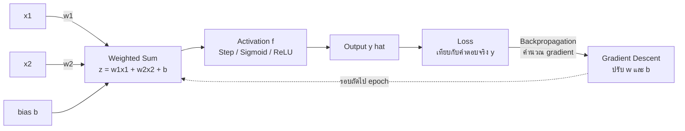

# โครงข่ายประสาทเทียม (Artificial Neural Networks)

> **หมวดหมู่:** เนื้อหาเชิงลึกประกอบการเรียนรู้ (Deep Dive Learning Content)

## 🎯 สิ่งที่จะได้เรียนรู้

- เปรียบเทียบ **เซลล์ประสาทชีวภาพ (biological neuron)** กับ **เซลล์ประสาทเทียม (artificial neuron)** ได้
- คำนวณ **weighted sum + bias** และผ่าน **activation function** ด้วยมือได้ (forward pass)
- รู้จัก activation functions ยอดนิยม ได้แก่ step, sigmoid, tanh, ReLU และ softmax
- อธิบายโครงสร้าง **input layer, hidden layer, output layer** ได้
- เข้าใจแนวคิดการฝึกโมเดลด้วย **loss function, gradient descent และ backpropagation** ในระดับสัญชาตญาณ
- เขียน perceptron ด้วย numpy ให้เรียนรู้ AND gate ได้

## 📖 เนื้อหาและคำอธิบาย

### 1. จากเซลล์ประสาทจริงสู่เซลล์ประสาทเทียม

สมองมนุษย์ประกอบด้วยเซลล์ประสาทจำนวนมหาศาลที่ส่งสัญญาณถึงกัน เซลล์หนึ่งรับสัญญาณผ่าน **dendrite** รวมสัญญาณไว้ที่ **cell body** และถ้าสัญญาณรวมแรงพอก็จะ "ยิง" สัญญาณออกไปทาง **axon** ผ่าน **synapse** ไปยังเซลล์ถัดไป

นักวิทยาศาสตร์นำแนวคิดนี้มาทำเป็นแบบจำลองทางคณิตศาสตร์อย่างง่าย

| เซลล์ประสาทชีวภาพ | เซลล์ประสาทเทียม | ความหมาย |
|---|---|---|
| Dendrite | Input $x_i$ | สัญญาณที่เข้ามา |
| ความแรงของ synapse | Weight $w_i$ | ความสำคัญของแต่ละ input |
| Cell body รวมสัญญาณ | Weighted sum $z$ | ผลรวมถ่วงน้ำหนัก |
| เกณฑ์การยิงสัญญาณ | Bias $b$ + Activation $f$ | ตัดสินว่าจะส่งสัญญาณแค่ไหน |
| Axon | Output $\hat{y}$ | ผลลัพธ์ส่งต่อไปชั้นถัดไป |

> [!warning] เป็นแค่ "แรงบันดาลใจ" ไม่ใช่การจำลองสมอง
> neural network สมัยใหม่ได้แรงบันดาลใจจากสมองเท่านั้น กลไกจริงของสมองซับซ้อนกว่ามาก ตำรา *Deep Learning* (Goodfellow, Bengio & Courville) ก็ย้ำว่าเป้าหมายของ deep learning ไม่ใช่การจำลองสมองให้สมบูรณ์

### 2. Perceptron: นิวรอนเทียมตัวแรก

Perceptron ถูกเสนอโดย Frank Rosenblatt ปลายทศวรรษ 1950 ทำงาน 3 ขั้น

**ขั้นที่ 1 — Weighted sum + bias**

$$z = w_1x_1 + w_2x_2 + \dots + w_nx_n + b = \sum_{i=1}^{n} w_i x_i + b$$

**ขั้นที่ 2 — Activation function**

$$\hat{y} = f(z)$$

**ขั้นที่ 3 — ส่ง output** ไปเป็นคำตอบ หรือเป็น input ของนิวรอนชั้นถัดไป

**อุปมา:** การตัดสินใจ "จะไปดูหนังไหม" — input คือ (ฝนตกไหม, เพื่อนไปด้วยไหม, มีเงินไหม) แต่ละข้อมีน้ำหนักไม่เท่ากัน (บางคนให้ความสำคัญกับเพื่อนมาก) ส่วน bias คือ "นิสัยพื้นฐาน" ว่าชอบออกจากบ้านแค่ไหน แล้วตัดสินใจ "ไป/ไม่ไป" ด้วย activation

### 3. ตัวอย่างคำนวณ forward pass ด้วยมือ

กำหนด input $x = [1.0,\ 0.5]$, weight $w = [0.4,\ -0.6]$, bias $b = 0.1$

$$z = (0.4)(1.0) + (-0.6)(0.5) + 0.1 = 0.4 - 0.3 + 0.1 = 0.2$$

นำ $z = 0.2$ ไปผ่าน activation ต่าง ๆ

- Step: $z \ge 0 \Rightarrow \hat{y} = 1$
- Sigmoid: $\sigma(0.2) = \dfrac{1}{1+e^{-0.2}} \approx \dfrac{1}{1.8187} \approx 0.550$
- ReLU: $\max(0,\ 0.2) = 0.2$

### 4. Activation Functions ที่ควรรู้จัก

ถ้าไม่มี activation ที่ไม่เป็นเชิงเส้น (non-linear) การซ้อนหลายชั้นก็ยังเท่ากับสมการเชิงเส้นชั้นเดียว activation จึงเป็นสิ่งที่ทำให้ network เรียนรู้ความสัมพันธ์ซับซ้อนได้

| Function | สูตร | ช่วงค่า output | ใช้บ่อยที่ | ข้อสังเกต |
|---|---|---|---|---|
| Step | $1$ ถ้า $z \ge 0$ ไม่งั้น $0$ | {0, 1} | perceptron ดั้งเดิม | หาอนุพันธ์ไม่ได้ ใช้กับ backprop ไม่ได้ |
| Sigmoid | $\sigma(z) = \frac{1}{1+e^{-z}}$ | (0, 1) | output ของ binary classification | ค่า gradient เล็กมากเมื่อ $z$ ใหญ่หรือเล็กมาก (vanishing gradient) |
| Tanh | $\tanh(z)$ | (−1, 1) | hidden layer รุ่นเก่า, RNN | อยู่กึ่งกลางที่ 0 |
| ReLU | $\max(0, z)$ | [0, ∞) | hidden layer ของ deep network ส่วนใหญ่ | คำนวณง่าย ฝึกเร็ว |
| Softmax | $\frac{e^{z_k}}{\sum_j e^{z_j}}$ | (0, 1) รวมกันได้ 1 | output ของ multi-class | ตีความเป็นความน่าจะเป็นของแต่ละ class |

### 5. จากนิวรอนเดี่ยวสู่โครงข่ายหลายชั้น (Multilayer Perceptron)

Perceptron ตัวเดียวแบ่งข้อมูลได้ด้วย "เส้นตรง" เส้นเดียว จึงแก้ปัญหาที่แยกด้วยเส้นตรงไม่ได้อย่าง **XOR** ไม่ได้ (ข้อจำกัดนี้ถูกวิเคราะห์ไว้ในหนังสือ *Perceptrons* ของ Minsky และ Papert ปี 1969) ทางแก้คือการเรียงนิวรอนเป็นชั้น ๆ

- **Input layer** — รับ feature เข้ามา (ไม่มีการคำนวณ)
- **Hidden layer(s)** — ชั้นกลางที่สร้าง "ตัวแทนข้อมูล" (representation) ใหม่ ๆ
- **Output layer** — ให้คำตอบ เช่น 1 นิวรอน + sigmoid สำหรับ ใช่/ไม่ใช่ หรือ 10 นิวรอน + softmax สำหรับตัวเลข 0–9

แต่ละนิวรอนในชั้นหนึ่งเชื่อมกับทุกนิวรอนของชั้นถัดไป เรียกว่า **fully connected (dense) layer**

### 6. Network เรียนรู้อย่างไร: Loss, Gradient Descent, Backpropagation

**อุปมา: ลงเขาตอนหมอกลงจัด** คุณมองไม่เห็นตีนเขา แต่รู้สึกได้ว่าพื้นใต้เท้าเอียงไปทางไหน คุณจึงก้าวไปทางที่ลาดลงทีละก้าวจนถึงจุดต่ำสุด

1. **Loss function** — วัดว่าโมเดลทายผิดมากแค่ไหน เช่น Mean Squared Error

$$L = \frac{1}{N}\sum_{i=1}^{N} (y_i - \hat{y}_i)^2$$

2. **Gradient** — บอกว่าถ้าขยับ weight แต่ละตัวนิดหนึ่ง loss จะเพิ่มหรือลด (ความชันของภูเขา)
3. **Gradient descent** — ขยับ weight สวนทางกับ gradient ทีละก้าว โดยมี **learning rate** $\eta$ เป็นขนาดก้าว

$$w \leftarrow w - \eta \frac{\partial L}{\partial w}$$

4. **Backpropagation** — เทคนิคคำนวณ gradient ของทุก weight อย่างมีประสิทธิภาพ โดยส่ง "ความผิดพลาด" ย้อนจาก output กลับไปยังชั้นก่อนหน้าด้วย chain rule แนวคิดนี้ได้รับความนิยมอย่างกว้างขวางหลังบทความของ Rumelhart, Hinton และ Williams ในปี 1986

| คำศัพท์ | ความหมายแบบง่าย |
|---|---|
| Epoch | ฝึกครบทั้ง training set 1 รอบ |
| Batch | กลุ่มตัวอย่างย่อยที่ใช้คำนวณ gradient แต่ละครั้ง |
| Learning rate | ขนาดก้าว: ใหญ่ไปกระโดดข้ามจุดต่ำสุด เล็กไปฝึกช้ามาก |
| Forward pass | คำนวณจาก input ไปจนได้ output และ loss |
| Backward pass | คำนวณ gradient ย้อนกลับแล้วอัปเดต weight |

> [!tip] ลองเล่นเอง
> เปิด TensorFlow Playground (ลิงก์ในแหล่งอ้างอิง) แล้วลองเพิ่ม/ลด hidden layer, เปลี่ยน activation และ learning rate เพื่อดูเส้นแบ่งข้อมูลเปลี่ยนไปแบบเรียลไทม์

## 🧩 ตัวอย่างประกอบ / Worked Example

**โจทย์:** สอน perceptron หนึ่งตัวให้ทำงานเหมือน **AND gate** (เชื่อมกับ [[Boolean Algebra และ Logic Gates]] ใน Week 03)

| $x_1$ | $x_2$ | AND |
|---|---|---|
| 0 | 0 | 0 |
| 0 | 1 | 0 |
| 1 | 0 | 0 |
| 1 | 1 | 1 |

Perceptron ใช้กฎการเรียนรู้แบบง่าย (perceptron learning rule) ไม่ต้องใช้ gradient

$$w \leftarrow w + \eta\,(y - \hat{y})\,x \qquad b \leftarrow b + \eta\,(y - \hat{y})$$

ถ้าทายถูก $(y - \hat{y}) = 0$ weight ไม่เปลี่ยน ถ้าทายผิด weight จะถูกดันไปทางที่ทำให้ทายถูกมากขึ้น

```python
# Perceptron เรียนรู้ AND gate ด้วย numpy (รันใน Google Colab ได้ทันที)
import numpy as np

# ข้อมูล: input 2 ตัว และคำตอบของ AND
X = np.array([[0, 0], [0, 1], [1, 0], [1, 1]])
y = np.array([0, 0, 0, 1])

def step(z):
    # activation แบบขั้นบันได: z >= 0 ได้ 1 ไม่งั้นได้ 0
    return np.where(z >= 0, 1, 0)

w = np.zeros(2)   # weight เริ่มต้นเป็น 0
b = 0.0           # bias เริ่มต้นเป็น 0
lr = 0.1          # learning rate

for epoch in range(10):
    errors = 0
    for xi, target in zip(X, y):
        y_hat = step(np.dot(w, xi) + b)   # forward: weighted sum + bias -> step
        error = target - y_hat            # ผิดไปเท่าไร (-1, 0, 1)
        w = w + lr * error * xi           # ปรับ weight
        b = b + lr * error                # ปรับ bias
        errors += int(error != 0)
    print(f"epoch {epoch+1}: w={np.round(w, 2)}, b={b:.2f}, errors={errors}")
    if errors == 0:                       # ทายถูกครบทุกตัว หยุดฝึก
        break

print("ผลทำนาย:", step(X @ w + b))
```

```output
epoch 1: w=[0.1 0.1], b=0.00, errors=2
epoch 2: w=[0.2 0.1], b=-0.10, errors=3
epoch 3: w=[0.2 0.1], b=-0.20, errors=3
epoch 4: w=[0.2 0.1], b=-0.20, errors=0
ผลทำนาย: [0 0 0 1]
```

**ตรวจคำตอบด้วยมือ** ด้วย $w = [0.2,\ 0.1]$, $b = -0.2$

| $(x_1, x_2)$ | $z = 0.2x_1 + 0.1x_2 - 0.2$ | ผลลัพธ์ |
|---|---|---|
| (0, 0) | $-0.2$ | 0 ✔ |
| (0, 1) | $-0.1$ | 0 ✔ |
| (1, 0) | $0.0$ (ในทางคณิตศาสตร์) | ? |
| (1, 1) | $0.1$ | 1 ✔ |

> [!warning] กรณี (1, 0) อยู่ "บนเส้นแบ่งพอดี"
> ในทางคณิตศาสตร์ $z = 0.2 - 0.2 = 0$ ซึ่งกฎ $z \ge 0$ จะให้ 1 (ผิด) แต่ในคอมพิวเตอร์ $b$ ได้จากการบวกลบ 0.1 สะสมหลายครั้ง ด้วยเลขทศนิยมแบบ floating point จึงเก็บได้เป็น $-0.20000000000000004$ ทำให้ $z \approx -2.8 \times 10^{-17} < 0$ และได้ผล 0 (ถูก) โดยบังเอิญ บทเรียนคือ **เส้นแบ่งของ perceptron นี้ชิดขอบเกินไป** ถ้าเปลี่ยน learning rate หรือลำดับข้อมูล ผลอาจต่างไป วิธีที่ปลอดภัยกว่าคือฝึกจนมี margin หรือใช้โมเดลที่ใช้ sigmoid + loss ต่อเนื่อง (เชื่อมกับเรื่อง floating point ใน Week 03)

> [!note] ลองต่อยอด
> เปลี่ยน `y` เป็น `[0, 1, 1, 1]` (OR gate) จะฝึกสำเร็จ แต่ถ้าเปลี่ยนเป็น `[0, 1, 1, 0]` (XOR) จำนวน errors จะไม่ลดเป็น 0 เลย เพราะ XOR แยกด้วยเส้นตรงเส้นเดียวไม่ได้ ต้องใช้ hidden layer

## 🗺️ แผนภาพสรุป



## ⚠️ ความเข้าใจผิดที่พบบ่อย

- **"Neural network ทำงานเหมือนสมองมนุษย์"** — เป็นเพียงแบบจำลองทางคณิตศาสตร์ที่ได้แรงบันดาลใจจากสมอง ไม่ได้คิดหรือรู้สึกแบบมนุษย์
- **"เพิ่มนิวรอน/ชั้นมากขึ้น ผลย่อมดีขึ้นเสมอ"** — network ใหญ่เกินไปเสี่ยง overfitting ใช้ข้อมูลและพลังประมวลผลมากขึ้น
- **"Backpropagation คืออัลกอริทึมการเรียนรู้ทั้งหมด"** — backprop เป็นวิธี *คำนวณ gradient* ส่วนการ *อัปเดต weight* ทำโดย optimizer เช่น gradient descent หรือ Adam
- **"Learning rate ยิ่งสูงยิ่งเรียนเร็ว"** — สูงเกินไป loss อาจแกว่งหรือพุ่งขึ้นจนฝึกไม่สำเร็จ
- **"Bias ในนิวรอนคือความลำเอียงของโมเดล"** — bias ในที่นี้คือพารามิเตอร์ค่าคงที่ที่เลื่อนเส้นแบ่ง คนละความหมายกับ *data bias* หรือความลำเอียงเชิงจริยธรรม

## 🔗 เชื่อมโยงกับรายวิชา

- แผนการสอน: [[Week 09 - AI & Machine Learning Foundations]]
- Logic gates และเลขทศนิยมในคอมพิวเตอร์: [[Week 03 - Digital Logic & Modern Processors]], [[Boolean Algebra และ Logic Gates]]
- การคูณเมทริกซ์จำนวนมหาศาลคือเหตุผลที่ต้องใช้ GPU/NPU (ดูไฟล์ Deep Learning ถัดไป)
- Generative AI และ Transformer ต่อยอดจาก neural network: [[Week 10 - Generative AI & Modern Robotics]], [[RAG และ LLM]]
- นิวรอนขนาดเล็กบนไมโครคอนโทรลเลอร์: [[TinyML และ Edge AI]] · การดูแลโมเดลระยะยาว: [[MLOps]]
- ความโปร่งใสและการอธิบายผลของโมเดล: [[Week 13 - Computer Ethics & Intellectual Property]]
- **Mini-Project 3 (Smart Environment Monitor):** ลองออกแบบนิวรอนหนึ่งตัวที่รับ (อุณหภูมิ, ความชื้น) แล้วตัดสินใจ "เปิดพัดลม/ไม่เปิด" และอภิปรายว่าควรได้ weight มาจากการกำหนดเองหรือจากการเรียนรู้ข้อมูลเซนเซอร์

## ❓ คำถามทบทวน

1. กำหนด $x = [2,\ 1]$, $w = [0.5,\ -1]$, $b = -0.5$ จงคำนวณ $z$ และค่า output เมื่อใช้ ReLU และ sigmoid

<details><summary>ดูแนวคำตอบ</summary>

$z = (0.5)(2) + (-1)(1) - 0.5 = 1 - 1 - 0.5 = -0.5$ · ReLU: $\max(0, -0.5) = 0$ · Sigmoid: $\frac{1}{1+e^{0.5}} \approx \frac{1}{2.6487} \approx 0.378$
</details>

2. ทำไม neural network ต้องมี activation function ที่ไม่เป็นเชิงเส้น

<details><summary>ดูแนวคำตอบ</summary>

ถ้าทุกชั้นเป็นเชิงเส้น การซ้อนหลายชั้นจะยุบรวมเป็นการแปลงเชิงเส้นชั้นเดียวได้เสมอ network จึงเรียนรู้ได้แค่เส้นแบ่งตรง ๆ activation แบบ non-linear เช่น ReLU ทำให้ซ้อนชั้นแล้วสร้างเส้นแบ่งที่ซับซ้อนได้
</details>

3. อธิบายบทบาทของ loss function, gradient descent และ backpropagation ด้วยอุปมา "ลงเขาในหมอก"

<details><summary>ดูแนวคำตอบ</summary>

loss คือความสูงจากตีนเขา (ยิ่งสูงยิ่งผิดมาก) backpropagation คือวิธีสัมผัสความชันใต้เท้าว่าแต่ละทิศ (แต่ละ weight) ลาดไปทางไหน gradient descent คือการก้าวลงไปตามทางลาด โดย learning rate คือขนาดก้าว
</details>

4. ทำไม perceptron ตัวเดียวเรียนรู้ XOR ไม่ได้ และแก้ได้อย่างไร

<details><summary>ดูแนวคำตอบ</summary>

perceptron หนึ่งตัวสร้างเส้นแบ่งได้เป็นเส้นตรงเส้นเดียว แต่จุดของ XOR ที่ให้ผล 1 ได้แก่ (0,1) และ (1,0) อยู่ทแยงกัน แยกจาก (0,0) และ (1,1) ด้วยเส้นตรงเส้นเดียวไม่ได้ แก้ได้ด้วยการเพิ่ม hidden layer ที่มี activation แบบ non-linear (multilayer perceptron)
</details>

5. ถ้า loss ระหว่างการฝึกแกว่งขึ้นลงรุนแรงและไม่ลดลง ควรสงสัยอะไรก่อน

<details><summary>ดูแนวคำตอบ</summary>

learning rate สูงเกินไป ทำให้ก้าวกระโดดข้ามจุดต่ำสุด ควรลด learning rate ลง นอกจากนี้ควรตรวจว่าข้อมูลถูก normalize แล้วหรือยัง
</details>

## 📚 แหล่งอ้างอิง

1. Goodfellow, I., Bengio, Y. & Courville, A. (2016). *Deep Learning*. MIT Press. บทที่ 6 Deep Feedforward Networks: <https://www.deeplearningbook.org/contents/mlp.html>
2. Google for Developers. *Machine Learning Crash Course: Neural networks.* <https://developers.google.com/machine-learning/crash-course/neural-networks>
3. Nielsen, M. *Neural Networks and Deep Learning*, Chapter 1 (perceptron และ sigmoid neuron). <http://neuralnetworksanddeeplearning.com/chap1.html>
4. 3Blue1Brown. *Neural Networks* (ชุดวิดีโออธิบาย gradient descent และ backpropagation). <https://www.3blue1brown.com/topics/neural-networks>
5. TensorFlow Playground (ทดลอง neural network บนเบราว์เซอร์). <https://playground.tensorflow.org/>
6. Russell, S. & Norvig, P. *Artificial Intelligence: A Modern Approach* (4th ed.), บทเรื่อง Deep Learning. <https://aima.cs.berkeley.edu/>
