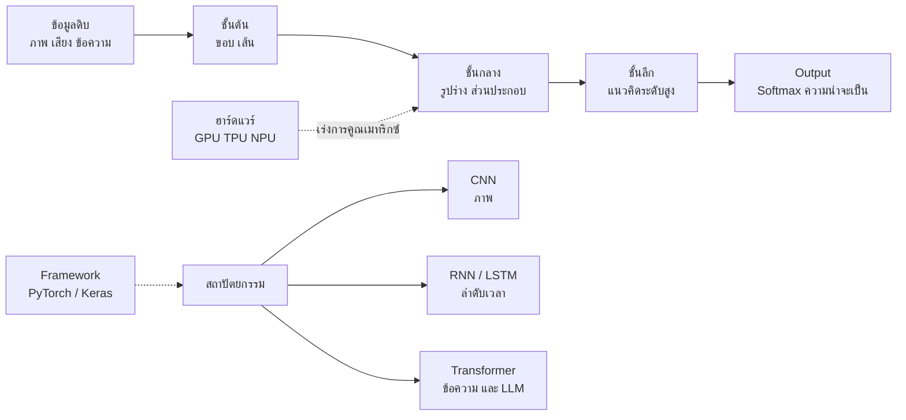

# การเรียนรู้เชิงลึกเบื้องต้น (Introduction to Deep Learning)

> **หมวดหมู่:** เนื้อหาเชิงลึกประกอบการเรียนรู้ (Deep Dive Learning Content)

## 🎯 สิ่งที่จะได้เรียนรู้

- อธิบายว่า **"deep"** ใน deep learning หมายถึงอะไร และทำไมความลึกช่วยให้เรียนรู้ข้อมูลซับซ้อนได้
- แยกความต่างระหว่าง ML แบบดั้งเดิม (ออกแบบ feature เอง) กับ deep learning (เรียนรู้ feature เอง)
- รู้จักสถาปัตยกรรมหลัก 3 ตระกูล ได้แก่ **CNN, RNN และ Transformer** ในระดับภาพรวม
- เชื่อมโยงความต้องการพลังประมวลผลของ deep learning กับฮาร์ดแวร์ **GPU / NPU / TPU** (Week 03)
- รู้จัก framework หลัก **PyTorch** และ **TensorFlow/Keras**
- สร้างและฝึกโมเดล MLP ด้วย Keras เพื่อจำแนกตัวเลขเขียนมือ MNIST บน Google Colab

## 📖 เนื้อหาและคำอธิบาย

### 1. "Deep" คืออะไร

Deep learning คือ machine learning ที่ใช้ **neural network หลายชั้น (หลาย hidden layer)** ความลึกหมายถึง *จำนวนชั้น* ของการแปลงข้อมูล

**อุปมา: สายพานโรงงานประกอบรถยนต์** สถานีแรกตัดแผ่นเหล็ก สถานีถัดไปประกอบเป็นชิ้นส่วน สถานีต่อไปประกอบเป็นตัวถัง จนสุดท้ายได้รถทั้งคัน แต่ละชั้นของ deep network ก็ทำงานคล้ายกัน คือสร้าง "ตัวแทนข้อมูล" (representation) ที่ซับซ้อนขึ้นทีละขั้น

ตัวอย่างการจดจำใบหน้าในภาพ (เป็นภาพแนวคิดที่นิยมใช้อธิบาย)
1. ชั้นต้น ๆ ตรวจจับ **ขอบและเส้น**
2. ชั้นกลางรวมเส้นเป็น **รูปร่าง** เช่น มุม วงกลม
3. ชั้นลึกรวมรูปร่างเป็น **ส่วนประกอบ** เช่น ตา จมูก
4. ชั้นสุดท้ายตัดสินว่าเป็น **ใบหน้าของใคร**

ตำรา *Deep Learning* (Goodfellow, Bengio & Courville) อธิบายแนวคิดนี้ว่าเป็นการเรียนรู้แนวคิดซับซ้อนโดยประกอบจากแนวคิดที่ง่ายกว่าเป็นลำดับชั้น

### 2. ML ดั้งเดิม vs Deep Learning

| ประเด็น | ML ดั้งเดิม (เช่น Decision Tree, SVM) | Deep Learning |
|---|---|---|
| Feature | มนุษย์ออกแบบเอง (feature engineering) | โมเดลเรียนรู้ feature เองจากข้อมูลดิบ |
| ข้อมูลที่เหมาะ | ตาราง (tabular) ขนาดเล็กถึงกลาง | ภาพ เสียง ข้อความ ข้อมูลขนาดใหญ่ |
| ปริมาณข้อมูลที่ต้องการ | น้อยกว่า | มักต้องการมาก |
| ฮาร์ดแวร์ | CPU ก็เพียงพอ | มักต้องใช้ GPU/TPU/NPU |
| ความอธิบายได้ (interpretability) | ค่อนข้างสูง | ต่ำกว่า ("กล่องดำ") |
| เวลาฝึก | วินาทีถึงนาที | นาทีถึงหลายสัปดาห์ (ขึ้นกับขนาด) |

> [!tip] ไม่ใช่ทุกงานต้องใช้ deep learning
> สำหรับข้อมูลตารางขนาดเล็ก เช่น ค่าเซนเซอร์ไม่กี่พันแถว โมเดลอย่าง Decision Tree หรือ Random Forest มักฝึกเร็วกว่า อธิบายได้ง่ายกว่า และให้ผลดีพอ ๆ กัน ควรเริ่มจากโมเดลง่ายเป็น baseline เสมอ

### 3. สถาปัตยกรรมหลักที่ควรรู้จัก

| สถาปัตยกรรม | แนวคิดหลัก | เหมาะกับข้อมูล | ตัวอย่างการใช้งาน |
|---|---|---|---|
| **MLP** (Multilayer Perceptron) | ชั้น dense เชื่อมกันทุกนิวรอน | เวกเตอร์ feature ทั่วไป | จำแนกข้อมูลตาราง, MNIST เบื้องต้น |
| **CNN** (Convolutional Neural Network) | ใช้ "ฟิลเตอร์" ขนาดเล็กเลื่อนสแกนภาพเพื่อหา pattern เฉพาะที่ | ภาพ, สัญญาณ 2 มิติ | จดจำใบหน้า, ตรวจโรคจากภาพถ่ายรังสี, ตรวจจับวัตถุในรถยนต์ |
| **RNN / LSTM** (Recurrent Neural Network) | มี "ความจำ" ส่งต่อข้อมูลจากขั้นเวลาก่อนหน้า | ลำดับ (sequence), อนุกรมเวลา | ทำนายค่าเซนเซอร์ล่วงหน้า, รู้จำเสียงพูดรุ่นก่อน |
| **Transformer** | กลไก **self-attention** ให้ทุกตำแหน่งในลำดับ "มองเห็น" กันได้พร้อมกัน | ข้อความ, และขยายไปภาพ/เสียง | LLM เช่น GPT, การแปลภาษา |

**อุปมาแบบสั้น ๆ**
- **CNN** เหมือนใช้แว่นขยายส่องทีละส่วนของภาพ แล้วค่อยรวมสิ่งที่เห็นเข้าด้วยกัน
- **RNN** เหมือนอ่านนิยายทีละคำ แล้วจำเนื้อเรื่องที่ผ่านมาไว้ในหัว
- **Transformer** เหมือนกางทั้งหน้ากระดาษแล้วใช้ปากกาไฮไลต์เชื่อมคำที่เกี่ยวข้องกันได้ทั่วทั้งหน้าพร้อมกัน

สถาปัตยกรรม Transformer ถูกเสนอในบทความ *Attention Is All You Need* (Vaswani et al., 2017) และกลายเป็นรากฐานของ Generative AI ที่จะเรียนในสัปดาห์ที่ 10

### 4. ทำไม deep learning ต้องใช้ GPU / NPU

หัวใจของการคำนวณใน neural network คือ **การคูณเมทริกซ์ (matrix multiplication)** จำนวนมหาศาล เช่น ชั้น dense ที่มี input 784 ค่าและ 128 นิวรอน ต้องคูณ-บวกประมาณ $784 \times 128 \approx 100{,}000$ ครั้ง *ต่อภาพหนึ่งภาพ* และต้องทำซ้ำกับข้อมูลหลายหมื่นภาพหลายรอบ

| หน่วยประมวลผล | จุดเด่น | บทบาทใน AI |
|---|---|---|
| **CPU** | คอร์น้อยแต่ฉลาด ทำงานทั่วไปและงานที่มีเงื่อนไขซับซ้อนได้ดี | เตรียมข้อมูล, โมเดลขนาดเล็ก |
| **GPU** | คอร์จำนวนมากทำงานขนาน (parallel) เหมาะกับการคูณเมทริกซ์ | ฝึกโมเดล (training) ขนาดใหญ่ |
| **TPU** | ชิปเฉพาะทางของ Google ออกแบบมาสำหรับงาน tensor | ฝึกและให้บริการโมเดลบนคลาวด์ |
| **NPU** | หน่วยประมวลผลเฉพาะ AI ในสมาร์ตโฟน/โน้ตบุ๊ก/บอร์ด edge เน้นประหยัดพลังงาน | inference บนอุปกรณ์ (on-device AI) |

> [!note] เชื่อมกับ Week 03
> ความแตกต่างระหว่างหน่วยประมวลผลแบบ general-purpose และแบบเฉพาะทาง (accelerator) ได้เรียนแล้วใน [[Week 03 - Digital Logic & Modern Processors]] deep learning คือเหตุผลหลักข้อหนึ่งที่อุตสาหกรรมชิปหันมาพัฒนา accelerator

### 5. Framework สำหรับ Deep Learning

| Framework | ผู้พัฒนาหลัก | จุดเด่นสำหรับผู้เริ่มต้น |
|---|---|---|
| **TensorFlow + Keras** | Google | Keras API เขียนโมเดลได้สั้น อ่านง่าย มีเครื่องมือแปลงไปใช้บนมือถือ/ไมโครคอนโทรลเลอร์ |
| **PyTorch** | Meta (ปัจจุบันอยู่ภายใต้ PyTorch Foundation) | เขียนแบบ Python ธรรมดา ดีบักง่าย เป็นที่นิยมมากในงานวิจัย |

ทั้งสองตัวรันบน Google Colab ได้ฟรี และรองรับ GPU (เลือก Runtime > Change runtime type)

## 🧩 ตัวอย่างประกอบ / Worked Example

**โจทย์:** จำแนกภาพตัวเลขเขียนมือ 0–9 จากชุดข้อมูล **MNIST** (ภาพขาวดำขนาด 28×28 พิกเซล มี 60,000 ภาพสำหรับฝึก และ 10,000 ภาพสำหรับทดสอบ) ด้วย MLP ตามแนวทางของ TensorFlow quickstart

**โครงสร้างโมเดล**
1. `Flatten` — คลี่ภาพ 28×28 เป็นเวกเตอร์ 784 ค่า
2. `Dense(128, relu)` — hidden layer 128 นิวรอน ใช้ ReLU: $f(z) = \max(0, z)$
3. `Dropout(0.2)` — สุ่มปิดนิวรอน 20% ระหว่างฝึก ลด overfitting
4. `Dense(10)` — output 10 ค่า (หนึ่งค่าต่อหนึ่งตัวเลข) แล้วแปลงเป็นความน่าจะเป็นด้วย softmax

$$\text{softmax}(z_k) = \frac{e^{z_k}}{\sum_{j=0}^{9} e^{z_j}}$$

**นับจำนวนพารามิเตอร์ (weight + bias)**
- ชั้น hidden: $784 \times 128 + 128 = 100{,}480$
- ชั้น output: $128 \times 10 + 10 = 1{,}290$
- รวม $101{,}770$ พารามิเตอร์ (Flatten และ Dropout ไม่มีพารามิเตอร์)

```python
# Keras MLP จำแนกตัวเลข MNIST (รันใน Google Colab; TensorFlow ติดตั้งมาให้แล้ว)
import tensorflow as tf

# 1) โหลดข้อมูลและ normalize ค่าพิกเซลจาก 0-255 ให้อยู่ในช่วง 0-1
(x_train, y_train), (x_test, y_test) = tf.keras.datasets.mnist.load_data()
x_train, x_test = x_train / 255.0, x_test / 255.0
print("train:", x_train.shape, "test:", x_test.shape)

# 2) สร้างโมเดลแบบเรียงชั้น (Sequential)
model = tf.keras.Sequential([
    tf.keras.Input(shape=(28, 28)),
    tf.keras.layers.Flatten(),                      # 28x28 -> 784
    tf.keras.layers.Dense(128, activation="relu"),  # hidden layer
    tf.keras.layers.Dropout(0.2),                   # ลด overfitting
    tf.keras.layers.Dense(10)                       # output 10 class (logits)
])
model.summary()  # ดูจำนวนพารามิเตอร์ของแต่ละชั้น

# 3) กำหนด loss, optimizer และ metric
model.compile(
    optimizer="adam",
    loss=tf.keras.losses.SparseCategoricalCrossentropy(from_logits=True),
    metrics=["accuracy"])

# 4) ฝึก 5 epochs (แบ่ง 10% ของ train ไว้เป็น validation)
model.fit(x_train, y_train, epochs=5, validation_split=0.1)

# 5) ประเมินบน test set ที่โมเดลไม่เคยเห็น
loss, acc = model.evaluate(x_test, y_test, verbose=0)
print(f"Test accuracy: {acc:.4f}")

# 6) inference: ทำนายภาพแรกของ test set
probs = tf.nn.softmax(model(x_test[:1])).numpy()
print("ทำนาย:", probs.argmax(), "| คำตอบจริง:", y_test[0])
```

```output
train: (60000, 28, 28) test: (10000, 28, 28)
Total params: 101,770
Epoch 1/5 ... loss: (ลดลงทุก epoch)  accuracy: (เพิ่มขึ้นทุก epoch)
...
Epoch 5/5 ... accuracy: ประมาณ 0.97-0.98
Test accuracy: ประมาณ 0.97-0.98
ทำนาย: 7 | คำตอบจริง: 7
```

> [!note] ทำไมผลลัพธ์จึงเป็น "~" (ค่าประมาณ)
> weight เริ่มต้นและ dropout ถูกสุ่ม ค่า accuracy จึงต่างเล็กน้อยในแต่ละครั้งที่รัน เอกสาร TensorFlow quickstart รายงานว่าโมเดลโครงสร้างนี้ได้ accuracy ประมาณ 98% บน MNIST ส่วนจำนวนพารามิเตอร์ 101,770 เป็นค่าคงที่ที่ตรวจด้วยการคำนวณข้างต้นได้

**ต่อยอด:** เปลี่ยนเป็น CNN โดยใส่ `Conv2D` และ `MaxPooling2D` ก่อน `Flatten` (ดูตัวอย่าง Keras ในแหล่งอ้างอิง) แล้วเปรียบเทียบ accuracy และเวลาฝึกบน CPU กับ GPU

## 🗺️ แผนภาพสรุป



## ⚠️ ความเข้าใจผิดที่พบบ่อย

- **"Deep learning ดีกว่า ML แบบดั้งเดิมเสมอ"** — กับข้อมูลตารางขนาดเล็ก โมเดลดั้งเดิมมักดีพอหรือดีกว่า และอธิบายผลได้ง่ายกว่า
- **"ยิ่งลึกยิ่งฉลาด"** — ความลึกที่มากขึ้นต้องการข้อมูล เวลา และพลังงานมากขึ้น และฝึกยากขึ้น ไม่ได้รับประกันผลที่ดีกว่า
- **"ต้องมี GPU แพง ๆ ถึงจะเริ่มเรียน deep learning ได้"** — Google Colab มี GPU ให้ทดลองใช้ และโมเดลเล็กอย่าง MNIST MLP ฝึกบน CPU ได้ในเวลาไม่นาน
- **"โมเดลที่ได้ accuracy 98% บน MNIST ใช้กับลายมือจริงได้ทันที"** — ภาพจริงอาจต่างจากข้อมูลฝึก (ขนาด ความเอียง พื้นหลัง) ต้องทดสอบกับข้อมูลจริงก่อนเสมอ
- **"Transformer ใช้ได้เฉพาะข้อความ"** — ปัจจุบันถูกนำไปใช้กับภาพ เสียง และข้อมูลหลายรูปแบบ (multimodal) ด้วย

## 🔗 เชื่อมโยงกับรายวิชา

- แผนการสอน: [[Week 09 - AI & Machine Learning Foundations]]
- ฮาร์ดแวร์ GPU/NPU และ accelerator: [[Week 03 - Digital Logic & Modern Processors]], [[Chiplet]]
- ศูนย์ข้อมูลที่ใช้ฝึกโมเดลขนาดใหญ่ (พลังงานและการระบายความร้อน): [[Week 07 - Data Center & Cloud Infrastructure]], [[Liquid Cooling]]
- Transformer สู่ Generative AI และ LLM: [[Week 10 - Generative AI & Modern Robotics]], [[RAG และ LLM]]
- ย่อโมเดลไปรันบนบอร์ดขนาดเล็ก: [[TinyML และ Edge AI]], [[Edge Computing]]
- นำโมเดลที่ฝึกแล้วไปใช้งานจริง: [[MLOps]]
- ต้นทุนพลังงานและผลกระทบต่อสังคม: [[Week 13 - Computer Ethics & Intellectual Property]]
- **Mini-Project 3 (Smart Environment Monitor):** อภิปรายในทีมว่าข้อมูลเซนเซอร์ของโปรเจกต์ (ตารางตัวเลขไม่กี่คอลัมน์) ควรใช้ deep learning หรือโมเดลดั้งเดิม และถ้าต้องรันบน ESP32 ใน [[Week 11 - Embedded Systems & IoT]] โมเดลต้องเล็กแค่ไหน

## ❓ คำถามทบทวน

1. "Deep" ใน deep learning หมายถึงอะไร และแต่ละชั้นทำหน้าที่อะไรในงานจดจำภาพ

<details><summary>ดูแนวคำตอบ</summary>

หมายถึงจำนวน hidden layer ที่มาก แต่ละชั้นสร้างตัวแทนข้อมูลที่ซับซ้อนขึ้นตามลำดับ เช่น ชั้นต้นจับขอบ/เส้น ชั้นกลางจับรูปร่าง ชั้นลึกจับส่วนประกอบหรือวัตถุทั้งชิ้น
</details>

2. จงเลือกสถาปัตยกรรมที่เหมาะสม (CNN, RNN/LSTM, Transformer) สำหรับ (ก) ตรวจโรคใบข้าวจากภาพถ่าย (ข) แชตบอตตอบคำถามภาษาไทย (ค) ทำนายอุณหภูมิห้องในชั่วโมงถัดไปจากค่าย้อนหลัง

<details><summary>ดูแนวคำตอบ</summary>

(ก) CNN เพราะเป็นข้อมูลภาพ (ข) Transformer ซึ่งเป็นพื้นฐานของ LLM (ค) RNN/LSTM เป็นตัวเลือกคลาสสิกสำหรับอนุกรมเวลา (แต่สำหรับข้อมูลน้อยและ feature ไม่มาก regression ธรรมดาก็อาจเพียงพอ)
</details>

3. ทำไม GPU จึงฝึก neural network ได้เร็วกว่า CPU

<details><summary>ดูแนวคำตอบ</summary>

งานหลักของ neural network คือการคูณเมทริกซ์ซึ่งแยกเป็นการคูณ-บวกอิสระต่อกันจำนวนมาก GPU มีคอร์จำนวนมากที่ทำงานขนานกันได้ จึงประมวลผลงานลักษณะนี้ได้พร้อมกันจำนวนมาก ขณะที่ CPU มีคอร์น้อยกว่าและออกแบบมาสำหรับงานทั่วไป
</details>

4. จงคำนวณจำนวนพารามิเตอร์ของชั้น `Dense(64)` ที่รับ input 784 ค่า

<details><summary>ดูแนวคำตอบ</summary>

weight $= 784 \times 64 = 50{,}176$ บวก bias 64 ค่า รวม $50{,}240$ พารามิเตอร์
</details>

5. `Dropout(0.2)` ช่วยอะไร และทำงานตอนไหน

<details><summary>ดูแนวคำตอบ</summary>

สุ่มปิดนิวรอน 20% ในแต่ละรอบของการฝึก ทำให้ network ไม่พึ่งนิวรอนตัวใดตัวหนึ่งมากเกินไป ช่วยลด overfitting โดยทำงานเฉพาะตอน training ส่วนตอน inference จะใช้นิวรอนครบทุกตัว
</details>

## 📚 แหล่งอ้างอิง

1. Goodfellow, I., Bengio, Y. & Courville, A. (2016). *Deep Learning*. MIT Press. <https://www.deeplearningbook.org/>
2. TensorFlow. *TensorFlow 2 quickstart for beginners* (MNIST MLP). <https://www.tensorflow.org/tutorials/quickstart/beginner>
3. Keras. *Simple MNIST convnet* (ตัวอย่าง CNN). <https://keras.io/examples/vision/mnist_convnet/>
4. PyTorch. *Learn the Basics* tutorial. <https://pytorch.org/tutorials/beginner/basics/intro.html>
5. Vaswani, A. et al. (2017). *Attention Is All You Need*. arXiv:1706.03762. <https://arxiv.org/abs/1706.03762>
6. Géron, A. (2022). *Hands-On Machine Learning with Scikit-Learn, Keras, and TensorFlow* (3rd ed.). O'Reilly. Notebook ประกอบ: <https://github.com/ageron/handson-ml3>
