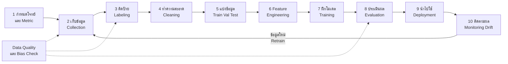

# วงจรชีวิตของข้อมูลในระบบ AI (Data Lifecycle in AI Systems)

> **หมวดหมู่:** เนื้อหาเชิงลึกประกอบการเรียนรู้ (Deep Dive Learning Content)

## 🎯 สิ่งที่จะได้เรียนรู้

- อธิบายขั้นตอนของวงจรชีวิตข้อมูลในระบบ AI ตั้งแต่ **เก็บข้อมูล (collection)** จนถึง **ติดตามผล (monitoring)** ได้
- อธิบายงาน **labeling, cleaning, splitting และ feature engineering** และเหตุผลที่แต่ละขั้นสำคัญ
- ระบุ **มิติของคุณภาพข้อมูล (data quality)** และแหล่งที่มาของ **อคติ (bias)** ในแต่ละขั้น
- อธิบายแนวคิด **data drift** และ **data leakage** ได้
- รู้จักแนวคิด **Datasheets for Datasets** สำหรับการจัดทำเอกสารชุดข้อมูล
- ทำความสะอาดข้อมูลเซนเซอร์เบื้องต้นด้วย pandas

## 📖 เนื้อหาและคำอธิบาย

### 1. ข้อมูลคือ "วัตถุดิบ" ของ AI

**อุปมา: ร้านอาหาร** เชฟฝีมือดีแค่ไหน ถ้าวัตถุดิบเน่าเสีย อาหารก็ออกมาแย่ ในระบบ AI โมเดลคือเชฟ ข้อมูลคือวัตถุดิบ หลักการที่ผู้ทำงานด้าน ML พูดกันบ่อยคือ **"Garbage in, garbage out"** โมเดลเรียนรู้ทุก pattern ที่อยู่ในข้อมูล รวมทั้งความผิดพลาดและอคติด้วย

ในงานจริง เวลาจำนวนมากของโครงการ ML หมดไปกับการเตรียมข้อมูล ไม่ใช่การเขียนโค้ดโมเดล คอร์ส *Data Preparation and Feature Engineering* ของ Google ก็ให้ความสำคัญกับขั้นตอนนี้เป็นหัวข้อหลัก

### 2. ขั้นตอนของวงจรชีวิตข้อมูล

| ขั้นตอน | ทำอะไร | ตัวอย่างใน Smart Environment Monitor | ความเสี่ยงที่ต้องระวัง |
|---|---|---|---|
| 1. **Problem definition** | กำหนดคำถามและ metric | "ทำนายว่าห้องจะร้อนเกินภายใน 30 นาทีไหม" | ตั้งโจทย์ที่วัดผลไม่ได้ |
| 2. **Collection** | เก็บข้อมูลจากแหล่งต่าง ๆ | อ่านค่า DHT22 จาก ESP32 ทุก 5 นาที | เก็บไม่ครอบคลุมทุกสถานการณ์ (เช่น มีแต่ข้อมูลหน้าฝน) |
| 3. **Labeling** | ใส่คำตอบที่ถูกต้องให้แต่ละตัวอย่าง | ติดป้าย "ok/hot" ตามความรู้สึกผู้ใช้ห้อง | ผู้ติดป้ายใช้เกณฑ์ไม่ตรงกัน |
| 4. **Cleaning** | จัดการค่าหาย ค่าผิดปกติ ข้อมูลซ้ำ รูปแบบไม่สม่ำเสมอ | ตัดค่า 85 °C ที่เกิดจากเซนเซอร์ขัดข้อง | ลบข้อมูลจนกลุ่มเล็ก ๆ หายไป |
| 5. **Splitting** | แบ่ง train / validation / test | แบ่งตามเวลา: สัปดาห์แรกฝึก สัปดาห์หลังทดสอบ | ข้อมูล test รั่วเข้า train (leakage) |
| 6. **Feature engineering** | สร้าง/แปลง feature ให้มีความหมาย | ชั่วโมงของวัน, อัตราการเปลี่ยนของอุณหภูมิ | ใช้ feature ที่ไม่มีจริงตอนใช้งาน |
| 7. **Training** | ฝึกโมเดล | Linear/Logistic Regression | overfitting |
| 8. **Evaluation** | วัดผลกับ test set และวิเคราะห์ error | ดู accuracy และกรณีที่ทายพลาด | ดูแค่ค่าเฉลี่ย ไม่แยกตามกลุ่ม |
| 9. **Deployment** | นำโมเดลไปให้บริการ | API บน server หรือรันบนบอร์ด | สภาพแวดล้อมจริงต่างจากตอนฝึก |
| 10. **Monitoring** | เฝ้าดูข้อมูลและผลการทำนาย | ตรวจว่าค่าเซนเซอร์หน้าร้อนต่างจากข้อมูลฝึกไหม | data drift ทำให้โมเดลเสื่อม |

ข้อมูลที่เก็บได้ระหว่าง monitoring จะย้อนกลับไปเป็นข้อมูลฝึกรอบใหม่ จึงเรียกว่า **วงจร (lifecycle)** ไม่ใช่เส้นตรง ขั้นที่ 9–10 เป็นหัวใจของ [[MLOps]] ซึ่งอธิบายต่อในไฟล์ถัดไป

### 3. มิติของคุณภาพข้อมูล (Data Quality Dimensions)

| มิติ | คำถามที่ต้องถาม | ตัวอย่างปัญหา |
|---|---|---|
| **Completeness** ความครบถ้วน | มีค่าหาย (missing) ไหม | Wi-Fi หลุด ค่าเซนเซอร์บางช่วงหาย |
| **Accuracy** ความถูกต้อง | ค่าตรงกับความจริงไหม | เซนเซอร์ไม่ได้ calibrate |
| **Consistency** ความสม่ำเสมอ | รูปแบบเดียวกันทั้งชุดไหม | label "hot", "Hot", " hot " ปนกัน |
| **Uniqueness** ความไม่ซ้ำ | มีแถวซ้ำไหม | ส่งข้อมูลซ้ำเมื่อ retry MQTT |
| **Timeliness** ความทันสมัย | ข้อมูลยังสะท้อนสภาพปัจจุบันไหม | ใช้ข้อมูลเมื่อ 3 ปีก่อน |
| **Representativeness** ความเป็นตัวแทน | ครอบคลุมทุกกลุ่ม/สถานการณ์ที่จะใช้งานจริงไหม | เก็บแค่ห้องชั้น 1 แต่ไปใช้ทั้งอาคาร |

### 4. อคติในข้อมูล (Data Bias) เกิดได้ทุกขั้น

- **Sampling / selection bias** — ข้อมูลที่เก็บไม่เป็นตัวแทนประชากรจริง เช่น ระบบจดจำใบหน้าที่ฝึกด้วยภาพคนบางกลุ่มเป็นส่วนใหญ่ มักทำงานแย่กับกลุ่มที่มีภาพน้อย
- **Label bias** — ผู้ติดป้ายมีอคติหรือใช้เกณฑ์ต่างกัน
- **Historical bias** — ข้อมูลสะท้อนความไม่เป็นธรรมในอดีต โมเดลจึงเรียนรู้และทำซ้ำความไม่เป็นธรรมนั้น
- **Measurement bias** — เครื่องมือวัดคลาดเคลื่อนต่างกันในแต่ละกลุ่ม

กรอบ **NIST AI Risk Management Framework (AI RMF 1.0)** เน้นว่าความน่าเชื่อถือของ AI ไม่ได้วัดแค่ accuracy แต่รวมถึงความถูกต้องและเชื่อถือได้ (valid and reliable), ความปลอดภัย, ความมั่นคง, ความโปร่งใส และความเป็นธรรมโดยจัดการอคติที่เป็นอันตราย และเสนอหน้าที่หลัก 4 ด้าน คือ **Govern, Map, Measure, Manage** ที่ใช้ได้ตลอดวงจรชีวิตของระบบ

### 5. Data Leakage และ Data Drift

> [!warning] Data Leakage — "แอบดูเฉลยโดยไม่รู้ตัว"
> เกิดเมื่อข้อมูลที่ไม่ควรรู้ตอนฝึกรั่วเข้าไปในการฝึก เช่น คำนวณค่าเฉลี่ยเพื่อเติมค่าหายจาก *ข้อมูลทั้งหมด* ก่อนแบ่ง train/test หรือสุ่มแบ่งข้อมูลอนุกรมเวลาจนอนาคตปนกับอดีต ผลคือคะแนนตอนทดสอบดีเกินจริง แต่ใช้งานจริงแล้วแย่

**Data drift** คือการที่ลักษณะของข้อมูลจริงหลัง deploy เปลี่ยนไปจากข้อมูลที่ใช้ฝึก เช่น โมเดลฝึกด้วยข้อมูลหน้าหนาว แต่ใช้งานในหน้าร้อน ส่วน **concept drift** คือความสัมพันธ์ระหว่าง feature กับ label เปลี่ยน เช่น ติดตั้งแอร์ใหม่ อุณหภูมิเดิมจึงไม่ได้แปลว่า "ร้อน" อีกต่อไป ทั้งสองแบบเป็นเหตุผลที่ต้อง monitor และ retrain

### 6. Datasheets for Datasets

Gebru และคณะ (2018) เสนอว่าชุดข้อมูลทุกชุดควรมี "เอกสารกำกับ" เหมือนแผ่นข้อมูล (datasheet) ของชิ้นส่วนอิเล็กทรอนิกส์ ที่บอกสเปกและเงื่อนไขการใช้งาน คำถามหลักในเอกสารแบ่งเป็นหมวด เช่น

- **Motivation** — สร้างชุดข้อมูลนี้เพื่ออะไร ใครสร้าง ใครให้ทุน
- **Composition** — ข้อมูลแต่ละแถวคืออะไร มีกี่ตัวอย่าง มีข้อมูลส่วนบุคคลไหม
- **Collection process** — เก็บอย่างไร ช่วงเวลาไหน ได้รับความยินยอมหรือไม่
- **Preprocessing / cleaning / labeling** — ทำอะไรกับข้อมูลดิบบ้าง
- **Uses** — ควรใช้และไม่ควรใช้ทำอะไร
- **Distribution และ Maintenance** — เผยแพร่อย่างไร ใครดูแล อัปเดตเมื่อไร

> [!tip] ใช้กับ Mini-Project ได้ทันที
> ให้แต่ละกลุ่มเขียน datasheet สั้น ๆ 1 หน้า (Markdown) สำหรับข้อมูลเซนเซอร์ของตนเอง แนบไว้ใน GitHub repository ข้าง ๆ ไฟล์ CSV

## 🧩 ตัวอย่างประกอบ / Worked Example

**โจทย์:** ข้อมูลจากเซนเซอร์อุณหภูมิ/ความชื้นในห้องเรียน 8 แถวมีปัญหาครบทุกแบบ ได้แก่ แถวซ้ำ ค่าหาย ค่าผิดปกติ (85 °C จากเซนเซอร์ขัดข้อง) และ label ไม่สม่ำเสมอ ("hot" กับ "Hot") จงทำความสะอาดและสร้าง feature ใหม่

**ขั้นตอน**
1. สำรวจขนาดและจำนวนค่าหาย
2. ลบแถวซ้ำ
3. ทำ label ให้เป็นรูปแบบเดียวกัน
4. ตัดค่าที่อยู่นอกช่วงที่เป็นไปได้ทางกายภาพ (−10 ถึง 60 °C สำหรับห้องเรียน)
5. เติมค่าหายด้วยค่ามัธยฐาน (median) ซึ่งทนต่อค่าผิดปกติมากกว่าค่าเฉลี่ย
6. สร้าง feature: ชั่วโมงของวัน และการเปลี่ยนแปลงอุณหภูมิจากแถวก่อนหน้า

$$\Delta T_t = T_t - T_{t-1}$$

```python
# ทำความสะอาดข้อมูลเซนเซอร์ด้วย pandas (รันใน Google Colab ได้ทันที)
import pandas as pd
import numpy as np

# ข้อมูลตัวอย่าง: มีแถวซ้ำ ค่าหาย (NaN) ค่าผิดปกติ และ label ไม่สม่ำเสมอ
data = {
    "timestamp": ["2026-10-01 08:00", "2026-10-01 08:05", "2026-10-01 08:05",
                  "2026-10-01 08:10", "2026-10-01 08:15", "2026-10-01 08:20",
                  "2026-10-01 08:25", "2026-10-01 08:30"],
    "temp_c":    [28.5, 29.1, 29.1, np.nan, 85.0, 30.2, 30.8, 31.0],
    "humidity":  [65, 63, 63, 62, 61, np.nan, 58, 57],
    "label":     ["ok", "ok", "ok", "ok", "hot", "ok", "hot", "Hot"],
}
df = pd.DataFrame(data)

# 1) สำรวจข้อมูล
print("ก่อนทำความสะอาด:", df.shape)
print(df.isna().sum().to_dict())          # นับค่าหายในแต่ละคอลัมน์

# 2) ลบแถวที่ซ้ำกันทุกคอลัมน์ (เช่น ส่งข้อมูลซ้ำตอน retry)
df = df.drop_duplicates()
print("หลังลบแถวซ้ำ:", df.shape)

# 3) ทำ label ให้เป็นตัวพิมพ์เล็กและไม่มีช่องว่าง
df["label"] = df["label"].str.strip().str.lower()

# 4) ตัดค่าที่เป็นไปไม่ได้ทางกายภาพ (เก็บแถวที่ค่าหายไว้ก่อน เพื่อเติมในขั้นถัดไป)
df = df[(df["temp_c"].isna()) | (df["temp_c"].between(-10, 60))]
print("หลังตัดค่าผิดปกติ:", df.shape)

# 5) เติมค่าหายด้วย median
df["temp_c"] = df["temp_c"].fillna(df["temp_c"].median())
df["humidity"] = df["humidity"].fillna(df["humidity"].median())

# 6) Feature engineering
df["timestamp"] = pd.to_datetime(df["timestamp"])
df["hour"] = df["timestamp"].dt.hour                            # ชั่วโมงของวัน
df["temp_change"] = df["temp_c"].diff().fillna(0).round(2)      # อุณหภูมิเปลี่ยนจากแถวก่อน

print(df[["temp_c", "humidity", "label", "hour", "temp_change"]])
print("จำนวนต่อ label:", df["label"].value_counts().to_dict())
```

```output
ก่อนทำความสะอาด: (8, 4)
{'timestamp': 0, 'temp_c': 1, 'humidity': 1, 'label': 0}
หลังลบแถวซ้ำ: (7, 4)
หลังตัดค่าผิดปกติ: (6, 4)
   temp_c  humidity label  hour  temp_change
0    28.5      65.0    ok     8          0.0
1    29.1      63.0    ok     8          0.6
3    30.2      62.0    ok     8          1.1
5    30.2      62.0    ok     8          0.0
6    30.8      58.0   hot     8          0.6
7    31.0      57.0   hot     8          0.2
จำนวนต่อ label: {'ok': 4, 'hot': 2}
```

**ตีความผล**
- จาก 8 แถวเหลือ 6 แถว (ลบแถวซ้ำ 1 แถว และค่าผิดปกติ 1 แถว)
- แถว index 3 อุณหภูมิหายไป ถูกเติมด้วย median ของอุณหภูมิที่เหลือ = 30.2 °C และแถว index 5 ความชื้นหายไป ถูกเติมด้วย median = 62.0
- label "Hot" ถูกรวมกับ "hot" แล้ว ข้อมูลมี "ok" 4 แถว และ "hot" 2 แถว ซึ่ง **ไม่สมดุล (imbalanced)** ควรระวังเมื่อเลือก metric
- แถวที่ 85 °C ถูกติดป้าย "hot" ไว้ ถ้าไม่ตัดออก โมเดลจะเรียนรู้จากความผิดพลาดของเซนเซอร์

> [!warning] จุดที่ควรปรับเมื่อทำงานจริง
> ตัวอย่างนี้คำนวณ median จากข้อมูลทั้งหมดเพื่อความง่าย ในงานจริงควร **แบ่ง train/test ก่อน** แล้วคำนวณ median จาก training set เท่านั้น จากนั้นนำค่าเดียวกันไปเติมใน test set เพื่อป้องกัน data leakage (scikit-learn มี `SimpleImputer` และ `Pipeline` ช่วยจัดการให้)

## 🗺️ แผนภาพสรุป



## ⚠️ ความเข้าใจผิดที่พบบ่อย

- **"ทำความสะอาดข้อมูลครั้งเดียวก็จบ"** — ข้อมูลใหม่ที่ไหลเข้ามาหลัง deploy ก็มีปัญหาได้ ต้องมีขั้นตรวจสอบอัตโนมัติอยู่ในระบบตลอด
- **"ลบแถวที่มีค่าหายทิ้งให้หมดง่ายที่สุด"** — อาจทำให้ข้อมูลเหลือน้อยหรือทำให้บางกลุ่มหายไป จนเกิด bias ควรพิจารณาว่าทำไมค่าจึงหาย
- **"อคติเป็นปัญหาของอัลกอริทึม"** — อคติจำนวนมากมาจากข้อมูลและการตั้งโจทย์ ตั้งแต่ขั้นเก็บและติดป้ายข้อมูล
- **"สุ่มแบ่ง train/test แบบไหนก็ได้"** — ข้อมูลอนุกรมเวลา (เช่น เซนเซอร์) ควรแบ่งตามเวลา ไม่เช่นนั้นโมเดลจะได้เห็น "อนาคต" ระหว่างฝึก
- **"ข้อมูลเซนเซอร์ไม่ใช่ข้อมูลส่วนบุคคล"** — ข้อมูลอย่างการเปิด-ปิดไฟหรือการตรวจจับการเคลื่อนไหวอาจบอกพฤติกรรมของบุคคลได้ ต้องพิจารณาตาม [[PDPA]]

## 🔗 เชื่อมโยงกับรายวิชา

- แผนการสอน: [[Week 09 - AI & Machine Learning Foundations]]
- การจัดเก็บและออกแบบฐานข้อมูล: [[Week 05 - Database & Data Management]], [[Vector Database]]
- การส่งข้อมูลจากเซนเซอร์: [[Week 11 - Embedded Systems & IoT]] และ Lab 11 MQTT
- ข้อมูลส่วนบุคคลและจริยธรรม: [[PDPA]], [[Week 13 - Computer Ethics & Intellectual Property]]
- ขั้นตอน deploy และ monitor: [[MLOps]] · ข้อมูลสำหรับ LLM: [[Week 10 - Generative AI & Modern Robotics]], [[RAG และ LLM]]
- ประมวลผลข้อมูลใกล้แหล่งกำเนิด: [[Edge Computing]], [[TinyML และ Edge AI]]
- **Mini-Project 3 (Smart Environment Monitor):** ใน [[Lab 09 - ML Basics and IoT Architecture]] ให้วาดวงจรชีวิตข้อมูลของโปรเจกต์กลุ่ม ระบุว่าแต่ละขั้นเกิดที่อุปกรณ์ใด (ESP32, broker, server) และเขียน datasheet 1 หน้าของชุดข้อมูลที่จะเก็บ

## ❓ คำถามทบทวน

1. อคติ (bias) เกิดได้จากจุดใดบ้างใน lifecycle ยกตัวอย่างอย่างน้อย 3 จุด

<details><summary>ดูแนวคำตอบ</summary>

(1) Collection: เก็บข้อมูลไม่เป็นตัวแทน เช่น มีแต่ข้อมูลกลุ่มเดียว (2) Labeling: ผู้ติดป้ายใช้เกณฑ์ไม่ตรงกันหรือมีอคติส่วนตัว (3) Problem definition: เลือก label ที่สะท้อนความไม่เป็นธรรมในอดีต (4) Evaluation: ดูแค่ค่าเฉลี่ยรวมจนไม่เห็นว่าโมเดลแย่กับกลุ่มเล็ก
</details>

2. data drift กับ concept drift ต่างกันอย่างไร ยกตัวอย่างในระบบตรวจวัดสภาพห้อง

<details><summary>ดูแนวคำตอบ</summary>

data drift คือการกระจายของ input เปลี่ยน เช่น ฝึกด้วยข้อมูลหน้าหนาวแต่ใช้งานหน้าร้อน ค่าอุณหภูมิจึงสูงกว่าที่โมเดลเคยเห็น ส่วน concept drift คือความสัมพันธ์ระหว่าง input กับคำตอบเปลี่ยน เช่น ติดแอร์ใหม่หรือผู้ใช้ห้องเปลี่ยน เกณฑ์ว่า "ร้อน" จึงเปลี่ยนไป
</details>

3. ทำไมการเติมค่าหายด้วยค่าเฉลี่ยของข้อมูลทั้งหมด *ก่อน* แบ่ง train/test จึงเป็น data leakage

<details><summary>ดูแนวคำตอบ</summary>

เพราะค่าเฉลี่ยนั้นมีข้อมูลจาก test set ปนอยู่ ข้อมูลที่ควร "ไม่เคยเห็น" จึงมีอิทธิพลต่อการฝึกทางอ้อม ทำให้ผลประเมินดีเกินจริง ควรคำนวณจาก training set แล้วนำค่าเดียวกันไปใช้กับ test set
</details>

4. ทำไมจึงใช้ median แทน mean ในการเติมค่าหายของข้อมูลเซนเซอร์

<details><summary>ดูแนวคำตอบ</summary>

median ไม่ไวต่อค่าผิดปกติ ถ้ามีค่าเพี้ยนสูงมาก (เช่น 85 °C) ค่าเฉลี่ยจะถูกดึงขึ้นมาก แต่ median แทบไม่เปลี่ยน
</details>

5. หากต้องเขียน datasheet ให้ข้อมูลเซนเซอร์ของกลุ่ม ควรตอบคำถามสำคัญอะไรบ้าง

<details><summary>ดูแนวคำตอบ</summary>

เช่น เก็บเพื่ออะไร (motivation), แต่ละแถวประกอบด้วยอะไรและมีกี่แถว (composition), เก็บจากห้องไหน ช่วงเวลาใด ด้วยเซนเซอร์รุ่นใด (collection), ทำความสะอาด/ติดป้ายอย่างไร (preprocessing), ควรและไม่ควรนำไปใช้ทำอะไร (uses) และใครดูแล (maintenance)
</details>

## 📚 แหล่งอ้างอิง

1. Gebru, T. et al. (2018). *Datasheets for Datasets*. arXiv:1803.09010. <https://arxiv.org/abs/1803.09010>
2. NIST. (2023). *Artificial Intelligence Risk Management Framework (AI RMF 1.0)*, NIST AI 100-1. <https://www.nist.gov/itl/ai-risk-management-framework> · PDF: <https://nvlpubs.nist.gov/nistpubs/ai/nist.ai.100-1.pdf>
3. Google for Developers. *Data Preparation and Feature Engineering for Machine Learning.* <https://developers.google.com/machine-learning/data-prep>
4. Google for Developers. *Machine Learning Crash Course: Fairness.* <https://developers.google.com/machine-learning/crash-course/fairness>
5. pandas documentation. *Working with missing data.* <https://pandas.pydata.org/docs/user_guide/missing_data.html>
