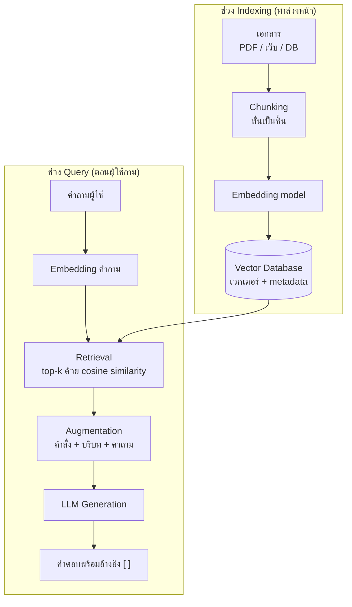

# การประยุกต์ใช้ RAG (Retrieval-Augmented Generation)

> **หมวดหมู่:** เนื้อหาเชิงลึกประกอบการเรียนรู้ (Deep Dive Learning Content)

## 🎯 สิ่งที่จะได้เรียนรู้
- อธิบายปัญหาของ LLM ที่ RAG ช่วยแก้ ได้แก่ ความรู้ไม่ทันสมัย ไม่รู้ข้อมูลภายในองค์กร และการตอบแบบไม่มีแหล่งอ้างอิง
- ลำดับขั้นตอนของ **RAG pipeline**: chunking → embedding → vector DB → retrieval → augmentation → generation ได้
- คำนวณ **cosine similarity** เพื่อค้นหาเอกสารที่เกี่ยวข้องในตัวอย่างขนาดเล็กได้
- เปรียบเทียบ **RAG กับ fine-tuning** และเลือกใช้ให้เหมาะกับโจทย์
- รู้แนวทาง **ประเมินผล (evaluation)** และการ **อ้างอิงแหล่งที่มา (citation)** ของระบบ RAG

## 📖 เนื้อหาและคำอธิบาย

### 1. ทำไมต้องมี RAG: "สอบแบบเปิดตำรา"
LLM เรียนรู้จากข้อมูลจนถึงวันหนึ่ง (knowledge cutoff) และไม่เคยเห็นเอกสารภายใน เช่น ประกาศของคณะ คู่มือ Lab หรือข้อมูล sensor ของเรา ถ้าถามตรง ๆ model อาจ "เดา" คำตอบที่ฟังดูดีแต่ผิด

**RAG** ถูกเสนอโดย Lewis et al. (2020) โดยรวม **ความจำแบบ parametric** (ความรู้ที่อยู่ใน weight ของ model) เข้ากับ **ความจำแบบ non-parametric** (คลังเอกสารภายนอกที่ค้นหาได้) เปรียบเหมือนเปลี่ยนจาก **สอบปิดตำรา** (ตอบจากความจำ) เป็น **สอบเปิดตำรา** (เปิดหาหน้าที่เกี่ยวข้องก่อนแล้วจึงเขียนตอบ) ข้อดีคือ:
- อัปเดตความรู้ได้โดยแก้เอกสาร ไม่ต้องฝึก model ใหม่
- ตอบจากข้อมูลเฉพาะขององค์กรได้
- **อ้างอิงแหล่งที่มา** ได้ ผู้ใช้ตรวจสอบย้อนกลับได้

### 2. RAG Pipeline ทีละขั้น
แบ่งเป็น 2 ช่วง: **Indexing (เตรียมคลังล่วงหน้า)** และ **Query time (ตอนผู้ใช้ถาม)**

| ขั้น | ช่วง | ทำอะไร | เปรียบเทียบกับห้องสมุด |
|---|---|---|---|
| 1. Load & Clean | Indexing | ดึงเอกสาร (PDF, เว็บ, ฐานข้อมูล) แล้วทำความสะอาด | รับหนังสือเข้าห้องสมุด |
| 2. Chunking | Indexing | หั่นเอกสารเป็นชิ้น เช่น ทีละย่อหน้า มักให้คาบเกี่ยวกัน (overlap) เล็กน้อย | แยกเป็นบท/หน้า |
| 3. Embedding | Indexing | แปลงแต่ละ chunk เป็นเวกเตอร์ด้วย embedding model | เขียนบัตรรายการตามเนื้อหา |
| 4. Store | Indexing | เก็บเวกเตอร์ + ข้อความ + metadata (ชื่อไฟล์ หน้า วันที่) ใน [[Vector Database]] | จัดเข้าตู้บัตรรายการ |
| 5. Retrieval | Query | แปลงคำถามเป็นเวกเตอร์ แล้วหา chunk ที่ใกล้ที่สุด top-k | บรรณารักษ์หาหน้าที่เกี่ยวข้อง |
| 6. Augmentation | Query | ประกอบ prompt = คำสั่ง + chunk ที่ค้นได้ + คำถาม | วางหนังสือที่เปิดไว้ตรงหน้า |
| 7. Generation | Query | LLM สร้างคำตอบจากบริบท พร้อมอ้างเลขแหล่ง | เขียนคำตอบพร้อมเชิงอรรถ |

> [!tip]
> ขนาด chunk สำคัญมาก: chunk **ใหญ่เกินไป** มีเนื้อหาปนกันหลายเรื่องทำให้ค้นไม่แม่นและเปลือง token; chunk **เล็กเกินไป** ขาดบริบท ไม่มีขนาดที่ดีที่สุดสำหรับทุกงาน ต้องทดลองกับข้อมูลจริง

### 3. ค้นหาด้วยความหมาย: Cosine Similarity
เมื่อทุกอย่างเป็นเวกเตอร์ การหา "เอกสารที่เกี่ยวข้อง" คือการหา "เวกเตอร์ที่ชี้ไปทางเดียวกัน" ตัววัดที่นิยมคือ **cosine similarity**

cos(θ) = (A · B) / (‖A‖ × ‖B‖)

ค่าใกล้ 1 = ความหมายใกล้กันมาก, ใกล้ 0 = ไม่เกี่ยวกัน ข้อดีเหนือการค้นด้วยคำตรงตัว (keyword search) คือหาเจอแม้ใช้คำต่างกัน เช่น "อุณหภูมิห้องสูง" กับ "ห้องร้อน" ระบบจริงหลายระบบจึงใช้ **hybrid search** (keyword + vector) และอาจมีขั้น **re-ranking** เพื่อเรียงผลให้แม่นขึ้น

ในทางปฏิบัติ ฐานข้อมูลที่เรียนใน [[Week 05 - Database & Data Management]] อย่าง PostgreSQL สามารถเพิ่มความสามารถค้นหาเวกเตอร์ได้ด้วย extension **pgvector** ซึ่งรองรับทั้งการค้นหาแบบแม่นยำ (exact) และแบบประมาณ (approximate nearest neighbor) ด้วย index เช่น HNSW และ IVFFlat

### 4. RAG vs Fine-tuning: เลือกอย่างไร
| เกณฑ์ | RAG | Fine-tuning |
|---|---|---|
| เปลี่ยนอะไร | เปลี่ยน **ข้อมูลที่ส่งให้ model** ตอนถาม | เปลี่ยน **weight ของ model** |
| เหมาะกับ | ความรู้ที่เปลี่ยนบ่อย, ข้อมูลเฉพาะองค์กร, ต้องการอ้างอิง | ปรับ **รูปแบบ/สไตล์/ทักษะ** เช่น ตอบเป็น JSON, ใช้ศัพท์เฉพาะทาง |
| อัปเดตความรู้ | แก้เอกสารแล้ว re-index ได้ทันที | ต้องฝึกใหม่ |
| ตรวจสอบย้อนกลับ | ชี้ได้ว่าใช้ chunk ใด | ยากมาก ความรู้ปนอยู่ใน weight |
| ต้นทุนเริ่มต้น | ต่ำกว่า (ต้องมี vector DB) | ต้องมีชุดข้อมูลฝึกและทรัพยากร compute |
| ข้อจำกัด | ถ้าค้นผิด คำตอบก็ผิด (garbage in, garbage out) | อาจจำข้อมูลผิด/ล้าสมัยติดไปกับ model |

> [!note]
> สองวิธีนี้ **ไม่ได้แข่งกัน** — ใช้ร่วมกันได้: fine-tune ให้ model เขียนตามรูปแบบที่ต้องการ แล้วใช้ RAG ป้อนข้อเท็จจริงล่าสุด แนวทางทั่วไปสำหรับมือใหม่คือ **เริ่มจาก prompt ที่ดี → เพิ่ม RAG → ค่อยพิจารณา fine-tuning** เมื่อจำเป็นจริง

### 5. การประเมินผลและการอ้างอิง (Evaluation & Citation)
ระบบ RAG ผิดได้ 2 จุด จึงต้องประเมิน **แยกส่วน**:
- **Retrieval quality** — ค้นเจอ chunk ที่ถูกไหม? วัดด้วยชุดคำถามทดสอบที่รู้คำตอบ เช่น ดูว่า chunk ที่ถูกอยู่ใน top-k หรือไม่ (recall@k)
- **Generation quality** — คำตอบ **ยึดตามบริบท (faithfulness/groundedness)** หรือแต่งเพิ่ม? ตอบตรงคำถาม (answer relevance) หรือไม่?

แนวปฏิบัติด้าน citation:
1. ให้แต่ละ chunk มี ID และ metadata (ชื่อเอกสาร หน้า วันที่)
2. สั่งใน prompt ให้ **อ้างเลข [ ] ทุกข้อความสำคัญ** และ **ตอบว่า "ไม่ทราบ" เมื่อบริบทไม่มีข้อมูล**
3. ให้หน้าจอแสดงลิงก์กลับไปยังเอกสารต้นฉบับเพื่อให้ผู้ใช้ตรวจสอบได้
4. สุ่มตรวจคำตอบโดยมนุษย์เป็นระยะ

> [!warning]
> RAG **ลด** hallucination แต่ **ไม่ได้ขจัด** model อาจตีความ chunk ผิด หรือผสมความรู้เดิมเข้าไป นอกจากนี้เอกสารในคลังคือ "ข้อมูลที่ไม่น่าไว้วางใจ" ได้ด้วย — OWASP Top 10 for LLM Applications 2025 จัด **Vector and Embedding Weaknesses (LLM08)** เป็นความเสี่ยงหนึ่ง เช่น การแอบใส่คำสั่งในเอกสาร (indirect prompt injection) หรือการค้นเจอเอกสารที่ผู้ใช้ไม่มีสิทธิ์เห็น จึงต้องกรองสิทธิ์ (access control) ตั้งแต่ขั้น retrieval

## 🧩 ตัวอย่างประกอบ / Worked Example
**โจทย์:** สร้าง RAG ของเล่นที่ตอบคำถามเกี่ยวกับรายวิชา จากคลังเอกสาร 4 chunk โดยใช้ numpy

**ขั้นตอน:**
1. เตรียม chunk (ในงานจริงได้จากการหั่นเอกสาร)
2. สร้าง "embedding ของเล่น" ด้วยการนับคำสำคัญ (ของจริงใช้ embedding model)
3. คำนวณ cosine similarity ระหว่างคำถามกับทุก chunk แล้วเลือก top-2
4. ประกอบ prompt พร้อมคำสั่งให้อ้างอิงแหล่งและห้ามแต่งเพิ่ม

```python
import numpy as np

# 1) คลังเอกสาร (knowledge base) แบ่งเป็น chunk สั้น ๆ แล้ว
chunks = [
    "Lab 10 ใช้บอร์ด ESP32 อ่านค่า sensor อุณหภูมิและความชื้น DHT22",
    "การสอบกลางภาคจัดในสัปดาห์ที่ 8 ครอบคลุมเนื้อหาสัปดาห์ 1-7",
    "Mini-Project 3 Smart Environment Monitor ส่ง sensor ขึ้น cloud และสรุปผลด้วย GenAI API",
    "ฐานข้อมูลเวกเตอร์เก็บ embedding เพื่อค้นหาด้วยความคล้ายเชิงความหมาย",
]

# 2) "embedding" แบบของเล่น: นับคำสำคัญจากพจนานุกรมเล็ก ๆ
#    (ของจริงใช้ embedding model ที่ให้เวกเตอร์หลายร้อยมิติ)
vocab = ["esp32", "sensor", "อุณหภูมิ", "สอบ", "สัปดาห์", "project",
         "genai", "cloud", "embedding", "เวกเตอร์"]

def embed(text):
    t = text.lower()
    return np.array([t.count(w) for w in vocab], dtype=float)

def cosine(a, b):
    # cosine similarity = ผลคูณจุด / (ความยาว a * ความยาว b)
    denom = np.linalg.norm(a) * np.linalg.norm(b)
    return 0.0 if denom == 0 else float(a @ b / denom)

index = np.array([embed(c) for c in chunks])   # 3) เก็บเวกเตอร์ลง "vector DB"

# 4) Retrieval: แปลงคำถามเป็นเวกเตอร์ แล้วหา chunk ที่คล้ายที่สุด top-k
query = "Mini-Project ต้องส่งข้อมูล sensor ขึ้น cloud ไหม"
q = embed(query)
scores = [cosine(q, v) for v in index]
top_k = np.argsort(scores)[::-1][:2]
for rank, i in enumerate(top_k, 1):
    print(f"#{rank} score={scores[i]:.2f} -> chunk[{i}]")

# 5) Augmentation: ประกอบ prompt ที่มีบริบท + คำสั่งให้อ้างอิงแหล่ง
context = "\n".join(f"[{i}] {chunks[i]}" for i in top_k)
prompt = (
    "ตอบโดยใช้เฉพาะข้อมูลในบริบท ถ้าไม่พบให้ตอบว่าไม่ทราบ และอ้างเลข [ ] ของแหล่ง\n"
    f"บริบท:\n{context}\n"
    f"คำถาม: {query}"
)
print(prompt)
# 6) Generation: ส่ง prompt ไปยัง LLM API (ไม่ได้แสดงในตัวอย่างนี้)
```

```output
#1 score=0.87 -> chunk[2]
#2 score=0.33 -> chunk[0]
ตอบโดยใช้เฉพาะข้อมูลในบริบท ถ้าไม่พบให้ตอบว่าไม่ทราบ และอ้างเลข [ ] ของแหล่ง
บริบท:
[2] Mini-Project 3 Smart Environment Monitor ส่ง sensor ขึ้น cloud และสรุปผลด้วย GenAI API
[0] Lab 10 ใช้บอร์ด ESP32 อ่านค่า sensor อุณหภูมิและความชื้น DHT22
คำถาม: Mini-Project ต้องส่งข้อมูล sensor ขึ้น cloud ไหม
```

**วิเคราะห์ผล:** chunk[2] ได้คะแนนสูงสุด (0.87) เพราะมีคำ "project", "sensor", "cloud" ตรงกับคำถาม ส่วน chunk[0] ติดอันดับ 2 เพราะมีคำว่า "sensor" ร่วม แต่คะแนนต่ำกว่ามาก ข้อจำกัดของ embedding ของเล่นนี้คือ **นับเฉพาะคำที่สะกดตรงกัน** ถ้าผู้ใช้ถามว่า "ห้องร้อนไหม" ระบบจะหาไม่เจอ ซึ่ง embedding model จริงแก้ปัญหานี้ได้เพราะเรียนรู้ความหมายจากข้อมูลจำนวนมาก

## 🗺️ แผนภาพสรุป


## ⚠️ ความเข้าใจผิดที่พบบ่อย
- **"ใช้ RAG แล้ว AI จะไม่ตอบผิดอีก"** — ถ้า retrieval ดึง chunk ผิด หรือ model ตีความผิด คำตอบก็ยังผิด ต้องประเมินทั้งสองส่วนและแสดงแหล่งให้ผู้ใช้ตรวจสอบ
- **"RAG คือการฝึก model ด้วยเอกสารของเรา"** — RAG ไม่เปลี่ยน weight ของ model เลย เป็นการส่งเอกสารที่เกี่ยวข้องเข้าไปใน prompt ตอนถามเท่านั้น
- **"ยัดเอกสารทั้งหมดเข้า context window ไปเลยง่ายกว่า"** — เปลือง token/ค่าใช้จ่าย ช้าลง และ model อาจใช้ข้อมูลช่วงกลางของบริบทยาวได้ไม่ดี การค้นเฉพาะส่วนที่เกี่ยวข้องจึงยังมีประโยชน์
- **"Vector DB คือฐานข้อมูลชนิดใหม่ที่มาแทน SQL"** — ส่วนใหญ่ใช้ **ควบคู่** กัน และฐานข้อมูลเชิงสัมพันธ์อย่าง PostgreSQL ก็เพิ่มความสามารถเวกเตอร์ได้ด้วย pgvector
- **"เอกสารในคลังของเราปลอดภัยเสมอ"** — เอกสารอาจมีคำสั่งแฝง (prompt injection) หรือข้อมูลที่บางคนไม่มีสิทธิ์เห็น ต้องมีการกรองสิทธิ์และตรวจเนื้อหา

## 🔗 เชื่อมโยงกับรายวิชา
- แผนสัปดาห์: [[Week 10 - Generative AI & Modern Robotics]] · แนวคิด: [[RAG และ LLM]] · [[Vector Database]]
- ฐานข้อมูล (การออกแบบตาราง metadata, index, query): [[Week 05 - Database & Data Management]]
- ความปลอดภัยของข้อมูลและสิทธิ์การเข้าถึง: [[Week 12 - Cybersecurity & Trust Architecture]]
- ลิขสิทธิ์ของเอกสารที่นำเข้าคลัง: [[Week 13 - Computer Ethics & Intellectual Property]]
- ใช้ RAG เป็น "เครื่องมือค้นข้อมูล" ของ agent: [[Agentic AI]]
- **Mini-Project 3 "Smart Environment Monitor"** ([[Lab 10 - GenAI API and ESP32 Sensors]]): สร้างคลังความรู้เล็ก ๆ เช่น คู่มือ sensor DHT22 และเกณฑ์อุณหภูมิ/ความชื้นที่เหมาะสมของห้อง Lab แล้วให้ GenAI API สรุปค่าจาก sensor โดยอ้างอิงเกณฑ์จากคลังนั้น แทนการให้ model เดาเกณฑ์เอง

## ❓ คำถามทบทวน
1. RAG ต่างจากการถาม LLM ตรง ๆ อย่างไร และช่วยแก้ปัญหาอะไร
<details><summary>ดูแนวคำตอบ</summary>

การถามตรง ๆ model ตอบจากความรู้ใน weight เท่านั้น ซึ่งอาจล้าสมัยและไม่มีข้อมูลภายในองค์กร RAG จะค้นเอกสารที่เกี่ยวข้องจากคลังภายนอกก่อน แล้วส่งเข้า prompt ทำให้ตอบจากข้อมูลล่าสุด/เฉพาะองค์กรได้ ลดการแต่งคำตอบ และอ้างอิงแหล่งที่มาให้ตรวจสอบได้
</details>

2. จงเรียงลำดับขั้นตอนของ RAG pipeline และระบุว่าขั้นใดทำล่วงหน้า ขั้นใดทำตอนผู้ใช้ถาม
<details><summary>ดูแนวคำตอบ</summary>

ล่วงหน้า (Indexing): โหลด/ทำความสะอาดเอกสาร → chunking → embedding → เก็บใน vector DB พร้อม metadata; ตอนถาม (Query): embed คำถาม → retrieval top-k → augmentation (ประกอบ prompt) → generation พร้อมอ้างอิง
</details>

3. ถ้าคณะต้องการแชตบอตตอบคำถามเรื่องประกาศและกำหนดการที่เปลี่ยนทุกสัปดาห์ ควรใช้ RAG หรือ fine-tuning เพราะอะไร
<details><summary>ดูแนวคำตอบ</summary>

ควรใช้ RAG เพราะข้อมูลเปลี่ยนบ่อย แก้เอกสารแล้ว re-index ได้ทันทีโดยไม่ต้องฝึก model ใหม่ และสามารถแสดงแหล่งอ้างอิง (ประกาศฉบับใด วันที่เท่าไร) ให้ผู้ใช้ตรวจสอบได้ ส่วน fine-tuning เหมาะกับการปรับรูปแบบหรือทักษะมากกว่าการเก็บข้อเท็จจริงที่เปลี่ยนบ่อย
</details>

4. ในตัวอย่าง numpy ถ้าผู้ใช้ถามว่า "ห้องร้อนไหม" ระบบจะได้ผลอย่างไร เพราะอะไร และแก้ได้อย่างไร
<details><summary>ดูแนวคำตอบ</summary>

เวกเตอร์ของคำถามจะเป็นศูนย์ทั้งหมด (ไม่มีคำใดอยู่ใน vocab) cosine similarity ของทุก chunk จึงเป็น 0 และหาเอกสารที่เกี่ยวข้องไม่ได้ เพราะ embedding ของเล่นนับเฉพาะคำที่สะกดตรงกัน แก้ได้โดยใช้ embedding model จริงที่จับความหมาย ("ร้อน" ใกล้ "อุณหภูมิสูง") หรือใช้ hybrid search
</details>

5. เราจะประเมินว่าระบบ RAG "ดี" ได้อย่างไร
<details><summary>ดูแนวคำตอบ</summary>

ประเมินแยกสองส่วน: (1) retrieval — สร้างชุดคำถามทดสอบที่รู้ว่า chunk ใดถูก แล้วดูว่าค้นเจอใน top-k หรือไม่; (2) generation — ตรวจว่าคำตอบยึดตามบริบท (faithfulness) ตอบตรงคำถาม และอ้างอิงถูกแหล่ง ร่วมกับการสุ่มตรวจโดยมนุษย์และเก็บ feedback จากผู้ใช้
</details>

## 📚 แหล่งอ้างอิง
- Lewis, P., Perez, E., Piktus, A., et al. (2020). *Retrieval-Augmented Generation for Knowledge-Intensive NLP Tasks.* arXiv:2005.11401. https://arxiv.org/abs/2005.11401
- Gao, Y., et al. (2023). *Retrieval-Augmented Generation for Large Language Models: A Survey.* arXiv:2312.10997. https://arxiv.org/abs/2312.10997
- Liu, N. F., et al. (2023). *Lost in the Middle: How Language Models Use Long Contexts.* arXiv:2307.03172. https://arxiv.org/abs/2307.03172
- pgvector. *Open-source vector similarity search for Postgres.* https://github.com/pgvector/pgvector
- OWASP GenAI Security Project. *OWASP Top 10 for LLM Applications 2025* (LLM08: Vector and Embedding Weaknesses). https://genai.owasp.org/llm-top-10/
