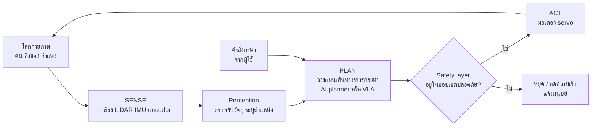

# Physical AI และหุ่นยนต์ฮิวแมนนอยด์ (Physical AI & Humanoid Robots)

> **หมวดหมู่:** เนื้อหาเชิงลึกประกอบการเรียนรู้ (Deep Dive Learning Content)

## 🎯 สิ่งที่จะได้เรียนรู้
- อธิบายความหมายของ **Physical AI** และความต่างจาก AI ที่ทำงานเฉพาะในซอฟต์แวร์
- อธิบายวงจร **Sense–Plan–Act** และบทบาทของ **sensor**, **actuator**, **controller**
- เข้าใจขั้น **perception** และการรวมข้อมูลจากหลาย sensor (sensor fusion)
- รู้จัก **ROS 2** ในฐานะ "ระบบประสาท" ของซอฟต์แวร์หุ่นยนต์
- เข้าใจ **simulation** และปัญหา **sim-to-real gap**
- อธิบายแนวคิด **Vision-Language-Action (VLA) model** ในระดับแนวคิด และตระหนักถึง **มาตรฐานความปลอดภัย** ของหุ่นยนต์

## 📖 เนื้อหาและคำอธิบาย

### 1. Physical AI คืออะไร
AI ที่เราใช้ส่วนใหญ่ (แชตบอต ระบบแนะนำสินค้า) ทำงานใน **โลกดิจิทัล** — ผิดพลาดก็ได้ข้อความผิดหรือคำแนะนำผิด **Physical AI** หมายถึง AI ที่ **รับรู้และกระทำต่อโลกกายภาพ** ผ่านร่างกายที่เป็นเครื่องจักร เช่น หุ่นยนต์แขนกล รถยนต์ไร้คนขับ โดรน และหุ่นยนต์ฮิวแมนนอยด์ (หุ่นยนต์รูปร่างคล้ายมนุษย์)

เปรียบเทียบ: AI ทั่วไปเหมือน **ที่ปรึกษาที่ให้คำแนะนำทางโทรศัพท์** ส่วน Physical AI เหมือน **ช่างที่ลงมือซ่อมเอง** — ต้องมองเห็น จับต้อง และรับผิดชอบผลกระทบทางกายภาพ

| ประเด็น | AI ในซอฟต์แวร์ (เช่น chatbot) | Physical AI (หุ่นยนต์) |
|---|---|---|
| ข้อมูลเข้า | ข้อความ ไฟล์ | สัญญาณ sensor ต่อเนื่องที่มี noise |
| ผลลัพธ์ | ข้อความ ภาพ โค้ด | การเคลื่อนที่ แรง การหยิบจับ |
| ข้อจำกัดเวลา | รอได้หลายวินาที | ต้องตอบสนองทันเวลา (real-time) |
| ผลของความผิดพลาด | ข้อมูลผิด | ชน หล่น บาดเจ็บ เสียหายทางทรัพย์สิน |
| ทดสอบ | รันซ้ำได้ง่าย | ทดสอบจริงแพงและเสี่ยง จึงพึ่ง simulation |

### 2. วงจร Sense–Plan–Act
หุ่นยนต์ทำงานเป็นวงจรซ้ำต่อเนื่องหลายรอบต่อวินาที:
1. **Sense (รับรู้)** — อ่านค่าจาก sensor
2. **Plan (วางแผน/ตัดสินใจ)** — ประมวลผลว่าสภาพแวดล้อมเป็นอย่างไร และควรทำอะไรต่อ
3. **Act (ลงมือ)** — ส่งคำสั่งไปยัง actuator ให้เคลื่อนที่

ผลของการกระทำทำให้โลกเปลี่ยน แล้ววนกลับไป sense ใหม่ — นี่คือ **ระบบควบคุมแบบป้อนกลับ (feedback control)** เหมือนการขี่จักรยานที่ตาคอยดูทาง สมองคอยตัดสินใจ และมือ-เท้าคอยปรับตลอดเวลา

| ส่วนประกอบ | ตัวอย่าง | หน้าที่ |
|---|---|---|
| **Sensor** | กล้อง (RGB/ความลึก), LiDAR, ultrasonic, IMU (วัดความเร่ง/การหมุน), encoder ที่ล้อ/ข้อต่อ, sensor แรงบิด/สัมผัส | รับรู้โลกภายนอกและสถานะของตัวเอง |
| **Controller / Computer** | ไมโครคอนโทรลเลอร์ (ESP32), คอมพิวเตอร์ฝังตัวที่มี GPU | ประมวลผล perception, planning และ control |
| **Actuator** | มอเตอร์ DC, servo, stepper, ระบบไฮดรอลิก/นิวแมติก | แปลงคำสั่งเป็นการเคลื่อนไหว |
| **Power** | แบตเตอรี่, ระบบจัดการพลังงาน | จ่ายพลังงาน — ข้อจำกัดสำคัญของหุ่นยนต์เคลื่อนที่ |

### 3. Perception: จากสัญญาณดิบสู่ "ความเข้าใจ"
ค่าจาก sensor เป็นแค่ตัวเลข ขั้น **perception** แปลงเป็นข้อมูลที่ใช้ตัดสินใจได้ เช่น
- **Object detection / segmentation** — มีคน กล่อง หรือสิ่งกีดขวางอยู่ตรงไหน (ใช้ deep learning จากสัปดาห์ที่ 9)
- **Localization & mapping (SLAM)** — หุ่นยนต์อยู่ที่ไหนในแผนที่ และสร้างแผนที่ไปพร้อมกัน
- **Sensor fusion** — รวมข้อมูลหลาย sensor เพื่อชดเชยจุดอ่อนของกันและกัน เช่น กล้องเห็นสีแต่กะระยะยาก LiDAR วัดระยะแม่นแต่ไม่เห็นสี

> [!note]
> ทุก sensor มี **noise** และความคลาดเคลื่อนเสมอ ระบบหุ่นยนต์ที่ดีจึงต้องออกแบบให้ทนต่อความไม่แน่นอน เช่น กรองสัญญาณ เผื่อระยะปลอดภัย และไม่เชื่อค่าจาก sensor ตัวเดียว

### 4. ROS 2: "ระบบประสาท" ของหุ่นยนต์
**ROS 2 (Robot Operating System 2)** ไม่ใช่ระบบปฏิบัติการแบบ Windows/Linux แต่เป็น **ชุด middleware, ไลบรารี และเครื่องมือ** สำหรับสร้างซอฟต์แวร์หุ่นยนต์แบบโมดูล แนวคิดหลัก:

| แนวคิด | ความหมาย | ตัวอย่าง |
|---|---|---|
| **Node** | โปรแกรมย่อยหนึ่งหน้าที่ | node อ่านกล้อง, node วางแผนเส้นทาง, node ควบคุมมอเตอร์ |
| **Topic** | ช่องสื่อสารแบบ publish/subscribe เหมาะกับข้อมูลต่อเนื่อง | node กล้อง publish ภาพ, node ตรวจจับวัตถุ subscribe |
| **Service** | การเรียกแบบถาม-ตอบ (request/response) | "ขอแผนที่ปัจจุบัน" |
| **Action** | งานที่ใช้เวลานาน มี goal, feedback ระหว่างทาง และ result ยกเลิกกลางคันได้ | "เดินไปที่ห้อง Lab 1" แล้วรายงานความคืบหน้า |
| **Parameter** | ค่าตั้งของ node | ความเร็วสูงสุด, ระยะปลอดภัย |

ข้อดีคือแต่ละทีมพัฒนา node ของตนแยกกัน แล้วต่อกันผ่าน topic ได้ — คล้ายแนวคิด microservices และ publish/subscribe ที่จะพบใน IoT (MQTT) สัปดาห์ถัดไป

### 5. Simulation และ Sim-to-Real
การฝึกและทดสอบหุ่นยนต์จริงนั้นแพง ช้า และเสี่ยง จึงนิยมใช้ **simulator** (เช่น Gazebo ที่ใช้ร่วมกับ ROS 2) จำลองฟิสิกส์ แสง และ sensor เพื่อทดสอบได้นับพันครั้งโดยไม่มีอะไรพัง แต่ปัญหาคือ **sim-to-real gap** — สิ่งที่ทำงานดีใน simulator อาจล้มเหลวในโลกจริง เพราะแรงเสียดทาน แสง หรือ noise ต่างกัน

เทคนิคหนึ่งที่ช่วยคือ **domain randomization** (Tobin et al., 2017): สุ่มเปลี่ยนสี พื้นผิว แสง และตำแหน่งกล้องใน simulator อย่างหลากหลาย จน model มองว่าโลกจริงเป็นแค่ "อีกรูปแบบหนึ่ง" ที่เคยเห็น — เปรียบเหมือนฝึกขับรถในทุกสภาพอากาศ จนเจอสภาพจริงแล้วไม่ตกใจ

### 6. Vision-Language-Action (VLA) Models: เมื่อ LLM ได้ "ร่างกาย"
แนวทางดั้งเดิมแยก perception, planning, control เป็นโมดูลที่วิศวกรเขียนเองทีละส่วน แนวทางใหม่พยายามนำความรู้จาก model ขนาดใหญ่มาช่วยควบคุมหุ่นยนต์ งาน **RT-2** (Brohan et al., 2023) เสนอ **Vision-Language-Action model** ซึ่งนำ vision-language model มา fine-tune ร่วมกับข้อมูลการเคลื่อนไหวของหุ่นยนต์ และ **แทนคำสั่งการเคลื่อนไหวเป็น token แบบเดียวกับข้อความ** ทำให้ model รับภาพจากกล้อง + คำสั่งภาษา (ตัวอย่างสมมติ เช่น "หยิบแก้วสีแดงไปวางบนจาน") แล้วส่งออกเป็นคำสั่งการเคลื่อนไหวได้โดยตรง

| แนวทาง | การทำงาน | จุดแข็ง | จุดอ่อน |
|---|---|---|---|
| แบบโมดูลดั้งเดิม | perception → planner → controller ที่วิศวกรออกแบบ | ตรวจสอบและพิสูจน์ความปลอดภัยได้ง่ายกว่า | ปรับตัวกับสถานการณ์ใหม่ได้จำกัด |
| LLM เป็นผู้วางแผนระดับสูง | LLM แตกคำสั่งภาษาเป็นขั้นย่อย แล้วเรียก skill ที่มีอยู่ | เข้าใจคำสั่งภาษาธรรมชาติ | ยังพึ่ง skill ระดับล่างที่เขียนไว้ |
| VLA แบบ end-to-end | ภาพ + ภาษา → action token โดยตรง | ใช้ความรู้จากข้อมูลเว็บขนาดใหญ่ ทำงานกับวัตถุที่ไม่เคยเห็นได้ดีขึ้น | อธิบายการตัดสินใจยาก ต้องการข้อมูลหุ่นยนต์มาก ยังเป็นงานวิจัยที่พัฒนาเร็ว |

### 7. หุ่นยนต์ฮิวแมนนอยด์: ทำไมต้องรูปร่างเหมือนคน
โลกของเราถูกออกแบบมาสำหรับร่างกายมนุษย์ — บันได ประตู ลูกบิด เครื่องมือ หุ่นยนต์รูปร่างคล้ายคนจึงอาจทำงานในพื้นที่เดิมได้โดยไม่ต้องปรับสภาพแวดล้อมมาก แต่ความท้าทายก็สูงมาก: การทรงตัวบนสองขา (balance control) มือที่มีหลายข้อต่อ การจัดการพลังงานแบตเตอรี่ และความปลอดภัยเมื่อทำงานใกล้คน ณ ปัจจุบันหลายบริษัทและสถาบันวิจัยกำลังพัฒนาและทดลองใช้งานในบางพื้นที่ เช่น คลังสินค้าและโรงงาน แต่ยังเป็นเทคโนโลยีที่เปลี่ยนแปลงเร็ว ควรติดตามจากแหล่งข้อมูลหลักของผู้พัฒนาและงานวิจัยที่ผ่านการตรวจสอบ

### 8. ความปลอดภัย: เมื่อความผิดพลาดของ AI มีน้ำหนักและแรง
ความผิดพลาดของแชตบอตคือข้อความผิด แต่ความผิดพลาดของหุ่นยนต์อาจทำให้คนบาดเจ็บ จึงต้องออกแบบ **หลายชั้น (defense in depth)**:
- **ชั้นความปลอดภัยแยกจาก AI** — ปุ่มหยุดฉุกเฉิน (emergency stop), จำกัดความเร็ว/แรงด้วยฮาร์ดแวร์หรือ firmware ที่ AI สั่งข้ามไม่ได้
- **ตรวจสอบก่อนลงมือ** — คำสั่งจาก AI planner ต้องผ่านการตรวจขอบเขต (เช่น ไม่ออกนอกพื้นที่ทำงาน)
- **ทดสอบใน simulation ก่อน** แล้วค่อยทดสอบจริงในพื้นที่ควบคุม
- **ปฏิบัติตามมาตรฐาน** — เช่น ISO 10218-1 และ ISO 10218-2 (ฉบับปรับปรุงปี 2025) ซึ่งเป็นมาตรฐานความปลอดภัยสำหรับหุ่นยนต์อุตสาหกรรมและการติดตั้งใช้งาน นักศึกษาไม่จำเป็นต้องจำรายละเอียด แต่ควรรู้ว่า **งานหุ่นยนต์จริงต้องผ่านการประเมินความเสี่ยงตามมาตรฐาน**

> [!warning]
> ห้ามให้ LLM หรือ AI model เป็น "ด่านเดียว" ที่ตัดสินความปลอดภัยของการเคลื่อนไหว เพราะ model อาจหลอน ถูกหลอกด้วย prompt injection หรือทำงานผิดเมื่อเจอสถานการณ์ใหม่ กฎความปลอดภัยต้องอยู่ในชั้นที่ตรวจสอบได้และคาดการณ์ได้

## 🧩 ตัวอย่างประกอบ / Worked Example
**โจทย์:** จำลองหุ่นยนต์เคลื่อนที่ตรงเข้าหากำแพงที่อยู่ห่าง 1 เมตร โดยใช้ sensor วัดระยะที่มี noise ให้หุ่นยนต์ชะลอเมื่อเข้าใกล้ และหยุดที่ระยะปลอดภัย 0.30 เมตร

**ขั้นตอน:** แยกโค้ดเป็น `sense()` → `plan()` → `act()` และมี **safety layer** สองชั้น: (1) บีบความเร็วไม่ให้เกิน `MAX_SPEED` (2) emergency stop ที่ทำงาน **แยกจาก planner**

```python
import random
random.seed(1)

SAFE_DIST = 0.30      # เมตร: ระยะปลอดภัยขั้นต่ำ (safety rule ที่ AI ห้ามข้าม)
MAX_SPEED = 0.20      # เมตร/รอบ: จำกัดความเร็วสูงสุดที่ actuator ยอมรับ

wall_pos, robot_pos = 1.00, 0.00   # โลกจริง (จำลอง)

def sense():
    # sensor วัดระยะ (เช่น ultrasonic/LiDAR) มีสัญญาณรบกวน (noise) เสมอ
    true_dist = wall_pos - robot_pos
    return round(true_dist + random.uniform(-0.02, 0.02), 3)

def plan(dist):
    # planner: ยิ่งใกล้กำแพงยิ่งช้าลง (อาจถูกแทนด้วย AI model ก็ได้)
    speed = 0.5 * (dist - SAFE_DIST)
    return max(0.0, min(speed, MAX_SPEED))    # safety layer: บีบค่าให้อยู่ในขอบเขต

def act(speed):
    global robot_pos
    robot_pos += speed                         # actuator: สั่งมอเตอร์เคลื่อนที่

for t in range(1, 9):
    d = sense()
    v = plan(d)
    if d <= SAFE_DIST + 0.02:                  # emergency stop แยกจาก planner
        print(f"t={t}: dist={d:.3f} m -> STOP (ถึงระยะปลอดภัย)")
        break
    act(v)
    print(f"t={t}: dist={d:.3f} m -> speed={v:.3f}")
```

```output
t=1: dist=0.985 m -> speed=0.200
t=2: dist=0.814 m -> speed=0.200
t=3: dist=0.611 m -> speed=0.155
t=4: dist=0.435 m -> speed=0.068
t=5: dist=0.377 m -> speed=0.039
t=6: dist=0.336 m -> speed=0.018
t=7: dist=0.327 m -> speed=0.014
t=8: dist=0.319 m -> STOP (ถึงระยะปลอดภัย)
```

**วิเคราะห์ผล:** ช่วงแรกหุ่นยนต์วิ่งที่ความเร็วสูงสุด 0.200 (ถูก safety layer บีบไว้ แม้ planner จะคำนวณได้มากกว่า) แล้วชะลอลงเรื่อย ๆ เมื่อเข้าใกล้กำแพง (นี่คือ **proportional control** อย่างง่าย) สังเกตว่าระยะที่วัดได้ไม่ได้ลดลงอย่างราบรื่นเพราะ noise ของ sensor และเราเผื่อขอบ 0.02 m ในเงื่อนไขหยุดเพื่อรองรับ noise นั้น หากวันหนึ่งเราเปลี่ยน `plan()` เป็น AI model ชั้น safety ทั้งสองชั้นยังคงทำงานเหมือนเดิม

## 🗺️ แผนภาพสรุป


## ⚠️ ความเข้าใจผิดที่พบบ่อย
- **"ROS คือระบบปฏิบัติการ"** — ROS 2 เป็น middleware และชุดเครื่องมือที่รันบนระบบปฏิบัติการจริง (เช่น Linux) ไม่ได้มาแทนระบบปฏิบัติการ
- **"ทำงานได้ใน simulator = ทำงานได้ในโลกจริง"** — มี sim-to-real gap เสมอ ต้องทดสอบจริงในพื้นที่ควบคุมและเผื่อความคลาดเคลื่อน
- **"ใส่ LLM เข้าไปแล้วหุ่นยนต์จะฉลาดและทำได้ทุกอย่าง"** — LLM ช่วยเข้าใจคำสั่งภาษาและวางแผนระดับสูง แต่การเคลื่อนไหวที่แม่นยำ ทันเวลา และปลอดภัยยังต้องพึ่งระบบควบคุมระดับล่าง
- **"Sensor ให้ค่าที่ถูกต้องเสมอ"** — ทุก sensor มี noise, drift และจุดบอด ต้องกรองข้อมูลและใช้หลาย sensor ร่วมกัน
- **"หุ่นยนต์ฮิวแมนนอยด์ดีกว่าหุ่นยนต์รูปแบบอื่นเสมอ"** — งานหลายอย่าง (เช่น สายพานในโรงงาน) หุ่นยนต์แขนกลหรือหุ่นยนต์มีล้อทำได้ถูกกว่า เร็วกว่า และปลอดภัยกว่า

## 🔗 เชื่อมโยงกับรายวิชา
- แผนสัปดาห์: [[Week 10 - Generative AI & Modern Robotics]] · ต่อยอดสู่ [[Week 11 - Embedded Systems & IoT]] (sensor, actuator, ไมโครคอนโทรลเลอร์)
- Perception ใช้ deep learning: [[Week 09 - AI & Machine Learning Foundations]]
- หน่วยประมวลผลและ GPU บนหุ่นยนต์: [[Week 03 - Digital Logic & Modern Processors]]
- การสั่งงานหุ่นยนต์ด้วย LLM คือ agent ที่มี "ร่างกาย": [[Agentic AI]]
- ความปลอดภัยของระบบที่เชื่อมเครือข่าย: [[Week 12 - Cybersecurity & Trust Architecture]] · ความรับผิดชอบเมื่อเครื่องจักรอัตโนมัติก่อความเสียหาย: [[Week 13 - Computer Ethics & Intellectual Property]]
- **Mini-Project 3 "Smart Environment Monitor"** ([[Lab 10 - GenAI API and ESP32 Sensors]]): ESP32 + sensor อุณหภูมิ/ความชื้นคือขั้น **Sense**, การตัดสินใจ (กฎตายตัวหรือ GenAI API) คือ **Plan**, และการสั่งพัดลม/LED/แจ้งเตือนคือ **Act** — ให้ออกแบบกฎความปลอดภัยแบบตายตัวไว้ใน firmware เสมอ ไม่ปล่อยให้ GenAI สั่ง actuator โดยตรง

## ❓ คำถามทบทวน
1. Physical AI คืออะไร ยกตัวอย่าง 2 ระบบ
<details><summary>ดูแนวคำตอบ</summary>

Physical AI คือ AI ที่รับรู้และกระทำต่อโลกกายภาพผ่านเครื่องจักร ไม่ได้ทำงานเฉพาะในซอฟต์แวร์ ตัวอย่างเช่น รถยนต์ไร้คนขับที่ใช้กล้องและ LiDAR ตัดสินใจบังคับรถ, หุ่นยนต์แขนกลในคลังสินค้าที่มองเห็นและหยิบสินค้า, หุ่นยนต์ฮิวแมนนอยด์
</details>

2. อธิบายวงจร Sense–Plan–Act โดยใช้ตัวอย่างหุ่นยนต์ดูดฝุ่น
<details><summary>ดูแนวคำตอบ</summary>

Sense: ใช้ sensor กันชน, sensor วัดระยะ, กล้อง หรือ sensor วัดหน้าผา รับรู้สิ่งกีดขวางและตำแหน่ง; Plan: คำนวณเส้นทางทำความสะอาดและตัดสินใจเลี้ยวเมื่อเจอสิ่งกีดขวาง; Act: สั่งมอเตอร์ล้อและแปรง แล้ววนกลับไป sense ใหม่อย่างต่อเนื่อง
</details>

3. ความเสี่ยงของ AI ในหุ่นยนต์ต่างจาก AI ใน chatbot อย่างไร
<details><summary>ดูแนวคำตอบ</summary>

ความผิดพลาดของ chatbot คือข้อมูลหรือข้อความผิด ซึ่งมนุษย์ยังตรวจสอบก่อนนำไปใช้ได้ ส่วนความผิดพลาดของหุ่นยนต์กลายเป็นการกระทำทางกายภาพทันที เช่น ชนหรือหนีบ อาจทำให้บาดเจ็บหรือเสียหาย และมักเกิดเร็วจนมนุษย์แทรกแซงไม่ทัน จึงต้องมี safety layer ที่แยกจาก AI, มาตรฐานความปลอดภัย และการทดสอบใน simulation ก่อน
</details>

4. ใน ROS 2 ควรใช้ topic, service หรือ action สำหรับ (ก) ส่งภาพจากกล้อง 30 ภาพต่อวินาที (ข) สั่งหุ่นยนต์เดินไปห้องที่ไกล 50 เมตร
<details><summary>ดูแนวคำตอบ</summary>

(ก) topic เพราะเป็นข้อมูลต่อเนื่องแบบ publish/subscribe (ข) action เพราะเป็นงานที่ใช้เวลานาน ต้องการ feedback ความคืบหน้าระหว่างทาง และอาจต้องยกเลิกกลางคัน
</details>

5. Sim-to-real gap คืออะไร และ domain randomization ช่วยได้อย่างไร
<details><summary>ดูแนวคำตอบ</summary>

Sim-to-real gap คือความต่างระหว่าง simulator กับโลกจริง (ฟิสิกส์ แสง noise) ที่ทำให้ model ที่ทำงานดีใน simulator ล้มเหลวในโลกจริง Domain randomization สุ่มเปลี่ยนสภาพแวดล้อมจำลองให้หลากหลายมากระหว่างฝึก model จึงเรียนรู้ลักษณะที่ทนต่อความเปลี่ยนแปลง และมองโลกจริงเป็นอีกรูปแบบหนึ่งที่คล้ายกับที่เคยเห็น
</details>

## 📚 แหล่งอ้างอิง
- Brohan, A., Brown, N., Carbajal, J., et al. (2023). *RT-2: Vision-Language-Action Models Transfer Web Knowledge to Robotic Control.* arXiv:2307.15818. https://arxiv.org/abs/2307.15818
- Tobin, J., et al. (2017). *Domain Randomization for Transferring Deep Neural Networks from Simulation to the Real World.* arXiv:1703.06907. https://arxiv.org/abs/1703.06907
- Open Robotics. *ROS 2 Documentation (Jazzy).* https://docs.ros.org/en/jazzy/index.html
- Gazebo. *Gazebo Documentation.* https://gazebosim.org/docs
- ISO. *ISO 10218-1:2025 Robotics — Safety requirements — Part 1: Industrial robots.* https://www.iso.org/standard/73933.html
- Siegwart, R., Nourbakhsh, I. R., & Scaramuzza, D. (2011). *Introduction to Autonomous Mobile Robots* (2nd ed.). MIT Press.
